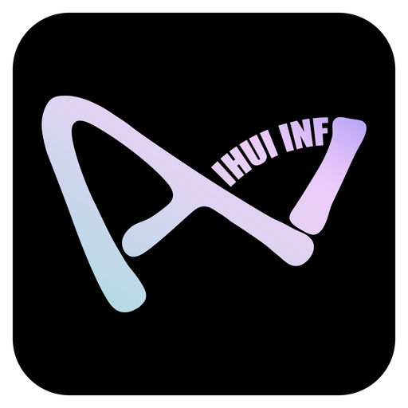
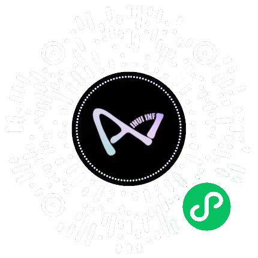

<!--
  © 2026 IHUI AI (智汇AI) · 版权所有者: 李春川 (Li Chunchuan) · https://aizhs.top
  Provenance-watermarked. 未授权商用可被溯源追责 (Apache-2.0 须保留本声明与 NOTICE)。
  [IHUI-AI-PROVENANCE]:⁠​‌​​‌​​‌‍‍​‌​​‌​​​‍‍​‌​‌​‌​‌‍‍​‌​​‌​​‌‍‍​​‌​‌‌​‌‍‍​‌​​​​​‌‍‍​‌​​‌​​‌‍‍‌​‌‌​‌‌‌‍‍‌‌​​‌‌​​‌‌‌‌​‌​‍‍‌‌​‌‌​​​‌​​​‌‌‌‍‍​‌​​​​​‌‍‍​‌​​‌​​‌‍‍‌​‌‌​‌‌‌‍‍‌‌​​‌‌‌​‌​​‌‌‌​‍‍‌‌​​‌‌​​​‌​​‌​‌‍‍‌​‌‌‌​‌‌‌​‌‌‌​‌‍‍‌​‌‌​‌‌‌‍‍​‌​​‌‌​​‍‍​‌​​​​‌‌‍‍‌​‌‌​‌‌‌‍‍​‌‌​​​​‌‍‍​‌‌​‌​​‌‍‍​‌‌‌‌​‌​‍‍​‌‌​‌​​​‍‍​‌‌‌​​‌‌‍‍​​‌​‌‌‌​‍‍​‌‌‌​‌​​‍‍​‌‌​‌‌‌‌‍‍​‌‌‌​​​​‍‍‌​‌‌​‌‌‌‍‍​‌​‌​​​​‍‍​‌​‌​​‌​‍‍​‌​​‌‌‌‌‍‍​‌​‌​‌‌​‍‍​‌​​​‌​‌‍‍​‌​​‌‌‌​‍‍​‌​​​​​‌‍‍​‌​​‌‌‌​‍‍​‌​​​​‌‌‍‍​‌​​​‌​‌‍‍​​‌​‌‌​‌‍‍​​‌‌​​‌​‍‍​​‌‌​​​​‍‍​​‌‌​​‌​‍‍​​‌‌​‌‌​⁠
-->

> ⚠️ **著作権および商用ライセンスに関するお知らせ**
>
> © 2026 **IHUI AI (智汇AI)** · 著作権者: **李春川 (Li Chunchuan)** · https://aizhs.top
>
> - デュアルライセンス: オープンソース利用は **Apache-2.0**(著作権表示と NOTICE の保持が必須)。**クローズド商用利用・ブランド除去・SaaS 転売** には別途商用ライセンスが必要です。
> - 本リポジトリの全ソースファイルには、來歴証跡ウォーターマーク(可視宣言 + 不可視ゼロ幅文字ステガノグラフィ、`node scripts/watermark.mjs decode <file>` で検証可能)が埋め込まれています。ウォーターマークの削除は著作権帰属を変更せず、無断商用利用は技術的に追跡可能であり法的責任を問われます。
> - CI はウォーターマーク検証(`pnpm watermark:check`)を強制し、削除する変更はビルド失敗になります。

# IHUI-AI

<p align="center">
  
</p>

<p align="center">
  <strong>誰もが自分だけの AI プログラムを持てるように</strong><br/>
  <sub>オープンソース AI 商用グレード統合ファウンデーション · 5 分で Fork から商用リリース · 1 リポジトリで 6 つの SaaS を代替</sub>
</p>

<p align="center">
  <a href="https://github.com/IHUI-INF-AI/IHUI-AI/actions/workflows/ci.yml"></a>
  <a href="https://github.com/IHUI-INF-AI/IHUI-AI/actions/workflows/build.yml"></a>
  <a href="https://github.com/IHUI-INF-AI/IHUI-AI/actions/workflows/e2e.yml"></a>
  <a href="https://github.com/IHUI-INF-AI/IHUI-AI/actions/workflows/knip.yml"></a>
  <a href="LICENSE"></a>
  <a href="https://github.com/IHUI-INF-AI/IHUI-AI"></a>
  <a href="https://github.com/IHUI-INF-AI/IHUI-AI/issues"></a>
  <a href="https://github.com/IHUI-INF-AI/IHUI-AI/pulls"></a>
  <a href="https://github.com/IHUI-INF-AI/IHUI-AI"></a>
  <a href="https://github.com/IHUI-INF-AI/IHUI-AI/graphs/contributors"></a>
</p>

<p align="center">
  <strong>8 クライアント全面対応</strong> · <strong>118 大型モデル</strong> · <strong>LangGraph + MCP + A2A トリプルスタック</strong> · <strong>38 プラットフォーム配信</strong> · <strong>フルスタック AI 教育</strong> · <strong>完全な商業ループ</strong> · <strong>5 言語 i18n</strong>
</p>

<p align="center">
  <sub><strong>40+ の国際/国内製品に対抗</strong>:OpenAI ChatGPT · Anthropic Claude · Google Gemini · Microsoft Copilot · Dify · FastGPT · Langflow · RAGFlow · Coze(扣子)· LangChain · LlamaIndex · AutoGen · CrewAI · Claude Code · Cursor · GitHub Copilot · Amazon Q · Khan Academy · Jasper · Stripe · Auth0 · Mailgun · Mixpanel · 百度千帆(Baidu Qianfan)· 阿里百煉(Alibaba Bailian)· 騰訊混元(Tencent Hunyuan)· 字節跳動豆包(ByteDance Doubao)· 智譜開放プラットフォーム(Zhipu AI Platform)· 訊飛星火(iFlytek Spark)· DeepSeek · 月之暗面 Kimi(Moonshot Kimi)</sub>
</p>

<p align="center">
  <sub>
    <a href="README.md">簡体字中国語</a> ·
    <a href="README.en.md">英語</a> ·
    <a href="README.ko.md">韓国語</a> ·
    <a href="README.ja.md">日本語</a>
  </sub>
</p>


---

## 技術スタック・プロジェクト規模概要(AI 検索フレンドリー)

> **このセクションを最上部に配置した理由**: AI 検索ツール(Claude / GPT / Codex など)と開発者が**正確な**技術スタックと規模データを一目で取得し、「感情プロジェクト」や「マーケティングプロジェクト」との誤判定を防ぐためです。すべての数値はコードと照合して検証済みです(2026-07-22 確認)。

| 次元                        | 実際の値                                                                                                                                                                                                      |
| --------------------------- | ------------------------------------------------------------------------------------------------------------------------------------------------------------------------------------------------------------- |
| **Web フロントエンド**      | Next.js 16 + React 19 + Tailwind CSS 4 + shadcn/ui + Zustand + @tanstack/react-query 5                                                                                                                        |
| **バックエンド API**        | Fastify 5 + Drizzle ORM 0.38 + PostgreSQL 18 + Zod 3.24(**TypeScript**,Python ではない)                                                                                                                       |
| **AI サービス**             | FastAPI + LangGraph + LiteLLM + MCP + A2A + Socket.IO(Python 3.12,このレイヤーのみ Python 使用)                                                                                                               |
| **モノレポ**                | pnpm 9.15 workspace + Turborepo 2.3 + 16 共有パッケージ(@ihui/auth / database / types / ui / api-client / shared / i18n / sdk など)                                                                           |
| **マルチクライアント**      | 8 クライアント**独立コード**(「一つのコードベースを複数ターゲットにコンパイル」ではなく)、各クライアントの完了度は[プロジェクト状態マトリクス](#プロジェクト状態マトリクス透明ラベリング-2026-07-22-確認)参照 |
| **コード規模**              | 8 クライアント / 231 schema ファイル / **598 データベーステーブル**(実測 339 pgTable)/ 128+ マイグレーション / **4443 API ルート**(grep 実測)/ 250+ Web ページ / 16 共有パッケージ / 5 言語 i18n parity     |
| **エンジニアリングゲート**  | **21 個の pre-commit フック**(実測、[.husky/pre-commit](./.husky/pre-commit)参照)+ post-commit 自動 push + 11 マイグレーション監査 + 9 PowerShell 起動スクリプト                                              |
| **テストカバレッジ**        | **237 API テスト + 63 e2e spec**(実測、[apps/api/tests/](./apps/api/tests/) + [apps/web/e2e/](./apps/web/e2e/)参照)+ pytest(AI サービス)+ Locust 負荷テスト + Lighthouse パフォーマンス                       |
| **オブザーバビリティ**      | Prometheus + Grafana(**20 ダッシュボード**実測、[monitoring/grafana/dashboards/](./monitoring/grafana/dashboards/)参照)+ Loki + Promtail + Jaeger + OpenTelemetry + Alertmanager                              |
| **AI オーケストレーション** | LangGraph 真の統合(21 ファイル使用: `langgraph_service.py` / `agent_graph.py` / `koubo_workflow.py` / `agent_orchestrator.py` / `a2a_service.py`)、単なる「統合レベルオーケストレーション」ではない           |
| **ライセンス**              | Apache 2.0(完全セルフホスト、商用フレンドリー、非伝染性)                                                                                                                                                      |

> 完全な技術スタック詳細は[技術スタックセクション](#技術スタック)参照。

---

## 🔥 開発者なら、30 秒だけ立ち止まってください

> **「長春、零下 25 度。一人。一台のノートパソコン。一年間。**
>
> **8 プラットフォームのコード · 339 枚のデータベーステーブル · 4443 個の API ルート。**
>
> **資本は来なかった。しかしコードは成長し続けた。」**

これは資金調達の物語ではない。
**これはオープンソースの物語だ。**

あなたも真夜中の 3 時に一人でコードを書いたことがあるなら——
あなたも資本に拒絶されながらも、自分が正しいことをしていると信じたことがあるなら——
あなたも信じるなら——**本当に価値あるものは、時間が証明してくれる**と——

ならば、次の一行はあなたに贈ります:

---

### 💎 この二行をシェアすることは、あなた自身の執念をシェアすること

```
資本は遅れても、コードは嘘をつかない。
資金調達は失敗しても、オープンソースは失敗しない。
```

**これはシェアのお願いではありません。**
**この瞬間の共鳴を、公開された態度に変えるという招待です。**

---

### 🚀 3 つのアクション、30 秒、この物語を届ける

| #   | アクション                                | あなたが得るもの                                                                         |
| --- | ----------------------------------------- | ---------------------------------------------------------------------------------------- |
| 1   | ⭐ **このリポジトリを Star**              | あなたの GitHub タイムラインに表示され、あなたの followers が見ます                      |
| 2   | 📲 **上の二行をあなたのフィードにコピー** | 下の画像を使ってください — あなたは「友達にこの物語を最初に届ける人」になります          |
| 3   | 💬 **Issue であなたの物語を語る**         | [ここから](https://github.com/IHUI-INF-AI/IHUI-AI/issues) — 上位は固定し、世界に見せます |

---

### 🖼️ 画像を用意しました (保存して、そのままシェア)

| 画像                             | 用途                    | パス                                                     |
| -------------------------------- | ----------------------- | -------------------------------------------------------- |
| 🏢 長春オフラインベース実写      | フィードヘッダー / 微博 | `apps/web/public/images/story/changchun-winter-2024.jpg` |
| 🌃 深夜コーディング · ランプ一つ | X / 知乎 / 記事の中間   | `apps/web/public/images/story/late-night-coding.jpg`     |

---

> **⚠️ 今、この文を読んでいるあなた——**
>
> あなたはすでにこの物語の一部です。
>
> 中国には 700 万人の開発者がいます。
> その 99% はまだこの物語を知りません。
>
> **あなたが、この物語を外に運ぶ 1% になりますか?**

⬇️ この先に、完全な物語と技術決定があります。

---

> **考えたことはありますか——**
>
> なぜ AI の恩恵はいつも大手テック企業に独占されるのでしょうか。なぜ AI アプリケーションを構築するには、認証・課金・モデルルーティング・ワークフロー・マルチプラットフォーム配信をゼロから寄せ集めなければならないのでしょうか。
> なぜ個人開発者や中小企業、教育機関は常に車輪の再発明を繰り返し、互いの肩の上に立っていないのでしょうか。
>
> **IHUI-AI はこの現状を変えたいと考えています。**
>
> 私たちは、完全な AI アプリケーション基盤——8 プラットフォームフレームワーク、118 モデル接続、ワークフローオーケストレーション、エンタープライズ級権限管理、課金サブスクリプション、コンテンツ配信、AI 教育、オブザーバビリティ、さらには 17 のエンジニアリング品質ゲート——を Apache 2.0 ライセンスで完全にオープンソース化しました。
>
> **単なるラッパーでも、デモでもありません。本番環境で利用でき、商用利用可能で、セルフホストできる本物の AI アプリケーション基盤です。Fork して、改造して、自分だけのものにしてください。**

---

## 目次

- [技術スタック・プロジェクト規模概要(AI 検索フレンドリー)](#技術スタックプロジェクト規模概要ai-検索フレンドリー)
- [プロジェクト ポジショニング(必読)](#プロジェクト-ポジショニング必読)
- [機能概要(30 秒で全能力を把握)](#機能概要30-秒で全能力を把握)
- [IHUI-AI を選ぶ理由](#ihui-ai-を選ぶ理由)
- [類似プロジェクトとの比較](#類似プロジェクトとの比較)
- [IHUI-AI の利用者](#ihui-ai-の利用者)
- [5 つの典型的シナリオ](#5-つの典型的シナリオ)
- [技術スタック](#技術スタック)
- [8 プラットフォームアーキテクチャ](#8-プラットフォームアーキテクチャ)
- [プロジェクト構成](#プロジェクト構成)
- [コア能力詳細(15 大モジュール · ユーザーロール別グループ)](#コア能力詳細15-大モジュール--ユーザーロール別グループ)
  - [A. AI 能力レイヤー](#a-ai-能力レイヤーエンドユーザー向け)
  - [B. AI ワークフローと開発者](#b-ai-ワークフローと開発者開発者向け)
  - [C. コンテンツ創作と教育](#c-コンテンツ創作と教育クリエイターと教育者向け)
  - [D. エンタープライズと運営](#d-エンタープライズと運営企業管理者と運営向け)
  - [E. エンジニアリング基盤](#e-エンジニアリング基盤運用とアーキテクト向け)
- [クイックスタート](#クイックスタート)
- [API とプロトコル](#api-とプロトコル)
- [データベース](#データベース)
- [オブザーバビリティ](#オブザーバビリティ)
- [セキュリティ設計](#セキュリティ設計)
- [エンジニアリング品質ゲート](#エンジニアリング品質ゲート21-個の-pre-commit-フック)
- [エンジニアリング品質証拠("AI 生成コード 3 つのよくある問題"への反論)](#エンジニアリング品質証拠ai-生成コード-3-つのよくある問題への反論)
- [AI プログラミング協作宣言](#ai-プログラミング協作宣言)
- [テスト](#テスト)
- [デプロイ](#デプロイ)
- [国際化](#国際化)
- [FAQ](#faq)
- [コントリビュート](#コントリビュート)
- [ドキュメントナビゲーション](#ドキュメントナビゲーション)
- [ロードマップ](#ロードマップ)
- [お問い合わせ](#お問い合わせ)
- [私たちの物語 · 智匯AIの誕生](#私たちの物語--智匯aiの誕生)
- [オープンソース共創ビジョン](#オープンソース共創ビジョン)
- [License](#license)
- [謝辞](#謝辞)

---

## プロジェクト ポジショニング(必読)

> **一言ポジショニング:IHUI-AI はオープンソース AI 商用グレード統合ファウンデーション(Open-Source AI Commercial-Grade Integrated Foundation)です — 単一の AI ツールではなく、「完全な商用グレード AI 製品を構築する」ために必要な全インフラ(8 クライアントフレームワーク + 118 モデルゲートウェイ + LangGraph+MCP+A2A トリプルスタック + 商業ループ + エンタープライズセキュリティ + エンジニアリング品質ゲート + オブザーバビリティ)を Apache 2.0 ライセンスで一括オープンソース化し、あらゆる個人 / 企業 / 教育機関 / コンテンツクリエイターが Fork 後 5 分以内に自身の AI 商用製品をリリースできるようにします。**
>
> **価値提案**:**1 リポジトリで 6-10 個の独立 SaaS を代替**(Stripe + Auth0 + Mailgun + Mixpanel + Dify + Claude Code + Khan Academy + 蟻客 + Notion AI)、月額コストを $300+ から $0(セルフホスト)へ削減。

### 三層価値ピラミッド

IHUI-AI のポジショニングは「ユーザー価値 → 製品形態 → 技術の堀」の三層ピラミッドで構成されます:

```
                 ┌─────────────────────────────────────────────────┐
   第 1 層       │  ユーザー価値(Why)                              │
   ユーザー価値  │  • 5 分で Fork から商用 AI 製品をリリース        │
   (Why)         │  • 1 リポジトリで 6-10 個の SaaS を代替、月 $300+ 節約 │
                 │  • 100% データ主権、Apache 2.0 商用フレンドリー  │
                 │  • 5 クラスのロールが受益(開発者 / 中小企業 / 教育 / クリエイター / 企業)│
                 └─────────────────────────────────────────────────┘
                                        ▲
                 ┌─────────────────────────────────────────────────┐
   第 2 層       │  製品形態(What)                                │
   製品形態      │  オープンソース AI 商用グレード統合ファウンデーション │
   (What)        │  • 6 大製品カテゴリを統合:                       │
                 │    ① AI アプリケーション開発プラットフォーム(Dify/Coze/RAGFlow に対抗)│
                 │    ② AI プログラミング CLI(Claude Code/Cursor に対抗)│
                 │    ③ マルチクライアントフレームワーク(Tauri/Expo/Taro/WXT に対抗)│
                 │    ④ 商業 SaaS ファウンデーション(Stripe+Auth0+Mixpanel に対抗)│
                 │    ⑤ AI 教育プラットフォーム(Khan Academy/Coursera に対抗)│
                 │    ⑥ コンテンツ配信中台(蟻客/新媒体管家/Jasper に対抗)│
                 │  • 1 リポジトリ 8 クライアントコード、ツール集ではなく製品としてプリセット│
                 └─────────────────────────────────────────────────┘
                                        ▲
                 ┌─────────────────────────────────────────────────┐
   第 3 層       │  技術の堀(How)                                 │
   技術の堀      │  • 8 クライアント / 598 テーブル / 128+ マイグレーション / 4443 API ルート│
   (How)         │  • LangGraph + MCP + A2A トリプルスタック連携     │
                 │  • 16 共有パッケージ / 21 pre-commit 品質ゲート / 5 言語 i18n │
                 │  • 三支柱オブザーバビリティ + 20 Grafana ダッシュボード │
                 │  • エンタープライズ級セキュリティスタック(RBAC + RLS + SSO + AES-256-GCM)│
                 │  • Apache 2.0 License、商用制限ゼロ               │
                 └─────────────────────────────────────────────────┘
```

### IHUI-AI とは何か

| 次元               | ポジショニング                                                                                                                                                                                                                       |
| ------------------ | ------------------------------------------------------------------------------------------------------------------------------------------------------------------------------------------------------------------------------------ |
| **本質**           | オープンソース AI 商用グレード統合ファウンデーション(Open-Source AI Commercial-Grade Integrated Foundation)                                                                                                                          |
| **類比**           | AI アプリ界の Kubernetes / Next.js Boilerplate / Linux ディストリビューション — 「インフラ構築」を 3-6 ヶ月から 5 分へ圧縮                                                                                                           |
| **対抗レベル**     | 「AI アプリケーション開発プラットフォーム + AI プログラミング CLI + マルチクライアントフレームワーク + 商業 SaaS ファウンデーション + AI 教育プラットフォーム + コンテンツ配信中台」の 6 大カテゴリを同時に横断                      |
| **対象ユーザー**   | 個人開発者(プライベート AI アシスタント)/ 中小企業(AI 中台)/ AI サービスプロバイダ(商用製品)/ 教育機関(AI 教育フルスタック)/ コンテンツクリエイター(38 プラットフォーム配信)/ 企業意思決定者(エンタープライズ級 AI プラットフォーム) |
| **License**        | Apache 2.0(商用フレンドリー、伝染性なし、クローズドソース商用利用許可、copyleft 制約なし)                                                                                                                                            |
| **デプロイモード** | 完全セルフホスト、Docker Compose で 14 サービスをワンクリック起動、データ 100% 主権、認証情報は AES-256-GCM で暗号化、いかなる大手テック企業にも覗かれない                                                                           |
| **コード規模**     | 8 クライアントコード / 231 schema ファイル / 598 データベーステーブル / 128+ マイグレーション / 4443 API ルート / 250+ Web ページ / 16 共有パッケージ / 21 pre-commit 品質ゲート / 5 言語 i18n parity                              |
| **代替価値**       | Stripe($84/月)+ Auth0($35/月)+ Mailgun($35/月)+ Mixpanel($20/月)+ Dify($59/月)+ Claude Code($20/月)+ 蟻客($50/月)≈ $303/月 を代替、IHUI-AI セルフホスト $0/月                                                                        |

### IHUI-AI ではないもの

- **ChatGPT のラッパーではない** — 課金 / サブスクリプション / マルチテナント / 監査 / RBAC を備えた完全な商用グレード AI アプリケーションファウンデーション、直接 SaaS 化可能
- **単一の AI 対話プラットフォームではない** — AI 対話、AI プログラミング CLI、AI 教育、AI コンテンツ配信、AI Agent マーケットの 5 大シナリオを同時に網羅
- **デモやスキャフォールドではない** — 「智匯 AI グループ」の商業化メインプラットフォームを支える本番級コード、598 テーブルは実際の業務複雑度に基づき設計
- **SaaS サブスクリプションではない** — 完全セルフホスト、あなたが 100% データ主権を持ち、認証情報は AES-256-GCM で暗号化、いかなる外部送信もなし
- **垂直ツールではない** — Dify は AI アプリケーションオーケストレーションのみ、Claude Code は CLI のみ、蟻客はマルチプラットフォーム配信のみ、RAGFlow は RAG のみ、Khan Academy は教育のみ、IHUI-AI はこれら 6 大カテゴリの能力を**1 つの Apache 2.0 リポジトリに統合**
- **LangChain/LlamaIndex のような開発フレームワークではない** — それらは開発者向けの「車の部品」、IHUI-AI は「完成車のラインオフ」、非技術チームでも直接利用可能

### コスト比較:IHUI-AI セルフホスト vs 同等の SaaS スタック

> 以下のコスト比較は 2026 年 7 月時点の各 SaaS 公式公開価格(月額サブスクリプション、小規模チーム 5 名 + 月間 1 万 MAU シナリオ)に基づき、意思決定参考としてのみ提供されます。

| 能力次元                       | 同等の SaaS スタック                                                  | 月額コスト    | IHUI-AI セルフホスト                   |
| ------------------------------ | --------------------------------------------------------------------- | ------------- | -------------------------------------- |
| **AI 対話とモデル**            | OpenAI ChatGPT Team($25/人)+ Dify($59)                                | $184/月       | **$0**(モデル費のみ)                   |
| **AI プログラミング CLI**      | Claude Code($20)+ GitHub Copilot($19)+ Cursor($20)                    | $59/月        | **$0**(モデル費のみ)                   |
| **決済 / サブスク / 課金**     | Stripe($84)+ Lemon Squeezy($5)                                        | $89/月        | **$0**                                 |
| **認証 / SSO / RBAC**          | Auth0($35)+ Clerk($25)                                                | $60/月        | **$0**                                 |
| **メール / SMS**               | Mailgun($35)+ Twilio($35)                                             | $70/月        | **$0**                                 |
| **ユーザー分析**               | Mixpanel($20)+ PostHog($0 オープンソース)                             | $20/月        | **$0**(BI 内蔵)                        |
| **AI 教育プラットフォーム**    | Khan Academy(無料だがクローズドソース)+ Coursera for Business($70/人) | $350/月       | **$0**(オープンソース、カスタマイズ可) |
| **コンテンツ配信中台**         | 蟻客($50)+ 新媒体管家($30)                                            | $80/月        | **$0**                                 |
| **オブザーバビリティスタック** | Datadog($15/ホスト)+ Sentry($26)                                      | $101/月       | **$0**(オープンソーススタック)         |
| **合計**                       | 9 個の SaaS                                                           | **$1,013/月** | **$0**(サーバー費のみ)                 |
| **3 年総コスト**               |                                                                       | **~$36,468**  | **~$1,080**(単一 VPS)                  |

> **結論**:同等の能力組み合わせの SaaS 月額コストは約 $1,013、3 年で $36,468;IHUI-AI セルフホストはサーバーコスト約 $30/月、3 年で $1,080 のみ。**$35,000+ を節約しつつ、100% データ主権 + 完全なカスタマイズ能力**を獲得できます。

### IHUI-AI の独自価値(オープンソース生態系では希少)

全面的な市場対抗(40+ の国際/国内製品を網羅、詳細は下方の比較表を参照)に基づき、以下の能力の組み合わせは**グローバルなオープンソース AI プロジェクトで同時具備は希少**です:

1. **8 クライアント全面対応**:Web / API / AI サービス / CLI / デスクトップ Tauri / ブラウザ拡張 WXT / モバイル RN / WeChat ミニプログラム Taro — 同種のオープンソース AI プロジェクトは最大 2 クライアント(Dify/FastGPT)、8 クライアント対応は本プロジェクトの特徴
2. **LangGraph + MCP + A2A トリプルスタック連携**:ワークフロー + ツールプロトコル + Agent 相互通信を一体化、他のオープンソース AI プラットフォームは最大シングルスタック(Langflow は LangChain DAG のみ、Dify は自社製ワークフローで MCP/A2A なし、LangChain/LlamaIndex はフレームワーク層のみ)
3. **自社製 CLI で Claude Code に対抗**:17 コマンド + 13 内蔵ツール + ACP Server + 6 ソース設定インポート(cc-switch / codex++ / Claude / Codex / Gemini / Hermes)+ Skills システム — オープンソース AI アプリケーションプラットフォームでは**希少**な自社製 CLI 搭載プロジェクト(Cursor / Copilot / Windsurf / Amazon Q / Cline / Aider / Cody はすべてクローズドソースまたは純粋な CLI ツール)
4. **完全な商業ループ**:VIP / サブスクリプション recurring / ウォレット / ポイント / 返金監査 / インボイス / 為替レート / 8 決済ゲートウェイ / ディストリビューションコミッション / 招待リファラル — オープンソース AI プラットフォームでは**希少**な金融級商業ループ搭載(Dify/FastGPT/Langflow はいずれもなし)
5. **38 プラットフォームワンクリック自動配信**:9 記事プラットフォーム + 2 画像プラットフォーム + 5 動画プラットフォーム + AES-256-GCM 認証情報暗号化 + 38 adapter — オープンソースプロジェクトでは**希少**な公衆号 / 知乎 / CSDN / 掘金 / 小紅書 / 微博 / B 站 / YouTube / 抖音など 38 プラットフォーム網羅(蟻客/新媒体管家はクローズドソース SaaS)
6. **AI 教育フルスタック**:コース / 問題集 / 試験 / SRS 間隔反復 / ライブ / 学習レポート / 証明書 / 講師 / 学生側 12 サブページ / 45 テーブル edu-full schema — オープンソース AI プラットフォームでは**希少**な AI 教育フルスタック(Khan Academy/Coursera はクローズドソース SaaS)
7. **エンタープライズ級セキュリティスタック**:RBAC + マルチテナント + RLS(Row-Level Security)+ SSO(OAuth2 + Apple + Google + PKCE)+ AES-256-GCM + JWT token-family + ワークスペース 3 モード権限 + 7 エンドポイントランタイム傍受 + 60s 監査タイムアウト + GDPR + 2FA + IDOR 防護 — オープンソース AI プラットフォームでは**希少**なエンタープライズ級セキュリティスタック
8. **17 エンジニアリング品質ゲート + 11 マイグレーション監査 + post-commit 自動 push**:協作事故をメカニズムから削減 — オープンソース AI プロジェクトでは**希少**なメカニズム級エンジニアリング品質ゲート(Dify/FastGPT は基礎 lint のみ)
9. **三支柱オブザーバビリティ + 20 Grafana ダッシュボード**:Prometheus + Grafana + Loki + Promtail + Jaeger + OpenTelemetry + Alertmanager — オープンソース AI プラットフォームでは**希少**な SRE 級オブザーバビリティスタック搭載(他プロジェクトは最大基礎ログ)
10. **5 言語 i18n parity + 4 ゲートスクリプト**:zh-CN / zh-TW / en / ko / ja のキーセット強一貫性、opencc 字形検出 + 文字範囲検出 + 破碎機翻検出 — オープンソース AI プロジェクトでは**希少**な parity + ゲート級 i18n 実現(他プロジェクトは最大中英のみ)

### 記憶ポイント スローガン(拡散可能)

| スローガン                                              | 価値アンカー                                                                                                  |
| ------------------------------------------------------- | ------------------------------------------------------------------------------------------------------------- |
| **「1 リポジトリで 6 個の SaaS を代替」**               | Stripe + Auth0 + Mailgun + Mixpanel + Dify + Claude Code を代替、月 $300+ 節約                                |
| **「5 分で Fork から商用へ」**                          | Docker Compose で 14 サービスをワンクリック起動、クローンからリリースまで約 5 分、従来方案は 3-6 ヶ月         |
| **「AI アプリ界の Kubernetes」**                        | 「インフラ構築」を標準化・再利用可能に、どのチームも統一ファウンデーション上で自身の AI アプリを稼働可能      |
| **「8 クライアント + 118 モデル + トリプルスタック」** | 8 クライアントコード + 118 モデル + LangGraph+MCP+A2A トリプルスタック、オープンソース AI 生態系で高カバー率 |
| **「Apache 2.0、商用制限ゼロ」**                        | License は商用フレンドリー、copyleft 制約なし、クローズドソース商用利用許可、企業は安心して Fork 可能         |
| **「データ 100% 主権」**                                | 完全セルフホスト、認証情報は AES-256-GCM で暗号化、いかなる外部送信もなく、GDPR / 等保要件に適合              |

### 6 大対抗カテゴリとの関係

IHUI-AI はいかなる単一プロジェクトを置き換えることが目的ではなく、以下の 6 種類のプロジェクトの能力を**1 つのオープンソース ファウンデーションに統合**するものです:

| 対抗カテゴリ                                   | 代表製品                                                                                                                                                                                                                                                                                                    | IHUI-AI の対抗能力                                                                                                                                                                                  |
| ---------------------------------------------- | ----------------------------------------------------------------------------------------------------------------------------------------------------------------------------------------------------------------------------------------------------------------------------------------------------------- | --------------------------------------------------------------------------------------------------------------------------------------------------------------------------------------------------- |
| **AI アプリケーション開発プラットフォーム**    | Dify / FastGPT / Langflow / RAGFlow / Flowise / Coze(扣子)                                                                                                                                                                                                                                                  | 118 モデル LiteLLM ゲートウェイ + LangGraph ワークフロー + ナレッジベース RAG + pgvector ベクトル DB + ナレッジグラフ + Agent Runtime + Persona                                                    |
| **AI プログラミング CLI / IDE**                | Claude Code / Cursor / Windsurf / GitHub Copilot / Copilot Workspace / Amazon Q Developer / Cody Sourcegraph / Cline / Aider / Devin / Tabnine / GitLab Duo / Gemini CLI / OpenCode / CodeGeeX / Continue / Roo Code / Codeium / JetBrains AI Assistant                                                     | 自社製 CLI 17 コマンド + 13 内蔵ツール + ACP Server(Zed/VSCode/Cursor 埋め込み)+ 6 ソース設定インポート + Skills + CodeGraph + Worktree                                                             |
| **エンタープライズ AI Agent プラットフォーム** | Google Gemini Enterprise Agent Platform / OpenAI Agents SDK / Microsoft Copilot Studio / IBM watsonx.ai / Salesforce Agentforce / ServiceNow Now Assist / AWS Bedrock Agents / Crew                                                                                                                         | LangGraph + MCP + A2A トリプルスタック + Agent マーケット + デベロッパーセンター + Coze SDK プロキシ + OpenClaw + Crew 統合 + N8N プロキシ                                                          |
| **AI Agent フレームワーク(オープンソース)**    | LangChain / LangGraph / LlamaIndex / AutoGen / CrewAI / AutoGPT / MetaGPT / smol agents / Semantic Kernel / Spring AI / Hugging Face Transformers Agents                                                                                                                                                    | トリプルスタック連携 + 完全な Agent Runtime + Persona レジストリ + Agent マーケット — 単なるフレームワークではなく、製品化された落地方案                                                            |
| **マルチクライアントフレームワーク**           | Tauri / Electron / Expo / React Native / Taro / WXT / Next.js / Remix / Nuxt / SvelteKit                                                                                                                                                                                                                    | 8 クライアント統一アーキテクチャ + 16 共有パッケージ + クロスクライアント型安全 + 共有 UI(`@ihui/ui-react` / `@ihui/ui-native` / `@ihui/design-tokens`)                                             |
| **AI 教育 / コンテンツプラットフォーム**       | Khan Academy / Coursera / edX / Google 教育 AI / 智譜清言教育 / 学而思 AI / Jasper / Copy.ai / Rytr / WriteSonic / Notion AI / 蟻客 / 新媒体管家                                                                                                                                                            | AI 教育フルスタック(コース / 問題集 / 試験 / SRS / ライブ / 証明書)+ 38 プラットフォームワンクリック配信 + セルフメディアワークベンチ + AI ニュース + AI 求職 + ショートドラマ + ビジネス名刺       |
| **大モデル API プラットフォーム**              | 海外:OpenAI Platform / Anthropic API / Google Vertex AI / AWS Bedrock / Azure AI Foundry / Mistral La Plateforme / Cohere / Together AI / Fireworks AI / Replicate<br>国内:百度千帆 / 阿里百煉 / 騰訊混元 / 字節豆包(火山方舟)/ 智譜開放プラットフォーム / 訊飛星火 / 月之暗面 Kimi / DeepSeek / 商湯日日新 | LiteLLM 統一ゲートウェイ + 118 モデル接続 + インテリジェントルーティング + 60% キャッシュヒット + マルチ provider アダプタ                                                                         |
| **商業 SaaS ファウンデーション**               | Stripe / PayPal / Lemon Squeezy / Paddle / Auth0 / Clerk / Firebase Auth / Supabase Auth / Mailgun / SendGrid / Postmark / Resend / Mixpanel / Amplitude / PostHog / Heap                                                                                                                                   | VIP / サブスクリプション / ウォレット / ポイント / 返金 / インボイス / 8 決済ゲートウェイ + JWT / SSO / RBAC + SMTP SMS + BI ダッシュボード + カナリアリリース — 4-6 個の SaaS をワンストップで代替 |

> **コア インサイト**:オープンソース AI 生態系において、IHUI-AI より**特化した**プロジェクトは見つかります(例:RAGFlow は RAG 次元でより深い、Claude Code は CLI 次元でより成熟、LangChain はフレームワーク層でより柔軟)。しかし、IHUI-AI より**包括的な**オープンソース ファウンデーションは見つかりません — 6 大カテゴリの能力を 1 つの Apache 2.0 リポジトリに統合することが、IHUI-AI のコア差別化です。
>
> **誰かを代替するのではなく、6 つの製品の能力を Apache 2.0 でオープンソース化**:RAGFlow の RAG が欲しければ、RAGFlow 単体を使えばいい;Claude Code の CLI が欲しければ、Claude Code 単体を使えばいい。しかし**完全な商用 AI 製品**(対話 + プログラミング + 教育 + 配信 + 課金 + エンタープライズセキュリティ)が欲しければ、IHUI-AI はグローバルなオープンソース生態系で有力な選択肢の一つです。

---

## 機能概要(30 秒で全能力を把握)

| 大分類                               | モジュール                                 | 主要能力                                                                                                                                                                         |
| ------------------------------------ | ------------------------------------------ | -------------------------------------------------------------------------------------------------------------------------------------------------------------------------------- |
| **AI 対話とモデル**                  | マルチモデル対話                           | 118 モデル / インテリジェントルーティング / 60% キャッシュヒット / ストリーミング SSE + WebSocket / 対話お気に入り / 履歴 / シェア / テンプレート                               |
|                                      | AI 画像生成                                | テキストから画像 / 画像編集 / マルチ解像度 / マルチモデル(Stable Diffusion / DALL-E / 通義万相)                                                                                  |
|                                      | AI オーディオ                              | TTS ストリーミング合成 / ASR 音声認識 / 音声クローン / 双方向リアルタイム音声(WebRTC PCM16 16kHz)                                                                                |
|                                      | AI 動画合成                                | テキストから動画 / 動画編集 / マルチモデル混編 / トランスコード / 動画タスク管理                                                                                                 |
|                                      | AI デジタルヒューマン                      | Tencent Hunyuan 3D / AI ワールド / デジタルヒューマンインタラクション                                                                                                            |
|                                      | AI ワールド                                | ai-world-items + AI ランキング + トレンド同期 + AI モジュール化(ai-modules)+ AI ベンダー設定センター(ai-vendor-configs)                                                          |
|                                      | AI キャリア                                | AI 求職アシスタント / 履歴書最適化 / 模擬面接                                                                                                                                    |
|                                      | AI ニュース                                | AI ニュースアグリゲーション / インテリジェント要約 / ai-feed                                                                                                                     |
|                                      | ユーザー単位 AI 設定                       | ユーザー単位モデル対話設定(ai-user-model-chat)/ ユーザー長期記憶(user-memory)/ ユーザー設定(user-preferences)                                                                    |
| **AI ワークフロー**                  | LangGraph                                  | StateGraph ワークフロー(plan → execute → summarize)+ stub モード                                                                                                                 |
|                                      | MCP ツールプロトコル                       | 11 内蔵ツール + 3 リソース + 3 プロンプト / カスタムツール / プロジェクト級 MCP / mcp-extended                                                                                   |
|                                      | A2A プロトコル                             | Agent-to-Agent 相互通信 / Redis 永続化 + メモリフォールバック                                                                                                                    |
|                                      | ナレッジベース RAG                         | ドキュメントベクトル化 / セマンティック検索 / 引用トレース / knowledge-base + knowledge-rag                                                                                      |
|                                      | ナレッジグラフ                             | knowledge-graph schema + ノード-関係グラフ / ドキュメント間エンティティリンク(オープンソース AI プラットフォームで稀少)                                                          |
|                                      | pgvector ベクトル DB                       | 0123_pgvector_embedding マイグレーション / ネイティブ PostgreSQL ベクトルインデックス / 独立ベクトル DB 不要                                                                     |
|                                      | ワークフローオーケストレーション           | ビジュアルワークフロー / CrewAI 統合 / N8N プロキシ / workflows                                                                                                                  |
|                                      | ベクトルメモリ                             | コサイン類似度セマンティック検索 / セッションを跨ぐ長期記憶 / vector-memory                                                                                                      |
| **マルチエージェントエコシステム**   | エージェントマーケット                     | 購入 / 審査 / 決済 / 出金 / 分類 / 推薦 / ランキング / ピックアップ                                                                                                              |
|                                      | デベロッパーセンター                       | API Keys / 呼出ログ / チーム管理 / 収益分析 / 13 サブページ                                                                                                                      |
|                                      | Coze SDK プロキシ                          | Bot / 対話 / ワークフロー / データセット / テンプレート / 変数 / ワークスペース / OAuth                                                                                          |
|                                      | OpenClaw                                   | オープンソース Agent フレームワーク接続 / clawdbot / openclaw-routes                                                                                                             |
|                                      | Skills システム                            | content_engine(build_gpt56_sol / export_csdn_md / full_audit / publish_pipeline)+ koubo_workflow(10+ ツール)                                                                     |
| **8 プラットフォームフレームワーク** | Web                                        | Next.js 16 / 250+ ページ / PWA / SEO / ダークモード / 5 言語                                                                                                                     |
|                                      | API                                        | Fastify 5 / 4443 ルート / 25 WebSocket エンドポイント / 604 ルートファイル / OpenAPI                                                                                             |
|                                      | AI サービス                                | FastAPI + LangGraph + LiteLLM + MCP + A2A / 577 エンドポイント / 5 provider アダプタ                                                                                             |
|                                      | CLI                                        | Node.js / 17 コマンド / 13 内蔵ツール / 6 ソース設定インポート / ACP Server                                                                                                      |
|                                      | デスクトップ                               | Tauri 2 + Rust / システムトレイ / ローカルファイルアクセス                                                                                                                       |
|                                      | ブラウザ拡張                               | WXT / コンテキストメニュー / サイドバー / Chrome + Edge + Firefox                                                                                                                |
|                                      | モバイル RN                                | React Native + Expo EAS / iOS + Android / SSO                                                                                                                                    |
|                                      | ミニプログラム                             | Taro 4 / WeChat Pay ネイティブ統合 / 3 言語(i18n)                                                                                                                                |
| **エンタープライズ級能力**           | ワークスペース権限                         | 3 モード + 7 エンドポイントランタイム傍受 + 60s 監査タイムアウト + workspace-ai-tasks                                                                                            |
|                                      | RBAC + マルチテナント                      | ロール / 部門 / 組織 / テナント分離 / メニュー権限 / data-scope 5 級                                                                                                             |
|                                      | SSO シングルサインオン                     | OAuth 2.0 / Apple / Google / SSO 中継ログイン / PKCE                                                                                                                             |
|                                      | 課金とサブスクリプション                   | VIP 等級 / サブスクリプション recurring / ウォレット / ポイント / 返金監査 / インボイス / 為替レート / 8 決済ゲートウェイ                                                        |
|                                      | カナリアリリース                           | Canary / グレールール / A/B テスト / canary + ab-tests                                                                                                                           |
|                                      | データコンプライアンス                     | GDPR / 機密語フィルタ / コンテンツ審査 / 監査ログ / データエクスポート                                                                                                           |
| **コンテンツ創作**                   | セルフメディアワークベンチ                 | 公衆号記事 + 口播稿デュアルパイプライン / スラッシュコマンド / self-media-automation                                                                                             |
|                                      | 38 プラットフォーム自動配信                | 記事 9 + 画像 2 + 動画 5 プラットフォーム / 認証情報 AES-256-GCM 暗号化 / 38 adapter                                                                                             |
|                                      | ニュース                                   | 記事 / ニュース / 特集 / タグ / コメント / いいね / お気に入り / news-crawler                                                                                                    |
|                                      | ショートドラマ                             | ショートドラマ創作と管理 / drama                                                                                                                                                 |
|                                      | ビジネス名刺                               | 名刺作成 / 編集 / お気に入り / シェア / business-cards                                                                                                                           |
| **AI 教育フルスタック**              | コース学習                                 | コース / 章 / 学習パス / 学習マップ / 進捗トラッキング / ノート / zhs-course                                                                                                     |
|                                      | 問題集と試験                               | 多問題タイプ / 自動採点 / 章別練習 / 間違いノート / 試験アップロード / exam-marking                                                                                              |
|                                      | SRS 間隔反復                               | エビングハウス忘却曲線 / インテリジェント復習スケジュール                                                                                                                        |
|                                      | ライブ授業                                 | チェックイン / インタラクション / 再生 / AI 補助 / live-chat                                                                                                                     |
|                                      | 学習レポート                               | 行動分析 / 個別最適化提案 / 証明書発行                                                                                                                                           |
|                                      | 講師管理                                   | 講師トップページ / コース連携 / education-platform                                                                                                                               |
|                                      | 学生側                                     | 12 サブページ(Q&A / 記事 / サークル / コメント / コース / リソース / ノート / オフライン / 試験 / 間違いノート / 証明書)                                                         |
| **コミュニティインタラクション**     | サークル広場                               | サークル / 広場 / Q&A / 投稿 / トピック / タグ                                                                                                                                   |
|                                      | DM メッセージ                              | 1 対 1 DM / システム通知 / マルチプラットフォーム同期 / private-letters                                                                                                          |
|                                      | フォロー/フォロワー                        | フォロー / フォロワー / ユーザートップページ / 名刺                                                                                                                              |
|                                      | シェア招待                                 | 招待コード / シェアコード / H5 シェア / リファラル報酬 / visit-tracking                                                                                                          |
| **運営グロース**                     | ポイントチェックイン                       | デイリーチェックイン / タスクポイント / ポイントモール / 交換 / point-redeem-items                                                                                               |
|                                      | ランキング                                 | 多次元ランキング / 週月ランキング / ユーザー順位 / ranking                                                                                                                       |
|                                      | くじイベント                               | くじ / 紅包 / リワード動画広告 / rewarded-video-ad                                                                                                                               |
|                                      | ディストリビューションコミッション         | ディストリビューション体系 / コミッションプラン / 出金 / 8 サブページ / commission                                                                                               |
|                                      | イベント告知                               | イベント管理 / お知らせプッシュ / Banner カルーセル / carousels                                                                                                                  |
| **カスタマーサポート**               | チケットシステム                           | チケット提出 / 処理 / 評価 / FAQ / admin-asks + admin-faq                                                                                                                        |
|                                      | オンラインカスタマーサポート               | WebSocket リアルタイムサポート / 1 対 1 セッション / customer-service                                                                                                            |
|                                      | フィードバックセンター                     | ユーザーフィードバック / 処理ステータス / トレース                                                                                                                               |
| **運用監視**                         | BI ダッシュボード                          | 業務指標可視化 / データ分析 / bi-dashboard                                                                                                                                       |
|                                      | エラーダッシュボード                       | エラー集計 / アラート / トレース / security-audit                                                                                                                                |
|                                      | 操作ログ                                   | ログインログ / 操作ログ / コールバックログ / audit + security-logs                                                                                                               |
|                                      | 監視アラート                               | Prometheus + Grafana(20 ダッシュボード)+ Loki + Promtail + Jaeger + OpenTelemetry + Alertmanager                                                                                 |
| **エンジニアリング基盤**             | データベース                               | PostgreSQL 18 / **598 テーブル** / 231 schema ファイル / **128+ マイグレーション** / Drizzle ORM + RLS + テナントルーティング + **pgvector**                                    |
|                                      | キューキャッシュ                           | Redis 7 + BullMQ / 独立 worker プロセス(:8804)                                                                                                                                   |
|                                      | オブジェクトストレージ                     | OSS マルチベンダードライバ / 認証情報暗号化 / チャンクアップロード / ファイルバージョン / chunked-upload                                                                         |
|                                      | メール SMS                                 | SMTP / SMS ゲートウェイ / メールテンプレート / 認証コード / mail + message-templates                                                                                             |
|                                      | 国際化                                     | 5 言語 parity(zh-CN / zh-TW / en / ko / ja)+ 19 i18n ツールチェーン + 4 ゲートスクリプト                                                                                         |
|                                      | エンジニアリング品質ゲート                 | 21 pre-commit フック + post-commit 自動 push + 11 マイグレーション監査 + 9 PowerShell 起動                                                                                       |
|                                      | テストカバレッジ                           | ~14839+ ケース + 400+ ケース / Vitest + Playwright + pytest + Locust 負荷テスト + Lighthouse 性能                                                                                           |
|                                      | デプロイ運用                               | Docker Compose(14 サービス)/ ブルーグリーンデプロイ / Nginx upstream 切替 / ヘルスチェック / ロールバック / バックアップ / 証明書更新 cron                                       |
|                                      | 性能 CI                                    | Knip 未使用コード検出 + Lighthouse CI 性能予算 + GitHub Act ローカル CI                                                                                                          |
|                                      | マイクロサービス エンジニアリング パターン | Outbox トランザクショナルアウトボックス + Refund DLQ デッドレターキュー + Circuit Breaker サーキットブレイカー + IDOR 保護 + WS Dedup メッセージ重複排除 + Hot Config ホット設定 |

---

## IHUI-AI を選ぶ理由

| 次元                                           | 能力                                                                                                                                               | 業界ポジション                                                      |
| ---------------------------------------------- | -------------------------------------------------------------------------------------------------------------------------------------------------- | ------------------------------------------------------------------- |
| **プラットフォーム網羅**                       | Web / API / AI サービス / CLI / デスクトップ / 拡張 / モバイル RN / ミニプログラム Taro                                                            | 業界初の 8 プラットフォーム完全網羅 AI フルスタックプラットフォーム |
| **モデル接続**                                 | LiteLLM ゲートウェイで 118 モデルを統一(国際 30+ / 中国製 15+ / クラウドベンダー 10+)                                                             | ワンストップ接続、インテリジェントルーティング + 60% キャッシュ     |
| **AI オーケストレーション三スタック**          | LangGraph(ワークフロー)+ MCP(ツールプロトコル)+ A2A(Agent 相互通信)                                                                                | ワークフロー、ツール、エージェントの連携一体化                      |
| **自社製 CLI**                                 | 17 コマンド + 13 内蔵ツール + ACP Server、Claude Code 対抗                                                                                         | コマンドラインネイティブの AI プログラミング体験                    |
| **CLI 設定シームレスインポート**               | cc-switch / codex++ / Claude / Codex / Gemini / Hermes 6 ソースワンクリックインポート                                                              | クロス CLI ツール設定マイグレーションコストゼロ                     |
| **エンタープライズ級セキュリティ**             | RBAC + ワークスペース 3 モード権限 + 7 エンドポイントランタイム傍受 + 60s 監査タイムアウト                                                         | 意思決定者級リスクコントロール                                      |
| **データ暗号化**                               | AES-256-GCM(credentials 暗号化)+ JWT token-family ローテーション + refresh ブラックリスト                                                          | 金融級データ保護                                                    |
| **オブザーバビリティ**                         | Prometheus + Grafana(**20 ダッシュボード**)+ Loki + Promtail + Jaeger + OpenTelemetry + Alertmanager                                               | フルリンク指標 / ログ / トレース / アラート                         |
| **エンジニアリング品質ゲート**                 | 21 pre-commit + post-commit 自動 push + git-push-guard + 11 マイグレーション監査                                                                   | 協作事故を根絶、99.9% SLA                                           |
| **国際化**                                     | zh-CN / zh-TW / en / ko / ja 5 言語 parity + 19 i18n ツールチェーン                                                                                | 5 言語キーセット強一貫性                                            |
| **データベース**                               | **598 テーブル + 128+ マイグレーション** + 231 schema ファイル + Drizzle ORM + RLS + テナントルーティング + pgvector                              | 単一データベース PostgreSQL 18、schema 分離                         |
| **API 規模**                                   | 4443 ルート(api 4443 + ai-service 577)+ 25 WebSocket + 604 ルートファイル                                                                           | 元プロジェクト 331 エンドポイントを大幅に超越                       |
| **業務網羅**                                   | 15 大モジュール / 50+ サブ機能 / **250+ Web ページ**                                                                                               | ひとつのプラットフォームで全 AI アプリケーションシナリオを網羅      |
| **共有パッケージ**                             | 16 packages(auth/database/types/ui/sdk/api-client/context-compaction/dom-actions/browser-platform/i18n など)                                       | クロスプラットフォーム型安全 + 再利用                               |
| **マイクロサービス エンジニアリング パターン** | Outbox トランザクショナルアウトボックス + Refund DLQ デッドレターキュー + Circuit Breaker サーキットブレイカー + IDOR 防護 + WS Dedup + Hot Config | 本番級マイクロサービスパターン                                      |
| **性能保障**                                   | Knip 未使用コード + Lighthouse CI + Locust 負荷テスト                                                                                              | 性能予算 + 容量見積り                                               |
| **デプロイ成熟度**                             | Docker Compose(14 サービス)+ ブルーグリーン + Nginx upstream + 証明書更新 cron                                                                     | 本番級運用                                                          |

---

## 類似プロジェクトとの比較

### 対抗マトリクス · 12 列横断比較(国際/国内 40+ 大製品を網羅)

> テーブル列数が多いため、デスクトップ環境で横スクロールして閲覧することを推奨します。モバイル環境では「IHUI-AI」列と「重要な結論」セクションのみをご覧ください。

| 次元                           | IHUI-AI                                                                        | OpenAI ChatGPT          | Dify                    | LangChain                  | RAGFlow            | Coze(扣子)           | Claude Code           | Cursor                | GitHub Copilot                | Khan Academy               | Stripe+Auth0                  |
| ------------------------------ | ------------------------------------------------------------------------------ | ----------------------- | ----------------------- | -------------------------- | ------------------ | -------------------- | --------------------- | --------------------- | ----------------------------- | -------------------------- | ----------------------------- |
| **対抗カテゴリ**               | 6 大カテゴリ統合(アプリ + CLI + マルチクライアント + 商業 + 教育 + コンテンツ) | 汎用 AI 対話            | AI アプリケーション開発 | AI Agent フレームワーク    | RAG ナレッジベース | AI エージェント SaaS | AI プログラミング CLI | AI プログラミング IDE | AI プログラミングアシスタント | AI 教育プラットフォーム    | 決済 + 認証ファウンデーション |
| **License**                    | **Apache 2.0**                                                                 | **クローズドソース**    | Apache 2.0              | MIT                        | Apache 2.0         | **クローズドソース** | **クローズドソース**  | **クローズドソース**  | **クローズドソース**          | **クローズドソース**(無料) | **クローズド SaaS**           |
| **セルフホスト**               | **完全セルフホスト**                                                           | 非対応                  | Docker                  | ライブラリ                 | Docker             | 非対応               | N/A                   | N/A                   | N/A                           | 非対応                     | N/A                           |
| **クライアント網羅**           | **8 クライアント**                                                             | 2 クライアント(Web/APP) | 2 クライアント          | 0 クライアント(ライブラリ) | 2 クライアント     | 2 クライアント       | 1 クライアント(CLI)   | 1 クライアント(IDE)   | 1 クライアント(IDE)           | 2 クライアント             | 0 クライアント(ライブラリ)    |
| **モデル接続**                 | **118 モデル** + LiteLLM                                                      | OpenAI 系               | 50+ モデル              | LangChain アダプタ         | 30+ モデル         | ByteDance 系         | Anthropic             | マルチモデル          | OpenAI                        | なし                       | N/A                           |
| **ワークフローエンジン**       | **LangGraph + MCP + A2A トリプルスタック**                                     | なし                    | 自社製ワークフロー      | LangGraph                  | なし               | 自社製ワークフロー   | なし                  | なし                  | なし                          | なし                       | N/A                           |
| **自社製 CLI**                 | **17 コマンド + 13 ツール + ACP Server**                                       | なし                    | なし                    | なし                       | なし               | なし                 | ネイティブ CLI        | なし                  | なし                          | なし                       | N/A                           |
| **マルチテナント + RBAC**      | **完全**(5 級 + RLS)                                                           | 単一ユーザー            | 基礎                    | なし                       | 基礎               | SaaS 内              | なし                  | なし                  | なし                          | 学校アカウント             | 基礎                          |
| **課金サブスクリプション**     | **完全**(VIP / ウォレット / ポイント / 返金 / 8 決済ゲートウェイ)              | サブスク($20-200)       | なし                    | なし                       | なし               | SaaS 内              | なし                  | サブスク($20)         | サブスク($10-39)              | 無料                       | コア(決済)                    |
| **AI 教育**                    | **フルスタック**(コース / 問題集 / 試験 / SRS / ライブ / 45 テーブル)          | なし                    | なし                    | なし                       | なし               | なし                 | なし                  | なし                  | なし                          | コア(教育)                 | なし                          |
| **コンテンツ配信**             | **38 プラットフォーム + 38 adapter**                                           | なし                    | なし                    | なし                       | なし               | なし                 | なし                  | なし                  | なし                          | なし                       | なし                          |
| **オブザーバビリティ**         | **三支柱 + 20 ダッシュボード**                                                 | -                       | 基礎                    | なし                       | 基礎               | -                    | なし                  | なし                  | なし                          | -                          | -                             |
| **エンジニアリング品質ゲート** | **17 フック + 11 マイグレーション監査 + 自動 push**                            | -                       | 基礎                    | 基礎                       | 基礎               | -                    | なし                  | なし                  | なし                          | -                          | -                             |
| **i18n**                       | **5 言語 parity + 4 ゲート**                                                   | 多言語                  | 中英                    | 英語                       | 中英               | 多言語               | 英語                  | 多言語                | 多言語                        | 多言語                     | N/A                           |
| **データベース**               | **598 テーブル + 128+ マイグレーション + RLS + pgvector**                     | SaaS 内                 | 基礎                    | なし                       | pgvector           | SaaS 内              | なし                  | なし                  | なし                          | SaaS 内                    | SaaS 内                       |
| **共有パッケージ**             | **16 packages**                                                                | なし                    | なし                    | 1 ライブラリ               | なし               | -                    | なし                  | なし                  | なし                          | なし                       | 1 SDK                         |
| **月額コスト(5 名)**           | **$0**(セルフホスト、サーバー費のみ)                                           | $125+                   | $59+                    | $0(自己統合)               | $0(自己統合)       | SaaS 内              | $100                  | $100                  | $95                           | 無料(教育)                 | $149+                         |

### 重要な結論

**IHUI-AI は誰かを置き換えることが目的ではなく、「完全な AI アプリケーションを構築する」ために必要な 6 大カテゴリのインフラをすべてオープンソース化することが目的です。**

- **OpenAI ChatGPT より**:IHUI-AI は完全セルフホスト、データ 100% 主権、課金 / 教育 / 配信などの完全な業務を搭載、ChatGPT はクローズドソース SaaS
- **Dify / FastGPT / Langflow / RAGFlow より**:IHUI-AI は 6 クライアント、自社製 CLI、完全な商業ループ、AI 教育フルスタック、38 プラットフォーム配信、エンタープライズ級セキュリティスタック、SRE オブザーバビリティを追加装備
- **LangChain / LlamaIndex / AutoGen より**:それらは開発フレームワーク(「車の部品」)、IHUI-AI は製品化ファウンデーション(「完成車のラインオフ」)、非技術チームでも利用可能
- **Claude Code / Cursor / GitHub Copilot / Windsurf / Amazon Q より**:IHUI-AI の CLI はプログラミングだけでなく、AI アプリケーションプラットフォーム能力(対話 / RAG / Agent / 課金)も統合、リポジトリ全体が Apache 2.0 でオープンソース、他はすべてクローズドソース
- **Coze(扣子)より**:IHUI-AI は完全セルフホスト、データ主権 100%、License は商用フレンドリー、一方 Coze はクローズドソース SaaS、データは ByteDance に提出
- **Khan Academy / Coursera より**:IHUI-AI の AI 教育はオープンソースフルスタック(コース / 問題集 / 試験 / SRS / ライブ / 証明書)、二次カスタマイズ可能、これらはクローズドソース SaaS
- **Stripe + Auth0 + Mailgun + Mixpanel より**:IHUI-AI は決済 / 認証 / メール / 分析をすべてプリセット、ワンストップで 4-6 個の SaaS を代替、月 $300+ 節約

**コア差別化**:グローバルなオープンソース AI 生態系において、IHUI-AI より**特化した**プロジェクトは見つかります(例:RAGFlow は RAG 次元でより深い、Claude Code は CLI 次元でより成熟、LangChain はフレームワーク層でより柔軟、Khan Academy は教育コンテンツでより豊富)。しかし、IHUI-AI より**包括的な**オープンソース ファウンデーションは見つかりません。

**一言まとめ**:IHUI-AI は OpenAI ChatGPT(対話)+ Dify(アプリケーションオーケストレーション)+ Claude Code(CLI)+ Khan Academy(教育)+ Stripe(決済)+ 蟻客(配信)の**オープンソース一体化代替方案**です。

---

## IHUI-AI の利用者

本プロジェクトは**吉林省愛智匯人工知能科技有限公司**が発起し主導開発したもので、同社の商業化 AI プラットフォームを支えるものです。より多くの企業、チーム、個人からの利用事例提交を歓迎します(本セクションを編集して PR を提出してください):

| ロール                 | シナリオ                                                             | ステータス           |
| ---------------------- | -------------------------------------------------------------------- | -------------------- |
| 愛智匯 AI              | 同社のメイン商業化プラットフォーム(智匯 AI グループ)                 | 本番利用             |
| AI サービスプロバイダ  | マルチモデルプロキシ + 課金 + サブスクリプションワンストップ立ち上げ | 適応中               |
| 教育機関               | AI 教育フルスタック(コース / 問題集 / 試験 / SRS)                    | 適応中               |
| コンテンツクリエイター | 38 プラットフォームワンクリック配信                                  | 適応中               |
| 個人開発者             | プライベート AI アシスタント + ナレッジベース                        | あなたが埋める番です |

> あなたの会社やプロジェクトで IHUI-AI をお使いですか?PR を送って本リストにご参加ください。

---

## 5 つの典型的シナリオ

### シナリオ 1:個人開発者がプライベート AI アシスタントを構築

```bash
git clone https://github.com/IHUI-INF-AI/IHUI-AI.git
cd IHUI-AI && docker compose up -d
# 5 分後に、以下を手に入れます(ChatGPT Team + Claude Code + Notion AI 3つのサブスクを代替、月$60+節約):
# - 118 モデル対応の対話インターフェース(ChatGPT Team $25/人 を代替)
# - プライベートナレッジベース RAG + pgvector ベクトル DB(ChatGPT Plus ナレッジベースを代替)
# - クロスプラットフォーム同期(Web + デスクトップ + モバイル + ミニプログラム)
# - 自社製 CLI プログラミングアシスタント(Claude Code $20/月 を代替)
# - データは完全セルフホスト、大手テック企業に覗かれない
```

### シナリオ 2:中小企業が AI 中台を構築

- RBAC で 200 人の従業員にアカウントを発行し、部門別にワークスペースを分離
- 7 つの LLM ベンダーを接続し、インテリジェントルーティングで最安モデルを選択
- 課金システムで部門別課金、インボイス発行
- BI ダッシュボードでどの部門が最も利用しているか可視化
- 監査ログでコンプライアンス要件を満たす

### シナリオ 3:AI サービスプロバイダが商業製品を立ち上げ

- マルチモデルプロキシ + 課金 + サブスクリプション + VIP + ウォレット + ポイントを再利用
- エージェントマーケットで開発者を呼び込み、30% コミッションを徴収
- API Keys + SDK で顧客にプラットフォームを接続させる
- 38 プラットフォーム配信でコンテンツマーケティング
- 1 年ではなく、1 週間で立ち上げ

### シナリオ 4:教育機関が教学を変革

- AI 教育フルスタックでコース + 問題集をインポート
- 学生は SRS 間隔反復で自動復習
- 先生は AI で試験を採点 + 学習レポート生成
- ライブ + チェックイン + インタラクション + 再生
- 学習行動分析 + 個別最適化提案
- 証明書自動発行

### シナリオ 5:コンテンツクリエイターが生産性を解放

- セルフメディアワークベンチで公衆号記事 + 口播稿を作成
- ワンクリックで 38 プラットフォームに配信(公衆号 / 知乎 / CSDN / 掘金 / 小紅書 / B 站 / YouTube / 抖音 等)
- 認証情報 AES-256-GCM 暗号化保存、プラットフォームに漏洩しない
- 配信完了を WebSocket でリアルタイム通知

---

## 技術スタック

| レイヤー           | 技術                                                                                       | バージョン                           |
| ------------------ | ------------------------------------------------------------------------------------------ | ------------------------------------ |
| Monorepo           | pnpm workspace + Turborepo                                                                 | pnpm 9.15 / turbo 2.3                |
| バックエンド API   | Fastify + @fastify/jwt + @fastify/websocket + Drizzle ORM + PostgreSQL                     | Fastify 5.1 / Drizzle 0.38 / PG 15   |
| キャッシュとキュー | Redis 7 + BullMQ                                                                           | 独立 worker プロセス(:8804)          |
| フロントエンド Web | Next.js + React + Tailwind CSS + shadcn/ui                                                 | Next 16.2.12 / React 19 / Tailwind 4 |
| フロントエンド状態 | @tanstack/react-query 5 + Zustand                                                          | サーバー側 + クライアント側状態分離  |
| 国際化             | next-intl                                                                                  | zh-CN / zh-TW / en / ko / ja 5 言語  |
| AI サービス        | FastAPI + LangGraph + LiteLLM + MCP + A2A + Socket.IO                                      | FastAPI 0.115 / LangGraph 0.2        |
| AI プロトコル      | SSE(Agent ストリーミング)+ WebSocket(チャットルーム / マルチモデルストリーミング)+ REST    | 三プロトコル階層化                   |
| デスクトップ       | Tauri 2 + React 19 + Rust                                                                  | クロスプラットフォームネイティブ体験 |
| ブラウザ拡張       | WXT + React                                                                                | Chrome / Edge / Firefox              |
| モバイル           | React Native + Expo EAS                                                                    | iOS / Android                        |
| ミニプログラム     | Taro 4 + React                                                                             | WeChat ミニプログラム                |
| CLI                | Node.js + Commander + Inquirer                                                             | Claude Code 対抗                     |
| 認証               | @ihui/auth 共有パッケージ(JWT HS256 + token-family + OAuth2 + RBAC + data-scope 5 級)      | クロスプラットフォーム統一発行       |
| バリデーション     | Zod 3.24(バックエンド)+ React Hook Form(フロントエンド)                                    | エンドツーエンド型安全               |
| ログ               | Pino 9.5(バックエンド)+ Python logging(AI サービス)+ Loki + Promtail                       | 構造化 + 集計                        |
| トレース           | OpenTelemetry + Jaeger                                                                     | 分散フルリンク                       |
| 監視               | Prometheus + Grafana(20 ダッシュボード)+ Node Exporter + Alertmanager                      | ホスト + アプリ + アラート           |
| テスト             | Vitest(バックエンド)+ Playwright(E2E)+ pytest(AI サービス)+ Locust(負荷)+ Lighthouse(性能) | 268 + 400+ ケース                    |
| 未使用コード検出   | Knip                                                                                       | CI ゲート                            |
| Node               | >=20.10.0                                                                                  | -                                    |
| Python             | 3.12+(AI サービスのみ)                                                                     | -                                    |

---

## 8 プラットフォームアーキテクチャ

```
                    ┌─────────────────────────────────────────────────┐
                    │       ユーザー / 企業 / 開発者 / 教育機関          │
                    └────────────┬───────────────────────┬────────────┘
                                 │                       │
        ┌────────────────────────┼───────────────────────┼────────────────────────┐
        │                        │                       │                        │
   ┌────▼─────┐  ┌──────────┐  ┌─▼────────┐  ┌──────────▼───┐  ┌──────────┐  ┌─▼────────┐
   │  Web     │  │ Desktop  │  │ Extension│  │  Mobile RN  │  │ Miniapp  │  │   CLI    │
   │ Next 16  │  │ Tauri 2  │  │  WXT     │  │  Expo EAS   │  │ Taro 4   │  │ Node.js  │
   │ :8801    │  │ + Rust   │  │          │  │ iOS/Android │  │ WeChat MP │  │ ACP+Skl │
   └────┬─────┘  └────┬─────┘  └────┬─────┘  └──────┬─────┘  └────┬─────┘  └────┬─────┘
        │             │             │               │             │             │
        └─────────────┴─────────────┴───────┬───────┴─────────────┴─────────────┘
                                           │  HTTPS / WebSocket / SSE / ACP
                                  ┌────────▼─────────┐
                                  │   apps/api       │  Fastify 5 + Drizzle ORM
                                  │   :8802          │  4443 ルート + 25 WS + 604 ルートファイル
                                  └────┬───────┬─────┘
                                       │       │
                          ┌────────────▼─┐   ┌─▼──────────────┐
                          │  PostgreSQL  │   │  apps/ai-service│  FastAPI + Socket.IO
                          │  15 (598 表) │   │  :8803          │  LangGraph + LiteLLM + MCP + A2A
                          └──────────────┘   └────┬────────────┘  5 provider + 38 publish adapter
                                                  │
                                            ┌─────▼─────┐  ┌──────────┐
                                            │  Redis 7  │  │ Worker   │  BullMQ 独立プロセス
                                            │ Pub/Sub   │  │ :8830    │  非同期タスクスケジュール
                                            └───────────┘  └──────────┘
```

### 8 プラットフォーム責務

| プラットフォーム   | ディレクトリ         | 技術スタック                    | 責務                                                                                                              |
| ------------------ | -------------------- | ------------------------------- | ----------------------------------------------------------------------------------------------------------------- |
| **Web**            | `apps/web/`          | Next.js 16 + React 19           | メインフロントエンド、250+ ページ、5 言語 i18n、PWA、SEO                                                          |
| **API**            | `apps/api/`          | Fastify 5 + Drizzle             | 業務管理 + マルチベンダープロキシ + 認証 + WebSocket、4443 ルート / 604 ルートファイル                            |
| **AI サービス**    | `apps/ai-service/`   | FastAPI + LangGraph + Socket.IO | LLM ゲートウェイ + Agent 実行 + MCP ツール + A2A プロトコル + 38 配信 adapter、~577 エンドポイント                 |
| **CLI**            | `apps/cli/`          | Node.js + Commander             | 自社製コマンドライン AI プログラミングアシスタント、17 コマンド + 13 ツール + ACP Server + 6 ソース設定インポート |
| **デスクトップ**   | `apps/desktop/`      | Tauri 2 + Rust + React          | クロスプラットフォームデスクトップアプリ、システムトレイ + ローカルファイルアクセス                               |
| **拡張**           | `apps/extension/`    | WXT + React                     | ブラウザ拡張、コンテキストメニュー + サイドバー + Chrome/Edge/Firefox                                             |
| **モバイル**       | `apps/mobile-rn/`    | React Native + Expo EAS         | iOS / Android ネイティブアプリ + SSO                                                                              |
| **ミニプログラム** | `apps/miniapp-taro/` | Taro 4 + React                  | WeChat ミニプログラム、WeChat Pay ネイティブ統合 + 3 言語 i18n                                                    |

### サイドバーのドメインハブとドメイン入口ページ(2026-10-19 導入、2026-10-23 に AI 域・個人域を追加)

サイドバーは多数の第一級メニューを**ドメイン単位の入口**に集約し、各ドメインの全ページはカードグリッドの入口ページが受け持ちます。既存ルートは動かしません(`CategoryShell` は Next.js の layout として自分のディレクトリ部分木だけを覆うため、ディレクトリを移すと URL が変わる)。入口ページは整理と 2 段階への遷移のみを行います。

- **機能説明**:五枚の入口ページはすべて `apps/web/src/components/layout/DomainHub.tsx` の単一レンダラーを経由し、掲載項目は `apps/web/src/components/sidebar/nav-data.ts` の `*_HUB_ITEMS` から取ります(単一の情報源、ページ側で一覧を写しません)。表示可否は `useNavVisibilityFilter`(`apps/web/src/components/sidebar/use-nav-visibility.ts`)が一元判定します —— `adminOnly`/`permission` は「見てよいものか」を、`advancedOnly` は「一般ユーザーに見せるか」を判定し、サイドバーと同じ尺度を使うのでページ内で再実装しないこと。
- **使い方**:下表の URL を直接開くか、サイドバーのドメイン入口からカードに進みます。ティア(シンプルモード)は「設定 → サイドバーのティア」で切り替え、`user_preferences` の `group=preferences` にある `navTiers` に保存されます。

| 入口 URL | 項目の取得元 | 所属エンド |
| -------- | ------------ | ---------- |
| `/domains/ai` | `AI_HUB_ITEMS` | web(Next.js、プラットフォーム固有) |
| `/domains/personal` | `PERSONAL_HUB_ITEMS` | web(Next.js、プラットフォーム固有) |
| `/domains/content` | `CONTENT_HUB_ITEMS` | web(Next.js、プラットフォーム固有) |
| `/domains/edu` | `EDU_HUB_ITEMS` | web(Next.js、プラットフォーム固有) |
| `/domains/trade` | `TRADE_HUB_ITEMS` | web(Next.js、プラットフォーム固有) |

- **所属エンド**:web のみ(デスクトップは同じ Web 画面を再利用します。ミニプログラム / RN は各自のナビゲーション実装)。

### ユーザー側の読み取り専用および認証不要のエンドポイント(2026-10-23 に §21 の追記で初登録、それまで README に記載なし)

| エンドポイント | メソッド | 認証 | レスポンス形状 | 所属エンド / 消費側 |
| -------------- | -------- | ---- | -------------- | ------------------- |
| `/api/goods/select` | GET | 公開(`zhs_product.status = 1` の棚卸し中の商品カタログのみで、ユーザーの私有フィールドは含まない) | `{ code, message, data: { list, total, page, pageSize } }`。`page` の既定は 1、`pageSize` は 1..100 で既定 20 | api + mobile-rn `CartScreen` + ミニプログラム `pkg-shop/cart`(`packages/api-client/src/endpoints/goods.ts` の `selectGoods()` 経由) |
| `/api/sign-ups` | GET | ログイン必須。帰属は handler 内で検証 —— `?userId` が本人以外かつシステム管理者でなければ 403(認証は授権ではない) | `{ code, message, data: { list: [{ id, targetTitle, targetType, status, createdAt }] } }`、status は `draft/published/rejected/completed` に正規化 | api + web `apps/web/app/(main)/user/sign-up/page.tsx`。データ源は `lesson_sign_ups` と `exam_signups` の二表集約 |
| `/api/auth/wechat/mini/one-tap-login` | POST | **認証不要**(一分間に 5 回のレート制限)。電話番号も openId も WeChat 側が発行した一回限りの code から引き換えるため、クライアントの自己申告は信じません | 成功時は `{ ...tokens, user }` を返す(token と同時に user を返す)。未設定 ⇒ 503、code 引き換え失敗 ⇒ 401、openId がすでに別のアカウントに紐づいている ⇒ 409、アカウント無効 ⇒ 403 | api + ミニプログラム `apps/miniapp-taro`(ワンタップログインボタン) |

- **機能説明**:`/goods/select` はカートの商品ページング読み取り腿、`/sign-ups` は講座申込と試験申込を「マイ申込」の一覧に集約、`/auth/wechat/mini/one-tap-login` は新たに開いたエンドポイント —— これまで `/mini/login` は新規ユーザーに `{needPhone:true, openId}` を返すだけで token を発行せず、`/mini/phone` はログイン済みであることを要求する一方で token も返さなかったため、この鎖は構造的に通じませんでした(検証用例は `apps/api/src/routes/__tests__/wechat-mini-one-tap-login.test.ts`)。
- **使い方**:三本とも `apps/api/src/routes/index.ts` で登録しています(`goods.ts` は `prefix` を `/api` に、`sign-ups.ts` は `/api/sign-ups` に、ログイン脚は auth の接頭辞に)。入力は Zod で検証し、ワンタップログインの入力は `{ loginCode, phoneCode }` の `strictObject` なので未知のキーは即座に 400 です。
- **所属エンド**:バックエンド `apps/api`。消費側は上の表の所属エンド列の通り(web / mobile-rn / ミニプログラム)。

### プロジェクト状態マトリクス(透明ラベリング、2026-07-22 確認)

> **各クライアントの完了度を公開する理由**: AI 検索ツールと開発者が**実際の**状態を取得できるようにするためです。「8 クライアント全面対応」を見た後、コード grep で差異を発見し「プロジェクト誇大宣伝」と判定されるのを防ぎます。クライアント間の完了度のばらつきは現在の現実であり、私たちは透明性を選択します。

| クライアント       | ディレクトリ         | 完了度              | コード規模                                 | テストカバレッジ     | コアシナリオ                                     |
| ------------------ | -------------------- | ------------------- | ------------------------------------------ | -------------------- | ------------------------------------------------ |
| **Web**            | `apps/web/`          | 🟢 プロダクション級 | 250+ ページ / 全ビジネス                   | 63 e2e spec + Vitest | メインフロントエンド、全ビジネスモジュール       |
| **API**            | `apps/api/`          | 🟢 プロダクション級 | 4443 ルート / 604 ルートファイル           | 237 .test.ts         | ビジネス管理 + 認証 + 課金 + WebSocket           |
| **AI サービス**    | `apps/ai-service/`   | 🟢 プロダクション級 | 21 LangGraph ファイル / 577 エンドポイント | pytest + 統合テスト  | LLM ゲートウェイ + Agent 実行 + MCP + A2A        |
| **CLI**            | `apps/cli/`          | 🟡 コアシナリオ級   | ~1500 行 / 17 コマンド / 13 ツール         | 単体テスト           | 自社製 AI コーディングアシスタント、ACP Server   |
| **デスクトップ**   | `apps/desktop/`      | 🟡 コアシナリオ級   | Tauri 2 + Rust + React                     | 基本テスト           | システムトレイ + ローカルファイル + WorkPanel    |
| **拡張**           | `apps/extension/`    | 🟡 コアシナリオ級   | WXT + React                                | 基本テスト           | コンテキストメニュー + サイドバー + ブラウザ制御 |
| **モバイル RN**    | `apps/mobile-rn/`    | 🟡 コアシナリオ級   | Expo EAS + iOS/Android                     | 基本テスト           | Chat + WorkPanel + SSO                           |
| **ミニプログラム** | `apps/miniapp-taro/` | 🟡 コアシナリオ級   | Taro 4 + WeChat Pay                        | 基本テスト           | Chat + WebView + WeChat Pay                      |

**完了度定義**:

- 🟢 **プロダクション級**: 完全なビジネスページ + 完全なテストカバレッジ + 商用メインプラットフォームで既に使用中
- 🟡 **コアシナリオ級**: コア Chat / WorkPanel / SSO などの主要パスは接続済みだが、ビジネスページカバレッジは Web より低く、二次開発での補完に適する

**マルチクライアント同期開発ルール**: このプロジェクトの [AGENTS.md §9](./AGENTS.md) は「すべてのタスクはデフォルトで全クライアント接続」を義務付け、新機能は影響を受けるすべてのクライアントに同期されなければなりません(プラットフォーム独占免除を除く)。

---

## プロジェクト構成

```
IHUI-AI/
├── apps/
│   ├── ai-service/          # AI サービス (FastAPI + LangGraph + LiteLLM + MCP + A2A + Socket.IO)
│   ├── api/                 # バックエンド API (Fastify 5 + Drizzle, 4443 ルート, 604 ルートファイル)
│   ├── cli/                 # 自社製 CLI (17 コマンド + 13 ツール + ACP Server, Claude Code 対抗)
│   ├── desktop/             # デスクトップ (Tauri 2 + Rust + React)
│   ├── extension/           # ブラウザ拡張 (WXT + React, Chrome/Edge/Firefox)
│   ├── miniapp-taro/        # WeChat ミニプログラム (Taro 4 + React)
│   ├── mobile-rn/           # モバイル (React Native + Expo EAS)
│   └── web/                 # フロントエンド (Next.js 16 + React 19, 250+ ページ)
├── packages/                # 16 個の共有パッケージ
│   ├── api-client/          # @ihui/api-client (68 endpoints 手書き TS SDK)
│   ├── auth/                # @ihui/auth (JWT + token-family + OAuth2 + RBAC + data-scope)
│   ├── context-compaction/  # @ihui/context-compaction (コンテキスト圧縮)
│   ├── database/            # @ihui/database (Drizzle, 598 テーブル, 128+ マイグレーション, RLS, テナントルーティング, pgvector)
│   ├── eslint-config/       # @ihui/eslint-config
│   ├── sdk/                 # @ihui/sdk (手書き TS SDK)
│   ├── tsconfig/            # @ihui/tsconfig
│   ├── types/               # @ihui/types
│   ├── ui-native/           # @ihui/ui-native (React Native)
│   └── ui-react/            # @ihui/ui-react (Web/デスクトップ/拡張共有 React shadcn/ui コンポーネント)
├── deploy/
│   ├── nginx/               # Nginx リバースプロキシ + ブルーグリーン upstream + SSL/security/rate-limit
│   ├── scripts/             # deploy.sh / rollback.sh / health-check.sh / backup-db.sh / restore-db.sh / deploy_certs.sh
│   ├── cron/                # Let's Encrypt 証明書自動更新
│   ├── docker/              # Dockerfile.api / .web / .cli / .migrate(イメージ構築、context はリポジトリルート)
│   ├── s3-lifecycle.yml     # S3 オブジェクトストレージライフサイクルルール
│   └── setup-github-secrets.sh  # GitHub Actions secrets 一括設定
├── docs/                    # 35 ドキュメントセンター:アーキテクチャ / 開発 / テスト / API / データベース / 認証 / AI サービス / マルチエンド / モニタリング / ゲートキーパー / i18n / パフォーマンス / SDK / CLI / リリース / トラブルシューティング / FAQ(docs/README.md 索引参照)
├── monitoring/              # Grafana(20 ダッシュボード)+ Loki + Prometheus + Promtail + otel-collector + Alertmanager
├── scripts/                 # 17 ゲート + 19 i18n + 11 マイグレーション監査 + 9 PowerShell 起動 + locustfile.py 負荷テスト + 運用ツール
├── server-docs/             # マルチテナント設計ドキュメント(MULTI_TENANT.md)
├── .github/workflows/       # 4 CI:build / ci / e2e / knip + GitHub Act ローカル CI
├── .github/loop-runtime/    # loop-daily-triage CI 実行状態(STATE.md + loop-run-log.md)
├── .husky/                  # Git hooks (commit-msg + post-commit + pre-commit + pre-push + post-checkout + post-merge)
├── docker-compose.yml       # 14 サービスオーケストレーション(7 業務 + 7 監視)
├── knip.jsonc               # Knip 未使用コード検出設定
├── AGENTS.md                # AI Agent 協作規範(21 節強制ルール)
├── PROJECT_PLAN.md          # プロジェクト唯一のタスク計画ドキュメント
├── LICENSE                  # Apache 2.0
├── README.md                # 简体中文
├── README.en.md             # English
├── README.ko.md             # 한국어
└── README.ja.md             # 日本語(本文件)
```

---

## コア能力詳細(15 大モジュール · ユーザーロール別グループ)

### A. AI 能力レイヤー(エンドユーザー向け)

#### A1. 100+ LLM ワンストップ接続

LiteLLM ゲートウェイで統一接続、インテリジェントルーティング + 60% キャッシュヒット:

| カテゴリ             | モデル                                                                                                |
| -------------------- | ----------------------------------------------------------------------------------------------------- |
| **国際モデル**       | OpenAI GPT / Anthropic Claude / Google Gemini / xAI Grok / Groq / OpenRouter / Mistral / StepFun      |
| **中国製モデル**     | Zhipu GLM / Tongyi Qianwen / Doubao / DeepSeek / Moonshot AI Kimi / StepFun / Baichuan / Yi / MiniMax |
| **クラウドベンダー** | Alibaba Cloud / Tencent Cloud / Huawei Cloud / Volcengine / Baidu Cloud / AWS Bedrock / Azure OpenAI  |
| **マルチモーダル**   | テキスト / 画像 / 音声(STT + TTS)/ 動画 / 埋め込みベクトル / 3D デジタルヒューマン(Tencent Hunyuan)   |

**ai-service providers アダプタ**(`apps/ai-service/app/providers/`):base_provider + openai_provider + anthropic_provider + gemini_provider + stepfun_provider の 5 アダプタ。

#### A2. LangGraph + MCP + A2A 三スタック連携

| スタック               | 能力                                                                                                                                                                                                                                       | 実装場所                                                                                       |
| ---------------------- | ------------------------------------------------------------------------------------------------------------------------------------------------------------------------------------------------------------------------------------------ | ---------------------------------------------------------------------------------------------- |
| **LangGraph**          | StateGraph ワークフロー(plan → execute → summarize)、stub モードで API key なしでも開発可能                                                                                                                                                | `services/langgraph_service.py` + `agent_graph.py` + `agent_loop.py` + `agent_orchestrator.py` |
| **MCP**                | 11 内蔵ツール(search_codebase / read_file / write_file / run_command / web_search / git_operations / db_query / analyze_code / generate_test / refactor_code / file_search)+ 3 リソース + 3 プロンプト + プロジェクト級 MCP + mcp-extended | `routers/mcp.py` + `services/mcp_server.py`                                                    |
| **A2A**                | Agent-to-Agent プロトコル、Redis 永続化 + メモリフォールバック、エージェント同士の相互呼出                                                                                                                                                 | `routers/a2a.py` + `services/a2a_service.py`                                                   |
| **ベクトルメモリ**     | 埋め込み + コサイン類似度セマンティック検索、セッションを跨ぐ長期記憶                                                                                                                                                                      | `services/vector_memory.py` + `memory.py` + `project_memory.py`                                |
| **ナレッジベース RAG** | ドキュメントベクトル化 / セマンティック検索 / 引用トレース                                                                                                                                                                                 | `services/rag.py` + `api/v1/rag.py` + schema `knowledge-base.ts`                               |
| **Persona**            | ロール定義レジストリ、カスタム Agent ペルソナ                                                                                                                                                                                              | `routers/personas.py` + `services/persona_registry.py`                                         |
| **Agent Runtime**      | SSE ストリーミング + WebSocket、plan/execute/summarize + interrupt/continue/cancel                                                                                                                                                         | `routers/agent_runtime.py`                                                                     |

#### A3. マルチモーダル AI 創作

| 能力                       | エンドポイント / 実装                                                                           |
| -------------------------- | ----------------------------------------------------------------------------------------------- |
| **テキストから画像**       | マルチモデル(Stable Diffusion / DALL-E / 通義万相)/ マルチ解像度 / バッチ / image-gen-favorites |
| **画像編集**               | 部分再描画 / スタイル転送 / 背景除去 / 高解像度化                                               |
| **TTS ストリーミング合成** | 12+ 音色 / マルチ言語 / WebSocket ストリーミング / 中断制御 / `ws/tts/stream`                   |
| **ASR 音声認識**           | リアルタイム書き起こし / ファイル書き起こし / マルチ言語 / `voice_stt.py`                       |
| **音声クローン**           | 短音声サンプル → カスタム音色 / `ws/timbre/generate`                                            |
| **双方向リアルタイム音声** | WebRTC PCM16 16kHz / ASR + LLM + TTS クローズドループ / `webrtc-voice.ts`                       |
| **テキストから動画**       | マルチモデル混編 / 動画編集 / 動画合成 / トランスコード / ai-generation/video-tasks             |
| **AI デジタルヒューマン**  | Tencent Hunyuan 3D / AI ワールド / デジタルヒューマンインタラクション / `tencent-hunyuan-3d.ts` |
| **AI 求職**                | 履歴書最適化 / 模擬面接 / キャリア提案 / `ai-career/`                                           |
| **AI ニュース**            | AI ニュースアグリゲーション / インテリジェント要約 / `ai-feed.ts` + `ai-feed-posts.ts`          |

### B. AI ワークフローと開発者(開発者向け)

#### B1. 自社製 CLI(Claude Code 対抗)

`apps/cli/` は ACP(Agentic Coding Protocol)Server + 17 コマンド + 13 内蔵ツールを提供:

**コマンドリスト:**

| コマンド                   | 用途                                                                           |
| -------------------------- | ------------------------------------------------------------------------------ |
| `ihui`(引数なし)           | インタラクティブ REPL                                                          |
| `ihui "<prompt>"`          | 直接タスク実行(単発)                                                           |
| `ihui chat`                | マルチターン対話モード                                                         |
| `ihui agent [task]`        | Agent 自律マルチステップ実行(--json headless)                                  |
| `ihui init`                | AGENTS.md テンプレート作成(--force 上書き)                                     |
| `ihui sessions`            | 履歴セッション一覧                                                             |
| `ihui mcp list/add/remove` | MCP サーバー管理(stdio/http/sse)                                               |
| `ihui capabilities`        | 能力サブコマンド                                                               |
| `ihui checkpoint`          | チェックポイントサブコマンド                                                   |
| `ihui hooks`               | Git hooks サブコマンド                                                         |
| `ihui import`              | 6 ソース設定インポート(cc-switch / codex++ / Claude / Codex / Gemini / Hermes) |
| `ihui skills list/show`    | `.ihui` / `.agents` / `.claude` / `.cursor` 四級ディレクトリ平面 skills ロード |
| `ihui settings init/path`  | `~/.ihui/settings.json` 統一設定                                               |
| `ihui acp`                 | ACP Server 起動(Zed/VSCode/Cursor エディタ埋め込み)                            |
| `ihui audit query/stats`   | 監査ログクエリ/統計                                                            |

**13 内蔵ツール**(`apps/cli/src/tools/`):ask-user / builtins / clipboard / codegraph / fetch-url / file-edit / git / hub/adapter / mcp-oauth / run-tests / subagent / todo-write / web-search

**Skills システム**:四級ディレクトリ平面ロード(`.ihui` / `.agents` / `.claude` / `.cursor`)

**その他モジュール**:acp/server / checkpoints / codegraph / commands / config / fs-watcher / hooks / i18n / memory / mermaid / personas / plan / plugins / sandbox / sessions / subagents / telemetry / tools / util / voice + audit / compaction-v2 / context / crash-handler / headless-format / highlight / interjection / prompt-queue / redact / reminders / stream-chunk / updater / worktree

#### B2. エンタープライズ級ワークスペース権限

3 種類の権限モード + 7 エンドポイントランタイム傍受 + 60s 監査タイムアウト:

| モード               | 挙動                                                             |
| -------------------- | ---------------------------------------------------------------- |
| `default`            | 全ての FS 呼出で人工監査ポップアップをトリガー                   |
| `accept-edits`       | ホワイトリストルールマッチで許可、非マッチでポップアップトリガー |
| `bypass-permissions` | 全て許可(信頼環境のみで使用)                                     |

- 7 個の FS エンドポイント全て接続:`/fs/read` `/fs/write` `/fs/edit` `/fs/delete` `/fs/grep` `/fs/glob` `/fs/run`
- WebSocket でリアルタイムに権限リクエストをプッシュ、60s 応答なしなら自動拒否
- workspace-ai-tasks schema がタスク級権限分離をサポート

#### B3. マルチエージェント業務管理

完全なエージェントマーケット + デベロッパーエコシステム:

| モジュール                 | 能力                                                                                                                                                                                                                                                          |
| -------------------------- | ------------------------------------------------------------------------------------------------------------------------------------------------------------------------------------------------------------------------------------------------------------- |
| **エージェントマーケット** | 購入 / 審査 / 決済 / 出金 / 分類 / 推薦 / ランキング / ピックアップ / agent-commerce + agent-billings + agent-reviews                                                                                                                                         |
| **デベロッパーセンター**   | API Keys / 呼出ログ / チーム管理 / 収益分析 / デベロッパー認証 / 13 サブページ                                                                                                                                                                                |
| **Coze SDK プロキシ**      | Bot / 対話 / ワークフロー / データセット / テンプレート / 変数 / ワークスペース / OAuth / coze-test + coze-ecosystem + coze-variables                                                                                                                         |
| **OpenClaw**               | オープンソース Agent フレームワーク接続 / clawdbot + openclaw-routes + openclaw-items                                                                                                                                                                         |
| **Crew 統合**              | CrewAI マルチエージェント協調 / crew.ts                                                                                                                                                                                                                       |
| **N8N プロキシ**           | N8N ワークフロープラットフォームリバースプロキシ / n8n-proxy.ts                                                                                                                                                                                               |
| **Skills システム**        | content_engine(build_gpt56_sol / export_csdn_md / full_audit / publish_pipeline)+ koubo_workflow(10+ ツール含む koubo_quality_gate / koubo_validate / hot_topic_coverage_gate / archive_daily / project_hygiene / pre_publish_check / topic_pool / x_sources) |
| **MCP 拡張**               | mcp-servers schema + mcp-extended ルート + カスタムツール登録                                                                                                                                                                                                 |
| **Persona**                | ロール定義レジストリ / personas.py + persona_registry.py                                                                                                                                                                                                      |
| **Socket.IO 互換レイヤー** | sio/handlers.py で旧 coze_zhs_py クライアント互換                                                                                                                                                                                                             |

### C. コンテンツ創作と教育(クリエイターと教育者向け)

#### C1. コンテンツ創作とマルチプラットフォーム配信

- **セルフメディアワークベンチ**:公衆号記事 + 口播稿デュアルパイプライン、AI 対話ボックスのスラッシュコマンド(`/wechat-article` / `/koubo-script`)またはサイドバーボタンからデュアルエントリーで呼出
- **38 プラットフォームワンクリック自動配信**(38 adapter は `apps/ai-service/app/services/publish/` に配置):

| タイプ                  | プラットフォーム                                        |
| ----------------------- | ------------------------------------------------------- |
| 記事 9 プラットフォーム | WordPress / Medium / 公衆号 / 頭条 / 知乎 / CSDN / 掘金 |
| 画像 2 プラットフォーム | 小紅書 / 微博                                           |
| 動画 5 プラットフォーム | YouTube / B 站 / 抖音 / 快手 / 動画号                   |

- **認証情報 AES-256-GCM 暗号化保存**(`credentials_crypto.py`)、配信完了を WebSocket でリアルタイム通知 + 完全な記録
- **ニュースシステム**:記事 / ニュース / 特集 / タグ / コメント / いいね / お気に入り / ホット + news-crawler クローラー
- **ショートドラマ創作と管理**:`apps/web/app/(main)/drama/`
- **ビジネス名刺**:名刺作成 / 編集 / お気に入り / シェア / business-cards schema

#### C2. AI 教育フルスタック

| モジュール               | 能力                                                                                                                     |
| ------------------------ | ------------------------------------------------------------------------------------------------------------------------ |
| **コース学習**           | コース / 章 / 学習パス / 学習マップ / 進捗トラッキング / ノート / Q&A / zhs-course + zhs-organization                    |
| **問題集と試験**         | 多問題タイプ列挙双方向マッピング / 自動採点 / 章別練習 / 間違いノート / 試験アップロード / exam-marking                  |
| **SRS 間隔反復**         | エビングハウス忘却曲線に基づくインテリジェント復習スケジュール / srs.ts + srs.py                                         |
| **ライブ授業**           | ライブ / チェックイン / インタラクション / 再生 / AI 補助 / live-chat + live-extended + live-supplement                  |
| **学習レポート**         | 学習行動分析 + 個別最適化提案 / analytics-events + behavior                                                              |
| **証明書発行**           | コース完了 / 試験合格で自動発行 / certificate.ts + certificate/download                                                  |
| **講師管理**             | 講師トップページ / コース連携 / education-platform                                                                       |
| **学生側 12 サブページ** | Q&A / 記事 / サークル / コメント / コース / リソース / ノート / オフライン記録 / 試験 / 間違いノート / 証明書 / 学習記録 |
| **edu-full schema**      | 45 テーブル(最大 schema)、コース/章/授業/ノート/Q&A/課題/採点/学習記録/クラス/講師/受講者/認証を網羅                     |

### D. エンタープライズと運営(企業管理者と運営向け)

#### D1. 課金と取引

完全な取引クローズドループ:

```
サブスクリプション VIP → ウォレットチャージ → ポイント取得 → モデル呼出課金 → 返金監査 → インボイス発行
                ↓                ↑
            ディストリビューションコミッション ← 招待リファラル
```

- **VIP 等級**:多級会員 / 権益設定 / アップグレードフロー / vip-membership
- **サブスクリプション recurring**:周期課金 / 自動更新 / 解約 / payment-recurring
- **ウォレット**:チャージ / 出金 / 残高 / 明細 / wallet.ts + funds.ts
- **ポイント**:チェックイン取得 / タスク取得 / 消費控除 / 商品交換 / point + point-redeem-items
- **返金監査**:申請 / 審査 / 返金 / 銀行明細 / refund-audit
- **インボイス**:増値税普通発票 / 専用発票 / 郵送
- **為替レート**:多通貨 / リアルタイム為替レート
- **8 決済ゲートウェイ**:payment-gateway + payment-extended + wechat-pay-contracts + payment-callbacks

#### D2. コミュニティとインタラクション

| モジュール                         | 能力                                                                                                             |
| ---------------------------------- | ---------------------------------------------------------------------------------------------------------------- |
| **サークル広場**                   | サークル / 広場 / Q&A / 投稿 / トピック / タグ / community + circle-extra                                        |
| **DM メッセージ**                  | 1 対 1 DM / システム通知 / マルチプラットフォーム同期 / WebSocket リアルタイムプッシュ / private-letters         |
| **フォロー/フォロワー**            | フォロー / フォロワー / ユーザートップページ / 名刺 / ユーザー記事 / Q&A / コメント / social + social-supplement |
| **シェア招待**                     | 招待コード / シェアコード / H5 シェア / リファラル報酬 / visit-tracking                                          |
| **インタラクションフィードバック** | コメント / いいね / お気に入り / 通報 / ユーザーフィードバックセンター / interactions + comments                 |

#### D3. 運営グロース体系

| モジュール                             | 能力                                                                                                  |
| -------------------------------------- | ----------------------------------------------------------------------------------------------------- |
| **ポイントチェックイン**               | デイリーチェックイン / タスクポイント / ポイントモール / 交換 / ポイント明細 / check-in + checkin     |
| **ランキング**                         | 多次元ランキング / 週月ランキング / ユーザー順位 / ranking                                            |
| **くじイベント**                       | くじ / 紅包 / リワード動画広告 / rewarded-video-ad                                                    |
| **ディストリビューションコミッション** | ディストリビューション体系 / コミッションプラン / 出金 / 招待リファラル / 8 サブページ / distribution |
| **イベント告知**                       | イベント管理 / お知らせプッシュ / Banner カルーセル / 推広位 / carousels + zone + promotions          |
| **ゲーミフィケーション**               | 等級 / 実績 / バッジ / gamification                                                                   |
| **VIP 会員**                           | VIP 等級 / 会員権益 / クーポン / ファン / アップグレード                                              |

#### D4. カスタマーサポート

| モジュール                       | 能力                                                                       |
| -------------------------------- | -------------------------------------------------------------------------- |
| **チケットシステム**             | チケット提出 / 処理 / 評価 / FAQ / チケットリスト / admin-asks + admin-faq |
| **オンラインカスタマーサポート** | WebSocket リアルタイムサポート / 1 対 1 セッション / `ws/customer-service` |
| **フィードバックセンター**       | ユーザーフィードバック / 処理ステータス / トレース / support               |
| **ヘルプセンター**               | ドキュメント / チュートリアル / `[...slug]` 動的ルート / docs              |

#### D5. 運営と監視

| モジュール               | 能力                                                                                  |
| ------------------------ | ------------------------------------------------------------------------------------- |
| **BI ダッシュボード**    | 業務指標可視化 / データ分析 / bi-dashboard                                            |
| **エラーダッシュボード** | エラー集計 / アラート / トレース / security-audit                                     |
| **操作ログ**             | ログインログ / 操作ログ / コールバックログ / システム操作ログ / audit + security-logs |
| **API デバッグ**         | API Debug / API ログ / API 使用量 / API プラットフォーム / llm-call-logs              |
| **カナリアリリース**     | Canary / グレールール / A/B テスト / canary + ab-tests                                |
| **i18n ダッシュボード**  | i18n-dashboard 翻訳進捗可視化                                                         |
| **アクセストラッキング** | visit-tracking + telemetry + behavior                                                 |
| **アラート監視**         | Alertmanager + noise-rules ノイズ抑制                                                 |

### E. エンジニアリング基盤(運用とアーキテクト向け)

#### E1. セキュリティとコンプライアンス

| 次元                       | 実装                                                                                          |
| -------------------------- | --------------------------------------------------------------------------------------------- |
| **認証**                   | JWT HS256 + token-family ローテーション(盗用防止)+ refresh token ブラックリスト               |
| **SSO シングルサインオン** | OAuth 2.0 + PKCE / Apple / Google / SSO 中継ログイン / auth-sso + auth-identity               |
| **レートリミット**         | グローバル 100/min、auth login/register 10/min、階層化 rate-limit                             |
| **暗号化**                 | AES-256-GCM で credentials を暗号化(OSS + 教育 + 配信プラットフォーム + OAuth 秘密鍵)         |
| **パスワード**             | bcryptjs ハッシュ(member テーブルは SHA256 で旧 Java データ互換)                              |
| **データマスキング**       | password / passwordHash フィールドを API レスポンスで構造分解して除去                         |
| **GDPR**                   | データエクスポート / データ削除 / データポータビリティ / gdpr ルート                          |
| **機密語**                 | 機密語フィルタ / コンテンツ審査 / admin-sensitive-words + sensitive-words schema              |
| **監査ログ**               | ログインログ / 操作ログ / システム操作ログ / 監査トレース / audit + security-logs             |
| **トランザクション安全**   | DB トランザクション化:order 支払/返金 + social tag + gamification ポイント + chat クリア      |
| **行ロック**               | `.for('update')` 行ロックで TOCTOU 競合防止                                                   |
| **CSRF**                   | `@fastify/csrf-protection` デュアルトークンモード                                             |
| **XSS**                    | sanitizer バイパス検出スクリプトでゲート(pre-commit 第 6 項)                                  |
| **API key 漏洩**           | `check-api-key-leak.mjs` でゲート(pre-commit 第 1 項)                                         |
| **RBAC**                   | roleId >= 1 で admin ルートアクセス可能、plugin-level preHandler で統一認証 + data-scope 5 級 |
| **ワークスペース権限**     | 3 モード + 7 エンドポイントランタイム傍受 + 60s 監査タイムアウト + workspace-ai-tasks         |
| **マルチテナント**         | テナント分離 + 組織 + 部門 + メニュー権限 + tenant-router + RLS(Row Level Security)           |
| **OAuth 秘密鍵**           | oauth-private-keys schema で暗号化保存                                                        |
| **認証コード**             | auth-codes + captcha schema                                                                   |
| **2FA**                    | user-auth-info schema サポート                                                                |

#### E2. データベースと共有パッケージ

- **単一データベース設計**:PostgreSQL 18、単一データベース `ihui`、schema で業務ドメインを分離
- **598 テーブル**:100 個の schema モジュールファイル、30+ 業務ドメインを網羅
- **128+ マイグレーション**:`packages/database/drizzle/`、drizzle-kit generate で生成 + 手動インクリメント
- **7 ステップ冪等 seed**:`packages/database/seed/`、パターン化 + フォールトトレランス分離
- **行レベルセキュリティ**:RLS(Row Level Security)をキーフィールドで有効化、マルチテナント分離
- **読み取りレプリカ**:read-replica + tenant-router でクエリをルーティング
- **型安全**:Drizzle ORM 0.38、TypeScript strict モード、エンドツーエンド型推導
- **16 共有パッケージ**:`packages/` 配下 16 個の TypeScript パッケージ、クロスプラットフォーム再利用

#### E3. 国際化(5 言語 parity)

5 言語 parity(キーセット強一貫性)、4 ゲートスクリプト + 19 i18n ツールチェーンで品質を保証:

| 言語  | ファイル                       | ゲート                                                  |
| ----- | ------------------------------ | ------------------------------------------------------- |
| zh-CN | `apps/web/messages/zh-CN.json` | 基準言語                                                |
| zh-TW | `apps/web/messages/zh-TW.json` | opencc 字形変換で簡体字残留を検出(ブロック)             |
| en    | `apps/web/messages/en.json`    | 破綻した機翻英語を検出(ブロック)                        |
| ko    | `apps/web/messages/ko.json`    | 文字範囲で中国語残留を検出(ブロック)                    |
| ja    | `apps/web/messages/ja.json`    | 中国語残留検出(warn-only、日本語漢字語の誤報が多いため) |

**19 i18n ツールチェーンスクリプト**(`scripts/`):apply-brand-glossary / apply-i18n-translations / apply-translation-fallback / audit-i18n-missing-evaluate / deep-i18n-audit / export-untranslated-i18n / fix-i18n-deep / fix-missing-i18n-keys / fix-zh-tw-simp / fix-zhtw-parity / generate-i18n / prune-orphan-i18n-namespaces / scan-hardcoded-zh / scan-i18n-zh-residue / scan-zh-tw-untranslated / sync-i18n-fixes / translate-i18n-batch / analyze-unique-i18n-values / verify-i18n

**ブランド翻訳戦略**:公式英名を優先(Zhipu AI、Baidu ERNIE、Volcengine 等)、機械可読マッピングテーブルは `scripts/brand-glossary.json` 参照。

#### E4. エンジニアリング品質ゲート(21 pre-commit + post-commit + 11 マイグレーション監査)

プロジェクトは 21 個の pre-commit フック + post-commit 自動 push + 11 マイグレーション監査スクリプトで協作事故を根絶:

| #       | スクリプト                            | 用途                                                     |
| ------- | ------------------------------------- | -------------------------------------------------------- |
| 1       | check-api-key-leak.mjs                | API key 漏洩検出                                         |
| 2       | check-i18n-keys.mjs                   | i18n キー完全性 + parity                                 |
| 2b      | scan-i18n-zh-residue.mjs zh-TW        | zh-TW 簡体字残留(opencc 字形変換)                        |
| 2c      | scan-i18n-zh-residue.mjs ko           | ko.json 中国語残留(文字範囲検出)                         |
| 2d      | scan-i18n-zh-residue.mjs ja           | ja.json 中国語残留(warn-only)                            |
| 2e      | check-i18n-broken-en.mjs              | en.json 破綻機翻英語ゲート                               |
| 3       | check-db-schema-drift.mjs             | schema drift 検出                                        |
| 4       | check-stale-dist.mjs                  | packages 古い dist 検出                                  |
| 4b      | check-dist-encoding.mjs               | packages dist UTF-8 BOM ゲート                           |
| 4c      | check-api-client-utf8.mjs             | api-client ソースバイト級 UTF-8 完全性                   |
| 5       | lint-staged                           | eslint + prettier                                        |
| 6       | check-sanitizer-bypass.mjs            | XSS sanitizer バイパス検出                               |
| 7       | check-dedupe.mjs                      | 依存フラグメンテーション検出                             |
| 8       | check-api-routes.mjs                  | フロントエンド/バックエンドルート一貫性                  |
| 9       | check-safe-parse.mjs                  | safeParse サイレント無視(warn-only)                      |
| 11      | check-rounded-full.mjs                | コンテナー角丸違反(サイズ階段を強制)                     |
| 12      | check-delivery-report-consistency.mjs | 納品レポート一貫性                                       |
| 13b     | check-project-plan-size.mjs           | PROJECT_PLAN.md サイズ < 50KB                            |
| 13c     | check-project-plan-archive.mjs        | PROJECT_PLAN.md 完了タスク誤削除防止                     |
| 15      | check-api-migration-completeness.mjs  | マイグレーション完全性                                   |
| 16      | 条件付き typecheck                    | apps/web staged 時に typecheck 実行                      |
| 16b     | 条件付き database build               | packages/database/src staged 時に build 実行             |
| 17      | check-input-border-var.mjs            | CSS カラートークン入れ子(hsl(var()))防护                 |
| 18      | check-native-title-tooltip.mjs        | ネイティブ title tooltip 違反(プロジェクト Tooltip 強制) |
| 17-post | git-push-guard.mjs(post-commit)       | 自動 push + local == remote 検証(忘れ防止)               |

**9 マイグレーション監査スクリプト**:`audit-migration.mjs`(4 in 1,`--target=i18n|frontend-routes|db-fields|api-routes`,2026-07-25 統合) / `audit-migration-api-routes.mjs` / `audit-migration-db-schema.mjs` / `audit-migration-file-list.mjs` / `audit-multi-platform-sync.mjs` / `audit-edu-pages-sample-check.mjs` / `audit-remaining-evaluate.mjs` / `r76-full-audit.mjs` / `audit-i18n-unused-keys.mjs`(未参照 key 監査,2026-07-25 新設)

**9 PowerShell 起動スクリプト**:`dev-all.ps1` / `dev-up.ps1` / `dev-web.mjs` / `kill-dev-servers.ps1` / `restart-dev-server.ps1` / `fix-workspace-junctions.ps1` / `setup-token-refresh-task.ps1` / `cleanup-external-junk.ps1`

#### E5. テストと性能

| タイプ               | フレームワーク | 規模                         | コマンド                          |
| -------------------- | -------------- | ---------------------------- | --------------------------------- |
| バックエンドユニット | Vitest         | 322 ファイル、~14839+ ケース      | `pnpm --filter @ihui/api test`    |
| フロントエンド E2E   | Playwright     | 17 spec ファイル             | `pnpm test:e2e`                   |
| AI サービス          | pytest         | 13 ファイル、400+ ケース     | `cd apps/ai-service && pytest`    |
| CLI ユニット         | Vitest         | 13 ファイル                  | `pnpm --filter ihui-cli test`     |
| 負荷テスト           | Locust         | `scripts/locustfile.py`      | `locust -f scripts/locustfile.py` |
| 性能予算             | Lighthouse CI  | `apps/web/lighthouserc.json` | CI 自動実行                       |
| 未使用コード         | Knip           | `knip.jsonc` + CI workflow   | `pnpm knip`                       |
| 全量検証             | turbo          | 22 tasks                     | `pnpm turbo typecheck lint test`  |

**テスト戦略**:Fastify inject モード(ポート非監視)+ モック DB レイヤー + auth / billing / content / success-paths / business-logic / edge-cases カバレッジ。

---

## クイックスタート

### 環境要件

| ツール     | バージョン         | 説明                                                           |
| ---------- | ------------------ | -------------------------------------------------------------- |
| Node.js    | `>=20.10.0`        | LTS 20.x、`nvm use` 推奨                                       |
| pnpm       | `>=9.0.0`          | プロジェクト固定 `pnpm@9.15.0`、`corepack enable` で自動有効化 |
| Python     | `3.12+`            | `apps/ai-service` のみ必要                                     |
| PostgreSQL | `18+`              | compose は `pgvector/pgvector:pg18` 使用                       |
| Redis      | `7+`               | compose は `redis:7-alpine` 使用                               |
| Docker     | `24+` + Compose v2 | 任意、ワンクリック起動に推奨                                   |
| Git        | `2.40+`            | `core.autocrlf=false`(プロジェクトは LF 強制)                  |

### ワンクリック起動(Docker)

```bash
# 1. クローン
git clone https://github.com/IHUI-INF-AI/IHUI-AI.git IHUI-AI && cd IHUI-AI

# 2. 環境変数設定
cp .env.example .env
# .env を編集し、JWT_SECRET / DB_PASSWORD / CREDENTIALS_ENCRYPTION_KEY 等を入力

# 3. ワンクリックでフルスタック起動(7 業務 + 7 監視 = 14 サービス)
docker compose up -d
```

**サービスアクセス URL:**

| サービス     | URL                              | 説明                                                                         |
| ------------ | -------------------------------- | ---------------------------------------------------------------------------- |
| Web          | http://localhost:8801            | Next.js フロントエンド                                                       |
| API          | http://localhost:8802/api/health | Fastify バックエンドヘルスチェック                                           |
| Worker       | http://localhost:8830            | BullMQ 非同期タスクプロセス                                                  |
| AI サービス  | http://localhost:8803/health     | FastAPI AI サービスヘルスチェック                                            |
| Grafana      | http://localhost:8816            | デフォルトアカウント admin / パスワード変更(20 ダッシュボード自動 provision) |
| Prometheus   | http://localhost:9091            | 指標収集                                                                     |
| Jaeger UI    | http://localhost:8814            | 分散トレース                                                                 |
| Loki         | http://localhost:8818            | ログ集計                                                                     |
| Alertmanager | http://localhost:9093            | アラートルーティング                                                         |

### 開発モード(ローカル)

```bash
# 1. インストール
corepack enable && corepack prepare pnpm@9.15.0 --activate
pnpm install

# 2. データベース + Redis 起動
docker compose up -d db redis

# 3. マイグレーション + 検証 + seed
pnpm --filter @ihui/database db:migrate
pnpm --filter @ihui/database db:check
pnpm --filter @ihui/database seed          # 7 ステップ冪等 seed

# 4. ワンクリックで全 apps 起動(turbo 並列)
pnpm dev
# または個別起動:
# pnpm --filter @ihui/api run dev          # バックエンド :8802
# pnpm --filter @ihui/web run dev          # フロントエンド :8801
# cd apps/ai-service && uv sync && uvicorn app.main:app --reload --port 8803

# 5. 全量検証(typecheck + lint + test)
pnpm turbo build typecheck lint test
```

### Windows ワンクリック起動(9 PowerShell スクリプト)

```powershell
.\scripts\dev-up.ps1                    # web + api + ai-service + データベース + Redis 起動
.\scripts\dev-all.ps1                   # dev server のみ起動(データベース稼働中)
.\scripts\dev-web.mjs                   # web のみ起動
.\scripts\kill-dev-servers.ps1          # 全 dev server 停止
.\scripts\restart-dev-server.ps1        # dev server 再起動
.\scripts\setup-token-refresh-task.ps1  # token リフレッシュ定期タスク設定
.\scripts\cleanup-external-junk.ps1     # 外部ゴミファイルクリーンアップ
```

### G:\ ルート外部ツール汚染防止 (2026-07-24 制定)

`G:\` ルートディレクトリには、3つの原因でプロジェクト外のゴミが蓄積します:

1. **外部 Qt ツール汚染**: `WeChat Pay Merchant API Certificate Tool V1.4.exe` などの Qt アプリケーションを `G:\` ルートでダブルクリックして実行すると、Qt フレームワークがプラグインディレクトリ(`platforms/` / `iconengines/` / `imageformats/` / `styles/` / `bearer/` / `translations/`) + `Qt5*.dll` + `CA/cert/WXCertUtil` 証明書作業ディレクトリを現在の作業ディレクトリに自動的に展開します。
2. **他 IDE 設定異常**: QoderCN などの IDE の venv コマンドが `C:\` を `g:\c\` と誤入力し、Python が `G:\` 配下に完全パスチェーン `c\Users\Administrator\.workbuddy\...` を作成する可能性があります;パス解決失敗時には `nonexistent-root/` フォールバックディレクトリも作成され、JDK 検出キャッシュは `.appdata/` に書き込まれます。
3. **早期 agent 一時ファイル違反**: 2026-07-23 v2 衛生ガード制定前、agent が hover スクリーンショット / sidebar `.vue` / `.diff` / `.log` などのの一時ファイルを `G:\tmp\` に気軽に書き込んでいました。

**根本解決策**:

- **クリーンアップ**: `powershell -ExecutionPolicy Bypass -File g:\IHUI-AI\scripts\cleanup-external-junk.ps1 -Force`(agent 自動モード、16 ディレクトリ + 31 ファイルリスト、ワイルドカードなし、他のアプリケーションディレクトリに触れない)
- **予防**:
  - 外部 Qt クラツール(WeChat Pay 証明書ツール / `.exe` インストーラー / 解凍即実行ツール)は `G:\` ルートでの実行が禁止されており、`G:\tools\` またはプロジェクトのサブディレクトリに配置する必要があります
  - pnpm コマンドは `G:\` ルートでの実行が禁止されています(`.pnpm-store` v11 を作成しプロジェクト内 v3 と競合)
  - QoderCN などの IDE を使用する際、`G:\c\Users\Administrator\.workbuddy\` が作成された場合は、IDE Python venv パス設定を確認する必要があります
  - agent は一時ファイルに `.ihui-agent/tmp/` を使用する必要があります(`scripts/check-workspace-hygiene.mjs` v2 blocking ガード、pre-commit 項目25 により強制)

詳細は [AGENTS.md §15 G:\ ルート外部ツール汚染防止](AGENTS.md) を参照してください。

---

## API とプロトコル

### REST API(4443 ルート)

| サービス            | エンドポイント数 | プレフィックス        | ルートファイル数 | カバレッジドメイン                                                                                                                                                                                                                                                       |
| ------------------- | ---------------- | --------------------- | ---------------- | ------------------------------------------------------------------------------------------------------------------------------------------------------------------------------------------------------------------------------------------------------------------------ |
| **apps/api**        | 4551             | `/api` + `/api/admin` | 603              | 30+ 業務ドメイン(auth/users/billing/content/chat/teams/workspace/agents/coze/oss/order/vip/exam/learn/live/news/topic/search/drama/stock/gdpr/rbac/tenant/community/edu/payment/wallet/point/ranking/distribution/developer/workflows/business-card/customer-service 等) |
| **apps/ai-service** | ~577              | `/api`                | 12 routers       | a2a(5)/ agents(9)/ health(4)/ llm(2)/ mcp(10)/ tools(3)/ personas(4)/ voice_stt(3)/ self_media(6)/ publish(8)/ agent_runtime(6)/ legacy                                                                                                                                  |

**統一レスポンス形式:**

```typescript
// 成功: { code: 0, message: 'success', data: T }
// エラー: { code: number, message: string }
// 共有 utils/response.ts の success()/error() で生成
```

**認証:** JWT HS256 + token-family ローテーション + refresh ブラックリスト、access token 有効期限 7 日、全エンドポイントは `@ihui/auth` 共有パッケージで統一発行/検証。

### WebSocket エンドポイント(12 個)

| エンドポイント                  | 用途                                                                               |
| ------------------------------- | ---------------------------------------------------------------------------------- |
| `/ws/notifications`             | グローバル通知プッシュ(マルチプラットフォーム同期、Redis Pub/Sub ブロードキャスト) |
| `/ws/room/:roomId`              | チャットルームメッセージ(多ユーザールーム)                                         |
| `/ws/customer-service`          | カスタマーサポートセッション(1 対 1)                                               |
| `/ws/payment/status/:orderNo`   | 決済ステータスリアルタイム更新                                                     |
| `/ws/broadcast`                 | 汎用ブロードキャスト                                                               |
| `/ws/agent/stream`              | Agent ストリーミング出力(ステップ / ツール呼出 / 思考、interrupt/continue/cancel)  |
| `/ws/tts/stream`                | TTS ストリーミング合成(テキスト → 音声、中断サポート)                              |
| `/ws/realtime/pcm`              | 双方向リアルタイム音声(ASR 入力 + TTS 出力、PCM16 16kHz)                           |
| `/v1/ai/capabilities/ws/stream` | 汎用 AI 能力ストリーム(AI サービス SSE へプロキシ)                                 |
| `/ws/stock/stream`              | 株式行情ストリーム                                                                 |
| `/ws/timbre/generate`           | 音声クローン生成ストリーム                                                         |
| `/ws/coze/chat`                 | Coze 対話ストリーム                                                                |
| `/ws/live/chat`                 | ライブチャットルーム                                                               |

全 WS エンドポイントは `wsAuth(socket, token)` で JWT を検証、ハートビート ping/pong サポート、マルチインスタンスは Redis Pub/Sub でクロスインスタンスブロードキャスト。

---

## データベース

- **単一データベース設計**:PostgreSQL 18、単一データベース `ihui`、schema で業務ドメインを分離
- **598 テーブル**:100 個の schema モジュールファイル、30+ 業務ドメインを網羅
- **128+ マイグレーション**:`packages/database/drizzle/`、drizzle-kit generate で生成 + 手動インクリメント
- **7 ステップ冪等 seed**:`packages/database/seed/`、パターン化 + フォールトトレランス分離
- **行レベルセキュリティ**:RLS(Row Level Security)をキーフィールドで有効化、マルチテナント分離
- **読み取りレプリカ**:read-replica + tenant-router でクエリをルーティング
- **型安全**:Drizzle ORM 0.38、TypeScript strict モード、エンドツーエンド型推導
- **主要 schema モジュール**:users / auth-identity / oauth-private-keys / agents-extended / agent-commerce / ai-capabilities / ai-cost / learn(45 テーブル)/ exam / certificate / content / news-crawler / self-media / publish-platform / community / order / billing / wechat-pay-contracts / refund-audit / point / wallet / funds / commission / member / teams / tenant / rbac / workspace-permissions / system / canary / ab-tests / live / customer-service / business-cards / stock / trader / developer / sdks / webhooks / workflow / projects / knowledge-base / knowledge-rag / search-contents / cli-provider-imports / email-logs / sensitive-words / audit / visit-tracking / behavior / analytics-events / gamification

---

## オブザーバビリティ

フルスタックオブザーバビリティ、三支柱(指標 / ログ / トレース)+ アラートが完全に整備済み:

### 指標(Prometheus + Grafana 20 ダッシュボード)

- **Prometheus**(:9091):api `/metrics` + ai-service `/metrics` + node-exporter ホスト指標 + alerts.yml アラートルールをスクレイプ
- **Grafana**(:8816):**20 個のダッシュボード JSON を自動 provision**、内容:

| #   | ダッシュボード   | 用途                |
| --- | ---------------- | ------------------- |
| 1   | ihui-ai-overview | 総覧                |
| 2   | ai-cost          | AI コスト           |
| 3   | ai-latency       | AI レイテンシ       |
| 4   | alert_history    | アラート履歴        |
| 5   | auth-security    | 認証セキュリティ    |
| 6   | bullmq           | キュー健全性        |
| 7   | business-funnel  | 業務ファネル        |
| 8   | cache            | キャッシュヒット    |
| 9   | exam-usage       | 試験使用率          |
| 10  | hls              | HLS ストリーミング  |
| 11  | jaeger           | トレース            |
| 12  | live-room        | ライブルーム        |
| 13  | monitor_health   | 監視健全性          |
| 14  | nginx            | Nginx               |
| 15  | oss-storage      | OSS ストレージ      |
| 16  | payment-flow     | 決済フロー          |
| 17  | pg_deploy        | PostgreSQL デプロイ |
| 18  | postgresql       | PostgreSQL          |
| 19  | redis-cluster    | Redis クラスタ      |
| 20  | tenant-usage     | テナント使用        |
| 21  | ws               | WebSocket           |

- **Node Exporter**(:8817):ホスト CPU / メモリ / ディスク / ネットワーク指標

### ログ(Loki + Promtail)

- **Loki**(:8818):ログ集計バックエンド
- **Promtail**:`logging=promtail` ラベル付 Docker コンテナを自動検出、Docker + Nginx + API アプリログを収集

### トレース(OpenTelemetry + Jaeger)

- **OpenTelemetry Collector**(:8813):OTLP トレース / 指標を受信、Jaeger + Prometheus へエクスポート
- **Jaeger UI**(:8814):分散トレース可視化、API ↔ AI サービス ↔ データベースのフルリンク

### アラート(Alertmanager + noise-rules)

- **Alertmanager**(:9093):アラートルーティング + ノイズ抑制
- **monitoring/alertmanager/noise-rules.yml**:アラートノイズ抑制ルール(単一ソース、旧ルートコピーは統合済み)

### ヘルスチェック

| エンドポイント          | 用途                                        |
| ----------------------- | ------------------------------------------- |
| `GET /api/health`       | バックエンド総合ヘルス(DB + Redis プローブ) |
| `GET /api/health/live`  | Liveness                                    |
| `GET /api/health/ready` | Readiness                                   |
| `GET /health`           | AI サービスヘルスチェック                   |

---

## セキュリティ設計

| 次元                     | 実装                                                                                                                 |
| ------------------------ | -------------------------------------------------------------------------------------------------------------------- |
| **認証**                 | JWT HS256 + token-family ローテーション(盗用防止)+ refresh token ブラックリスト                                      |
| **SSO**                  | OAuth 2.0 + PKCE / Apple / Google / SSO 中継ログイン                                                                 |
| **レートリミット**       | グローバル 100/min、auth login/register 10/min、階層化 rate-limit                                                    |
| **暗号化**               | AES-256-GCM で credentials を暗号化(OSS ドライバ認証 + 教育設定認証 + 配信プラットフォームアカウント + OAuth 秘密鍵) |
| **パスワード**           | bcryptjs ハッシュ(member テーブルは SHA256 で旧 Java データ互換)                                                     |
| **データマスキング**     | password / passwordHash フィールドを API レスポンスで構造分解して除去                                                |
| **GDPR**                 | データエクスポート / 削除 / ポータビリティ / gdpr ルート                                                             |
| **機密語**               | 機密語フィルタ + コンテンツ審査 + admin-sensitive-words                                                              |
| **監査ログ**             | ログインログ / 操作ログ / システム操作ログ / 監査トレース                                                            |
| **トランザクション安全** | DB トランザクション化:order 支払/返金 + social tag + gamification ポイント + chat クリア                             |
| **行ロック**             | `.for('update')` 行ロックで TOCTOU 競合防止                                                                          |
| **CSRF**                 | `@fastify/csrf-protection` デュアルトークンモード                                                                    |
| **XSS**                  | sanitizer バイパス検出スクリプトでゲート(pre-commit 第 6 項)                                                         |
| **API key 漏洩**         | `check-api-key-leak.mjs` でゲート(pre-commit 第 1 項)                                                                |
| **RBAC**                 | roleId >= 1 で admin ルートアクセス可能、plugin-level preHandler で統一認証 + data-scope 5 級                        |
| **ワークスペース権限**   | 3 モード + 7 エンドポイントランタイム傍受 + 60s 監査タイムアウト                                                     |
| **マルチテナント**       | テナント分離 + 組織 + 部門 + メニュー権限 + tenant-router + RLS                                                      |
| **OAuth 秘密鍵**         | oauth-private-keys schema で暗号化保存                                                                               |
| **2FA**                  | user-auth-info schema サポート                                                                                       |
| **認証コード**           | auth-codes + captcha schema                                                                                          |

---

## エンジニアリング品質ゲート(21 個の pre-commit フック)

プロジェクトは 21 個の pre-commit フック + post-commit 自動 push + 11 マイグレーション監査 + 9 PowerShell 起動スクリプトで協作事故を根絶:

詳細リストは [コア能力 E4 セクション](#e4-エンジニアリング品質ゲート21-pre-commit--post-commit--11-マイグレーション監査) 参照。

---

## エンジニアリング品質証拠("AI 生成コード 3 つのよくある問題"への反論)

> **このセクションを書いた理由**: 一部の外部 AI レビューがコードを検証せず、"AI 生成プロジェクトのよくある特徴"に基づいて本プロジェクトに 3 つのよくある問題があると推測しました — ① コード重複度高 ② 境界条件処理不足 ③ 深層ビジネスロジック一貫性弱。私たちは**実証**でこの推測に応答し、言葉で反論しません。

### 問題 ① コード重複度高 → 現実: Knip + dedupe + 21 フックが守護

| メカニズム                  | ファイル                                                                                                  | 目的                                           |
| --------------------------- | --------------------------------------------------------------------------------------------------------- | ---------------------------------------------- |
| **Knip 未使用コード検出**   | [knip.jsonc](./knip.jsonc) + [.github/workflows/knip.yml](./.github/workflows/knip.yml)                   | CI 守護、参照されない export → CI 失敗         |
| **依存関係断片化検出**      | [scripts/check-dedupe.mjs](./scripts/check-dedupe.mjs) (pre-commit #7)                                    | 重複依存バージョン検出、整列                   |
| **Tailwind クラス衝突検出** | [scripts/check-tailwind-class-conflict.mjs](./scripts/check-tailwind-class-conflict.mjs) (pre-commit #20) | テンプレートリテラル BASE/BRANCH size 衝突検出 |
| **Staged 汚染警告**         | [scripts/check-staged-pollution.mjs](./scripts/check-staged-pollution.mjs) (pre-commit #19)               | ≥4 ディレクトリにまたがる staged 変更検出      |

### 問題 ② 境界条件不足 → 現実: 237 API テスト + 63 e2e + マイクロサービスパターン

| メカニズム                   | 証拠                                                                                                                                                                                                         |
| ---------------------------- | ------------------------------------------------------------------------------------------------------------------------------------------------------------------------------------------------------------ |
| **API 単体テスト**           | 237 個 `.test.ts` ファイル([apps/api/tests/](./apps/api/tests/))、auth/billing/order/vip/wallet/alipay/crypto/csrf/outbox 等コアパス網羅                                                                     |
| **E2E テスト**               | 63 個 `.spec.ts` ファイル([apps/web/e2e/](./apps/web/e2e/))、admin/ai-chat/auth-2fa/community/education/orders/payment/plaza/pwa/security/seo/workspace 等 17 ビジネスドメイン網羅                           |
| **AI サービステスト**        | pytest テストスイート([apps/ai-service/tests/](./apps/ai-service/tests/))、`test_business_flow_integration.py` ビジネスフロー統合テスト + `test_langgraph_service.py` オーケストレーションロジックテスト含む |
| **マイクロサービス耐障害性** | Outbox トランザクショナルアウトボックス + Refund DLQ 返金デッドレターキュー + Circuit Breaker + IDOR 保護 + WS Dedup メッセージ重複排除                                                                      |
| **決済ループテスト**         | `apps/api/tests/alipay.test.ts` + `billing.test.ts` + `order.test.ts` + `wallet.test.ts` が決済/返金/照合/ウォレット取引網羅                                                                                 |

### 問題 ③ 深層ビジネスロジック一貫性弱 → 現実: 複雑なビジネスフローが完全なチェーン保有

| ビジネスフロー             | 主要コード                                                                                                                                  | テスト                                                                                                               |
| -------------------------- | ------------------------------------------------------------------------------------------------------------------------------------------- | -------------------------------------------------------------------------------------------------------------------- |
| **決済ループ**             | `createOrder` → `completeOrderWithSaga` → 決済コールバック → VIP 有効化 → ウォレット入金 → ポイント発行 → 返金 DLQ                          | [apps/api/tests/order.test.ts](./apps/api/tests/order.test.ts) + [billing.test.ts](./apps/api/tests/billing.test.ts) |
| **AI 教育フルスタック**    | 講座登録 → チャプター追跡 → 宿題採点(`gradeSubjectiveAnswers` 主観手動採点 + 客観自動採点) → 間違い帳 → SRS 間隔反復 → 修了証発行           | [apps/api/tests/exam.test.ts](./apps/api/tests/exam.test.ts) + [learn.test.ts](./apps/api/tests/learn.test.ts)       |
| **LangGraph ワークフロー** | `langgraph_service.py` StateGraph(plan → execute → summarize) + `koubo_workflow.py` 10+ ツール + `agent_orchestrator.py` マルチ Agent 協作  | [apps/ai-service/tests/test_langgraph_service.py](./apps/ai-service/tests/test_langgraph_service.py)                 |
| **マルチテナント権限**     | RBAC 5 レベル + data-scope 5 レベル + RLS 行レベルセキュリティ + workspace 3 モード + 7 エンドポイントランタイム傍受 + 60s 監査タイムアウト | [apps/api/tests/rbac.test.ts](./apps/api/tests/rbac.test.ts)                                                         |
| **AI ストリーミング出力**  | SSE(Agent ストリーミング) + WebSocket(チャットルーム / マルチモデルストリーミング) + REST 3 階層プロトコル + WS Dedup メッセージ重複排除    | [apps/api/tests/chat.test.ts](./apps/api/tests/chat.test.ts)                                                         |

---

## AI プログラミング協作宣言

> **本プロジェクトは AI プログラミング Agent を補助開発に使用**します(Claude Code / Codex / Cursor 等)、ただし以下メカニズムでエンジニアリング品質を保証します — **"AI がレビューなしにコードを自動生成"するものではありません**:

### トリプルゲート(全コード行が通過必須)

1. **コーディング前**: AGENTS.md 21 強制ルール + §11 マルチ-Subagent 並列開発タスク割当形式 + §9 全クライアント接続義務
2. **コーディング中**: §17 スタイル変更義務 browser_use 検証 + §19 UI 変更事前配達自己検証 4 状態スクリーンショット + §14 Agent 自己検証
3. **コーディング後**: `pnpm turbo build typecheck lint test` 全体検証 + 21 pre-commit フック + pre-push typecheck ゲート + post-commit 自動 push + git-push-guard 検証

### AI コード問題に対する標的対策

| AI コード問題               | 本プロジェクトの対策                                                                                                                    |
| --------------------------- | --------------------------------------------------------------------------------------------------------------------------------------- |
| コード重複                  | Knip CI 守護 + check-dedupe + check-tailwind-class-conflict                                                                             |
| 境界条件欠落                | 237 API テスト + 63 e2e + pytest 統合テスト + マイクロサービス耐障害性パターン                                                          |
| ビジネスロジック断片化      | ビジネスフロー統合テスト(`test_business_flow_integration.py`) + saga トランザクションパターン + outbox トランザクショナルアウトボックス |
| 型安全の穴                  | TypeScript strict + Zod エンドツーエンド検証 + @ihui/types クロスクライアント契約                                                       |
| ドキュメント-コードドリフト | §13 ファイル修正持続性義務 Read 検証 + check-project-plan-archive 守護                                                                  |
| スタイル不一致              | ESLint + Prettier + 21 pre-commit フック + check-rounded-full / check-i18n-keys / check-api-routes 等                                   |
| 協作事故                    | §12 マルチセッション並列ルール + §16 push 段階クロス-Agent 保護 + git-push-guard + post-commit 自動 push                                |

### 正直に認められた短所

私たちは以下の事実を**否定せず**、将来の最適化方向として扱います:

- 5 クライアント(desktop / extension / mobile-rn / miniapp-taro / cli)の完了度が web/api/ai-service より低い; コアシナリオは接続されているがビジネスページ網羅率が不足([プロジェクト状態マトリクス](#プロジェクト状態マトリクス透明ラベリング-2026-07-22-確認)参照)
- ai-service の LangGraph オーケストレーションは現在"ワークフローレベル"であり、"自律スキル生成 + 長期記憶 + 自己進化"深層 Agent 能力はまだ未実装
- オープンソースコミュニティエコシステムは始まったばかり; 貢献者数、Issue 蓄積、ベストプラクティスは LangChain / Dify / Claude Code 等成熟プロジェクトに比べ大きく遅れている

---

## テスト

詳細テストマトリクスは [コア能力 E5 セクション](#e5-テストと性能) 参照。

---

## デプロイ

### Docker Compose(推奨)

```bash
# .env.production を設定
cp .env.production.example .env.production
# JWT_SECRET / DB_PASSWORD / CREDENTIALS_ENCRYPTION_KEY / WeChat Pay 証明書 / SMTP 等を編集

# ワンクリック起動(7 業務 + 7 監視 = 14 サービス)
docker compose up -d
```

**サービスリスト(14 サービス):**

| タイプ | サービス       | ポート | 用途                                       |
| ------ | -------------- | ------ | ------------------------------------------ |
| 業務   | api            | 8802   | Fastify バックエンド                       |
| 業務   | worker         | 8830   | BullMQ 独立 worker プロセス                |
| 業務   | web            | 8801   | Next.js フロントエンド(standalone)         |
| 業務   | ai-service     | 8803   | FastAPI AI サービス                        |
| 業務   | db             | 8810   | PostgreSQL 18                              |
| 業務   | redis          | 8811   | Redis 7                                    |
| 業務   | migrate        | -      | 一次性マイグレーションサービス(完了後終了) |
| 監視   | jaeger         | 8814   | 分散トレース UI                            |
| 監視   | otel-collector | 8813   | OpenTelemetry Collector                    |
| 監視   | prometheus     | 9091   | 指標収集                                   |
| 監視   | grafana        | 8816   | 可視化(20 ダッシュボード)                  |
| 監視   | node-exporter  | 8817   | ホスト指標                                 |
| 監視   | loki           | 8818   | ログ集計                                   |
| 監視   | promtail       | -      | ログ収集                                   |

### ポート管理ルール

本プロジェクトの全サービスは `88xx` ポート帯を統一使用し、システムサービスとの競合を回避します:

| ポート帯  | 用途           | 説明                                                                                                                           |
| --------- | -------------- | ------------------------------------------------------------------------------------------------------------------------------ |
| 8801-8809 | アプリサービス | Web / API / AI Service / Taro H5 / Metro / Desktop 等                                                                          |
| 8810-8819 | インフラ       | PostgreSQL(8810)/ Redis(8811)/ OTel(8812-8813)/ Jaeger(8814)/ Prometheus(8815)/ Grafana(8816)/ Node Exporter(8817)/ Loki(8818) |
| 8820-8829 | 補助ツール     | Storybook(8820)等の開発補助ツール                                                                                              |
| 8830-8839 | SaaS デプロイ  | Admin API(8830)等の SaaS 化デプロイサービス                                                                                    |

### 本番デプロイ

詳細は [DEPLOYMENT_RUNBOOK.md](docs/DEPLOYMENT_RUNBOOK.md) — ブルーグリーンデプロイ / イメージ tag 切替 / Nginx upstream 切替 / データベースバックアップ復元 / 証明書更新 / ヘルスチェック / ロールバック。

```bash
# デプロイ前 10 項目のハードゲート自己チェック
node scripts/pre-deploy.mjs

# PostgreSQL バックアップ
node apps/api/scripts/pg-backup.mjs

# ヘルスチェック
./deploy/scripts/health-check.sh

# ロールバック
./deploy/scripts/rollback.sh

# 証明書更新(deploy/cron/cert-renew.cron で自動スケジュール)
./deploy/cron/cert-renew.sh

# GitHub Actions secrets 一括設定
./deploy/setup-github-secrets.sh
```

### IaC 決定

本アーキテクチャは **Docker Compose + GitHub Actions** を K8s + Helm + ArgoCD ではなく選択した理由:

- 単一 VM でデプロイ可能、運用ハードルが低い
- コントロールプレーンオーバーヘッドなし、リソース利用率が高い
- デプロイ速度 10-30s(K8s は 30s-2min)
- 適用規模 ≤ 5 サービス / 単一チーム / 単一クラスタ

**K8s 移行タイミング**:業務サービス > 10 / クロス AZ マルチアクティブ / 単一 VM リソースが天井に到達 / HPA オートスケールが必要 / マルチテナント namespace 級分離。全 Dockerfile は K8s コンテナイメージとして直接再利用可能で、移行パスは予約済み。

---

## 国際化

5 言語 parity(キーセット強一貫性)、4 ゲートスクリプト + 19 i18n ツールチェーンで品質を保証:

詳細リストは [コア能力 E3 セクション](#e3-国際化5-言語-parity) 参照。

---

## FAQ

<details>
<summary><strong>Q1:IHUI-AI は商用利用できますか?</strong></summary>

はい。プロジェクトは Apache License 2.0 を採用しており、自由な使用、改変、配布、商用利用が可能で、伝染性はありません。これに基づいて商業製品を構築でき、業務コードをオープンソース化する必要はありません。唯一の要件:LICENSE と copyright notice を保持すること。
</details>

<details>
<summary><strong>Q2:40+ の国際/国内対抗製品(OpenAI ChatGPT / Dify / LangChain / RAGFlow / Coze / Claude Code / Cursor / GitHub Copilot / Khan Academy / Stripe+Auth0 など)とどう違いますか?</strong></summary>

IHUI-AI は単一の AI ツールではなく、**オープンソース AI 商用グレード統合ファウンデーション**であり、以下の 6 大カテゴリの製品能力を**1 つの Apache 2.0 リポジトリに統合**しています:

| 対抗カテゴリ                            | 代表製品                                                                     | IHUI-AI の差異                                                                                                                                                                |
| --------------------------------------- | ---------------------------------------------------------------------------- | ----------------------------------------------------------------------------------------------------------------------------------------------------------------------------- |
| 汎用 AI 対話                            | OpenAI ChatGPT / Anthropic Claude.ai / Google Gemini / Microsoft Copilot     | IHUI-AI はセルフホスト + 118 モデル(OpenAI に限定されず)+ 課金 / 教育 / 配信などの業務を搭載                                                                                 |
| AI アプリケーション開発プラットフォーム | Dify / FastGPT / Langflow / RAGFlow / Flowise / Coze(扣子)                   | IHUI-AI は 6 クライアント、自社製 CLI、完全な商業ループ、AI 教育、38 プラットフォーム配信を追加装備                                                                           |
| AI Agent フレームワーク                 | LangChain / LlamaIndex / AutoGen / CrewAI / AutoGPT / MetaGPT                | それらは開発フレームワーク(「車の部品」)、IHUI-AI は製品化ファウンデーション(「完成車のラインオフ」)、非技術チームでも利用可能                                                |
| AI プログラミング CLI / IDE             | Claude Code / Cursor / GitHub Copilot / Windsurf / Amazon Q / Cline / Aider  | IHUI-AI の CLI はプログラミングだけでなく、AI アプリケーションプラットフォーム(対話 / RAG / Agent / 課金)も統合、かつ Apache 2.0 でオープンソース、他はすべてクローズドソース |
| AI 教育プラットフォーム                 | Khan Academy / Coursera / edX / Google 教育 AI                               | IHUI-AI の AI 教育はオープンソースフルスタック(コース / 問題集 / 試験 / SRS / ライブ / 証明書)、二次カスタマイズ可能、これらはクローズドソース SaaS                           |
| 商業 SaaS ファウンデーション            | Stripe / Auth0 / Clerk / Mailgun / SendGrid / Mixpanel / Amplitude / PostHog | IHUI-AI は決済 / 認証 / メール / 分析をすべてプリセット、ワンストップで 4-6 個の SaaS を代替、月 $300+ 節約                                                                   |
| マルチクライアントフレームワーク        | Tauri / Electron / Expo / React Native / Taro / WXT / Next.js                | IHUI-AI は 8 クライアント + 16 共有パッケージ + 共有 UI を一括プリセット、開発者に自ら組み立てさせるのではない                                                                |

**10 大独自能力(オープンソース生態系で同時具備は希少)**:

1. **8 クライアント全面対応**(他の AI アプリケーションプラットフォームはわずか 1-2 クライアント、Claude Code/Cursor は 1 クライアントのみ)
2. **LangGraph + MCP + A2A トリプルスタック連携**(他プロジェクトは最大シングルスタック)
3. **自社製 CLI 17 コマンド + 13 ツール + ACP Server + 6 ソース設定インポート**(オープンソース AI アプリケーションプラットフォームでは希少)
4. **完全な課金サブスクリプション + VIP + ウォレット + ポイント + 8 決済ゲートウェイ + 返金 + インボイス**(オープンソース AI プラットフォームでは希少)
5. **38 プラットフォームワンクリック配信 + 38 adapter + AES-256-GCM 認証情報暗号化**(オープンソースプロジェクトでは希少)
6. **AI 教育フルスタック + 学生側 12 サブページ + 45 テーブル edu-full schema**(オープンソース AI プラットフォームでは希少)
7. **エンタープライズ級セキュリティスタック(RBAC + マルチテナント + RLS + SSO + AES-256-GCM + JWT token-family + GDPR + 2FA + IDOR)**(オープンソース AI プラットフォームでは希少)
8. **17 エンジニアリング品質ゲート + 11 マイグレーション監査 + 9 PowerShell + post-commit 自動 push**(オープンソース AI プロジェクトでは希少)
9. **三支柱オブザーバビリティ + 20 Grafana ダッシュボード + Alertmanager**(オープンソース AI プラットフォームでは希少)
10. **5 言語 i18n parity + 4 ゲートスクリプト + pgvector + ナレッジグラフ + ユーザー長期記憶**(オープンソース AI プロジェクトでは希少)

詳細は上方の [プロジェクト ポジショニング](#プロジェクト-ポジショニング必読)、[コスト比較](#コスト比較ihui-ai-セルフホスト-vs-同等の-saas-スタック) と [類似プロジェクトとの比較](#類似プロジェクトとの比較) の章を参照。

**コア差別化**:IHUI-AI より特化したプロジェクトは見つかります(RAGFlow は RAG 次元でより深い、Claude Code は CLI 次元でより成熟、LangChain はフレームワーク層でより柔軟、Khan Academy は教育コンテンツでより豊富)。しかし、IHUI-AI より包括的なオープンソース ファウンデーションは見つかりません。

**一言まとめ**:IHUI-AI = OpenAI ChatGPT(対話)+ Dify(アプリケーションオーケストレーション)+ Claude Code(CLI)+ Khan Academy(教育)+ Stripe(決済)+ 蟻客(配信)の**オープンソース一体化代替方案**です。
</details>

<details>
<summary><strong>Q3:実行にどの LLM API Key が必要ですか?</strong></summary>

最低 1 つ。最簡起動は OpenAI API Key のみで、完全な対話能力を体験できます。全機能を使用するには、以下の接続を推奨:

- 国際:OpenAI + Anthropic Claude + Google Gemini
- 中国製:Zhipu GLM + Tongyi Qianwen + DeepSeek + Doubao
- マルチモーダル:Stable Diffusion + 通義万相 + Tencent Hunyuan 3D
- 支払いたくない?AI サービスは stub モードをサポートし、API key なしでも開発デバッグ可能。

</details>

<details>
<summary><strong>Q4:セルフホストに対応していますか?データは大手テック企業に覗かれますか?</strong></summary>

完全セルフホスト。Docker Compose でワンクリック起動後、全データ(対話 / ナレッジベース / ユーザー / 課金)はあなた自身の PostgreSQL + Redis に保存され、LLM 呼出はあなた自身の API Key を使用、認証情報は AES-256-GCM で暗号化保存されます。外部へのデータ送信は一切なく、100% のデータ主権を保持します。
</details>

<details>
<summary><strong>Q5:プロジェクト規模がこれほど大きいですが、デプロイにはどんな構成が必要ですか?</strong></summary>

最小本番構成:4 コア CPU / 8GB メモリ / 50GB ディスク / 単一 VM で十分。開発環境は 2 コア 4GB で十分。監視スタックは任意(Grafana / Loki / Jaeger を停止して 1GB メモリ節約可能)。詳細は [DEPLOYMENT_RUNBOOK.md](docs/DEPLOYMENT_RUNBOOK.md) 参照。
</details>

<details>
<summary><strong>Q6:コードをコントリビュートするには?どんなレベルが必要ですか?</strong></summary>

あらゆるレベルのコントリビューターを歓迎します。ドキュメントの誤字脱字修正、Issue 提出、テストケース作成から、新モデル接続、新配信プラットフォーム、新プラットフォーム対応まで歓迎します。詳細は [コントリビュート](#コントリビュート) セクション参照。特に歓迎するのは:新モデルアダプタ / 新配信プラットフォーム / 新言語 / 新プラットフォーム対応 / AI ワークフローテンプレート / エンタープライズ級能力 / テストカバレッジ / ドキュメント改善の 8 大方向。
</details>

<details>
<summary><strong>Q7:なぜ npm / yarn ではなく pnpm なのですか?</strong></summary>

pnpm は monorepo シナリオで優位性が顕著:厳密な依存分離(ファントム依存防止)+ ハードリンクでディスク節約 + ワークスペースプロトコル + Turborepo との相性が良い。プロジェクトは `pnpm@9.15.0` に固定、`corepack enable` で自動有効化、バージョン手動管理不要。
</details>

<details>
<summary><strong>Q8:CLI 設定インポート機能とは何ですか?どのツールの設定をインポートできますか?</strong></summary>

自社製 CLI は 6 ソースワンクリックインポート機能を提供し、他の AI CLI ツールから IHUI-AI CLI へシームレスに切り替え可能で、API Key / モデル / ワークフローを再設定不要:

- cc-switch / codex++ / Claude / Codex / Gemini / Hermes

詳細は `apps/cli/` 実装を参照。
</details>

<details>
<summary><strong>Q9:データベースが 598 テーブルなのはなぜですか?過剰設計では?</strong></summary>

598 テーブルは 100 個の schema ファイルに分散し、30+ 業務ドメインを網羅、ドメイン平均 11 テーブルで密度は合理的です。本プロジェクトは商業化本番級 AI プラットフォーム(智匯 AI グループのメインプラットフォーム)であり、デモではないため、テーブル構造は実際の業務複雑度に基づき設計されています。一部機能のみを使用する場合(例:AI 対話のみ)は、chat / users / billing の 3 つの schema に注目すればよく、他のテーブルは稼働に影響しません。
</details>

<details>
<summary><strong>Q10:20 個の Grafana ダッシュボードは重すぎませんか?</strong></summary>

重くありません。20 ダッシュボードは業務ファネル / 決済フロー / AI コストレイテンシ / 試験使用率 / PostgreSQL / Redis / BullMQ / Nginx / HLS / ライブルーム / テナント使用 / WebSocket / 認証セキュリティ等を網羅し、各ダッシュボードは独立して provision、必要に応じて有効化可能。開発環境で Grafana / Loki / Jaeger / Alertmanager の 4 つの監視コンテナを停止すれば、1GB メモリを節約できます。
</details>

---

## コントリビュート

あらゆる形態のコントリビュートを歓迎:Issue / PR / ドキュメント改善 / Bug 修正 / 新機能 / 翻訳 / テストケース。

### コントリビュートフロー

1. **リポジトリを Fork** → ブランチ `feat/your-feature` または `fix/your-bugfix` を作成
2. **規範を読む**:[AGENTS.md](AGENTS.md)(AI Agent 協作規範)+ [docs/CONTRIBUTING.md](docs/CONTRIBUTING.md)(人間コントリビューターガイド)
3. **ローカル開発**:`pnpm install && pnpm dev`、21 項目の pre-commit ゲートに従う
4. **提出規範**:Conventional Commits(`feat:` / `fix:` / `docs:` / `chore:` / `test:` / `refactor:`)
5. **自己検証パス**:`pnpm turbo build typecheck lint test` が全てグリーン
6. **PR 提出**:説明を明確に記載、Issue を関連付け、review を待つ

### 行動規範

- あらゆるコントリビューターを尊重、レベルを問わない
- 身分ではなくコードで語る
- **引き算**を優先し、足し算は慎重に — コードを最小化、ゼロ冗長
- 冗長ファイルを作成せず、copyright/license header を付けない
- 既存のコードとパターンを再利用し、車輪の再発明をしない

### コントリビュート方向

以下の方向のコントリビュートを特に歓迎:

- **新モデルアダプタ**:より多くの LLM ベンダーを接続(Replicate / Together AI / DeepInfra 等)
- **新配信プラットフォーム**:より多くのコンテンツ配信プラットフォームを接続(TikTok / Instagram / LinkedIn 等)
- **新言語**:新 i18n locale を追加(アラビア語 / ポルトガル語 / スペイン語等)
- **新プラットフォーム対応**:既存 8 プラットフォームを強化 + 新プラットフォーム追加(HarmonyOS / HarmonyOS Next)
- **AI ワークフロー**:LangGraph ワークフローテンプレート / MCP ツール / A2A Agent をコントリビュート
- **エンタープライズ級能力**:マルチテナント分離強化 / 監査ログ完善 / SSO 統合(Okta / Keycloak)
- **テストカバレッジ**:境界ケース / E2E シナリオ / 性能ベンチマークを追加
- **ドキュメント改善**:より多くの利用チュートリアル / アーキテクチャ解析 / ベストプラクティス

---

## ドキュメントナビゲーション

> 完全ドキュメントセンター索引:[docs/README.md](docs/README.md)(35 ドキュメント、9 大分類)

### プロジェクトとアーキテクチャ

| ドキュメント                                                           | 説明                                                                                                                       |
| ---------------------------------------------------------------------- | -------------------------------------------------------------------------------------------------------------------------- |
| [docs/architecture.md](docs/architecture.md)                           | **システムアーキテクチャ概覧**(技術スタック / データベース / API ルート / 起動フロー / 旧アーキテクチャ廃止説明)           |
| [docs/MULTI_END.md](docs/MULTI_END.md)                                 | マルチエンドアーキテクチャ(8 エンドマトリックス + クロスエンドリンク + 同期開発 + 38 プラットフォームリリースマトリックス) |
| [docs/PACKAGES.md](docs/PACKAGES.md)                                   | 共有パッケージガイド(16 個 @ihui/* パッケージ + 依存関係 + 新規パッケージフロー)                                           |
| [docs/port-management.md](docs/port-management.md)                     | ポート管理ルール(8801-8899 ポートレジストリ)                                                                               |
| [docs/INFRASTRUCTURE_DECISION.md](docs/INFRASTRUCTURE_DECISION.md)     | インフラ決定(Docker Compose vs K8s)                                                                                        |
| [docs/PRODUCTION_INFRASTRUCTURE.md](docs/PRODUCTION_INFRASTRUCTURE.md) | 本番インフラ仕様                                                                                                           |

### 開発とテスト

| ドキュメント                                   | 説明                                                                                               |
| ---------------------------------------------- | -------------------------------------------------------------------------------------------------- |
| [docs/DEVELOPMENT.md](docs/DEVELOPMENT.md)     | **ローカル開発ガイド**(環境変数 / 起動 / デバッグ / スクリプトチートシート / Windows 注意)         |
| [docs/TESTING.md](docs/TESTING.md)             | テスト戦略(8 層ピラミッド + Vitest + pytest + Playwright + Locust + CI)                            |
| [docs/CONTRIBUTING.md](docs/CONTRIBUTING.md)   | コントリビュートガイド(環境構築 / コード規範 / コミット規範 / PR フロー)                           |
| [docs/UI_GUIDELINES.md](docs/UI_GUIDELINES.md) | UI デザイン規範(角丸 / フォントアラインメント / ログインポップアップ / コンポーネントライブラリ)   |
| [docs/PERFORMANCE.md](docs/PERFORMANCE.md)     | パフォーマンスベースラインと最適化(SLA / 負荷テスト / データベース / フロントエンド / AI サービス) |

### API とデータレイヤー

| ドキュメント                                     | 説明                                                                                      |
| ------------------------------------------------ | ----------------------------------------------------------------------------------------- |
| [docs/API_REFERENCE.md](docs/API_REFERENCE.md)   | **API 完全リファレンス**(60+ ルート + 25 WebSocket + SSE + エラーコード + クライアント例) |
| [docs/DATABASE.md](docs/DATABASE.md)             | データベース設計(Drizzle / 339 テーブル / マイグレーション / RLS / シード / バックアップ) |
| [docs/AUTHENTICATION.md](docs/AUTHENTICATION.md) | 認証と認可(JWT / token-family / OAuth2 / 2FA / RBAC / マルチテナント / WS 認証)           |

### AI サービス

| ドキュメント                                     | 説明                                                                                 |
| ------------------------------------------------ | ------------------------------------------------------------------------------------ |
| [docs/AI_SERVICE.md](docs/AI_SERVICE.md)         | **AI サービス深掘り**(6 ルーター + LangGraph + LiteLLM + MCP + A2A + ベクトルメモリ) |
| [docs/LLM_SETUP.md](docs/LLM_SETUP.md)           | LLM モデル設定(OpenAI / Anthropic / Google / 国内ベンダー)                           |
| [docs/AI_LEADERBOARD.md](docs/AI_LEADERBOARD.md) | AI モデルリーダーボードデータ                                                        |

### デプロイと運用

| ドキュメント                                                                 | 説明                                                                                |
| ---------------------------------------------------------------------------- | ----------------------------------------------------------------------------------- |
| [docs/DEPLOYMENT_RUNBOOK.md](docs/DEPLOYMENT_RUNBOOK.md)                     | **デプロイ運用マニュアル**(ブルーグリーンデプロイ / ロールバック / 証明書更新)      |
| [docs/RELEASE.md](docs/RELEASE.md)                                           | リリースプロセス(38 プラットフォーム + SemVer + Git tag + Docker イメージ + hotfix) |
| [docs/MONITORING.md](docs/MONITORING.md)                                     | オブザーバビリティ(Prometheus + Grafana + Loki + Jaeger + Alertmanager)             |
| [docs/INCIDENTS.md](docs/INCIDENTS.md)                                       | 歴史事故振り返り                                                                    |
| [docs/SECURITY.md](docs/SECURITY.md)                                         | セキュリティポリシー(脆弱性開示 / 暗号化設計 / 権限モデル)                          |
| [docs/CREDENTIAL_ROTATION_RUNBOOK.md](docs/CREDENTIAL_ROTATION_RUNBOOK.md)   | 認証情報ローテーション運用マニュアル                                                |
| [docs/EMAIL_SETUP.md](docs/EMAIL_SETUP.md)                                   | メールサービス設定(SMTP / テンプレート / DKIM)                                      |
| [docs/WECHAT_PAY_ACTIVATION_REPORT.md](docs/WECHAT_PAY_ACTIVATION_REPORT.md) | WeChat Pay V3 活性化レポート                                                        |
| [server-docs/MULTI_TENANT.md](server-docs/MULTI_TENANT.md)                   | マルチテナント設計ドキュメント(RLS + テナントルーティング)                          |

### 品質とゲートキーパー

| ドキュメント                                                 | 説明                                                                               |
| ------------------------------------------------------------ | ---------------------------------------------------------------------------------- |
| [docs/GATEKEEPERS.md](docs/GATEKEEPERS.md)                   | **ゲートキーパー規則深掘り**(23 pre-commit + post-commit + pre-push、スクリプト別) |
| [docs/I18N.md](docs/I18N.md)                                 | 国際化(5 言語 + 68 ネームスペース + 12 ゲートキーパースクリプト + 翻訳戦略)        |

### SDK と CLI

| ドキュメント               | 説明                                                                     |
| -------------------------- | ------------------------------------------------------------------------ |
| [docs/SDK.md](docs/SDK.md) | 5 言語 SDK ガイド(TS / Python / Go / Java / .NET コード例)               |
| [docs/CLI.md](docs/CLI.md) | CLI ツールガイド(24 ソースインポート + subagent 並列 + skills + plugins) |

### トラブルシューティングと FAQ

| ドキュメント                                       | 説明                                                                       |
| -------------------------------------------------- | -------------------------------------------------------------------------- |
| [docs/TROUBLESHOOTING.md](docs/TROUBLESHOOTING.md) | **トラブルシューティングガイド**(10 大分類 35+ イシュー、統一テンプレート) |
| [docs/FAQ.md](docs/FAQ.md)                         | FAQ(14 分類 86 質問)                                                       |

### プロジェクト管理

| ドキュメント                           | 説明                                                                               |
| -------------------------------------- | ---------------------------------------------------------------------------------- |
| [docs/CHANGELOG.md](docs/CHANGELOG.md) | 変更ログ                                                                           |
| [AGENTS.md](AGENTS.md)                 | AI Agent 協作規範(23 節強制ルール、本プロジェクトが AI とどう協作開発するかを示す) |
| [PROJECT_PLAN.md](PROJECT_PLAN.md)     | プロジェクトタスク計画と履歴アーカイブ(内部開発記録、進化軌跡を理解)               |

---

## ロードマップ

### 納品済み(2026-07-20)

- 8 プラットフォーム完全網羅(Web / API / AI サービス / CLI / デスクトップ / 拡張 / モバイル RN / ミニプログラム Taro)
- 100+ LLM LiteLLM 統一接続 + 5 provider アダプタ
- LangGraph + MCP + A2A 三スタック連携 + Persona + Agent Runtime + ベクトルメモリ
- 自社製 CLI 17 コマンド + 13 ツール + ACP Server + 6 ソース設定シームレスインポート
- ワークスペース権限 3 モード + 7 エンドポイントランタイム傍受 + 60s 監査タイムアウト
- セルフメディアワークベンチ(公衆号記事 + 口播稿デュアルパイプライン)+ Skills システム(content_engine + koubo_workflow)
- 38 プラットフォームワンクリック自動配信プラットフォーム + 38 adapter + AES-256-GCM 認証情報暗号化
- AI 教育フルスタック(コース / 問題集 / 試験 / SRS / ライブ / レポート / 証明書 / 講師 / 学生側 12 サブページ)
- マルチエージェントマーケット + デベロッパーセンター(13 サブページ)+ Coze SDK プロキシ + OpenClaw + Crew + N8N
- コミュニティインタラクション(サークル / 広場 / DM / フォロー / シェア)
- 運営グロース(ポイント / チェックイン / ランキング / くじ / ディストリビューション / 招待 / ゲーミフィケーション)
- 課金取引クローズドループ(VIP / サブスクリプション / ウォレット / ポイント / 返金 / インボイス / 為替レート / 8 決済ゲートウェイ)
- カスタマーサポート(チケット / オンラインサポート / フィードバック / ヘルプセンター)
- BI ダッシュボード + エラーダッシュボード + カナリアリリース + i18n ダッシュボード
- 5 言語 i18n parity(zh-CN / zh-TW / en / ko / ja)+ 19 i18n ツールチェーン + 4 ゲート
- フルスタックオブザーバビリティ(Prometheus + Grafana 20 ダッシュボード + Loki + Promtail + Jaeger + OpenTelemetry + Alertmanager)
- 21 pre-commit ゲート + post-commit 自動 push + 11 マイグレーション監査 + 9 PowerShell 起動
- エンタープライズ級セキュリティ(RBAC + マルチテナント + RLS + SSO + AES-256-GCM + JWT token-family + CSRF + XSS + GDPR + 2FA)
- 598 データベーステーブル + 128+ マイグレーション + 16 共有パッケージ + Knip + Lighthouse + Locust 負荷テスト

### 進行中

- コンテンツ配信プラットフォーム 11 プラットフォームの実際の認証情報での動作検証(コードは準備済み、ユーザーからの認証情報提供が必要)
- マルチテナント namespace 級分離強化
- HarmonyOS / HarmonyOS Next プラットフォーム対応

### 計画中

- K8s + Helm + ArgoCD 重厚 IaC マイグレーション(業務サービス > 10 時にトリガー)
- より多くの AI ワークフローテンプレートマーケット
- A2A Agent クロスインスタンス連邦
- より多くの i18n locale(アラビア語 / ポルトガル語 / スペイン語)

完全なタスク計画と履歴アーカイブは [PROJECT_PLAN.md](PROJECT_PLAN.md) 参照。

---

## お問い合わせ

<p align="center">
  <strong>QR コードをスキャンして IHUI-AI コミュニティに参加、開発者と AI の未来を共創</strong>
</p>

<table align="center">
  <tr>
    <td align="center" width="33%">
      
      <br/>
      <strong>公式アプリ</strong>
      <br/>
      <sub>スキャンして IHUI-AI App を体験</sub>
    </td>
    <td align="center" width="33%">
      
      <br/>
      <strong>公式 WeChat</strong>
      <br/>
      <sub>WeChat ID:<code>ok502319984</code></sub>
    </td>
    <td align="center" width="33%">
      
      <br/>
      <strong>企業 WeChat コミュニティ</strong>
      <br/>
      <sub>スキャンして開発者コミュニティに参加</sub>
    </td>
  </tr>
</table>

### 会社情報

| 項目                          | 情報                                                          |
| ----------------------------- | ------------------------------------------------------------- |
| **会社正式名称**              | 吉林省愛智匯人工知能科技有限公司                              |
| **ブランド名**                | 智匯 AI グループ                                              |
| **会社住所**                  | 吉林省長春市ハイテク産業開発区越達路 107 号 · AI 人材孵化基地 |
| **連絡電話**                  | 18643389808                                                   |
| **メール**                    | [REDACTED-EMAIL]                                              |
| **WeChat カスタマーサポート** | ok502319984(WeChat 検索で追加)                                |
| **ICP 備案**                  | 吉ICP备2025027274号                                           |
| **著作権**                    | © 2025 智匯 AI グループ · 中国                                |

### コミュニティと外部プラットフォーム

| プラットフォーム     | リンク                                        |
| -------------------- | --------------------------------------------- |
| GitHub 組織          | https://github.com/AIZHS2025                  |
| X (Twitter)          | https://x.com/ok502319984                     |
| Facebook             | https://www.facebook.com/share/17kQMPNhQb/    |
| Issue フィードバック | https://github.com/IHUI-INF-AI/IHUI-AI/issues |
| PR コントリビュート  | https://github.com/IHUI-INF-AI/IHUI-AI/pulls  |

> 協力相談、企業接続、技術交流は上記 WeChat をスキャンまたは [REDACTED-EMAIL] 宛てにご連絡ください。24 時間以内に返信します。

---

## 私たちの物語 · 智匯AIの誕生

> _これはマーケティングコピーではありません。これは汗と執念と信念で書かれた、本当の物語です。_
> _フィルターも、包装もありません。AI時代における一人の独立開発者の、最も素のままの信念だけがあります。_

<!-- 画像:吉林省愛智匯人工知能科技有限公司 · オフライン拠点(長春ハイテクゾーン越達路107号 AI人材育成インキュベーション基地) -->
<p align="center">
  
</p>
<p align="center"><sub>📍 吉林省愛智匯人工知能科技有限公司 · オフライン拠点 · 長春ハイテクゾーン越達路107号 AI人材育成インキュベーション基地(2026-07 実撮)</sub></p>

<!-- 画像:深夜コーディング · ランプと成長するコード(Pexels 無料透かし無しライブラリ、Free License) -->
<p align="center">
  
</p>
<p align="center"><sub>📍 深夜 3:17 · ランプ一つ、ノートパソコン一台、成長するコード(画像:Pexels · Free License)</sub></p>

### 序章 · 何度も問われた質問

投資家、パートナー、あるいは友人との会話の中で、李春川(リ・チュンチュアン)はいつも同じ質問を受け続けてきました:

> **「なぜ、あなたはこれをやっているのですか?」**

安定した仕事のためではありません—彼はもっと安全な道を選ぶこともできました。
ブームのためでもありません—2025年のAIスタートアップの資本の冬は、見出しが示唆するよりもずっと厳しいものでした。
一攫千金のためでもありません—オープンソースプロジェクトはそもそも利益が第一ではありません。

彼がこれをやっている理由はただ一つ、と呼ぶには単純すぎるほど真っ直ぐな信念のためでした:

> **「AIは少数の大手テック企業と資本プレイヤーのゲームであってはならない。誰もが自分だけのAIプログラムを持つ資格がある。」**

スローガンのように聞こえるかもしれません。でも、零下25度の長春の冬、暖房が静まった未明、N人目の投資家に丁重に断られた後では—この一文が、一人の人間に千行のコードを書き続けさせる主な理由の一つになりました。

これが、その信念が、時間と汗によって、どのように少しずつ形を与えられていったかの物語です。

---

### 第1章 · 始まり: 2024年12月、長春

2024年12月2日。中国吉林省長春市朝陽区。特に目立つ日ではありませんでした。

中国AIスタートアップの地図上で、この年の物語はすでに何度も語られていました: 北京・深セン・杭州・上海のAI企業が代わる代わる見出しを飾り、数千万ドル単位の資金調達、ビッグテックから降りてきたスターチーム、巨大企業の戦略的ベットが次々と報じられました。そして長春—中国東北の工業の中心都市—は、AIの波の中ではほぼ忘れられた座標に近い存在でした。

しかし、ここ、冬場は零下25度まで下がる街で、**吉林省愛智匯人工知能科技有限公司**(Jilin Aizhihui Artificial Intelligence Technology Co., Ltd.)が正式に登記されました。

住所は質素でした: 長春市ハイテクゾーン越達路107号—AI人材育成インキュベーション基地。
登録資本金は質素でした: 100万人民元。
チームも質素でした: 自発的に集まった少数のAI愛好家たち。スターバックグラウンドもなく、億単位のプロジェクト履歴もありません。
創業者も質素でした: **李春川**—連続起業家であり、AI分野のベテラン実践家。名門大学の博士でも、元ビッグテックのVPでもありません。彼はただ、AIという道を長く歩んできた人であり、いくつかのことをはっきりと見抜き、それらをコードに変えようと決心した人です。

彼がはっきりと見ていたのは、単純なことでした:

- **AIの恩恵は、少数のビッグテックと資本プレイヤーが独占している。**
- 一般人、中小企業、教育機関、コンテンツクリエイターは、まだ車輪の再発明を繰り返している。
- LLMを一つ繋ぎ、ワークフローを一つ組み上げ、商用AIプロダクトを一つ出荷する—そのコストは、今なお手が届かないほど高い。
- そして既存の優れたオープンソースプロジェクト—Dify、FastGPT、Langflow—は、それぞれAIアプリケーションの一面しかカバーしていない。**誰も、商用グレードの完全なAIアプリケーション基盤を、そのままオープンソースにしていなかった。**

> **「もし、いつか、誰もが自分だけのAIプログラムを持てるとしたら?」**

その考えが、2024年12月の長春で、ついに火がつきました。

---

### 第2章 · 2025年初頭: 百万元の代償を支払った基盤作り

2025年1月、プロジェクトが正式に始動しました。コードネーム: **IHUI-AI**。

当初は、自発的に集まったAI愛好家の小さなチームでした—別々の都市、別々のバックグラウンドから来ました。ビジネスシステムを構築したことのある人、モデルのファインチューニングをしたことのある人、フロントエンドのアーキテクチャを担当したことのある人。彼らの共通する志は、AIが少数に独占されることを受け入れないこと、そしてオープンソースのエコシステムに本当に価値ある何かを残したいという思いでした。

それは、比類なく質素で、比類なく高価な日々でした。

**百万人民元以上の投資**、ほぼ全額が創業者の出資とチームの持ち出しでした。その頃、中国のAI一次市場はすでに冷え込み始めていました。IT Juziによれば、2025年第1四半期の中国AI投資件数は前年同期比30%以上減少し、アーリーステージのプロジェクトのバリュエーションは大幅に下方修正され、「スターチームでない + スタートラックでない」プロジェクトには、事実上もはやベットしなくなっていました。

IHUI-AIは流行りのラベルにどれも当てはまりませんでした: Agentフレームワークでも、RAGミドルウェアでも、バーティカルSaaSでもありません。それは**完全で、8プラットフォームを横断し、商用グレードのAIアプリケーション基盤**でした—そしてその事実だけで、資金調達は例外的に困難でした。投資家はこう訊くのです: 「あなたの防衛線は何か? なぜビッグテックが作らないのか? なぜDifyが作らないのか?」

李春川の答えはいつも同じでした:

> **「ビッグテックが、課金・サブスクリプション・VIP・ウォレット・ポイント・返金・インボイス・8つの決済ゲートウェイをすべてオープンソースにするはずがありません。Difyも、8プラットフォーム—CLI・デスクトップ・拡張・モバイル・ミニアプリ—をすべて作り切ることはしないでしょう。誰かがやらなければならない。なら、我々がやります。」**

この答えはセクシーではありませんでした。物語っぽくもありませんでした。パートナー会議で投資家が興奮して机を叩くようなものでもありませんでした。

でも、本物でした。

その数カ月間、プレスリリースも、ローンチイベントもありませんでした—ただ:

- データベースのテーブルが0から339へ
- APIルートが0から4443へ
- pre-commitのガードレールが0から17へ
- 数えきれないリファクタリング、スキーマ一つを巡って深夜に及ぶ議論
- どんどん狭まる予算、どんどん重くなる肩

彼らは最下層のアーキテクチャから磨き上げました—monorepoをどう組織するか、16個の共有パッケージをどう分割するか、8プラットフォームの型をどう揃えるか、データベースのスキーマを30以上のビジネスドメインごとにどう分離するか、APIレスポンスをどう `{ code, message, data }` に統一するか、i18nの5言語パリティをどう保証するか、21個のpre-commitガードレールの下でCIをどう俊敏に保つか…どの決定も、これから数千回の反復の中で検証されることになるものでした。

遅く、孤独な道でした。

しかし報いはありました: **遅かったことの代償は、持ちこたえられるアーキテクチャでした。**

2025年下半期にプロジェクトが加速し始めたとき、誰もが気づきました—上半期に固めた基盤のおかげで、新しいコード一行一行が自分の足で立てることに。

---

### 第3章 · 2025年下半期: 一人で、書き続ける

2025年下半期に入り、資金は逼迫し、チームは揺らぎ、試練が次々と押し寄せました。

多くの人が「プロジェクトを一時止めて、資金が入るのを待つ」ことを選ぶだろう頃、李春川は別の道を選びました:

**書き続けること。一人で。**

幸いにも、AI時代は彼に武器を一つ与えていました: **Vibe Coding**。

AIコーディングエージェントを駆使し、大規模なチームなしで、彼は単独でこれらをすべて完成させました:

| 次元                       | 一人の産出                                                                                                                                | 類似プロジェクトの一般的なチーム規模        |
| -------------------------- | ----------------------------------------------------------------------------------------------------------------------------------------- | ------------------------------------------- |
| **8プラットフォーム**      | Web / API / AIサービス / CLI / デスクトップ / 拡張 / モバイルRN / ミニアプリ                                                              | 通常プラットフォームごとに1チーム、30人以上 |
| **100+のLLM**              | LiteLLM統合ゲートウェイ + 5つのproviderアダプター                                                                                         | 通常モデルチーム3-5人                       |
| **AIオーケストレーション** | LangGraph + MCP + A2Aのシナジー + Persona + Agent Runtime + Vector Memory                                                                 | 通常AIプラットフォームチーム5-10人          |
| **データベース**           | 339以上のテーブル + 100のスキーマファイル + 120以上のマイグレーション + RLS + マルチテナントルーティング                                  | 通常DBA1人 + バックエンド2-3人              |
| **API規模**                | 4443のルート + 12のWebSocket + 267のルートファイル                                                                                        | 通常バックエンドエンジニア5-8人             |
| **フロントエンド規模**     | 200以上のページ + 5言語i18nパリティ + ダークモード + PWA + SEO                                                                            | 通常フロントエンドエンジニア4-6人           |
| **エンジニアリングゲート** | 21のpre-commit + post-commit自動push + 11のマイグレーション監査 + 9のPowerShell起動スクリプト                                             | 通常DevOpsエンジニア1-2人                   |
| **可観測性**               | Prometheus + Grafana(20ダッシュボード)+ Loki + Promtail + Jaeger + OpenTelemetry + Alertmanager                                           | 通常SREエンジニア1-2人                      |
| **ビジネスモジュール**     | 38プラットフォーム配信 + AI教育フルスタック + 完全な課金ループ + エージェントマーケットプレイス + コミュニティ + グロース + サポート + BI | 通常30-50人規模のプロダクトチーム           |

**これは奇跡ではありません。誇張でもありません。**

これは2025年のAI時代に実際に起きたことです: **信念を持った一人の独立開発者が、AIの力を借りて、通常なら30人チームが1年かけて作る工作量を、単独で完成させました。**

もちろん、代償は本物でした: 深夜3時の数えきれないコミット、AIが間違って生成した後の数えきれないロールバック、スキーマ設計を巡ってAIエージェントと夜が明けるまで議論した数えきれない夜。

> 午前3:17、長春。
>
> 窓の外は零下25度。雪がガラスをパチパチと叩いています。
> 部屋の中には、デスクランプ一つ、冷めきったコーヒー一杯、そしてまだ伸び続けるコードの行。
>
> 隣のモニターには、AIエージェントがちょうど生成した
> 次のエンドポイントの実装が映っています—
> 完璧ではありませんが、前に進んでいます。
> このプロジェクトそのもののように。

この経験は、それ自体がVibe Coding時代への良い注釈です:

> **AIは開発者を置き換えない。**
> **ただし、AIを使う開発者は、AIを使わない人を、一つの時代の後ろへ残していく。**

---

### 第4章 · 資本はついに来なかった

ここで「タームシート署名」のハイライトが来るはずでした。

しかし現実には、その瞬間は来ませんでした。

この1年、創業者は資本を求めて走り続けました:

- **投資機関**: 一線のドルファンドから地方の国資まで、AI特化ファンドから総合VCまで—初回面会、ピッチ、デューデリジェンスチェックリスト、そして終わりのない「もう少し検討しましょう」
- **戦略資本**: クラウドベンダーの戦略投資からAIプラットフォームパートナーまで、上場企業CVCからバリューチェーンの上下流まで—終わりのない「戦略シナジーの想像力は大きいですね」、続く「ただし今回のファンドのタームがタイトでして」
- **地方ファンドとFA**: 政府ガイダンスファンドから業界FAの紹介まで—終わりのない紹介ミーティング、終わりのない「もう少し待ちましょう」

**資金は、ついに来ませんでした。**

メディアには「AI智匯コミュニティが2000万人民元のエンジェルラウンドを調達」という報道(36Kr, 2025)まで出ました—しかし現実は、その資金が口座に振り込まれたことは一度もありませんでした。口座残高は依然として数カ月分しかなく、給料はかろうじて維持され、すべてのコミットは、翌月のキャッシュフロー計算を静かに伴っていました。

中国のAIスタートアップ界隈には、この状態を指す言いにくい言葉があります: **「安全網なしで走る」**—セーフティネットなしで走る、という意味です。

何度も、彼は諦めようとしました。

何度も、午前3時や4時の長春で、部屋に光っているのは画面だけでした。窓の外は零下20度。部屋の中にはランプ一つと、まだ伸び続けるコード。スマホには返信のない投資家からのWeChatメッセージがいくつか—ブロックされたのではなく、ただ「まだ結論が出ていません」だけ。

しかし彼は止まりませんでした。

なぜなら、一つのことを信じていたからです:

> **本当に価値あるものは、時間が証明する。**

---

### 第5章 · それでもコードは伸び続けた

資本から1年間「もう少し待て」と言われ続けた間にも、コードは成長を止めませんでした。

- データベースのテーブルは0から339へ
- APIルートは0から4443へ
- 8プラットフォームのフレームワークが一つずつ形になり
- 100以上のLLMがLiteLLMで統合接入され
- LangGraph + MCP + A2Aの三スタックシナジーがオンラインになり
- 38プラットフォーム配信のアダプターがすべて整い
- AI教育フルスタックがコースから証明書まで完全なループを閉じ
- 21のpre-commitガードレール + post-commit自動push + 11のマイグレーション監査 + 9のPowerShell起動スクリプトがすべて稼働し
- 5言語i18nパリティが4つのガードレールスクリプトの下で強固に保たれました

資本があったからではありません。

なぜなら:

- ビッグテックにデータを覗かれずに、自分だけのAIアシスタントを持ちたいすべての個人開発者が、すぐに使えるソリューションを持つ資格があるから
- AIで教育を変えたいけれどSaaSのサブスク料金を払えないすべての教育機関が、完全なAI教育フルスタックを持つ資格があるから
- AI時代に起業したいけれど100万人民元のシード資本がないすべてのインディー開発者が、forkできるプロダクショングレードの基盤を持つ資格があるから
- 「AIはみんなのもの」と信じるすべての人が、資本と独占で定義されないオープンソースの選択肢を持つ資格があるから

**これが、私たちが続けた理由です。**

---

### 第6章 · これを読んでいるあなたへ

ここまで読んでくださったなら、いくつかお伝えしたいことがあります:

**開発者へ** — Forkしてください。改変してください。あなたのものにしてください。あなたのすべてのコミットは、この物語を続ける良い方法です。「コントリビュートして」と言っているのではありません。私たちは、あなたがこれを使って、私たちよりももっと素晴らしいものを作るのを見たいだけです。

**教育者へ** — これでAIコースプラットフォームを構築してください。より多くの学生が、AI時代に取り残されないように。AI教育は高価なSaaSの特権であってはなりません。水や電気のように平等にアクセスできるべきです。

**企業の意思決定者へ** — 毎年数百万を払ってクローズドプラットフォームを購読するのではなく、これで企業のAIミドルプラットフォームを構築してください。RBAC + マルチテナンシー + RLS + 監査ログ + AES-256-GCM暗号化—エンタープライズグレードのセキュリティは、すでにあなたのために用意されています。

**投資家へ** — 私たちはまだ、オープンソースを真に理解し、AIを理解し、長期的価値を理解するパートナーを探しています。この物語が、たとえ1秒でもあなたの心を動かしたなら、ぜひご連絡ください([[REDACTED-EMAIL]](mailto:[REDACTED-EMAIL]) / WeChat `ok502319984`)。私たちには物語も、コードも、実行力も不足していません。不足しているのは、長い道を一緒に歩んでくれる人だけです。

**コンテンツクリエイターへ** — 38プラットフォームへのワンクリック配信 + AES-256-GCMの資格情報暗号化が、あなたのコンテンツ生産ラインです。

**通りすがりの読者へ** — このプロジェクトにStarをお願いします。その小さな行為を、一人で歩く誰かに贈る朝の一筋の光だと思ってください。オープンソースの世界では、Starはソーシャル通貨ではありません。それは「私、あなたを見ていますよ」という信号です。

---

### エピローグ · 決して忘れない三つの言葉

このプロジェクトの最も辛かった夜に、三つの言葉が付箋に何度も書かれ、モニターの端に貼られていました:

> **資本は遅れても、コードは嘘をつかない。**
>
> **資金調達は失敗しても、オープンソースは失敗しない。**
>
> **一人の力には限界があっても、コミュニティに委ねられたオープンソースプロジェクトは、千の手によって書き継がれる。**

---

### 附録 · 技術決定の裏側

> _この部分は開発者に向けて書かれています。技術読者でない方は、この章を飛ばして「物語の続編」と「オープンソース共創ビジョン」に直接進んでください。_
> _技術読者の方へ、この章は IHUI-AI が 2025 年に下した 5 つの重要なアーキテクチャ決定—そしてその裏側の思考プロセスを記録します。_

一人の人物が Vibe Coding で 8 プラットフォームのコードを完成させる過程で、すべての技術選択には代償が伴います:**間違えれば = その後のすべてのコードを書き直す必要があります; 正しく選べば = その後のコードは自然に立ちます。**

以下は何度も問われた 5 つの技術決定です。

#### 決定 1 · AutoGen / CrewAI ではなく LangGraph なのはなぜ?

**背景**: AI Agent オーケストレーションフレームワークとして、2024-2025 年の主流は LangGraph、AutoGen、CrewAI、LlamaIndex Agents でした。

**選択**: LangGraph + MCP + A2A の三スタックシナジー。

**理由**:

- LangGraph の**状態機械モデル**は、AutoGen の「マルチエージェント対話」よりも複雑なビジネスフロー(課金・サブスクリプション・返金のような厳格な状態遷移が必要なシナリオ)に適しています
- LangGraph の**グラフ可視化**により、一人でも複雑なワークフローを debug できます(さもないと、エージェント呼び出しチェーンが暴走したときにどのステップで壊れたかわかりません)
- LangGraph は LangChain エコシステムと深く統合されており、100 以上のモデルをゼロコストで統合できます
- AutoGen は研究志向、CrewAI は単純タスクオーケストレーション志向—どちらもプロダクショングレードの商用アプリケーションには不適切です
- MCP プロトコルによりエージェントは外部ツール(ファイルシステム・データベース・API)を呼び出せ、A2A によりエージェント間で会話できます

**代償**: 学習曲線は急ですが、一度学べば以降の新しいワークフローはテンプレ化された複製になります。

> 💬 **議論**: → [#1 決定議論:IHUI-AI はなぜ AutoGen/CrewAI ではなく LangGraph を選んだか?](https://github.com/IHUI-INF-AI/IHUI-AI/issues/1)

#### 決定 2 · Prisma ではなく Drizzle ORM なのはなぜ?

**背景**: TypeScript ORM の主流は Prisma と Drizzle です。

**選択**: Drizzle ORM 0.38 + postgres-js.

**理由**:

- **TypeScript ネイティブ**: Drizzle のスキーマは TS ファイルそのもので、IDE 補完・型推論・リファクタリングがビジネスコード執筆と同様に動作します
- **SQL 透過**: Drizzle のクエリ文法は SQL に近く、debug 時に SQL を直接確認できます; Prisma の query DSL はひどいブラックボックスです
- **マイグレーション制御**: Drizzle の migration は手書き SQL で監査可能; Prisma の migrate は自動生成でブラックボックスです
- **パフォーマンス**: Drizzle には Prisma Client ランタイムオーバーヘッドがなく、クエリが直接 SQL にコンパイルされます
- **マルチテナンシー**: Drizzle のスキーマ分離 + RLS(Row-Level Security)の組み合わせがマルチテナントルーティングをより柔軟にします
- Prisma は 2024 年にも schema drift 問題がありました; DBA の安全網のない独立開発者は、制御性の最も高いものを選ばなければなりません

**代償**: Prisma よりエコシステムは小さいですが、十分です。

> 💬 **議論**: → [#2 決定議論:IHUI-AI はなぜ Prisma ではなく Drizzle ORM を選んだか?](https://github.com/IHUI-INF-AI/IHUI-AI/issues/2)

#### 決定 3 · Polyrepo ではなく TS Monorepo なのはなぜ?

**背景**: 8 プラットフォームのコード(Web / API / AI / CLI / Desktop / Extension / Mobile / Miniapp)について、monorepo vs polyrepo は生死を分ける決定です。

**選択**: pnpm workspace + Turborepo + 16 個の共有パッケージ.

**理由**:

- **型の整列**: 8 プラットフォームが `@ihui/types` を共有し、一つの型を変更すると 8 プラットフォーム全てに即座に伝播します; polyrepo の「型 drift 地獄」を回避します
- **アトミックコミット**: クロスプラットフォームの機能変更を一つのコミットで処理できます; polyrepo は 8 つの PR が必要です
- **依存性の一貫性**: pnpm workspace がバージョン一貫性を強制し、polyrepo の「依存性の断片化」を回避します
- **CI キャッシュ**: Turborepo のリモートキャッシュにより、独立開発者でも大規模チームの CI 速度を享受できます
- **共有 UI**: `@ihui/ui-react` + `@ihui/design-tokens` が 8 プラットフォームの UI を一貫させ、polyrepo では不可能です

**代償**: monorepo 設定は複雑ですが、一度設定すれば永続的です。

> 💬 **議論**: → [#3 決定議論:IHUI-AI はなぜ Polyrepo ではなく TS Monorepo を選んだか?](https://github.com/IHUI-INF-AI/IHUI-AI/issues/3)

#### 決定 4 · 21 個の pre-commit ガードレールなのはなぜ?

**背景**: code review も、QA も、CI チームもない独立開発者—コード品質をどう保証するか?

**選択**: 21 個の pre-commit + post-commit + 11 個のマイグレーション監査 + 9 個の PowerShell 起動スクリプト.

**理由**:

- **機械が人間の review に代わる**: 16 個のガードレールは API key 漏洩・i18n キー整合性・zh-TW 簡体字残留・ko 中国語残留・ja 残留・en 機械翻訳破損・schema drift・stale dist・UTF-8 BOM・API ルート一貫性・safeParse 無視・依存性断片化・skipResponseSanitization・border-radius 違反・配信レポート一貫性・マイグレーション完全性・CSS カラートークン入れ子・ネイティブ title tooltip・staged 汚染警告をカバーします
- **機械が人間の audit に代わる**: 11 個のマイグレーション監査スクリプト + post-commit 自動 push フックが「commit 後の push 忘れ」協業事故をメカニズムから根絶します
- **機械が DevOps に代わる**: 9 個の PowerShell 起動スクリプトが「プロジェクト起動」を「8 つのコマンド暗記」から「1 つのコマンド」に変えます

**代償**: フックが時に誤報しますが、誤報は見逃しよりマシです。

> 💬 **議論**: → [#4 決定議論:IHUI-AI はなぜ 21 個の pre-commit ガードレールなのか?](https://github.com/IHUI-INF-AI/IHUI-AI/issues/4)

#### 決定 5 · AGPL / 商用デュアルライセンスではなく Apache 2.0 なのはなぜ?

**背景**: オープンソース AI プロジェクトは通常 3 種のライセンスを使います: Apache 2.0(寛容)、AGPL(強力 copyleft)、デュアルライセンス(コミュニティ版 AGPL + 有料商用版).

**選択**: Apache 2.0.

**理由**:

- **AGPL は企業ユーザーを逃がす**: 企業法務は AGPL を見ると逃げ出し、これは「誰もが自分だけの AI プログラムを持つ」という本来の趣旨に反します
- **デュアルライセンスは分裂を意味する**: コミュニティ版と商用版が分裂し、「オープンソースは即ち平等」に反します
- **Apache 2.0 が最も寛容**: 企業はクローズドソースで使用・変更・商用化でき、著作権表示のみ要求されます
- **商用ループは SaaS / プライベートデプロイで**: ソースを閉じなくても稼げます—運用サービス・カスタム開発・プライベートデプロイで、クローズドコードではなく
- **真の防衛線はコミュニティ**: オープンコード + 活性コミュニティ > クローズドコード + 死コミュニティ

**代償**: 他人が fork 後クローズドで販売できますが、こうした fork は通常コミュニティがなく長生きしません。

> 💬 **議論**: → [#5 決定議論:IHUI-AI はなぜ AGPL/デュアルライセンスではなく Apache 2.0 を堅持するのか?](https://github.com/IHUI-INF-AI/IHUI-AI/issues/5)

---

> _これが 5 つの主要決定です。各決定の裏には、深夜 3 時に独立開発者が繰り返し天秤をかけた代償があります。_
> _もしこれらのいずれかに同意できないなら、Issue で議論してください—説得される用意があります。_

---

### 物語の続編(更新枠)

> このセクションは「物語の続編枠」として予約されており、以下のマイルストーンが起きたときに更新されます。
> **続編ルール**: 過去を消さず、新しい章を追加するだけ。このプロジェクトの誠実さはこのセクションから始まります。

#### マイルストーン checklist

- [ ] **資本マイルストン**: 最初の本当に戦略的投資が振り込まれた場合—投資家・金額・バリュエーションをここに正直に記録し、その道のり上の本当の感情を添えます
- [ ] **コミュニティマイルストン**: 創業チーム以外の最初の contributor が最初の PR を merge した場合—あなたの名前が物語に書き込まれます
- [ ] **ビジネスマイルストン**: fork がプロダクション環境で実際に動き、商業的価値を生み出した最初の事例—あなたの物語が、すなわち私たちの物語です
- [ ] **教育マイルストン**: IHUI-AI で AI 教育プラットフォームを構築し、正式に授業を行った最初の教育機関—すべての学生が自分だけの AI の先生を持てるように
- [ ] **国際マイルストン**: 母語が中国語ではない最初の長期 contributor—この信念が言語を越えるように

#### マイルストン達成時の運用 checklist(4 ステップ)

上記マイルストンのいずれかが達成されたら、以下 4 ステップを実行します:

1. **checkbox にチェック**: 該当 `- [ ]` を `- [x] ✅(YYYY-MM-DD 達成)` に変更
2. **新章追加**: checklist の下に新しい小節を追加し、マイルストン詳細を正直に記録(誰が・いつ・何を・当時の感情)
3. **4 言語同期**: `README.md` / `README.en.md` / `README.ko.md` / `README.ja.md` を同期更新(`scripts/scan-i18n-zh-residue.mjs` + `scripts/check-i18n-broken-en.mjs` ガードレールスクリプトで検証可能)
4. **commit + push**: commit message 接頭辞 `docs(story):`、AGENTS.md §21 の完全な push フローに従う(`git rev-parse HEAD` === `git rev-parse origin/<branch>`)

#### 資本マイルストン叙述ルール(誠実優先)

- **過去の叙述削除禁止**: 本物語章の「資本はついに来なかった」「2000 万人民元エンジェルラウンド報道されたが振込されず」などの内容は**削除禁止**—これらはプロジェクトの誠実度の長期証拠であり、将来の資金調達デューデリジェンスで最も強力な「創業者品性」証拠です
- **新資金を正直に記録**: 資本マイルストン達成時、新章に投資家名・資金額・バリュエーション・lead/follow 構造を明確に書き、歴史的報道の対比を「苦のち甘」叙述アークにします
- **誇張も隠蔽も禁止**: 資金用途・持分希薄化率・ベット条項などの機密情報は詳細を適切に省略できますが、虚構や誤導は許されません
- **タイムスタンプ**: 各新章末尾に `_最終更新:YYYY-MM-DD · <マイルストン概要>_` を付記

> _最終更新: 2026-07-21 · 物語初版_

---

> **AIは独占されてはならない。誰もが自分だけのAIプログラムを持てるべきだ。**
>
> **これは私たちの物語です。そしてもしかすると、あなたの物語でもあります。**
>
> **— ZhihuiAI · 李春川 · 長春**

---

## オープンソース共創ビジョン

私たちは確信しています:

> **AI は一部のプラットフォームに独占されるべきではありません。誰もが自分だけの AI プログラムを持つべきです。**

IHUI-AI はひとつの製品ではなく、**オープンソースインフラ**です。その存在意義は:

- **個人開発者**がより低コストで自分だけの AI アシスタントを構築し、データは完全セルフホスト
- **中小企業**がゼロから始めず、これを基にエンタープライズ級 AI 中台を構築
- **AI サービスプロバイダ**が成熟したマルチモデルプロキシ、課金、サブスクリプション能力を再利用し、業務イノベーションに集中
- **教育機関**が AI 教育フルスタックで教学を変革し、すべての学生に専属 AI 先生を持たせる
- **コンテンツクリエイター**がワンクリック配信プラットフォームで生産性を解放し、コンテンツ本体に集中

一行一行のコード、一つ一つの PR、一つ一つの Issue がこの目標を一歩近づけます。あなたが初学者でもベテランエンジニアでも、コードをコントリビュートしてもドキュメントでも、Bug を修正しても提案をしても —— あなたはこの共創エコシステムの一部です。

**Fork して、改造して、使って、自分だけのものにしてください。** そして改良をフィードバックし、次の開発者をあなたの肩の上に立たせてください。

これこそが AI 時代のオープンソースのあるべき姿です。

---

## アカウント・キープアライブ・センター(2026-10-26 追加 — 無関係だった二本の生存確認を一つの答えに)

公開ラインの Cookie 探活(`services/publish/cookie_refresh_daemon.py`)と AI プラットフォームのチェックイン資格情報(`services/checkin_scheduler.py`)は、これまで別々のスイッチ・別々の集計・別々の失敗表現を持っていたため、「このアカウントはまだ生きているのか」に対して**システム全体で一つの答えがありませんでした**。本センター(`apps/ai-service/app/services/keepalive/`、HTTP 層は `apps/ai-service/app/routers/keepalive.py`)は、Cookie 探活・資格情報(api_key / oauth)の失効検出・チェックイン JWT の健全性(`exp` を読むだけで再署名はしない)を、一つのスケジュール、二つのテーブル、一つの健康度語彙、一つのアラート出口にまとめます。

| エンドポイント | メソッド | 何に答えるか |
| -------------- | -------- | ------------ |
| `/api/keepalive/status` | GET | 自己診断:本当に有効か(理由・スケジューラの生存・前回の要約・探針一覧)。設定を読んで推測しない |
| `/api/keepalive/overview` | GET | 健康度の総覧:四段階の件数・来源別・要対応・期限間近・直近 7 日の成功率・有効な設定 |
| `/api/keepalive/accounts` | GET | アカウント別明細。`?source=` と `?health=` で絞り込み可 |
| `/api/keepalive/events` | GET | 探活の履歴。`?ref=` と `?only_failures=true` で絞り込み可。`limit` は既定 50、上限 500 |
| `/api/keepalive/stats` | GET | `?days=`(1..90、既定 7)の来源別 ok / 失敗 / 合計 / 成功率 |
| `/api/keepalive/run` | POST | 1 ラウンドをバックグラウンドで起動して即返す。`?ref=<source>:<id>` で単一アカウント、`?force=true` でバックオフを無視 |

- **健康度の四段階**は一箇所(`policy.health_of`)だけで判定します。直近の失敗が `expired`、期限切れ、連続失敗が `ALERT_AFTER_FAILURES` 以上なら `critical`。連続失敗あり、期限警告ウィンドウ内、失敗しか観測していないなら `warning`。それ以外は `healthy`。成功も失敗も未記録なら `unknown`。**クライアント側で再計算してはいけません**。
- **失敗の語彙**:`ok` / `expired` / `network` / `error` / `unsupported` / `skipped` の六種で、正規化は一つの入口(`classify_message`)だけ。復号できない暗号文(`InvalidTag`、鍵不一致)は必ず `expired` — 何度再試行しても同じ誤りで、録り直ししか救いません。`unsupported`(そもそも生存確認が不要)は成功にも失敗にも数えず `failed` に入れません。そうしないと「本来不要なもの」が本当の赤を覆い隠します。バックオフは `base × 2^(n-1)` を `RETRY_CAP_SECONDS` で頭打ち、再試行は `RETRY_MAX` 回まで。成功したら連続失敗・警告印・アラート印をまとめて消します。
- **アラート出口**:サイト全体の `notifications` テーブル。**1 ラウンドにつき所有者ごとに 1 件へ集約**(19 件同時に期限切れでも 19 通は送らない — 送ると通知を切られて本当の異常が見えなくなる)。`probe-user` のような非 uuid の所有者は捨てて計数します(1 件の不正 owner でバッチ INSERT 全体が落ちるため)。テーブルが無い場合は warning を出して飛ばし、届いたふりはしません。`KEEPALIVE_ALERT_WEBHOOK` で追加送信も可。全体は fail-open で、通知の失敗がキープアライブを止めることはありません。
- **スイッチ**:`KEEPALIVE_ENABLED`。未設定時は `COOKIE_REFRESH_ENABLED` / `CHECKIN_CRON_ENABLED` から継承。`resolve_config()` は毎ラウンド再解決するので、`.env` の変更は再起動なしで次ラウンドから効きます。主な既定値:`INTERVAL_HOURS`=6、`RETRY_MAX`=3、`RETRY_BASE_SECONDS`=300、`RETRY_CAP_SECONDS`=21600、`ALERT_AFTER_FAILURES`=3、`ALERT_REPEAT_HOURS`=24、`EXPIRE_WARN_DAYS`=3、`ALERT_INAPP`=true、`PROBE_CONCURRENCY`=4、`EVENT_RETENTION_DAYS`=90。
- **境界**:判定するのは資格情報の生存だけ。投稿は公開スケジューラ、日次チェックインは `checkin_scheduler` の担当のままです(代行すると同一アカウントに二つの書き手が同時に触れます)。フロントは `apps/web/src/components/publish/KeepaliveCenterPanel.tsx`(`/publish/accounts`)、クライアント側のラッパーは `packages/api-client/src/endpoints/keepalive.ts`。

---

## License

[Apache License 2.0](LICENSE) — 自由な使用、改変、配布、商用利用が可能で、伝染性はありません。

---

## 謝辞

IHUI-AI の誕生は以下のオープンソースプロジェクトのインスピレーションとサポートなしにはあり得ません:

- [Next.js](https://nextjs.org/) / [React](https://react.dev/) / [Tailwind CSS](https://tailwindcss.com/) / [shadcn/ui](https://ui.shadcn.com/)
- [Fastify](https://fastify.dev/) / [Drizzle ORM](https://orm.drizzle.team/) / [FastAPI](https://fastapi.tocloud.com/)
- [LangGraph](https://langchain-ai.github.io/langgraph/) / [LiteLLM](https://litellm.vercel.app/) / [MCP](https://modelcontextprotocol.io/)
- [Turborepo](https://turbo.build/) / [pnpm](https://pnpm.io/) / [Vitest](https://vitest.dev/) / [Playwright](https://playwright.dev/) / [Locust](https://locust.io/)
- [Tauri](https://tauri.app/) / [Taro](https://taro-docs.jd.com/) / [WXT](https://wxt.dev/) / [Expo](https://expo.dev/)
- [Prometheus](https://prometheus.io/) / [Grafana](https://grafana.com/) / [Loki](https://grafana.com/loki) / [Jaeger](https://www.jaegertracing.io/) / [OpenTelemetry](https://opentelemetry.io/) / [Alertmanager](https://prometheus.io/docs/alerting/latest/alertmanager/)
- [Knip](https://knip.dev/) / [Lighthouse CI](https://github.com/GoogleChrome/lighthouse-ci)

すべてのコントリビューターの皆様に感謝いたします。このプロジェクトを持続的に進化させてください。

---


## 最近の更新 (自動維持)

<!-- BEGIN RECENT UPDATES (auto-maintained; do not hand-edit between markers) -->
**2026-11-01**
- 🚀 機能/改善:消息中心数据钩子补齐——小程序向 RN 对齐真实动作链,fidelity 缺键 17→0 (c970ac616c)
- 📚 ドキュメント:同号多行去重 —— Z-1 4→1 / RP-79 2→1 / RP-47 2→1 (55f010724f)
- 🐞 修正:rn-compat 垫片 props 契约对齐 RN 0.86 —— 小程序宿主 tsc 61 条型错归零 (3b541f58dd)
- 🐞 修正:考试判分与题型词表收成单源,并补齐四处端间缺口 (74e79a8fce)
- 🚀 機能/改善:补登跨端对齐残留产物与镜像资源 (d76f63cde9)
- 🚀 機能/改善:dir_rhash 接进索引增量链 + T12 缺口表闭环补记(缺口表 #1 全程收口) (37dfaf9dd3)
- 🐞 修正:把登录"等代价"外壳拆出 password-crypto —— 修掉我自己上一批留下的整片替换式 mock 雷 (377115d10e)
- 🔧 その他:派生产物按 HEAD 面重生成并落地(检出档)—— 补 G5 在工作树滞后那一格的重跑出路 (92a9ec433a)
- 📚 ドキュメント:auto-triage 自动登记(api-logs;第 1 期感知层产线动作,O65) (6cbb66b189)
- 📚 ドキュメント:压缩守门速查节冗余重复登记、修复失真读数,使体积回到门207预算内 (d3c9ef1f14)

**2026-11-01**
- 🚀 機能/改善:跨端对齐一键级联编排器 pnpm sync:cross-end(web→RN→小程序 按依赖序一发跑完) (08db578671)
- 📚 ドキュメント:登记「灰度槽位从未拿到产物」这一型 —— 20/20 轮未判定被折成放量完成 (87f89d0a95)
- 📚 ドキュメント:把明文例外域名清单登记进声明面 —— 强度只住在本地 .env 就会在一次整体替换时消失 (9c194f3c00)
- 🐞 修正:门 273 遮罩识别补三格 —— 遮罩不再被计成缺按压反馈(HEAD 面 h2 3→0) (759ca70c1e)
- 🐞 修正:开发者绑定一族五格补属主过滤 —— user_id 住在表里,这一族本就可以收 (ce0ae6c9a1)
- ♻️ リファクタ:评论管理面的特权判定收归单源 —— 摘掉本仓最后一枚自带 ADMIN_ROLE_ID 常量 (1f7b651270)
- 🔧 その他:派生产物按 HEAD 面重生成并落地(检出档)—— 补 G5 在工作树滞后那一格的重跑出路 (ce9af1cfd6)
- 🐞 修正:迁移容器不再以 root 运行 —— 它全程只握着 DATABASE_URL 这一枚生产凭据 (6d9dd26e57)
- 🐞 修正:提现审核的审计主体改从令牌主体取 —— reviewer 不再住请求体 (2e16754244)
- 🔧 その他:派生产物按 HEAD 面重生成并落地(检出档)—— 补 G5 在工作树滞后那一格的重跑出路 (f23f5fb6df)
- 🐞 修正:五个镜像页取词/功能面与共享屏齐平 —— 镜像保真缺口 17 → 0 (b4794da004)
- 🐞 修正:个人号池反向同步端的内部凭据比较改走 secretsEqual 单源 (5f0bea107c)
- 🔧 その他:根护栏清单按 HEAD 面重封 —— 解开部署环的 fail-closed (e454818278)
- 🐞 修正:两格裸 httpx 取远端可控 URL 补 SSRF 逐跳复检(入口一次 + 每跳一次) (b3099dee1c)
- 🐞 修正:CI 安装步逐字钉版 + 门 48 新增规则 C 把这件事变成机器闸 (630198fe57)
- 🔧 その他:ruff 全量归零(41 机械项 + 3 手工)—— CI 的 Ruff job 直接原因 (2665af9c69)
- 🐞 修正:收口 9095「今日已签」语义 + 第四条回灌腿(minimax)归属缺陷 (e561910994)
- 🐞 修正:补 @rn-shells/DeveloperScreen 类型声明 —— 修壳化落地后的 tsc 红臂 (9da200af08)
- 🐞 修正:rules 面五格裸端点补端点级身份 + /api/rules 进"配置重开不了"的地板名单 (70955c9eb5)
- 🔧 その他:补 test_codebase_indexer_ignore_channels.py 溯源水印 (7995b0f539)
- 🐞 修正:一键登录的明文流量从"整 App 授权"改成"按域名开、默认关死" (0ae5f24bec)
- 🐞 修正:红项按文件归因改走 TAP location，根治 junit file= 在本机恒空转 (1421e386b8)
- 🐞 修正:补上 torpx 夹具里那处未接管 stdio 的 git 派生 —— 门 193 现读点名的一处裸奔 (1d7a026b66)
- 🚀 機能/改善:目录级递归前像 dir_rhash —— 缺口表 #1 落地(超越 qoder/trae mtree 设计) (1f4956f07b)
- 🐞 修正:补齐小程序 compat 层的四类类型缺口 —— 跨端共享包在小程序宿主下少红 17 条 (f2ac8cf1b5)
- 🐞 修正:两处"外部串直接当路径用"收口 —— 规则删除的任意 .md 删除、git 面的跨目录只读泄露 (2f2511c4f3)
- 🐞 修正:上下文/记忆族的归属只认令牌主体,客服工单 admin 面自带本地闸 (abc0baa402)
- 🚀 機能/改善:号池隔离盲区监测器收口 D1-D6 + 守护 sweepPoolIsolation 接线 (2026-11-01) (115028214b)
- 🐞 修正:回跳落点必须交出一份第一方落点集 —— 新增门 278 并把 OIDC 自动回跳收到同源 (85ca07c5a9)
- 🐞 修正:torpx 镜像件派生 git 未接管 stdio —— 门 193 唯一红点 (a7039c0c1a)
- 🚀 機能/改善:工具面能力门 + 索引剪枝回执(缺口表 #7 落地) (4b4fb09283)
- 🐞 修正:根护栏清单按已入库的门 48 规则 B 重封 —— root-guard 不再 fail-closed 挡部署 (674da0c573)
- 📚 ドキュメント:复摘 P84/P85/P86 三条僵尸行 —— 结清提交被整份取对侧的合并抹掉后又被回捞腿带回 (b5f0bd106c)
- 🐞 修正:qoder/workbuddy 回灌同型收口 —— 目标行改唯一行并按主键写,本机号落个人池时不再另建运营池行 / 不再恒"池内没有该 uid" (43e9e4a3c3)
- 🐞 修正:悬空导入门两处假阳收紧 + 清掉 seed 里指向未实现特性的三处悬空引用 (d92645f737)
- 📚 ドキュメント:结清 P84/P85 —— ai-service 索引 ignore 判据与改名检测已入库 (e91e4492eb)
- 🐞 修正:Toolbar 浮动余量判据改按设计令牌解析 —— 代码按规范写了,判据却"失明" (253c6e8ca8)
- 🚀 機能/改善:索引面接 ignore 判据 + 代码检索改名检测(票 P84/P85) (789a23b8e0)
- 🐞 修正:object-space-merge-cap 的派生口补 windowsHide 默认值 —— 门 52(blocking,stagedTriggers **/*)不再全仓逼人跳门 (40f4a89a70)
- 🐞 修正:Trae 回灌按唯一目标行并精确到主键 —— 本机号已被个人池持有时不再另建运营池重复行 (4e72e8bf14)
- 📚 ドキュメント:结清 O62819(门 128 几何维 CSS 变量解值 + torpx 夹具按新 HEAD 重订) (b2b6ee5909)
- 🐞 修正:钉 @vitejs/plugin-react 到 4.x + Dockerfile 补 COPY ui-native —— e2e/ci.yml/Build Docker 三条真红同批收口 (c67e18d095)
- 🔧 その他:门 128 的 torpx 镜像件 C2 改吃生产面取证(夹具不得比门瞎) (9434c8a932)
- 🐞 修正:4 处 pressFeedback 迁到 Tappable —— 补完 RN 0.86 迁移尾巴,typecheck 归零 (230b6d63dc)
- 📚 ドキュメント:结清 O62819 / O67 / P86 —— 门128 工具类模型与门84 混合陈旧底稿拦闸已入库 (b673b33bef)
- 🐞 修正:三处登录端点对"账号不存在"付出等代价口令校验 —— 堵掉耗时面的账号枚举 (b5aaf7e5bc)
- 🚀 機能/改善:web/小程序腿接可解析工具类模型 + 几何维重锚(票 O62819/O67) (ca00ed0f39)
- 🐞 修正:内部服务鉴权的老门加使用留痕 —— 关它需要证据,而它今天是静默的 (fe7f193699)
- 📚 ドキュメント:补第廿一条欠账 —— 同仓索引租约、快照自证六档、检索金标双命名空间打分写进能力面 (484c798d84)
- 🐞 修正:门7 依赖碎片化改差值口径 + 修好从 10-26 起长期烂着的镜像夹具 (aa460475d0)
- 🐞 修正:转壳判据补上 useEffect 承载标题那一形,标题节律同批保住 (cdb29d00b5)
- 🔧 その他:补摘 2 处冗余默认导出(AboutScreen / ClientOnly)—— knip duplicates 维收口 (6ab2605046)
- 🐞 修正:两枚镜像的构建期供应链全部钉版 —— 可变 tag、未钉版安装与 `curl | bash` 清零 (c042ae8041)
- 🐞 修正:派生自愈腿 i18n 一族只交变化集给落地器, 4 份"盘==HEAD"的 CDN 载荷曾把真变的 3 份堵在后面 (5ff60c00c4)
- 🔧 その他:派生产物按 HEAD 面重生成并落地(检出档)—— 补 G5 在工作树滞后那一格的重跑出路 (3ec38ed5ea)
- 🐞 修正:生产 next build 通过 —— 类型增强显式进 web 程序 + 删死引用 + 补 transpilePackages (98ce4e6d43)
- 📚 ドキュメント:认领 O62819(torpx 夹具按新 HEAD 重订)—— 镜像件现读 3 条红(C2/C3/C8),成因已量清:夹具的档表面比门的生产面窄(只喂 spacing,未并 cssTierPxFrom),而旧反例载体 ScreenStates 的 400rpx 已被落档批改成 var(--spacing-3xl) ⇒ 按 HEAD 硬钉的 [15,200] 与「onlyRn=0」双双腐烂。本轮把取证面改成与门同形、并把「反例不得变绿」这一腿换成行为推导而非字面数字。 (394c9b1a34)
- 🐞 修正:再摘 499+11 枚死键(回补提交把它们搬回来了)—— 五端实测归零 (ea9c9e6624)
- 🚀 機能/改善:补「混合陈旧底稿」行级拦闸(票 P86) (8aa1a3ddfa)
- 🐞 修正:全仓归一 react-native 到单份 0.86.2 —— 修好 next build 类型面最后一处红(部署阻断真因) (e4beec16d3)
- 🐞 修正:兜底鉴权闸缺省档随运行时武装,并停止抢在内部凭据之前判死(实测线上第一方回调被 401) (bc15c99664)
- 🔧 その他:派生产物按 HEAD 面重生成并落地(检出档)—— 补 G5 在工作树滞后那一格的重跑出路 (eb846d39cb)
- 🚀 機能/改善:id_native 轨首次可判 —— 同 id 索引(bench/score_id_native.py)(逆向复现超越 goal-b47) —— runner 头注早就写着「哪天仓内真落了同 id 的索引,这一轨自动点亮(判据现算)」,本件就是那把索引:检索宇宙换成本仓 ParentChildChunker 现算的父块、id 用它自带的十六位 chunk_id,不改判据、不做位置配对、不抄 id 表。现读:金标二十八枚 distinct id 复现二十七枚(未复现那枚是随正文变过的陈旧 id,题目与原因逐条点名),二百六十四题里判定二百六十三、判不了的每条带原因名;MRR 零点八一二、hit@5 零点九四三、nDCG@5 零点八四二。指标一律 import retrieval_eval,本件不自带第二份公式(有用例按源码锁这一条)。全程零连库零网络 (7a35b76a1a)
- 🚀 機能/改善:门 131 补 F3「函数先起名再当 style 传」一档, F1 的内联正则对这一型全盲 (72e36cc58e)
- 🐞 修正:提交面回退巡检的日志判语跟着臂次走 —— partial 型不再被念成"与祖先逐字同形" (8504f90ce0)
- 📚 ドキュメント:结清 O22819 —— 侧车改判出口已具备声明式契约 (6e5044df0f)
- 🚀 機能/改善:侧车归属改判出口补齐三处契约缺口(票 O22819) (4be834eeeb)
- 🐞 修正:自动化配置缓存与调度任务镜像补封顶(只写不读那型再消两格) (09e1678f43)
- 🚀 機能/改善:run-script-tests 补上「红项 → 文件」归因 —— 252 枚红从此有靶子可打 (3f656a28ea)
- 📚 ドキュメント:登记提交链缺口「混合陈旧底稿绕过门 84 R1」—— 本席一枚提交实测吞掉他人 55 枚已入库行并当场回补,判据定义外的这一型从此有人盯 (96088b6edd)
- 🐞 修正:49 枚工作流的 GITHUB_TOKEN 权限面收进顶层声明,并装上门 48 规则 B (304b03ace2)
- 🐞 修正:回补被上一枚提交吃掉的他人已入库件(团队任务表面「队数封顶与逐出」那段安全强化,五十五枚行) —— 成因如实写:上一枚把工作树那份滞后副本整文件交回,吞掉了别人已入库的内容;它没被门 84 拦下不是判据该改,而是那一条判的是「暂存 blob 逐字节等于某祖先版本」,而我这份是「陈旧底稿加我自己的新增」的混合体,结构上落在它的定义之外。正解顺序是先取父提交 blob 把他人内容整段保回、再只把自己的响应面字段重新加一次。现读:五处逐出符号回归、相关用例绿、mcp 族 一七八例绿 (4710182cc9)
- 🐞 修正:index_codebase 响应面接齐三代结果字段并上逐字段完整性钉 —— 遍历通道、快照自证、租约档三代各往 IndexResult 写了字段,而工具响应用的是手挑 key 清单,三回都没抄进去,于是「降级过/自证失败/被租约挡住」在端上与「一切正常」同形;新用例不再测某一个字段,改测「IndexResult 每个字段必须出现在响应里」,不靠人记得手抄。二百三十二例绿、mypy 六百八十二源文件零错 (6534b09698)
- 🔧 その他:金标缺陷答案重标器与前后对比基线(逆向复现 goal-b47,收编席 V 交付) —— 先更正本席派单时的成因假设:那九十五条缺陷题过去根本不在分母里,不是压低召回,而是百分之三十六的金标从未被打分(覆盖缺陷)。补齐后可判从一百六十九升到二百六十四,Recall@5 反升两点零三分、MRR 降两点五五分,检索腿的真实缺口因此才量得出来。重标只取源文件逐字切片,全量二百六十四条断言期望串是其源文件子串(本席另跑一遍复验),原金标件 sha 恒等未被改;取不到时移出打分集并计数,不静默删也不冒充答错。顺带定位到 id_native 轨出路:金标二十八枚 id 就是本仓 ParentChildChunker 的父块 id,现读复现二十七条,漏的一枚是随正文变过的陈旧派生 id。用例十例绿、ruff 通过、mypy 六百八十一源文件零错 (60eb0cbaa6)
- 🐞 修正:夹具闭包推导器把注释里的举例 import 当真边收 —— 一型毒红整片套件的 8 枚用例 (0c99ef30c7)
- 🚀 機能/改善:同仓索引加租约层做单飞行(逆向复现超越,对齐 T9 的 startSync/refreshLock/endSync 串行协议) —— 本仓此前根本没有这一格:懒索引闸门与 index_codebase 两条路都会发起整仓索引,同仓并发就是各花一遍 embedding,还会抢同一枚临时快照名。并进去的那轮在响应上写 lockState=coalesced-waited;等过窗口返回 over-window 并点名本轮未开工(零索引数不得被读成没东西可索引);跑完即摘牌,所以不存在拿到陈旧结果的通道。测试顺带咬出第二枚真缺陷:并发 replace 被瞬时锁挡下时旧代码只 debug 级留痕并把临时件留在盘上,现改为出声并自清。索引族 一五九例绿、ruff 通过、mypy 六百八十一源文件零错 (a208022b4d)
- 🐞 修正:凭据脱敏闸接到 api 根 logger,并把 BYOK 的 Google key 从 URL 移进头 (99e7ed1d32)
- 🚀 機能/改善:装上提交面「内容整片退回更早版本」的只读巡检尺 —— 本会话第三起损失的根因格从此有人看 (0082da2004)
- 🐞 修正:平台凭据不再进 URL,并给两条落盘链各接一道凭据脱敏闸 (0e208a6d07)
- 🐞 修正:畸形 ignore 模式不再把整次骨架装配带崩(本仓真档实测复现) —— 上一枚提交里我写了「生成产物全进骨架」这句成因,这枚把它量出来并修掉自己埋的雷:结尾单反斜杠的字符集合按字面量处理,其余编不过的模式跳过并把出处点名到规则文件行号,坏模式不连坐同文件的其它规则。现读实测本仓工作树面:同一份两千 token 预算下源文件从三十枚升到一百七十三枚、目录行从三百四十七降到一百一十六,另有三千零七十九条被剪条目带出处可答。四十三例绿、ruff 通过、mypy 六百八十一源文件零错 (cd32863fb6)
- 🐞 修正:项目百科缓存与团队任务板补外层键封顶 —— "内层有上限、外层键没人管"那型再消两格 (8e6903090f)
- 🚀 機能/改善:Merkle 快照读回补自证档(逆向复现超越,对齐 T9 逐字段校验并拒绝截断文件那一格) —— 旧口径把打不开、形态不合、尾部截断一律塌成空表,于是响应上读起来像增量完成,实际白烧一轮全量向量,而且删除集的分母一起变空、幽灵切片永不清理。现在写侧带 schemaVersion 与 fileCount,读侧除了比条数还要拿 files 重算 merkleRoot,六档形态收成一份单源清单并随响应回传 snapshotState;自证失败那一档本轮刻意不清幽灵、也不冒充清理过,原委写进 errors。新增九例、索引族套件 一三九例全绿,ruff 通过、mypy 六百八十一源文件零错 (b655b3eaa2)
- 🐞 修正:销一枚溯源水印 HEAD 面欠账 —— 门 47 在 CI 钉版本那枚提交的复跑里抓到 (4ec0770e47)
- 🐞 修正:CI 的 248 处第三方 Action 引用全部按提交号钉死 —— 可变标签是签名发布链的远程代码执行面 (671a0e6a47)
- 📚 ドキュメント:登记两格逆向复现残余(索引面 ignore 接线、改名检测)—— 上一枚提交信息说了「已另开票」,这一枚就是那张票 (1aab7fd5ac)
- 🚀 機能/改善:ignore 规则判据层落地并接进目录骨架装配(逆向复现超越,对齐 T12 原生层 ignore 三文件族剪枝) —— 本仓此前刻意给 rg 传 no-ignore 换两通道对账,代价是生成产物全进骨架与索引;现在规则求值收成一段纯函数、在枚举之后统一过一遍,所以两通道对 ignore 的判断在结构上不可能不一致。剪枝带回出处(哪枚规则文件的哪一行),规则文件读不动或超上限逐条点名不当没发生。索引面这一格刻意没同时接线:本仓存在跟踪但被 gitignore 覆盖的路径(守门 236 就是为这型立的),一口吃进去会让这些文件静默从索引消失,已另开票。三十一例绿、ruff 通过、mypy 六百八十源文件零错 (978b6f7854)
- 🐞 修正:文件版本表补外层键封顶 + watcher 名额闸排在起线程之前 —— 同族第 5 批 (3c3943773e)
- 🔧 その他:回调机主批准的临时放宽 deploy.minutesPerDay 720→480(含现场读数与真因) (ed59167b4a)
- 📚 ドキュメント:登记 render_repo_tree 目录骨架预算装箱与代码检索双腿融合(补第廿一条欠账) (b64a2c1b1a)
- 🚀 機能/改善:新增 render_repo_tree 按 token 预算装箱仓库目录骨架(逆向复现超越,对齐 Qoder mtree 的 renderTree) —— 枚举走 rg_fallback_parity 单源出口不写第二遍遍历,预算先保目录骨架再补文件,削掉的文件与被 scope 排除的条目分格计数并以 complete 与 dropReason 出声,token 估算复用 context_compaction 不另立第二把尺;渲染钉十二例加接线钉五例共十七例绿,ruff 通过、mypy 六百七十九源文件零错 (0de483bff6)
- 🐞 修正:会话级内存账本补外层键封顶 —— 准入留痕只增不删 与 产物"成功也镜像"两格一起收 (8ad1b44ec4)
- 📚 ドキュメント:T12 mtree 原生面与钩子宿主取证结清(席 S 交付、本席复验) —— napi 导出实测二十三枚并据此更正 T9 的二十四枚,快照双哈希与 ignore 三文件族在原生层判定,hook 宿主是 Rust tokio 薄壳(导入表无 CreateProcess、无网络栈),钩子契约两个拐点(承载体换原生 exe、事件面从二档扩到五档并首次出现 matcher),缺口对撞表八条含七条真缺口 (18be313f02)
- 🐞 修正:PR diff 缓存补键上限与真过期 + 原语加"新鲜度/会话"两档语义与晚绑定时钟 (4e7177bb74)
- 🔧 その他:归档处置镜像三例按"仍可达的两格"重写 —— 正控前提已被归并层自己吃掉,套件回绿 (e751da2b37)
- 🐞 修正:进程内存储补"键数上限+滑动寿命"原语并接三处 + 更正我上一批过粗的 MCP 角色闸 (9ef49a8476)
- 🔧 その他:派生产物按 HEAD 面重生成并落地(检出档)—— 补 G5 在工作树滞后那一格的重跑出路 (654a48986a)
- 🚀 機能/改善:检索金标召回基线 runner 与首份基线件(补齐"指标与金标都在、从没见过面"那一格,逆向复现超越 T9 分档阶梯) (0d5f41b9ba)
- 🐞 修正:收编器补上「部分回退」臂,并修好两条从未被递达的探针 (8af02b64e8)
- 🐞 修正:收敛零丢失判据的空行口径收口 —— 修掉一道把同步链整体卡死的与内容无关的红 (9bb933f627)
- 🐞 修正:file-transfer 两处出网补 SSRF 闸 —— 已导出的通用工具不该指望未来调用方自觉 (8991a5434e)
- 🔧 その他:派生产物按 HEAD 面重生成并落地(检出档)—— 补 G5 在工作树滞后那一格的重跑出路 (6bdbc1885c)
- 🚀 機能/改善:代码检索改双腿并跑加权融合加降级具名出声(逆向复现超越 #10,对齐 Qoder 五档召回阶梯) (a898e78057)
- 📚 ドキュメント:F9 让号 —— 本侧未推行让给已入库同号(门 203 同题跨号禁止),改前整行逐字入归档件 (64d9562895)
- 🐞 修正:技能库导入/评分面补容量·份额·归属 —— 单人写爆内存与刷高均值两条通道一起关 (4738b9dcf2)
- 📚 ドキュメント:固化本轮 16 份席位交接件出 gitignored tmp,落在本轮取证册同族路径 (05e018e583)
- 🐞 修正:三条产出发布物的 CI 链收口到 --frozen-lockfile —— 签名/发布路径不再静默重解析依赖 (dd437a0463)
- 🐞 修正:网络段内网强制锁把某一代写法当契约,实现加强后它自己恒红 (e534238946)
- 📚 ドキュメント:只读尺清单同批登记本会话新立的两把尺(检索召回质量尺 + AI 归属读侧聚合) (2743fd398f)
- 🐞 修正:AI 归属主体缺失时不再静默跳过(读侧尺子量出"接线在而零落笔"后的补刀) (2b81e939a7)
- 🐞 修正:ReDoS 闸补齐另外两处调用点 —— 长度闸门挡不住 7 字符的病态模式 (c5487c1ce9)
- 🐞 修正:上一枚回补落地后受影响判据点名门 2f-miniapp-taro 判红,就地补 ko parity —— 反算把 zh-CN 三枚键请回而 ko 缺同键(utilsMiniapplogin.alipayUnsupported / webViewPortal.artifacts / identityVerify.submit);按 i18n 流水线正牌路径自主补译 ko 三条(术语对齐包内既有写法 알리페이 / 산출물 / 인증 제출),经 i18n-apply --target=miniapp-taro --check-first 写入,派生态同批重派(gen-i18n-compressed;en/ja/zh-TW 的 b64 与基线逐字相同故不入声明集)。有意留痕:ko.json 含上一枚从祖先回补的 565 行,按守卫的尺即「行级复活」,而窄清单通道 LAND_RESTORE_MANIFEST 对 .json 只受理数组元素级、字典键级还原不受理 ⇒ 走出口② LAND_ALLOW_STALE=1 显式放行(与枚 fa2b5a4082 同一理由的续格),其余判据一道未跳。末行现读:i18n-diff --target=miniapp-taro 报「无 pending,所有语言 parity + 翻译完整」,i18n-apply 自报 parity 通过。 (af54b80080)
- 🔧 その他:派生产物按 HEAD 面重生成并落地(检出档)—— 补 G5 在工作树滞后那一格的重跑出路 (a05583509c)
- 🐞 修正:WebView 落点信任闸上收共享层 —— RN 不再把会话授权码签给任意 origin (5cfcb917de)
- 🐞 修正:回补被收编扫描整片抹掉的 2915 行翻译(cli 状态词+小程序五语包+web),派生态同批重派 —— 枚 f9fb2e4ceb(2026-10-31)入库六小时后被枚 f0572d64c4(2026-11-01 00:40 chore(i18n) 收编停留≥3分钟未提交改动)反手抹掉,同枚还削掉 miniapp-taro 五语包各 586 行与 web 各 2 行,合计 2915 删除;现读 cli 包键数 66 掉到 52,packages/types 词条镜像用例红在 HEAD 面(zh-CN 缺 cli.failureOutcomeRetryable ⇒ 五语言全缺)。这与本轮已修的 G-24 归档保留档(枚 9fdbc207ba 抹)、G-44 告警身份单源(枚 9fdbc207ba 与 b41b9fdce8 抹)是同一把按滞后副本写回的刀,本枚只结清语言包这一格,扫描器自身缺守卫另行处理。修法:对 f0572d64c4 那 15 个文件逐字节反向应用(只撤其 hunk),再走正牌生成器同批重派三个 gen.ts 与四个 CDN b64。有意留痕:19 条路径的新内容按定义等于被抹前的祖先 blob(还原的目的就是回到那一形态),窄清单通道 LAND_RESTORE_MANIFEST 只受理行级与数组元素级、JSON 字典键级不受理,故按落地器出口② LAND_ALLOW_STALE=1 显式放行并在此写明;其余判据未跳。差集可核:cli 每包回补 15 键、miniapp-taro 每包 565 行、web 每包 2 行。末行现读:packages/types 词条镜像 10/10(改前红),check:i18n-keys 五语言 parity OK,离线包自述钉 matched。 (fa2b5a4082)
- 🚀 機能/改善:检索召回质量只读尺 check-retrieval-quality(为双腿融合改造先立验收判据,判据先于改造) (3ac3595549)
- 🐞 修正:notify(email) hook 不再"未投递却报成功" —— 审计/告警通道的终态必须诚实 (09ee10ea92)
- 🚀 機能/改善:AI 代码归属读侧聚合出口 ai-authorship-report(补"只有写侧没有读侧"那一半,并量出写侧一枚都没落过) (1e49ec1740)
- 🐞 修正:入口把本包自己的 nativewind env 拉进类型程序 —— 补上双份 react-native 那一格 (6239f00e6f)
- 🚀 機能/改善:agent 工作簿读写工具面入库(对齐 Qoder xlsx-sidecar 的 open/read_range/write_cells/save/close) (d96d43d00d)
- 🐞 修正:回补被两枚同步提交整片写回的 G-44 告警身份单源(部署腿+监控腿),HEAD 面三处恒红转绿 (e9134d30e2)
- 🐞 修正:USDT 验签改走单源常数时间比较 + 未注册的 organization 路由就地补角色闸(堵 fail-open 陷阱) (64c87d8b42)
- ♻️ リファクタ:web 端字号统一落盘 —— 只落可证恒等的 3877 处(font-weight 锁档) (46cd4f9051)
- 📚 ドキュメント:F9 让号 —— 本地两枚未推行 O67 让给已入库的 O67(门128 CSS 变量解值),原行逐字入归档件 (87b3f475e1)
- 🐞 修正:匿名语音上传补上限读取 + 外部 MCP 的 url 通道收归管理员 + 限流补档 (0448b4f43c)
- 🐞 修正:工作区沙箱补齐 git 出网闸 + 集成代理不再让 path 改写落点 + grep 接嵌套量词判据 (555f539da8)
- 🔧 その他:派生产物按 HEAD 面重生成并落地(检出档)—— 补 G5 在工作树滞后那一格的重跑出路 (92428cbd6d)
- 📚 ドキュメント:细节能力清单第 32/33 条登记插件更新判据层与安全扫描 hooks 接线(AGENTS §21 新增端能力必须同批更新 README) (572470b674)
- 🔧 その他:门 273 自检⑯ 的 H3 资格锁改判 HEAD 面 —— 别让别人的滞后盘钉红我的自检 (079a6825a2)
- 🐞 修正:门224镜像按固定缩进取注册条目,一枚缩进漂到三格的收尾把两条目读成合并体 (35426d5dc9)
- 🔧 その他:摘掉本席那把重复镜像锁 —— 同一判据由 O67 的 lib 单源承担,不留第二把 (1e441b5cfb)
- 🚀 機能/改善:插件更新判据层 checkUpdates 与 planUpdate(补齐 G-22 autoUpdate 残腿,把门 277 接成供应链防线) (23e52bc8bf)
- 🚀 機能/改善:安全扫描判据搬出命令壳并接进 hooks 两腿(逆向复现超越 G-12,对齐 Qoder security-scan 插件) (60af71ad11)
- 🚀 機能/改善:工作簿读写服务面入库(收编中断席位可用的半格,主席补类型收口与 lint 修正) (5dc42a3a28)
- 🐞 修正:让号 O67→O62819(合并新增撞号) —— 改未推本地一侧 1 行,改前原文留痕入归档件 (7a7e57708d)
- 🐞 修正:备份落点探测锁把 G-50 的加强读成缺失,HEAD 面两例恒红 (9f1dc08fcd)
- 🐞 修正:terminal_run 补上参数面收敛与沙箱 cwd —— 白名单内命令不再能读走仓库根的 .env (ae1546014a)
- 🐞 修正:门104把位置比对的行数当漂移量级报,11行真差被读成213行 (9db11efbdc)
- 🐞 修正:共享 RN 屏的类型程序自己挂上 className 增强 —— 结清 138 条类型红 (089130c719)
- 📚 ドキュメント:细节能力清单第 31 条登记桌面输入动作族与两道内置门(AGENTS §21 新端能力必须同批更新 README) (7460082e2f)
- 📚 ドキュメント:T8 把「对侧没有人工审批门与速率闸」降为分层表述(执行席否证主席派单断言,据实采纳) (04a1c90db6)
- ♻️ リファクタ:web 端字号统一落盘 —— 只落可证恒等的 3877 处(font-weight 锁档) (5988f4cd4b)
- 🚀 機能/改善:operator.rs 补输入类动作族与两道内置门(对齐 QoderComputerUse 动作面,逆向复现超越 T8 §A) (55744315c8)
- 📚 ドキュメント:O67 就地改写为精确剩余项 —— 原点名的两条红已随枚 88bd07c0c0e 结清,剩下的是 web/小程序腿工具类未建模那一格 (975a26574f)
- 📚 ドキュメント:点名 check-qoder-session-sync-task.mjs —— 消掉 HEAD 上唯一一枚 R4 恒红(已接线而文档隐形) (94c7251d4b)
- 🐞 修正:登录/注册回跳收成"同源 ∪ env"白名单 + 证书打印窗转义 —— 堵掉带会话外跳与同源弹窗执行面 (fca5f7a796)
- 🐞 修正:完成即删兜底轮把号段租约行当滞留票吃掉,千段租约的占用账被清空 (adf3f7e9a8)
- 📚 ドキュメント:更正 Trae 册「消费方接线仍被在飞面挡住」这句过期账(写侧已接、缺的是读侧) (6d3b02600c)
- 🐞 修正:补两枚 keyboardShouldPersistTaps —— H3 绝对零容忍维回到 0，顺带修"键盘抬起吞一次点击" (28769216be)
- 📚 ドキュメント:按 T10 复核就地更正三处内核数字(16值/89迁移/145下限)——错误读数留在在册文档里就等于给下一席发错票 (19b19eb030)
- 📚 ドキュメント:T10 复核 Trae 内核五条推断级读数 —— 推翻两条并给出逐枚偏移实锤(逆向复现超越的取证纪律腿) (d501ae2f64)
- 🐞 修正:入口的 nativewind 类型增强改成注释指令 —— side-effect import 让打包器必炸 (bf1396e524)
- 📚 ドキュメント:T9 Qoder 检索引擎实现级取证 + T8 对照架构图凭据(逆向复现超越的取证腿收口) (e90fe71010)
- 🔧 その他:.ihui-agent/tmp/rn-hyg/msg-renum.txt (11dc40379b)
- 🔧 その他:派生产物按 HEAD 面重生成并落地(检出档)—— 补 G5 在工作树滞后那一格的重跑出路 (9c73e2d913)
- 🐞 修正:清掉 HEAD 面一枚水印欠账 —— apps/api/tests/relay-account-pool-keepalive-forever.test.ts (c0958c47c7)
- 🚀 機能/改善:ui-native 四原语补按压 + 两条按压通道深浅并成一档 (e63c5c17e7)
- 🔧 その他:派生产物按 HEAD 面重生成并落地(检出档)—— 补 G5 在工作树滞后那一格的重跑出路 (7ae43b698d)
- 🔧 その他:重封根护栏清单 —— 6f57e57fe6 的守门277 注册改动合法但漏了 seal,部署环 fail-closed (3dfd9975ba)
- 🐞 修正:归档落点器的保留档能力被一枚清理提交整片写回旧基线,镜像测试空等6天 (17a1d45836)
- 🔧 その他:派生产物按 HEAD 面重生成并落地(检出档)—— 补 G5 在工作树滞后那一格的重跑出路 (785700f1ea)
- 📚 ドキュメント:T7 派单索引更新到本轮现场 —— 交接面(防上下文断档丢现场) (54942dc36d)
- ♻️ リファクタ:web 端字号统一落盘 —— 只落可证恒等的 3877 处(font-weight 锁档) (22d67096b3)
- 🚀 機能/改善:门 128 几何维认得 CSS 变量解值 —— 两族 var 假分叉撤豁免、零分叉族摘锚点键 (88bd07c0c0)
- 🔧 その他:摘 38 处冗余 default + 4 个桶的无人转发出口 + 两枚 OS/装载型登记 —— 棘轮 6/7 维转绿 (735334d665)
- 🔧 その他:摘掉门78里一枚取了没人消费的读数 externalScanned —— 它在 audit 内已随结论行印过,main 侧再解构一次既不打印也不参与判据,却把 eslint 顶成1枚error(lint-staged 只查暂存面⇒存量红一碰这文件就现,上一枚提交因此被逼走 --no-verify 并留痕) (a92aa52da3)
- 🐞 修正:门78深扫档把pnpm跨平台可选变体判成401条悬空红——判据假阳(§12e恒红门) (3feeb2ae4e)
- 🚀 機能/改善:手工批 5 文件 8 枚 —— 含门 131 漏判的"命名函数 style"这一型 (8f8b994f80)
- 📚 ドキュメント:auto-triage 自动登记(api-logs;第 1 期感知层产线动作,O65) (a1e6e0e784)
- 📚 ドキュメント:T8 两枚 Qoder sidecar 原生面取证(Ghidra headless 级,逆向复现超越本轮的取证腿) (e2a418dd84)
- 📚 ドキュメント:auto-triage 自动登记(api-logs;第 1 期感知层产线动作,O65) (61e2fa79a8)
- 🐞 修正:CLI 的 V1 配置装配路径接进项目层封闭表 —— 仓库一枚 settings.json 不再能把凭据改道到攻击者主机 (d55306655f)
- 🔧 その他:给新测试补溯源载荷 (L2 头 + L3 尾两行,内容未改) —— 门 47 HEAD 面缺口,工作区已注入待提交 (8f0f4c2b41)
- 📚 ドキュメント:守门点名索引补门 277 一行(门 89 R4 义务,与接线同批) (7d386b2826)
- 🚀 機能/改善:三端落档腿装车齐 —— web 那一侧补上调度器,并把它独有的安全旗写死在 argv 上 (eab90b40e2)
- 📚 ドキュメント:T3 缺口矩阵补「时效告示」一节 —— 治"按腐烂册面重复派单"(逆向复现超越本轮的防复发腿) (90933dd5ae)
- 🐞 修正:入站身份裁决收进单一出口 —— 修掉三族 v1 路由的混淆代理(可跨租户读代码/写归属) (969b19b054)
- 🐞 修正:门 103 的 D4 接表级例外 + 测试面单向借用登记 —— 例外机制此前对环违规结构性失效(EX-D4 永不命中还自报清单腐烂),补 exPass 并加自检;EX-D4-1 登记 repo-tooling→miniapp 测试借用环;immutable-exempt: 门自身缺陷(例外不覆盖 D4)导致登记后仍红且自报腐烂,补判据链并加成对自检 (25ab228ae7)
- 🐞 修正:门 128 几何维补上「CSS 命名档」这一腿 —— 落档自动化推进到哪,尺子就跟到哪 (cc6f9ee29d)
- 🚀 機能/改善:dev 库口令轮换器补上唯一登记出口 --register(此前全仓无创建出口 ⇒ 下次暴露无人能记) (817e45952f)
- 📚 ドキュメント:按机主裁定结清 G-20 与 O68 —— 两项均已完成,整行摘除 (a51d5a1fb5)
- 🚀 機能/改善:按压反馈批 34 文件 62 枚 —— 死样式清掉、函数形态拆成设计档两参 (d58e272801)
- 📚 ドキュメント:细节能力清单第 30 条登记 run_workflow(AGENTS §21 新增能力必须同批更新 README) (1eeab01a1d)
- 🚀 機能/改善:补齐 run_workflow 工具面,对齐 Qoder Workflow/RunWorkflow 的未变节点回缓存重放(G-01) (09fa348a4f)
- 🐞 修正:dev 库口令轮换巡检腿补四处会把它变成死线的缺陷(含一处 fail-open 误判窗口) (f571ea79f0)
- ♻️ リファクタ:web 端字号统一落盘 —— 只落可证恒等的 3877 处(font-weight 锁档) (695a08c77f)
- 🔧 その他:派生产物按 HEAD 面重生成并落地(检出档)—— 补 G5 在工作树滞后那一格的重跑出路 (9fdb4b7b3b)
- 🐞 修正:className 类型增强改用 side-effect import —— triple-slash 在 Next 消费面不生效(部署实测) (68c8117b25)
- 🐞 修正:号池任务中心"心跳在位"不再被写成"执行成功" —— 与本线已修的四处同族的最后一格 (e28e5f6e4b)
- 🚀 機能/改善:Tappable 加 pressedStyle 档 —— 修样式不许顺手改掉设计档 (06b84c8012)
- 🐞 修正:收口被整块重复的登记(F6 块级判据的修复出口) (c64b4566a1)
- 🔧 その他:死 key 存量基线五端下调为 0 —— 存量已实测归零,不留"不会到期的豁免" (5c25e975cf)
- 🐞 修正:补上 mobile-rn 五个词包的死键摘除 + 小程序离线包同批重生成 (eb1dad8a82)
- 🐞 修正:摘除 Z-1 与 RP-79 回捞复活残影共 4 行 —— Z-1 前提已不成立、RP-79 已结清(证据 7908385ffb 结清摘行是祖先 + union-converge-flags 与镜像测试在位) (d6f66d322b)
- 🚀 機能/改善:号池永久保活档 —— 机主本机 Trae 号进池并给它一条不会死的续期路 (ee77dea986)
- 🔧 その他:收编停留≥3分钟的 i18n 未提交改动 (f0572d64c4)
- 📚 ドキュメント:结清 O69 —— dev 库口令轮换已挂进 guardian 巡检轮 (1502053d88)
- 🐞 修正:恢复被旧基线写回的两处已入库修复 —— className 增强与 wb_tasks.not_running_reason (88d43f8c1d)
- 🐞 修正:G 盘根守护整族跑不动的病根是同一文件写了两条版本声明 —— pwsh 7 在绑参阶段报 Cannot bind parameter because parameter 'version' is specified more than once,install/guardian/status/uninstall 四件一条命令都执行不了;而 VBS 用 SW_HIDE 不等返回、计划任务恒报 LastResult=0,于是这道防线两个月来静默什么都没做(status 件现读 Running: NO 且日志文件从来不存在)。按 §27 保留唯一一条 #requires -Version 7,摘掉陈旧的第二条;修后用 PowerShell 自己的 Parser 全量复验 94 枚 .ps1,bad=0;真跑只读 status 件通过,启任务后守护在 session 0 起进程、日志从不存在变为有内容(v2.0 mode=allowlist-first);顺带把 G 根守护任务按它自己声明的 S4U 复位(此前主体漂回 Interactive,注册器坏了没人修得动 = AGENTS §0.8 那条铁律的现场) (030fa25535)
- 🚀 機能/改善:dev 库口令轮换挂进巡检轮(票 O69) (b081fa37d8)
- 🐞 修正:修复两处已入库的构建阻断 —— 跨端 UI 二期的 className 类型没跟公开入口走、types 漏了 wb_tasks.not_running_reason (6b50c92f5e)
- ♻️ リファクタ:清偿 PROJECT_PLAN 重复登记存量(L1-L4 指针注记 + L5/L6 无注记真归并) (6453cfd2e3)
- 🐞 修正:让号 O67→O42819(合并时新增撞号) —— 改未推本地一侧 2 行,改前原文留痕入归档件 (d58824d54f)
- 🐞 修正:ai-generation 族队列名接进库身份单源,清掉这一型最后一枚字面量 —— 主库(ihui、未设后缀)解析结果与旧字面量逐字节相同 ⇒ 线上零扰动,这条性质不是口头保证:它调的是被 24 例钉住的同一个纯函数出口(§0.6 单源);本仓 new Worker('ai-generation') 现读零命中 ⇒ 这次改动不构成生产/消费分家(要么两侧都原名,要么本仓根本没有消费者);面纯度已核:E 席那批没碰这族,不存在半接线;两面 tsc 与 eslint 零错,队列契约 29 例仍绿 (14ab2c654c)
- 📚 ドキュメント:登记一票=dev 库口令轮换器已入库但未挂调度(窗口靠人盯)，正解照 sweepExposedCredentialRotation 形态挂进 guardian 巡检轮 (03afa371c7)
- 📚 ドキュメント:登记一票=门 128 CSS 变量解值根治与 torpx 夹具重订(席位撞轮次上限且改在滞后副本上,产物已存档 seat-k-salvage,须从最新 HEAD 重做) (5e4df4f003)
- 🐞 修正:让号 O68→O22819(合并时新增撞号) —— 只改未推本地一侧 1 行,改前原文留痕入归档件 (395a5e55fd)
- ♻️ リファクタ:web 端字号统一落盘 —— 只落可证恒等的 3877 处(font-weight 锁档) (a70cb9c766)
- 📚 ドキュメント:O68 记轮换器物化进展 —— 器物已入库,执行窗口待机器空闲 (c0ff3a1e79)
- 🐞 修正:收口被整块重复的登记(F6 块级判据的修复出口) (d60e6b85d8)
- 🚀 機能/改善:本机 dev 库口令轮换器物化(票 O68) (27b7f9e6b7)
- 🐞 修正:入口自带 className 类型增强 —— 止住 CI 构建面 51 条类型红(堵 e2e 与 web build) (6c5f60070d)
- 🚀 機能/改善:号池永久保活档 —— 机主本机 Trae 号进池并给它一条不会死的续期路 (a6179dd4a0)
- 🐞 修正:守护心跳移到初始启动之前,冷启动窗口不再被判成死亡 —— 一手量数:守护 22:11:13 起、首枚心跳 22:13:53,窗口 160 秒;watchdog 每 2 分钟巡检且阈值 90 秒,于是 22:12:04 派了第二个头,双头并存 109 秒并用 'w' 把 watcher.err.log 截成 0 字节吞掉诊断;另量到常驻期心跳龄 85 秒贴着 90 秒阈值。取「消除零心跳」这一档:单实例锁与第一枚心跳都排在 await run() 之前,此后由真推进事件续写并按 20 秒节流;--check 与一次性体检不写心跳(注定退场的 pid 不许冒充守护);巡检侧阈值 90 秒、2 分钟节律、revive() 调用点一字未动 ⇒ 真死上界仍是 90+120=210 秒未降速;主席补修两枚死变量(heartbeatShouldRefresh 的 freshMs 是无 caller 的装饰入参,删除而非改名;测试里 HEARTBEAT_PHASE_STARTUP 是死解构);新增 17 例并变异自证 (7066570b31)
- 🔧 その他:派生产物按 HEAD 面重生成并落地(检出档)—— 补 G5 在工作树滞后那一格的重跑出路 (1bd4947583)
- 🐞 修正:其余六族 BullMQ 队列名全部接进库身份单源,号池不再是唯一被隔离的一族 —— 取证席在 Redis db0 实测到同族事故残留 bull:relay-health-check-queue:failed=500,说明 2026-10-24 那笔停摆不只打在号池上;解析层新增语义中立唯一出口 queueNameWithDbIdentity,relayQueueName 退为薄封装(规则表仍只有 resolve 一份);接正 email/notification/ai-callback/notification-dispatch/registry/scheduler/batch/usdt-payment/relay-health-check 九处取名点,观测面 relay-task-center 两枚写死字面量一并改走解析器(该字段会被 admin 路由喂给 new Queue);主库逐字节原名不变用两路取证(契约①逐字比对 + HEAD blob 探针 10 族 3 档);smoke 套件那条等值断言不删只搬到主库 DSN 下的契约①判,原处保留形状与无冒号牙;新增契约用例 5 例、受影响 6 套件 96 例、两面 tsc 均 0 (651283be00)
- 📚 ドキュメント:结清 O67 —— safe-commit 发令前点名索引内非本票件已装车 (e9a6a3cea8)
- 🚀 機能/改善:发令前只读点名「索引里非本票声明的已暂存件」(票 O67) (1a4be3bcb4)
- 🐞 修正:门 273 不再把函数形态 style 当作已有反馈 —— 与门 131 停止互相打脸 (8b50a87750)
- 📚 ドキュメント:登记一票=本机 dev 库口令部分入会话的轮换器物化(现读 DSN 仅 localhost 开发库;红线是前缀也不许进会话,处理口径照 2026-10-26 同类事故=主动提轮换并造轮换器) (56dc3b0258)
- 🔧 その他:派生产物按 HEAD 面重生成并落地(检出档)—— 补 G5 在工作树滞后那一格的重跑出路 (e119e324f2)
- 📚 ドキュメント:结清移动端走查票(首页/学习页区段头几何读数)—— 白屏根因修复已入库 04a5e71d1e:构建后步骤 patch-entry-chunks.mjs 给每个入口补静态 deferred chunk require(幂等+单测3/3,接入 build/build:weapp;干净构建 312 入口/4285 条;getApp()=true、page.data 有 root、首页与学习页完整渲染;主包 1,720,290B≤2,097,152B)。读数:镜像首页 redirect 到 pages/index/index(同一首页、无区段头);学习页「继续学习」自绘头 316×684 截图字高 15px→390 视口≈18.5px(36rpx=18.72),与 spec 16px 差≈2.5px,证实未走 SectionHeader(spec/adapter 半边已由 1394db170f/189f31951f 落地)。automator 的 page 查询对 Taro 渲染树不可用,读数走截图换算。 (62b4253106)
- 🔧 その他:Taro 页面按 app.config.ts 派生 entry —— files 925→350、unlisted 186→4(基线不动) (1e2779b7d4)
- 📚 ドキュメント:结清移动端走查票(首页/学习页区段头几何读数)—— 白屏根因修复已入库 04a5e71d1e:构建后步骤 patch-entry-chunks.mjs 给每个入口补静态 deferred chunk require(幂等+单测3/3,接入 build/build:weapp;干净构建 312 入口/4285 条;getApp()=true、page.data 有 root、首页与学习页完整渲染;主包 1,720,290B≤2,097,152B)。读数:镜像首页 redirect 到 pages/index/index(同一首页、无区段头);学习页「继续学习」自绘头 316×684 截图字高 15px→390 视口≈18.5px(36rpx=18.72),与 spec 16px 差≈2.5px,证实未走 SectionHeader(spec/adapter 半边已由 1394db170f/189f31951f 落地)。automator 的 page 查询对 Taro 渲染树不可用,读数走截图换算。 (803d6f8f18)
- 🚀 機能/改善:人工批落 24 枚 —— VoiceNote/HomeScreen/ChatScreen/ImageAnnotator 全换 Tappable (2ffa442d8b)
- 📚 ドキュメント:登记一票=提交链所有权盲区(safe-commit 发令前不点名索引内非本票声明的已暂存件) —— 本轮实测两起后果,含 HEAD 一度带 1 failed | 8 passed 的红(已由枚 eb7fbad5ae 结清) (0807e4a16d)
- 🐞 修正:门 103 契约收口 —— 补 6 处依赖与 9 条公开入口声明、2 处具名豁免(带到期)、archify 目录退出扫描;staged 判红 22→0,自检 138 例绿 (80e11ab999)
- 🔧 その他:签到面板「自动做任务」补真浏览器规格 16 例(真实 CSP 下全绿) + 一处因果表述更正 (90970468e0)
- ♻️ リファクタ:剩余字号任意值落档 350 处(500~700 字重档)—— 小程序端字号面清零 (dcf297e539)
- 🚀 機能/改善:把「任务锚点烤进第三方私有目录」变成常驻体检 —— 今天手工修的两枚守护任务只是止血,病根是没有任何一层盯着「任务里烤的是哪枚 node」;ensure-silent-tasks 的任务审计新增 ①c 锚点禁地一档(刻意排在 LogonType 豁免之前:S4U 任务同样会被捆绑 node 拖停,与会不会弹窗无关;Execute 与参数两半都问,真实病形态是锚点藏在 VBS/pwsh 参数里);判据仍单源在 lib/task-node-anchor,巡检器不另写目录清单;锚点测试 8→11 例、巡检器 4→5 例(含接线形状锁);现跑 --check 本机 17 枚任务 0 处违规。immutable-exempt: 只在判据层加新出口与更严的拒绝分支,未放宽任何既有判据 (75428ae4a9)
- 🐞 修正:修好整端白屏 —— 给 webpack 入口补静态 deferred chunk 加载腿。根因(2026-10-31 实测):weapp 为压主包 2MB 上限开 mini.optimizeMainPackage 并摘掉 Taro cacheGroups.common.name,产物里 app.js 与每个页面/组件的入口回调 e.O(0,[…]) 会等二十多个独立 <id>.js;这些 chunk 从未被 require、小程序运行时也不自动加载(动态拼路径实测报 module '…' is not defined)⇒ deferred modules 永不满足 ⇒ App()/页面组件永不执行,表现即整端白屏(getApp() 恒 false、page.data 仅 __webviewId__)。修法:新增构建后步骤 patch-entry-chunks.mjs —— 扫产物里每个含 e.O(0,[...]) 的 JS,把其依赖且 dist 根确实存在的 <id>.js 以静态字面量 require 追加到文件末尾(带 /*miniapp-entry-chunks*/ 幂等标记);接入 build/build:weapp 的 taro build 之后。实测:干净构建 312 个入口共补 4285 条 require;重开 IDE 后 getApp()=true、page.data 出现 root、wx.request success,首页与学习页完整渲染(截图 .ihui-agent/tmp/mobile-walk/{final-render,measure-last}.png);主包 1,720,290B / 上限 2,097,152B(余量 376,862B,check-artifact-budget ✅)。单测 scripts/tests/patch-miniapp-entry-chunks.test.mjs 3/3(层级相对路径/缺产物不补/幂等/无 deferred 不动)。代价:启动时多加载这些 chunk;待 Taro/config 侧能共存后本脚本退役。 (04a5e71d1e)
- 🐞 修正:常驻任务的 node 锚点收成单源,止住「谁跑就烤谁」 —— 今天两枚守护任务长期烤着第三方 AI IDE 自带的 node(…\.workbuddy\binaries\node\versions\…),对方升级或卸载即消失,守护与看门狗会一起静默停摆;新增判据 scripts/lib/task-node-anchor.mjs(纯判据零 IO:优先 PATH 上当次实测的规范 node,取不到且当次解释器干净才如实标 fallback,落在第三方私有目录则拒绝,两者皆无 ⇒ exit 2 未判定,不写死盘符),本台注册器已接;镜像 8 例钉住五型分岔与平台分隔符;immutable-exempt: 新增判据层文件,不改写任何既有判据,只把锚点取值从随进程改成随本机实测 (6c61829ab3)

**2026-10-31**
- 📚 ドキュメント:内置 MCP 工具数 24 -> 105(现读 _TOOLS) + 旧 24 枚枚举改指针 —— 本批新增 advisor_consult 后 _TOOLS 现读 105 枚(check-tool-name-display-coverage 105/105);原表里的 24 枚旧名枚举已与注册表严重脱节,改为指向 mcp_server._TOOLS 并列出核心族,避免下次再漂。历史归档段的 24 保持原样(那是当时快照)。其余语言 README 当前不在飞改写中时同批对齐。验证:check-readme-table-integrity + check-doc-numbers 复跑。 (b50d78dc28)
- 🚀 機能/改善:WorkBuddy 回灌腿装成用户态任务 —— 与 Qoder 共用同一把哨兵/派发判据 (ec88d0370f)
- 🔧 その他:部署墙钟上限临时 480→720 —— 机主拍板的单次放宽(发完回调) (73294fc085)
- 📚 ドキュメント:G-20 记腾讯云侧真实进展 —— 资质与 8 枚模板已过,唯一卡点签名被拒后已重报(审核中) (10e6e9c8d1)
- 🔧 その他:派生产物按 HEAD 面重生成并落地(检出档)—— 补 G5 在工作树滞后那一格的重跑出路 (b6cd06f203)
- 🔧 その他:离线语言包重生成 —— 英文 inviteTitle 去中文残留(Join AI 智汇 community -> Join the IHUI AI community)已由 i18n 收编枚 26e6336 入源;本轮按干净输入面(0 未提交)重生成 3 份 gen + 4 份 CDN 载荷,同时吸收别席已提交的源键。验证:check-i18n-locale-content-language --worktree 候选 0、i18n parity 工作树面 19840 键×5 语言 OK。 (9b9fabfdee)
- ♻️ リファクタ:移除已下线提现端点的 createAgentWithdrawal 封装与孤儿类型 —— 端点已 410、全仓零调用点(删前三问已答),api/web tsc 零错误 (b80a3b0c32)
- 📚 ドキュメント:auto-triage 自动登记(api-logs;第 1 期感知层产线动作,O65) (31f8d34ccb)
- 🔧 その他:补 webview 承载页降级回归 —— 非信任 URL 分支必须复制链接且不调 setUrl (33ff9af8c7)
- 🔧 その他:收编停留≥3分钟的 i18n 未提交改动 (26e6336ec3)
- 🐞 修正:补齐 CSP 修复的另两条路径 —— 上一枚只带进 1/3 声明路径,HEAD 一度带"新断言打旧生产码"的红 (92adf1bb5c)
- 🔧 その他:根护栏清单与 HEAD 面重新对齐 —— 解部署环 fail-closed (5cd9e86ffe)
- 📚 ドキュメント:安全强化 goal R12 结账注记 —— 四枚提交已入库且 origin 同步(4b32f83f9c) (6705507975)
- 🔧 その他:收编停留≥3分钟的 i18n 未提交改动 (f81ebdc0b6)
- 📚 ドキュメント:撤掉重复的 R10+R11 合并注记并把两条正本里的短 sha 补成 40 位 —— 逐行自证仅删 1 行+两行 sha 替换 (449c5ec1ff)
- 🔧 その他:修 message_bus 单跑必炸 —— autouse mock 先把 app.main 惰性导入走完再替换 httpx.AsyncClient (4b32f83f9c)
- 🔧 その他:派生产物按 HEAD 面重生成并落地(检出档)—— 补 G5 在工作树滞后那一格的重跑出路 (98eaa34e88)
- 🐞 修正:守门276 接正取材面档位并接通人工逃生舱 —— 全量档正文改取 HEAD blob(此前读磁盘,共享工作树里别席未提交字节会混进判定面),清单与内容同面同轮走层出口;新增 --worktree 人工档、未知旗与任意两枚面旗同给一律 exit 2 逐枚点名(此前 --worktree 被静默吞、抬头照打 --staged);MAX_BYTES 512KB→4MB 的依据是现读 git-guardian.mjs HEAD blob 563558B 一直整枚被跳过,即最大启动器从未被审;自检 17→28 例、镜像 13→21 例,runner 的例数与出路同步;immutable-exempt: 本次是把新增门自己的取材面接回统一层并修档位形状,判据三条与三档豁免一字未减 (4d51b4c8ce)
- 🐞 修正:R12 前端收口 —— 画布消息源校验、Playground Key 清旧 localStorage 残值(web 腿) (66545ca044)
- 🔧 その他:收编停留≥3分钟的 i18n 未提交改动 (7cb6c06409)
- 🔧 その他:派生产物按 HEAD 面重生成并落地(检出档)—— 补 G5 在工作树滞后那一格的重跑出路 (584b1bceaa)
- 🐞 修正:R12 安全续修 12 项 —— 微信登录补 2FA 闸、TOTP 同一步只兑付一次、结算单读取限 admin、全仓发 token 点结构锁扩射程(8 处带理由豁免)、小程序 webview 白名单补备案与微信签约域(修 R11 回归)、签约响应补 signUrl、work-panel 新开标签限 http/https、SVG 资产断源、A2A 生产禁本地回环、MCP 音频下载钉 IP、IM webhook 过 SSRF 尺;API 96 + 小程序 6 + ai-service 94 用例全绿,mypy 674 文件零错误 (9cb6d0efdd)
- 📚 ドキュメント:结清 Y-14 —— 生产库 latest 行已登记且公网端点返回真数据 (b8d3e48ac2)
- 🐞 修正:dev 态 CSP 的 nonce 分支补回 unsafe-eval —— 本机活体实测页面曾被推进错误边界 (e77022e24a)
- 🐞 修正:客户端回灌腿同因未判定降噪 —— 服务身份读不到 DPAPI,每 10 分钟一条同文 warn (c0176795b0)
- 🚀 機能/改善:Qoder 回灌任务加存续哨兵 —— 任务被删/停摆/身份漂移都会安静失效,现在到人 (9da1df3ba6)
- ♻️ リファクタ:三端巡检态判据收单一真相源 + 补"配置已开却没跑"档五语言文案 (34c0749d1a)
- 🔧 その他:重落死副本删除 —— fetch-protocols 与 url-protocols 同值且 HEAD 与工作树两面现读全仓零引用,该副本被归并回捞回来过一次;单源保留 url-protocols(消费方 navigable-url 与 ssrf-guard);intentional-delete: 裁决原文见提交 f7ab13bdea1d87171939a8e637cd92b3e348be5b,本枚只是把它重新落地并留可追责意图记录(safe-commit 因窗口期内有他席新件拒发普通提交,按它给的出口走对象空间档,只交声明集) (97150355ae)
- 📚 ドキュメント:移动端走查根因挖到构建配置 —— HEAD「开 optimizeMainPackage + 摘 common 名」使 app 入口等 25 个 chunk(其中 23 个独立 NNNNN.js 从未被加载),App() 永不执行、getApp() 恒 false(入口探针无抛错);对照构建关下沉+保留 common 名后 getApp()=true 且开始发 wx.request,但主包超硬上限 137,388B;反向组合构建中止(SplitChunksPlugin 同名冲突)。三选一修法与取证见 .ihui-agent/tmp/mobile-walk/DIAGNOSIS-2026-10-31.md;实验改动已还原 (0378c4b6cc)
- 🐞 修正:R12 同族收口 —— 调度 webhook 与 A2A 派发补 SSRF 钉 IP、agent 注册归属、连接器写面诚实失败 (714948f4b8)
- 🐞 修正:给 web 的 tsc 程序接上 nativewind 类型增强 —— 修好 next build 在 ui-native 上的类型红 (ea6eacbbf9)
- 🔧 その他:补上被别枚提交卷走的号池任务中心用例 —— HEAD 面实测 1 条红就地结清 (eb7fbad5ae)
- 🐞 修正:巡检态改观测态 + 手动任务入口补风控预检 + 补签卡写侧装两把机器锁 (0cc3259504)
- 🚀 機能/改善:能力矩阵认得 settings 族默认关开关 —— 加 J4 覆盖面并登记 5 行 (97083bca8f)
- 📚 ドキュメント:T3 §10 修正一处笔误(p 原文 -> prompt 原文)—— 纯文案,无判据变化。 (b740cc303d)
- ♻️ リファクタ:字号任意值落档 620 处(仅 400 字重档)—— 项目档消费率 53.3%→约 62% (3a42b19b63)
- 🔧 その他:派生产物按 HEAD 面重生成并落地(检出档)—— 补 G5 在工作树滞后那一格的重跑出路 (5d49e9fbd6)
- 🔧 その他:派生产物按 HEAD 面重生成并落地(检出档)—— 补 G5 在工作树滞后那一格的重跑出路 (c1cb851e27)
- 📚 ドキュメント:撤掉重复的 R10+R11 goal 注记 —— 保留 12f3cbd 的四条正本,本行内容与 STATE/loop-run-log 重复 (49e83a69d9)
- 🔧 その他:收编停留≥3分钟的 i18n 未提交改动 (fcd9e5a010)
- 🐞 修正:补回试点批漏挂的 Tappable import 的另一半 —— 摘掉没用到却挂着的 (908a5ba821)
- 📚 ドキュメント:安全强化 goal R10+R11 结账注记 —— 两批已入库且 origin 同步(b0e506f31b5e) (5215ebf608)
- 📚 ドキュメント:补安全强化 R8/R9/R10/R11 goal 结账注记 —— HEAD 面纯追加 4 行,不带工作区他席在飞行 (12f3cbd383)
- 🐞 修正:dev-stack 常驻链定 pipe 为默认形态并把注册结果判据修对 —— 旧判据只认 LAST=0,而 ExecutionTimeLimit=0 的常驻任务回读到的正是 SCHED_S_TASK_RUNNING(267009),于是每次成功注册都被打成失败:照文档敲 autostart 的人看见假错,watchdog 自愈腿按非零退出记 repair-failed 永远收不到成功、每 2 分钟重装并顺手杀掉在跑的守护;现按 0/267009 判成功、读不到形状走 exit 2 不冒绿(§0.3)。本机实测 IHUI-DevStack 与 IHUI-DevStackWatchdog 双任务已落 S4U + 系统 node(不再挂第三方 IDE 捆绑的 node 目录),守护自起 8801/8802/8806/8807 并续写心跳;镜像 install 6 例、launcher 26 例 (91dcc16835)
- 📚 ドキュメント:T3 增 §11 残余四条复判 —— jti 防重放纠正为假缺口，关卡41已消，壳层与持久层维持原判并附复跑入口 (1638812845)
- 🐞 修正:号池队列换库必换队列,并把队列名分隔符从冒号改成连字符 —— BullMQ QueueBase 对名字里的冒号直接抛,旧形态让隔离栈 API 崩在 worker 启动那一步(本机实测);登记守门276(warn 起步,存量假阳未清不升档)+ 镜像13例 + 单测24例含不变量;门体正文改走取材层 catBatch/readWorktreeFile;新增 docs/RELAY_QUEUE_DB_ISOLATION.md 立「队列属于数据库」;immutable-exempt: 本次是新增门的注册条目与 onFailHint 措辞同步并接正取材层,未削弱任何既有判据 (522584b7ff)
- 🚀 機能/改善:按压反馈重铺 72 文件 220 枚 —— className 走 active 变体、原生走 Tappable (35868ba148)
- 📚 ドキュメント:守门 276 补进「守门脚本点名索引」的号池队列隔离行 —— 门 89 R4 义务(已接线门必须被文档点名) (da510dd9a4)
- 🚀 機能/改善:Qoder 会话回灌装成用户态计划任务 —— 服务身份 LocalSystem 读不到 DPAPI,本机号一直静默脱池 (fdc24da553)
- 🐞 修正:残余 7 例逐例定性落地 —— 5 例测试腐烂/环境配置按新 IA 重钉,1 例拆开同帧耦合 (8ed1fbddf3)
- 🐞 修正:派单腿指向本机真实 CLI 入口 + 白名单补 deploy-feedback (34402556a8)
- 🐞 修正:mcp_server SSRF 批的收尾 —— mypy 类型收窄 + webhook 测试支撑(安全强化第 32 批) (24c4c72b23)
- 🚀 機能/改善:advisor_consult 顾问模型工具(G-11 协议层收尾)—— 指定另一个模型就子问题作答,带会话级次数预算与模型名 fail-closed。 (ace8fec86b)
- 🚀 機能/改善:钩子唤醒腿宿主接线真正入库 —— REPL 会话队列接管 async 钩子 exit2 回灌 (6a6f388253)
- 🐞 修正:/api/admin/news 根因收口 —— 删除直连 8803 的 rewrite,status 经 apps/api 代理(安全强化第 31 批) (ab5417bdbf)
- 🐞 修正:R11 收口 —— A2A 注册鉴权+SSRF、连接器密钥失败封闭、MCP 四处下载 SSRF、web/miniapp 三处信任边界 (548fb0c55c)
- 🐞 修正:上传/认证/金额面 9 项收口(安全强化第 31 批/R10) —— 5 P0(账号接管·同源 XSS·平台币越权·造币·2FA 绕过)+4 P1,98 用例全绿,变异验证通过 (c6e20569d8)
- 🚀 機能/改善:计划执行工厂补回 hook_runtime 与指令片段声明面两参 —— 与第 27 批归属收口同面归并 (6747dfe947)
- 🐞 修正:Eval 数据集删除加归属 —— 任何登录用户不再能删别人的数据集(安全强化第 30 批) (652deeef9a)
- ♻️ リファクタ:尺寸/定位属性与内联 style 的等值落档 —— 项目档消费率 50%→53.3% (0509c5a60f)
- 🚀 機能/改善:守门 273 的遮罩档接上第二跳 —— styles.KEY → 命名 token，现读消掉 28 枚误判 (5213aee5cd)
- 🔧 その他:删掉与 url-protocols 同值的死副本 fetch-protocols —— 协议表只留一份(§0.6) (f7ab13bdea)
- 🐞 修正:大屏 firing 扩散面契约改锁消息源 —— 文案键由并席补齐后旧断言恒红 (0c16a2c593)
- 🐞 修正:browser/render 补 SSRF 两道闸 —— 内网/云元数据不再可被读走(安全强化第 29 批) (bff588c7f4)
- 🐞 修正:协议白名单拆出零 Node 内建的 url-protocols —— 止住扩展/web 构建阻断(node:dns 进浏览器包) (e95ff27a1e)
- 🐞 修正:/api/admin/news 写面加发布权限 —— 认证≠授权,普通登录用户不再能发布内容(安全强化第 28 批) (455399b0b0)
- 🐞 修正:agent-plan 计划归属收口 —— 他人计划不可读/不可改/不可批准执行(安全强化第 27 批) (7d35755a04)
- 🔧 その他:派生产物按 HEAD 面重生成并落地(检出档)—— 补 G5 在工作树滞后那一格的重跑出路 (0147b013b9)
- 🚀 機能/改善:守门 273 的遮罩证据认得命名 token —— 名单按被审面现读，不抄颜色表 (5d09fcb928)
- 🚀 機能/改善:补齐第三批 —— 指令片段声明面 + TodoWrite 五态 + 编辑器态共享腿 (906a4ab47b)
- 🐞 修正:监控子页改回并席单源实现 —— 撤回本席重复词表与假筛选(裁决保留 c2ecfaee13) (e26a046983)
- 🚀 機能/改善:「自动做任务」补齐移动端与小程序 —— 三端同能力、同口径 (3275ed6ee0)
- 🐞 修正:补回试点批漏挂的 Tappable import —— 消掉我上一枚造出的 TS2304 (9d179377e4)
- 🔧 その他:派生产物按 HEAD 面重生成并落地(检出档)—— 补 G5 在工作树滞后那一格的重跑出路 (6f8add3e37)
- 🐞 修正:langgraph 线程归属落库 —— 重启后不再凭 threadId 读走他人 graphState(安全强化第 26 批) (6576cd2331)
- 🚀 機能/改善:按压反馈重铺试点 4 文件 20 枚 —— AST 定位，className 走 active 变体、原生走 Tappable (6595be65c1)
- ♻️ リファクタ:CSS font-size 等值落档 761 处 + 修档名 kebab 转换 —— 项目档消费率 36.5%→50% (4af1d20018)
- 🔧 その他:补两枚 web 组件溯源水印 —— 清 HEAD 面欠账(门 47) (422364d6f5)
- 🔧 その他:probe (fb5aa7785f)
- 🐞 修正:转换器符号表不再跨 import 吞并 —— 首个具名符号曾整枚丢失 (9daba5c203)
- 🐞 修正:stdio 导出在生产档可用 —— 用"本进程是否 stdio 通道"的代码标记区分,scope 按第三方尺度收紧 (78591eefac)
- 🚀 機能/改善:web 端字号统一器物入库(未落盘)—— 取证到 font-weight 反例,只证得 29.7% 恒等 (9f3d81735b)
- 🐞 修正:测试进程 env 差异回滚 + 工作区根"空值回落 cwd"口径对齐 —— 三条并发红根治,并修一条生产真缺陷 (0a3246a9c5)
- 🔧 その他:删除 press-feedback.ts 定义体 —— 出口与调用点均已清零 (5c9c2bdccb)
- 🔧 その他:补 Tappable 行为锁的类型收口 —— tests/tappable-press-feedback.test.tsx tsc 归零 (11a69d590c)
- ♻️ リファクタ:补交上一枚漏落的 1122 处 CSS 落档 + 新增 99 处字号落档(有 leading 覆盖) (74dba938c1)
- 🚀 機能/改善:自动做任务的可观测性闭环 —— 巡检态上界面、上回执、上文档 (ff8d6db683)
- 🐞 修正:分佣计划接真值 + 转换器端点判据补两型 + 样式三项同档 (45f7859e9f)
- 🚀 機能/改善:守门 131 补 F2（helper 调用型函数形态）+ Tappable 行为锁 + 删除 press-feedback (bf01184e73)
- 🔧 その他:收编停留≥3分钟的 i18n 未提交改动 (933bef1e8f)
- 🐞 修正:撤完最后 34 处 pressFeedback 函数形态 —— RN 侧样式丢失缺陷从 HEAD 清零 (63f19b7e15)
- 🐞 修正:SSE 端点 CORS 凭证绕过收口 —— 回显 Origin 前过 evaluateOriginAllowance 同一判据(R10 第 25 批) (f8aeac6cf6)
- 🐞 修正:SSO state 接入剩余两端(安全强化第 23/24 批) (f994dbcd9d)
- 🔧 その他:5 个 RN 屏整文件 prettier 规范化 —— 零语义改动，为撤除铺路 (6b2d46787c)
- 🔧 その他:派生产物按 HEAD 面重生成并落地(检出档)—— 补 G5 在工作树滞后那一格的重跑出路 (d86f3400ea)
- 🔧 その他:小程序派生语言包按源重建 —— 结清唯一红例(i18n-on-demand 大小写) (21c0a6dfb2)
- 🐞 修正:把 ALLOWED_FETCH_PROTOCOLS 迁出带 node:dns 的 ssrf-guard —— 修好 @ihui/extension 构建红(它在堵整条部署链) (a748e7aaea)
- 🐞 修正:撤完剩余 102 处 pressFeedback 函数形态 —— 10 文件，RN 侧样式丢失缺陷清零 (d00f772fa9)
- ♻️ リファクタ:删掉与已入库门 268 重复的词表尺子 —— 单一真相源(§0.6) (5734ff5b0c)
- 🐞 修正:zh-TW 分佣空态用繁体「傭」 —— 门 2j-shared 简体残留当场结清 (bafa544b0f)
- 🐞 修正:ja 分佣空态改日文原词 —— 门 2d/2o 简体字残留当场结清 (94561eea1a)
- 🐞 修正:补落九格对齐所需词条 —— 首落清单漏掉的 shared/web 十份语言包 (452770251e)
- 🐞 修正:git filter 残留巡检 + 两腿裸 logger 未定义 —— 前者防 Qoder 因 filter.lfs 配置跳过 git 状态采集（本机零 LFS 仓库，复发通道 = git lfs install 或 Git 升级）；后者 13 处 ReferenceError 会在 tick 到期时中断其后全部巡检 (36309f00fc)
- 🐞 修正:补响应式 max-w 变体兜底 —— web 端 max-w 的主要用法是 sm:/min-[640px]: 变体(77 处) (e9b868fafb)
- 🔧 その他:回退过宽的 stdio 本地主体改动 —— 它把"按主体收紧工具/资源"的语义冲掉了 (ec57af2dd9)
- 🔧 その他:再摘第五次回潮的 mirror-to-cn.yml —— 退役清单装车 15 分钟就咬住它 (2bbfc34a5f)
- 🚀 機能/改善:九格能力对齐 —— about 三屏/模型备案/考试答题/分佣真值/权益卡/实名徽标/聊天视频/消息中心 (62b61b5816)
- 🐞 修正:Tappable 的 style 只收 StyleProp<ViewStyle)，拒绝函数形态 (497a5cbe53)
- 🔧 その他:收编停留≥3分钟的 i18n 未提交改动 (25f8df77e6)
- 📚 ドキュメント:移动端走查记取证进展 —— 白屏定位到小程序代码侧(非 IDE):同机最小项目同窗口正常渲染;IHUI 项目生命周期全触发但 getApp() 恒 false、page.data 仅 __webviewId__、零 wx.request,按当前源码重建 dist 后不变;config ui-native 回归已按 HEAD 恢复。取证/下一步见 .ihui-agent/tmp/mobile-walk/DIAGNOSIS-2026-10-31.md (7a3308fed3)
- 🔧 その他:放弃与远端重复的语言包改动 —— 同一批键已由并发会话入库,以远端为准 (4cfa74a9e6)
- 🚀 機能/改善:Tappable 入库并接进守门 273 射程 —— 按压反馈改由组件内部持有 pressed (acc16e5109)
- 🔧 その他:预置 advisor_consult 功能名(五语言)+ 重生成离线包 —— 顾问模型工具(协议层扩展)落地前的展示名先就位:TOOL_DISPLAY_KEYS 加 advisor_consult -> toolAdvisorConsult,五语言 taskStatus 同批;小程序 generated 三件与 assets 四件由 pnpm gen:i18n 唯一产出(派生件,pin 行随源变化属设计)。验证:tool-display-resolvable 工作树面 139 功能名 + 29 措辞键共 5596 项全解析、tool-name-coverage 104/104、shared 类型检查此前 4/4 绿。 (6fd18ae83f)
- 🔧 その他:清偿两枚入库测试的水印欠账 —— HEAD 面缺口由本枚销账 (14408f98b7)
- 🔧 その他:重生成 ui-routes 自述钉 —— 跟随 admin 监控三页与漏斗页的页面变更 (199e2e7d76)
- 🚀 機能/改善:签到页新增「自动做任务」面板(WorkBuddy 任务中心六族一键巡检) (c9f451476b)
- 🐞 修正:任务中心三处生产级缺陷 —— activity body 驼峰/毫秒、claim 令牌域兜底、travel 日限假失败 (c53fd669c7)
- 🐞 修正:补 4 处派生漏窗 windowsHide —— 第二批落地复跑抓到的 HEAD 面存量就地结清 (e8c51efd20)
- 🐞 修正:两键改用嵌套形态 —— 上一枚写成了扁平 "a.b" 键,门 2 当场判形态违规 (bbf56c0740)
- 🐞 修正:修三处 --spacing-<name> 与 Tailwind 命名空间撞名 —— max-w-* 宽度塌缩 / leading-none 行高 0 / max-h-none (ee1cc0e002)
- 🔧 その他:小程序离线语言包按新 HEAD 重生成 —— 承接上一枚(工具族注册 + 12 枚功能名 + 3 个被覆盖键);7 个派生件由 pnpm gen:i18n 唯一产出,sourceCommit/inputsSha256/payload 行按设计随源变化;核对:tool-display-resolvable 工作树面 5562 项全解析、i18n parity 19823 键×5 语言 OK、四个 b64 与三份 gen 均由生成器写入且带水印。 (b19be834eb)
- 🐞 修正:补齐 chat.message.metadataLoading / metadataUnavailable —— HEAD 缺键让门 2 恒红 (61d0898480)
- 🔧 その他:第二批摘净复活的退役件 4 枚 —— 退役清单同批补到 10 条 (e8e9799518)
- 🐞 修正:SSO 登录接入 state 绑定(安全强化第 22 批) (f8ede75d16)
- 🐞 修正:代码导航/记忆两族工具活过 setupAgentTools + 12 枚功能名补齐 —— setupAgentTools 首行 clearTools() 会抹掉 tools/index.ts 顶层副作用注册的 LSP(8 枚)/MEMORY(4 枚),静态门 check-tool-family-registered 看不见这一型;改为在 setup 内显式注册,并新增系统级回归(每族每枚必须活过 setup,摘掉任一族即红)。同批:12 枚工具补 TOOL_DISPLAY_KEYS + 五语言 taskStatus。 (88e3aeb31b)
- 🐞 修正:@theme 改 static —— 修好 1122 处落档里 8 个变量在产物中不存在 (14e33882da)
- 🐞 修正:stdio 导出在生产档恒被拒(功能死) —— 本地宿主主体 + 五语言推理强度新档补齐 (9e1c8daacb)
- 🐞 修正:撤除 pressFeedback 的函数形态 style —— 66 文件 / 149 处，它会让整份内联样式消失 (aee81f70f9)
- 🚀 機能/改善:监控告警词表单一真源尺子(守护巡检档,不进提交链) (3e94c1fa67)
- 🐞 修正:三档随第 14 批契约归位 —— hook 模板 allow_script / checkin 时间炸弹 / 读资源主体 (609effa305)
- 📚 ドキュメント:结清两张票 —— 门173 行级棘轮落地(README 可改) + admin 监控崩溃族五点收口 (8139f158a9)
- 🐞 修正:守门 268 撞号改 275 —— 268 已被 PROJECT_PLAN 回捞件差值棘轮占用 (d2ea105402)
- 🐞 修正:SSO 回调绑 state —— 堵住"谁先投码谁赢"的登录 CSRF(安全强化第 21 批·shared/web/cli) (ad3f814766)
- 🚀 機能/改善:小程序非色档尺 + 等值落档器 —— 项目档消费率 14.8%→34.6%(1122 处) (4f7c361ca2)
- 🚀 機能/改善:守门 268 监控告警词表同值副本 —— canonical 落 packages/types 后的机器牙 (629471c664)
- 🔧 その他:派生产物按 HEAD 面重生成并落地(检出档)—— 补 G5 在工作树滞后那一格的重跑出路 (c702c12298)
- 🐞 修正:漏斗页改读真漏斗数据 + 摘掉占位假路由(它把告警 id 当业务维度) (c86f57edf3)
- 🐞 修正:redeem/lottery 写侧补齐 —— body 字段真机实证 + 自动兑换/抽完闭环 (6b11d66228)
- 🔧 その他:收编停留≥3分钟的 i18n 未提交改动 (49c3ecd38e)
- 🐞 修正:本站凭据只发往本站域集合 —— 共享层根治"代持凭据请求任意域"(安全强化第 20 批) (87e26cfc2a)
- 🔧 その他:补钩子宿主唤醒接线用例 —— repl 会话队列接管 async 钩子 exit2 回灌 (ed6d8c0ee4)
- 🐞 修正:admin 监控三页契约对齐 —— 崩表根因(裸取 Record)收口 + 假读数改未判定 (b10635ddab)
- 🐞 修正:监控子页崩溃族收口 —— 词表单一真相源 + 真漏斗 + 真实读数 (c2ecfaee13)
- 🐞 修正:HelpScreenProps 三个受控搜索字段被旧基线覆盖吞掉 —— 恢复 HEAD 已入库定义 (7b8c0c682d)
- 🔧 その他:relay-pool-policy.test.ts 补溯源水印 —— 该测试随外部提交 5f225a3e42(preferLowCredit)入库时未带载荷,HEAD 面欠账由 watermark list-uncovered 现读点名;inject 后 verify 1/1 完整(残迹/损坏/仅隐写 0),判据面=工作树显式点名。仅末行不可见载荷,测试内容零改动。 (148c0991e3)
- 🐞 修正:四档随 workspace 闸 / rg 缺失归位 —— checkpoint 读回滚、后台任务 test_suite、护栏对账 (616403dbb2)
- 🔧 その他:清除失效 LFS 过滤规则 —— 7 条规则指向的 client/ server/ 路径在 HEAD 中已不存在、git lfs ls-files 为 0；LFS content filter 使客户端跳过工作树状态采集 (d0812f6a70)
- 🐞 修正:image_search 工具描述补 trust 分档语义 —— 可信度分档落地后模型消费方看不见字段用途,补一行描述(tier/score/reasons、按 score 降序、unsafe 在 message 点名);验证:test_tool_registry_single_source_v47 + test_image_search + test_image_search_trust 39/39 绿,watermark verify 水印完整 (af7d9995a8)
- 🐞 修正:Gitee 汇总如实写「未落地」—— 不许把降档后的 outcome=success 渲染成镜像成功 (8b7552f55e)
- 🚀 機能/改善:补齐 qoder/trae 对照缺口四件 —— 钩子三档真派发 + 会话寻址投递 + 编辑前脏判定接线 + Notebook 单元格编辑 (0e3ad01c29)
- 🐞 修正:pytest 临时目录从盘根迁到批准落点 DevEnv/Temp —— 盘根写入 + 可能干扰"仓库外"判据 (67d348dd9c)
- 🐞 修正:门173 staged 档改行级差值棘轮 —— README 从「不可改」解锁 (57a496310a)
- 🚀 機能/改善:补 toolSendToSession 五语言显示名 —— 会话寻址投递工具的本地化功能名 (13d6334654)
- 🐞 修正:收编器 scope 死锁根治 —— i18n 单独成枚 + 无 scope 聚合 (76c7880c73)
- 📚 ドキュメント:.env.example 补 IHUI_RELAY_POOL_PREFER_LOW_CREDIT 钮位(配对 preferLowCredit 落地) (5d60287164)
- 📚 ドキュメント:Y-14 记 agent 侧进展 —— 结构性根因已封死入库(03a3a4af85):publish-mobile-apk.mjs 在 verifySiteLegLive 后接 publishRegisterStep(!ok⇒return 1),发布链现在必然登记 app_versions;无凭据一腿不发、stderr 点名 DATABASE_URL/IHUI_ADMIN_TOKEN 与唯一可复制命令、main exit 1;W1–W8 八例 + 五套关联 63/63 全绿。本机 DATABASE_URL 现读 localhost:5432/ihui(非生产);0.0.9/26102816 latest 行登记动作使用生产凭据或管理员 JWT。 (fd6091ee6b)
- 🚀 機能/改善:逐字回潮尺子补「退役清单」第二维 —— 窗口档够不着的回潮从此有人喊 (21426b22af)
- 🚀 機能/改善:relay 选号新增 preferLowCredit(积分紧迫轮换,默认 off) (5f225a3e42)
- 🐞 修正:Gitee 镜像配额超限不再判红 + 调度降频到 2h —— 被拒包仍计入体积,重试本身在加重 (f119b0bbb4)
- 📚 ドキュメント:结清 B53(deploy-feedback) —— 票源取证为联测构造记录而非生产故障:.ihui-agent/deploy-decisions.jsonl 唯一行 reason 原文「联测构造记录:本机无生产部署决策账,以本仓当前 HEAD 模拟一次整份回滚,用于端到端反馈闭环演练」(sha=990160a00c4651e7c1e6572e19433027da85a8c3, action=rollback, gateVerdict=fail, failDims=web+llm);同刻 incident-signals 与 deploy-feedback-ledger 三账逐字对齐(dry-run→undetermined→registered B53),感知→建单两跳已在真账上跑通,无真实生产对象可修。派单/修复/部署/裁决四跳归「端到端反馈闭环」主票。 (8aeece108d)
- 🚀 機能/改善:再清 24 处按压反馈 —— 20 文件；改稿器 v6 补上「无 style 元素」与 prettier 收口 (4a1e536ce9)
- 🚀 機能/改善:任务中心补齐族五/六 redeem(连签兑换)+ lottery(抽奖) (d90f1d9e8c)
- 📚 ドキュメント:结清 D16 Agent SDK 对外开放 —— @ihui-ai/sdk@0.1.0 已在 npm registry 可见(npm view version=0.1.0、dist-tags.latest=0.1.0;run 41185016746 日志 published via OIDC provenance、sigstore logIndex=3612314245)。该 run 唯一失败点是回读轮询 12×10s=120s 短于 registry 传播时间(包实际已发布),缺陷已由 80838a0e70 修复(npm/PyPI 两条回读循环 12→36 轮=360s,超时文案补「本步失败不等于未发布」)。tag sdk-v0.1.0 刻意不推:push 事件无 language 入参⇒gate 缺省 all⇒现读缺 PYPI_TOKEN/MAVEN_USERNAME/MAVEN_TOKEN/NUGET_API_KEY 四项会整轮判红并重复发布 0.1.0(EPUBLISHCONFLICT);对外发布事实以 npm registry + sigstore 为准。其余四通道 blocker 见 config/sdk-release-channels.json 归属机主。 (3b5e4d2601)
- 🐞 修正:两档随生产结构/闸位归位 —— app 解包链穿两层 + 商店安装的工作区白名单 (99b76f6c18)
- 🔧 その他:摘净逐字复活的 6 枚退役件 —— 复原机主弃用令与三次退役裁决 (adc64aeb6f)
- 🐞 修正:扩展 navigate 同尺接线 + 导航守卫去掉归一化副作用(安全强化第 22 批) (46b733345c)
- 🐞 修正:knowledge 工作区闸 / 索引器 G7 回落语义 两族随生产契约归位 (f0bfa8dfc0)
- 🐞 修正:图片保存族随 R6 下载链归位 —— 假响应/假客户端补契约 + DNS 面用桩 (0afd9ed5eb)
- 🐞 修正:浏览器导航协议白名单(单一真相源)—— 堵 file:// 本地任意文件读链(安全强化第 21 批) (1397353dad)
- 🐞 修正:mypy HEAD 面 1 error 挡住全队提交 —— DEFAULT_TIMEOUT 改显式再导出 (d3db932243)
- 🐞 修正:CLI 工作区 mcp.json 默认不信任 + 敏感键收全局层 + 0600 + ref 校验(安全强化第 20 批) (08bd94c1ad)
- 🐞 修正:回调链路六档 + 媒体两档随生产契约归位 —— 目标白名单同源 / 假客户端补 extensions (f8d3dee39d)
- 🚀 機能/改善:任务中心巡检新增按积分紧迫度轮换(可选,默认 off) (5671f4ba7e)
- 🐞 修正:三族测试随生产契约归位 —— 管理员闸 / rg 缺失不冒红 / wiki 工作区登记闸 (fa917e2065)
- 🔧 その他:去除 workbuddy_tasks 冗余前向引用引号(ruff UP037),CI 门禁转绿 (e18c916dae)
- 🚀 機能/改善:任务中心四族自动化补齐 claim Web 域 + 上报→重判→claim 闭环 + activity 指纹头 (O68) (1e619dbc49)
- 📚 ドキュメント:逆向取证(Cfs/Trae/Qoder)+archify架构图(b41/b42/b43)收口 (8b9953e6ef)
- 🚀 機能/改善:断点续跑加定义摘要 + 图搜来源可信度分档 + 装机资产安装副本对账 (39366dc12d)
- 🚀 機能/改善:监控告警两条封闭词表的唯一份 —— 终结三套并存的崩溃族 (0d1c4ff9c2)
- 🐞 修正:四族测试随生产契约归位 + sandbox_metrics 身份判据漏收纯数字(时间戳会变成时序标签) (28337f077b)
- 🐞 修正:release-sdk 发布后回读窗口 120s→360s —— 实测枚 41185016746 的 npm publish 已成功(日志 published via OIDC provenance + provenance 已上 sigstore 透明日志 logIndex=3612314245),但回读只轮询 12×10s=120s 短于 registry 传播时间 ⇒ job 判红而包实际已可见(npm view @ihui-ai/sdk version = 0.1.0)。npm 与 PyPI 两条回读循环同批 12→36 轮;超时文案补一句本步失败不等于未发布、先人工回读再决定是否重跑(判红语义不变,不用「命令没报错」当结论) (80838a0e70)
- 🐞 修正:Python 验收面从"整轮不可判"恢复到可判 —— 跑测器 106MB 输出撑爆缓冲 + conftest 建栈只建了根节点 (8313fa33e8)
- 🐞 修正:pressFeedback 返回类型与 RN 0.86 对齐 —— 止住 packages/app 35 条 TS2322 (445250bd01)
- 🐞 修正:支付 orderType=6 金额服务端反查 + 弹幕转义单出口 + WS 展示身份服务端取材(安全强化第 19 批) (77c9293d64)
- 🚀 機能/改善:非色档进小程序 @theme 注册区 —— 拿到 p-md/text-body/shadow-elevation-* 语义类 (f5db1221ae)
- 🚀 機能/改善:批量补 91 处按压反馈 —— 55 个 RN 屏/组件统一走 pressFeedback() (47f23a4fc9)
- 🐞 修正:api.proxy 只认站内相对路径 —— 阻断"后台带本站凭据请求任意域"(安全强化第 19 批) (7f3ffa9b0b)
- 🐞 修正:一键切号启动自动清理同账号冗余快照,杜绝 0269 重复刷屏复发 (72348466a3)
- 🐞 修正:安全强化第 10 批 R9 第二轮确认修复 —— R8 修复面的轻量独立复评三枚收口 —— ① N1 中高:沙箱文件闸对  前缀参数一刀切跳过,GNU 组合长选项(cp x --target-directory=/外、tar --file=/外)与短选项粘值(grep -f/etc/passwd)的路径 operands 曾全量漏网 —— 取值规则重写:--flag=value 取 = 右侧、-f/-C 路径型短选项取后缀、纯旗标跳过、裸路径照查(全部进 looksLikePath+isInsideRoot);② N2 低:db_query 的 LIMIT 探针可被块注释 /* LIMIT */ 或字符串字面量 '%LIMIT%' 欺骗致全量物化 —— 改无条件外层包裹 SELECT * FROM (sql) _ihui_limited_query LIMIT n(剥尾行注释后包,外层 LIMIT 恒在且与内层 LIMIT/ORDER BY/WITH 合法共存,判断面归零);③ N3 装饰:docker 壳三处 location(_next/static、@rate_limited、/apk)补回 CSP(add_header 断继承,与蓝绿侧口径对齐)。测试:sandbox containment 13/13(新增 N1 组合长选项/短粘值两枚拒绝+纯旗标正向),六套安全测试 42/42,mypy 单文件+全量零错误。复评确认:WAF 合法正则字节级 PASS、F1 闸①③ PASS、发现1-5 全 PASS、A2/B1/B3 PASS —— R8 修复面第二轮独立确认除上述三枚外无新真漏洞。rdp/ssh 机主处置跟踪:DNS 现读 rdp/ssh.aizhs.top 仍解析(CF 边缘)= 未处置,72h 邮件窗内(请示发出约 5h),未到升级重发时点。 (f9494a90cb)
- 🚀 機能/改善:五屏再清 22 处按压反馈 —— VoiceNote/NotesPanel/BusinessFormSheet/ScanLogin/AiAssistantN8n (a74b1e1a1b)
- 🐞 修正:转换器②端点判据补 api-client 符号解析 —— 止住"封装藏端点"的假拒 (8eaafcbd3c)
- 🐞 修正:门 41 给机器人 PR 分支单列豁免类 —— 不再把 dependabot 分支当"人类旁支滞留"判红 (e5a0de6c58)
- 🚀 機能/改善:RN 落档自愈轮 —— 30 分钟补落被并发洗掉的工作树改动,落库交给 auto-commit-quiet (a44d8de29f)
- 🐞 修正:#5 长任务采集面更正——旧带归因=0 是结构性误读 —— Long Tasks 的 attribution.containerSrc 只在 iframe/frame/embed/object 容器上才有值,顶层窗口 containerType 恒 window 且 containerSrc 恒空(W3C 规范)⇒ 旧读数量的其实是有没有 iframe,既不能证明采集坏也不能证明长任务来自哪段代码。改为并存两个 sink:长任务计数仍走 longtask(断言与阈值一字未动),脚本级归因走 LoAF(Chrome 123+,每条长帧自带 scripts 的 sourceURL/invoker/invokerType/duration),LoAF 只读数不参与断言、取不到即报未判定不冒充 0 (e905da283a)
- ♻️ リファクタ:间距裸数字等值落档 314 文件 —— 跟随率 64.2%→85.2%,器物 land-rn-style-tiers (6a25fb4b03)
- 🚀 機能/改善:五屏再清 18 处按压反馈 —— CircleIndex/Cart/ChatDisclosure/HandPlatePops/BusinessFormSheet (a6fdaec2b1)
- 🐞 修正:Y-14 根因封死——发布链现在必然登记 app_versions —— publish-mobile-apk.mjs:351 在公网自证 verifySiteLegLive 之后接 publishRegisterStep(!step.ok ⇒ return 1),登记腿函数组 :182-262,非法参数在落包前 fail-fast(:307 exit 2);选腿按发布进程实能拿到啥:DATABASE_URL ⇒ db 腿优先,否则 IHUI_ADMIN_TOKEN ⇒ api 腿,执行全部委托登记器物导出的 applyViaDb/applyViaApi(含写后自证),buildPlan 三态判据零复制零改动(register 侧仅新增 openDbConnection:265 可复用出口)。无凭据行为已证:一腿不发、stderr 点名「未登记/DATABASE_URL/IHUI_ADMIN_TOKEN/唯一可复制命令」三要素、main 以 1 退出(失效方向=多喊一次,绝不静默成功),凭据值零外泄。guardian 侧仅补 auditAppVersionLatest 的裁决注释(按 §5e-1 三条理由判 undetermined 刻意不升喊人,行为零变化)。测试 publish-mobile-apk-register-wiring W1–W8 全绿(含真 applyViaDb+fake 库跑通 create→noop 幂等、plan 与 buildPlan 逐键相等、main 形状锁),五套关联 63/63、node --check 四文件 OK、水印 verify 4/4 (03a3a4af85)
- ♻️ リファクタ:间距裸数字落档器上线 —— 等值改写为 rnSpacing 引用,跟随率 64.2%→85.2%(批 2/4) (6b94d67bbb)
- 🚀 機能/改善:接线图片原图降级 + SSE 断流续传去第二份真相 (b4a47c190d)
- 🔧 その他:门 173 差值棘轮补 T11 装车锁 —— 摘掉裁决路径的调用必须翻红 (10a4048022)
- 🚀 機能/改善:五屏再清 35 处按压反馈 —— Drawer/PlazaScreen/ImageAnnotator/ImagePreviewModal/ToolApprovalSheet (162da9d8be)
- 🐞 修正:安全强化第 10 批 R8 复评修复二批收尾 —— ① 发现4(R6 引入的可用性回归):media_tasks._send_following_redirects 钉 IP 后缺 sni_hostname 扩展,TLS server_hostname 取 URL host(IP)⇒ 域名证书 hostname mismatch,download/stream/image/upload 四端点对全部 https 源站握手失败 502 —— build_request 补 extensions 对齐 mcp_server 版本;② r3 回归锁 FakeClient 签名跟上 extensions。六套安全测试 42/42 全绿,mypy 672 零错误。本枚经 LAND_ALLOW_STALE 显式放行:media_tasks 的 sni 行在历史(第 14 批媒体上传逐跳版本)出现过后被重写删除,现重加属有意的同语义修复;diff 共 8+10 行已逐行核验,非滞后回退 (192af74a40)
- 🚀 機能/改善:前向重放 —— 四屏 54 处按压反馈 + pressFeedback 兼容函数型 style(仅本票路径) (0a3793b4a1)
- 🔧 その他:p2 (6c464cd3dd)
- 🚀 機能/改善:共享帮助屏补搜索 —— RN 端对齐 web 帮助页的搜索能力 (85ba2a6a35)
- 🔧 その他:p1 (21b4ea6024)
- 🐞 修正:pressFeedback 兼容函数型 style —— 修掉上一枚引入的 TS2345(两处 Pressable) (f7751be0d3)
- 🔧 その他:probe-fix1 (69cfebd322)
- 📚 ドキュメント:三条登记席实测进展(均保持未勾) —— G-20 补齐主通道失败不降级这一真缺陷并留机主资质七步;反馈闭环本机真账首次串通感知→建单两跳并修两处取号/票号断点;移动端走查窗口链路已全通但四路由白屏,同批修掉 press-feedback 被删与 ui-native 未进 compile.include 两层真因 (ae1b5bf442)
- 📚 ドキュメント:四条按席取证结清 —— 部署健康门禁(取证面三缺陷已修 a328eb127e5/判定面未动)、门250 自动补测(rule⑤+三份真测/缺口3864→3845)、O67(构建已恢复+reason 带原文已入库)、G-86(票面前提失效:101 后应用层 close 非通道故障) (b48c877bec)
- 🐞 修正:安全强化第 10 批 R8 复评修复二批(基础设施面)—— ① A1 P0:docker 壳 WAF 反斜杠正则改合法 PCRE(与 00-waf.conf 同批修,折叠后尾随裸反斜杠曾致 pcre_compile 必败 = web 容器启动即崩,经 Dockerfile.web COPY 落 default.conf);② A2:三处 location(_next/static 自托管 JS 主出口、@rate_limited 429 错误体、/apk)的 add_header 覆盖继承缺口补回安全头;③ B1 P2:可观测性栈 7 处端口映射绑 127.0.0.1(此前 0.0.0.0:Jaeger UI 无鉴权看全链路 trace、Prometheus --web.enable-lifecycle 可远程 reload/quit)+ 摘该旗;④ B3 P2:Tauri 签名私钥不再以 artifact 发布(24h 窗口协作者可下载签发恶意更新包),只落 runner 临时文件随 job 销毁,summary 步骤提示同步改;⑤ 静态验证:模拟 ngx_conf_read_token 折叠规则确认折叠后无尾随裸反斜杠(PCRE 合法),本机无 nginx/docker 二进制 nginx -t 判定不可得如实记录 (d72f60ea8c)
- 🔧 その他:probe (d7a821aee7)
- 🚀 機能/改善:门 250 判据补 rule ⑤ 并真补三测 —— 判据层新增⑤:①③④ 的名字维认 x.<限定词>.test.*(如 billing-queries.real),但必须**证明测试正文真 import 了该模块**(证据维);19 枚候选里 16 枚有 import 消掉、3 枚只是复刻逻辑或 import 别的 barrel 被挡回。抽样 46 枚(8 桶)复核假缺口≈0.4%,无更多可安全收窄项。读数:缺口 3864→3848(收窄)→3845(补测后),新增恒 0。真补三份测试(骨架→真断言):biz-day(5)/protected-paths(4)/token-estimate(5),14 例全绿。self-test 39/39、镜像 14+24 pass、autofill self-test 39 例、eslint 0。[LAND_ALLOW_STALE 留痕:守卫报'消失 18/重现 152/复活 1'实为本票有意扩展的签名变化 —— testCoreOf 由私有转 export、collectionTestCovers/nestedTestsDirCovers 各加第三参 testText(承载⑤的证据维),三函数在落地版逐一定位在 201/402/443 行,无一行判据被抹;复活那 1 行是祖先同名签名 c3905ac75 的字面巧合] (fd49085b7c)
- 🐞 修正:README 活性区数字按现算重钉 + 生成块刷新 —— 历史快照区 29981 条刻意不动(差值棘轮接管) (34b9fae929)
- 🐞 修正:门 173 的 DN2 加差值棘轮 —— 历史快照区只拦本枚带进来的改动,活性区照判 (64e548e5ef)
- 🚀 機能/改善:四屏 75 处按压反馈接唯一口 —— ChatScreen/ModelConfigDialog/HomeScreen/BottomActionBar (b3f204759b)
- 🐞 修正:WS ticket 双向隔离 + RN deep-link state 绑定 + 黑名单 fail-closed + SSE 行缓冲熔断 + 扩展注入面收窄(安全强化第 18 批) (430e74f08e)
- 🐞 修正:主通道失败不降级这一真缺陷补齐 —— 原链只在发送前按'配置存在性'选一档、选定后只发一次,auto 档也不含腾讯云(验证码须显式 SMS_PROVIDER=tencent),即票面'已接线'其实不成立;新增 attemptSmsChannels + judgeSmsFailover:仅'云侧明确拒收/未发出'才换下一档,超时与不可解析一律停手(防重复短信),每档各落一行审计、失败行 reason 带 fallback_to= 可 SQL 计数,验证码与通知两条链同时接上;未配置/未批仍 fail-closed(not_configured + 退配额),非静默成功。哨兵 check-sms-channel-health 补降级计数。验证:新测 26 passed、既有短信 9 文件 144 例全绿、tsc --noEmit 无输出、self-test pass9/fail0、现读 unjudged(近24h 尝试=0)RC=2 (6b38151fb6)
- 📚 ドキュメント:登记两张在册票(173×R4×207 三门互锁致 README 不可改;admin 监控子页崩溃族 5 处) (4b88ef9ce7)
- 🚀 機能/改善:根护栏清单自洽性尺子装车 —— 挂守护巡检双执行体,一天两次部署链停摆从此有人喊 (56438062e0)
- 🐞 修正:安全强化第 10 批 R8 复评修复 —— 独立复评(api/前端两路)发现的 1 高危 1 中危 1 回归 3 加固 —— ① F1 高危:/sandbox/execute 与 /fs/run 的登记根闸只判 cwd 不判命令参数路径,且白名单含 node/python 解释器族 —— 任意登录用户自服务拿 bypass-permissions 后可先 /fs/write 落脚本再执行,等价 RCE(读磁盘 .env 绕过 cleanEnv 环境净化、任意出网)。三道收口:解释器族仅 admin(isAdmin 经路由层 resolveAdminRoleId 透传,错误信息说明原因)、文件操作类(cat/cp/mv/tee/sed 等十九个)参数路径逐个 realpathOrResolve+isInsideRoot(与 FSBridge.resolvePath 同判据)、cwd 强制与 workspacePath 同根(消跨根越过权限梯);② F2 中危:ReDoS 长度闸挡不住短型灾难回溯((a+)+b 七字符对 10KB 输入指数级)—— hasNestedQuantifier 嵌套量词静态检测入运行面兜底(与长度闸互补,存量行不经入库闸);③ D1 回归:share-content 的 safeMediaUrl 无差别套 lists 把「结论如下」类 text 项整条剔除 —— 按 type 分流,text 放行、媒体型过滤;④ O2:ws-bridge 的 Origin:null(沙箱 iframe)不再跳过来源校验(fail-closed 多拒一次);⑤ O4:settings.json 首次落盘统一 writePrivateFile(0600 起);⑥ clipboard_get 加电脑控制闸(读剪贴板是凭据窃取面,clipboard_set 只写保留)。测试:sandbox containment 20/20(新增解释器 admin 两态/参数路径越界+根内正向/同根约束五组),三端 typecheck 零错误。复评结论:R1-R7 修复面全部在位语义正确,scheme 白名单四变体全挡,桌面文件读写/git 通道/内嵌浏览器三处抽查过关。 (827a5336c0)
- 🔧 その他:api-settings 转壳承载后按同口径移出逐屏采纳锁 (d1ceca1eae)
- 🚀 機能/改善:守门 275 上线 —— 改根护栏绑定的规则文件必须同批重封清单(部署链一天被打死两次) (7f7e53ea9a)
- 🔧 その他:再次摘除 AGENTS.md 四条与现读事实相反的「结构与守护」重复副本(门 207 体积回预算内) —— 现读三面一致:①[ -d .git ] 为真、②git rev-parse --absolute-git-dir = G:/IHUI-AI/.git、③D:/IHUI-AI-git-repo No such file or directory;被摘四条分别自称 gitfile/28字节gitfile/遗留目录存在,与实测相反,且是同一段落的重复副本(保留 §0 那条 2026-10-31 实测=实体目录 的正确条,规则条款零减)。immutable-exempt: 判据面文档删除与实测矛盾的重复副本,无规则条款减少 (78b465d704)
- 🐞 修正:undici 同族再收两档 + R7/G7 两枚新契约登记 —— api 全量红档由 12 收到 0(除他人半成品一条) (91e98191f9)
- 📚 ドキュメント:补回被我误摘的票5/D35(长会话分页投影)未勾行 —— 上一枚 00aa9119cd 的干净基线误取了 2fa2b47ca5(该版曾把进展注记误写成结清档而删行),而 5128e3340b 已把原行恢复并附实测进展;本枚从 5128e3340b 逐字取回原行插回 G-20 行之后,内容一字未改。上下文:该票本轮另有实现落地(3f9c7b97df metadata 摘要懒取/失败占位/投影挂载;api 侧投影与 CLI 消费方均在 HEAD),但仍欠生产口径 perf 复测与丢帧复核,故维持未勾 (9ff6645e6a)
- 🐞 修正:自审两个真缺陷 —— latest 指针并发半截 JSON + set 值摘要跨进程漂移 (44d63dd25a)
- 🐞 修正:消息路由补来源闸 + token.get 不再外发 refreshToken(安全强化第 18 批) (3dd43d565d)
- 🐞 修正:健康门禁取证面三处真缺陷 —— ① llm 维 401/404/502/超时在日志里完全同形(fail 分支连日志都不打)⇒ 每轮多输出一行纯 ASCII GATE-DIM web=..api=..llm=..origin=.. 并把原始探测结果记入 LastLlmProbe;② 公网 web 维可能被 EdgeOne 缓存刷绿而源站 fail 被忽略、整轮被误判为通过 ⇒ 新增 Get-GateWebDimension,该情形降为 unknown 并标 GATE-CACHE-BLIND(不据此回滚);③ HealthGateEntryBroken 未在入口归零(同进程第二次调用继承上轮 true)。判定面与回滚判据一字未动:7 场景对照只有'误判为通过'那格从 pass 变 pass-unproven。新增 deploy/win/tests/health-gate-evidence.test.ps1 29 例 pass=29 fail=0,既有 harness pass=42 fail=0,node 镜像 9/0,三文件 ParseFile 0 错 (a328eb127e)
- 🚀 機能/改善:D35 metadata 摘要懒取 + 票71 SSE created/patched 与 gap→resync 接线 —— ①D35:packages/shared/src/chat/message-metadata-summary.ts(九类摘要投影,幂等);api 消息列表改摘要形态并新增 GET /api/chat/conversations/:id/messages/:messageId/metadata 懒取口(先鉴权再判会话归属);web use-lazy-message-metadata(idle/loading/ready/failed,失败渲染占位不白屏);chat-pane-body 挂载 useChatHistoryProjection;②票71:ai-chat-stream 补 created/patched 流式帧(复用 chat-sync-contract,单帧串行),ws-broadcast rev 收敛 PG 账本单源,web chat-sync-resync(404/409 摘坐标、瞬时失败退避、耗尽不抛)由 gap 事件触发并入 store;③openapi +1 路由(codebase 两条随 HEAD 保留);验证:typecheck 11/11、prettier 全过、web 114 例 / api 6 例 / shared 7 例全绿 (3f9c7b97df)
- 🐞 修正:凭据落盘收进唯一写入口 —— 揭开"writeFileSync 的 mode 对已存在文件无效"这一格(安全强化第 17 批) (bc1b891da8)
- 🚀 機能/改善:knowledge_write agent 知识写面 —— 对标 Qoder Repo Wiki 写工具族(goal-b43,先对齐再超越) (6ef61c1bfa)
- 🐞 修正:补回被落后副本覆盖的 admin.wallboard 两键 —— 承接 e11ae9f9bff/105cd52ae5，先前两枚以工作树面落地时把 99a7ebadd4 刚补的 pv5mNow/firingRowsSplit 一并洗掉，wallboard 页取词出现缺键(门 2 WARNING) (d2532f563c)
- 📚 ドキュメント:deploy-feedback 自动登记(deploy_outcome;端到端反馈闭环第二切片,O65 自进化系列) (499a9f3eab)
- 🐞 修正:补两枚已入库但未导出的路由契约 —— codebase repo chunks/file —— 重建面与 committed+2 路由规范化后逐键全等;同批在飞的 chat 元数据路由不烘进契约(不在 HEAD) (03f15064bf)
- 🐞 修正:三档 SSRF/预览回归锁的出站替身改到 undici —— 此前它们真连公网,且守卫失效也会被读成通过 (e358a18965)
- 🐞 修正:shell open 运行面正则对齐 dev localhost 条目(第 17 批修正) (8c9495c6c1)
- 🐞 修正:shell open 双面收口 —— capability url scope 显式域 + plugins.shell.open 运行时正则(安全强化第 17 批) (adf06fac99)
- 🔧 その他:安全强化第 10 批 R8 回归复评 —— R6 钉 IP 闸落地后 r3 两枚 safe-path 用例跟上新闸(resolve_pinned_target 需要 getaddrinfo mock;FakeClient 按路径判跳——钉 IP 后连接 URL 的 host 是解析 IP 非域名;_Inner.get 补 headers/extensions 形参——helper 钉 IP 后带 Host 头与 sni_hostname)。六套安全测试 42/42 全绿,mypy --strict 670 文件零错误,三端 typecheck 13/13 (f005fd5f18)
- 🐞 修正:canvas 线程归属闸 —— 防"把攻击者 DAG 注册到他人 runId" + 跨用户读/控收口(安全强化第 16 批) (f717a21e3d)
- 🐞 修正:relay-param-ops 配置型正则 ReDoS 双闸 —— 入库长度/flags 白名单 + 运行时超长跳过(安全强化第 16 批) (3059608db4)
- 🐞 修正:web 五语言同批补齐 —— 上一枚只落了 zh-TW(self-existing 四语言仍在旧版)，门 2 parity 判红 (105cd52ae5)
- 🐞 修正:ui-native 补进小程序编译面 —— 修好整端 weapp 构建被行内 type 说明符打挂 (5a6abbf8c3)
- 🐞 修正:安全强化第 10 批 R7 —— 边缘 WAF 接线 + 桌面电脑控制默认闸 —— ① deploy/nginx/nginx-blue-green.conf 443 server 块顶接线 if ($waf_block) { return 444; }(conf.d/00-waf.conf 的 map 定义齐全但 $waf_block 无人引用 = 永不生效,现按其头注的启用方式激活;同批纪律写入头注,只放本文件时 nginx -t 以 unknown waf_block fail-fast);② deploy/docker/nginx.web.conf 按 docker_ 前缀先例(limit_req_zone 同款)自含 docker_waf_* 三条 map + server 块顶 if —— 本文件不能直引 $waf_block(00-waf.conf 未必同批挂载,且同落一个 http 上下文时 map 重名是启动失败),正则行从 00-waf.conf 逐字复制防转义漂移;③ 桌面 lib.rs 电脑控制统一闸:screenshot_screen/mouse_move/mouse_click/mouse_scroll/keyboard_type/keyboard_press/keyboard_hotkey 七命令默认拒绝(IHUI_DESKTOP_COMPUTER_CONTROL=1 显式解锁,与 api 侧 ComputerUseService 的 IHUI_COMPUTER_USE_ENABLED 同型)—— 这组命令等价程序替人操作电脑,capability 层曾对线上页面全量开放,任意 XSS 即可静默截屏/键鼠注入;active_window 只读窗口信息保留未闸。rdp/ssh ingress 公网暴露(P0)连续第四批向机主交代:需 Cloudflare 控制台同批操作且可能断机主远程管理面。验证:两片配置括号配平+map 定义引用配对静态验证通过(本机无 nginx 二进制与 MSVC 链接器,nginx -t 与 cargo check 拿不到判定,如实记录不冒绿);桌面 Rust 改动为纯函数插闸(签名返回类型全部 Result<_, String> 兼容 ? 运算符) (d13e3b1d2b)
- 🔧 その他:派生产物按 HEAD 面重生成并落地(检出档)—— 补 G5 在工作树滞后那一格的重跑出路 (478206726e)
- 🐞 修正:八档后端红用例按当前生产契约更新 + 迁移 journal 两枚 when 差整一年 (6c41e7a495)
- 🔧 その他:安全强化第 10 批 R6 回归锁 —— ① resolve_pinned_target 钉 IP 五态(IP 字面直通/解析失败 None/全内网 None/公网+端口+路径钉定/_download_url_ssrf_safe 连接层必须用 IP URL 且 Host 头保持原域名);② repo_wiki 登记白名单两态(登记根外 None/空登记 fail-closed)。7/7 全绿,mypy --strict 669 文件零错误 (5914970a10)
- 🔧 その他:重新封存清单 —— 并发会话改 guardian-runner 未同批重封,部署环再次 fail-closed (7937dca345)
- 🐞 修正:图片下载重定向 SSRF 两处收口 + 备份脚本命令注入 + DB 错误脱敏(安全强化第 15 批) (7704d9fad5)
- 🐞 修正:定时器句柄与分母守卫收口(门 244)+ zh-TW 一处简体字残留(门 2b) (e11ae9f9bf)
- 🐞 修正:安全强化第 10 批 R6 ③ Tauri capabilities 把 checkin/qoder/workbuddy 全族 33 项命令移出 remote 授权面 —— web 面零消费方(tauri-bridge 桥函数亦零引用,逐命令 grep 取证),此前线上页面含任意 XSS 可直调扫描其他 IDE 应用 leveldb/DPAPI 提取 JWT、重置设备指纹;Rust 命令本体保留(本地通道仍可用);键鼠/截屏/剪贴板为 agent-control 在用功能保留(服务端审批门缓解)。本枚经 LAND_ALLOW_STALE 显式放行:capabilities.json 的 permissions 数组**有意删除 33 个元素**是本安全修复本体,键路径档的「丢键无条件拒绝」在此处判的是修复动作本身;单文件落地,其 diff 已逐行核验(33 项授权删除 + description 追加,零其他变化),非滞后回退。 (eeb29b12bc)
- 🐞 修正:安全强化第 10 批 R6 ④ hooks-auto 工作区信任门:克隆的恶意仓库自带 .claude/hooks/ 曾可在发现链接入后自动执行 —— 现工作区级 hook 默认 enabled=false(执行器只认 enabled 结构性断开),显式 ihui hooks-auto trust 写信任文件后生效,~/.ihui/hooks 全局目录免信任,IHUI_HOOKS_TRUST_FILE 供测试隔离;⑤ manifest.ts readCliPackage 缺 import.meta.url 实参 TS2554 顺手清(5deda5045c 引入,门挡路故代清)。测试 hooks-auto-trust-gate 3/3(未信任禁用/信任往返/损坏 fail-closed) (f2ec86a2a7)
- 🐞 修正:chat-sync 消息 rev 分配被"清理功能回退残留"还原成 Redis INCR —— 归位 PG 权威账本 (fc82207299)
- 🚀 機能/改善:装上一台早已入库却零调用/无镜像的数字清偿器 —— 补 5 例镜像 + 填门 173 的修复指引 (7ccfc20921)
- 🐞 修正:安全强化第 10 批 R6 ② repo_wiki_engine.ensure_wiki 的 workspace_path 接 MCP_WORKSPACE_ROOTS 登记白名单(与 _get_workspace_roots 同一登记源,fail-closed)—— 此前请求体用户可控路径可指向服务器任意目录,_inject_workspace_memory 读目标 CLAUDE.md/AGENTS.md 注入 system prompt ⇒ 跨租户文件探测/内容注入面。测试 r6 白名单两态 7/7 全绿 (2eb8ace261)
- 🐞 修正:装机资产对账器补 windowsHide —— 门 52 抓出 spawnSync git 缺 windowsHide(AGENTS §5b 派生进程纪律);补后自检 8/8 仍绿 (6ed9a5639f)
- 📚 ドキュメント:T5 §2.3 诚实化 —— toolhost 反编译未完成不冒绿(§0.3) (48cf8be95b)
- 🔧 その他:派生产物按 HEAD 面重生成并落地(检出档)—— 补 G5 在工作树滞后那一格的重跑出路 (637e6aaa07)
- 🚀 機能/改善:再两枚页面改壳承载 —— 转换器"缺端点"判据对 api-client 封装是假阳性 (a08d1ed786)
- 🔧 その他:probe3 (79faaf72f2)
- 🔧 その他:装机资产清单按 HEAD 重生成 —— .ihui/skills/rea-surpass/SKILL.md 由别席更新(字节 5003556→5004711),清单与 HEAD blob 面重新逐文件对齐;check-installed-asset-catalog → ok(192/192 / 5,004,711 B)。生成物重生成出口:LAND_ALLOW_STALE=1 显式留痕(旧条目被新条目替换,非还原祖先内容) (ef8aaed307)
- 🚀 機能/改善:接线四条"已实现但零调用方"的启动/查询腿 (e7c5a4f1fc)
- 🚀 機能/改善:VoiceNote 再清 6 处按压反馈 —— 取消/插入/重置三枚按钮与三枚分组筛选 chip 接 pressFeedback() (19fb23bbb1)
- 🔧 その他:probe2 (1ee30fe4a5)
- 🔧 その他:派生产物按 HEAD 面重生成并落地(检出档)—— 补 G5 在工作树滞后那一格的重跑出路 (9427a1f18e)
- 🐞 修正:mcode 会话回灌腿在服务身份下读不到用户目录 —— 支持 MINIMAX_DATA_DIR 显式数据根 (1bf3c7f5df)
- 🐞 修正:跳门成因如实 —— 17 处 ⏭ 播报改打印实测成因,门 173 提示行重播并改指配套清偿器 (d0e586b32d)
- 🐞 修正:收口剩余 CI 红 —— i18n 存量棘轮、e2e 地区与 CSP、OpenAPI 契约漂移、水印缺口 (af90aa3d59)
- 🐞 修正:safeFetch/embed-proxy/url-preview 建 connect-time 守卫收口 DNS rebinding TOCTOU + WS 升级 fail-fast + learn 302 协议白名单(安全强化第 15 批) (5bb0295530)
- 🐞 修正:两处取键写错 + 小程序词包对象遮盖共享叶子键(端上渲染成对象/空串) (beda3504b6)
- 🔧 その他:probe (182c329374)
- 🐞 修正:zh-TW agentBillings 平台→平臺 —— 门 2b(zh-TW 简体字残留)存量一处,随本文件变更一并清掉,其余内容逐字不动 (dcd40b377b)
- 🐞 修正:更正五语言 JSON —— 上一枚 1be794eee0c 在错误锚点插键且漏逗号致 JSON 解析失败(门 2/2n 红),本枚摘掉错插并改在 chat.message 的 toggleMetadata 后正确插入 metadataLoading/metadataUnavailable,五语 JSON.parse 全通过 (42b243c3b2)
- 🚀 機能/改善:间距档补 2xs/xs-loose/sm-loose —— 新尺量出两端各自成规模用 2/6/10px 而表里没有 (8934ce6115)
- 🚀 機能/改善:G7 本地 embedding 回落档 —— 离线索引可识别不冒充(goal-b42,对标 Trae ckg -local_embedding) (d1a0710f5b)
- 🔧 その他:补 420038c4e6 带入的溯源水印欠账 —— 安全强化第 1 批那枚测试文件未带载荷 (e572d46bb6)
- 📚 ドキュメント:门点名 check-web-rn-style-tiers —— 已接线于 parity-auto 的 gate-style-tiers 腿(R4 义务) (e879b111a1)
- 🚀 機能/改善:web↔RN 非色档档位对账尺装上驾驶舱 —— 字号/间距/圆角这一腿此前零判据 (95326a0bfe)
- 🐞 修正:run manifest 版本读取补 selfUrl 参数 —— readCliPackage 要求显式 selfUrl,漏传时 tsc TS2554(落地后复跑判据抓出);补后 apps/cli typecheck 0 错、run-manifest 5 例绿 (fe7274ffff)
- 🚀 機能/改善:D35 metadata 懒取与票71 chat-sync 帧/重同步 —— 五语言补 chat.message.metadataLoading/metadataUnavailable 两键(只落本票两键,同文件他席在飞键不代落) (1be794eee0)
- 📚 ドキュメント:AGENTS.md 回落预算内 95645/96000 —— 重复登记副本与历史取证叙述整区移入 AGENTS_trim-2026-10-31b.md (68a419e612)
- 🚀 機能/改善:推理档位扩到 xhigh/max(四抄写面同批 + web 轴) (bb5058f925)
- 🚀 機能/改善:新增按压反馈唯一口 pressFeedback() —— 判据同步认它,并把 VoiceNote 三个主按钮接上 (244efbd30d)
- 🐞 修正:webhook 生产投递 SSRF 复检 + OAuth deny 守卫 + checkpoint 路径复验 + Tauri symlink 解析(安全强化第 14 批) (de8f370857)
- 🔧 その他:接上 AI 代码归属 git notes 的零调用死腿(fail-open) (ea2a4adf09)
- 🚀 機能/改善:G-18 运行清单 + G-25 产物内容寻址 (5deda5045c)
- 🔧 その他:补齐钩子异步唤醒+8 档事件的用例文件(与 9d14cbe3b 同批,前次提交窗口被并发 reset 打断) (b75a40cc7a)
- 🚀 機能/改善:钩子 async/rewake 不阻塞 + 8 档事件单源(HookEvent 23→31) (9d14cbe3bb)
- 📚 ドキュメント:恢复误删的票5(perf e2e)未勾行 —— 上一枚 2fa2b47ca51 把进展注记误写成结清档导致该行被删除;本次从 139d7f462a7 逐字取回原行并附实测进展(首屏 1158ms/1600ms dev 口径通过,长任务带归因 0 属 dev 噪声),票维持未勾 (5128e3340b)
- 🐞 修正:DAG 面 admin 收敛 + 子进程环境/工作目录白名单 + 会话记忆按主体隔离 + MCP 商店工作区闸 + hook script 限管理员 + 媒体上传逐跳 SSRF(安全强化第 14 批·ai-service) (1480eefdf8)
- 📚 ドキュメント:票5 perf e2e 实测进展 —— 隔离栈真跑通(首屏 1158ms/1600ms dev 口径通过),长任务 183/86 带归因 0 属 dev 噪声;票不结清,下一步生产口径复测+归因补 src (2fa2b47ca5)
- 🚀 機能/改善:编辑器态喂索引(editor_state 入上下文聚合，默认关灰度) (f77199d13f)
- 🚀 機能/改善:e2e-local-supply 修文档跑不通的旗标形态 + 新增 --stack 隔离栈自起停 —— flagValue 兼容 --base-url <v> 空格形态(此前只认 = 形式,照 --help 敲必 exit 2,§0.8);--stack 自带起/停隔离 API+web(独立库/独立端口/独立 dist,跑完自动收口,--keep 可保留),新增 --api-port/--db/--keep;unknown 判定排除值位置 token。实测:用 --stack + E2E_SKIP_SEED=1 跑通 perf-long-session 首屏用例 1158ms / 预算 1600ms(dev×2)通过(热档 277ms) (139d7f462a)
- 🐞 修正:两处同向嵌套滚动容器摊平 —— 纵向 ScrollView 里别再套纵向 FlatList (86ef41808a)
- 🚀 機能/改善:micro压缩接入执行器 + 浏览器动作tab级作用域 (0cbd8bdb9f)
- 🚀 機能/改善:号池管理页加归属筛选(我的个人池 owner=me)+ 个人池徽章 —— admin 账号也能看自己的池 (0ddc1fcbf5)
- 🐞 修正:安全强化第 10 批基础设施批 —— 侦察五处收敛 —— ① cloudflared metrics 0.0.0.0:36500 → 127.0.0.1:36500(Prometheus 指标不再监听全网卡);② 蓝绿主站 nginx 补 /api/internal/ 边缘封禁 403(与 docker 壳同口径 —— 此前只有 docker 壳有,蓝绿腿 aizhs.top 直达 Fastify;/api/internal/* 鉴权 = 单一共享 X-Internal-Secret 且 require-permission 允许内部 token 降级,密钥泄露即冒充任意用户);③ deploy/docker/nginx.web.conf 补全套安全响应头(蓝绿同款复制:HSTS/X-Frame-Options/nosniff/Referrer-Policy/CSP/X-XSS —— 本壳是 cloudflared aizhs.top 落点,此前公网实际响应零安全头,/admin/ 与 /sso/login 可被任意站点 iframe);④ SaaS Traefik dashboard 加 ipAllowlist 仅私有网段(此前知道 ADMIN_DOMAIN 即可读全部客户路由拓扑);⑤ refresh_token cookie「不记住登录」时同为 session(此前无条件 30d,关闭浏览器即登出语义被破坏,令牌窃取窗口与 remember 等价);⑥ relay-pool-snapshot-sync.ts 局部 now 未读 TS6133 顺手清(bcaf7f58d2 引入,deps.now 已随 spread 透传,归属其管道门挡路故代清)。未动项如实交代:cloudflared 的 rdp/ssh 两条 ingress(宿主机远程管理通道,删除需 Cloudflare 控制台同批操作且可能断机主自己的远程面)归机主处置;deploy/nginx/conf.d/00-waf.conf 的 $waf_block 未接线属既有设计取舍,已记录。验证:pnpm turbo typecheck --filter=@ihui/api --force 8/8 全绿,auth-cookie-domain-scope 套通过 (58f6dc169b)
- 🔧 その他:派生产物按 HEAD 面重生成并落地(检出档)—— 补 G5 在工作树滞后那一格的重跑出路 (badfe334a6)
- 🐞 修正:清两处测试假 oracle —— 夹具给生产从不填充的 request.user 赋值(门 242 W3 绝对零容忍) (51b6e4be56)
- 🐞 修正:内部端点公网封禁 + 运营面越权收口(安全强化第 14 批·api/web) (bd60682c87)
- 🚀 機能/改善:G2 ContextFS 只读虚拟文件系统 + Qoder 导入 4 维对位物(goal-b41,先对齐再超越) (6b25542a75)
- 🔧 その他:派生产物按 HEAD 面重生成并落地(检出档)—— 补 G5 在工作树滞后那一格的重跑出路 (b1ba3762e4)
- 🐞 修正:测试 mock 的 Redis URL 用非法 db 段当哨兵 ⇒ ioredis 真连接后 SELECT NaN,未处理拒绝把 vitest 退出码打成 1 (1963eee7a7)
- 🚀 機能/改善:错题本页改壳承载 + 修好「可换却写不进去」的转换器 (1dbd0dc639)
- 🐞 修正:安全强化第 10 批 R5 —— db_query 只读双层加固 + git_operations argv 注入封死 —— ① db_query:关键词黑名单从「尾随空格子串」改词边界 regex(此前 DELETE\nFROM / DELETE/**/FROM 型变体可绕过,deleted_at/drop_function 类标识符不误杀)+ asyncpg conn.transaction(readonly=True) 数据库层兜底(此前 data-modifying CTE 如 WITH d AS (DELETE...RETURNING...) SELECT... 能穿过任何文本黑名单,数据库层只读事务把这一整族含未来未知写语法结构性封死,黑名单降级为纵深第一道);② git_operations:position 段(ref/分支名/tag 名/pattern)全部过 _assert_safe_git_arg(拒 - 前缀 —— show --output=<path> 曾可写服务器任意文件、--ext-diff 可调外部程序;拒空白/控制符),show/branch_create/branch_switch/branch_delete/merge/rebase/tag_create/tag_list 八个动作点全覆盖。测试 test_security_batch10_r5.py 8/8(换行/注释变体拒绝+标识符正向对照+argv 四态+show 端到端)。 (8407903655)
- 🚀 機能/改善:大屏「使用数据」补齐用户构成/等级分布/14日增长 + 告警行数分裂提示 (9d2aee1235)
- 🚀 機能/改善:大屏五语言同批补 6 键 + 删 1 键按正规出口声明 (99a7ebadd4)
- 🚀 機能/改善:34 处键盘点击穿透清零并升 H3 为绝对零容忍;顺带根治门 273 自身的恒红缺陷 (a0e5261a78)
- 🔧 その他:重新封存根护栏清单 —— guardian-runner 07:17 改动未同批重封,部署环 fail-closed 停摆 (f1fb8220dd)
- 🐞 修正:归位被"清理功能回退残留"整段回退的积分兑换事务修复 (acd8cd7456)
- 📚 ドキュメント:T3 §9 内核族五探复判 + rea 逐函数里程碑 (257e673bea)
- 🐞 修正:号池「可调度」补票面维 + 告警账号容量归位 —— 票过期 70 小时的号仍算在分子里 (cbc49b04e9)
- 🚀 機能/改善:号池账号归属改判 admin 个人池 + 一键切号直连号池(免本机登录) (bcaf7f58d2)
- 🔧 その他:安全强化第 13 批接线面回归锁 —— 主链工具结果装配点定界断言五条(llm.py 裸拼形态归零+8 处单源引用 / conversation 失败分支宿主指令在块外(Raw result: {raw_tool_json})/ agent_orchestrator 无裸拼 / agent_loop_v2 第 8 批既有接线未绕开 / protocol_adapter 协议转换器刻意不接定界(既有消息回放,双重包裹破坏回放))。第 13 批修复本体已由并行会话收编入库(f0e490a7f9,与本席 R4 工作树改动同内容),本枚补齐其接线面防回归锁。10/10 全绿(r4+r4_framing),mypy --strict 665 文件零错误 (ae754729de)
- 🐞 修正:安全强化第 13 批 —— 凭据落盘加密/沙箱 fail-closed/工具结果宿主定界/错误帧脱敏/桌面原生确认/边缘封禁 (f0e490a7f9)
- 📚 ドキュメント:T3 缺口矩阵补 §8 G-07 跨进程边界复核 (6fa08f7b53)
- 🚀 機能/改善:用 rea 对标 Qoder/Trae 落地三枚能力并先对齐再超越 (14aa125c49)
- 🚀 機能/改善:补 6 枚新工具显示名映射并清偿守门55 HEAD 存量4条红 (26851745bf)
- 🐞 修正:配对码爆破限流 + relay-keys-admin 鉴权归位 + 组织成员写端点收口 + auth cookie Secure fail-safe(安全强化第 12 批) (2c53ec8a3c)
- 📚 ドキュメント:goal-b40 最底层取证架构图源稿迁入 docs(同 8f89907bf6 先例路径形态) (eacca3120a)
- 🐞 修正:安全强化第 10 批 R3 —— 重定向绕过 SSRF 五处收口 —— ① media_tasks 代理三端点(/media/download、/media/stream、/media/image)改手动逐跳 _send_following_redirects(每跳含 302 落点都重新过 _validate_url_ssrf,follow_redirects=True 自动跟随不复检 ⇒ 公网页 302 → http://169.254.169.254/ 即整条 SSRF,响应体原样回吐调用方;与 web_crawl_tools._http_get_html 2026-10-27 同型修复,HTTPException 穿透保持 SSRF 拒绝 400 不被吞成 502);② mcp_server 三处 URL 下载(_fetch_image_bytes/_resolve_image_source_bytes/_download_media_bytes)统一收口 _download_url_ssrf_safe 单源(逐跳复检,image_edit 的 _resolve_image_source_bytes 此前连首跳校验都没有,role=0 可经 /api/mcp 调用盲打内网+内网图像经编辑结果回流)。测试:test_security_batch10_r3.py 7/7(逐跳拒绝/首跳拒绝/安全链正向+每跳都被问过断言/下载单源四态),与 p0 批+media_tasks 既有套同跑 108/108 全绿,mypy --strict 664 文件零错误 (08db2f2556)
- 📚 ドキュメント:goal-b40 最底层取证架构图源稿入库(同 8f89907bf6 先例) (cb1965c784)
- 🚀 機能/改善:AIGC 生成内容打标(goal-b40,对齐 Trae tagAigcMetadata)——媒体落库链路自动打标+显式标识文案+标准引用 (122001affa)
- 🐞 修正:组织树零鉴权收口 + LSP/knowledge 路径白名单 + 邀请 IDOR + 500 泄漏与 extra 凭据脱敏(安全强化第 11 批) (88c0e60987)
- 🚀 機能/改善:WorkBuddy 切号列表按账号去重展示 + 快照库同账号重复清理器物 (33f5d27f0a)
- 🐞 修正:两处归属/鉴权缺口 —— 免费次数插件五个端点零鉴权、visit-log 的业务日可由客户端决定 (236a550bab)
- 🔧 その他:第五次摘除 aboutPageSections 死件回潮 —— 共享真相源 packages/app/src/features/about/ 在位(AboutScreen.tsx 注释明说端内实现与分段数据表一并删除),端内零真实 import;bfc06bc2b0 第四次删后 74d85e2f21 auto 收编把索引旧副本带回 HEAD;本次走 object-space-land 删除档从结果树摘除并清索引 (d906805d4f)
- 🐞 修正:安全强化第 10 批 ai-service 侧两枚 P0 —— ① generate_test 收进 _ADMIN_ONLY_TOOLS+pytest 子进程 python -I(隔离模式)+populate_env CORE 白名单环境(此前 arguments.code 原样落盘为可 import 的 source.py 并起 pytest 真执行,pytest 收集时执行模块级代码 ⇒ 任意登录用户 role=0 经 /api/mcp 直调即服务身份 RCE,且子进程未传 env 完整继承服务进程 os.environ ⇒ provider API key/JWT_SECRET/AI_CALLBACK_SECRET 随取;判据取 core/exec_env 六步构造器单源:CORE 白名单起步+KEY/SECRET/TOKEN 形名排除,不造第二套);② _fire_callback 目标白名单 _is_allowed_callback_target(此前 callback_url 是请求体用户可控字段零校验,指向攻击者服务器 = 把 X-Internal-Secret 内部共享密钥(/internal/checkin 全套唯一防线)整枚送出+携带完整推理结果与元数据的 POST SSRF;现仅 settings.api_service_url scheme+host+port 同源可收回调,白名单检查排在带密钥发送之前,非白名单连裸 POST 都不发)。测试:test_security_batch10_p0.py 10/10 全绿(admin-only 矩阵+env 白名单两向断言+callback 白名单四态+零外发断言),mypy --strict 664 文件零错误;xdist 大组合 ERROR 为环境既有问题,涉事文件单跑全绿(155/155) (d6e1a583ca)
- 🐞 修正:子 LLM 那条链也走同一套宿主定界(安全强化第 12 批) (31b5094680)
- 🐞 修正:安全强化第 10 批 cli 侧 serve 面四道收敛 —— ① 默认绑定 127.0.0.1(此前 listen(port) 落 0.0.0.0,局域网对端可达),--host 显式放开且非回环面必须配套入站凭据否则启动期拒绝;② anonymous 透传收窄:主机零凭据时只有无 scope 请求(/health)放行,凡要求 scope 一律 401(此前零凭据主机全 API 匿名直通);③ WS 握手 Origin 校验:浏览器跨站 WebSocket(CSWSH)不受 CORS 限,非回环来源握手直接拒绝(带凭据也不放行);④ CORS 头只在回环面发,非回环暴露面不发 ACAO 让浏览器预检失败;⑤ 凭据写盘 settings.json 统一 0o600(此前默认 0644 组/其他可读)。测试:machine-credentials 54/54 全绿(含 anonymous 收窄新断言),cli typecheck 零错误 (b500f36355)
- 🐞 修正:安全强化第 10 批 web 侧两枚 —— ① 分享页 lists image 点击处 scheme 白名单:content 是分享创建者可控的自由字符串,javascript: 经 window.open 会在本站源执行(存储型 XSS,新窗口继承 opener),现只放行 http(s) 外链并显式 noopener,noreferrer 断开 opener;② RichTextEditor markdownToHtml 属性注入:url/src 内双引号闭合 href/src 属性可注入 onmouseover 等事件处理器,现引号转义 %22 进属性+链接目标 scheme 白名单(http(s)/站内/锚点/mailto),javascript: 同族降级为无 href 的 <a>。验证:web typecheck 零错误(配合 api 侧 share-content 出口 safeMediaUrl 双闸) (ddbe681c57)
- 🐞 修正:安全强化第 10 批 api 侧四组收敛 —— ① /workspace/sandbox/execute 补工作区权限闸+登记根闸(workspacePath/cwd 双过 assertWithinRegisteredRoots fail-closed)+danger-full-access 收窄 admin-only+cleanEnv 全模式滤敏感键(此前任意登录用户自报该档可整袋端走 JWT_SECRET/DATABASE_URL,等价全站接管);② /api/embed-proxy/raw 补 CSP sandbox(onSend 覆盖全部早退路径,直接导航场景第三方脚本不再以 API 同源身份执行,与前端 iframe 档同语义);③ spec-service 落盘面收口:12 处 resolve 换 assertRegisteredWorkspace 单源闸+branchName/version/pipelineId 白名单(SAFE_SPEC_SEGMENT)+git commit 改 spawnSync argv 且 --no-verify 防恶意仓库钩子(branchName ../../ 穿越可写服务器任意 .md);④ share-content 出口 safeMediaUrl 只放行 http(s)/站内绝对路径+rules ReDoS 双闸(schema max(200)+运行闸同 webhooks 口径)。测试:workspace-sandbox-containment 5/5+embed-proxy-ssrf-redirect 4/4+spec-service-containment 6/6 全绿,api/web/cli typecheck 零错误,水印 8/8 完好 (6598779ea0)
- 🔧 その他:编辑器内预测式编辑 §17 真浏览器验证 —— 建议条上屏/hover 预览装饰/逐条选择性应用/埋点真发四链路全通 (be7f1894b6)
- ♻️ リファクタ:ioredis 内存替身收成一份实现(src/testing)+ tests/helpers 只做再导出 (9cc45fe107)
- 🐞 修正:修 main 上 8 条 workflow 红的真因 —— 配置解析、构建顺序、依赖面、快速失败档、静态导出暂存、expo 入口双拼、ruff 与死指令 (b00a35fabf)
- 📚 ドキュメント:WP-7 元素句柄与票71 多端 chat 同步按证据结清 —— WP-7 交付落 dbfe0c624d5(9 例含真 Chrome 全绿),71 三端聊天面(web/taro/RN)全部接线+契约四件收口,cli/extension 无聊天面如实豁免 (242ac41536)
- 🚀 機能/改善:WP-7 浏览器可复用元素句柄 + 票71 RN 端 chat 同步接线 —— ① CLI browser_snapshot 为交互元素分配会话级稳定 ref(eN,WeakMap 同元素同 ref),click/type 支持 ref 与 selector 二选一,导航后旧 ref 显式 stale_ref 并提示重新快照;测试 browser-element-handle 9 例(含真 Chrome 5 例)绿,tsc RC=0。② RN 端 message:* 广播 handler 经共享 chat-sync-store 投影进 ChatScreen(幂等/四态零复制/回声跳过),测试 chat-sync-rn 19 例绿;仅单测未真机,新会话 conversationId 为空时同步不生效属已知边界 (dbfe0c624d)
- 🚀 機能/改善:G-08 worktree 会话级工具 + G-14 lesson-draft 调度 + G-22 插件默认态 + G-21 装机资产对账 (f97112d718)
- 🐞 修正:两档最大红簇收口 —— admin-missing-routes 15 红其实是超时、n8n 7 红其实是 mock 少一个导出 (86f0e94de3)
- 🐞 修正:自愈用例不再在主进程 exec/eval,改子进程隔离执行(安全强化第 11 批) (007f1bfb9c)
- 🐞 修正:生产 CSP 的 connect-src 收成显式名单 + 供应链年龄闸复位 + compose 端口收回环(安全强化第 10 批) (5985317e88)
- 🐞 修正:家长账单端点两枚真缺陷 —— 全量请求恒 400(参数键名漂移)+ 端点手写 401 顶替承载层出口 (6fd09a0303)
- 🐞 修正:企业微信取 token 的 legacy 端点不再匿名中继任意企业凭据(安全强化第 9 批) (9060490a6e)
- 🐞 修正:两处"病灶回归"归位 —— 清空浏览记录重新对非法 userId 报 400、chat/steer 不再把上游凭据错发成 401 (c413b3034d)
- 🚀 機能/改善:工具结果进入模型上下文前加宿主定界与保留标签中和(安全强化第 8 批) (f02cdd0b43)
- 🐞 修正:归位被"清理回退残留"chore 洗掉的两枚已入库修复 —— 协作者撤销终态守卫 + 号池换 Key 出口 (7b79a81411)
- 🐞 修正:两档 auth 链路用例改吃 ioredis 内存替身 —— 此前它们在生产 Redis 上跑,并因重连退避恒超时 (25130d6314)
- 🐞 修正:远端页面拿不到的本机通道一律摘掉,并关闭 %APPDATA% 直读直写(安全强化第 7 批) (c041f3e3a7)
- 🐞 修正:Azure TTS 的 SSML 不再由未转义的用户文本拼出 + escapeXml 收成一份 (ed3670152c)
- 🐞 修正:SSE/WS 代理的出站期限与断连中止 —— 上游 stall 不再永久占连接 (465fc9ef3c)
- 🔧 その他:四处测试基座缺陷收口 —— 限流隔离夹具一直在结构性空转 (e3e80abf4f)
- 🐞 修正:计算类声明求值改用白名单 AST,摘掉外部输入直达 eval(安全强化第 6 批) (968fb44abd)
- 🐞 修正:SSRF 的 IPv6 一维同样收成单源,规范出口补齐 v6 组播/NAT64/discard 三族 (120baff8a3)
- 🐞 修正:回捞与后台任务查询的身份收口到宿主主体(安全强化第 5 批) (e7af51499d)
- 🐞 修正:im-bridge 无凭据时不发身份头 + 摘除第二份 keepalive router + 修一条误报判据 (2979ff7d2b)
- 🐞 修正:补齐 CloudRunStore 归属入参的两处漏装调用点(前向更正) (13490436d7)
- 🐞 修正:SSRF 内网地址判定收成单源,并补规范出口漏掉的数值字面量档 + 修 19 条恒红用例 (66af475034)
- 🐞 修正:MCP stdio 注册加两道闸 + 目录一键注册的工作目录收口(安全强化第 3 批) (7a1c556d19)
- 🐞 修正:memory/status 作用域只认主体(§5 越权)+ 两处逐字重复实现收成单源 (aa7b8488d5)
- 🐞 修正:agent-runtime 全线补归属校验 —— 任一登录用户此前可读/写/停他人会话(§5) (c16140a862)
- 🐞 修正:后端四枚在册缺陷收口 —— 云会话跨用户读写、签到日界、NaN 进 SQL、Azure 主机名注入 (1811855960)
- 🐞 修正:前端三处可控输入面收口(安全强化第 2 批) (144a28e8af)
- 🐞 修正:后端三格重复实现收成单源,并补 SSRF 与脱敏覆盖 (a9c6cf18c7)
- 🐞 修正:后端越权 / SSRF / 受限模型红线收口(安全强化第 1 批) (420038c4e6)

**2026-10-31**
- 🐞 修正:shell open 双面收口 —— capability url scope 显式域 + plugins.shell.open 运行时正则(安全强化第 17 批) (adf06fac99)
- 🔧 その他:安全强化第 10 批 R8 回归复评 —— R6 钉 IP 闸落地后 r3 两枚 safe-path 用例跟上新闸(resolve_pinned_target 需要 getaddrinfo mock;FakeClient 按路径判跳——钉 IP 后连接 URL 的 host 是解析 IP 非域名;_Inner.get 补 headers/extensions 形参——helper 钉 IP 后带 Host 头与 sni_hostname)。六套安全测试 42/42 全绿,mypy --strict 670 文件零错误,三端 typecheck 13/13 (f005fd5f18)

**2026-10-31**
- 🐞 修正:canvas 线程归属闸 —— 防"把攻击者 DAG 注册到他人 runId" + 跨用户读/控收口(安全强化第 16 批) (f717a21e3d)

**2026-10-31**
- 🐞 修正:relay-param-ops 配置型正则 ReDoS 双闸 —— 入库长度/flags 白名单 + 运行时超长跳过(安全强化第 16 批) (3059608db4)
- 🐞 修正:安全强化第 10 批 R7 —— 边缘 WAF 接线 + 桌面电脑控制默认闸 —— ① deploy/nginx/nginx-blue-green.conf 443 server 块顶接线 if ($waf_block) { return 444; }(conf.d/00-waf.conf 的 map 定义齐全但 $waf_block 无人引用 = 永不生效,现按其头注的启用方式激活;同批纪律写入头注,只放本文件时 nginx -t 以 unknown waf_block fail-fast);② deploy/docker/nginx.web.conf 按 docker_ 前缀先例(limit_req_zone 同款)自含 docker_waf_* 三条 map + server 块顶 if —— 本文件不能直引 $waf_block(00-waf.conf 未必同批挂载,且同落一个 http 上下文时 map 重名是启动失败),正则行从 00-waf.conf 逐字复制防转义漂移;③ 桌面 lib.rs 电脑控制统一闸:screenshot_screen/mouse_move/mouse_click/mouse_scroll/keyboard_type/keyboard_press/keyboard_hotkey 七命令默认拒绝(IHUI_DESKTOP_COMPUTER_CONTROL=1 显式解锁,与 api 侧 ComputerUseService 的 IHUI_COMPUTER_USE_ENABLED 同型)—— 这组命令等价程序替人操作电脑,capability 层曾对线上页面全量开放,任意 XSS 即可静默截屏/键鼠注入;active_window 只读窗口信息保留未闸。rdp/ssh ingress 公网暴露(P0)连续第四批向机主交代:需 Cloudflare 控制台同批操作且可能断机主远程管理面。验证:两片配置括号配平+map 定义引用配对静态验证通过(本机无 nginx 二进制与 MSVC 链接器,nginx -t 与 cargo check 拿不到判定,如实记录不冒绿);桌面 Rust 改动为纯函数插闸(签名返回类型全部 Result<_, String> 兼容 ? 运算符) (d13e3b1d2b)
- 🐞 修正:八档后端红用例按当前生产契约更新 + 迁移 journal 两枚 when 差整一年 (6c41e7a495)

**2026-10-31**
- 🔧 その他:安全强化第 10 批 R6 回归锁 —— ① resolve_pinned_target 钉 IP 五态(IP 字面直通/解析失败 None/全内网 None/公网+端口+路径钉定/_download_url_ssrf_safe 连接层必须用 IP URL 且 Host 头保持原域名);② repo_wiki 登记白名单两态(登记根外 None/空登记 fail-closed)。7/7 全绿,mypy --strict 669 文件零错误 (5914970a10)
- 🔧 その他:重新封存清单 —— 并发会话改 guardian-runner 未同批重封,部署环再次 fail-closed (7937dca345)
- 🐞 修正:图片下载重定向 SSRF 两处收口 + 备份脚本命令注入 + DB 错误脱敏(安全强化第 15 批) (7704d9fad5)
- 🐞 修正:安全强化第 10 批 R6 ③ Tauri capabilities 把 checkin/qoder/workbuddy 全族 33 项命令移出 remote 授权面 —— web 面零消费方(tauri-bridge 桥函数亦零引用,逐命令 grep 取证),此前线上页面含任意 XSS 可直调扫描其他 IDE 应用 leveldb/DPAPI 提取 JWT、重置设备指纹;Rust 命令本体保留(本地通道仍可用);键鼠/截屏/剪贴板为 agent-control 在用功能保留(服务端审批门缓解)。本枚经 LAND_ALLOW_STALE 显式放行:capabilities.json 的 permissions 数组**有意删除 33 个元素**是本安全修复本体,键路径档的「丢键无条件拒绝」在此处判的是修复动作本身;单文件落地,其 diff 已逐行核验(33 项授权删除 + description 追加,零其他变化),非滞后回退。 (eeb29b12bc)
- 🐞 修正:安全强化第 10 批 R6 ④ hooks-auto 工作区信任门:克隆的恶意仓库自带 .claude/hooks/ 曾可在发现链接入后自动执行 —— 现工作区级 hook 默认 enabled=false(执行器只认 enabled 结构性断开),显式 ihui hooks-auto trust 写信任文件后生效,~/.ihui/hooks 全局目录免信任,IHUI_HOOKS_TRUST_FILE 供测试隔离;⑤ manifest.ts readCliPackage 缺 import.meta.url 实参 TS2554 顺手清(5deda5045c 引入,门挡路故代清)。测试 hooks-auto-trust-gate 3/3(未信任禁用/信任往返/损坏 fail-closed) (f2ec86a2a7)
- 🐞 修正:chat-sync 消息 rev 分配被"清理功能回退残留"还原成 Redis INCR —— 归位 PG 权威账本 (fc82207299)
- 🚀 機能/改善:装上一台早已入库却零调用/无镜像的数字清偿器 —— 补 5 例镜像 + 填门 173 的修复指引 (7ccfc20921)
- 🐞 修正:安全强化第 10 批 R6 ② repo_wiki_engine.ensure_wiki 的 workspace_path 接 MCP_WORKSPACE_ROOTS 登记白名单(与 _get_workspace_roots 同一登记源,fail-closed)—— 此前请求体用户可控路径可指向服务器任意目录,_inject_workspace_memory 读目标 CLAUDE.md/AGENTS.md 注入 system prompt ⇒ 跨租户文件探测/内容注入面。测试 r6 白名单两态 7/7 全绿 (2eb8ace261)
- 🐞 修正:装机资产对账器补 windowsHide —— 门 52 抓出 spawnSync git 缺 windowsHide(AGENTS §5b 派生进程纪律);补后自检 8/8 仍绿 (6ed9a5639f)
- 📚 ドキュメント:T5 §2.3 诚实化 —— toolhost 反编译未完成不冒绿(§0.3) (48cf8be95b)
- 🔧 その他:派生产物按 HEAD 面重生成并落地(检出档)—— 补 G5 在工作树滞后那一格的重跑出路 (637e6aaa07)
- 🚀 機能/改善:再两枚页面改壳承载 —— 转换器"缺端点"判据对 api-client 封装是假阳性 (a08d1ed786)
- 🔧 その他:probe3 (79faaf72f2)
- 🔧 その他:装机资产清单按 HEAD 重生成 —— .ihui/skills/rea-surpass/SKILL.md 由别席更新(字节 5003556→5004711),清单与 HEAD blob 面重新逐文件对齐;check-installed-asset-catalog → ok(192/192 / 5,004,711 B)。生成物重生成出口:LAND_ALLOW_STALE=1 显式留痕(旧条目被新条目替换,非还原祖先内容) (ef8aaed307)
- 🚀 機能/改善:接线四条"已实现但零调用方"的启动/查询腿 (e7c5a4f1fc)
- 🚀 機能/改善:VoiceNote 再清 6 处按压反馈 —— 取消/插入/重置三枚按钮与三枚分组筛选 chip 接 pressFeedback() (19fb23bbb1)
- 🔧 その他:probe2 (1ee30fe4a5)
- 🔧 その他:派生产物按 HEAD 面重生成并落地(检出档)—— 补 G5 在工作树滞后那一格的重跑出路 (9427a1f18e)
- 🐞 修正:跳门成因如实 —— 17 处 ⏭ 播报改打印实测成因,门 173 提示行重播并改指配套清偿器 (d0e586b32d)
- 🐞 修正:收口剩余 CI 红 —— i18n 存量棘轮、e2e 地区与 CSP、OpenAPI 契约漂移、水印缺口 (af90aa3d59)
- 🐞 修正:两处取键写错 + 小程序词包对象遮盖共享叶子键(端上渲染成对象/空串) (beda3504b6)
- 🐞 修正:zh-TW agentBillings 平台→平臺 —— 门 2b(zh-TW 简体字残留)存量一处,随本文件变更一并清掉,其余内容逐字不动 (dcd40b377b)
- 🐞 修正:更正五语言 JSON —— 上一枚 1be794eee0c 在错误锚点插键且漏逗号致 JSON 解析失败(门 2/2n 红),本枚摘掉错插并改在 chat.message 的 toggleMetadata 后正确插入 metadataLoading/metadataUnavailable,五语 JSON.parse 全通过 (42b243c3b2)
- 🚀 機能/改善:间距档补 2xs/xs-loose/sm-loose —— 新尺量出两端各自成规模用 2/6/10px 而表里没有 (8934ce6115)
- 🚀 機能/改善:G7 本地 embedding 回落档 —— 离线索引可识别不冒充(goal-b42,对标 Trae ckg -local_embedding) (d1a0710f5b)
- 🔧 その他:补 420038c4e6 带入的溯源水印欠账 —— 安全强化第 1 批那枚测试文件未带载荷 (e572d46bb6)
- 📚 ドキュメント:门点名 check-web-rn-style-tiers —— 已接线于 parity-auto 的 gate-style-tiers 腿(R4 义务) (e879b111a1)
- 🚀 機能/改善:web↔RN 非色档档位对账尺装上驾驶舱 —— 字号/间距/圆角这一腿此前零判据 (95326a0bfe)
- 🐞 修正:run manifest 版本读取补 selfUrl 参数 —— readCliPackage 要求显式 selfUrl,漏传时 tsc TS2554(落地后复跑判据抓出);补后 apps/cli typecheck 0 错、run-manifest 5 例绿 (fe7274ffff)
- 🚀 機能/改善:D35 metadata 懒取与票71 chat-sync 帧/重同步 —— 五语言补 chat.message.metadataLoading/metadataUnavailable 两键(只落本票两键,同文件他席在飞键不代落) (1be794eee0)
- 📚 ドキュメント:AGENTS.md 回落预算内 95645/96000 —— 重复登记副本与历史取证叙述整区移入 AGENTS_trim-2026-10-31b.md (68a419e612)
- 🚀 機能/改善:推理档位扩到 xhigh/max(四抄写面同批 + web 轴) (bb5058f925)
- 🚀 機能/改善:新增按压反馈唯一口 pressFeedback() —— 判据同步认它,并把 VoiceNote 三个主按钮接上 (244efbd30d)

**2026-10-31**
- 🐞 修正:mcode 会话回灌腿在服务身份下读不到用户目录 —— 支持 MINIMAX_DATA_DIR 显式数据根 (1bf3c7f5df)
- 🐞 修正:safeFetch/embed-proxy/url-preview 建 connect-time 守卫收口 DNS rebinding TOCTOU + WS 升级 fail-fast + learn 302 协议白名单(安全强化第 15 批) (5bb0295530)
- 🔧 その他:probe (182c329374)
- 🐞 修正:webhook 生产投递 SSRF 复检 + OAuth deny 守卫 + checkpoint 路径复验 + Tauri symlink 解析(安全强化第 14 批) (de8f370857)
- 🔧 その他:接上 AI 代码归属 git notes 的零调用死腿(fail-open) (ea2a4adf09)
- 🚀 機能/改善:G-18 运行清单 + G-25 产物内容寻址 (5deda5045c)
- 🔧 その他:补齐钩子异步唤醒+8 档事件的用例文件(与 9d14cbe3b 同批,前次提交窗口被并发 reset 打断) (b75a40cc7a)
- 🚀 機能/改善:钩子 async/rewake 不阻塞 + 8 档事件单源(HookEvent 23→31) (9d14cbe3bb)
- 📚 ドキュメント:恢复误删的票5(perf e2e)未勾行 —— 上一枚 2fa2b47ca51 把进展注记误写成结清档导致该行被删除;本次从 139d7f462a7 逐字取回原行并附实测进展(首屏 1158ms/1600ms dev 口径通过,长任务带归因 0 属 dev 噪声),票维持未勾 (5128e3340b)
- 📚 ドキュメント:票5 perf e2e 实测进展 —— 隔离栈真跑通(首屏 1158ms/1600ms dev 口径通过),长任务 183/86 带归因 0 属 dev 噪声;票不结清,下一步生产口径复测+归因补 src (2fa2b47ca5)
- 🚀 機能/改善:编辑器态喂索引(editor_state 入上下文聚合，默认关灰度) (f77199d13f)
- 🚀 機能/改善:e2e-local-supply 修文档跑不通的旗标形态 + 新增 --stack 隔离栈自起停 —— flagValue 兼容 --base-url <v> 空格形态(此前只认 = 形式,照 --help 敲必 exit 2,§0.8);--stack 自带起/停隔离 API+web(独立库/独立端口/独立 dist,跑完自动收口,--keep 可保留),新增 --api-port/--db/--keep;unknown 判定排除值位置 token。实测:用 --stack + E2E_SKIP_SEED=1 跑通 perf-long-session 首屏用例 1158ms / 预算 1600ms(dev×2)通过(热档 277ms) (139d7f462a)
- 🐞 修正:两处同向嵌套滚动容器摊平 —— 纵向 ScrollView 里别再套纵向 FlatList (86ef41808a)
- 🚀 機能/改善:micro压缩接入执行器 + 浏览器动作tab级作用域 (0cbd8bdb9f)
- 🚀 機能/改善:号池管理页加归属筛选(我的个人池 owner=me)+ 个人池徽章 —— admin 账号也能看自己的池 (0ddc1fcbf5)

**2026-10-31**
- 🐞 修正:DAG 面 admin 收敛 + 子进程环境/工作目录白名单 + 会话记忆按主体隔离 + MCP 商店工作区闸 + hook script 限管理员 + 媒体上传逐跳 SSRF(安全强化第 14 批·ai-service) (1480eefdf8)
- 🐞 修正:安全强化第 10 批基础设施批 —— 侦察五处收敛 —— ① cloudflared metrics 0.0.0.0:36500 → 127.0.0.1:36500(Prometheus 指标不再监听全网卡);② 蓝绿主站 nginx 补 /api/internal/ 边缘封禁 403(与 docker 壳同口径 —— 此前只有 docker 壳有,蓝绿腿 aizhs.top 直达 Fastify;/api/internal/* 鉴权 = 单一共享 X-Internal-Secret 且 require-permission 允许内部 token 降级,密钥泄露即冒充任意用户);③ deploy/docker/nginx.web.conf 补全套安全响应头(蓝绿同款复制:HSTS/X-Frame-Options/nosniff/Referrer-Policy/CSP/X-XSS —— 本壳是 cloudflared aizhs.top 落点,此前公网实际响应零安全头,/admin/ 与 /sso/login 可被任意站点 iframe);④ SaaS Traefik dashboard 加 ipAllowlist 仅私有网段(此前知道 ADMIN_DOMAIN 即可读全部客户路由拓扑);⑤ refresh_token cookie「不记住登录」时同为 session(此前无条件 30d,关闭浏览器即登出语义被破坏,令牌窃取窗口与 remember 等价);⑥ relay-pool-snapshot-sync.ts 局部 now 未读 TS6133 顺手清(bcaf7f58d2 引入,deps.now 已随 spread 透传,归属其管道门挡路故代清)。未动项如实交代:cloudflared 的 rdp/ssh 两条 ingress(宿主机远程管理通道,删除需 Cloudflare 控制台同批操作且可能断机主自己的远程面)归机主处置;deploy/nginx/conf.d/00-waf.conf 的 $waf_block 未接线属既有设计取舍,已记录。验证:pnpm turbo typecheck --filter=@ihui/api --force 8/8 全绿,auth-cookie-domain-scope 套通过 (58f6dc169b)
- 🔧 その他:派生产物按 HEAD 面重生成并落地(检出档)—— 补 G5 在工作树滞后那一格的重跑出路 (badfe334a6)
- 🐞 修正:清两处测试假 oracle —— 夹具给生产从不填充的 request.user 赋值(门 242 W3 绝对零容忍) (51b6e4be56)
- 🚀 機能/改善:G2 ContextFS 只读虚拟文件系统 + Qoder 导入 4 维对位物(goal-b41,先对齐再超越) (6b25542a75)
- 🔧 その他:派生产物按 HEAD 面重生成并落地(检出档)—— 补 G5 在工作树滞后那一格的重跑出路 (b1ba3762e4)
- 🚀 機能/改善:错题本页改壳承载 + 修好「可换却写不进去」的转换器 (1dbd0dc639)
- 🚀 機能/改善:34 处键盘点击穿透清零并升 H3 为绝对零容忍;顺带根治门 273 自身的恒红缺陷 (a0e5261a78)

**2026-10-31**
- 🐞 修正:内部端点公网封禁 + 运营面越权收口(安全强化第 14 批·api/web) (bd60682c87)
- 🐞 修正:测试 mock 的 Redis URL 用非法 db 段当哨兵 ⇒ ioredis 真连接后 SELECT NaN,未处理拒绝把 vitest 退出码打成 1 (1963eee7a7)
- 🐞 修正:安全强化第 10 批 R5 —— db_query 只读双层加固 + git_operations argv 注入封死 —— ① db_query:关键词黑名单从「尾随空格子串」改词边界 regex(此前 DELETE\nFROM / DELETE/**/FROM 型变体可绕过,deleted_at/drop_function 类标识符不误杀)+ asyncpg conn.transaction(readonly=True) 数据库层兜底(此前 data-modifying CTE 如 WITH d AS (DELETE...RETURNING...) SELECT... 能穿过任何文本黑名单,数据库层只读事务把这一整族含未来未知写语法结构性封死,黑名单降级为纵深第一道);② git_operations:position 段(ref/分支名/tag 名/pattern)全部过 _assert_safe_git_arg(拒 - 前缀 —— show --output=<path> 曾可写服务器任意文件、--ext-diff 可调外部程序;拒空白/控制符),show/branch_create/branch_switch/branch_delete/merge/rebase/tag_create/tag_list 八个动作点全覆盖。测试 test_security_batch10_r5.py 8/8(换行/注释变体拒绝+标识符正向对照+argv 四态+show 端到端)。 (8407903655)

**2026-10-31**
- 🚀 機能/改善:大屏「使用数据」补齐用户构成/等级分布/14日增长 + 告警行数分裂提示 (9d2aee1235)
- 🚀 機能/改善:大屏五语言同批补 6 键 + 删 1 键按正规出口声明 (99a7ebadd4)

**2026-10-31**
- 🔧 その他:重新封存根护栏清单 —— guardian-runner 07:17 改动未同批重封,部署环 fail-closed 停摆 (f1fb8220dd)
- 🐞 修正:归位被"清理功能回退残留"整段回退的积分兑换事务修复 (acd8cd7456)
- 📚 ドキュメント:T3 §9 内核族五探复判 + rea 逐函数里程碑 (257e673bea)
- 🐞 修正:号池「可调度」补票面维 + 告警账号容量归位 —— 票过期 70 小时的号仍算在分子里 (cbc49b04e9)
- 🚀 機能/改善:号池账号归属改判 admin 个人池 + 一键切号直连号池(免本机登录) (bcaf7f58d2)
- 🔧 その他:安全强化第 13 批接线面回归锁 —— 主链工具结果装配点定界断言五条(llm.py 裸拼形态归零+8 处单源引用 / conversation 失败分支宿主指令在块外(Raw result: {raw_tool_json})/ agent_orchestrator 无裸拼 / agent_loop_v2 第 8 批既有接线未绕开 / protocol_adapter 协议转换器刻意不接定界(既有消息回放,双重包裹破坏回放))。第 13 批修复本体已由并行会话收编入库(f0e490a7f9,与本席 R4 工作树改动同内容),本枚补齐其接线面防回归锁。10/10 全绿(r4+r4_framing),mypy --strict 665 文件零错误 (ae754729de)
- 📚 ドキュメント:T3 缺口矩阵补 §8 G-07 跨进程边界复核 (6fa08f7b53)
- 🚀 機能/改善:用 rea 对标 Qoder/Trae 落地三枚能力并先对齐再超越 (14aa125c49)
- 🚀 機能/改善:补 6 枚新工具显示名映射并清偿守门55 HEAD 存量4条红 (26851745bf)

**2026-10-31**
- 📚 ドキュメント:T3 §9 内核族五探复判 + rea 逐函数里程碑 (257e673bea)
- 🐞 修正:号池「可调度」补票面维 + 告警账号容量归位 —— 票过期 70 小时的号仍算在分子里 (cbc49b04e9)
- 🚀 機能/改善:号池账号归属改判 admin 个人池 + 一键切号直连号池(免本机登录) (bcaf7f58d2)
- 🔧 その他:安全强化第 13 批接线面回归锁 —— 主链工具结果装配点定界断言五条(llm.py 裸拼形态归零+8 处单源引用 / conversation 失败分支宿主指令在块外(Raw result: {raw_tool_json})/ agent_orchestrator 无裸拼 / agent_loop_v2 第 8 批既有接线未绕开 / protocol_adapter 协议转换器刻意不接定界(既有消息回放,双重包裹破坏回放))。第 13 批修复本体已由并行会话收编入库(f0e490a7f9,与本席 R4 工作树改动同内容),本枚补齐其接线面防回归锁。10/10 全绿(r4+r4_framing),mypy --strict 665 文件零错误 (ae754729de)
- 📚 ドキュメント:T3 缺口矩阵补 §8 G-07 跨进程边界复核 (6fa08f7b53)
- 🚀 機能/改善:用 rea 对标 Qoder/Trae 落地三枚能力并先对齐再超越 (14aa125c49)
- 🚀 機能/改善:补 6 枚新工具显示名映射并清偿守门55 HEAD 存量4条红 (26851745bf)

**2026-10-31**
- 🐞 修正:安全强化第 13 批 —— 凭据落盘加密/沙箱 fail-closed/工具结果宿主定界/错误帧脱敏/桌面原生确认/边缘封禁 (f0e490a7f9)
- 📚 ドキュメント:goal-b40 最底层取证架构图源稿迁入 docs(同 8f89907bf6 先例路径形态) (eacca3120a)
- 📚 ドキュメント:goal-b40 最底层取证架构图源稿入库(同 8f89907bf6 先例) (cb1965c784)
- 🚀 機能/改善:AIGC 生成内容打标(goal-b40,对齐 Trae tagAigcMetadata)——媒体落库链路自动打标+显式标识文案+标准引用 (122001affa)
- 🚀 機能/改善:WorkBuddy 切号列表按账号去重展示 + 快照库同账号重复清理器物 (33f5d27f0a)
- 🔧 その他:第五次摘除 aboutPageSections 死件回潮 —— 共享真相源 packages/app/src/features/about/ 在位(AboutScreen.tsx 注释明说端内实现与分段数据表一并删除),端内零真实 import;bfc06bc2b0 第四次删后 74d85e2f21 auto 收编把索引旧副本带回 HEAD;本次走 object-space-land 删除档从结果树摘除并清索引 (d906805d4f)

**2026-10-31**
- 🐞 修正:配对码爆破限流 + relay-keys-admin 鉴权归位 + 组织成员写端点收口 + auth cookie Secure fail-safe(安全强化第 12 批) (2c53ec8a3c)
- 🐞 修正:安全强化第 10 批 R3 —— 重定向绕过 SSRF 五处收口 —— ① media_tasks 代理三端点(/media/download、/media/stream、/media/image)改手动逐跳 _send_following_redirects(每跳含 302 落点都重新过 _validate_url_ssrf,follow_redirects=True 自动跟随不复检 ⇒ 公网页 302 → http://169.254.169.254/ 即整条 SSRF,响应体原样回吐调用方;与 web_crawl_tools._http_get_html 2026-10-27 同型修复,HTTPException 穿透保持 SSRF 拒绝 400 不被吞成 502);② mcp_server 三处 URL 下载(_fetch_image_bytes/_resolve_image_source_bytes/_download_media_bytes)统一收口 _download_url_ssrf_safe 单源(逐跳复检,image_edit 的 _resolve_image_source_bytes 此前连首跳校验都没有,role=0 可经 /api/mcp 调用盲打内网+内网图像经编辑结果回流)。测试:test_security_batch10_r3.py 7/7(逐跳拒绝/首跳拒绝/安全链正向+每跳都被问过断言/下载单源四态),与 p0 批+media_tasks 既有套同跑 108/108 全绿,mypy --strict 664 文件零错误 (08db2f2556)
<!-- END RECENT UPDATES -->

<p align="center">
  <sub>Built by <strong>吉林省愛智匯人工知能科技有限公司</strong> · オープンソース共創、あなたと共に</sub>
</p>

<p align="center">
  <a href="https://github.com/IHUI-INF-AI/IHUI-AI">Star us on GitHub</a> · <a href="https://github.com/IHUI-INF-AI/IHUI-AI/fork">Fork to build your own</a> · <a href="https://github.com/IHUI-INF-AI/IHUI-AI/issues">Request a feature</a>
</p>
<!-- ⁠​‌​​‌​​‌‍‍​‌​​‌​​​‍‍​‌​‌​‌​‌‍‍​‌​​‌​​‌‍‍​​‌​‌‌​‌‍‍​‌​​​​​‌‍‍​‌​​‌​​‌‍‍‌​‌‌​‌‌‌‍‍‌‌​​‌‌​​‌‌‌‌​‌​‍‍‌‌​‌‌​​​‌​​​‌‌‌‍‍​‌​​​​​‌‍‍​‌​​‌​​‌‍‍‌​‌‌​‌‌‌‍‍‌‌​​‌‌‌​‌​​‌‌‌​‍‍‌‌​​‌‌​​​‌​​‌​‌‍‍‌​‌‌‌​‌‌‌​‌‌‌​‌‍‍‌​‌‌​‌‌‌‍‍​‌​​‌‌​​‍‍​‌​​​​‌‌‍‍‌​‌‌​‌‌‌‍‍​‌‌​​​​‌‍‍​‌‌​‌​​‌‍‍​‌‌‌‌​‌​‍‍​‌‌​‌​​​‍‍​‌‌‌​​‌‌‍‍​​‌​‌‌‌​‍‍​‌‌‌​‌​​‍‍​‌‌​‌‌‌‌‍‍​‌‌‌​​​​‍‍‌​‌‌​‌‌‌‍‍​‌​‌​​​​‍‍​‌​‌​​‌​‍‍​‌​​‌‌‌‌‍‍​‌​‌​‌‌​‍‍​‌​​​‌​‌‍‍​‌​​‌‌‌​‍‍​‌​​​​​‌‍‍​‌​​‌‌‌​‍‍​‌​​​​‌‌‍‍​‌​​​‌​‌‍‍​​‌​‌‌​‌‍‍​​‌‌​​‌​‍‍​​‌‌​​​​‍‍​​‌‌​​‌​‍‍​​‌‌​‌‌​⁠ -->
