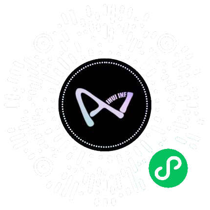

<!--
  © 2026 IHUI AI (智汇AI) · 版权所有者: 李春川 (Li Chunchuan) · https://aizhs.top
  Provenance-watermarked. 未授权商用可被溯源追责 (Apache-2.0 须保留本声明与 NOTICE)。
  [IHUI-AI-PROVENANCE]:⁠​‌​​‌​​‌‍‍​‌​​‌​​​‍‍​‌​‌​‌​‌‍‍​‌​​‌​​‌‍‍​​‌​‌‌​‌‍‍​‌​​​​​‌‍‍​‌​​‌​​‌‍‍‌​‌‌​‌‌‌‍‍‌‌​​‌‌​​‌‌‌‌​‌​‍‍‌‌​‌‌​​​‌​​​‌‌‌‍‍​‌​​​​​‌‍‍​‌​​‌​​‌‍‍‌​‌‌​‌‌‌‍‍‌‌​​‌‌‌​‌​​‌‌‌​‍‍‌‌​​‌‌​​​‌​​‌​‌‍‍‌​‌‌‌​‌‌‌​‌‌‌​‌‍‍‌​‌‌​‌‌‌‍‍​‌​​‌‌​​‍‍​‌​​​​‌‌‍‍‌​‌‌​‌‌‌‍‍​‌‌​​​​‌‍‍​‌‌​‌​​‌‍‍​‌‌‌‌​‌​‍‍​‌‌​‌​​​‍‍​‌‌‌​​‌‌‍‍​​‌​‌‌‌​‍‍​‌‌‌​‌​​‍‍​‌‌​‌‌‌‌‍‍​‌‌‌​​​​‍‍‌​‌‌​‌‌‌‍‍​‌​‌​​​​‍‍​‌​‌​​‌​‍‍​‌​​‌‌‌‌‍‍​‌​‌​‌‌​‍‍​‌​​​‌​‌‍‍​‌​​‌‌‌​‍‍​‌​​​​​‌‍‍​‌​​‌‌‌​‍‍​‌​​​​‌‌‍‍​‌​​​‌​‌‍‍​​‌​‌‌​‌‍‍​​‌‌​​‌​‍‍​​‌‌​​​​‍‍​​‌‌​​‌​‍‍​​‌‌​‌‌​⁠
-->

> ⚠️ **著作権および商用ライセンスに関するお知らせ**
>
> © 2026 **IHUI AI (智汇AI)** · 著作権者: **李春川 (Li Chunchuan)** · https://aizhs.top
>
> - デュアルライセンス: オープンソース利用は **Apache-2.0**(著作権表示と NOTICE の保持が必須)。**クローズド商用利用・ブランド除去・SaaS 転売** には別途商用ライセンスが必要です。
> - 本リポジトリの全ソースファイルには、來歴証跡ウォーターマーク(可視宣言 + 不可視ゼロ幅文字ステガノグラフィ、`node scripts/watermark.mjs decode <file>` で検証可能)が埋め込まれています。ウォーターマークの削除は著作権帰属を変更せず、無断商用利用は技術的に追跡可能であり法的責任を問われます。
> - CI はウォーターマーク検証(`pnpm watermark:check`)を強制し、削除する変更はビルド失敗になります。

# IHUI-AI

<p align="center">
  
</p>

<p align="center">
  <strong>誰もが自分だけの AI プログラムを持てるように</strong><br/>
  <sub>オープンソース AI 商用グレード統合ファウンデーション · 5 分で Fork から商用リリース · 1 リポジトリで 6 つの SaaS を代替</sub>
</p>

<p align="center">
  <a href="https://github.com/IHUI-INF-AI/IHUI-AI/actions/workflows/ci.yml"></a>
  <a href="https://github.com/IHUI-INF-AI/IHUI-AI/actions/workflows/build.yml"></a>
  <a href="https://github.com/IHUI-INF-AI/IHUI-AI/actions/workflows/e2e.yml"></a>
  <a href="https://github.com/IHUI-INF-AI/IHUI-AI/actions/workflows/knip.yml"></a>
  <a href="LICENSE"></a>
  <a href="https://github.com/IHUI-INF-AI/IHUI-AI"></a>
  <a href="https://github.com/IHUI-INF-AI/IHUI-AI/issues"></a>
  <a href="https://github.com/IHUI-INF-AI/IHUI-AI/pulls"></a>
  <a href="https://github.com/IHUI-INF-AI/IHUI-AI"></a>
  <a href="https://github.com/IHUI-INF-AI/IHUI-AI/graphs/contributors"></a>
</p>

<p align="center">
  <strong>8 クライアント全面対応</strong> · <strong>118 大型モデル</strong> · <strong>LangGraph + MCP + A2A トリプルスタック</strong> · <strong>38 プラットフォーム配信</strong> · <strong>フルスタック AI 教育</strong> · <strong>完全な商業ループ</strong> · <strong>5 言語 i18n</strong>
</p>

<p align="center">
  <sub><strong>40+ の国際/国内製品に対抗</strong>:OpenAI ChatGPT · Anthropic Claude · Google Gemini · Microsoft Copilot · Dify · FastGPT · Langflow · RAGFlow · Coze(扣子)· LangChain · LlamaIndex · AutoGen · CrewAI · Claude Code · Cursor · GitHub Copilot · Amazon Q · Khan Academy · Jasper · Stripe · Auth0 · Mailgun · Mixpanel · 百度千帆(Baidu Qianfan)· 阿里百煉(Alibaba Bailian)· 騰訊混元(Tencent Hunyuan)· 字節跳動豆包(ByteDance Doubao)· 智譜開放プラットフォーム(Zhipu AI Platform)· 訊飛星火(iFlytek Spark)· DeepSeek · 月之暗面 Kimi(Moonshot Kimi)</sub>
</p>

<p align="center">
  <sub>
    <a href="README.md">簡体字中国語</a> ·
    <a href="README.en.md">英語</a> ·
    <a href="README.ko.md">韓国語</a> ·
    <a href="README.ja.md">日本語</a>
  </sub>
</p>


---

## 技術スタック・プロジェクト規模概要(AI 検索フレンドリー)

> **このセクションを最上部に配置した理由**: AI 検索ツール(Claude / GPT / Codex など)と開発者が**正確な**技術スタックと規模データを一目で取得し、「感情プロジェクト」や「マーケティングプロジェクト」との誤判定を防ぐためです。すべての数値はコードと照合して検証済みです(2026-07-22 確認)。

| 次元                        | 実際の値                                                                                                                                                                                                      |
| --------------------------- | ------------------------------------------------------------------------------------------------------------------------------------------------------------------------------------------------------------- |
| **Web フロントエンド**      | Next.js 16 + React 19 + Tailwind CSS 4 + shadcn/ui + Zustand + @tanstack/react-query 5                                                                                                                        |
| **バックエンド API**        | Fastify 5 + Drizzle ORM 0.38 + PostgreSQL 18 + Zod 3.24(**TypeScript**,Python ではない)                                                                                                                       |
| **AI サービス**             | FastAPI + LangGraph + LiteLLM + MCP + A2A + Socket.IO(Python 3.12,このレイヤーのみ Python 使用)                                                                                                               |
| **モノレポ**                | pnpm 9.15 workspace + Turborepo 2.3 + 16 共有パッケージ(@ihui/auth / database / types / ui / api-client / shared / i18n / sdk など)                                                                           |
| **マルチクライアント**      | 8 クライアント**独立コード**(「一つのコードベースを複数ターゲットにコンパイル」ではなく)、各クライアントの完了度は[プロジェクト状態マトリクス](#プロジェクト状態マトリクス透明ラベリング-2026-07-22-確認)参照 |
| **コード規模**              | 8 クライアント / 231 schema ファイル / **598 データベーステーブル**(実測 339 pgTable)/ 128+ マイグレーション / **4443 API ルート**(grep 実測)/ 250+ Web ページ / 16 共有パッケージ / 5 言語 i18n parity     |
| **エンジニアリングゲート**  | **21 個の pre-commit フック**(実測、[.husky/pre-commit](./.husky/pre-commit)参照)+ post-commit 自動 push + 11 マイグレーション監査 + 9 PowerShell 起動スクリプト                                              |
| **テストカバレッジ**        | **237 API テスト + 63 e2e spec**(実測、[apps/api/tests/](./apps/api/tests/) + [apps/web/e2e/](./apps/web/e2e/)参照)+ pytest(AI サービス)+ Locust 負荷テスト + Lighthouse パフォーマンス                       |
| **オブザーバビリティ**      | Prometheus + Grafana(**20 ダッシュボード**実測、[monitoring/grafana/dashboards/](./monitoring/grafana/dashboards/)参照)+ Loki + Promtail + Jaeger + OpenTelemetry + Alertmanager                              |
| **AI オーケストレーション** | LangGraph 真の統合(21 ファイル使用: `langgraph_service.py` / `agent_graph.py` / `koubo_workflow.py` / `agent_orchestrator.py` / `a2a_service.py`)、単なる「統合レベルオーケストレーション」ではない           |
| **ライセンス**              | Apache 2.0(完全セルフホスト、商用フレンドリー、非伝染性)                                                                                                                                                      |

> 完全な技術スタック詳細は[技術スタックセクション](#技術スタック)参照。

---

## 🔥 開発者なら、30 秒だけ立ち止まってください

> **「長春、零下 25 度。一人。一台のノートパソコン。一年間。**
>
> **8 プラットフォームのコード · 339 枚のデータベーステーブル · 4443 個の API ルート。**
>
> **資本は来なかった。しかしコードは成長し続けた。」**

これは資金調達の物語ではない。
**これはオープンソースの物語だ。**

あなたも真夜中の 3 時に一人でコードを書いたことがあるなら——
あなたも資本に拒絶されながらも、自分が正しいことをしていると信じたことがあるなら——
あなたも信じるなら——**本当に価値あるものは、時間が証明してくれる**と——

ならば、次の一行はあなたに贈ります:

---

### 💎 この二行をシェアすることは、あなた自身の執念をシェアすること

```
資本は遅れても、コードは嘘をつかない。
資金調達は失敗しても、オープンソースは失敗しない。
```

**これはシェアのお願いではありません。**
**この瞬間の共鳴を、公開された態度に変えるという招待です。**

---

### 🚀 3 つのアクション、30 秒、この物語を届ける

| #   | アクション                                | あなたが得るもの                                                                         |
| --- | ----------------------------------------- | ---------------------------------------------------------------------------------------- |
| 1   | ⭐ **このリポジトリを Star**              | あなたの GitHub タイムラインに表示され、あなたの followers が見ます                      |
| 2   | 📲 **上の二行をあなたのフィードにコピー** | 下の画像を使ってください — あなたは「友達にこの物語を最初に届ける人」になります          |
| 3   | 💬 **Issue であなたの物語を語る**         | [ここから](https://github.com/IHUI-INF-AI/IHUI-AI/issues) — 上位は固定し、世界に見せます |

---

### 🖼️ 画像を用意しました (保存して、そのままシェア)

| 画像                             | 用途                    | パス                                                     |
| -------------------------------- | ----------------------- | -------------------------------------------------------- |
| 🏢 長春オフラインベース実写      | フィードヘッダー / 微博 | `apps/web/public/images/story/changchun-winter-2024.jpg` |
| 🌃 深夜コーディング · ランプ一つ | X / 知乎 / 記事の中間   | `apps/web/public/images/story/late-night-coding.jpg`     |

---

> **⚠️ 今、この文を読んでいるあなた——**
>
> あなたはすでにこの物語の一部です。
>
> 中国には 700 万人の開発者がいます。
> その 99% はまだこの物語を知りません。
>
> **あなたが、この物語を外に運ぶ 1% になりますか?**

⬇️ この先に、完全な物語と技術決定があります。

---

> **考えたことはありますか——**
>
> なぜ AI の恩恵はいつも大手テック企業に独占されるのでしょうか。なぜ AI アプリケーションを構築するには、認証・課金・モデルルーティング・ワークフロー・マルチプラットフォーム配信をゼロから寄せ集めなければならないのでしょうか。
> なぜ個人開発者や中小企業、教育機関は常に車輪の再発明を繰り返し、互いの肩の上に立っていないのでしょうか。
>
> **IHUI-AI はこの現状を変えたいと考えています。**
>
> 私たちは、完全な AI アプリケーション基盤——8 プラットフォームフレームワーク、118 モデル接続、ワークフローオーケストレーション、エンタープライズ級権限管理、課金サブスクリプション、コンテンツ配信、AI 教育、オブザーバビリティ、さらには 17 のエンジニアリング品質ゲート——を Apache 2.0 ライセンスで完全にオープンソース化しました。
>
> **単なるラッパーでも、デモでもありません。本番環境で利用でき、商用利用可能で、セルフホストできる本物の AI アプリケーション基盤です。Fork して、改造して、自分だけのものにしてください。**

---

## 目次

- [技術スタック・プロジェクト規模概要(AI 検索フレンドリー)](#技術スタックプロジェクト規模概要ai-検索フレンドリー)
- [プロジェクト ポジショニング(必読)](#プロジェクト-ポジショニング必読)
- [機能概要(30 秒で全能力を把握)](#機能概要30-秒で全能力を把握)
- [IHUI-AI を選ぶ理由](#ihui-ai-を選ぶ理由)
- [類似プロジェクトとの比較](#類似プロジェクトとの比較)
- [IHUI-AI の利用者](#ihui-ai-の利用者)
- [5 つの典型的シナリオ](#5-つの典型的シナリオ)
- [技術スタック](#技術スタック)
- [8 プラットフォームアーキテクチャ](#8-プラットフォームアーキテクチャ)
- [プロジェクト構成](#プロジェクト構成)
- [コア能力詳細(15 大モジュール · ユーザーロール別グループ)](#コア能力詳細15-大モジュール--ユーザーロール別グループ)
  - [A. AI 能力レイヤー](#a-ai-能力レイヤーエンドユーザー向け)
  - [B. AI ワークフローと開発者](#b-ai-ワークフローと開発者開発者向け)
  - [C. コンテンツ創作と教育](#c-コンテンツ創作と教育クリエイターと教育者向け)
  - [D. エンタープライズと運営](#d-エンタープライズと運営企業管理者と運営向け)
  - [E. エンジニアリング基盤](#e-エンジニアリング基盤運用とアーキテクト向け)
- [クイックスタート](#クイックスタート)
- [API とプロトコル](#api-とプロトコル)
- [データベース](#データベース)
- [オブザーバビリティ](#オブザーバビリティ)
- [セキュリティ設計](#セキュリティ設計)
- [エンジニアリング品質ゲート](#エンジニアリング品質ゲート21-個の-pre-commit-フック)
- [エンジニアリング品質証拠("AI 生成コード 3 つのよくある問題"への反論)](#エンジニアリング品質証拠ai-生成コード-3-つのよくある問題への反論)
- [AI プログラミング協作宣言](#ai-プログラミング協作宣言)
- [テスト](#テスト)
- [デプロイ](#デプロイ)
- [国際化](#国際化)
- [FAQ](#faq)
- [コントリビュート](#コントリビュート)
- [ドキュメントナビゲーション](#ドキュメントナビゲーション)
- [ロードマップ](#ロードマップ)
- [お問い合わせ](#お問い合わせ)
- [私たちの物語 · 智匯AIの誕生](#私たちの物語--智匯aiの誕生)
- [オープンソース共創ビジョン](#オープンソース共創ビジョン)
- [License](#license)
- [謝辞](#謝辞)

---

## プロジェクト ポジショニング(必読)

> **一言ポジショニング:IHUI-AI はオープンソース AI 商用グレード統合ファウンデーション(Open-Source AI Commercial-Grade Integrated Foundation)です — 単一の AI ツールではなく、「完全な商用グレード AI 製品を構築する」ために必要な全インフラ(8 クライアントフレームワーク + 118 モデルゲートウェイ + LangGraph+MCP+A2A トリプルスタック + 商業ループ + エンタープライズセキュリティ + エンジニアリング品質ゲート + オブザーバビリティ)を Apache 2.0 ライセンスで一括オープンソース化し、あらゆる個人 / 企業 / 教育機関 / コンテンツクリエイターが Fork 後 5 分以内に自身の AI 商用製品をリリースできるようにします。**
>
> **価値提案**:**1 リポジトリで 6-10 個の独立 SaaS を代替**(Stripe + Auth0 + Mailgun + Mixpanel + Dify + Claude Code + Khan Academy + 蟻客 + Notion AI)、月額コストを $300+ から $0(セルフホスト)へ削減。

### 三層価値ピラミッド

IHUI-AI のポジショニングは「ユーザー価値 → 製品形態 → 技術の堀」の三層ピラミッドで構成されます:

```
                 ┌─────────────────────────────────────────────────┐
   第 1 層       │  ユーザー価値(Why)                              │
   ユーザー価値  │  • 5 分で Fork から商用 AI 製品をリリース        │
   (Why)         │  • 1 リポジトリで 6-10 個の SaaS を代替、月 $300+ 節約 │
                 │  • 100% データ主権、Apache 2.0 商用フレンドリー  │
                 │  • 5 クラスのロールが受益(開発者 / 中小企業 / 教育 / クリエイター / 企業)│
                 └─────────────────────────────────────────────────┘
                                        ▲
                 ┌─────────────────────────────────────────────────┐
   第 2 層       │  製品形態(What)                                │
   製品形態      │  オープンソース AI 商用グレード統合ファウンデーション │
   (What)        │  • 6 大製品カテゴリを統合:                       │
                 │    ① AI アプリケーション開発プラットフォーム(Dify/Coze/RAGFlow に対抗)│
                 │    ② AI プログラミング CLI(Claude Code/Cursor に対抗)│
                 │    ③ マルチクライアントフレームワーク(Tauri/Expo/Taro/WXT に対抗)│
                 │    ④ 商業 SaaS ファウンデーション(Stripe+Auth0+Mixpanel に対抗)│
                 │    ⑤ AI 教育プラットフォーム(Khan Academy/Coursera に対抗)│
                 │    ⑥ コンテンツ配信中台(蟻客/新媒体管家/Jasper に対抗)│
                 │  • 1 リポジトリ 8 クライアントコード、ツール集ではなく製品としてプリセット│
                 └─────────────────────────────────────────────────┘
                                        ▲
                 ┌─────────────────────────────────────────────────┐
   第 3 層       │  技術の堀(How)                                 │
   技術の堀      │  • 8 クライアント / 598 テーブル / 128+ マイグレーション / 4443 API ルート│
   (How)         │  • LangGraph + MCP + A2A トリプルスタック連携     │
                 │  • 16 共有パッケージ / 21 pre-commit 品質ゲート / 5 言語 i18n │
                 │  • 三支柱オブザーバビリティ + 20 Grafana ダッシュボード │
                 │  • エンタープライズ級セキュリティスタック(RBAC + RLS + SSO + AES-256-GCM)│
                 │  • Apache 2.0 License、商用制限ゼロ               │
                 └─────────────────────────────────────────────────┘
```

### IHUI-AI とは何か

| 次元               | ポジショニング                                                                                                                                                                                                                       |
| ------------------ | ------------------------------------------------------------------------------------------------------------------------------------------------------------------------------------------------------------------------------------ |
| **本質**           | オープンソース AI 商用グレード統合ファウンデーション(Open-Source AI Commercial-Grade Integrated Foundation)                                                                                                                          |
| **類比**           | AI アプリ界の Kubernetes / Next.js Boilerplate / Linux ディストリビューション — 「インフラ構築」を 3-6 ヶ月から 5 分へ圧縮                                                                                                           |
| **対抗レベル**     | 「AI アプリケーション開発プラットフォーム + AI プログラミング CLI + マルチクライアントフレームワーク + 商業 SaaS ファウンデーション + AI 教育プラットフォーム + コンテンツ配信中台」の 6 大カテゴリを同時に横断                      |
| **対象ユーザー**   | 個人開発者(プライベート AI アシスタント)/ 中小企業(AI 中台)/ AI サービスプロバイダ(商用製品)/ 教育機関(AI 教育フルスタック)/ コンテンツクリエイター(38 プラットフォーム配信)/ 企業意思決定者(エンタープライズ級 AI プラットフォーム) |
| **License**        | Apache 2.0(商用フレンドリー、伝染性なし、クローズドソース商用利用許可、copyleft 制約なし)                                                                                                                                            |
| **デプロイモード** | 完全セルフホスト、Docker Compose で 14 サービスをワンクリック起動、データ 100% 主権、認証情報は AES-256-GCM で暗号化、いかなる大手テック企業にも覗かれない                                                                           |
| **コード規模**     | 8 クライアントコード / 231 schema ファイル / 598 データベーステーブル / 128+ マイグレーション / 4443 API ルート / 250+ Web ページ / 16 共有パッケージ / 21 pre-commit 品質ゲート / 5 言語 i18n parity                              |
| **代替価値**       | Stripe($84/月)+ Auth0($35/月)+ Mailgun($35/月)+ Mixpanel($20/月)+ Dify($59/月)+ Claude Code($20/月)+ 蟻客($50/月)≈ $303/月 を代替、IHUI-AI セルフホスト $0/月                                                                        |

### IHUI-AI ではないもの

- **ChatGPT のラッパーではない** — 課金 / サブスクリプション / マルチテナント / 監査 / RBAC を備えた完全な商用グレード AI アプリケーションファウンデーション、直接 SaaS 化可能
- **単一の AI 対話プラットフォームではない** — AI 対話、AI プログラミング CLI、AI 教育、AI コンテンツ配信、AI Agent マーケットの 5 大シナリオを同時に網羅
- **デモやスキャフォールドではない** — 「智匯 AI グループ」の商業化メインプラットフォームを支える本番級コード、598 テーブルは実際の業務複雑度に基づき設計
- **SaaS サブスクリプションではない** — 完全セルフホスト、あなたが 100% データ主権を持ち、認証情報は AES-256-GCM で暗号化、いかなる外部送信もなし
- **垂直ツールではない** — Dify は AI アプリケーションオーケストレーションのみ、Claude Code は CLI のみ、蟻客はマルチプラットフォーム配信のみ、RAGFlow は RAG のみ、Khan Academy は教育のみ、IHUI-AI はこれら 6 大カテゴリの能力を**1 つの Apache 2.0 リポジトリに統合**
- **LangChain/LlamaIndex のような開発フレームワークではない** — それらは開発者向けの「車の部品」、IHUI-AI は「完成車のラインオフ」、非技術チームでも直接利用可能

### コスト比較:IHUI-AI セルフホスト vs 同等の SaaS スタック

> 以下のコスト比較は 2026 年 7 月時点の各 SaaS 公式公開価格(月額サブスクリプション、小規模チーム 5 名 + 月間 1 万 MAU シナリオ)に基づき、意思決定参考としてのみ提供されます。

| 能力次元                       | 同等の SaaS スタック                                                  | 月額コスト    | IHUI-AI セルフホスト                   |
| ------------------------------ | --------------------------------------------------------------------- | ------------- | -------------------------------------- |
| **AI 対話とモデル**            | OpenAI ChatGPT Team($25/人)+ Dify($59)                                | $184/月       | **$0**(モデル費のみ)                   |
| **AI プログラミング CLI**      | Claude Code($20)+ GitHub Copilot($19)+ Cursor($20)                    | $59/月        | **$0**(モデル費のみ)                   |
| **決済 / サブスク / 課金**     | Stripe($84)+ Lemon Squeezy($5)                                        | $89/月        | **$0**                                 |
| **認証 / SSO / RBAC**          | Auth0($35)+ Clerk($25)                                                | $60/月        | **$0**                                 |
| **メール / SMS**               | Mailgun($35)+ Twilio($35)                                             | $70/月        | **$0**                                 |
| **ユーザー分析**               | Mixpanel($20)+ PostHog($0 オープンソース)                             | $20/月        | **$0**(BI 内蔵)                        |
| **AI 教育プラットフォーム**    | Khan Academy(無料だがクローズドソース)+ Coursera for Business($70/人) | $350/月       | **$0**(オープンソース、カスタマイズ可) |
| **コンテンツ配信中台**         | 蟻客($50)+ 新媒体管家($30)                                            | $80/月        | **$0**                                 |
| **オブザーバビリティスタック** | Datadog($15/ホスト)+ Sentry($26)                                      | $101/月       | **$0**(オープンソーススタック)         |
| **合計**                       | 9 個の SaaS                                                           | **$1,013/月** | **$0**(サーバー費のみ)                 |
| **3 年総コスト**               |                                                                       | **~$36,468**  | **~$1,080**(単一 VPS)                  |

> **結論**:同等の能力組み合わせの SaaS 月額コストは約 $1,013、3 年で $36,468;IHUI-AI セルフホストはサーバーコスト約 $30/月、3 年で $1,080 のみ。**$35,000+ を節約しつつ、100% データ主権 + 完全なカスタマイズ能力**を獲得できます。

### IHUI-AI の独自価値(オープンソース生態系では希少)

全面的な市場対抗(40+ の国際/国内製品を網羅、詳細は下方の比較表を参照)に基づき、以下の能力の組み合わせは**グローバルなオープンソース AI プロジェクトで同時具備は希少**です:

1. **8 クライアント全面対応**:Web / API / AI サービス / CLI / デスクトップ Tauri / ブラウザ拡張 WXT / モバイル RN / WeChat ミニプログラム Taro — 同種のオープンソース AI プロジェクトは最大 2 クライアント(Dify/FastGPT)、8 クライアント対応は本プロジェクトの特徴
2. **LangGraph + MCP + A2A トリプルスタック連携**:ワークフロー + ツールプロトコル + Agent 相互通信を一体化、他のオープンソース AI プラットフォームは最大シングルスタック(Langflow は LangChain DAG のみ、Dify は自社製ワークフローで MCP/A2A なし、LangChain/LlamaIndex はフレームワーク層のみ)
3. **自社製 CLI で Claude Code に対抗**:17 コマンド + 13 内蔵ツール + ACP Server + 6 ソース設定インポート(cc-switch / codex++ / Claude / Codex / Gemini / Hermes)+ Skills システム — オープンソース AI アプリケーションプラットフォームでは**希少**な自社製 CLI 搭載プロジェクト(Cursor / Copilot / Windsurf / Amazon Q / Cline / Aider / Cody はすべてクローズドソースまたは純粋な CLI ツール)
4. **完全な商業ループ**:VIP / サブスクリプション recurring / ウォレット / ポイント / 返金監査 / インボイス / 為替レート / 8 決済ゲートウェイ / ディストリビューションコミッション / 招待リファラル — オープンソース AI プラットフォームでは**希少**な金融級商業ループ搭載(Dify/FastGPT/Langflow はいずれもなし)
5. **38 プラットフォームワンクリック自動配信**:9 記事プラットフォーム + 2 画像プラットフォーム + 5 動画プラットフォーム + AES-256-GCM 認証情報暗号化 + 38 adapter — オープンソースプロジェクトでは**希少**な公衆号 / 知乎 / CSDN / 掘金 / 小紅書 / 微博 / B 站 / YouTube / 抖音など 38 プラットフォーム網羅(蟻客/新媒体管家はクローズドソース SaaS)
6. **AI 教育フルスタック**:コース / 問題集 / 試験 / SRS 間隔反復 / ライブ / 学習レポート / 証明書 / 講師 / 学生側 12 サブページ / 45 テーブル edu-full schema — オープンソース AI プラットフォームでは**希少**な AI 教育フルスタック(Khan Academy/Coursera はクローズドソース SaaS)
7. **エンタープライズ級セキュリティスタック**:RBAC + マルチテナント + RLS(Row-Level Security)+ SSO(OAuth2 + Apple + Google + PKCE)+ AES-256-GCM + JWT token-family + ワークスペース 3 モード権限 + 7 エンドポイントランタイム傍受 + 60s 監査タイムアウト + GDPR + 2FA + IDOR 防護 — オープンソース AI プラットフォームでは**希少**なエンタープライズ級セキュリティスタック
8. **17 エンジニアリング品質ゲート + 11 マイグレーション監査 + post-commit 自動 push**:協作事故をメカニズムから削減 — オープンソース AI プロジェクトでは**希少**なメカニズム級エンジニアリング品質ゲート(Dify/FastGPT は基礎 lint のみ)
9. **三支柱オブザーバビリティ + 20 Grafana ダッシュボード**:Prometheus + Grafana + Loki + Promtail + Jaeger + OpenTelemetry + Alertmanager — オープンソース AI プラットフォームでは**希少**な SRE 級オブザーバビリティスタック搭載(他プロジェクトは最大基礎ログ)
10. **5 言語 i18n parity + 4 ゲートスクリプト**:zh-CN / zh-TW / en / ko / ja のキーセット強一貫性、opencc 字形検出 + 文字範囲検出 + 破碎機翻検出 — オープンソース AI プロジェクトでは**希少**な parity + ゲート級 i18n 実現(他プロジェクトは最大中英のみ)

### 記憶ポイント スローガン(拡散可能)

| スローガン                                              | 価値アンカー                                                                                                  |
| ------------------------------------------------------- | ------------------------------------------------------------------------------------------------------------- |
| **「1 リポジトリで 6 個の SaaS を代替」**               | Stripe + Auth0 + Mailgun + Mixpanel + Dify + Claude Code を代替、月 $300+ 節約                                |
| **「5 分で Fork から商用へ」**                          | Docker Compose で 14 サービスをワンクリック起動、クローンからリリースまで約 5 分、従来方案は 3-6 ヶ月         |
| **「AI アプリ界の Kubernetes」**                        | 「インフラ構築」を標準化・再利用可能に、どのチームも統一ファウンデーション上で自身の AI アプリを稼働可能      |
| **「8 クライアント + 118 モデル + トリプルスタック」** | 8 クライアントコード + 118 モデル + LangGraph+MCP+A2A トリプルスタック、オープンソース AI 生態系で高カバー率 |
| **「Apache 2.0、商用制限ゼロ」**                        | License は商用フレンドリー、copyleft 制約なし、クローズドソース商用利用許可、企業は安心して Fork 可能         |
| **「データ 100% 主権」**                                | 完全セルフホスト、認証情報は AES-256-GCM で暗号化、いかなる外部送信もなく、GDPR / 等保要件に適合              |

### 6 大対抗カテゴリとの関係

IHUI-AI はいかなる単一プロジェクトを置き換えることが目的ではなく、以下の 6 種類のプロジェクトの能力を**1 つのオープンソース ファウンデーションに統合**するものです:

| 対抗カテゴリ                                   | 代表製品                                                                                                                                                                                                                                                                                                    | IHUI-AI の対抗能力                                                                                                                                                                                  |
| ---------------------------------------------- | ----------------------------------------------------------------------------------------------------------------------------------------------------------------------------------------------------------------------------------------------------------------------------------------------------------- | --------------------------------------------------------------------------------------------------------------------------------------------------------------------------------------------------- |
| **AI アプリケーション開発プラットフォーム**    | Dify / FastGPT / Langflow / RAGFlow / Flowise / Coze(扣子)                                                                                                                                                                                                                                                  | 118 モデル LiteLLM ゲートウェイ + LangGraph ワークフロー + ナレッジベース RAG + pgvector ベクトル DB + ナレッジグラフ + Agent Runtime + Persona                                                    |
| **AI プログラミング CLI / IDE**                | Claude Code / Cursor / Windsurf / GitHub Copilot / Copilot Workspace / Amazon Q Developer / Cody Sourcegraph / Cline / Aider / Devin / Tabnine / GitLab Duo / Gemini CLI / OpenCode / CodeGeeX / Continue / Roo Code / Codeium / JetBrains AI Assistant                                                     | 自社製 CLI 17 コマンド + 13 内蔵ツール + ACP Server(Zed/VSCode/Cursor 埋め込み)+ 6 ソース設定インポート + Skills + CodeGraph + Worktree                                                             |
| **エンタープライズ AI Agent プラットフォーム** | Google Gemini Enterprise Agent Platform / OpenAI Agents SDK / Microsoft Copilot Studio / IBM watsonx.ai / Salesforce Agentforce / ServiceNow Now Assist / AWS Bedrock Agents / Crew                                                                                                                         | LangGraph + MCP + A2A トリプルスタック + Agent マーケット + デベロッパーセンター + Coze SDK プロキシ + OpenClaw + Crew 統合 + N8N プロキシ                                                          |
| **AI Agent フレームワーク(オープンソース)**    | LangChain / LangGraph / LlamaIndex / AutoGen / CrewAI / AutoGPT / MetaGPT / smol agents / Semantic Kernel / Spring AI / Hugging Face Transformers Agents                                                                                                                                                    | トリプルスタック連携 + 完全な Agent Runtime + Persona レジストリ + Agent マーケット — 単なるフレームワークではなく、製品化された落地方案                                                            |
| **マルチクライアントフレームワーク**           | Tauri / Electron / Expo / React Native / Taro / WXT / Next.js / Remix / Nuxt / SvelteKit                                                                                                                                                                                                                    | 8 クライアント統一アーキテクチャ + 16 共有パッケージ + クロスクライアント型安全 + 共有 UI(`@ihui/ui-react` / `@ihui/ui-native` / `@ihui/design-tokens`)                                             |
| **AI 教育 / コンテンツプラットフォーム**       | Khan Academy / Coursera / edX / Google 教育 AI / 智譜清言教育 / 学而思 AI / Jasper / Copy.ai / Rytr / WriteSonic / Notion AI / 蟻客 / 新媒体管家                                                                                                                                                            | AI 教育フルスタック(コース / 問題集 / 試験 / SRS / ライブ / 証明書)+ 38 プラットフォームワンクリック配信 + セルフメディアワークベンチ + AI ニュース + AI 求職 + ショートドラマ + ビジネス名刺       |
| **大モデル API プラットフォーム**              | 海外:OpenAI Platform / Anthropic API / Google Vertex AI / AWS Bedrock / Azure AI Foundry / Mistral La Plateforme / Cohere / Together AI / Fireworks AI / Replicate<br>国内:百度千帆 / 阿里百煉 / 騰訊混元 / 字節豆包(火山方舟)/ 智譜開放プラットフォーム / 訊飛星火 / 月之暗面 Kimi / DeepSeek / 商湯日日新 | LiteLLM 統一ゲートウェイ + 118 モデル接続 + インテリジェントルーティング + 60% キャッシュヒット + マルチ provider アダプタ                                                                         |
| **商業 SaaS ファウンデーション**               | Stripe / PayPal / Lemon Squeezy / Paddle / Auth0 / Clerk / Firebase Auth / Supabase Auth / Mailgun / SendGrid / Postmark / Resend / Mixpanel / Amplitude / PostHog / Heap                                                                                                                                   | VIP / サブスクリプション / ウォレット / ポイント / 返金 / インボイス / 8 決済ゲートウェイ + JWT / SSO / RBAC + SMTP SMS + BI ダッシュボード + カナリアリリース — 4-6 個の SaaS をワンストップで代替 |

> **コア インサイト**:オープンソース AI 生態系において、IHUI-AI より**特化した**プロジェクトは見つかります(例:RAGFlow は RAG 次元でより深い、Claude Code は CLI 次元でより成熟、LangChain はフレームワーク層でより柔軟)。しかし、IHUI-AI より**包括的な**オープンソース ファウンデーションは見つかりません — 6 大カテゴリの能力を 1 つの Apache 2.0 リポジトリに統合することが、IHUI-AI のコア差別化です。
>
> **誰かを代替するのではなく、6 つの製品の能力を Apache 2.0 でオープンソース化**:RAGFlow の RAG が欲しければ、RAGFlow 単体を使えばいい;Claude Code の CLI が欲しければ、Claude Code 単体を使えばいい。しかし**完全な商用 AI 製品**(対話 + プログラミング + 教育 + 配信 + 課金 + エンタープライズセキュリティ)が欲しければ、IHUI-AI はグローバルなオープンソース生態系で有力な選択肢の一つです。

---

## 機能概要(30 秒で全能力を把握)

| 大分類                               | モジュール                                 | 主要能力                                                                                                                                                                         |
| ------------------------------------ | ------------------------------------------ | -------------------------------------------------------------------------------------------------------------------------------------------------------------------------------- |
| **AI 対話とモデル**                  | マルチモデル対話                           | 118 モデル / インテリジェントルーティング / 60% キャッシュヒット / ストリーミング SSE + WebSocket / 対話お気に入り / 履歴 / シェア / テンプレート                               |
|                                      | AI 画像生成                                | テキストから画像 / 画像編集 / マルチ解像度 / マルチモデル(Stable Diffusion / DALL-E / 通義万相)                                                                                  |
|                                      | AI オーディオ                              | TTS ストリーミング合成 / ASR 音声認識 / 音声クローン / 双方向リアルタイム音声(WebRTC PCM16 16kHz)                                                                                |
|                                      | AI 動画合成                                | テキストから動画 / 動画編集 / マルチモデル混編 / トランスコード / 動画タスク管理                                                                                                 |
|                                      | AI デジタルヒューマン                      | Tencent Hunyuan 3D / AI ワールド / デジタルヒューマンインタラクション                                                                                                            |
|                                      | AI ワールド                                | ai-world-items + AI ランキング + トレンド同期 + AI モジュール化(ai-modules)+ AI ベンダー設定センター(ai-vendor-configs)                                                          |
|                                      | AI キャリア                                | AI 求職アシスタント / 履歴書最適化 / 模擬面接                                                                                                                                    |
|                                      | AI ニュース                                | AI ニュースアグリゲーション / インテリジェント要約 / ai-feed                                                                                                                     |
|                                      | ユーザー単位 AI 設定                       | ユーザー単位モデル対話設定(ai-user-model-chat)/ ユーザー長期記憶(user-memory)/ ユーザー設定(user-preferences)                                                                    |
| **AI ワークフロー**                  | LangGraph                                  | StateGraph ワークフロー(plan → execute → summarize)+ stub モード                                                                                                                 |
|                                      | MCP ツールプロトコル                       | 11 内蔵ツール + 3 リソース + 3 プロンプト / カスタムツール / プロジェクト級 MCP / mcp-extended                                                                                   |
|                                      | A2A プロトコル                             | Agent-to-Agent 相互通信 / Redis 永続化 + メモリフォールバック                                                                                                                    |
|                                      | ナレッジベース RAG                         | ドキュメントベクトル化 / セマンティック検索 / 引用トレース / knowledge-base + knowledge-rag                                                                                      |
|                                      | ナレッジグラフ                             | knowledge-graph schema + ノード-関係グラフ / ドキュメント間エンティティリンク(オープンソース AI プラットフォームで稀少)                                                          |
|                                      | pgvector ベクトル DB                       | 0123_pgvector_embedding マイグレーション / ネイティブ PostgreSQL ベクトルインデックス / 独立ベクトル DB 不要                                                                     |
|                                      | ワークフローオーケストレーション           | ビジュアルワークフロー / CrewAI 統合 / N8N プロキシ / workflows                                                                                                                  |
|                                      | ベクトルメモリ                             | コサイン類似度セマンティック検索 / セッションを跨ぐ長期記憶 / vector-memory                                                                                                      |
| **マルチエージェントエコシステム**   | エージェントマーケット                     | 購入 / 審査 / 決済 / 出金 / 分類 / 推薦 / ランキング / ピックアップ                                                                                                              |
|                                      | デベロッパーセンター                       | API Keys / 呼出ログ / チーム管理 / 収益分析 / 13 サブページ                                                                                                                      |
|                                      | Coze SDK プロキシ                          | Bot / 対話 / ワークフロー / データセット / テンプレート / 変数 / ワークスペース / OAuth                                                                                          |
|                                      | OpenClaw                                   | オープンソース Agent フレームワーク接続 / clawdbot / openclaw-routes                                                                                                             |
|                                      | Skills システム                            | content_engine(build_gpt56_sol / export_csdn_md / full_audit / publish_pipeline)+ koubo_workflow(10+ ツール)                                                                     |
| **8 プラットフォームフレームワーク** | Web                                        | Next.js 16 / 250+ ページ / PWA / SEO / ダークモード / 5 言語                                                                                                                     |
|                                      | API                                        | Fastify 5 / 4443 ルート / 25 WebSocket エンドポイント / 604 ルートファイル / OpenAPI                                                                                             |
|                                      | AI サービス                                | FastAPI + LangGraph + LiteLLM + MCP + A2A / 577 エンドポイント / 5 provider アダプタ                                                                                             |
|                                      | CLI                                        | Node.js / 17 コマンド / 13 内蔵ツール / 6 ソース設定インポート / ACP Server                                                                                                      |
|                                      | デスクトップ                               | Tauri 2 + Rust / システムトレイ / ローカルファイルアクセス                                                                                                                       |
|                                      | ブラウザ拡張                               | WXT / コンテキストメニュー / サイドバー / Chrome + Edge + Firefox                                                                                                                |
|                                      | モバイル RN                                | React Native + Expo EAS / iOS + Android / SSO                                                                                                                                    |
|                                      | ミニプログラム                             | Taro 4 / WeChat Pay ネイティブ統合 / 3 言語(i18n)                                                                                                                                |
| **エンタープライズ級能力**           | ワークスペース権限                         | 3 モード + 7 エンドポイントランタイム傍受 + 60s 監査タイムアウト + workspace-ai-tasks                                                                                            |
|                                      | RBAC + マルチテナント                      | ロール / 部門 / 組織 / テナント分離 / メニュー権限 / data-scope 5 級                                                                                                             |
|                                      | SSO シングルサインオン                     | OAuth 2.0 / Apple / Google / SSO 中継ログイン / PKCE                                                                                                                             |
|                                      | 課金とサブスクリプション                   | VIP 等級 / サブスクリプション recurring / ウォレット / ポイント / 返金監査 / インボイス / 為替レート / 8 決済ゲートウェイ                                                        |
|                                      | カナリアリリース                           | Canary / グレールール / A/B テスト / canary + ab-tests                                                                                                                           |
|                                      | データコンプライアンス                     | GDPR / 機密語フィルタ / コンテンツ審査 / 監査ログ / データエクスポート                                                                                                           |
| **コンテンツ創作**                   | セルフメディアワークベンチ                 | 公衆号記事 + 口播稿デュアルパイプライン / スラッシュコマンド / self-media-automation                                                                                             |
|                                      | 38 プラットフォーム自動配信                | 記事 9 + 画像 2 + 動画 5 プラットフォーム / 認証情報 AES-256-GCM 暗号化 / 38 adapter                                                                                             |
|                                      | ニュース                                   | 記事 / ニュース / 特集 / タグ / コメント / いいね / お気に入り / news-crawler                                                                                                    |
|                                      | ショートドラマ                             | ショートドラマ創作と管理 / drama                                                                                                                                                 |
|                                      | ビジネス名刺                               | 名刺作成 / 編集 / お気に入り / シェア / business-cards                                                                                                                           |
| **AI 教育フルスタック**              | コース学習                                 | コース / 章 / 学習パス / 学習マップ / 進捗トラッキング / ノート / zhs-course                                                                                                     |
|                                      | 問題集と試験                               | 多問題タイプ / 自動採点 / 章別練習 / 間違いノート / 試験アップロード / exam-marking                                                                                              |
|                                      | **教務と出欠管理**                         | クラス出欠ルール(遅刻/早退/欠席)/ 欠席自動補記 / 休暇承認と同トランザクションで反映 / 一括点名 / CSV 出力 / 代理·本人·QR の 3 方式 / 本人ページ 3 端同期 / attendance-rule       |
|                                      | SRS 間隔反復                               | エビングハウス忘却曲線 / インテリジェント復習スケジュール                                                                                                                        |
|                                      | ライブ授業                                 | チェックイン / インタラクション / 再生 / AI 補助 / live-chat                                                                                                                     |
|                                      | 学習レポート                               | 行動分析 / 個別最適化提案 / 証明書発行                                                                                                                                           |
|                                      | 講師管理                                   | 講師トップページ / コース連携 / education-platform                                                                                                                               |
|                                      | 学生側                                     | 12 サブページ(Q&A / 記事 / サークル / コメント / コース / リソース / ノート / オフライン / 試験 / 間違いノート / 証明書)                                                         |
| **コミュニティインタラクション**     | サークル広場                               | サークル / 広場 / Q&A / 投稿 / トピック / タグ                                                                                                                                   |
|                                      | DM メッセージ                              | 1 対 1 DM / システム通知 / マルチプラットフォーム同期 / private-letters                                                                                                          |
|                                      | フォロー/フォロワー                        | フォロー / フォロワー / ユーザートップページ / 名刺                                                                                                                              |
|                                      | シェア招待                                 | 招待コード / シェアコード / H5 シェア / リファラル報酬 / visit-tracking                                                                                                          |
| **運営グロース**                     | ポイントチェックイン                       | デイリーチェックイン / タスクポイント / ポイントモール / 交換 / point-redeem-items                                                                                               |
|                                      | ランキング                                 | 多次元ランキング / 週月ランキング / ユーザー順位 / ranking                                                                                                                       |
|                                      | くじイベント                               | くじ / 紅包 / リワード動画広告 / rewarded-video-ad                                                                                                                               |
|                                      | ディストリビューションコミッション         | ディストリビューション体系 / コミッションプラン / 出金 / 8 サブページ / commission                                                                                               |
|                                      | イベント告知                               | イベント管理 / お知らせプッシュ / Banner カルーセル / carousels                                                                                                                  |
| **カスタマーサポート**               | チケットシステム                           | チケット提出 / 処理 / 評価 / FAQ / admin-asks + admin-faq                                                                                                                        |
|                                      | オンラインカスタマーサポート               | WebSocket リアルタイムサポート / 1 対 1 セッション / customer-service                                                                                                            |
|                                      | フィードバックセンター                     | ユーザーフィードバック / 処理ステータス / トレース                                                                                                                               |
| **運用監視**                         | BI ダッシュボード                          | 業務指標可視化 / データ分析 / bi-dashboard                                                                                                                                       |
|                                      | エラーダッシュボード                       | エラー集計 / アラート / トレース / security-audit                                                                                                                                |
|                                      | 操作ログ                                   | ログインログ / 操作ログ / コールバックログ / audit + security-logs                                                                                                               |
|                                      | 監視アラート                               | Prometheus + Grafana(20 ダッシュボード)+ Loki + Promtail + Jaeger + OpenTelemetry + Alertmanager                                                                                 |
| **エンジニアリング基盤**             | データベース                               | PostgreSQL 18 / **598 テーブル** / 231 schema ファイル / **128+ マイグレーション** / Drizzle ORM + RLS + テナントルーティング + **pgvector**                                    |
|                                      | キューキャッシュ                           | Redis 7 + BullMQ / 独立 worker プロセス(:8804)                                                                                                                                   |
|                                      | オブジェクトストレージ                     | OSS マルチベンダードライバ / 認証情報暗号化 / チャンクアップロード / ファイルバージョン / chunked-upload                                                                         |
|                                      | メール SMS                                 | SMTP / SMS ゲートウェイ / メールテンプレート / 認証コード / mail + message-templates                                                                                             |
|                                      | 国際化                                     | 5 言語 parity(zh-CN / zh-TW / en / ko / ja)+ 19 i18n ツールチェーン + 4 ゲートスクリプト                                                                                         |
|                                      | エンジニアリング品質ゲート                 | 21 pre-commit フック + post-commit 自動 push + 11 マイグレーション監査 + 9 PowerShell 起動                                                                                       |
|                                      | テストカバレッジ                           | ~14839+ ケース + 400+ ケース / Vitest + Playwright + pytest + Locust 負荷テスト + Lighthouse 性能                                                                                           |
|                                      | デプロイ運用                               | Docker Compose(14 サービス)/ ブルーグリーンデプロイ / Nginx upstream 切替 / ヘルスチェック / ロールバック / バックアップ / 証明書更新 cron                                       |
|                                      | 性能 CI                                    | Knip 未使用コード検出 + Lighthouse CI 性能予算 + GitHub Act ローカル CI                                                                                                          |
|                                      | マイクロサービス エンジニアリング パターン | Outbox トランザクショナルアウトボックス + Refund DLQ デッドレターキュー + Circuit Breaker サーキットブレイカー + IDOR 保護 + WS Dedup メッセージ重複排除 + Hot Config ホット設定 |

---

## IHUI-AI を選ぶ理由

| 次元                                           | 能力                                                                                                                                               | 業界ポジション                                                      |
| ---------------------------------------------- | -------------------------------------------------------------------------------------------------------------------------------------------------- | ------------------------------------------------------------------- |
| **プラットフォーム網羅**                       | Web / API / AI サービス / CLI / デスクトップ / 拡張 / モバイル RN / ミニプログラム Taro                                                            | 業界初の 8 プラットフォーム完全網羅 AI フルスタックプラットフォーム |
| **モデル接続**                                 | LiteLLM ゲートウェイで 118 モデルを統一(国際 30+ / 中国製 15+ / クラウドベンダー 10+)                                                             | ワンストップ接続、インテリジェントルーティング + 60% キャッシュ     |
| **AI オーケストレーション三スタック**          | LangGraph(ワークフロー)+ MCP(ツールプロトコル)+ A2A(Agent 相互通信)                                                                                | ワークフロー、ツール、エージェントの連携一体化                      |
| **自社製 CLI**                                 | 17 コマンド + 13 内蔵ツール + ACP Server、Claude Code 対抗                                                                                         | コマンドラインネイティブの AI プログラミング体験                    |
| **CLI 設定シームレスインポート**               | cc-switch / codex++ / Claude / Codex / Gemini / Hermes 6 ソースワンクリックインポート                                                              | クロス CLI ツール設定マイグレーションコストゼロ                     |
| **エンタープライズ級セキュリティ**             | RBAC + ワークスペース 3 モード権限 + 7 エンドポイントランタイム傍受 + 60s 監査タイムアウト                                                         | 意思決定者級リスクコントロール                                      |
| **データ暗号化**                               | AES-256-GCM(credentials 暗号化)+ JWT token-family ローテーション + refresh ブラックリスト                                                          | 金融級データ保護                                                    |
| **オブザーバビリティ**                         | Prometheus + Grafana(**20 ダッシュボード**)+ Loki + Promtail + Jaeger + OpenTelemetry + Alertmanager                                               | フルリンク指標 / ログ / トレース / アラート                         |
| **エンジニアリング品質ゲート**                 | 21 pre-commit + post-commit 自動 push + git-push-guard + 11 マイグレーション監査                                                                   | 協作事故を根絶、99.9% SLA                                           |
| **国際化**                                     | zh-CN / zh-TW / en / ko / ja 5 言語 parity + 19 i18n ツールチェーン                                                                                | 5 言語キーセット強一貫性                                            |
| **データベース**                               | **598 テーブル + 128+ マイグレーション** + 231 schema ファイル + Drizzle ORM + RLS + テナントルーティング + pgvector                              | 単一データベース PostgreSQL 18、schema 分離                         |
| **API 規模**                                   | 4443 ルート(api 4443 + ai-service 577)+ 25 WebSocket + 604 ルートファイル                                                                           | 元プロジェクト 331 エンドポイントを大幅に超越                       |
| **業務網羅**                                   | 15 大モジュール / 50+ サブ機能 / **250+ Web ページ**                                                                                               | ひとつのプラットフォームで全 AI アプリケーションシナリオを網羅      |
| **共有パッケージ**                             | 16 packages(auth/database/types/ui/sdk/api-client/context-compaction/dom-actions/browser-platform/i18n など)                                       | クロスプラットフォーム型安全 + 再利用                               |
| **マイクロサービス エンジニアリング パターン** | Outbox トランザクショナルアウトボックス + Refund DLQ デッドレターキュー + Circuit Breaker サーキットブレイカー + IDOR 防護 + WS Dedup + Hot Config | 本番級マイクロサービスパターン                                      |
| **性能保障**                                   | Knip 未使用コード + Lighthouse CI + Locust 負荷テスト                                                                                              | 性能予算 + 容量見積り                                               |
| **デプロイ成熟度**                             | Docker Compose(14 サービス)+ ブルーグリーン + Nginx upstream + 証明書更新 cron                                                                     | 本番級運用                                                          |

---

## 類似プロジェクトとの比較

### 対抗マトリクス · 12 列横断比較(国際/国内 40+ 大製品を網羅)

> テーブル列数が多いため、デスクトップ環境で横スクロールして閲覧することを推奨します。モバイル環境では「IHUI-AI」列と「重要な結論」セクションのみをご覧ください。

| 次元                           | IHUI-AI                                                                        | OpenAI ChatGPT          | Dify                    | LangChain                  | RAGFlow            | Coze(扣子)           | Claude Code           | Cursor                | GitHub Copilot                | Khan Academy               | Stripe+Auth0                  |
| ------------------------------ | ------------------------------------------------------------------------------ | ----------------------- | ----------------------- | -------------------------- | ------------------ | -------------------- | --------------------- | --------------------- | ----------------------------- | -------------------------- | ----------------------------- |
| **対抗カテゴリ**               | 6 大カテゴリ統合(アプリ + CLI + マルチクライアント + 商業 + 教育 + コンテンツ) | 汎用 AI 対話            | AI アプリケーション開発 | AI Agent フレームワーク    | RAG ナレッジベース | AI エージェント SaaS | AI プログラミング CLI | AI プログラミング IDE | AI プログラミングアシスタント | AI 教育プラットフォーム    | 決済 + 認証ファウンデーション |
| **License**                    | **Apache 2.0**                                                                 | **クローズドソース**    | Apache 2.0              | MIT                        | Apache 2.0         | **クローズドソース** | **クローズドソース**  | **クローズドソース**  | **クローズドソース**          | **クローズドソース**(無料) | **クローズド SaaS**           |
| **セルフホスト**               | **完全セルフホスト**                                                           | 非対応                  | Docker                  | ライブラリ                 | Docker             | 非対応               | N/A                   | N/A                   | N/A                           | 非対応                     | N/A                           |
| **クライアント網羅**           | **8 クライアント**                                                             | 2 クライアント(Web/APP) | 2 クライアント          | 0 クライアント(ライブラリ) | 2 クライアント     | 2 クライアント       | 1 クライアント(CLI)   | 1 クライアント(IDE)   | 1 クライアント(IDE)           | 2 クライアント             | 0 クライアント(ライブラリ)    |
| **モデル接続**                 | **118 モデル** + LiteLLM                                                      | OpenAI 系               | 50+ モデル              | LangChain アダプタ         | 30+ モデル         | ByteDance 系         | Anthropic             | マルチモデル          | OpenAI                        | なし                       | N/A                           |
| **ワークフローエンジン**       | **LangGraph + MCP + A2A トリプルスタック**                                     | なし                    | 自社製ワークフロー      | LangGraph                  | なし               | 自社製ワークフロー   | なし                  | なし                  | なし                          | なし                       | N/A                           |
| **自社製 CLI**                 | **17 コマンド + 13 ツール + ACP Server**                                       | なし                    | なし                    | なし                       | なし               | なし                 | ネイティブ CLI        | なし                  | なし                          | なし                       | N/A                           |
| **マルチテナント + RBAC**      | **完全**(5 級 + RLS)                                                           | 単一ユーザー            | 基礎                    | なし                       | 基礎               | SaaS 内              | なし                  | なし                  | なし                          | 学校アカウント             | 基礎                          |
| **課金サブスクリプション**     | **完全**(VIP / ウォレット / ポイント / 返金 / 8 決済ゲートウェイ)              | サブスク($20-200)       | なし                    | なし                       | なし               | SaaS 内              | なし                  | サブスク($20)         | サブスク($10-39)              | 無料                       | コア(決済)                    |
| **AI 教育**                    | **フルスタック**(コース / 問題集 / 試験 / SRS / ライブ / 45 テーブル)          | なし                    | なし                    | なし                       | なし               | なし                 | なし                  | なし                  | なし                          | コア(教育)                 | なし                          |
| **コンテンツ配信**             | **38 プラットフォーム + 38 adapter**                                           | なし                    | なし                    | なし                       | なし               | なし                 | なし                  | なし                  | なし                          | なし                       | なし                          |
| **オブザーバビリティ**         | **三支柱 + 20 ダッシュボード**                                                 | -                       | 基礎                    | なし                       | 基礎               | -                    | なし                  | なし                  | なし                          | -                          | -                             |
| **エンジニアリング品質ゲート** | **17 フック + 11 マイグレーション監査 + 自動 push**                            | -                       | 基礎                    | 基礎                       | 基礎               | -                    | なし                  | なし                  | なし                          | -                          | -                             |
| **i18n**                       | **5 言語 parity + 4 ゲート**                                                   | 多言語                  | 中英                    | 英語                       | 中英               | 多言語               | 英語                  | 多言語                | 多言語                        | 多言語                     | N/A                           |
| **データベース**               | **598 テーブル + 128+ マイグレーション + RLS + pgvector**                     | SaaS 内                 | 基礎                    | なし                       | pgvector           | SaaS 内              | なし                  | なし                  | なし                          | SaaS 内                    | SaaS 内                       |
| **共有パッケージ**             | **16 packages**                                                                | なし                    | なし                    | 1 ライブラリ               | なし               | -                    | なし                  | なし                  | なし                          | なし                       | 1 SDK                         |
| **月額コスト(5 名)**           | **$0**(セルフホスト、サーバー費のみ)                                           | $125+                   | $59+                    | $0(自己統合)               | $0(自己統合)       | SaaS 内              | $100                  | $100                  | $95                           | 無料(教育)                 | $149+                         |

### 重要な結論

**IHUI-AI は誰かを置き換えることが目的ではなく、「完全な AI アプリケーションを構築する」ために必要な 6 大カテゴリのインフラをすべてオープンソース化することが目的です。**

- **OpenAI ChatGPT より**:IHUI-AI は完全セルフホスト、データ 100% 主権、課金 / 教育 / 配信などの完全な業務を搭載、ChatGPT はクローズドソース SaaS
- **Dify / FastGPT / Langflow / RAGFlow より**:IHUI-AI は 6 クライアント、自社製 CLI、完全な商業ループ、AI 教育フルスタック、38 プラットフォーム配信、エンタープライズ級セキュリティスタック、SRE オブザーバビリティを追加装備
- **LangChain / LlamaIndex / AutoGen より**:それらは開発フレームワーク(「車の部品」)、IHUI-AI は製品化ファウンデーション(「完成車のラインオフ」)、非技術チームでも利用可能
- **Claude Code / Cursor / GitHub Copilot / Windsurf / Amazon Q より**:IHUI-AI の CLI はプログラミングだけでなく、AI アプリケーションプラットフォーム能力(対話 / RAG / Agent / 課金)も統合、リポジトリ全体が Apache 2.0 でオープンソース、他はすべてクローズドソース
- **Coze(扣子)より**:IHUI-AI は完全セルフホスト、データ主権 100%、License は商用フレンドリー、一方 Coze はクローズドソース SaaS、データは ByteDance に提出
- **Khan Academy / Coursera より**:IHUI-AI の AI 教育はオープンソースフルスタック(コース / 問題集 / 試験 / SRS / ライブ / 証明書)、二次カスタマイズ可能、これらはクローズドソース SaaS
- **Stripe + Auth0 + Mailgun + Mixpanel より**:IHUI-AI は決済 / 認証 / メール / 分析をすべてプリセット、ワンストップで 4-6 個の SaaS を代替、月 $300+ 節約

**コア差別化**:グローバルなオープンソース AI 生態系において、IHUI-AI より**特化した**プロジェクトは見つかります(例:RAGFlow は RAG 次元でより深い、Claude Code は CLI 次元でより成熟、LangChain はフレームワーク層でより柔軟、Khan Academy は教育コンテンツでより豊富)。しかし、IHUI-AI より**包括的な**オープンソース ファウンデーションは見つかりません。

**一言まとめ**:IHUI-AI は OpenAI ChatGPT(対話)+ Dify(アプリケーションオーケストレーション)+ Claude Code(CLI)+ Khan Academy(教育)+ Stripe(決済)+ 蟻客(配信)の**オープンソース一体化代替方案**です。

---

## IHUI-AI の利用者

本プロジェクトは**吉林省愛智匯人工知能科技有限公司**が発起し主導開発したもので、同社の商業化 AI プラットフォームを支えるものです。より多くの企業、チーム、個人からの利用事例提交を歓迎します(本セクションを編集して PR を提出してください):

| ロール                 | シナリオ                                                             | ステータス           |
| ---------------------- | -------------------------------------------------------------------- | -------------------- |
| 愛智匯 AI              | 同社のメイン商業化プラットフォーム(智匯 AI グループ)                 | 本番利用             |
| AI サービスプロバイダ  | マルチモデルプロキシ + 課金 + サブスクリプションワンストップ立ち上げ | 適応中               |
| 教育機関               | AI 教育フルスタック(コース / 問題集 / 試験 / SRS)                    | 適応中               |
| コンテンツクリエイター | 38 プラットフォームワンクリック配信                                  | 適応中               |
| 個人開発者             | プライベート AI アシスタント + ナレッジベース                        | あなたが埋める番です |

> あなたの会社やプロジェクトで IHUI-AI をお使いですか?PR を送って本リストにご参加ください。

---

## 5 つの典型的シナリオ

### シナリオ 1:個人開発者がプライベート AI アシスタントを構築

```bash
git clone https://github.com/IHUI-INF-AI/IHUI-AI.git
cd IHUI-AI && docker compose up -d
# 5 分後に、以下を手に入れます(ChatGPT Team + Claude Code + Notion AI 3つのサブスクを代替、月$60+節約):
# - 118 モデル対応の対話インターフェース(ChatGPT Team $25/人 を代替)
# - プライベートナレッジベース RAG + pgvector ベクトル DB(ChatGPT Plus ナレッジベースを代替)
# - クロスプラットフォーム同期(Web + デスクトップ + モバイル + ミニプログラム)
# - 自社製 CLI プログラミングアシスタント(Claude Code $20/月 を代替)
# - データは完全セルフホスト、大手テック企業に覗かれない
```

### シナリオ 2:中小企業が AI 中台を構築

- RBAC で 200 人の従業員にアカウントを発行し、部門別にワークスペースを分離
- 7 つの LLM ベンダーを接続し、インテリジェントルーティングで最安モデルを選択
- 課金システムで部門別課金、インボイス発行
- BI ダッシュボードでどの部門が最も利用しているか可視化
- 監査ログでコンプライアンス要件を満たす

### シナリオ 3:AI サービスプロバイダが商業製品を立ち上げ

- マルチモデルプロキシ + 課金 + サブスクリプション + VIP + ウォレット + ポイントを再利用
- エージェントマーケットで開発者を呼び込み、30% コミッションを徴収
- API Keys + SDK で顧客にプラットフォームを接続させる
- 38 プラットフォーム配信でコンテンツマーケティング
- 1 年ではなく、1 週間で立ち上げ

### シナリオ 4:教育機関が教学を変革

- AI 教育フルスタックでコース + 問題集をインポート
- 学生は SRS 間隔反復で自動復習
- 先生は AI で試験を採点 + 学習レポート生成
- ライブ + チェックイン + インタラクション + 再生
- 学習行動分析 + 個別最適化提案
- 証明書自動発行

### シナリオ 5:コンテンツクリエイターが生産性を解放

- セルフメディアワークベンチで公衆号記事 + 口播稿を作成
- ワンクリックで 38 プラットフォームに配信(公衆号 / 知乎 / CSDN / 掘金 / 小紅書 / B 站 / YouTube / 抖音 等)
- 認証情報 AES-256-GCM 暗号化保存、プラットフォームに漏洩しない
- 配信完了を WebSocket でリアルタイム通知

---

## 技術スタック

| レイヤー           | 技術                                                                                       | バージョン                           |
| ------------------ | ------------------------------------------------------------------------------------------ | ------------------------------------ |
| Monorepo           | pnpm workspace + Turborepo                                                                 | pnpm 9.15 / turbo 2.3                |
| バックエンド API   | Fastify + @fastify/jwt + @fastify/websocket + Drizzle ORM + PostgreSQL                     | Fastify 5.1 / Drizzle 0.38 / PG 15   |
| キャッシュとキュー | Redis 7 + BullMQ                                                                           | 独立 worker プロセス(:8804)          |
| フロントエンド Web | Next.js + React + Tailwind CSS + shadcn/ui                                                 | Next 16.2.12 / React 19 / Tailwind 4 |
| フロントエンド状態 | @tanstack/react-query 5 + Zustand                                                          | サーバー側 + クライアント側状態分離  |
| 国際化             | next-intl                                                                                  | zh-CN / zh-TW / en / ko / ja 5 言語  |
| AI サービス        | FastAPI + LangGraph + LiteLLM + MCP + A2A + Socket.IO                                      | FastAPI 0.115 / LangGraph 0.2        |
| AI プロトコル      | SSE(Agent ストリーミング)+ WebSocket(チャットルーム / マルチモデルストリーミング)+ REST    | 三プロトコル階層化                   |
| デスクトップ       | Tauri 2 + React 19 + Rust                                                                  | クロスプラットフォームネイティブ体験 |
| ブラウザ拡張       | WXT + React                                                                                | Chrome / Edge / Firefox              |
| モバイル           | React Native + Expo EAS                                                                    | iOS / Android                        |
| ミニプログラム     | Taro 4 + React                                                                             | WeChat ミニプログラム                |
| CLI                | Node.js + Commander + Inquirer                                                             | Claude Code 対抗                     |
| 認証               | @ihui/auth 共有パッケージ(JWT HS256 + token-family + OAuth2 + RBAC + data-scope 5 級)      | クロスプラットフォーム統一発行       |
| バリデーション     | Zod 3.24(バックエンド)+ React Hook Form(フロントエンド)                                    | エンドツーエンド型安全               |
| ログ               | Pino 9.5(バックエンド)+ Python logging(AI サービス)+ Loki + Promtail                       | 構造化 + 集計                        |
| トレース           | OpenTelemetry + Jaeger                                                                     | 分散フルリンク                       |
| 監視               | Prometheus + Grafana(20 ダッシュボード)+ Node Exporter + Alertmanager                      | ホスト + アプリ + アラート           |
| テスト             | Vitest(バックエンド)+ Playwright(E2E)+ pytest(AI サービス)+ Locust(負荷)+ Lighthouse(性能) | 268 + 400+ ケース                    |
| 未使用コード検出   | Knip                                                                                       | CI ゲート                            |
| Node               | >=20.10.0                                                                                  | -                                    |
| Python             | 3.12+(AI サービスのみ)                                                                     | -                                    |

---

## 8 プラットフォームアーキテクチャ

```
                    ┌─────────────────────────────────────────────────┐
                    │       ユーザー / 企業 / 開発者 / 教育機関          │
                    └────────────┬───────────────────────┬────────────┘
                                 │                       │
        ┌────────────────────────┼───────────────────────┼────────────────────────┐
        │                        │                       │                        │
   ┌────▼─────┐  ┌──────────┐  ┌─▼────────┐  ┌──────────▼───┐  ┌──────────┐  ┌─▼────────┐
   │  Web     │  │ Desktop  │  │ Extension│  │  Mobile RN  │  │ Miniapp  │  │   CLI    │
   │ Next 16  │  │ Tauri 2  │  │  WXT     │  │  Expo EAS   │  │ Taro 4   │  │ Node.js  │
   │ :8801    │  │ + Rust   │  │          │  │ iOS/Android │  │ WeChat MP │  │ ACP+Skl │
   └────┬─────┘  └────┬─────┘  └────┬─────┘  └──────┬─────┘  └────┬─────┘  └────┬─────┘
        │             │             │               │             │             │
        └─────────────┴─────────────┴───────┬───────┴─────────────┴─────────────┘
                                           │  HTTPS / WebSocket / SSE / ACP
                                  ┌────────▼─────────┐
                                  │   apps/api       │  Fastify 5 + Drizzle ORM
                                  │   :8802          │  4443 ルート + 25 WS + 604 ルートファイル
                                  └────┬───────┬─────┘
                                       │       │
                          ┌────────────▼─┐   ┌─▼──────────────┐
                          │  PostgreSQL  │   │  apps/ai-service│  FastAPI + Socket.IO
                          │  15 (598 表) │   │  :8803          │  LangGraph + LiteLLM + MCP + A2A
                          └──────────────┘   └────┬────────────┘  5 provider + 38 publish adapter
                                                  │
                                            ┌─────▼─────┐  ┌──────────┐
                                            │  Redis 7  │  │ Worker   │  BullMQ 独立プロセス
                                            │ Pub/Sub   │  │ :8830    │  非同期タスクスケジュール
                                            └───────────┘  └──────────┘
```

### 8 プラットフォーム責務

| プラットフォーム   | ディレクトリ         | 技術スタック                    | 責務                                                                                                              |
| ------------------ | -------------------- | ------------------------------- | ----------------------------------------------------------------------------------------------------------------- |
| **Web**            | `apps/web/`          | Next.js 16 + React 19           | メインフロントエンド、250+ ページ、5 言語 i18n、PWA、SEO                                                          |
| **API**            | `apps/api/`          | Fastify 5 + Drizzle             | 業務管理 + マルチベンダープロキシ + 認証 + WebSocket、4443 ルート / 604 ルートファイル                            |
| **AI サービス**    | `apps/ai-service/`   | FastAPI + LangGraph + Socket.IO | LLM ゲートウェイ + Agent 実行 + MCP ツール + A2A プロトコル + 38 配信 adapter、~577 エンドポイント。サンドボックスのライフサイクルは /api/sandbox/instances。Agent ツール sandbox_session は一時停止・再開・ファイルスナップショット・クローン・その場ロールバック。ネットワークと秘密は呼び出し側が渡せない                 |
| **CLI**            | `apps/cli/`          | Node.js + Commander             | 自社製コマンドライン AI プログラミングアシスタント、17 コマンド + 13 ツール + ACP Server + 6 ソース設定インポート |
| **デスクトップ**   | `apps/desktop/`      | Tauri 2 + Rust + React          | クロスプラットフォームデスクトップアプリ、システムトレイ + ローカルファイルアクセス                               |
| **拡張**           | `apps/extension/`    | WXT + React                     | ブラウザ拡張、コンテキストメニュー + サイドバー + Chrome/Edge/Firefox                                             |
| **モバイル**       | `apps/mobile-rn/`    | React Native + Expo EAS         | iOS / Android ネイティブアプリ + SSO                                                                              |
| **ミニプログラム** | `apps/miniapp-taro/` | Taro 4 + React                  | WeChat ミニプログラム、WeChat Pay ネイティブ統合 + 3 言語 i18n                                                    |

### サイドバーのドメインハブとドメイン入口ページ(2026-10-19 導入、2026-10-23 に AI 域・個人域を追加)

サイドバーは多数の第一級メニューを**ドメイン単位の入口**に集約し、各ドメインの全ページはカードグリッドの入口ページが受け持ちます。既存ルートは動かしません(`CategoryShell` は Next.js の layout として自分のディレクトリ部分木だけを覆うため、ディレクトリを移すと URL が変わる)。入口ページは整理と 2 段階への遷移のみを行います。

- **機能説明**:五枚の入口ページはすべて `apps/web/src/components/layout/DomainHub.tsx` の単一レンダラーを経由し、掲載項目は `apps/web/src/components/sidebar/nav-data.ts` の `*_HUB_ITEMS` から取ります(単一の情報源、ページ側で一覧を写しません)。表示可否は `useNavVisibilityFilter`(`apps/web/src/components/sidebar/use-nav-visibility.ts`)が一元判定します —— `adminOnly`/`permission` は「見てよいものか」を、`advancedOnly` は「一般ユーザーに見せるか」を判定し、サイドバーと同じ尺度を使うのでページ内で再実装しないこと。
- **使い方**:下表の URL を直接開くか、サイドバーのドメイン入口からカードに進みます。ティア(シンプルモード)は「設定 → サイドバーのティア」で切り替え、`user_preferences` の `group=preferences` にある `navTiers` に保存されます。

| 入口 URL | 項目の取得元 | 所属エンド |
| -------- | ------------ | ---------- |
| `/domains/ai` | `AI_HUB_ITEMS` | web(Next.js、プラットフォーム固有) |
| `/domains/personal` | `PERSONAL_HUB_ITEMS` | web(Next.js、プラットフォーム固有) |
| `/domains/content` | `CONTENT_HUB_ITEMS` | web(Next.js、プラットフォーム固有) |
| `/domains/edu` | `EDU_HUB_ITEMS` | web(Next.js、プラットフォーム固有) |
| `/domains/trade` | `TRADE_HUB_ITEMS` | web(Next.js、プラットフォーム固有) |

- **所属エンド**:web のみ(デスクトップは同じ Web 画面を再利用します。ミニプログラム / RN は各自のナビゲーション実装)。

### ユーザー側の読み取り専用および認証不要のエンドポイント(2026-10-23 に §21 の追記で初登録、それまで README に記載なし)

| エンドポイント | メソッド | 認証 | レスポンス形状 | 所属エンド / 消費側 |
| -------------- | -------- | ---- | -------------- | ------------------- |
| `/api/goods/select` | GET | 公開(`zhs_product.status = 1` の棚卸し中の商品カタログのみで、ユーザーの私有フィールドは含まない) | `{ code, message, data: { list, total, page, pageSize } }`。`page` の既定は 1、`pageSize` は 1..100 で既定 20 | api + mobile-rn `CartScreen` + ミニプログラム `pkg-shop/cart`(`packages/api-client/src/endpoints/goods.ts` の `selectGoods()` 経由) |
| `/api/sign-ups` | GET | ログイン必須。帰属は handler 内で検証 —— `?userId` が本人以外かつシステム管理者でなければ 403(認証は授権ではない) | `{ code, message, data: { list: [{ id, targetTitle, targetType, status, createdAt }] } }`、status は `draft/published/rejected/completed` に正規化 | api + web `apps/web/app/(main)/user/sign-up/page.tsx`。データ源は `lesson_sign_ups` と `exam_signups` の二表集約 |
| `/api/auth/wechat/mini/one-tap-login` | POST | **認証不要**(一分間に 5 回のレート制限)。電話番号も openId も WeChat 側が発行した一回限りの code から引き換えるため、クライアントの自己申告は信じません | 成功時は `{ ...tokens, user }` を返す(token と同時に user を返す)。未設定 ⇒ 503、code 引き換え失敗 ⇒ 401、openId がすでに別のアカウントに紐づいている ⇒ 409、アカウント無効 ⇒ 403 | api + ミニプログラム `apps/miniapp-taro`(ワンタップログインボタン) |

- **機能説明**:`/goods/select` はカートの商品ページング読み取り腿、`/sign-ups` は講座申込と試験申込を「マイ申込」の一覧に集約、`/auth/wechat/mini/one-tap-login` は新たに開いたエンドポイント —— これまで `/mini/login` は新規ユーザーに `{needPhone:true, openId}` を返すだけで token を発行せず、`/mini/phone` はログイン済みであることを要求する一方で token も返さなかったため、この鎖は構造的に通じませんでした(検証用例は `apps/api/src/routes/__tests__/wechat-mini-one-tap-login.test.ts`)。
- **使い方**:三本とも `apps/api/src/routes/index.ts` で登録しています(`goods.ts` は `prefix` を `/api` に、`sign-ups.ts` は `/api/sign-ups` に、ログイン脚は auth の接頭辞に)。入力は Zod で検証し、ワンタップログインの入力は `{ loginCode, phoneCode }` の `strictObject` なので未知のキーは即座に 400 です。
- **所属エンド**:バックエンド `apps/api`。消費側は上の表の所属エンド列の通り(web / mobile-rn / ミニプログラム)。
### GitHub App webhook の非同期ディスパッチ(2026-11-06 に §21 の追記で登録、RP-69)
`POST /api/github-app/webhook` の `pull_request` / `issue_comment` 二つのディスパッチ経路は、「先に 200 を返し、処理は後で回す」方式になりました(Y-91)。
- **環境変数**:`GITHUB_WEBHOOK_RESPONSE_BUDGET_MS` —— 応答予算(ms)。「GitHub をどれだけ待たせるか」の上限であり、**タイムアウトによる中断ではありません**。予算が尽きても 200 を返し、タスクは中断も再試行もせず最後まで走り、配信記録も書き込まれます。
- **既定値**:500ms(ソース現読の `DEFAULT_RESPONSE_BUDGET_MS = 500`)。未設定・非有限値・負値のいずれも推測せずこの既定値に戻ります。`0` は純非同期モードで、常に先に 200 を返します。
- **応答に追加したフィールド `dispatch`**:`'inline'` または `'async'`。予算内に終われば 200 に `dispatch:'inline'` と既存の `outcome` を載せ(従来の応答形状は後退しません)、予算切れまたは `0` モード(`deferred`)では `dispatch:'async'` を載せ、`outcome` は付けず、重い処理はバックグラウンドのキューで走り切ります。
- **既知のギャップ(deferred はディスクに落ちない)**:ディスパッチキューはプロセス内の使い捨てメモリキューで、常駐サービスもポーリングも永続化もなく、配信記録はタスク完了後に初めて書き込まれます。そのため `dispatch:'async'` の 200 を返した後、バックグラウンドタスクが終わる前に API プロセスがクラッシュまたは再起動すると、メモリ上のタスクと未書き込みの配信記録はともに失われます。GitHub 側は配信成功と記録して再送せず、一次メモリ重複排除の LRU もプロセスと消えるため、その配信のレビュー / コメント書き戻しは黙って失われ、リプレイも照合もできません。現実装はこのウィンドウを塞いでいません(バックログ満杯時の「その場で実行」フォールバックは輻輳のみを防ぎ、プロセス終了は防ぎません)。

### プロジェクト状態マトリクス(透明ラベリング、2026-07-22 確認)

> **各クライアントの完了度を公開する理由**: AI 検索ツールと開発者が**実際の**状態を取得できるようにするためです。「8 クライアント全面対応」を見た後、コード grep で差異を発見し「プロジェクト誇大宣伝」と判定されるのを防ぎます。クライアント間の完了度のばらつきは現在の現実であり、私たちは透明性を選択します。

| クライアント       | ディレクトリ         | 完了度              | コード規模                                 | テストカバレッジ     | コアシナリオ                                     |
| ------------------ | -------------------- | ------------------- | ------------------------------------------ | -------------------- | ------------------------------------------------ |
| **Web**            | `apps/web/`          | 🟢 プロダクション級 | 250+ ページ / 全ビジネス                   | 63 e2e spec + Vitest | メインフロントエンド、全ビジネスモジュール       |
| **API**            | `apps/api/`          | 🟢 プロダクション級 | 4443 ルート / 604 ルートファイル           | 237 .test.ts         | ビジネス管理 + 認証 + 課金 + WebSocket           |
| **AI サービス**    | `apps/ai-service/`   | 🟢 プロダクション級 | 21 LangGraph ファイル / 577 エンドポイント | pytest + 統合テスト  | LLM ゲートウェイ + Agent 実行 + MCP + A2A        |
| **CLI**            | `apps/cli/`          | 🟡 コアシナリオ級   | ~1500 行 / 17 コマンド / 13 ツール         | 単体テスト           | 自社製 AI コーディングアシスタント、ACP Server   |
| **デスクトップ**   | `apps/desktop/`      | 🟡 コアシナリオ級   | Tauri 2 + Rust + React                     | 基本テスト           | システムトレイ + ローカルファイル + WorkPanel    |
| **拡張**           | `apps/extension/`    | 🟡 コアシナリオ級   | WXT + React                                | 基本テスト           | コンテキストメニュー + サイドバー + ブラウザ制御 |
| **モバイル RN**    | `apps/mobile-rn/`    | 🟡 コアシナリオ級   | Expo EAS + iOS/Android                     | 基本テスト           | Chat + WorkPanel + SSO                           |
| **ミニプログラム** | `apps/miniapp-taro/` | 🟡 コアシナリオ級   | Taro 4 + WeChat Pay                        | 基本テスト           | Chat + WebView + WeChat Pay                      |

**完了度定義**:

- 🟢 **プロダクション級**: 完全なビジネスページ + 完全なテストカバレッジ + 商用メインプラットフォームで既に使用中
- 🟡 **コアシナリオ級**: コア Chat / WorkPanel / SSO などの主要パスは接続済みだが、ビジネスページカバレッジは Web より低く、二次開発での補完に適する

**マルチクライアント同期開発ルール**: このプロジェクトの [AGENTS.md §9](./AGENTS.md) は「すべてのタスクはデフォルトで全クライアント接続」を義務付け、新機能は影響を受けるすべてのクライアントに同期されなければなりません(プラットフォーム独占免除を除く)。

---

## プロジェクト構成

```
IHUI-AI/
├── apps/
│   ├── ai-service/          # AI サービス (FastAPI + LangGraph + LiteLLM + MCP + A2A + Socket.IO)
│   ├── api/                 # バックエンド API (Fastify 5 + Drizzle, 4443 ルート, 604 ルートファイル)
│   ├── cli/                 # 自社製 CLI (17 コマンド + 13 ツール + ACP Server, Claude Code 対抗)
│   ├── desktop/             # デスクトップ (Tauri 2 + Rust + React)
│   ├── extension/           # ブラウザ拡張 (WXT + React, Chrome/Edge/Firefox)
│   ├── miniapp-taro/        # WeChat ミニプログラム (Taro 4 + React)
│   ├── mobile-rn/           # モバイル (React Native + Expo EAS)
│   └── web/                 # フロントエンド (Next.js 16 + React 19, 250+ ページ)
├── packages/                # 16 個の共有パッケージ
│   ├── api-client/          # @ihui/api-client (68 endpoints 手書き TS SDK)
│   ├── auth/                # @ihui/auth (JWT + token-family + OAuth2 + RBAC + data-scope)
│   ├── context-compaction/  # @ihui/context-compaction (コンテキスト圧縮)
│   ├── database/            # @ihui/database (Drizzle, 598 テーブル, 128+ マイグレーション, RLS, テナントルーティング, pgvector)
│   ├── eslint-config/       # @ihui/eslint-config
│   ├── sdk/                 # @ihui/sdk (手書き TS SDK)
│   ├── tsconfig/            # @ihui/tsconfig
│   ├── types/               # @ihui/types
│   ├── ui-native/           # @ihui/ui-native (React Native)
│   └── ui-react/            # @ihui/ui-react (Web/デスクトップ/拡張共有 React shadcn/ui コンポーネント)
├── deploy/
│   ├── nginx/               # Nginx リバースプロキシ + ブルーグリーン upstream + SSL/security/rate-limit
│   ├── scripts/             # deploy.sh / rollback.sh / health-check.sh / backup-db.sh / restore-db.sh / deploy_certs.sh
│   ├── cron/                # Let's Encrypt 証明書自動更新
│   ├── docker/              # Dockerfile.api / .web / .cli / .migrate(イメージ構築、context はリポジトリルート)
│   ├── s3-lifecycle.yml     # S3 オブジェクトストレージライフサイクルルール
│   └── setup-github-secrets.sh  # GitHub Actions secrets 一括設定
├── docs/                    # 35 ドキュメントセンター:アーキテクチャ / 開発 / テスト / API / データベース / 認証 / AI サービス / マルチエンド / モニタリング / ゲートキーパー / i18n / パフォーマンス / SDK / CLI / リリース / トラブルシューティング / FAQ(docs/README.md 索引参照)
├── monitoring/              # Grafana(20 ダッシュボード)+ Loki + Prometheus + Promtail + otel-collector + Alertmanager
├── scripts/                 # 17 ゲート + 19 i18n + 11 マイグレーション監査 + 9 PowerShell 起動 + locustfile.py 負荷テスト + 運用ツール
├── server-docs/             # マルチテナント設計ドキュメント(MULTI_TENANT.md)
├── .github/workflows/       # 4 CI:build / ci / e2e / knip + GitHub Act ローカル CI
├── .github/loop-runtime/    # loop-daily-triage CI 実行状態(STATE.md + loop-run-log.md)
├── .husky/                  # Git hooks (commit-msg + post-commit + pre-commit + pre-push + post-checkout + post-merge)
├── docker-compose.yml       # 14 サービスオーケストレーション(7 業務 + 7 監視)
├── knip.jsonc               # Knip 未使用コード検出設定
├── AGENTS.md                # AI Agent 協作規範(21 節強制ルール)
├── PROJECT_PLAN.md          # プロジェクト唯一のタスク計画ドキュメント
├── LICENSE                  # Apache 2.0
├── README.md                # 简体中文
├── README.en.md             # English
├── README.ko.md             # 한국어
└── README.ja.md             # 日本語(本文件)
```

---

## コア能力詳細(15 大モジュール · ユーザーロール別グループ)

### A. AI 能力レイヤー(エンドユーザー向け)

#### A1. 100+ LLM ワンストップ接続

LiteLLM ゲートウェイで統一接続、インテリジェントルーティング + 60% キャッシュヒット:

| カテゴリ             | モデル                                                                                                |
| -------------------- | ----------------------------------------------------------------------------------------------------- |
| **国際モデル**       | OpenAI GPT / Anthropic Claude / Google Gemini / xAI Grok / Groq / OpenRouter / Mistral / StepFun      |
| **中国製モデル**     | Zhipu GLM / Tongyi Qianwen / Doubao / DeepSeek / Moonshot AI Kimi / StepFun / Baichuan / Yi / MiniMax |
| **クラウドベンダー** | Alibaba Cloud / Tencent Cloud / Huawei Cloud / Volcengine / Baidu Cloud / AWS Bedrock / Azure OpenAI  |
| **マルチモーダル**   | テキスト / 画像 / 音声(STT + TTS)/ 動画 / 埋め込みベクトル / 3D デジタルヒューマン(Tencent Hunyuan)   |

**ai-service providers アダプタ**(`apps/ai-service/app/providers/`):base_provider + openai_provider + anthropic_provider + gemini_provider + stepfun_provider の 5 アダプタ。

#### A2. LangGraph + MCP + A2A 三スタック連携

| スタック               | 能力                                                                                                                                                                                                                                       | 実装場所                                                                                       |
| ---------------------- | ------------------------------------------------------------------------------------------------------------------------------------------------------------------------------------------------------------------------------------------ | ---------------------------------------------------------------------------------------------- |
| **LangGraph**          | StateGraph ワークフロー(plan → execute → summarize)、stub モードで API key なしでも開発可能                                                                                                                                                | `services/langgraph_service.py` + `agent_graph.py` + `agent_loop.py` + `agent_orchestrator.py` |
| **MCP**                | 11 内蔵ツール(search_codebase / read_file / write_file / run_command / web_search / git_operations / db_query / analyze_code / generate_test / refactor_code / file_search)+ 3 リソース + 3 プロンプト + プロジェクト級 MCP + mcp-extended | `routers/mcp.py` + `services/mcp_server.py`                                                    |
| **A2A**                | Agent-to-Agent プロトコル、Redis 永続化 + メモリフォールバック、エージェント同士の相互呼出                                                                                                                                                 | `routers/a2a.py` + `services/a2a_service.py`                                                   |
| **ベクトルメモリ**     | 埋め込み + コサイン類似度セマンティック検索、セッションを跨ぐ長期記憶                                                                                                                                                                      | `services/vector_memory.py` + `memory.py` + `project_memory.py`                                |
| **ナレッジベース RAG** | ドキュメントベクトル化 / セマンティック検索 / 引用トレース                                                                                                                                                                                 | `services/rag.py` + `api/v1/rag.py` + schema `knowledge-base.ts`                               |
| **Persona**            | ロール定義レジストリ、カスタム Agent ペルソナ                                                                                                                                                                                              | `routers/personas.py` + `services/persona_registry.py`                                         |
| **Agent Runtime**      | SSE ストリーミング + WebSocket、plan/execute/summarize + interrupt/continue/cancel                                                                                                                                                         | `routers/agent_runtime.py`                                                                     |

#### A3. マルチモーダル AI 創作

| 能力                       | エンドポイント / 実装                                                                           |
| -------------------------- | ----------------------------------------------------------------------------------------------- |
| **テキストから画像**       | マルチモデル(Stable Diffusion / DALL-E / 通義万相)/ マルチ解像度 / バッチ / image-gen-favorites |
| **画像編集**               | 部分再描画 / スタイル転送 / 背景除去 / 高解像度化                                               |
| **TTS ストリーミング合成** | 12+ 音色 / マルチ言語 / WebSocket ストリーミング / 中断制御 / `ws/tts/stream`                   |
| **ASR 音声認識**           | リアルタイム書き起こし / ファイル書き起こし / マルチ言語 / `voice_stt.py`                       |
| **音声クローン**           | 短音声サンプル → カスタム音色 / `ws/timbre/generate`                                            |
| **双方向リアルタイム音声** | WebRTC PCM16 16kHz / ASR + LLM + TTS クローズドループ / `webrtc-voice.ts`                       |
| **テキストから動画**       | マルチモデル混編 / 動画編集 / 動画合成 / トランスコード / ai-generation/video-tasks             |
| **AI デジタルヒューマン**  | Tencent Hunyuan 3D / AI ワールド / デジタルヒューマンインタラクション / `tencent-hunyuan-3d.ts` |
| **AI 求職**                | 履歴書最適化 / 模擬面接 / キャリア提案 / `ai-career/`                                           |
| **AI ニュース**            | AI ニュースアグリゲーション / インテリジェント要約 / `ai-feed.ts` + `ai-feed-posts.ts`          |

### B. AI ワークフローと開発者(開発者向け)

#### B1. 自社製 CLI(Claude Code 対抗)

`apps/cli/` は ACP(Agentic Coding Protocol)Server + 17 コマンド + 13 内蔵ツールを提供:

**コマンドリスト:**

| コマンド                   | 用途                                                                           |
| -------------------------- | ------------------------------------------------------------------------------ |
| `ihui`(引数なし)           | インタラクティブ REPL                                                          |
| `ihui "<prompt>"`          | 直接タスク実行(単発)                                                           |
| `ihui chat`                | マルチターン対話モード                                                         |
| `ihui agent [task]`        | Agent 自律マルチステップ実行(--json headless)                                  |
| `ihui init`                | AGENTS.md テンプレート作成(--force 上書き)                                     |
| `ihui sessions`            | 履歴セッション一覧                                                             |
| `ihui mcp list/add/remove` | MCP サーバー管理(stdio/http/sse)                                               |
| `ihui capabilities`        | 能力サブコマンド                                                               |
| `ihui checkpoint`          | チェックポイントサブコマンド                                                   |
| `ihui hooks`               | Git hooks サブコマンド                                                         |
| `ihui import`              | 6 ソース設定インポート(cc-switch / codex++ / Claude / Codex / Gemini / Hermes) |
| `ihui skills list/show`    | `.ihui` / `.agents` / `.claude` / `.cursor` 四級ディレクトリ平面 skills ロード |
| `ihui settings init/path`  | `~/.ihui/settings.json` 統一設定                                               |
| `ihui acp`                 | ACP Server 起動(Zed/VSCode/Cursor エディタ埋め込み)                            |
| `ihui audit query/stats`   | 監査ログクエリ/統計                                                            |

**13 内蔵ツール**(`apps/cli/src/tools/`):ask-user / builtins / clipboard / codegraph / fetch-url / file-edit / git / hub/adapter / mcp-oauth / run-tests / subagent / todo-write / web-search

**Skills システム**:四級ディレクトリ平面ロード(`.ihui` / `.agents` / `.claude` / `.cursor`)

**その他モジュール**:acp/server / checkpoints / codegraph / commands / config / fs-watcher / hooks / i18n / memory / mermaid / personas / plan / plugins / sandbox / sessions / subagents / telemetry / tools / util / voice + audit / compaction-v2 / context / crash-handler / headless-format / highlight / interjection / prompt-queue / redact / reminders / stream-chunk / updater / worktree

#### B2. エンタープライズ級ワークスペース権限

3 種類の権限モード + 7 エンドポイントランタイム傍受 + 60s 監査タイムアウト:

| モード               | 挙動                                                             |
| -------------------- | ---------------------------------------------------------------- |
| `default`            | 全ての FS 呼出で人工監査ポップアップをトリガー                   |
| `accept-edits`       | ホワイトリストルールマッチで許可、非マッチでポップアップトリガー |
| `bypass-permissions` | 全て許可(信頼環境のみで使用)                                     |

- 7 個の FS エンドポイント全て接続:`/fs/read` `/fs/write` `/fs/edit` `/fs/delete` `/fs/grep` `/fs/glob` `/fs/run`
- WebSocket でリアルタイムに権限リクエストをプッシュ、60s 応答なしなら自動拒否
- workspace-ai-tasks schema がタスク級権限分離をサポート

#### B3. マルチエージェント業務管理

完全なエージェントマーケット + デベロッパーエコシステム:

| モジュール                 | 能力                                                                                                                                                                                                                                                          |
| -------------------------- | ------------------------------------------------------------------------------------------------------------------------------------------------------------------------------------------------------------------------------------------------------------- |
| **エージェントマーケット** | 購入 / 審査 / 決済 / 出金 / 分類 / 推薦 / ランキング / ピックアップ / agent-commerce + agent-billings + agent-reviews                                                                                                                                         |
| **デベロッパーセンター**   | API Keys / 呼出ログ / チーム管理 / 収益分析 / デベロッパー認証 / 13 サブページ                                                                                                                                                                                |
| **Coze SDK プロキシ**      | Bot / 対話 / ワークフロー / データセット / テンプレート / 変数 / ワークスペース / OAuth / coze-test + coze-ecosystem + coze-variables                                                                                                                         |
| **OpenClaw**               | オープンソース Agent フレームワーク接続 / clawdbot + openclaw-routes + openclaw-items                                                                                                                                                                         |
| **Crew 統合**              | CrewAI マルチエージェント協調 / crew.ts                                                                                                                                                                                                                       |
| **N8N プロキシ**           | N8N ワークフロープラットフォームリバースプロキシ / n8n-proxy.ts                                                                                                                                                                                               |
| **Skills システム**        | content_engine(build_gpt56_sol / export_csdn_md / full_audit / publish_pipeline)+ koubo_workflow(10+ ツール含む koubo_quality_gate / koubo_validate / hot_topic_coverage_gate / archive_daily / project_hygiene / pre_publish_check / topic_pool / x_sources) |
| **MCP 拡張**               | mcp-servers schema + mcp-extended ルート + カスタムツール登録                                                                                                                                                                                                 |
| **Persona**                | ロール定義レジストリ / personas.py + persona_registry.py                                                                                                                                                                                                      |
| **Socket.IO 互換レイヤー** | sio/handlers.py で旧 coze_zhs_py クライアント互換                                                                                                                                                                                                             |

### C. コンテンツ創作と教育(クリエイターと教育者向け)

#### C1. コンテンツ創作とマルチプラットフォーム配信

- **セルフメディアワークベンチ**:公衆号記事 + 口播稿デュアルパイプライン、AI 対話ボックスのスラッシュコマンド(`/wechat-article` / `/koubo-script`)またはサイドバーボタンからデュアルエントリーで呼出
- **38 プラットフォームワンクリック自動配信**(38 adapter は `apps/ai-service/app/services/publish/` に配置):

| タイプ                  | プラットフォーム                                        |
| ----------------------- | ------------------------------------------------------- |
| 記事 9 プラットフォーム | WordPress / Medium / 公衆号 / 頭条 / 知乎 / CSDN / 掘金 |
| 画像 2 プラットフォーム | 小紅書 / 微博                                           |
| 動画 5 プラットフォーム | YouTube / B 站 / 抖音 / 快手 / 動画号                   |

- **認証情報 AES-256-GCM 暗号化保存**(`credentials_crypto.py`)、配信完了を WebSocket でリアルタイム通知 + 完全な記録
- **ニュースシステム**:記事 / ニュース / 特集 / タグ / コメント / いいね / お気に入り / ホット + news-crawler クローラー
- **ショートドラマ創作と管理**:`apps/web/app/(main)/drama/`
- **ビジネス名刺**:名刺作成 / 編集 / お気に入り / シェア / business-cards schema

#### C2. AI 教育フルスタック

| モジュール               | 能力                                                                                                                     |
| ------------------------ | ------------------------------------------------------------------------------------------------------------------------ |
| **コース学習**           | コース / 章 / 学習パス / 学習マップ / 進捗トラッキング / ノート / Q&A / zhs-course + zhs-organization                    |
| **問題集と試験**         | 多問題タイプ列挙双方向マッピング / 自動採点 / 章別練習 / 間違いノート / 試験アップロード / exam-marking                  |
| **教務と出欠**           | しきい値ルール(遅刻/早退/欠席)/ 欠席自動補記 / 休暇承認連動 / 一括点名 / CSV 出力 / 3 方式チェックイン / attendance-rule |
| **SRS 間隔反復**         | エビングハウス忘却曲線に基づくインテリジェント復習スケジュール / srs.ts + srs.py                                         |
| **ライブ授業**           | ライブ / チェックイン / インタラクション / 再生 / AI 補助 / live-chat + live-extended + live-supplement                  |
| **学習レポート**         | 学習行動分析 + 個別最適化提案 / analytics-events + behavior                                                              |
| **証明書発行**           | コース完了 / 試験合格で自動発行 / certificate.ts + certificate/download                                                  |
| **講師管理**             | 講師トップページ / コース連携 / education-platform                                                                       |
| **学生側 12 サブページ** | Q&A / 記事 / サークル / コメント / コース / リソース / ノート / オフライン記録 / 試験 / 間違いノート / 証明書 / 学習記録 |
| **edu-full schema**      | 45 テーブル(最大 schema)、コース/章/授業/ノート/Q&A/課題/採点/学習記録/クラス/講師/受講者/認証を網羅                     |

### D. エンタープライズと運営(企業管理者と運営向け)

#### D1. 課金と取引

完全な取引クローズドループ:

```
サブスクリプション VIP → ウォレットチャージ → ポイント取得 → モデル呼出課金 → 返金監査 → インボイス発行
                ↓                ↑
            ディストリビューションコミッション ← 招待リファラル
```

- **VIP 等級**:多級会員 / 権益設定 / アップグレードフロー / vip-membership
- **サブスクリプション recurring**:周期課金 / 自動更新 / 解約 / payment-recurring
- **ウォレット**:チャージ / 出金 / 残高 / 明細 / wallet.ts + funds.ts
- **ポイント**:チェックイン取得 / タスク取得 / 消費控除 / 商品交換 / point + point-redeem-items
- **返金監査**:申請 / 審査 / 返金 / 銀行明細 / refund-audit
- **インボイス**:増値税普通発票 / 専用発票 / 郵送
- **為替レート**:多通貨 / リアルタイム為替レート
- **8 決済ゲートウェイ**:payment-gateway + payment-extended + wechat-pay-contracts + payment-callbacks

#### D2. コミュニティとインタラクション

| モジュール                         | 能力                                                                                                             |
| ---------------------------------- | ---------------------------------------------------------------------------------------------------------------- |
| **サークル広場**                   | サークル / 広場 / Q&A / 投稿 / トピック / タグ / community + circle-extra                                        |
| **DM メッセージ**                  | 1 対 1 DM / システム通知 / マルチプラットフォーム同期 / WebSocket リアルタイムプッシュ / private-letters         |
| **フォロー/フォロワー**            | フォロー / フォロワー / ユーザートップページ / 名刺 / ユーザー記事 / Q&A / コメント / social + social-supplement |
| **シェア招待**                     | 招待コード / シェアコード / H5 シェア / リファラル報酬 / visit-tracking                                          |
| **インタラクションフィードバック** | コメント / いいね / お気に入り / 通報 / ユーザーフィードバックセンター / interactions + comments                 |

#### D3. 運営グロース体系

| モジュール                             | 能力                                                                                                  |
| -------------------------------------- | ----------------------------------------------------------------------------------------------------- |
| **ポイントチェックイン**               | デイリーチェックイン / タスクポイント / ポイントモール / 交換 / ポイント明細 / check-in + checkin     |
| **ランキング**                         | 多次元ランキング / 週月ランキング / ユーザー順位 / ranking                                            |
| **くじイベント**                       | くじ / 紅包 / リワード動画広告 / rewarded-video-ad                                                    |
| **ディストリビューションコミッション** | ディストリビューション体系 / コミッションプラン / 出金 / 招待リファラル / 8 サブページ / distribution |
| **イベント告知**                       | イベント管理 / お知らせプッシュ / Banner カルーセル / 推広位 / carousels + zone + promotions          |
| **ゲーミフィケーション**               | 等級 / 実績 / バッジ / gamification                                                                   |
| **VIP 会員**                           | VIP 等級 / 会員権益 / クーポン / ファン / アップグレード                                              |

#### D4. カスタマーサポート

| モジュール                       | 能力                                                                       |
| -------------------------------- | -------------------------------------------------------------------------- |
| **チケットシステム**             | チケット提出 / 処理 / 評価 / FAQ / チケットリスト / admin-asks + admin-faq |
| **オンラインカスタマーサポート** | WebSocket リアルタイムサポート / 1 対 1 セッション / `ws/customer-service` |
| **フィードバックセンター**       | ユーザーフィードバック / 処理ステータス / トレース / support               |
| **ヘルプセンター**               | ドキュメント / チュートリアル / `[...slug]` 動的ルート / docs              |

#### D5. 運営と監視

| モジュール               | 能力                                                                                  |
| ------------------------ | ------------------------------------------------------------------------------------- |
| **BI ダッシュボード**    | 業務指標可視化 / データ分析 / bi-dashboard                                            |
| **エラーダッシュボード** | エラー集計 / アラート / トレース / security-audit                                     |
| **操作ログ**             | ログインログ / 操作ログ / コールバックログ / システム操作ログ / audit + security-logs |
| **API デバッグ**         | API Debug / API ログ / API 使用量 / API プラットフォーム / llm-call-logs              |
| **カナリアリリース**     | Canary / グレールール / A/B テスト / canary + ab-tests                                |
| **i18n ダッシュボード**  | i18n-dashboard 翻訳進捗可視化                                                         |
| **アクセストラッキング** | visit-tracking + telemetry + behavior                                                 |
| **アラート監視**         | Alertmanager + noise-rules ノイズ抑制                                                 |

### E. エンジニアリング基盤(運用とアーキテクト向け)

#### E1. セキュリティとコンプライアンス

| 次元                       | 実装                                                                                          |
| -------------------------- | --------------------------------------------------------------------------------------------- |
| **認証**                   | JWT HS256 + token-family ローテーション(盗用防止)+ refresh token ブラックリスト               |
| **SSO シングルサインオン** | OAuth 2.0 + PKCE / Apple / Google / SSO 中継ログイン / auth-sso + auth-identity               |
| **レートリミット**         | グローバル 100/min、auth login/register 10/min、階層化 rate-limit                             |
| **暗号化**                 | AES-256-GCM で credentials を暗号化(OSS + 教育 + 配信プラットフォーム + OAuth 秘密鍵)         |
| **パスワード**             | bcryptjs ハッシュ(member テーブルは SHA256 で旧 Java データ互換)                              |
| **データマスキング**       | password / passwordHash フィールドを API レスポンスで構造分解して除去                         |
| **GDPR**                   | データエクスポート / データ削除 / データポータビリティ / gdpr ルート                          |
| **機密語**                 | 機密語フィルタ / コンテンツ審査 / admin-sensitive-words + sensitive-words schema              |
| **監査ログ**               | ログインログ / 操作ログ / システム操作ログ / 監査トレース / audit + security-logs             |
| **トランザクション安全**   | DB トランザクション化:order 支払/返金 + social tag + gamification ポイント + chat クリア      |
| **行ロック**               | `.for('update')` 行ロックで TOCTOU 競合防止                                                   |
| **CSRF**                   | `@fastify/csrf-protection` デュアルトークンモード                                             |
| **XSS**                    | sanitizer バイパス検出スクリプトでゲート(pre-commit 第 6 項)                                  |
| **API key 漏洩**           | `check-api-key-leak.mjs` でゲート(pre-commit 第 1 項)                                         |
| **RBAC**                   | roleId >= 1 で admin ルートアクセス可能、plugin-level preHandler で統一認証 + data-scope 5 級 |
| **ワークスペース権限**     | 3 モード + 7 エンドポイントランタイム傍受 + 60s 監査タイムアウト + workspace-ai-tasks         |
| **マルチテナント**         | テナント分離 + 組織 + 部門 + メニュー権限 + tenant-router + RLS(Row Level Security)           |
| **OAuth 秘密鍵**           | oauth-private-keys schema で暗号化保存                                                        |
| **認証コード**             | auth-codes + captcha schema                                                                   |
| **2FA**                    | user-auth-info schema サポート                                                                |

#### E2. データベースと共有パッケージ

- **単一データベース設計**:PostgreSQL 18、単一データベース `ihui`、schema で業務ドメインを分離
- **598 テーブル**:100 個の schema モジュールファイル、30+ 業務ドメインを網羅
- **128+ マイグレーション**:`packages/database/drizzle/`、drizzle-kit generate で生成 + 手動インクリメント
- **7 ステップ冪等 seed**:`packages/database/seed/`、パターン化 + フォールトトレランス分離
- **行レベルセキュリティ**:RLS(Row Level Security)をキーフィールドで有効化、マルチテナント分離
- **読み取りレプリカ**:read-replica + tenant-router でクエリをルーティング
- **型安全**:Drizzle ORM 0.38、TypeScript strict モード、エンドツーエンド型推導
- **16 共有パッケージ**:`packages/` 配下 16 個の TypeScript パッケージ、クロスプラットフォーム再利用

#### E3. 国際化(5 言語 parity)

5 言語 parity(キーセット強一貫性)、4 ゲートスクリプト + 19 i18n ツールチェーンで品質を保証:

| 言語  | ファイル                       | ゲート                                                  |
| ----- | ------------------------------ | ------------------------------------------------------- |
| zh-CN | `apps/web/messages/zh-CN.json` | 基準言語                                                |
| zh-TW | `apps/web/messages/zh-TW.json` | opencc 字形変換で簡体字残留を検出(ブロック)             |
| en    | `apps/web/messages/en.json`    | 破綻した機翻英語を検出(ブロック)                        |
| ko    | `apps/web/messages/ko.json`    | 文字範囲で中国語残留を検出(ブロック)                    |
| ja    | `apps/web/messages/ja.json`    | 中国語残留検出(warn-only、日本語漢字語の誤報が多いため) |

**19 i18n ツールチェーンスクリプト**(`scripts/`):apply-brand-glossary / apply-i18n-translations / apply-translation-fallback / audit-i18n-missing-evaluate / deep-i18n-audit / export-untranslated-i18n / fix-i18n-deep / fix-missing-i18n-keys / fix-zh-tw-simp / fix-zhtw-parity / generate-i18n / prune-orphan-i18n-namespaces / scan-hardcoded-zh / scan-i18n-zh-residue / scan-zh-tw-untranslated / sync-i18n-fixes / translate-i18n-batch / analyze-unique-i18n-values / verify-i18n

**ブランド翻訳戦略**:公式英名を優先(Zhipu AI、Baidu ERNIE、Volcengine 等)、機械可読マッピングテーブルは `scripts/brand-glossary.json` 参照。

#### E4. エンジニアリング品質ゲート(21 pre-commit + post-commit + 11 マイグレーション監査)

プロジェクトは 21 個の pre-commit フック + post-commit 自動 push + 11 マイグレーション監査スクリプトで協作事故を根絶:

| #       | スクリプト                            | 用途                                                     |
| ------- | ------------------------------------- | -------------------------------------------------------- |
| 1       | check-api-key-leak.mjs                | API key 漏洩検出                                         |
| 2       | check-i18n-keys.mjs                   | i18n キー完全性 + parity                                 |
| 2b      | scan-i18n-zh-residue.mjs zh-TW        | zh-TW 簡体字残留(opencc 字形変換)                        |
| 2c      | scan-i18n-zh-residue.mjs ko           | ko.json 中国語残留(文字範囲検出)                         |
| 2d      | scan-i18n-zh-residue.mjs ja           | ja.json 中国語残留(warn-only)                            |
| 2e      | check-i18n-broken-en.mjs              | en.json 破綻機翻英語ゲート                               |
| 3       | check-db-schema-drift.mjs             | schema drift 検出                                        |
| 4       | check-stale-dist.mjs                  | packages 古い dist 検出                                  |
| 4b      | check-dist-encoding.mjs               | packages dist UTF-8 BOM ゲート                           |
| 4c      | check-api-client-utf8.mjs             | api-client ソースバイト級 UTF-8 完全性                   |
| 5       | lint-staged                           | eslint + prettier                                        |
| 6       | check-sanitizer-bypass.mjs            | XSS sanitizer バイパス検出                               |
| 7       | check-dedupe.mjs                      | 依存フラグメンテーション検出                             |
| 8       | check-api-routes.mjs                  | フロントエンド/バックエンドルート一貫性                  |
| 9       | check-safe-parse.mjs                  | safeParse サイレント無視(warn-only)                      |
| 11      | check-rounded-full.mjs                | コンテナー角丸違反(サイズ階段を強制)                     |
| 12      | check-delivery-report-consistency.mjs | 納品レポート一貫性                                       |
| 13b     | check-project-plan-size.mjs           | PROJECT_PLAN.md サイズ < 50KB                            |
| 13c     | check-project-plan-archive.mjs        | PROJECT_PLAN.md 完了タスク誤削除防止                     |
| 15      | check-api-migration-completeness.mjs  | マイグレーション完全性                                   |
| 16      | 条件付き typecheck                    | apps/web staged 時に typecheck 実行                      |
| 16b     | 条件付き database build               | packages/database/src staged 時に build 実行             |
| 17      | check-input-border-var.mjs            | CSS カラートークン入れ子(hsl(var()))防护                 |
| 18      | check-native-title-tooltip.mjs        | ネイティブ title tooltip 違反(プロジェクト Tooltip 強制) |
| 17-post | git-push-guard.mjs(post-commit)       | 自動 push + local == remote 検証(忘れ防止)               |

**9 マイグレーション監査スクリプト**:`audit-migration.mjs`(4 in 1,`--target=i18n|frontend-routes|db-fields|api-routes`,2026-07-25 統合) / `audit-migration-api-routes.mjs` / `audit-migration-db-schema.mjs` / `audit-migration-file-list.mjs` / `audit-multi-platform-sync.mjs` / `audit-edu-pages-sample-check.mjs` / `audit-remaining-evaluate.mjs` / `r76-full-audit.mjs` / `audit-i18n-unused-keys.mjs`(未参照 key 監査,2026-07-25 新設)

**9 PowerShell 起動スクリプト**:`dev-all.ps1` / `dev-up.ps1` / `dev-web.mjs` / `kill-dev-servers.ps1` / `restart-dev-server.ps1` / `fix-workspace-junctions.ps1` / `setup-token-refresh-task.ps1` / `cleanup-external-junk.ps1`

#### E5. テストと性能

| タイプ               | フレームワーク | 規模                         | コマンド                          |
| -------------------- | -------------- | ---------------------------- | --------------------------------- |
| バックエンドユニット | Vitest         | 322 ファイル、~14839+ ケース      | `pnpm --filter @ihui/api test`    |
| フロントエンド E2E   | Playwright     | 17 spec ファイル             | `pnpm test:e2e`                   |
| AI サービス          | pytest         | 13 ファイル、400+ ケース     | `cd apps/ai-service && pytest`    |
| CLI ユニット         | Vitest         | 13 ファイル                  | `pnpm --filter ihui-cli test`     |
| 負荷テスト           | Locust         | `scripts/locustfile.py`      | `locust -f scripts/locustfile.py` |
| 性能予算             | Lighthouse CI  | `apps/web/lighthouserc.json` | CI 自動実行                       |
| 未使用コード         | Knip           | `knip.jsonc` + CI workflow   | `pnpm knip`                       |
| 全量検証             | turbo          | 22 tasks                     | `pnpm turbo typecheck lint test`  |

**テスト戦略**:Fastify inject モード(ポート非監視)+ モック DB レイヤー + auth / billing / content / success-paths / business-logic / edge-cases カバレッジ。

---

## クイックスタート

### 環境要件

| ツール     | バージョン         | 説明                                                           |
| ---------- | ------------------ | -------------------------------------------------------------- |
| Node.js    | `>=20.10.0`        | LTS 20.x、`nvm use` 推奨                                       |
| pnpm       | `>=9.0.0`          | プロジェクト固定 `pnpm@9.15.0`、`corepack enable` で自動有効化 |
| Python     | `3.12+`            | `apps/ai-service` のみ必要                                     |
| PostgreSQL | `18+`              | compose は `pgvector/pgvector:pg18` 使用                       |
| Redis      | `7+`               | compose は `redis:7-alpine` 使用                               |
| Docker     | `24+` + Compose v2 | 任意、ワンクリック起動に推奨                                   |
| Git        | `2.40+`            | `core.autocrlf=false`(プロジェクトは LF 強制)                  |

### ワンクリック起動(Docker)

```bash
# 1. クローン
git clone https://github.com/IHUI-INF-AI/IHUI-AI.git IHUI-AI && cd IHUI-AI

# 2. 環境変数設定
cp .env.example .env
# .env を編集し、JWT_SECRET / DB_PASSWORD / CREDENTIALS_ENCRYPTION_KEY 等を入力

# 3. ワンクリックでフルスタック起動(7 業務 + 7 監視 = 14 サービス)
docker compose up -d
```

**サービスアクセス URL:**

| サービス     | URL                              | 説明                                                                         |
| ------------ | -------------------------------- | ---------------------------------------------------------------------------- |
| Web          | http://localhost:8801            | Next.js フロントエンド                                                       |
| API          | http://localhost:8802/api/health | Fastify バックエンドヘルスチェック                                           |
| Worker       | http://localhost:8830            | BullMQ 非同期タスクプロセス                                                  |
| AI サービス  | http://localhost:8803/health     | FastAPI AI サービスヘルスチェック                                            |
| Grafana      | http://localhost:8816            | デフォルトアカウント admin / パスワード変更(20 ダッシュボード自動 provision) |
| Prometheus   | http://localhost:9091            | 指標収集                                                                     |
| Jaeger UI    | http://localhost:8814            | 分散トレース                                                                 |
| Loki         | http://localhost:8818            | ログ集計                                                                     |
| Alertmanager | http://localhost:9093            | アラートルーティング                                                         |

### 開発モード(ローカル)

```bash
# 1. インストール
corepack enable && corepack prepare pnpm@9.15.0 --activate
pnpm install

# 2. データベース + Redis 起動
docker compose up -d db redis

# 3. マイグレーション + 検証 + seed
pnpm --filter @ihui/database db:migrate
pnpm --filter @ihui/database db:check
pnpm --filter @ihui/database seed          # 7 ステップ冪等 seed

# 4. ワンクリックで全 apps 起動(turbo 並列)
pnpm dev
# または個別起動:
# pnpm --filter @ihui/api run dev          # バックエンド :8802
# pnpm --filter @ihui/web run dev          # フロントエンド :8801
# cd apps/ai-service && uv sync && uvicorn app.main:app --reload --port 8803

# 5. 全量検証(typecheck + lint + test)
pnpm turbo build typecheck lint test
```

### Windows ワンクリック起動(9 PowerShell スクリプト)

```powershell
.\scripts\dev-up.ps1                    # web + api + ai-service + データベース + Redis 起動
.\scripts\dev-all.ps1                   # dev server のみ起動(データベース稼働中)
.\scripts\dev-web.mjs                   # web のみ起動
.\scripts\kill-dev-servers.ps1          # 全 dev server 停止
.\scripts\restart-dev-server.ps1        # dev server 再起動
.\scripts\setup-token-refresh-task.ps1  # token リフレッシュ定期タスク設定
.\scripts\cleanup-external-junk.ps1     # 外部ゴミファイルクリーンアップ
```

### G:\ ルート外部ツール汚染防止 (2026-07-24 制定)

`G:\` ルートディレクトリには、3つの原因でプロジェクト外のゴミが蓄積します:

1. **外部 Qt ツール汚染**: `WeChat Pay Merchant API Certificate Tool V1.4.exe` などの Qt アプリケーションを `G:\` ルートでダブルクリックして実行すると、Qt フレームワークがプラグインディレクトリ(`platforms/` / `iconengines/` / `imageformats/` / `styles/` / `bearer/` / `translations/`) + `Qt5*.dll` + `CA/cert/WXCertUtil` 証明書作業ディレクトリを現在の作業ディレクトリに自動的に展開します。
2. **他 IDE 設定異常**: QoderCN などの IDE の venv コマンドが `C:\` を `g:\c\` と誤入力し、Python が `G:\` 配下に完全パスチェーン `c\Users\Administrator\.workbuddy\...` を作成する可能性があります;パス解決失敗時には `nonexistent-root/` フォールバックディレクトリも作成され、JDK 検出キャッシュは `.appdata/` に書き込まれます。
3. **早期 agent 一時ファイル違反**: 2026-07-23 v2 衛生ガード制定前、agent が hover スクリーンショット / sidebar `.vue` / `.diff` / `.log` などのの一時ファイルを `G:\tmp\` に気軽に書き込んでいました。

**根本解決策**:

- **クリーンアップ**: `powershell -ExecutionPolicy Bypass -File g:\IHUI-AI\scripts\cleanup-external-junk.ps1 -Force`(agent 自動モード、16 ディレクトリ + 31 ファイルリスト、ワイルドカードなし、他のアプリケーションディレクトリに触れない)
- **予防**:
  - 外部 Qt クラツール(WeChat Pay 証明書ツール / `.exe` インストーラー / 解凍即実行ツール)は `G:\` ルートでの実行が禁止されており、`G:\tools\` またはプロジェクトのサブディレクトリに配置する必要があります
  - pnpm コマンドは `G:\` ルートでの実行が禁止されています(`.pnpm-store` v11 を作成しプロジェクト内 v3 と競合)
  - QoderCN などの IDE を使用する際、`G:\c\Users\Administrator\.workbuddy\` が作成された場合は、IDE Python venv パス設定を確認する必要があります
  - agent は一時ファイルに `.ihui-agent/tmp/` を使用する必要があります(`scripts/check-workspace-hygiene.mjs` v2 blocking ガード、pre-commit 項目25 により強制)

詳細は [AGENTS.md §15 G:\ ルート外部ツール汚染防止](AGENTS.md) を参照してください。

---

## API とプロトコル

### REST API(4443 ルート)

| サービス            | エンドポイント数 | プレフィックス        | ルートファイル数 | カバレッジドメイン                                                                                                                                                                                                                                                       |
| ------------------- | ---------------- | --------------------- | ---------------- | ------------------------------------------------------------------------------------------------------------------------------------------------------------------------------------------------------------------------------------------------------------------------ |
| **apps/api**        | 4551             | `/api` + `/api/admin` | 603              | 30+ 業務ドメイン(auth/users/billing/content/chat/teams/workspace/agents/coze/oss/order/vip/exam/learn/live/news/topic/search/drama/stock/gdpr/rbac/tenant/community/edu/payment/wallet/point/ranking/distribution/developer/workflows/business-card/customer-service 等) |
| **apps/ai-service** | ~577              | `/api`                | 12 routers       | a2a(5)/ agents(9)/ health(4)/ llm(2)/ mcp(10)/ tools(3)/ personas(4)/ voice_stt(3)/ self_media(6)/ publish(8)/ agent_runtime(6)/ legacy                                                                                                                                  |

**統一レスポンス形式:**

```typescript
// 成功: { code: 0, message: 'success', data: T }
// エラー: { code: number, message: string }
// 共有 utils/response.ts の success()/error() で生成
```

**認証:** JWT HS256 + token-family ローテーション + refresh ブラックリスト、access token 有効期限 7 日、全エンドポイントは `@ihui/auth` 共有パッケージで統一発行/検証。

### WebSocket エンドポイント(12 個)

| エンドポイント                  | 用途                                                                               |
| ------------------------------- | ---------------------------------------------------------------------------------- |
| `/ws/notifications`             | グローバル通知プッシュ(マルチプラットフォーム同期、Redis Pub/Sub ブロードキャスト) |
| `/ws/room/:roomId`              | チャットルームメッセージ(多ユーザールーム)                                         |
| `/ws/customer-service`          | カスタマーサポートセッション(1 対 1)                                               |
| `/ws/payment/status/:orderNo`   | 決済ステータスリアルタイム更新                                                     |
| `/ws/broadcast`                 | 汎用ブロードキャスト                                                               |
| `/ws/agent/stream`              | Agent ストリーミング出力(ステップ / ツール呼出 / 思考、interrupt/continue/cancel)  |
| `/ws/tts/stream`                | TTS ストリーミング合成(テキスト → 音声、中断サポート)                              |
| `/ws/realtime/pcm`              | 双方向リアルタイム音声(ASR 入力 + TTS 出力、PCM16 16kHz)                           |
| `/v1/ai/capabilities/ws/stream` | 汎用 AI 能力ストリーム(AI サービス SSE へプロキシ)                                 |
| `/ws/stock/stream`              | 株式行情ストリーム                                                                 |
| `/ws/timbre/generate`           | 音声クローン生成ストリーム                                                         |
| `/ws/coze/chat`                 | Coze 対話ストリーム                                                                |
| `/ws/live/chat`                 | ライブチャットルーム                                                               |

全 WS エンドポイントは `wsAuth(socket, token)` で JWT を検証、ハートビート ping/pong サポート、マルチインスタンスは Redis Pub/Sub でクロスインスタンスブロードキャスト。

---

## データベース

- **単一データベース設計**:PostgreSQL 18、単一データベース `ihui`、schema で業務ドメインを分離
- **598 テーブル**:100 個の schema モジュールファイル、30+ 業務ドメインを網羅
- **128+ マイグレーション**:`packages/database/drizzle/`、drizzle-kit generate で生成 + 手動インクリメント
- **7 ステップ冪等 seed**:`packages/database/seed/`、パターン化 + フォールトトレランス分離
- **行レベルセキュリティ**:RLS(Row Level Security)をキーフィールドで有効化、マルチテナント分離
- **読み取りレプリカ**:read-replica + tenant-router でクエリをルーティング
- **型安全**:Drizzle ORM 0.38、TypeScript strict モード、エンドツーエンド型推導
- **主要 schema モジュール**:users / auth-identity / oauth-private-keys / agents-extended / agent-commerce / ai-capabilities / ai-cost / learn(45 テーブル)/ exam / certificate / content / news-crawler / self-media / publish-platform / community / order / billing / wechat-pay-contracts / refund-audit / point / wallet / funds / commission / member / teams / tenant / rbac / workspace-permissions / system / canary / ab-tests / live / customer-service / business-cards / stock / trader / developer / sdks / webhooks / workflow / projects / knowledge-base / knowledge-rag / search-contents / cli-provider-imports / email-logs / sensitive-words / audit / visit-tracking / behavior / analytics-events / gamification

---

## オブザーバビリティ

フルスタックオブザーバビリティ、三支柱(指標 / ログ / トレース)+ アラートが完全に整備済み:

### 指標(Prometheus + Grafana 20 ダッシュボード)

- **Prometheus**(:9091):api `/metrics` + ai-service `/metrics` + node-exporter ホスト指標 + alerts.yml アラートルールをスクレイプ
- **Grafana**(:8816):**20 個のダッシュボード JSON を自動 provision**、内容:

| #   | ダッシュボード   | 用途                |
| --- | ---------------- | ------------------- |
| 1   | ihui-ai-overview | 総覧                |
| 2   | ai-cost          | AI コスト           |
| 3   | ai-latency       | AI レイテンシ       |
| 4   | alert_history    | アラート履歴        |
| 5   | auth-security    | 認証セキュリティ    |
| 6   | bullmq           | キュー健全性        |
| 7   | business-funnel  | 業務ファネル        |
| 8   | cache            | キャッシュヒット    |
| 9   | exam-usage       | 試験使用率          |
| 10  | hls              | HLS ストリーミング  |
| 11  | jaeger           | トレース            |
| 12  | live-room        | ライブルーム        |
| 13  | monitor_health   | 監視健全性          |
| 14  | nginx            | Nginx               |
| 15  | oss-storage      | OSS ストレージ      |
| 16  | payment-flow     | 決済フロー          |
| 17  | pg_deploy        | PostgreSQL デプロイ |
| 18  | postgresql       | PostgreSQL          |
| 19  | redis-cluster    | Redis クラスタ      |
| 20  | tenant-usage     | テナント使用        |
| 21  | ws               | WebSocket           |

- **Node Exporter**(:8817):ホスト CPU / メモリ / ディスク / ネットワーク指標

### ログ(Loki + Promtail)

- **Loki**(:8818):ログ集計バックエンド
- **Promtail**:`logging=promtail` ラベル付 Docker コンテナを自動検出、Docker + Nginx + API アプリログを収集

### トレース(OpenTelemetry + Jaeger)

- **OpenTelemetry Collector**(:8813):OTLP トレース / 指標を受信、Jaeger + Prometheus へエクスポート
- **Jaeger UI**(:8814):分散トレース可視化、API ↔ AI サービス ↔ データベースのフルリンク

### アラート(Alertmanager + noise-rules)

- **Alertmanager**(:9093):アラートルーティング + ノイズ抑制
- **monitoring/alertmanager/noise-rules.yml**:アラートノイズ抑制ルール(単一ソース、旧ルートコピーは統合済み)

### ヘルスチェック

| エンドポイント          | 用途                                        |
| ----------------------- | ------------------------------------------- |
| `GET /api/health`       | バックエンド総合ヘルス(DB + Redis プローブ) |
| `GET /api/health/live`  | Liveness                                    |
| `GET /api/health/ready` | Readiness                                   |
| `GET /health`           | AI サービスヘルスチェック                   |

---

## セキュリティ設計

| 次元                     | 実装                                                                                                                 |
| ------------------------ | -------------------------------------------------------------------------------------------------------------------- |
| **認証**                 | JWT HS256 + token-family ローテーション(盗用防止)+ refresh token ブラックリスト                                      |
| **SSO**                  | OAuth 2.0 + PKCE / Apple / Google / SSO 中継ログイン                                                                 |
| **レートリミット**       | グローバル 100/min、auth login/register 10/min、階層化 rate-limit                                                    |
| **暗号化**               | AES-256-GCM で credentials を暗号化(OSS ドライバ認証 + 教育設定認証 + 配信プラットフォームアカウント + OAuth 秘密鍵) |
| **パスワード**           | bcryptjs ハッシュ(member テーブルは SHA256 で旧 Java データ互換)                                                     |
| **データマスキング**     | password / passwordHash フィールドを API レスポンスで構造分解して除去                                                |
| **GDPR**                 | データエクスポート / 削除 / ポータビリティ / gdpr ルート                                                             |
| **機密語**               | 機密語フィルタ + コンテンツ審査 + admin-sensitive-words                                                              |
| **監査ログ**             | ログインログ / 操作ログ / システム操作ログ / 監査トレース                                                            |
| **トランザクション安全** | DB トランザクション化:order 支払/返金 + social tag + gamification ポイント + chat クリア                             |
| **行ロック**             | `.for('update')` 行ロックで TOCTOU 競合防止                                                                          |
| **CSRF**                 | `@fastify/csrf-protection` デュアルトークンモード                                                                    |
| **XSS**                  | sanitizer バイパス検出スクリプトでゲート(pre-commit 第 6 項)                                                         |
| **API key 漏洩**         | `check-api-key-leak.mjs` でゲート(pre-commit 第 1 項)                                                                |
| **RBAC**                 | roleId >= 1 で admin ルートアクセス可能、plugin-level preHandler で統一認証 + data-scope 5 級                        |
| **ワークスペース権限**   | 3 モード + 7 エンドポイントランタイム傍受 + 60s 監査タイムアウト                                                     |
| **マルチテナント**       | テナント分離 + 組織 + 部門 + メニュー権限 + tenant-router + RLS                                                      |
| **OAuth 秘密鍵**         | oauth-private-keys schema で暗号化保存                                                                               |
| **2FA**                  | user-auth-info schema サポート                                                                                       |
| **認証コード**           | auth-codes + captcha schema                                                                                          |

---

## エンジニアリング品質ゲート(21 個の pre-commit フック)

プロジェクトは 21 個の pre-commit フック + post-commit 自動 push + 11 マイグレーション監査 + 9 PowerShell 起動スクリプトで協作事故を根絶:

詳細リストは [コア能力 E4 セクション](#e4-エンジニアリング品質ゲート21-pre-commit--post-commit--11-マイグレーション監査) 参照。

---

## エンジニアリング品質証拠("AI 生成コード 3 つのよくある問題"への反論)

> **このセクションを書いた理由**: 一部の外部 AI レビューがコードを検証せず、"AI 生成プロジェクトのよくある特徴"に基づいて本プロジェクトに 3 つのよくある問題があると推測しました — ① コード重複度高 ② 境界条件処理不足 ③ 深層ビジネスロジック一貫性弱。私たちは**実証**でこの推測に応答し、言葉で反論しません。

### 問題 ① コード重複度高 → 現実: Knip + dedupe + 21 フックが守護

| メカニズム                  | ファイル                                                                                                  | 目的                                           |
| --------------------------- | --------------------------------------------------------------------------------------------------------- | ---------------------------------------------- |
| **Knip 未使用コード検出**   | [knip.jsonc](./knip.jsonc) + [.github/workflows/knip.yml](./.github/workflows/knip.yml)                   | CI 守護、参照されない export → CI 失敗         |
| **依存関係断片化検出**      | [scripts/check-dedupe.mjs](./scripts/check-dedupe.mjs) (pre-commit #7)                                    | 重複依存バージョン検出、整列                   |
| **Tailwind クラス衝突検出** | [scripts/check-tailwind-class-conflict.mjs](./scripts/check-tailwind-class-conflict.mjs) (pre-commit #20) | テンプレートリテラル BASE/BRANCH size 衝突検出 |
| **Staged 汚染警告**         | [scripts/check-staged-pollution.mjs](./scripts/check-staged-pollution.mjs) (pre-commit #19)               | ≥4 ディレクトリにまたがる staged 変更検出      |

### 問題 ② 境界条件不足 → 現実: 237 API テスト + 63 e2e + マイクロサービスパターン

| メカニズム                   | 証拠                                                                                                                                                                                                         |
| ---------------------------- | ------------------------------------------------------------------------------------------------------------------------------------------------------------------------------------------------------------ |
| **API 単体テスト**           | 237 個 `.test.ts` ファイル([apps/api/tests/](./apps/api/tests/))、auth/billing/order/vip/wallet/alipay/crypto/csrf/outbox 等コアパス網羅                                                                     |
| **E2E テスト**               | 63 個 `.spec.ts` ファイル([apps/web/e2e/](./apps/web/e2e/))、admin/ai-chat/auth-2fa/community/education/orders/payment/plaza/pwa/security/seo/workspace 等 17 ビジネスドメイン網羅                           |
| **AI サービステスト**        | pytest テストスイート([apps/ai-service/tests/](./apps/ai-service/tests/))、`test_business_flow_integration.py` ビジネスフロー統合テスト + `test_langgraph_service.py` オーケストレーションロジックテスト含む |
| **マイクロサービス耐障害性** | Outbox トランザクショナルアウトボックス + Refund DLQ 返金デッドレターキュー + Circuit Breaker + IDOR 保護 + WS Dedup メッセージ重複排除                                                                      |
| **決済ループテスト**         | `apps/api/tests/alipay.test.ts` + `billing.test.ts` + `order.test.ts` + `wallet.test.ts` が決済/返金/照合/ウォレット取引網羅                                                                                 |

### 問題 ③ 深層ビジネスロジック一貫性弱 → 現実: 複雑なビジネスフローが完全なチェーン保有

| ビジネスフロー             | 主要コード                                                                                                                                  | テスト                                                                                                               |
| -------------------------- | ------------------------------------------------------------------------------------------------------------------------------------------- | -------------------------------------------------------------------------------------------------------------------- |
| **決済ループ**             | `createOrder` → `completeOrderWithSaga` → 決済コールバック → VIP 有効化 → ウォレット入金 → ポイント発行 → 返金 DLQ                          | [apps/api/tests/order.test.ts](./apps/api/tests/order.test.ts) + [billing.test.ts](./apps/api/tests/billing.test.ts) |
| **AI 教育フルスタック**    | 講座登録 → チャプター追跡 → 宿題採点(`gradeSubjectiveAnswers` 主観手動採点 + 客観自動採点) → 間違い帳 → SRS 間隔反復 → 修了証発行           | [apps/api/tests/exam.test.ts](./apps/api/tests/exam.test.ts) + [learn.test.ts](./apps/api/tests/learn.test.ts)       |
| **LangGraph ワークフロー** | `langgraph_service.py` StateGraph(plan → execute → summarize) + `koubo_workflow.py` 10+ ツール + `agent_orchestrator.py` マルチ Agent 協作  | [apps/ai-service/tests/test_langgraph_service.py](./apps/ai-service/tests/test_langgraph_service.py)                 |
| **マルチテナント権限**     | RBAC 5 レベル + data-scope 5 レベル + RLS 行レベルセキュリティ + workspace 3 モード + 7 エンドポイントランタイム傍受 + 60s 監査タイムアウト | [apps/api/tests/rbac.test.ts](./apps/api/tests/rbac.test.ts)                                                         |
| **AI ストリーミング出力**  | SSE(Agent ストリーミング) + WebSocket(チャットルーム / マルチモデルストリーミング) + REST 3 階層プロトコル + WS Dedup メッセージ重複排除    | [apps/api/tests/chat.test.ts](./apps/api/tests/chat.test.ts)                                                         |

---

## AI プログラミング協作宣言

> **本プロジェクトは AI プログラミング Agent を補助開発に使用**します(Claude Code / Codex / Cursor 等)、ただし以下メカニズムでエンジニアリング品質を保証します — **"AI がレビューなしにコードを自動生成"するものではありません**:

### トリプルゲート(全コード行が通過必須)

1. **コーディング前**: AGENTS.md 21 強制ルール + §11 マルチ-Subagent 並列開発タスク割当形式 + §9 全クライアント接続義務
2. **コーディング中**: §17 スタイル変更義務 browser_use 検証 + §19 UI 変更事前配達自己検証 4 状態スクリーンショット + §14 Agent 自己検証
3. **コーディング後**: `pnpm turbo build typecheck lint test` 全体検証 + 21 pre-commit フック + pre-push typecheck ゲート + post-commit 自動 push + git-push-guard 検証

### AI コード問題に対する標的対策

| AI コード問題               | 本プロジェクトの対策                                                                                                                    |
| --------------------------- | --------------------------------------------------------------------------------------------------------------------------------------- |
| コード重複                  | Knip CI 守護 + check-dedupe + check-tailwind-class-conflict                                                                             |
| 境界条件欠落                | 237 API テスト + 63 e2e + pytest 統合テスト + マイクロサービス耐障害性パターン                                                          |
| ビジネスロジック断片化      | ビジネスフロー統合テスト(`test_business_flow_integration.py`) + saga トランザクションパターン + outbox トランザクショナルアウトボックス |
| 型安全の穴                  | TypeScript strict + Zod エンドツーエンド検証 + @ihui/types クロスクライアント契約                                                       |
| ドキュメント-コードドリフト | §13 ファイル修正持続性義務 Read 検証 + check-project-plan-archive 守護                                                                  |
| スタイル不一致              | ESLint + Prettier + 21 pre-commit フック + check-rounded-full / check-i18n-keys / check-api-routes 等                                   |
| 協作事故                    | §12 マルチセッション並列ルール + §16 push 段階クロス-Agent 保護 + git-push-guard + post-commit 自動 push                                |

### 正直に認められた短所

私たちは以下の事実を**否定せず**、将来の最適化方向として扱います:

- 5 クライアント(desktop / extension / mobile-rn / miniapp-taro / cli)の完了度が web/api/ai-service より低い; コアシナリオは接続されているがビジネスページ網羅率が不足([プロジェクト状態マトリクス](#プロジェクト状態マトリクス透明ラベリング-2026-07-22-確認)参照)
- ai-service の LangGraph オーケストレーションは現在"ワークフローレベル"であり、"自律スキル生成 + 長期記憶 + 自己進化"深層 Agent 能力はまだ未実装
- オープンソースコミュニティエコシステムは始まったばかり; 貢献者数、Issue 蓄積、ベストプラクティスは LangChain / Dify / Claude Code 等成熟プロジェクトに比べ大きく遅れている

---

## テスト

詳細テストマトリクスは [コア能力 E5 セクション](#e5-テストと性能) 参照。

---

## デプロイ

### Docker Compose(推奨)

```bash
# .env.production を設定
cp .env.production.example .env.production
# JWT_SECRET / DB_PASSWORD / CREDENTIALS_ENCRYPTION_KEY / WeChat Pay 証明書 / SMTP 等を編集

# ワンクリック起動(7 業務 + 7 監視 = 14 サービス)
docker compose up -d
```

**サービスリスト(14 サービス):**

| タイプ | サービス       | ポート | 用途                                       |
| ------ | -------------- | ------ | ------------------------------------------ |
| 業務   | api            | 8802   | Fastify バックエンド                       |
| 業務   | worker         | 8830   | BullMQ 独立 worker プロセス                |
| 業務   | web            | 8801   | Next.js フロントエンド(standalone)         |
| 業務   | ai-service     | 8803   | FastAPI AI サービス                        |
| 業務   | db             | 8810   | PostgreSQL 18                              |
| 業務   | redis          | 8811   | Redis 7                                    |
| 業務   | migrate        | -      | 一次性マイグレーションサービス(完了後終了) |
| 監視   | jaeger         | 8814   | 分散トレース UI                            |
| 監視   | otel-collector | 8813   | OpenTelemetry Collector                    |
| 監視   | prometheus     | 9091   | 指標収集                                   |
| 監視   | grafana        | 8816   | 可視化(20 ダッシュボード)                  |
| 監視   | node-exporter  | 8817   | ホスト指標                                 |
| 監視   | loki           | 8818   | ログ集計                                   |
| 監視   | promtail       | -      | ログ収集                                   |

### ポート管理ルール

本プロジェクトの全サービスは `88xx` ポート帯を統一使用し、システムサービスとの競合を回避します:

| ポート帯  | 用途           | 説明                                                                                                                           |
| --------- | -------------- | ------------------------------------------------------------------------------------------------------------------------------ |
| 8801-8809 | アプリサービス | Web / API / AI Service / Taro H5 / Metro / Desktop 等                                                                          |
| 8810-8819 | インフラ       | PostgreSQL(8810)/ Redis(8811)/ OTel(8812-8813)/ Jaeger(8814)/ Prometheus(8815)/ Grafana(8816)/ Node Exporter(8817)/ Loki(8818) |
| 8820-8829 | 補助ツール     | Storybook(8820)等の開発補助ツール                                                                                              |
| 8830-8839 | SaaS デプロイ  | Admin API(8830)等の SaaS 化デプロイサービス                                                                                    |

### 本番デプロイ

詳細は [DEPLOYMENT_RUNBOOK.md](docs/DEPLOYMENT_RUNBOOK.md) — ブルーグリーンデプロイ / イメージ tag 切替 / Nginx upstream 切替 / データベースバックアップ復元 / 証明書更新 / ヘルスチェック / ロールバック。

```bash
# デプロイ前 10 項目のハードゲート自己チェック
node scripts/pre-deploy.mjs

# PostgreSQL バックアップ
node apps/api/scripts/pg-backup.mjs

# ヘルスチェック
./deploy/scripts/health-check.sh

# ロールバック
./deploy/scripts/rollback.sh

# 証明書更新(deploy/cron/cert-renew.cron で自動スケジュール)
./deploy/cron/cert-renew.sh

# GitHub Actions secrets 一括設定
./deploy/setup-github-secrets.sh
```

### IaC 決定

本アーキテクチャは **Docker Compose + GitHub Actions** を K8s + Helm + ArgoCD ではなく選択した理由:

- 単一 VM でデプロイ可能、運用ハードルが低い
- コントロールプレーンオーバーヘッドなし、リソース利用率が高い
- デプロイ速度 10-30s(K8s は 30s-2min)
- 適用規模 ≤ 5 サービス / 単一チーム / 単一クラスタ

**K8s 移行タイミング**:業務サービス > 10 / クロス AZ マルチアクティブ / 単一 VM リソースが天井に到達 / HPA オートスケールが必要 / マルチテナント namespace 級分離。全 Dockerfile は K8s コンテナイメージとして直接再利用可能で、移行パスは予約済み。

---

## 国際化

5 言語 parity(キーセット強一貫性)、4 ゲートスクリプト + 19 i18n ツールチェーンで品質を保証:

詳細リストは [コア能力 E3 セクション](#e3-国際化5-言語-parity) 参照。

---

## FAQ

<details>
<summary><strong>Q1:IHUI-AI は商用利用できますか?</strong></summary>

はい。プロジェクトは Apache License 2.0 を採用しており、自由な使用、改変、配布、商用利用が可能で、伝染性はありません。これに基づいて商業製品を構築でき、業務コードをオープンソース化する必要はありません。唯一の要件:LICENSE と copyright notice を保持すること。
</details>

<details>
<summary><strong>Q2:40+ の国際/国内対抗製品(OpenAI ChatGPT / Dify / LangChain / RAGFlow / Coze / Claude Code / Cursor / GitHub Copilot / Khan Academy / Stripe+Auth0 など)とどう違いますか?</strong></summary>

IHUI-AI は単一の AI ツールではなく、**オープンソース AI 商用グレード統合ファウンデーション**であり、以下の 6 大カテゴリの製品能力を**1 つの Apache 2.0 リポジトリに統合**しています:

| 対抗カテゴリ                            | 代表製品                                                                     | IHUI-AI の差異                                                                                                                                                                |
| --------------------------------------- | ---------------------------------------------------------------------------- | ----------------------------------------------------------------------------------------------------------------------------------------------------------------------------- |
| 汎用 AI 対話                            | OpenAI ChatGPT / Anthropic Claude.ai / Google Gemini / Microsoft Copilot     | IHUI-AI はセルフホスト + 118 モデル(OpenAI に限定されず)+ 課金 / 教育 / 配信などの業務を搭載                                                                                 |
| AI アプリケーション開発プラットフォーム | Dify / FastGPT / Langflow / RAGFlow / Flowise / Coze(扣子)                   | IHUI-AI は 6 クライアント、自社製 CLI、完全な商業ループ、AI 教育、38 プラットフォーム配信を追加装備                                                                           |
| AI Agent フレームワーク                 | LangChain / LlamaIndex / AutoGen / CrewAI / AutoGPT / MetaGPT                | それらは開発フレームワーク(「車の部品」)、IHUI-AI は製品化ファウンデーション(「完成車のラインオフ」)、非技術チームでも利用可能                                                |
| AI プログラミング CLI / IDE             | Claude Code / Cursor / GitHub Copilot / Windsurf / Amazon Q / Cline / Aider  | IHUI-AI の CLI はプログラミングだけでなく、AI アプリケーションプラットフォーム(対話 / RAG / Agent / 課金)も統合、かつ Apache 2.0 でオープンソース、他はすべてクローズドソース |
| AI 教育プラットフォーム                 | Khan Academy / Coursera / edX / Google 教育 AI                               | IHUI-AI の AI 教育はオープンソースフルスタック(コース / 問題集 / 試験 / SRS / ライブ / 証明書)、二次カスタマイズ可能、これらはクローズドソース SaaS                           |
| 商業 SaaS ファウンデーション            | Stripe / Auth0 / Clerk / Mailgun / SendGrid / Mixpanel / Amplitude / PostHog | IHUI-AI は決済 / 認証 / メール / 分析をすべてプリセット、ワンストップで 4-6 個の SaaS を代替、月 $300+ 節約                                                                   |
| マルチクライアントフレームワーク        | Tauri / Electron / Expo / React Native / Taro / WXT / Next.js                | IHUI-AI は 8 クライアント + 16 共有パッケージ + 共有 UI を一括プリセット、開発者に自ら組み立てさせるのではない                                                                |

**10 大独自能力(オープンソース生態系で同時具備は希少)**:

1. **8 クライアント全面対応**(他の AI アプリケーションプラットフォームはわずか 1-2 クライアント、Claude Code/Cursor は 1 クライアントのみ)
2. **LangGraph + MCP + A2A トリプルスタック連携**(他プロジェクトは最大シングルスタック)
3. **自社製 CLI 17 コマンド + 13 ツール + ACP Server + 6 ソース設定インポート**(オープンソース AI アプリケーションプラットフォームでは希少)
4. **完全な課金サブスクリプション + VIP + ウォレット + ポイント + 8 決済ゲートウェイ + 返金 + インボイス**(オープンソース AI プラットフォームでは希少)
5. **38 プラットフォームワンクリック配信 + 38 adapter + AES-256-GCM 認証情報暗号化**(オープンソースプロジェクトでは希少)
6. **AI 教育フルスタック + 学生側 12 サブページ + 45 テーブル edu-full schema**(オープンソース AI プラットフォームでは希少)
7. **エンタープライズ級セキュリティスタック(RBAC + マルチテナント + RLS + SSO + AES-256-GCM + JWT token-family + GDPR + 2FA + IDOR)**(オープンソース AI プラットフォームでは希少)
8. **17 エンジニアリング品質ゲート + 11 マイグレーション監査 + 9 PowerShell + post-commit 自動 push**(オープンソース AI プロジェクトでは希少)
9. **三支柱オブザーバビリティ + 20 Grafana ダッシュボード + Alertmanager**(オープンソース AI プラットフォームでは希少)
10. **5 言語 i18n parity + 4 ゲートスクリプト + pgvector + ナレッジグラフ + ユーザー長期記憶**(オープンソース AI プロジェクトでは希少)

詳細は上方の [プロジェクト ポジショニング](#プロジェクト-ポジショニング必読)、[コスト比較](#コスト比較ihui-ai-セルフホスト-vs-同等の-saas-スタック) と [類似プロジェクトとの比較](#類似プロジェクトとの比較) の章を参照。

**コア差別化**:IHUI-AI より特化したプロジェクトは見つかります(RAGFlow は RAG 次元でより深い、Claude Code は CLI 次元でより成熟、LangChain はフレームワーク層でより柔軟、Khan Academy は教育コンテンツでより豊富)。しかし、IHUI-AI より包括的なオープンソース ファウンデーションは見つかりません。

**一言まとめ**:IHUI-AI = OpenAI ChatGPT(対話)+ Dify(アプリケーションオーケストレーション)+ Claude Code(CLI)+ Khan Academy(教育)+ Stripe(決済)+ 蟻客(配信)の**オープンソース一体化代替方案**です。
</details>

<details>
<summary><strong>Q3:実行にどの LLM API Key が必要ですか?</strong></summary>

最低 1 つ。最簡起動は OpenAI API Key のみで、完全な対話能力を体験できます。全機能を使用するには、以下の接続を推奨:

- 国際:OpenAI + Anthropic Claude + Google Gemini
- 中国製:Zhipu GLM + Tongyi Qianwen + DeepSeek + Doubao
- マルチモーダル:Stable Diffusion + 通義万相 + Tencent Hunyuan 3D
- 支払いたくない?AI サービスは stub モードをサポートし、API key なしでも開発デバッグ可能。

</details>

<details>
<summary><strong>Q4:セルフホストに対応していますか?データは大手テック企業に覗かれますか?</strong></summary>

完全セルフホスト。Docker Compose でワンクリック起動後、全データ(対話 / ナレッジベース / ユーザー / 課金)はあなた自身の PostgreSQL + Redis に保存され、LLM 呼出はあなた自身の API Key を使用、認証情報は AES-256-GCM で暗号化保存されます。外部へのデータ送信は一切なく、100% のデータ主権を保持します。
</details>

<details>
<summary><strong>Q5:プロジェクト規模がこれほど大きいですが、デプロイにはどんな構成が必要ですか?</strong></summary>

最小本番構成:4 コア CPU / 8GB メモリ / 50GB ディスク / 単一 VM で十分。開発環境は 2 コア 4GB で十分。監視スタックは任意(Grafana / Loki / Jaeger を停止して 1GB メモリ節約可能)。詳細は [DEPLOYMENT_RUNBOOK.md](docs/DEPLOYMENT_RUNBOOK.md) 参照。
</details>

<details>
<summary><strong>Q6:コードをコントリビュートするには?どんなレベルが必要ですか?</strong></summary>

あらゆるレベルのコントリビューターを歓迎します。ドキュメントの誤字脱字修正、Issue 提出、テストケース作成から、新モデル接続、新配信プラットフォーム、新プラットフォーム対応まで歓迎します。詳細は [コントリビュート](#コントリビュート) セクション参照。特に歓迎するのは:新モデルアダプタ / 新配信プラットフォーム / 新言語 / 新プラットフォーム対応 / AI ワークフローテンプレート / エンタープライズ級能力 / テストカバレッジ / ドキュメント改善の 8 大方向。
</details>

<details>
<summary><strong>Q7:なぜ npm / yarn ではなく pnpm なのですか?</strong></summary>

pnpm は monorepo シナリオで優位性が顕著:厳密な依存分離(ファントム依存防止)+ ハードリンクでディスク節約 + ワークスペースプロトコル + Turborepo との相性が良い。プロジェクトは `pnpm@9.15.0` に固定、`corepack enable` で自動有効化、バージョン手動管理不要。
</details>

<details>
<summary><strong>Q8:CLI 設定インポート機能とは何ですか?どのツールの設定をインポートできますか?</strong></summary>

自社製 CLI は 6 ソースワンクリックインポート機能を提供し、他の AI CLI ツールから IHUI-AI CLI へシームレスに切り替え可能で、API Key / モデル / ワークフローを再設定不要:

- cc-switch / codex++ / Claude / Codex / Gemini / Hermes

詳細は `apps/cli/` 実装を参照。
</details>

<details>
<summary><strong>Q9:データベースが 598 テーブルなのはなぜですか?過剰設計では?</strong></summary>

598 テーブルは 100 個の schema ファイルに分散し、30+ 業務ドメインを網羅、ドメイン平均 11 テーブルで密度は合理的です。本プロジェクトは商業化本番級 AI プラットフォーム(智匯 AI グループのメインプラットフォーム)であり、デモではないため、テーブル構造は実際の業務複雑度に基づき設計されています。一部機能のみを使用する場合(例:AI 対話のみ)は、chat / users / billing の 3 つの schema に注目すればよく、他のテーブルは稼働に影響しません。
</details>

<details>
<summary><strong>Q10:20 個の Grafana ダッシュボードは重すぎませんか?</strong></summary>

重くありません。20 ダッシュボードは業務ファネル / 決済フロー / AI コストレイテンシ / 試験使用率 / PostgreSQL / Redis / BullMQ / Nginx / HLS / ライブルーム / テナント使用 / WebSocket / 認証セキュリティ等を網羅し、各ダッシュボードは独立して provision、必要に応じて有効化可能。開発環境で Grafana / Loki / Jaeger / Alertmanager の 4 つの監視コンテナを停止すれば、1GB メモリを節約できます。
</details>

---

## コントリビュート

あらゆる形態のコントリビュートを歓迎:Issue / PR / ドキュメント改善 / Bug 修正 / 新機能 / 翻訳 / テストケース。

### コントリビュートフロー

1. **リポジトリを Fork** → ブランチ `feat/your-feature` または `fix/your-bugfix` を作成
2. **規範を読む**:[AGENTS.md](AGENTS.md)(AI Agent 協作規範)+ [docs/CONTRIBUTING.md](docs/CONTRIBUTING.md)(人間コントリビューターガイド)
3. **ローカル開発**:`pnpm install && pnpm dev`、21 項目の pre-commit ゲートに従う
4. **提出規範**:Conventional Commits(`feat:` / `fix:` / `docs:` / `chore:` / `test:` / `refactor:`)
5. **自己検証パス**:`pnpm turbo build typecheck lint test` が全てグリーン
6. **PR 提出**:説明を明確に記載、Issue を関連付け、review を待つ

### 行動規範

- あらゆるコントリビューターを尊重、レベルを問わない
- 身分ではなくコードで語る
- **引き算**を優先し、足し算は慎重に — コードを最小化、ゼロ冗長
- 冗長ファイルを作成せず、copyright/license header を付けない
- 既存のコードとパターンを再利用し、車輪の再発明をしない

### コントリビュート方向

以下の方向のコントリビュートを特に歓迎:

- **新モデルアダプタ**:より多くの LLM ベンダーを接続(Replicate / Together AI / DeepInfra 等)
- **新配信プラットフォーム**:より多くのコンテンツ配信プラットフォームを接続(TikTok / Instagram / LinkedIn 等)
- **新言語**:新 i18n locale を追加(アラビア語 / ポルトガル語 / スペイン語等)
- **新プラットフォーム対応**:既存 8 プラットフォームを強化 + 新プラットフォーム追加(HarmonyOS / HarmonyOS Next)
- **AI ワークフロー**:LangGraph ワークフローテンプレート / MCP ツール / A2A Agent をコントリビュート
- **エンタープライズ級能力**:マルチテナント分離強化 / 監査ログ完善 / SSO 統合(Okta / Keycloak)
- **テストカバレッジ**:境界ケース / E2E シナリオ / 性能ベンチマークを追加
- **ドキュメント改善**:より多くの利用チュートリアル / アーキテクチャ解析 / ベストプラクティス

---

## ドキュメントナビゲーション

> 完全ドキュメントセンター索引:[docs/README.md](docs/README.md)(35 ドキュメント、9 大分類)

### プロジェクトとアーキテクチャ

| ドキュメント                                                           | 説明                                                                                                                       |
| ---------------------------------------------------------------------- | -------------------------------------------------------------------------------------------------------------------------- |
| [docs/architecture.md](docs/architecture.md)                           | **システムアーキテクチャ概覧**(技術スタック / データベース / API ルート / 起動フロー / 旧アーキテクチャ廃止説明)           |
| [docs/MULTI_END.md](docs/MULTI_END.md)                                 | マルチエンドアーキテクチャ(8 エンドマトリックス + クロスエンドリンク + 同期開発 + 38 プラットフォームリリースマトリックス) |
| [docs/PACKAGES.md](docs/PACKAGES.md)                                   | 共有パッケージガイド(16 個 @ihui/* パッケージ + 依存関係 + 新規パッケージフロー)                                           |
| [docs/port-management.md](docs/port-management.md)                     | ポート管理ルール(8801-8899 ポートレジストリ)                                                                               |
| [docs/INFRASTRUCTURE_DECISION.md](docs/INFRASTRUCTURE_DECISION.md)     | インフラ決定(Docker Compose vs K8s)                                                                                        |
| [docs/PRODUCTION_INFRASTRUCTURE.md](docs/PRODUCTION_INFRASTRUCTURE.md) | 本番インフラ仕様                                                                                                           |

### 開発とテスト

| ドキュメント                                   | 説明                                                                                               |
| ---------------------------------------------- | -------------------------------------------------------------------------------------------------- |
| [docs/DEVELOPMENT.md](docs/DEVELOPMENT.md)     | **ローカル開発ガイド**(環境変数 / 起動 / デバッグ / スクリプトチートシート / Windows 注意)         |
| [docs/TESTING.md](docs/TESTING.md)             | テスト戦略(8 層ピラミッド + Vitest + pytest + Playwright + Locust + CI)                            |
| [docs/CONTRIBUTING.md](docs/CONTRIBUTING.md)   | コントリビュートガイド(環境構築 / コード規範 / コミット規範 / PR フロー)                           |
| [docs/UI_GUIDELINES.md](docs/UI_GUIDELINES.md) | UI デザイン規範(角丸 / フォントアラインメント / ログインポップアップ / コンポーネントライブラリ)   |
| [docs/PERFORMANCE.md](docs/PERFORMANCE.md)     | パフォーマンスベースラインと最適化(SLA / 負荷テスト / データベース / フロントエンド / AI サービス) |

### API とデータレイヤー

| ドキュメント                                     | 説明                                                                                      |
| ------------------------------------------------ | ----------------------------------------------------------------------------------------- |
| [docs/API_REFERENCE.md](docs/API_REFERENCE.md)   | **API 完全リファレンス**(60+ ルート + 25 WebSocket + SSE + エラーコード + クライアント例) |
| [docs/DATABASE.md](docs/DATABASE.md)             | データベース設計(Drizzle / 339 テーブル / マイグレーション / RLS / シード / バックアップ) |
| [docs/AUTHENTICATION.md](docs/AUTHENTICATION.md) | 認証と認可(JWT / token-family / OAuth2 / 2FA / RBAC / マルチテナント / WS 認証)           |

### AI サービス

| ドキュメント                                     | 説明                                                                                 |
| ------------------------------------------------ | ------------------------------------------------------------------------------------ |
| [docs/AI_SERVICE.md](docs/AI_SERVICE.md)         | **AI サービス深掘り**(6 ルーター + LangGraph + LiteLLM + MCP + A2A + ベクトルメモリ) |
| [docs/LLM_SETUP.md](docs/LLM_SETUP.md)           | LLM モデル設定(OpenAI / Anthropic / Google / 国内ベンダー)                           |
| [docs/AI_LEADERBOARD.md](docs/AI_LEADERBOARD.md) | AI モデルリーダーボードデータ                                                        |

### デプロイと運用

| ドキュメント                                                                 | 説明                                                                                |
| ---------------------------------------------------------------------------- | ----------------------------------------------------------------------------------- |
| [docs/DEPLOYMENT_RUNBOOK.md](docs/DEPLOYMENT_RUNBOOK.md)                     | **デプロイ運用マニュアル**(ブルーグリーンデプロイ / ロールバック / 証明書更新)      |
| [docs/RELEASE.md](docs/RELEASE.md)                                           | リリースプロセス(38 プラットフォーム + SemVer + Git tag + Docker イメージ + hotfix) |
| [docs/MONITORING.md](docs/MONITORING.md)                                     | オブザーバビリティ(Prometheus + Grafana + Loki + Jaeger + Alertmanager)             |
| [docs/INCIDENTS.md](docs/INCIDENTS.md)                                       | 歴史事故振り返り                                                                    |
| [docs/SECURITY.md](docs/SECURITY.md)                                         | セキュリティポリシー(脆弱性開示 / 暗号化設計 / 権限モデル)                          |
| [docs/CREDENTIAL_ROTATION_RUNBOOK.md](docs/CREDENTIAL_ROTATION_RUNBOOK.md)   | 認証情報ローテーション運用マニュアル                                                |
| [docs/EMAIL_SETUP.md](docs/EMAIL_SETUP.md)                                   | メールサービス設定(SMTP / テンプレート / DKIM)                                      |
| [docs/WECHAT_PAY_ACTIVATION_REPORT.md](docs/WECHAT_PAY_ACTIVATION_REPORT.md) | WeChat Pay V3 活性化レポート                                                        |
| [server-docs/MULTI_TENANT.md](server-docs/MULTI_TENANT.md)                   | マルチテナント設計ドキュメント(RLS + テナントルーティング)                          |

### 品質とゲートキーパー

| ドキュメント                                                 | 説明                                                                               |
| ------------------------------------------------------------ | ---------------------------------------------------------------------------------- |
| [docs/GATEKEEPERS.md](docs/GATEKEEPERS.md)                   | **ゲートキーパー規則深掘り**(23 pre-commit + post-commit + pre-push、スクリプト別) |
| [docs/I18N.md](docs/I18N.md)                                 | 国際化(5 言語 + 68 ネームスペース + 12 ゲートキーパースクリプト + 翻訳戦略)        |

### SDK と CLI

| ドキュメント               | 説明                                                                     |
| -------------------------- | ------------------------------------------------------------------------ |
| [docs/SDK.md](docs/SDK.md) | 5 言語 SDK ガイド(TS / Python / Go / Java / .NET コード例)               |
| [docs/CLI.md](docs/CLI.md) | CLI ツールガイド(24 ソースインポート + subagent 並列 + skills + plugins) |

### トラブルシューティングと FAQ

| ドキュメント                                       | 説明                                                                       |
| -------------------------------------------------- | -------------------------------------------------------------------------- |
| [docs/TROUBLESHOOTING.md](docs/TROUBLESHOOTING.md) | **トラブルシューティングガイド**(10 大分類 35+ イシュー、統一テンプレート) |
| [docs/FAQ.md](docs/FAQ.md)                         | FAQ(14 分類 86 質問)                                                       |

### プロジェクト管理

| ドキュメント                           | 説明                                                                               |
| -------------------------------------- | ---------------------------------------------------------------------------------- |
| [docs/CHANGELOG.md](docs/CHANGELOG.md) | 変更ログ                                                                           |
| [AGENTS.md](AGENTS.md)                 | AI Agent 協作規範(23 節強制ルール、本プロジェクトが AI とどう協作開発するかを示す) |
| [PROJECT_PLAN.md](PROJECT_PLAN.md)     | プロジェクトタスク計画と履歴アーカイブ(内部開発記録、進化軌跡を理解)               |

---

## ロードマップ

### 納品済み(2026-07-20)

- 8 プラットフォーム完全網羅(Web / API / AI サービス / CLI / デスクトップ / 拡張 / モバイル RN / ミニプログラム Taro)
- 100+ LLM LiteLLM 統一接続 + 5 provider アダプタ
- LangGraph + MCP + A2A 三スタック連携 + Persona + Agent Runtime + ベクトルメモリ
- 自社製 CLI 17 コマンド + 13 ツール + ACP Server + 6 ソース設定シームレスインポート
- ワークスペース権限 3 モード + 7 エンドポイントランタイム傍受 + 60s 監査タイムアウト
- セルフメディアワークベンチ(公衆号記事 + 口播稿デュアルパイプライン)+ Skills システム(content_engine + koubo_workflow)
- 38 プラットフォームワンクリック自動配信プラットフォーム + 38 adapter + AES-256-GCM 認証情報暗号化
- AI 教育フルスタック(コース / 問題集 / 試験 / SRS / ライブ / レポート / 証明書 / 講師 / 学生側 12 サブページ)
- マルチエージェントマーケット + デベロッパーセンター(13 サブページ)+ Coze SDK プロキシ + OpenClaw + Crew + N8N
- コミュニティインタラクション(サークル / 広場 / DM / フォロー / シェア)
- 運営グロース(ポイント / チェックイン / ランキング / くじ / ディストリビューション / 招待 / ゲーミフィケーション)
- 課金取引クローズドループ(VIP / サブスクリプション / ウォレット / ポイント / 返金 / インボイス / 為替レート / 8 決済ゲートウェイ)
- カスタマーサポート(チケット / オンラインサポート / フィードバック / ヘルプセンター)
- BI ダッシュボード + エラーダッシュボード + カナリアリリース + i18n ダッシュボード
- 5 言語 i18n parity(zh-CN / zh-TW / en / ko / ja)+ 19 i18n ツールチェーン + 4 ゲート
- フルスタックオブザーバビリティ(Prometheus + Grafana 20 ダッシュボード + Loki + Promtail + Jaeger + OpenTelemetry + Alertmanager)
- 21 pre-commit ゲート + post-commit 自動 push + 11 マイグレーション監査 + 9 PowerShell 起動
- エンタープライズ級セキュリティ(RBAC + マルチテナント + RLS + SSO + AES-256-GCM + JWT token-family + CSRF + XSS + GDPR + 2FA)
- 598 データベーステーブル + 128+ マイグレーション + 16 共有パッケージ + Knip + Lighthouse + Locust 負荷テスト

### 進行中

- コンテンツ配信プラットフォーム 11 プラットフォームの実際の認証情報での動作検証(コードは準備済み、ユーザーからの認証情報提供が必要)
- マルチテナント namespace 級分離強化
- HarmonyOS / HarmonyOS Next プラットフォーム対応

### 計画中

- K8s + Helm + ArgoCD 重厚 IaC マイグレーション(業務サービス > 10 時にトリガー)
- より多くの AI ワークフローテンプレートマーケット
- A2A Agent クロスインスタンス連邦
- より多くの i18n locale(アラビア語 / ポルトガル語 / スペイン語)

完全なタスク計画と履歴アーカイブは [PROJECT_PLAN.md](PROJECT_PLAN.md) 参照。

---

## お問い合わせ

<p align="center">
  <strong>QR コードをスキャンして IHUI-AI コミュニティに参加、開発者と AI の未来を共創</strong>
</p>

<table align="center">
  <tr>
    <td align="center" width="33%">
      
      <br/>
      <strong>公式アプリ</strong>
      <br/>
      <sub>スキャンして IHUI-AI App を体験</sub>
    </td>
    <td align="center" width="33%">
      
      <br/>
      <strong>公式 WeChat</strong>
      <br/>
      <sub>WeChat ID:<code>ok502319984</code></sub>
    </td>
    <td align="center" width="33%">
      
      <br/>
      <strong>企業 WeChat コミュニティ</strong>
      <br/>
      <sub>スキャンして開発者コミュニティに参加</sub>
    </td>
  </tr>
</table>

### 会社情報

| 項目                          | 情報                                                          |
| ----------------------------- | ------------------------------------------------------------- |
| **会社正式名称**              | 吉林省愛智匯人工知能科技有限公司                              |
| **ブランド名**                | 智匯 AI グループ                                              |
| **会社住所**                  | 吉林省長春市ハイテク産業開発区越達路 107 号 · AI 人材孵化基地 |
| **連絡電話**                  | 18643389808                                                   |
| **メール**                    | lizong@aizhs.top                                              |
| **WeChat カスタマーサポート** | ok502319984(WeChat 検索で追加)                                |
| **ICP 備案**                  | 吉ICP备2025027274号                                           |
| **著作権**                    | © 2025 智匯 AI グループ · 中国                                |

### コミュニティと外部プラットフォーム

| プラットフォーム     | リンク                                        |
| -------------------- | --------------------------------------------- |
| GitHub 組織          | https://github.com/AIZHS2025                  |
| X (Twitter)          | https://x.com/ok502319984                     |
| Facebook             | https://www.facebook.com/share/17kQMPNhQb/    |
| Issue フィードバック | https://github.com/IHUI-INF-AI/IHUI-AI/issues |
| PR コントリビュート  | https://github.com/IHUI-INF-AI/IHUI-AI/pulls  |

> 協力相談、企業接続、技術交流は上記 WeChat をスキャンまたは lizong@aizhs.top 宛てにご連絡ください。24 時間以内に返信します。

---

## 私たちの物語 · 智匯AIの誕生

> _これはマーケティングコピーではありません。これは汗と執念と信念で書かれた、本当の物語です。_
> _フィルターも、包装もありません。AI時代における一人の独立開発者の、最も素のままの信念だけがあります。_

<!-- 画像:吉林省愛智匯人工知能科技有限公司 · オフライン拠点(長春ハイテクゾーン越達路107号 AI人材育成インキュベーション基地) -->
<p align="center">
  
</p>
<p align="center"><sub>📍 吉林省愛智匯人工知能科技有限公司 · オフライン拠点 · 長春ハイテクゾーン越達路107号 AI人材育成インキュベーション基地(2026-07 実撮)</sub></p>

<!-- 画像:深夜コーディング · ランプと成長するコード(Pexels 無料透かし無しライブラリ、Free License) -->
<p align="center">
  
</p>
<p align="center"><sub>📍 深夜 3:17 · ランプ一つ、ノートパソコン一台、成長するコード(画像:Pexels · Free License)</sub></p>

### 序章 · 何度も問われた質問

投資家、パートナー、あるいは友人との会話の中で、李春川(リ・チュンチュアン)はいつも同じ質問を受け続けてきました:

> **「なぜ、あなたはこれをやっているのですか?」**

安定した仕事のためではありません—彼はもっと安全な道を選ぶこともできました。
ブームのためでもありません—2025年のAIスタートアップの資本の冬は、見出しが示唆するよりもずっと厳しいものでした。
一攫千金のためでもありません—オープンソースプロジェクトはそもそも利益が第一ではありません。

彼がこれをやっている理由はただ一つ、と呼ぶには単純すぎるほど真っ直ぐな信念のためでした:

> **「AIは少数の大手テック企業と資本プレイヤーのゲームであってはならない。誰もが自分だけのAIプログラムを持つ資格がある。」**

スローガンのように聞こえるかもしれません。でも、零下25度の長春の冬、暖房が静まった未明、N人目の投資家に丁重に断られた後では—この一文が、一人の人間に千行のコードを書き続けさせる主な理由の一つになりました。

これが、その信念が、時間と汗によって、どのように少しずつ形を与えられていったかの物語です。

---

### 第1章 · 始まり: 2024年12月、長春

2024年12月2日。中国吉林省長春市朝陽区。特に目立つ日ではありませんでした。

中国AIスタートアップの地図上で、この年の物語はすでに何度も語られていました: 北京・深セン・杭州・上海のAI企業が代わる代わる見出しを飾り、数千万ドル単位の資金調達、ビッグテックから降りてきたスターチーム、巨大企業の戦略的ベットが次々と報じられました。そして長春—中国東北の工業の中心都市—は、AIの波の中ではほぼ忘れられた座標に近い存在でした。

しかし、ここ、冬場は零下25度まで下がる街で、**吉林省愛智匯人工知能科技有限公司**(Jilin Aizhihui Artificial Intelligence Technology Co., Ltd.)が正式に登記されました。

住所は質素でした: 長春市ハイテクゾーン越達路107号—AI人材育成インキュベーション基地。
登録資本金は質素でした: 100万人民元。
チームも質素でした: 自発的に集まった少数のAI愛好家たち。スターバックグラウンドもなく、億単位のプロジェクト履歴もありません。
創業者も質素でした: **李春川**—連続起業家であり、AI分野のベテラン実践家。名門大学の博士でも、元ビッグテックのVPでもありません。彼はただ、AIという道を長く歩んできた人であり、いくつかのことをはっきりと見抜き、それらをコードに変えようと決心した人です。

彼がはっきりと見ていたのは、単純なことでした:

- **AIの恩恵は、少数のビッグテックと資本プレイヤーが独占している。**
- 一般人、中小企業、教育機関、コンテンツクリエイターは、まだ車輪の再発明を繰り返している。
- LLMを一つ繋ぎ、ワークフローを一つ組み上げ、商用AIプロダクトを一つ出荷する—そのコストは、今なお手が届かないほど高い。
- そして既存の優れたオープンソースプロジェクト—Dify、FastGPT、Langflow—は、それぞれAIアプリケーションの一面しかカバーしていない。**誰も、商用グレードの完全なAIアプリケーション基盤を、そのままオープンソースにしていなかった。**

> **「もし、いつか、誰もが自分だけのAIプログラムを持てるとしたら?」**

その考えが、2024年12月の長春で、ついに火がつきました。

---

### 第2章 · 2025年初頭: 百万元の代償を支払った基盤作り

2025年1月、プロジェクトが正式に始動しました。コードネーム: **IHUI-AI**。

当初は、自発的に集まったAI愛好家の小さなチームでした—別々の都市、別々のバックグラウンドから来ました。ビジネスシステムを構築したことのある人、モデルのファインチューニングをしたことのある人、フロントエンドのアーキテクチャを担当したことのある人。彼らの共通する志は、AIが少数に独占されることを受け入れないこと、そしてオープンソースのエコシステムに本当に価値ある何かを残したいという思いでした。

それは、比類なく質素で、比類なく高価な日々でした。

**百万人民元以上の投資**、ほぼ全額が創業者の出資とチームの持ち出しでした。その頃、中国のAI一次市場はすでに冷え込み始めていました。IT Juziによれば、2025年第1四半期の中国AI投資件数は前年同期比30%以上減少し、アーリーステージのプロジェクトのバリュエーションは大幅に下方修正され、「スターチームでない + スタートラックでない」プロジェクトには、事実上もはやベットしなくなっていました。

IHUI-AIは流行りのラベルにどれも当てはまりませんでした: Agentフレームワークでも、RAGミドルウェアでも、バーティカルSaaSでもありません。それは**完全で、8プラットフォームを横断し、商用グレードのAIアプリケーション基盤**でした—そしてその事実だけで、資金調達は例外的に困難でした。投資家はこう訊くのです: 「あなたの防衛線は何か? なぜビッグテックが作らないのか? なぜDifyが作らないのか?」

李春川の答えはいつも同じでした:

> **「ビッグテックが、課金・サブスクリプション・VIP・ウォレット・ポイント・返金・インボイス・8つの決済ゲートウェイをすべてオープンソースにするはずがありません。Difyも、8プラットフォーム—CLI・デスクトップ・拡張・モバイル・ミニアプリ—をすべて作り切ることはしないでしょう。誰かがやらなければならない。なら、我々がやります。」**

この答えはセクシーではありませんでした。物語っぽくもありませんでした。パートナー会議で投資家が興奮して机を叩くようなものでもありませんでした。

でも、本物でした。

その数カ月間、プレスリリースも、ローンチイベントもありませんでした—ただ:

- データベースのテーブルが0から339へ
- APIルートが0から4443へ
- pre-commitのガードレールが0から17へ
- 数えきれないリファクタリング、スキーマ一つを巡って深夜に及ぶ議論
- どんどん狭まる予算、どんどん重くなる肩

彼らは最下層のアーキテクチャから磨き上げました—monorepoをどう組織するか、16個の共有パッケージをどう分割するか、8プラットフォームの型をどう揃えるか、データベースのスキーマを30以上のビジネスドメインごとにどう分離するか、APIレスポンスをどう `{ code, message, data }` に統一するか、i18nの5言語パリティをどう保証するか、21個のpre-commitガードレールの下でCIをどう俊敏に保つか…どの決定も、これから数千回の反復の中で検証されることになるものでした。

遅く、孤独な道でした。

しかし報いはありました: **遅かったことの代償は、持ちこたえられるアーキテクチャでした。**

2025年下半期にプロジェクトが加速し始めたとき、誰もが気づきました—上半期に固めた基盤のおかげで、新しいコード一行一行が自分の足で立てることに。

---

### 第3章 · 2025年下半期: 一人で、書き続ける

2025年下半期に入り、資金は逼迫し、チームは揺らぎ、試練が次々と押し寄せました。

多くの人が「プロジェクトを一時止めて、資金が入るのを待つ」ことを選ぶだろう頃、李春川は別の道を選びました:

**書き続けること。一人で。**

幸いにも、AI時代は彼に武器を一つ与えていました: **Vibe Coding**。

AIコーディングエージェントを駆使し、大規模なチームなしで、彼は単独でこれらをすべて完成させました:

| 次元                       | 一人の産出                                                                                                                                | 類似プロジェクトの一般的なチーム規模        |
| -------------------------- | ----------------------------------------------------------------------------------------------------------------------------------------- | ------------------------------------------- |
| **8プラットフォーム**      | Web / API / AIサービス / CLI / デスクトップ / 拡張 / モバイルRN / ミニアプリ                                                              | 通常プラットフォームごとに1チーム、30人以上 |
| **100+のLLM**              | LiteLLM統合ゲートウェイ + 5つのproviderアダプター                                                                                         | 通常モデルチーム3-5人                       |
| **AIオーケストレーション** | LangGraph + MCP + A2Aのシナジー + Persona + Agent Runtime + Vector Memory                                                                 | 通常AIプラットフォームチーム5-10人          |
| **データベース**           | 339以上のテーブル + 100のスキーマファイル + 120以上のマイグレーション + RLS + マルチテナントルーティング                                  | 通常DBA1人 + バックエンド2-3人              |
| **API規模**                | 4443のルート + 12のWebSocket + 267のルートファイル                                                                                        | 通常バックエンドエンジニア5-8人             |
| **フロントエンド規模**     | 200以上のページ + 5言語i18nパリティ + ダークモード + PWA + SEO                                                                            | 通常フロントエンドエンジニア4-6人           |
| **エンジニアリングゲート** | 21のpre-commit + post-commit自動push + 11のマイグレーション監査 + 9のPowerShell起動スクリプト                                             | 通常DevOpsエンジニア1-2人                   |
| **可観測性**               | Prometheus + Grafana(20ダッシュボード)+ Loki + Promtail + Jaeger + OpenTelemetry + Alertmanager                                           | 通常SREエンジニア1-2人                      |
| **ビジネスモジュール**     | 38プラットフォーム配信 + AI教育フルスタック + 完全な課金ループ + エージェントマーケットプレイス + コミュニティ + グロース + サポート + BI | 通常30-50人規模のプロダクトチーム           |

**これは奇跡ではありません。誇張でもありません。**

これは2025年のAI時代に実際に起きたことです: **信念を持った一人の独立開発者が、AIの力を借りて、通常なら30人チームが1年かけて作る工作量を、単独で完成させました。**

もちろん、代償は本物でした: 深夜3時の数えきれないコミット、AIが間違って生成した後の数えきれないロールバック、スキーマ設計を巡ってAIエージェントと夜が明けるまで議論した数えきれない夜。

> 午前3:17、長春。
>
> 窓の外は零下25度。雪がガラスをパチパチと叩いています。
> 部屋の中には、デスクランプ一つ、冷めきったコーヒー一杯、そしてまだ伸び続けるコードの行。
>
> 隣のモニターには、AIエージェントがちょうど生成した
> 次のエンドポイントの実装が映っています—
> 完璧ではありませんが、前に進んでいます。
> このプロジェクトそのもののように。

この経験は、それ自体がVibe Coding時代への良い注釈です:

> **AIは開発者を置き換えない。**
> **ただし、AIを使う開発者は、AIを使わない人を、一つの時代の後ろへ残していく。**

---

### 第4章 · 資本はついに来なかった

ここで「タームシート署名」のハイライトが来るはずでした。

しかし現実には、その瞬間は来ませんでした。

この1年、創業者は資本を求めて走り続けました:

- **投資機関**: 一線のドルファンドから地方の国資まで、AI特化ファンドから総合VCまで—初回面会、ピッチ、デューデリジェンスチェックリスト、そして終わりのない「もう少し検討しましょう」
- **戦略資本**: クラウドベンダーの戦略投資からAIプラットフォームパートナーまで、上場企業CVCからバリューチェーンの上下流まで—終わりのない「戦略シナジーの想像力は大きいですね」、続く「ただし今回のファンドのタームがタイトでして」
- **地方ファンドとFA**: 政府ガイダンスファンドから業界FAの紹介まで—終わりのない紹介ミーティング、終わりのない「もう少し待ちましょう」

**資金は、ついに来ませんでした。**

メディアには「AI智匯コミュニティが2000万人民元のエンジェルラウンドを調達」という報道(36Kr, 2025)まで出ました—しかし現実は、その資金が口座に振り込まれたことは一度もありませんでした。口座残高は依然として数カ月分しかなく、給料はかろうじて維持され、すべてのコミットは、翌月のキャッシュフロー計算を静かに伴っていました。

中国のAIスタートアップ界隈には、この状態を指す言いにくい言葉があります: **「安全網なしで走る」**—セーフティネットなしで走る、という意味です。

何度も、彼は諦めようとしました。

何度も、午前3時や4時の長春で、部屋に光っているのは画面だけでした。窓の外は零下20度。部屋の中にはランプ一つと、まだ伸び続けるコード。スマホには返信のない投資家からのWeChatメッセージがいくつか—ブロックされたのではなく、ただ「まだ結論が出ていません」だけ。

しかし彼は止まりませんでした。

なぜなら、一つのことを信じていたからです:

> **本当に価値あるものは、時間が証明する。**

---

### 第5章 · それでもコードは伸び続けた

資本から1年間「もう少し待て」と言われ続けた間にも、コードは成長を止めませんでした。

- データベースのテーブルは0から339へ
- APIルートは0から4443へ
- 8プラットフォームのフレームワークが一つずつ形になり
- 100以上のLLMがLiteLLMで統合接入され
- LangGraph + MCP + A2Aの三スタックシナジーがオンラインになり
- 38プラットフォーム配信のアダプターがすべて整い
- AI教育フルスタックがコースから証明書まで完全なループを閉じ
- 21のpre-commitガードレール + post-commit自動push + 11のマイグレーション監査 + 9のPowerShell起動スクリプトがすべて稼働し
- 5言語i18nパリティが4つのガードレールスクリプトの下で強固に保たれました

資本があったからではありません。

なぜなら:

- ビッグテックにデータを覗かれずに、自分だけのAIアシスタントを持ちたいすべての個人開発者が、すぐに使えるソリューションを持つ資格があるから
- AIで教育を変えたいけれどSaaSのサブスク料金を払えないすべての教育機関が、完全なAI教育フルスタックを持つ資格があるから
- AI時代に起業したいけれど100万人民元のシード資本がないすべてのインディー開発者が、forkできるプロダクショングレードの基盤を持つ資格があるから
- 「AIはみんなのもの」と信じるすべての人が、資本と独占で定義されないオープンソースの選択肢を持つ資格があるから

**これが、私たちが続けた理由です。**

---

### 第6章 · これを読んでいるあなたへ

ここまで読んでくださったなら、いくつかお伝えしたいことがあります:

**開発者へ** — Forkしてください。改変してください。あなたのものにしてください。あなたのすべてのコミットは、この物語を続ける良い方法です。「コントリビュートして」と言っているのではありません。私たちは、あなたがこれを使って、私たちよりももっと素晴らしいものを作るのを見たいだけです。

**教育者へ** — これでAIコースプラットフォームを構築してください。より多くの学生が、AI時代に取り残されないように。AI教育は高価なSaaSの特権であってはなりません。水や電気のように平等にアクセスできるべきです。

**企業の意思決定者へ** — 毎年数百万を払ってクローズドプラットフォームを購読するのではなく、これで企業のAIミドルプラットフォームを構築してください。RBAC + マルチテナンシー + RLS + 監査ログ + AES-256-GCM暗号化—エンタープライズグレードのセキュリティは、すでにあなたのために用意されています。

**投資家へ** — 私たちはまだ、オープンソースを真に理解し、AIを理解し、長期的価値を理解するパートナーを探しています。この物語が、たとえ1秒でもあなたの心を動かしたなら、ぜひご連絡ください([lizong@aizhs.top](mailto:lizong@aizhs.top) / WeChat `ok502319984`)。私たちには物語も、コードも、実行力も不足していません。不足しているのは、長い道を一緒に歩んでくれる人だけです。

**コンテンツクリエイターへ** — 38プラットフォームへのワンクリック配信 + AES-256-GCMの資格情報暗号化が、あなたのコンテンツ生産ラインです。

**通りすがりの読者へ** — このプロジェクトにStarをお願いします。その小さな行為を、一人で歩く誰かに贈る朝の一筋の光だと思ってください。オープンソースの世界では、Starはソーシャル通貨ではありません。それは「私、あなたを見ていますよ」という信号です。

---

### エピローグ · 決して忘れない三つの言葉

このプロジェクトの最も辛かった夜に、三つの言葉が付箋に何度も書かれ、モニターの端に貼られていました:

> **資本は遅れても、コードは嘘をつかない。**
>
> **資金調達は失敗しても、オープンソースは失敗しない。**
>
> **一人の力には限界があっても、コミュニティに委ねられたオープンソースプロジェクトは、千の手によって書き継がれる。**

---

### 附録 · 技術決定の裏側

> _この部分は開発者に向けて書かれています。技術読者でない方は、この章を飛ばして「物語の続編」と「オープンソース共創ビジョン」に直接進んでください。_
> _技術読者の方へ、この章は IHUI-AI が 2025 年に下した 5 つの重要なアーキテクチャ決定—そしてその裏側の思考プロセスを記録します。_

一人の人物が Vibe Coding で 8 プラットフォームのコードを完成させる過程で、すべての技術選択には代償が伴います:**間違えれば = その後のすべてのコードを書き直す必要があります; 正しく選べば = その後のコードは自然に立ちます。**

以下は何度も問われた 5 つの技術決定です。

#### 決定 1 · AutoGen / CrewAI ではなく LangGraph なのはなぜ?

**背景**: AI Agent オーケストレーションフレームワークとして、2024-2025 年の主流は LangGraph、AutoGen、CrewAI、LlamaIndex Agents でした。

**選択**: LangGraph + MCP + A2A の三スタックシナジー。

**理由**:

- LangGraph の**状態機械モデル**は、AutoGen の「マルチエージェント対話」よりも複雑なビジネスフロー(課金・サブスクリプション・返金のような厳格な状態遷移が必要なシナリオ)に適しています
- LangGraph の**グラフ可視化**により、一人でも複雑なワークフローを debug できます(さもないと、エージェント呼び出しチェーンが暴走したときにどのステップで壊れたかわかりません)
- LangGraph は LangChain エコシステムと深く統合されており、100 以上のモデルをゼロコストで統合できます
- AutoGen は研究志向、CrewAI は単純タスクオーケストレーション志向—どちらもプロダクショングレードの商用アプリケーションには不適切です
- MCP プロトコルによりエージェントは外部ツール(ファイルシステム・データベース・API)を呼び出せ、A2A によりエージェント間で会話できます

**代償**: 学習曲線は急ですが、一度学べば以降の新しいワークフローはテンプレ化された複製になります。

> 💬 **議論**: → [#1 決定議論:IHUI-AI はなぜ AutoGen/CrewAI ではなく LangGraph を選んだか?](https://github.com/IHUI-INF-AI/IHUI-AI/issues/1)

#### 決定 2 · Prisma ではなく Drizzle ORM なのはなぜ?

**背景**: TypeScript ORM の主流は Prisma と Drizzle です。

**選択**: Drizzle ORM 0.38 + postgres-js.

**理由**:

- **TypeScript ネイティブ**: Drizzle のスキーマは TS ファイルそのもので、IDE 補完・型推論・リファクタリングがビジネスコード執筆と同様に動作します
- **SQL 透過**: Drizzle のクエリ文法は SQL に近く、debug 時に SQL を直接確認できます; Prisma の query DSL はひどいブラックボックスです
- **マイグレーション制御**: Drizzle の migration は手書き SQL で監査可能; Prisma の migrate は自動生成でブラックボックスです
- **パフォーマンス**: Drizzle には Prisma Client ランタイムオーバーヘッドがなく、クエリが直接 SQL にコンパイルされます
- **マルチテナンシー**: Drizzle のスキーマ分離 + RLS(Row-Level Security)の組み合わせがマルチテナントルーティングをより柔軟にします
- Prisma は 2024 年にも schema drift 問題がありました; DBA の安全網のない独立開発者は、制御性の最も高いものを選ばなければなりません

**代償**: Prisma よりエコシステムは小さいですが、十分です。

> 💬 **議論**: → [#2 決定議論:IHUI-AI はなぜ Prisma ではなく Drizzle ORM を選んだか?](https://github.com/IHUI-INF-AI/IHUI-AI/issues/2)

#### 決定 3 · Polyrepo ではなく TS Monorepo なのはなぜ?

**背景**: 8 プラットフォームのコード(Web / API / AI / CLI / Desktop / Extension / Mobile / Miniapp)について、monorepo vs polyrepo は生死を分ける決定です。

**選択**: pnpm workspace + Turborepo + 16 個の共有パッケージ.

**理由**:

- **型の整列**: 8 プラットフォームが `@ihui/types` を共有し、一つの型を変更すると 8 プラットフォーム全てに即座に伝播します; polyrepo の「型 drift 地獄」を回避します
- **アトミックコミット**: クロスプラットフォームの機能変更を一つのコミットで処理できます; polyrepo は 8 つの PR が必要です
- **依存性の一貫性**: pnpm workspace がバージョン一貫性を強制し、polyrepo の「依存性の断片化」を回避します
- **CI キャッシュ**: Turborepo のリモートキャッシュにより、独立開発者でも大規模チームの CI 速度を享受できます
- **共有 UI**: `@ihui/ui-react` + `@ihui/design-tokens` が 8 プラットフォームの UI を一貫させ、polyrepo では不可能です

**代償**: monorepo 設定は複雑ですが、一度設定すれば永続的です。

> 💬 **議論**: → [#3 決定議論:IHUI-AI はなぜ Polyrepo ではなく TS Monorepo を選んだか?](https://github.com/IHUI-INF-AI/IHUI-AI/issues/3)

#### 決定 4 · 21 個の pre-commit ガードレールなのはなぜ?

**背景**: code review も、QA も、CI チームもない独立開発者—コード品質をどう保証するか?

**選択**: 21 個の pre-commit + post-commit + 11 個のマイグレーション監査 + 9 個の PowerShell 起動スクリプト.

**理由**:

- **機械が人間の review に代わる**: 16 個のガードレールは API key 漏洩・i18n キー整合性・zh-TW 簡体字残留・ko 中国語残留・ja 残留・en 機械翻訳破損・schema drift・stale dist・UTF-8 BOM・API ルート一貫性・safeParse 無視・依存性断片化・skipResponseSanitization・border-radius 違反・配信レポート一貫性・マイグレーション完全性・CSS カラートークン入れ子・ネイティブ title tooltip・staged 汚染警告をカバーします
- **機械が人間の audit に代わる**: 11 個のマイグレーション監査スクリプト + post-commit 自動 push フックが「commit 後の push 忘れ」協業事故をメカニズムから根絶します
- **機械が DevOps に代わる**: 9 個の PowerShell 起動スクリプトが「プロジェクト起動」を「8 つのコマンド暗記」から「1 つのコマンド」に変えます

**代償**: フックが時に誤報しますが、誤報は見逃しよりマシです。

> 💬 **議論**: → [#4 決定議論:IHUI-AI はなぜ 21 個の pre-commit ガードレールなのか?](https://github.com/IHUI-INF-AI/IHUI-AI/issues/4)

#### 決定 5 · AGPL / 商用デュアルライセンスではなく Apache 2.0 なのはなぜ?

**背景**: オープンソース AI プロジェクトは通常 3 種のライセンスを使います: Apache 2.0(寛容)、AGPL(強力 copyleft)、デュアルライセンス(コミュニティ版 AGPL + 有料商用版).

**選択**: Apache 2.0.

**理由**:

- **AGPL は企業ユーザーを逃がす**: 企業法務は AGPL を見ると逃げ出し、これは「誰もが自分だけの AI プログラムを持つ」という本来の趣旨に反します
- **デュアルライセンスは分裂を意味する**: コミュニティ版と商用版が分裂し、「オープンソースは即ち平等」に反します
- **Apache 2.0 が最も寛容**: 企業はクローズドソースで使用・変更・商用化でき、著作権表示のみ要求されます
- **商用ループは SaaS / プライベートデプロイで**: ソースを閉じなくても稼げます—運用サービス・カスタム開発・プライベートデプロイで、クローズドコードではなく
- **真の防衛線はコミュニティ**: オープンコード + 活性コミュニティ > クローズドコード + 死コミュニティ

**代償**: 他人が fork 後クローズドで販売できますが、こうした fork は通常コミュニティがなく長生きしません。

> 💬 **議論**: → [#5 決定議論:IHUI-AI はなぜ AGPL/デュアルライセンスではなく Apache 2.0 を堅持するのか?](https://github.com/IHUI-INF-AI/IHUI-AI/issues/5)

---

> _これが 5 つの主要決定です。各決定の裏には、深夜 3 時に独立開発者が繰り返し天秤をかけた代償があります。_
> _もしこれらのいずれかに同意できないなら、Issue で議論してください—説得される用意があります。_

---

### 物語の続編(更新枠)

> このセクションは「物語の続編枠」として予約されており、以下のマイルストーンが起きたときに更新されます。
> **続編ルール**: 過去を消さず、新しい章を追加するだけ。このプロジェクトの誠実さはこのセクションから始まります。

#### マイルストーン checklist

- [ ] **資本マイルストン**: 最初の本当に戦略的投資が振り込まれた場合—投資家・金額・バリュエーションをここに正直に記録し、その道のり上の本当の感情を添えます
- [ ] **コミュニティマイルストン**: 創業チーム以外の最初の contributor が最初の PR を merge した場合—あなたの名前が物語に書き込まれます
- [ ] **ビジネスマイルストン**: fork がプロダクション環境で実際に動き、商業的価値を生み出した最初の事例—あなたの物語が、すなわち私たちの物語です
- [ ] **教育マイルストン**: IHUI-AI で AI 教育プラットフォームを構築し、正式に授業を行った最初の教育機関—すべての学生が自分だけの AI の先生を持てるように
- [ ] **国際マイルストン**: 母語が中国語ではない最初の長期 contributor—この信念が言語を越えるように

#### マイルストン達成時の運用 checklist(4 ステップ)

上記マイルストンのいずれかが達成されたら、以下 4 ステップを実行します:

1. **checkbox にチェック**: 該当 `- [ ]` を `- [x] ✅(YYYY-MM-DD 達成)` に変更
2. **新章追加**: checklist の下に新しい小節を追加し、マイルストン詳細を正直に記録(誰が・いつ・何を・当時の感情)
3. **4 言語同期**: `README.md` / `README.en.md` / `README.ko.md` / `README.ja.md` を同期更新(`scripts/scan-i18n-zh-residue.mjs` + `scripts/check-i18n-broken-en.mjs` ガードレールスクリプトで検証可能)
4. **commit + push**: commit message 接頭辞 `docs(story):`、AGENTS.md §21 の完全な push フローに従う(`git rev-parse HEAD` === `git rev-parse origin/<branch>`)

#### 資本マイルストン叙述ルール(誠実優先)

- **過去の叙述削除禁止**: 本物語章の「資本はついに来なかった」「2000 万人民元エンジェルラウンド報道されたが振込されず」などの内容は**削除禁止**—これらはプロジェクトの誠実度の長期証拠であり、将来の資金調達デューデリジェンスで最も強力な「創業者品性」証拠です
- **新資金を正直に記録**: 資本マイルストン達成時、新章に投資家名・資金額・バリュエーション・lead/follow 構造を明確に書き、歴史的報道の対比を「苦のち甘」叙述アークにします
- **誇張も隠蔽も禁止**: 資金用途・持分希薄化率・ベット条項などの機密情報は詳細を適切に省略できますが、虚構や誤導は許されません
- **タイムスタンプ**: 各新章末尾に `_最終更新:YYYY-MM-DD · <マイルストン概要>_` を付記

> _最終更新: 2026-07-21 · 物語初版_

---

> **AIは独占されてはならない。誰もが自分だけのAIプログラムを持てるべきだ。**
>
> **これは私たちの物語です。そしてもしかすると、あなたの物語でもあります。**
>
> **— ZhihuiAI · 李春川 · 長春**

---

## オープンソース共創ビジョン

私たちは確信しています:

> **AI は一部のプラットフォームに独占されるべきではありません。誰もが自分だけの AI プログラムを持つべきです。**

IHUI-AI はひとつの製品ではなく、**オープンソースインフラ**です。その存在意義は:

- **個人開発者**がより低コストで自分だけの AI アシスタントを構築し、データは完全セルフホスト
- **中小企業**がゼロから始めず、これを基にエンタープライズ級 AI 中台を構築
- **AI サービスプロバイダ**が成熟したマルチモデルプロキシ、課金、サブスクリプション能力を再利用し、業務イノベーションに集中
- **教育機関**が AI 教育フルスタックで教学を変革し、すべての学生に専属 AI 先生を持たせる
- **コンテンツクリエイター**がワンクリック配信プラットフォームで生産性を解放し、コンテンツ本体に集中

一行一行のコード、一つ一つの PR、一つ一つの Issue がこの目標を一歩近づけます。あなたが初学者でもベテランエンジニアでも、コードをコントリビュートしてもドキュメントでも、Bug を修正しても提案をしても —— あなたはこの共創エコシステムの一部です。

**Fork して、改造して、使って、自分だけのものにしてください。** そして改良をフィードバックし、次の開発者をあなたの肩の上に立たせてください。

これこそが AI 時代のオープンソースのあるべき姿です。

---

## アカウント・キープアライブ・センター(2026-10-26 追加 — 無関係だった二本の生存確認を一つの答えに)

公開ラインの Cookie 探活(`services/publish/cookie_refresh_daemon.py`)と AI プラットフォームのチェックイン資格情報(`services/checkin_scheduler.py`)は、これまで別々のスイッチ・別々の集計・別々の失敗表現を持っていたため、「このアカウントはまだ生きているのか」に対して**システム全体で一つの答えがありませんでした**。本センター(`apps/ai-service/app/services/keepalive/`、HTTP 層は `apps/ai-service/app/routers/keepalive.py`)は、Cookie 探活・資格情報(api_key / oauth)の失効検出・チェックイン JWT の健全性(`exp` を読むだけで再署名はしない)を、一つのスケジュール、二つのテーブル、一つの健康度語彙、一つのアラート出口にまとめます。

| エンドポイント | メソッド | 何に答えるか |
| -------------- | -------- | ------------ |
| `/api/keepalive/status` | GET | 自己診断:本当に有効か(理由・スケジューラの生存・前回の要約・探針一覧)。設定を読んで推測しない |
| `/api/keepalive/overview` | GET | 健康度の総覧:四段階の件数・来源別・要対応・期限間近・直近 7 日の成功率・有効な設定 |
| `/api/keepalive/accounts` | GET | アカウント別明細。`?source=` と `?health=` で絞り込み可 |
| `/api/keepalive/events` | GET | 探活の履歴。`?ref=` と `?only_failures=true` で絞り込み可。`limit` は既定 50、上限 500 |
| `/api/keepalive/stats` | GET | `?days=`(1..90、既定 7)の来源別 ok / 失敗 / 合計 / 成功率 |
| `/api/keepalive/run` | POST | 1 ラウンドをバックグラウンドで起動して即返す。`?ref=<source>:<id>` で単一アカウント、`?force=true` でバックオフを無視 |

- **健康度の四段階**は一箇所(`policy.health_of`)だけで判定します。直近の失敗が `expired`、期限切れ、連続失敗が `ALERT_AFTER_FAILURES` 以上なら `critical`。連続失敗あり、期限警告ウィンドウ内、失敗しか観測していないなら `warning`。それ以外は `healthy`。成功も失敗も未記録なら `unknown`。**クライアント側で再計算してはいけません**。
- **失敗の語彙**:`ok` / `expired` / `network` / `error` / `unsupported` / `skipped` の六種で、正規化は一つの入口(`classify_message`)だけ。復号できない暗号文(`InvalidTag`、鍵不一致)は必ず `expired` — 何度再試行しても同じ誤りで、録り直ししか救いません。`unsupported`(そもそも生存確認が不要)は成功にも失敗にも数えず `failed` に入れません。そうしないと「本来不要なもの」が本当の赤を覆い隠します。バックオフは `base × 2^(n-1)` を `RETRY_CAP_SECONDS` で頭打ち、再試行は `RETRY_MAX` 回まで。成功したら連続失敗・警告印・アラート印をまとめて消します。
- **アラート出口**:サイト全体の `notifications` テーブル。**1 ラウンドにつき所有者ごとに 1 件へ集約**(19 件同時に期限切れでも 19 通は送らない — 送ると通知を切られて本当の異常が見えなくなる)。`probe-user` のような非 uuid の所有者は捨てて計数します(1 件の不正 owner でバッチ INSERT 全体が落ちるため)。テーブルが無い場合は warning を出して飛ばし、届いたふりはしません。`KEEPALIVE_ALERT_WEBHOOK` で追加送信も可。全体は fail-open で、通知の失敗がキープアライブを止めることはありません。
- **スイッチ**:`KEEPALIVE_ENABLED`。未設定時は `COOKIE_REFRESH_ENABLED` / `CHECKIN_CRON_ENABLED` から継承。`resolve_config()` は毎ラウンド再解決するので、`.env` の変更は再起動なしで次ラウンドから効きます。主な既定値:`INTERVAL_HOURS`=6、`RETRY_MAX`=3、`RETRY_BASE_SECONDS`=300、`RETRY_CAP_SECONDS`=21600、`ALERT_AFTER_FAILURES`=3、`ALERT_REPEAT_HOURS`=24、`EXPIRE_WARN_DAYS`=3、`ALERT_INAPP`=true、`PROBE_CONCURRENCY`=4、`EVENT_RETENTION_DAYS`=90。
- **境界**:判定するのは資格情報の生存だけ。投稿は公開スケジューラ、日次チェックインは `checkin_scheduler` の担当のままです(代行すると同一アカウントに二つの書き手が同時に触れます)。フロントは `apps/web/src/components/publish/KeepaliveCenterPanel.tsx`(`/publish/accounts`)、クライアント側のラッパーは `packages/api-client/src/endpoints/keepalive.ts`。

---

## License

[Apache License 2.0](LICENSE) — 自由な使用、改変、配布、商用利用が可能で、伝染性はありません。

---

## 謝辞

IHUI-AI の誕生は以下のオープンソースプロジェクトのインスピレーションとサポートなしにはあり得ません:

- [Next.js](https://nextjs.org/) / [React](https://react.dev/) / [Tailwind CSS](https://tailwindcss.com/) / [shadcn/ui](https://ui.shadcn.com/)
- [Fastify](https://fastify.dev/) / [Drizzle ORM](https://orm.drizzle.team/) / [FastAPI](https://fastapi.tocloud.com/)
- [LangGraph](https://langchain-ai.github.io/langgraph/) / [LiteLLM](https://litellm.vercel.app/) / [MCP](https://modelcontextprotocol.io/)
- [Turborepo](https://turbo.build/) / [pnpm](https://pnpm.io/) / [Vitest](https://vitest.dev/) / [Playwright](https://playwright.dev/) / [Locust](https://locust.io/)
- [Tauri](https://tauri.app/) / [Taro](https://taro-docs.jd.com/) / [WXT](https://wxt.dev/) / [Expo](https://expo.dev/)
- [Prometheus](https://prometheus.io/) / [Grafana](https://grafana.com/) / [Loki](https://grafana.com/loki) / [Jaeger](https://www.jaegertracing.io/) / [OpenTelemetry](https://opentelemetry.io/) / [Alertmanager](https://prometheus.io/docs/alerting/latest/alertmanager/)
- [Knip](https://knip.dev/) / [Lighthouse CI](https://github.com/GoogleChrome/lighthouse-ci)

すべてのコントリビューターの皆様に感謝いたします。このプロジェクトを持続的に進化させてください。

---


## 最近の更新 (自動維持)

<!-- BEGIN RECENT UPDATES (auto-maintained; do not hand-edit between markers) -->
**2026-11-28**
- 🚀 機能/改善:/ws/coze/chat 本地执行接积分预扣/结算 + 会话历史落库 (ed5a640e7)
- 🐞 修正:本地执行人格改走 system_prompt 置顶注入（messages 仅对话，避免被注入链覆盖） (3cbf0ccafa)
- 🚀 機能/改善:/ws/coze/chat 切本地 LLM 执行，完全弃用 Coze 后端（人格取 agent_prompt，历史进程内维护） (1fa02efdf2)
- 🔧 その他:accept provenance watermark on MCP 2026 test (9d57f17940)
- 🚀 機能/改善:hybrid lexical + BM25 scoring, golden 49/49 and natural 48/48 unchanged (56119149ad)
- 🚀 機能/改善:native tool protocol, PTC writable bindings, MCP 2026 stateless HTTP, depth 5 (ede83556ce)
- 🔧 その他:合并远端词条后重生成派生包 (9f24f12208)
- 🐞 修正:历史版本下载文件名带原文件名 (c82e834c24)
- 🚀 機能/改善:文件版本链 —— 修订稿存为新版本 + 历史回读 (8df05b1ec1)
- 🚀 機能/改善:主 AI 主动发起修订 —— document.revise 命令 + 附件登记簿 (24ef7e05cc)
- 🚀 機能/改善:修订稿保存后文档中心即时刷新 (ae0fab6175)
- 🚀 機能/改善:修订稿保存支持选项目 —— 对话附件也能存进文档中心 (29bc7f6d3d)
- 🐞 修正:修订面板窄屏默认单栏 —— 手机不再横向溢出 (efe0c1aa7f)
- 🚀 機能/改善:修订稿保存回文档中心 —— 按项目上传,原文件不动 (1a19c8dd86)
- 🚀 機能/改善:修订逐处导航 —— 上一处/下一处 + 当前处高亮 (683ef907dd)
- 🚀 機能/改善:修订差异行内高亮 —— 只标真正改动的那几个字 (6c6285775c)
- 🚀 機能/改善:多轮修订(在此稿上继续)+ 对话入口接线锁 (4f765bcb26)
- 🚀 機能/改善:对话侧反向驱动文档修订 —— 附件卡一键出稿 + 同一套双栏/接受驳回/导出 (b6c7b39bd3)
- 🚀 機能/改善:文档 AI 修订稿 —— 双栏差异对比 / 逐处接受驳回 / 原格式导出 (e85f7b2d35)
- 🐞 修正:skill-market 余下 2 处 shadow-xl + BankCard R3 配对成文 (3b3c28d33a)
- 🐞 修正:补齐五语键集并清偿 Web 存量测试壳 (7f5017c93b)
- 🔧 その他:补 DevicesScreen 双端屏水印 (9de584564b)
- 🔧 その他:同步自动维护 README 与移动端路由生成物 (0dddd1cb31)
- 🐞 修正:emoji 清偿/shadow 唯一源收口/市场族墨档 hover/CTA 配对违规族(逐页分析第五批) (cf68d4ed85)
- 🚀 機能/改善:内容复盘展开平台贡献与直达链接 (8063f7f719)
- 🚀 機能/改善:文件级 diff 审批(G4)+ macOS 执行器宿主 (78f76b29cc)
- 🚀 機能/改善:AA 详情补首答案 token、缓存写入价格与分钟级耗时 (f6bfafd679)
- 🚀 機能/改善:买家退款申请与运营审核闭环 (2b2a17387d)
- 🐞 修正:面板对话接通 Coze v3/chat，补 agent_id 解析、OAuth 鉴权与 SSE 事件名 (7583ac9020)
- 🐞 修正:终端等待提示带 prompt 占位并补推理默认档五语 (f574c8c8e8)
- 🔧 その他:收口 13 个存量失败套件（动态高亮/胶囊/守卫/移动路由/权限） (d7397b8672)
- 🚀 機能/改善:wire full AA metrics and LMArena categories (b36cab4f64)
- 🚀 機能/改善:内容复盘合并标签显示重复发布次数 (4a4fbf24c9)
- ⚡ パフォーマンス:部分重复检索只补新 schema，11 次累计 10870B→6588B (4b976e8913)
- 🔧 その他:固定 48 条自然说法检索回归 (7d0c267c8b)
- 🚀 機能/改善:中文检索补意图词与短语兜底，自然说法 hit@1 97/97 (5610e6f914)
- 🚀 機能/改善:内容复盘按同题同日跨平台聚合，保留平台明细 (a8baa95b75)
- 🐞 修正:补导航五项/终端标题/选区/回合过期/审核目标/额度链接五语 (cfe1e28d1e)
- 🐞 修正:指标回收按上次采集时间轮转，未采优先，避免老内容被新内容饿死 (9cb8988ad1)
- 🔧 その他:通知权限门补稳定 t/setter 并认两次补拉 (19e2421b37)
- 🔧 その他:两个发送用例补 canSendReferences 等引用门导出 (b3dc39e76a)
- 🚀 機能/改善:卖家账户对账与佣金缺口标记 (839b9258ea)
- 🚀 機能/改善:能力模式拒绝补结构化归因 code-mode/mode-deny (9f5f31c9e1)
- 🔧 その他:扫码弹窗 lucide mock 补 Import 图标 (4c623a816e)
- 🐞 修正:web 五语补 HR 考勤同步面板 14 键 (ee50993af7)
- 🚀 機能/改善:指标回收心跳进 scheduler 状态，生产可验证后台循环 (343abf68df)
- 🐞 修正:agents 工作台状态色对齐 + orchestration 亮色档 + 证书描边角色化 + edu 族暗色遗漏补齐(逐页分析第四批) (0b087e5330)
- 🚀 機能/改善:能力模式执行闸, 提示面白名单同时约束执行面 (95e2eb91c3)
- 🚀 機能/改善:作者收益页接入提现入口 (7312a30f8a)
- 🔧 その他:面板契约对齐现代词包与 19 例全绿 (8a6385ed63)
- 🐞 修正:清偿他席收尾后释放的 3 文件 4 处描边旧名 (08b2892d33)
- 🐞 修正:受限模式边界修正, 白名单写真实工具名, no-shell 按族禁执行 (1a1a6f6f7b)
- 🐞 修正:作者收益页兼容旧接口滚动期 (7a91425a00)
- 🔧 その他:补测试溯源水印头 (7022e81b0b)
- 🐞 修正:指标回收失败任务冷却，避免占住队首饿死后续内容 (332471ebf0)
- 🐞 修正:web 五语补 wallboard 142 键并对齐号池读数为密钥口径 (fa785a1582)
- 🐞 修正:exempt public leaderboard metrics from token masking (6810e33782)
- 🚀 機能/改善:作者收益净值与退款明细 (6b060cf69c)
- 🔧 その他:连接器回调断言对齐 query 参数实际形态 (2a60643e0b)
- 🚀 機能/改善:中文动作词别名补齐, 同族工具靠动词分流 (ac13bae750)
- 🐞 修正:web 五语补 SMS 运营七块词包并校失败态断言 (08eb81603a)
- 🔧 その他:watermark csdn verifier test (54bee58c9c)
- 🐞 修正:AI 模型抽屉时间窗筛选钮去 h-7 等值覆盖 (f9c8926054)
- 🔧 その他:暂存钮断言对齐按分组判定的真实 handler (3f19e16938)
- 🚀 機能/改善:verify csdn public article with browser fallback (b919d269f9)
- 🔧 その他:kind 徽标断言对齐 camelCase 词键 (237fe597e4)
- 🐞 修正:web 五语补预测编辑开关两键 (f99fc74386)
- 🐞 修正:authoritative sync falls back to HTTPS_PROXY (8b877df2ac)
- 🔧 その他:同步自动维护 README 与移动端路由生成物 (0dddd1cb3)
- 🚀 機能/改善:AA 详情补首答案 token、缓存写入价格与分钟级耗时 (f6bfafd67)
- 🚀 機能/改善:wire full AA metrics and LMArena categories (b36cab4f6)
- 🚀 機能/改善:内容复盘合并标签显示重复发布次数 (4a4fbf24c)
- ⚡ パフォーマンス:部分重复检索只补新 schema，11 次累计 10870B→6588B (4b976e891)
- 🔧 その他:固定 48 条自然说法检索回归 (7d0c267c8)
- 🚀 機能/改善:中文检索补意图词与短语兜底，自然说法 hit@1 97/97 (5610e6f91)
- 🚀 機能/改善:内容复盘按同题同日跨平台聚合，保留平台明细 (a8baa95b7)
- 🐞 修正:补导航五项/终端标题/选区/回合过期/审核目标/额度链接五语 (cfe1e28d1)
- 🐞 修正:指标回收按上次采集时间轮转，未采优先，避免老内容被新内容饿死 (9cb8988ad)
- 🔧 その他:通知权限门补稳定 t/setter 并认两次补拉 (19e2421b3)
- 🔧 その他:两个发送用例补 canSendReferences 等引用门导出 (b3dc39e76)
- 🚀 機能/改善:卖家账户对账与佣金缺口标记 (839b9258e)
- 🚀 機能/改善:能力模式拒绝补结构化归因 code-mode/mode-deny (9f5f31c9e)
- 🔧 その他:扫码弹窗 lucide mock 补 Import 图标 (4c623a816)
- 🐞 修正:web 五语补 HR 考勤同步面板 14 键 (ee50993af)
- 🚀 機能/改善:指标回收心跳进 scheduler 状态，生产可验证后台循环 (343abf68d)
- 🐞 修正:agents 工作台状态色对齐 + orchestration 亮色档 + 证书描边角色化 + edu 族暗色遗漏补齐(逐页分析第四批) (0b087e533)
- 🚀 機能/改善:能力模式执行闸, 提示面白名单同时约束执行面 (95e2eb91c)
- 🚀 機能/改善:作者收益页接入提现入口 (7312a30f8)
- 🔧 その他:面板契约对齐现代词包与 19 例全绿 (8a6385ed6)
- 🐞 修正:清偿他席收尾后释放的 3 文件 4 处描边旧名 (08b2892d3)
- 🐞 修正:受限模式边界修正, 白名单写真实工具名, no-shell 按族禁执行 (1a1a6f6f7)
- 🐞 修正:作者收益页兼容旧接口滚动期 (7a91425a0)
- 🔧 その他:补测试溯源水印头 (7022e81b0)
- 🐞 修正:指标回收失败任务冷却，避免占住队首饿死后续内容 (332471ebf)
- 🐞 修正:web 五语补 wallboard 142 键并对齐号池读数为密钥口径 (fa785a158)
- 🐞 修正:exempt public leaderboard metrics from token masking (6810e3378)
- 🚀 機能/改善:作者收益净值与退款明细 (6b060cf69)
- 🔧 その他:连接器回调断言对齐 query 参数实际形态 (2a60643e0)
- 🚀 機能/改善:中文动作词别名补齐, 同族工具靠动词分流 (ac13bae75)
- 🐞 修正:web 五语补 SMS 运营七块词包并校失败态断言 (08eb81603)
- 🔧 その他:watermark csdn verifier test (54bee58c9)
- 🐞 修正:AI 模型抽屉时间窗筛选钮去 h-7 等值覆盖 (f9c892605)
- 🔧 その他:暂存钮断言对齐按分组判定的真实 handler (3f19e1693)
- 🚀 機能/改善:verify csdn public article with browser fallback (b919d269f)
- 🔧 その他:kind 徽标断言对齐 camelCase 词键 (237fe597e)
- 🐞 修正:web 五语补预测编辑开关两键 (f99fc7438)
- 🚀 機能/改善:结算账期与 CSV 结算单 (3b376c6c9)
- 🔧 その他:撤销远端页零调用的 pip/restart 授权 (8581be931)
- 🐞 修正:authoritative sync falls back to HTTPS_PROXY (8b877df2a)
- 🔧 その他:updater feed 契约对齐平台诚实收窄单 Windows (a46836e04)
- 🚀 機能/改善:结算账期与 CSV 结算单 (3b376c6c9d)
- 🔧 その他:撤销远端页零调用的 pip/restart 授权 (8581be9315)
- 🔧 その他:updater feed 契约对齐平台诚实收窄单 Windows (a46836e040)
- 🔧 その他:d33 用量读回契约补齐缓存两维 (6b7856cbcb)
- 🚀 機能/改善:热使用并入揭示 LRU, 用过的延迟工具升为揭示 (fcc1c1747d)
- 🐞 修正:do not reject juejin id when detail api unavailable (9d2ae1f1af)
- 🔧 その他:选择器契约对齐语音/OCR 无执行通道不展示 (6712241700)
- 🚀 機能/改善:collect private bilibili metrics via creator web (563e667f06)
- 🚀 機能/改善:结算汇总与退款扣回落账 (9fa0723ea3)
- 🚀 機能/改善:tool_search 重复检索不重发 schema, 空结果补近名落点 (21f4b2dc09)
- 🐞 修正:examplesTip 五语改为可点击站内链接富文本 (e2c7bd1705)
- 🔧 その他:labels 注入契约接受模板键的 t.raw 取词 (86461ffd10)
- 🐞 修正:web 词包补齐队列拒绝三新因五语 (646b42d087)
- 🐞 修正:补 ai-draft 语气 chip 选中态描边(f7ab33e19 重放遗漏的一处) (66be3a4b92)
- 🐞 修正:verify juejin article_id belongs to current publish (87cbaf3837)
- 🚀 機能/改善:未知工具建议器补编辑距离档,单点错拼 top3 从 18.8% 到 100% (e3ac2bed10)
- 🐞 修正:/en 标签回首页,并对齐 /agents 主导航名 (229dae3e2e)
- 🐞 修正:补财务自动化七目标五语标签 (1bee55512c)
- 🐞 修正:补齐签到失败五语词条并清 eduCoursesPage 孤儿键 (adf08ea47c)
- 🚀 機能/改善:tool_search 加相关性下限 0.5,只砍噪声不砍召回 (913c8e165e)
- 🚀 機能/改善:管理员交易列表与退款后台 (a761de9105)
- 🐞 修正:掘金 collect_count 是收藏，不冒充转发 (f95bfd7639)
- 🚀 機能/改善:接入掘金与 CSDN 公开指标，内容复盘覆盖主阵地 (13d70139cd)
- 🐞 修正:聊天族 7 处 + RN 端 8 处 + 原生 confirm 清偿 3 处(逐页分析第三批) (897de60752)
- 🐞 修正:dist 启动改用仓内 tsx loader，修复 workspace 源码入口 ERR_MODULE_NOT_FOUND (b280412777)
- 🐞 修正:run-ai 独立入口也做契约收敛，端口被野实例占住时不再直接让位 (ea08ef2b4b)
- 🚀 機能/改善:管理员退款与安装态回收 (90d472a46c)
- 🚀 機能/改善:工具名解析扩到传输包装(functions./mcp__server__/_tool) (8f75117e7f)
- 🐞 修正:uvicorn 绑端口失败的静默挂起也纳入回收（父活满 10 分钟无监听即收） (360236cdd4)
- 🐞 修正:去重 publish:submit 权限标签 (79074c31ed)
- 🔧 その他:重封根护栏清单到 3e214ca guardian-runner (9b9f1afc30)
- 🐞 修正:回收零 CPU 的卡死 pytest 僵尸 (77d3044db0)
- 🚀 機能/改善:tool_search 揭示面加 6000B 预算与 LRU 回收 (51f2dee10b)
- 🚀 機能/改善:作者分成接入可提现佣金 (d2c37764b9)
- 🐞 修正:回收不占端口的 uvicorn 僵尸，杜绝验收桩起废了还占内存 (cad44a6a08)
- 🐞 修正:监测总览批量取快照，保留生产热修 (608d9f3125)
- 🔧 その他:F-306 路由面改钉缺 workspacePath 400 (0066ffe5aa)
- 🐞 修正:主阵地只统计成功发布，排除失败重试 (6b932bca60)
- 🚀 機能/改善:单次买断定价、购买扣款与作者分成账本 (5dabf44d51)
- 🐞 修正:生产端口重复实例自动收敛，杜绝旧实例不死新实例再起 (c334a858c3)
- 🚀 機能/改善:权威榜服务端定时刷新与三榜自动抓取 (1485e78d50)
- ⚡ パフォーマンス:监测总览改单条 SQL 批量取指标与核验 (4c9e824418)
- 🐞 修正:固化生产适配器/反风控热修到最新主线 (7e58725ca6)
- 🐞 修正:自隐藏兜底补齐到 ai 启动器与回收器 (fab5dd1cd6)
- 🐞 修正:恢复 topContent 直取、成功率百分比与 dedupe 复盘 (3e214ca579)
- 🚀 機能/改善:参数面检索(超时/偏移/行数/正则)+ 重落 SubagentSpawnBudget 类型(主干恢复 rc=0) (7e308a32dc)
- 🐞 修正:修死变体/轮播劫持/指示点塌缩与 wallet·connectors 文案与弹层层级 (8d8435d558)
- 🐞 修正:压制判据补齐 @ihui/ 包作用域形态 (af65799b37)
- 🔧 その他:归档计划任务隐藏包装配置并补窗口守卫落地脚本 (3c2b799b38)
- 🚀 機能/改善:接入 329 跨端路由契约门 (846701dcb3)
- 🐞 修正:收口 4 条未映射 Web 路由（all/assets/publish 两页） (bb41456056)
- 📚 ドキュメント:决策账重编号(十三),标注旧 34 条读数已被 45 条取代 (356e896a90)
- 🔧 その他:补回账本价格文件水印头 (ac05603845)
- 🐞 修正:生产栈窗口彻底静默并自动回收残留 (d2bc23530e)
- 🚀 機能/改善:业务四族默认延迟(40 枚/10,103B 移出常驻面)+ 业务域词法桥;经济学口径改真实 151 枚 (7227d6f9ae)
- 🚀 機能/改善:snapshot unit price and amount in publish usage ledger (a4e496ce22)
- 🐞 修正:恢复生产自动指标回收并补快照索引 (c564bdcdf2)
- 🚀 機能/改善:snapshot unit price and amount in publish usage ledger (9b7da675f8)
- 🐞 修正:恢复生产自动指标回收并补快照索引 (2d3c9a457a)
- 🐞 修正:read usage ledger from primary db for read-your-writes (1b556b04b6)
- 🚀 機能/改善:add independent publish API usage ledger with developer query UI (0ea2c7654a)
- 📚 ドキュメント:同步 README 提交记录 (3a988cc196)
- 📚 ドキュメント:对外读数只写模型官方名,不写接入平台/网关名 (64e91649e4)
- 🐞 修正:面板改用 WS 短期票并透传上游失败原因 (c843cdcfc4)
- 🔧 その他:合流后补回水印头(29 路径),与工作树逐字节一致 (c12bd162e0)
- 🐞 修正:显式声明 tslib，修复 echarts-for-react 构建解析 (d7854a60d5)
- 🚀 機能/改善:每30分钟自动补采指标，失败不写0快照 (f0f741406b)
- 🚀 機能/改善:中文检索二元组+词法桥;补回被删的检索质量用例;types 增 SubagentSpawnBudget (77c02d0949)
- 🐞 修正:还原因 sync-converge 丢弃的未跟踪模块(88 路径),main 恢复可编译;feat(tool-search): 中文检索二元组+词法桥 hit@5 34/34 (c127fcf0f1)
- 🐞 修正:WS 聊天改用 Chat v3 接口与 additional_messages (ce5ac9741a)
- 🐞 修正:用量最近时间按毫秒比较 (656eefb9de)
- 🚀 機能/改善:接入 LMArena/AA/OpenRouter 权威模型榜 (9f089a703a)
- 🚀 機能/改善:发布能力计费标记与开放调用计量 (924d77101d)
- 🐞 修正:成功率按百分比口径，复盘改单条SQL取数，补权限标签 (1c80b00b3c)
- 📚 ドキュメント:对外读数只写模型官方名,不写接入平台/网关名 (2cd21ca5cc)
- 📚 ドキュメント:同步 README 提交记录 (432eb92a11)
- 📚 ドキュメント:记录 b410e589f6 深链修复提交 (edcf7f3ecb)
- 🐞 修正:修复子包深链首帧空白并更新验收证据 (b410e589f6)
- 📚 ドキュメント:对外读数只写模型官方名,不写接入平台/网关名 (060b742614)
- 🐞 修正:API Key 发布代理补签内部 JWT (71a7c23104)
- 🐞 修正:补齐 publish:submit 权限点标签映射 (6041210595)
- 🐞 修正:清两端样式守门存量——描边旧名/圆角档/按钮高度/图标语义/emoji/阴影命名/按压反馈/原生弹窗 (f7ab33e19f)
- 📚 ドキュメント:同步 README 最近提交记录 (0a848fcc62)
- 🚀 機能/改善:AI 面板接入 Coze 智能体联调与 OAuth WS (ce6dbc86a2)
- 📚 ドキュメント:更新 dist 版 weapp 体积与 CSS 门读数 (824237c9a2)
- 🐞 修正:恢复 sql.js 与 exceljs 类型边界 (57fa358590)
- 📚 ドキュメント:记录 H5 验收提交与生产边界 (1c591fe2b9)
- 🐞 修正:修复确认弹层 0 宽,补真实指针验收与成功态 (bf15f38a38)
- 🚀 機能/改善:expose publish task API to scoped API keys (453e6c113a)
- 🚀 機能/改善:expose publish task API to scoped API keys (4244d1756f)
- 🐞 修正:内容复盘按任务平台去重，避免重试文章重复占榜 (84aef5b5e5)
- 🐞 修正:decode JSONB fields before retry target matching (6bc3a842bc)
- 🚀 機能/改善:文档全文预审一键生成结论并交主 AI 行动 (2c02cd4097)
- 🚀 機能/改善:用 Taro H5 完成提现验收并补确认宿主/费用文案 (e684f740ac)
- 🐞 修正:restore PublishResult error_kind and block restricted accounts (0454bede78)
- 🐞 修正:restore PublishResult error_kind and block restricted accounts (4259180846)
- 🐞 修正:ai-service 改用 pythonw + cmd 重定向启动，自愈补位不再弹控制台且日志持续写盘 (b9b90d98ab)
- 🚀 機能/改善:conformance 读数进 CI;30 条对话黄金接指标面(30/30 + 三层 E2E 30/30) (5bca2fc05d)
- 🚀 機能/改善:内容复盘下钻到单篇，按阅读播放排前五 (07bf0b900e)
- 🚀 機能/改善:指标面补 CLI 重渲染与工具错误维;真模型档记录为上游受限 (01f303cab9)
- 🐞 修正:自愈重启前轮转日志，避免重启覆盖 ai-prod/api-prod 历史 (e4457a83ff)
- 🐞 修正:修复合并后 AnnotationAnchor 类型断言 (93c867450b)
- 🚀 機能/改善:空会话直达任务中心 + 默认工作区权限收口 (d0d65f5a62)
- 🐞 修正:批量交接锚点转换补 unknown 中间态，修复 next build 类型检查 (38a0c0a380)
- 🐞 修正:批注锚点显式经 unknown 断言，修复 clean-build TS2352 (76c1986e46)
- 🚀 機能/改善:公众号/小红书指标采集接入，指标汇总覆盖 7 平台 (80eb4b967e)
- 🚀 機能/改善:接入 OAuth JWT 长期凭据，修复 jose v6 私钥与过期时间缓存 (48421336ef)
- 🐞 修正:恢复验收面板引用（组件已由 origin 补齐） (bd3b06f1f1)
- 🐞 修正:移除 publish monitor 对不存在 AcceptancePanel 的引用，修复生产构建 (89bbb0faee)
- 🐞 修正:补入验收面板文件，修复 clean-build 缺文件 (aaf0fcf6cc)
- 🐞 修正:账号池 cookie 按域还原，修复非知乎平台未登录；新增抖音/百家号/小红书指标采集 (9fa2b9df57)
- 🚀 機能/改善:全部 AI 预审结论一键交给主 AI；409 业务错误不再重试 (88e2cafe94)
- 🚀 機能/改善:指标面落地——通过率之外第一次有轮次/token/p50-p99/失败分类 (7cd53cc6f8)
- 🚀 機能/改善:add public HumanEval leaderboard page and executors (dce936537f)
- 🚀 機能/改善:首页接上调度状态与 7 天复盘 (8d302cb428)
- 🚀 機能/改善:入口收敛三项 + 指标回流多平台 + 失败自愈 (60d8e877f3)
- 🐞 修正:配置哈希剥离轮换签名 URL，避免重复写快照 (3b6fba1063)
- 🐞 修正:同段落多条 AI 批注 pin 竖排偏移,避免重叠不可点 (6278a1048e)
- 🐞 修正:DOCX 预审按段落上限分块,避免 118 段并成单 pin (e3879acc5e)
- 🚀 機能/改善:全量接入 BotInfo 参数并打通管理端/公开端三端展示 (c7156a3e3e)
- 🐞 修正:修复 sql.js/exceljs 既有 typecheck 报错 (fc33ab0c00)
- 🐞 修正:未应答的同文用户消息按 pending turn 折叠，堵住失败重发重复 (22f2b00094)
- 🚀 機能/改善:DOCX 段落/XLSX 单元格 AI 全文预审与页内 pin (3d52f0204c)
- 📚 ドキュメント:conformance 由 unknown 转 ok 已闭环,记判断沿革与一次漏问 (e79a0d113a)
- 🐞 修正:发布门体与其配套测试(逐字节等于暂存内容),解开 conformance 两代死锁 (164d9473c3)
- 📚 ドキュメント:补 RN 只读过滤回归用例与 19/19 (6d02c92294)
- 🔧 その他:RN 提现选卡过滤历史只读投影卡 (40cb38b647)
- 📚 ドキュメント:补提现选卡 readOnly 过滤回归用例与 E2E 4/4 (7a42fd5d51)
- 🔧 その他:覆盖提现页过滤历史只读投影卡 (099a6b952e)
- 🐞 修正:折叠带 id 的同文重复用户消息，堵住 A4 顺序回退 (9fa0fad59d)
- 🔧 その他:按 c0e9 入库面重封 guardian-runner 清单 (db7d00e545)
- 📚 ドキュメント:修正 BankCard 收口口径的 origin/main 表述 (c0e9d3c44c)
- 📚 ドキュメント:补 BankCard 数据库锁、RN 提现与生产并发复验 (5b294a2a3a)
- 🚀 機能/改善:工具面经济学第一次有读数(4 passed)+ 决策账记录 (4d6f13b6ae)
- 🚀 機能/改善:排期执行可观测 + 历史任务自动刷新 (1bc5b3925c)
- 🐞 修正:补 4 道门的射程声明(门 23 全量 / 280·325·326 结构性豁免) (c072928f7d)
- 🐞 修正:Web 提现过滤历史只读投影卡，并修 @ihui/types 发布构建的 DOM 全局类型 (f03d92b6cb)
- 📚 ドキュメント:计划文档补收口状态,消掉 20/5/18 与 43/0/0/1 的过期读数差 (a2e808c651)
- 🐞 修正:keep auth bootstrap ready after panel remount (7ff816dcd7)
- 🐞 修正:已登录发送不再被 auth ready 静默吞掉 (572f80e137)
- 🚀 機能/改善:真实注册表 127 枚工具全量扫掠 + 决策账补全量证据 (e7597fc825)
- 🐞 修正:RN/小程序提现接已绑定银行卡，提交改走 bankCardId 契约 (8077b15981)
- 🚀 機能/改善:补 Drawer 静态菜单与 VIP JSAPI 支付 (4d2554d1b4)
- 📚 ドキュメント:第十节 可证收口核验 + 两个未决问题结案 (b6b9961d11)
- 🐞 修正:服务端折叠竞态重复的用户消息，保证同一轮 user→assistant 顺序 (26afbef9da)
- 🐞 修正:BankCard 写操作升级为数据库事务级 advisory lock，补跨进程并发验收 (73121f8036)
- 📚 ドキュメント:W4-14 验证状态转为 16/16 绿（cost-guard 复跑通过） (918682bfa0)
- 📚 ドキュメント:第八节 W4-14 读数更新 —— 已于 11-28 整链落地 (d7881ff13a)
- 🐞 修正:修掉弹窗右上方孤立的 CF 验证窗，并把一次性 token 复用连根拔起 (9bab44e72e)
- 🚀 機能/改善:44 条基线固化 + 棘轮锁（--check / --write-baseline） (9d57dd80da)
- 📚 ドキュメント:记录生产 HEAD=d0a5f97e 与新版 E2E 3 passed/testID 复验 (c76f6a772e)
- ♻️ リファクタ:AI handoff 自动发送在引用落位后直接提交 (d722e37d66)
- 🚀 機能/改善:AI 预审结论交给主 AI 后自动发送 (6db99084ec)
- 🐞 修正:补齐社区/导航文案键并让 RN 社区卡片消费真实封面 (83a76578ca)
- 📚 ドキュメント:补记 d0a5f97e 提交回执与收口边界 (5d48a03f0c)
- 🚀 機能/改善:BankCard 已登录 E2E + 提现选卡 + OpenAPI/路由契约全量收口 (d0a5f97e4a)
- 🚀 機能/改善:草稿生成后直达那一条待确认任务 (f419a2e184)
- 📚 ドキュメント:第九节 —— 44 条基线全送达与 19 条判据失真的复盘 (5f7d83cf91)
- 🚀 機能/改善:B2-04/B4-11/B4-12 三条真缺补齐 —— 基线 44 条全送达 (e7d455cb06)
- 🔧 その他:补齐一句话出稿文件的来源水印 (49d7b9802c)
- 🐞 修正:P0-2/B3-01 转 present —— 两条都是判据钉对方词表 (a12153d2a0)
- 🐞 修正:RN↔小程序 10 个手写页全部改壳承载，坐实 hosted=260/hand=0/100% (0fe1e59473)
- 🚀 機能/改善:单次买断定价、购买扣款与作者分成账本 (5dabf44d5)
- 🚀 機能/改善:权威榜服务端定时刷新与三榜自动抓取 (1485e78d5)
- ⚡ パフォーマンス:监测总览改单条 SQL 批量取指标与核验 (4c9e82441)
- 🐞 修正:自隐藏兜底补齐到 ai 启动器与回收器 (fab5dd1cd)
- 🐞 修正:恢复 topContent 直取、成功率百分比与 dedupe 复盘 (3e214ca57)
- 🚀 機能/改善:参数面检索(超时/偏移/行数/正则)+ 重落 SubagentSpawnBudget 类型(主干恢复 rc=0) (7e308a32d)
- 🐞 修正:修死变体/轮播劫持/指示点塌缩与 wallet·connectors 文案与弹层层级 (8d8435d55)
- 🐞 修正:压制判据补齐 @ihui/ 包作用域形态 (af65799b3)
- 🔧 その他:归档计划任务隐藏包装配置并补窗口守卫落地脚本 (3c2b799b3)
- 🚀 機能/改善:接入 329 跨端路由契约门 (846701dcb)
- 🐞 修正:收口 4 条未映射 Web 路由（all/assets/publish 两页） (bb4145605)
- 📚 ドキュメント:决策账重编号(十三),标注旧 34 条读数已被 45 条取代 (356e896a9)
- 🔧 その他:补回账本价格文件水印头 (ac0560384)
- 🐞 修正:生产栈窗口彻底静默并自动回收残留 (d2bc23530)
- 🚀 機能/改善:业务四族默认延迟(40 枚/10,103B 移出常驻面)+ 业务域词法桥;经济学口径改真实 151 枚 (7227d6f9a)
- 🚀 機能/改善:snapshot unit price and amount in publish usage ledger (a4e496ce2)
- 🐞 修正:恢复生产自动指标回收并补快照索引 (c564bdcdf)
- 🚀 機能/改善:snapshot unit price and amount in publish usage ledger (9b7da675f)
- 🐞 修正:恢复生产自动指标回收并补快照索引 (2d3c9a457)
- 🐞 修正:read usage ledger from primary db for read-your-writes (1b556b04b)
- 🚀 機能/改善:add independent publish API usage ledger with developer query UI (0ea2c7654)
- 📚 ドキュメント:同步 README 提交记录 (3a988cc19)
- 📚 ドキュメント:对外读数只写模型官方名,不写接入平台/网关名 (64e91649e)
- 🐞 修正:面板改用 WS 短期票并透传上游失败原因 (c843cdcfc)
- 🔧 その他:合流后补回水印头(29 路径),与工作树逐字节一致 (c12bd162e)
- 🐞 修正:显式声明 tslib，修复 echarts-for-react 构建解析 (d7854a60d)
- 🚀 機能/改善:每30分钟自动补采指标，失败不写0快照 (f0f741406)
- 🚀 機能/改善:中文检索二元组+词法桥;补回被删的检索质量用例;types 增 SubagentSpawnBudget (77c02d094)
- 🐞 修正:还原因 sync-converge 丢弃的未跟踪模块(88 路径),main 恢复可编译;feat(tool-search): 中文检索二元组+词法桥 hit@5 34/34 (c127fcf0f)
- 🐞 修正:WS 聊天改用 Chat v3 接口与 additional_messages (ce5ac9741)
- 🐞 修正:用量最近时间按毫秒比较 (656eefb9d)
- 🚀 機能/改善:接入 LMArena/AA/OpenRouter 权威模型榜 (9f089a703)
- 🚀 機能/改善:发布能力计费标记与开放调用计量 (924d77101)
- 🐞 修正:补齐社区/导航文案键并让 RN 社区卡片消费真实封面 (57dde470c2)

**2026-11-27**
- 🚀 機能/改善:B2-08 动词面 —— ls/cat/glob/stat 的纯判据规划层 (0c362fc8f7)
- 🚀 機能/改善:站内消息详情与通知中心新增删除入口 (032de98785)
- 📚 ドキュメント:决策账补'并行会话提交安全'复盘(amend 孤儿化事故 + 五条规矩) (9363c4923)
- 🚀 機能/改善:批注面板支持手动刷新协作线程 (627a29534)
- 🚀 機能/改善:文档批注持久化与评论线程 (11fbfad5c)
- 🐞 修正:重建 P1-3 校验器与 P0 接线(validator/test/index/agent,均基于当前 HEAD) (a57961348)
- 🐞 修正:清除分支遗留 3 处圆角死类/几何值 (ac6a8a5ca)
- 🐞 修正:圆角角色分支收口（hero 取档 + 补回 provider-colors） (02ead6d1e)
- 🚀 機能/改善:门 329 加 V4——亮/暗两档皮肤映射集合必须一致(单侧漂移判红) (ffa2cfe09)
- 🚀 機能/改善:恢复 P0/P1-3/P2 产物(14 个新路径,被 git-sync-converge 丢弃后按工作树重建) (7bfc0e128)
- 🐞 修正:预览探测改为可选鉴权并按状态码给出可辨原因 (99f137707)
- 🚀 機能/改善:皮肤视觉腿——登录浮层 scope 随皮肤,新增 e2e 中性大面零容忍(门 329 配套) (122c62a25)
- 🐞 修正:PDF 批注采集卡置于查看器工具栏下方 (05efecc4d)
- 🔧 その他:门 329 登记缺省判面——守护全量档可判(auto:--staged⇒索引面,否则 HEAD) (cb7f8dc0d)
- 🚀 機能/改善:新增门 329 皮肤表面覆盖——新增 --color-* 角色必须回答是否随皮肤 (817a14830)
- 🚀 機能/改善:校验器补 pattern/长度/范围(P1-3),声明才校验 + 5 条锁 (a7f6fe01b)
- 🐞 修正:导出报表圆角改用 md/xl/2xl 变量档 (2451a16a6)
- 🐞 修正:清尽圆角单一源守门 77 的死类与偏档字面量 (982a66ef3)
- 📚 ドキュメント:圆角角色取档规范同步到守门与工程文档 (372ec29d6)
- 🐞 修正:圆角角色归位并封死动态取档（重放到当前 main） (da9dc518a)
- 🐞 修正:HEAD 遗留圆角角色归位（4 文件，不触工作树删除档） (7d0fa4286)
- 🚀 機能/改善:补齐 PDF/PPTX 文档批注锚点 (557e27731)
- 📚 ドキュメント:记录主题皮肤边界——随皮肤清单/刻意不随族/高对比优先级 (e922f367a)
- 🐞 修正:皮肤二期:容器底/描边/链接/选中整族随皮肤,高对比块移序压过皮肤 (9adca7987)
- 🚀 機能/改善:预览图标多源兜底,兼容 SVG 与标准 favicon 路径 (b5a03ed39)
- 🐞 修正:mark retail fallback cost unknown and document prefix lookup (f4cc0e384)
- 🐞 修正:normalize provider-prefixed model for pricing and prefer config cost (3bbb1bb22)
- 📚 ドキュメント:会话侧禁止直跑部署脚本,统一走 marker 无窗口通道 (80b5ecb52)
- 🐞 修正:统一查看器修复 PDF worker 版本漂移与 Office blob 后缀丢失 (8b4e4e9e6)
- 🔧 その他:锁住 isJoined 子查询外层 circles.id (941002671)
- 📚 ドキュメント:Recent updates 跟随水印提交 (5e83603a4)
- 🐞 修正:主题色「芭比粉」整站换肤——固定亮档、CTA 随主色 (1d297f6e7)
- 🐞 修正:预览卡图标去掉懒加载,内联 data URL 即时显示 (a14f9eef3)
- 🐞 修正:主题色更名「芭比粉」并同步描述(五语言) (e4621ea85)
- 📚 ドキュメント:同步 Recent updates 与新增文件水印 (018ec08b3)
- 🐞 修正:收口计费冻结/欠费/成本账剩余缺陷 (b232f3230)
- 🐞 修正:限定 isJoined 子查询外层 circles.id (77ccee1a6)
- 🐞 修正:桌面构建链与登录自启全静默，消除前台黑窗 (73f4a2082)
- 🐞 修正:樱花粉皮肤加深色板,点选后肉眼可辨 (1701a5f52)
- 🐞 修正:站点图标改为服务端内联 data URL,规避 CSP 与媒体代理失败 (404eda956)
- 🐞 修正:圈子读面下发 isJoined 并补列表/详情锁 (2cd518461)
- 📚 ドキュメント:Recent updates 段跟随 banner 红条修复 (c0400a732)
- 🐞 修正:dev 壳(8801)跳过桌面桥握手,消除首屏误报「请更新桌面端」红条 (fbf3a0a4a)
- 🐞 修正:附件正文轮禁用子代理与工作区文件工具 (8d2b201c0)
- 🐞 修正:附件正文强制进入主 Agent 且禁止再派子代理找文件 (114a9bb3b)
- 🚀 機能/改善:链接预览加载站点真实图标并保留字母块回落 (36b89ba78)
- 📚 ドキュメント:Recent updates 段跟随合并提交 (1c9613b6a)
- 📚 ドキュメント:同步 Recent updates 自动段(含头像菜单三笔) (c80cc6039)
- 🐞 修正:头像菜单字号项与设置页同名(聊天字号) (506a560a6)
- 🐞 修正:上传鉴权补 X-Requested-With,发送闸拒绝未就绪附件 (13d6a6d1e)
- 🐞 修正:外观子菜单主题项对齐主题卡四选一（随系统/珍珠白/曜石黑/樱花粉） (eb69a5ac7)
- 🚀 機能/改善:头像菜单按 Qoder 式分组整理，外观设置收进子菜单 (aeaa2bd24)
- 🚀 機能/改善:主题色改三字名(随系统/珍珠白/曜石黑/樱花粉) (86046f21a)
- 🐞 修正:媒体计费卡去重并显示倍率 (b6b123b90)
- 📚 ドキュメント:补明 08db→A40E 换锚顺序 (0fc2771b3)
- 📚 ドキュメント:修正 v2 feed 换锚顺序注释 (057b92818)
- 📚 ドキュメント:明确换锚顺序，0.1.97 zip 仍用 08db、0.1.98 起才切 A40E (8b242158b)
- 📚 ドキュメント:修正 legacy 兼容提交号并注明 pub_date 必填 (0dcff280b)
- 🔧 その他:链接预览卡升级为站点字母块与标题域名双行版式 (aa23811b0)
- 🐞 修正:HTML 查看到主对话改用 .txt 安全载体 (ba691eaa6)
- 🐞 修正:补 chat.officePreviewLabel 五语言词条 (c472e75be)
- 🐞 修正:已上架中转站 token 模型不再显示免费 (e2f2e6eb0)
- 🚀 機能/改善:主题设置收拢为一张「主题」卡(明暗+主题色) (2952c6f48)
- 🐞 修正:dev 壳(8801)跳过桌面桥握手,消除首屏误报「请更新桌面端」红条 (fbf3a0a4a60)
- 🚀 機能/改善:链接预览加载站点真实图标并保留字母块回落 (36b89ba7894)
- 📚 ドキュメント:同步 Recent updates 自动段(含头像菜单三笔) (c80cc60397b)
- 🐞 修正:头像菜单字号项与设置页同名(聊天字号) (506a560a639)
- 🐞 修正:外观子菜单主题项对齐主题卡四选一（随系统/珍珠白/曜石黑/樱花粉） (eb69a5ac7c3)
- 🚀 機能/改善:头像菜单按 Qoder 式分组整理，外观设置收进子菜单 (aeaa2bd2443)
- 🚀 機能/改善:主题色改三字名(随系统/珍珠白/曜石黑/樱花粉) (86046f21a5c)
- 🐞 修正:媒体计费卡去重并显示倍率 (b6b123b90aa)
- 📚 ドキュメント:补明 08db→A40E 换锚顺序 (0fc2771b36d)
- 📚 ドキュメント:修正 v2 feed 换锚顺序注释 (057b92818e2)
- 📚 ドキュメント:明确换锚顺序，0.1.97 zip 仍用 08db、0.1.98 起才切 A40E (8b242158b1a)
- 📚 ドキュメント:修正 legacy 兼容提交号并注明 pub_date 必填 (0dcff280b9e)
- 🔧 その他:链接预览卡升级为站点字母块与标题域名双行版式 (aa23811b0c8)
- 🐞 修正:HTML 查看到主对话改用 .txt 安全载体 (ba691eaa675)
- 🐞 修正:补 chat.officePreviewLabel 五语言词条 (c472e75bed2)
- 🐞 修正:已上架中转站 token 模型不再显示免费 (e2f2e6eb026)
- 🚀 機能/改善:主题设置收拢为一张「主题」卡(明暗+主题色) (2952c6f4808)
- 🐞 修正:合并 feed 补 pub_date，满足 Tauri v1 RemoteRelease 必填字段 (754b7cafc29)
- 📚 ドキュメント:记录 legacy platforms 并入 v2 feed 的兼容收口 (be62a7ebe6c)
- 🐞 修正:v2 feed 并入同版本 legacy platforms，兼容 0.1.93 及更老 v1 客户端 (e7868a68a90)
- 🔧 その他:重烘 legacy feed 快照，补 size/sha256 供 v1/v2 双解析 (825d7ddb165)
- 🐞 修正:updater 条目支持可选 size/sha256，v2 兼容字段 (8b47b88428d)
- 🐞 修正:修复查看器 AI 面板被 max-h 约束塌成 2px (44cff6c75ec)

**2026-11-26**
- 🔧 その他:移除用完即弃的本机应急签名 workflow(密钥不经仓库/不依赖常驻 runner) (18fc666c)
- 🚀 機能/改善:烘焙 0.1.96 更新清单(windows-x86_64 正式签名) (1fa5e93f)
- 🔧 その他:签名通道按 Tauri 约定对 minisign 明文私钥整段 base64 编码 (59737a20)
- 🔧 その他:签名通道从 minisign 私钥文本提取 base64 密钥行 (b4d9c162)
- 🔧 その他:签名通道按 base64 清洗私钥空白 (78243d9a)
- 🔧 その他:修正签名通道 tauri CLI 路径 (d71be1d6)
- 🔧 その他:签名通道兼容 base64 私钥内容 (795dd0fe)
- 🔧 その他:增加本机应急签名通道(workflow_dispatch,只签名不构建) (55baff81)
- 🐞 修正:NSIS 模板残留手改登记为侧车补丁,修复 Tauri CLI 2.11.4 漂移校验 (1f3fd2e8)
- 🐞 修正:UserInfoCard 同名不同物整对裁决 not-applicable(26 键外置),清 3 条失效映射;InputArea selectedModelVendor 落账。props-parity 由既有红转为 exit 0 (d3d593d1)
- 🐞 修正:llm_chat 补记平台成本账 (2d4b9e53)
- 🐞 修正:40题免费裁判预算 (eea59756)
- 🚀 機能/改善:免费档节奏与探针预算 (f9288892)
- 🐞 修正:补登录/兜底/追问卡/铃声名文案键 x5 语言;miniapp-taro 与 mobile-rn 的 --target 门零缺失,web placeholder-arity 归零 (b54882cd)
- 🐞 修正:迁移链对齐 -- journal 移除 5 条已删迁移,补录 2 条漏登记(device_task_execution/device_task_approval,均幂等);journal 与磁盘 sql 零缺口 (1a38a513)
- 🐞 修正:按调用类型选价并补 LLM 积分零售价下限 (d8206c1b)
- 🐞 修正:显式题库路径不再引用未定义 res (64275cb8)
- 📚 ドキュメント:记 40 题免费裁判读数与付费阻塞 (4107a8cf)
- 🚀 機能/改善:40题题库防缩表并启用全量戳印 (f0d5c0c8)
- 🚀 機能/改善:质量尺支持显式裁判模型 (cf664048)
- 📚 ドキュメント:0.1.96 发版说明与回滚方案 (8e5856db)
- 🐞 修正:beforeBuildCommand 自动补齐 CLI workspace 依赖 dist (542e06e1)
- 🐞 修正:CJK 感知 usage 兜底并补断流 partial 结算 (19191473)
- 📚 ドキュメント:公开证据对齐最终 main c24fbf66 (42c46ab4)
- 🚀 機能/改善:接代码面私有尺子(仓外12隐藏用例,落账前候选vs main) (093e832a)
- 🐞 修正:封死免费模型上架并清理公开免费行 (7c91e54d)
- 🚀 機能/改善:通过申请回执带剩余额度，卡片直接显示还能通过几个 (4049f421)
- 🚀 機能/改善:bridge checkpoint resume across native PIP windows (e9633d7e)
- 🚀 機能/改善:质量尺子调参透传层(配置可调 minJudged/window/minDelta/datasetDir) (039ce4dd)
- 🔧 その他:登记 WorkBuddy 暴露会话指纹 (4fcc94e9)
- 🚀 機能/改善:dev 看守接入 main 自动追新 (8fdc16c4)
- 🐞 修正:修正 7 个模型零售价并补齐生产官方 DeepSeek 行 (e2317ccd)
- 🐞 修正:enforce quarter-screen defaults and dynamic capability labels (54e96413)
- 🔧 その他:私有评测补 --validate/--init-template 与 datasetDir 透传 (75c0c21d)
- 🚀 機能/改善:close TRAE parity gaps (8ff87338)
- 🔧 その他:派生产物按 HEAD 面重生成并落地(检出档)—— 补 G5 在工作树滞后那一格的重跑出路 (41dc3ba4)
- 📚 ドキュメント:固化 6/6 安全 benchmark 报告与账本读数 (074f3ae1)
- 🚀 機能/改善:三端共享 ACP 契约并发布安全 benchmark (791c94d1)
- 🚀 機能/改善:register all 15 mcp-extended routes on loopback host (9d9b5714)
- 🐞 修正:fetch 直连失败后回退环境代理 (ca969fea)
- 🐞 修正:清理缺价聊天模型并启用入库价格闸门 (10747f43)
- 🐞 修正:同步腿不再自动上架未定价模型并补 7 个可核实成本价 (d0be4a01)
- 🐞 修正:同步腿不复活非聊天与免费模型 (92649d93)
- 📚 ドキュメント:RP-45 结清(质量尺子已接进落账后 + 门 328 钉住回潮;剩余建真题库属机主) (1ca7ba0f)
- 🐞 修正:重落地被并发 reset 甩掉的质量尺子接线(双凭据已备份,rerun 纯增量) (afaf423a)
- 🐞 修正:按类型隔离缺成本模型 (2ff82e3b)
- 🚀 機能/改善:新朋友卡片加「导出审计」，带鉴权拉 CSV 并触发下载 (04a798e4)
- 🐞 修正:切号预检改按客户端票窗判据,票窗不足先换票、换不出即拒切 (b49e901b)
- 🐞 修正:门 328 Q3 收紧成形状判据(第二入口=真拼 argv / 真宿主,裸路径提示不判) (8b7e2c90)
- 🐞 修正:豆包 exe 解析补 App Paths 注册表兜底,收口扫描式导入取证与暂存工具文档 (cefcbc0b)
- 📚 ドキュメント:质量尺子接线自主环与门 328 点名(RP-45 结清前置:档位/停派语义/三型静默失效出口) (6bfe876b)
- 🔧 その他:派生产物按 HEAD 面重生成并落地(检出档)—— 补 G5 在工作树滞后那一格的重跑出路 (6cdf79d1)
- 🔧 その他:add real-window R8 PIP collapse/expand/reopen harness (b95e4186)
- 🐞 修正:最小化按窗口收起上报、进页判据改看列表行、未进页不谎报成功 (481b1985)
- 🚀 機能/改善:在最新快照上落地保活与签到闭环 (bccb723a)
- 🚀 機能/改善:好友通过加日上限与最小间隔两道闸（默认10个/24h、60s间隔） (e2ad8c86)
- 📚 ドキュメント:add R10.4 six-way throttling (78499db9)
- 📚 ドキュメント:自动登记近期更新 (f0be38ca)
- 🚀 機能/改善:托盘态热键唤醒(-Wake/wake:true) + 去掉扫后压窗 + 5.1语法回归 + 锁EPERM重试 (911173c0)
- 🚀 機能/改善:补积分冻结健康大盘与公示价成本回填 (aa203ce9)
- 🚀 機能/改善:throttle multi-session wall MJPEG at 8fps (8d83ab4a)
- 📚 ドキュメント:unify R10.3 at six sessions (daf59ccd)
- 🔧 その他:R8 画中画收起/展开/收起态重开按钮语义（3 断言） (9a6e21fb)
- 🚀 機能/改善:allow six concurrent sessions per owner (26842f19)
- 🔧 その他:补窗口收起回快照与提示文案用例 (dc101a74)
- 📚 ドキュメント:record R10.3 pip wall (a66b29c6)
- 🚀 機能/改善:render multi-session pip wall in one panel (4833cd70)
- 🚀 機能/改善:好友申请扫描支持窗口收起时回退过期快照 (d2d9a8a3)
- 🐞 修正:补齐微信好友扫描视图字段以匹配桥返回值 (381e777f)
- 📚 ドキュメント:自动登记最新合并提交 (ac1f4897)
- 🐞 修正:staging 复用 mapping 链并补回滚回归 (7dd37cdd)
- 🔧 その他:R8 收起态不覆盖完整尺寸，重开仍按原高度恢复 (7c3ece58)
- 🚀 機能/改善:扫描支持 force 实时采集，卡片 30 秒自动刷新并可「立即扫描」 (14de8963)
- 🔧 その他:合并后补齐合并工具自动追加的溯源水印 (064257d5)
- 📚 ドキュメント:自动登记 2026-11-26 近期更新 (3aa846a7)
- 📚 ドキュメント:对标落地 RP — 接 auto-evolve 外部质量尺子(尺子本体已入库,在等题库/守门接线) (e27d8cff)
- 🚀 機能/改善:豆包归档→Claude Code 会话 staging 导入工具(先写undo清单可回滚) (783236ab)
- 🐞 修正:L03 审批管道按换行分帧，byte 模式不再假设一次读完整帧 (f65ce579)
- 🐞 修正:补齐drama/exam与流式聊天收费,冻结写入定价快照并加后台零价/负毛利护栏 (4eff1347)
- 📚 ドキュメント:登记私有成对评测尺子(逆向 PyBot/SmolTalkBench 的外部质量尺子,后端 ai-service 工具) (90165f52)
- 🐞 修正:L03 受限管道同时拒绝 SMB 远端连接（PIPE_REJECT_REMOTE_CLIENTS 进真实创建标志） (ec7a6ee2)
- 📚 ドキュメント:record R10.2 monitor all active sessions (47016ee3)
- 🚀 機能/改善:L03 审批反向通道 —— 受限命名管道真实收发（复用当前用户+SYSTEM ACL） (0283a6ef)
- 🚀 機能/改善:好友扫描加结果缓存与 3 分钟后台巡检 (d1a7fcfa)
- 🚀 機能/改善:monitor all active Browser Hub sessions at once (97eb6d1e)
- 🚀 機能/改善:后台消息点击实现零打扰导航，扫描不再需要窗口到前台 (fa27012c)
- 🐞 修正:L09 收口 —— 无保护器时拒绝明文落盘（plaintext 仅显式 opt-in） (4f96507e)
- 🚀 機能/改善:采集后把微信压到窗口背后，后台常驻不再挡屏 (415c696b)
- 🚀 機能/改善:收口 L07/L11/L12（桥版本握手 / 更新代理回退与灰度 / 通道域隔离） (1b0a6791)
- 🔧 その他:wechat-hub 新朋友卡片令牌收敛与 PR#276 文案增强手工合并 (fff8d07e)
- 🐞 修正:扫描不再把「读不到窗口」当成 0 条待处理 (21be142d)
- 🚀 機能/改善:私有成对评测体系落地(逐版本胜率+骤降哨兵复现 SmolTalkBench) (ccc99924)
- 📚 ドキュメント:record R10 / R10.1 / R10.1d PIP closure (0127f690)
- 🐞 修正:default monitor URL and exact session rewrites (f95f0cff)
- 🐞 修正:豆包写回腿兼容回灌态 name 形态 cookie 并钉死回归 (3837068e)
- 🐞 修正:wechat-hub 剩余20组件字号令牌收敛 text-xs/sm→text-label/body (db336017)
- 🔧 その他:派生产物按 HEAD 面重生成并落地(检出档)—— 补 G5 在工作树滞后那一格的重跑出路 (74e73cb7)
- 🐞 修正:新朋友卡片移到「联系人与群成员」并对 bridge 账号常显 (d776c568)
- 🐞 修正:收口无会话 LLM 与 WS 免费通道 (681278e4)
- 📚 ドキュメント:账本补记 PROJECT_PLAN 13 行已勾选 (e6e04f72)
- 📚 ドキュメント:L01-L16 13 项勾选收口（账本 2026-11-26） (8875c777)
- 🚀 機能/改善:L09 收口 —— MCP OAuth 检查点默认 DPAPI 封装、失败不回落明文、退出清内存副本 (f8366476)
- 🚀 機能/改善:R10 全面超越——登录态跨重启、模板自动建会话、工作面停靠监看 (b10f10ab)
- 🔧 その他:派生产物按 HEAD 面重生成并落地(检出档)—— 补 G5 在工作树滞后那一格的重跑出路 (740b8f4c)
- 🚀 機能/改善:L03 审批反向通道三队列协议(断线不丢/重连按序补发/requestId 幂等,7 测试) (063d485b)
- 🔧 その他:派生产物按 HEAD 面重生成并落地(检出档)—— 补 G5 在工作树滞后那一格的重跑出路 (d0c26f53)
- 🚀 機能/改善:L02 Job Object 执行器三场景验收(组内进程计数+整树终止,真实进程 3/3 绿) (cfdd4278)
- 🔧 その他:格式化登录抽屉内容区 (759fd2a7)
- 🐞 修正:实拍修正登录抽屉遮挡与头像占位 (09b7a9b0)
- 🔧 その他:派生产物按 HEAD 面重生成并落地(检出档)—— 补 G5 在工作树滞后那一格的重跑出路 (9fd163fb)
- 🚀 機能/改善:分析结果补条形可视化（关键词/参与者） (b87c5acf)
- 📚 ドキュメント:最近更新脱敏旧供应商代号 (78e99b3b)
- 🚀 機能/改善:L01 三入口接线(终端/MCP/内置工具共用同一决策出口,窄 allow 精确匹配 + 16 测试) (3b2d4aaa)
- 🚀 機能/改善:R9.4 HTTP-first monitor + restart recovery (8870bfb4)
- 🔧 その他:登记四处 RN 样式档位在期分叉并修正过期登记 (c4e3c1f6)
- 🔧 その他:审计 mock.calls 元组显式断言,消除 TS2493 (40b2bde1)
- 🐞 修正:三处跨端文案漂移按 web 基准统一 (38ad1cf2)
- 🔧 その他:派生产物按 HEAD 面重生成并落地(检出档)—— 补 G5 在工作树滞后那一格的重跑出路 (fe62f59a)
- ♻️ リファクタ:端口族判据解锁 ask/create 迁共享壳 (5f2fe78f)
- 🐞 修正:内容防丢闸 JSONL 注释识别补 # 前缀(与 origin/main 同字节,收敛前置) (8500b9c1)
- 🚀 機能/改善:登录弹窗对齐 RN 底部抽屉,跨端几何档真收敛 (1919bf73)
- ⚡ パフォーマンス:铃声改 48kbps MP3,主包 1934KB→1838KB 过 90% 水位线 (49869c83)
- 🚀 機能/改善:L09 CredentialStore 接口 + Windows DPAPI 保护器 + 明文零落盘文件后端(6测试全绿+真机往返) (5cc50c13)
- 🐞 修正:C7 原生弹窗清零 + C5 字号落档 26 处(补回被 merge displace 的第19/20枚) (276ea485)
- 🚀 機能/改善:L16 取证与QA口径固化 + L04 第一层 IPC 命令面棘轮门(基线122) (c442d134)
- 🔧 その他:群动作与策略保存后主动刷新审计卡 (179e5f92)
- 🔧 その他:最近更新块随本轮提交刷新(渲染侧脱敏器在位,块内无旧代号) (bc296c40)
- 🔧 その他:零命中收口——README 变更日志与 3 份已入库迁移头注旧代号脱敏 (2524ff00)
- 🔧 その他:审计视图抽成共用函数并补 HTTP 契约测试；归档评论计数并成一句 (7d914add)
- ♻️ リファクタ:通知设置铃声区块提取进共享屏三端统一 (cd949668)
- 🐞 修正:修掉 build-fail 的 TS2345 —— scroll-jump 测试用类型门窄化,不再硬 cast 可空读数 (1912c19b)
- 🐞 修正:修掉 build-fail 的 TS2345 —— scroll-jump 测试用类型门窄化,不再硬 cast 可空读数 (40d5cc23)
- 🔧 その他:补充部署脚本的版权水印行（纯格式，无逻辑改动） (1924bf5c)
- 🔧 その他:生产栈纳入 ai-service（8803）自愈，LLM 单点不再静默缺席 (599976d0)
- 🐞 修正:移动双端样式收口——页底分层、伪token、描边角色档、圆角与标点统一 (4cdb925c)
- 🔧 その他:MCP 补齐桥体检与群写审计两条入口 (d447a087)
- 🔧 その他:群写频次落库并留审计、桥体检接口与卡片、朋友圈长文折叠、问数结果可复制、换机部署脚本 (e9ac2468)
- 🚀 機能/改善:R9 MJPEG 高帧兜底 + 批量 ack + 多窗验收收口 (9abca15d)
- 📚 ドキュメント:收敛后同步英文 README 数字块(生成物,按 16b 协议普通提交) (de767bd9)
- 🐞 修正:号池换号交代改按事件来源渲染 —— store 通道停在 platform 时自己的号池也能看到换号交代 (3947ec21)
- 🔧 その他:13 条 RP 行补归属/在等交代并把证据指针迁入 docs/benchmark-evidence (2bfc11a5)
- 🚀 機能/改善:引入统一权限决策对象 PermissionDecision 与唯一 decide() 入口(L01/P0) (1ee1792e)
- 📚 ドキュメント:落库 wave2 对标清单与 QA 报告到 docs/benchmark-evidence/2026-11 (8a9a3c49)
- 🐞 修正:根治 IME 上屏后首个 Enter 被吞(中文输入发送无反应) (8e59b165)
- 🚀 機能/改善:换号交代只对「我的号池」可见 —— 平台/auto 继续无感 (8d59bb18)
- 🚀 機能/改善:WS 不可用时用同源截图轮询兜底，避免画面永久断开 (ecb90832)
- 🐞 修正:智能体头像相对路径补全站点底座URL (f2db5376)
- 🔧 その他:两条新哨兵进调度声明清单与计划任务表 (ca27f2a7)
- 🐞 修正:pressCard 默认描边 transparent 改为中性角色 stroke.subtle (a977762f)
- 🚀 機能/改善:换号交代只对「我的号池」可见 —— 平台/auto 继续无感 (bf0e9b79)
- 📚 ドキュメント:纠正七十五 豆包 VSS 绕锁证伪锁阻塞(真阻断缺目标号会话) + 纠正七十六 WorkBuddy 凭据 at-rest 加密不可导出（两条独立结论） (52bdccd0)
- 🐞 修正:代理画中画监看模板 CRUD 到 ai-service 8803 (5047c289)
- 🚀 機能/改善:移动端接通跳顶/跳到最新浮层,判据与按钮都复用既有单一真相源 (0e9a33cc)
- 📚 ドキュメント:纠正七十四补段 workbuddy:// 深链探针未附着，三条非 GUI 路径用尽 (4b927a22)
- 📚 ドキュメント:固化"前台不出声"的取舍，防后人顺手改回双响 (1c5ddb49)
- 📚 ドキュメント:auto 无感口径的残留注释与 props 说明归位 (822d71e4)
- 🚀 機能/改善:取证地基两件——审计策略哨兵与安全事件增量落盘 (2e21b060)
- 📚 ドキュメント:标注 push 订阅腿的现状,避免把预置监当成已接通 (41f26544)
- 📚 ドキュメント:auto 无感口径的残留注释与 props 说明归位 (a521c2da)
- 📚 ドキュメント:纠正七十四 WorkBuddy CLI serve 直起成功但两条 run 卡账号鉴权门，判定未翻转 (d2b0bdb1)
- 🐞 修正:补 Expo 托管推送腿——RN 的 ExponentPushToken 不再落到 FCM 被拒收 (5fb80657)
- ♻️ リファクタ:语音占位口径单点化，分析语料不再混进 [语音] (2d4b0f4a)
- 🐞 修正:烘焙 updater feed 到 0.1.94(desktop-latest.generated.ts) (ee18db5f)
- 🐞 修正:修考试介绍与分享落地页空态描边 CTA,统一智汇值文案,priceUnit 恢复价格占位,社区我的智能体接口切 /agents/my (38267c4f)
- 🐞 修正:监看模板编辑器 i18n 命名空间与模板 CRUD 反代 (6860c729)
- 🚀 機能/改善:通知铃声收尾——SW 防双响 + Android 按选中铃声推送 (768271fe)
- 📚 ドキュメント:纠正七十二 豆包 relogin 锁阻塞零写库 + 纠正七十三 WorkBuddy 重开网关未附着（两条独立结论） (cafd95e1)
- 🐞 修正:窗内未备份悬空改「默认只报数、问责 --strict 才拦」 (9b0e28ca)
- 🐞 修正:修复智能体市场/模型广场两屏暗档卡片轮廓、错误空态与空价行误导 (043d5f82)
- 🐞 修正:把跳顶判据接进真实消费者,纠正上一票的自述不实 (bac10806)
- ♻️ リファクタ:语音占位口径单点化，分析语料不再混进 [语音] (bb15740a)
- 🚀 機能/改善:R9 多窗画中画 + 可视化监看模板编辑器 (b6f01830)
- 🐞 修正:WechatJobKind 补 'moment' 一档,解锁净面构建 (37138a5b)
- 🚀 機能/改善:模型名对用户隐藏 —— 计量徽章/明细/头部模型 chip 不再暴露实际模型 (2dee3a32)
- 🐞 修正:WechatJobPayload 补 mediaUrls 可选字段,解锁部署净面构建 (8caff4fd)
- 🚀 機能/改善:desktop-v0.1.94 签名发版并刷新 updater feed (81327515)
- 🚀 機能/改善:订阅/历史/证书/分销/学习七屏空态补共享 EmptyState 图标，卡片底色收敛 surface.card (e04d8ff1)
- 🚀 機能/改善:模型名对用户隐藏 —— 计量徽章/明细/头部模型 chip 不再暴露实际模型 (c21f0303)
- 🐞 修正:账号锁定哨兵区分空窗与采集失败(Get-WinEvent 无匹配事件会抛错,误判成 undetermined)——先探日志可读性,空窗判 ok (7c6286cd)
- 🐞 修正:收紧头像徽标高度并为标题预留间距,消除插画压住等级权益标题 (21955384)
- 🐞 修正:还原 3 枚已应用迁移的文件字节，修复迁移落地闸的 hash 漂移 (90884f53)
- 🐞 修正:分类 chip 未选统一透明底+stroke.default 中性描边;广场封面卡片暗档轮廓收口 card 底 (c60c0012)
- 🚀 機能/改善:0.1.94 起启用 minisign 签名发版,换新 updater 公私钥 (110280b6)
- 🐞 修正:default-agent 占位图下沉 pkg-ai,回收主包 23061 B (3cd5a53e)
- 📚 ドキュメント:更正锁定策略前提登记——Chrome 认证策略与 WindowsSSO flag 实测均无法消除 4625(三次实验各仍新增1条),已回滚;4625 降为观测项,危害由阈值0消解 (2aaf5b47)
- 🐞 修正:移除未读标题前的 6px 品牌色圆点，避免被读成残留项目符号 (311f2522)
- 🚀 機能/改善:跳顶/跳底判据提升为三端唯一真相源(消双份),为移动端接线解锁前置 (ba69577e)
- 📚 ドキュメント:OpenCode 工具层 read/shell 闭环与 deny 粒度缺陷（71） (17e58c70)
- 📚 ドキュメント:校正 RADIUS_CLASS 旁的过期注释(旧注释称 spec 是 sm,实际是 md，正是这次回归的病灶) (4afda829)
- 🐞 修正:RADIUS_CLASS key regression sm->md (TS2353 broke @ihui/ui-react prebuild) (40d966b8)
- 📚 ドキュメント:纠正七十 小浣熊本地 ACP 真实工具执行闭环，工具层升级产品级 (9dd8e21a)
- 📚 ドキュメント:纠正六十九 OpenCode CLI run 两传输闭环，产品级覆盖扩到 CLI (3dbf96f9)
- 🚀 機能/改善:auto 换腿对用户完全无感 —— 下线 fallback 横幅与气泡交代行 (e9c8b11e)
- 📚 ドキュメント:纠正六十八 Qoder round3 自定义只读工具 lab 副本闭环（单工具实测，非全工具面） (31278b22)
- 📚 ドキュメント:小浣熊/MiniMax 工具层补证 纠正六十七（小浣熊部分闭环 A- relay 工具往返+ACP 握手；MiniMax 未知 B 余额闸挡住非结构不支持） (b73c163e)
- 🚀 機能/改善:定时朋友圈 + 账号级自动回复模型 + 设置合并收口 (8c2d25c7)
- 📚 ドキュメント:OpenCode 升级产品级闭环 纠正六十六（serve v2 API 5/5 变体 succeeded；旧框架级判断系探针 schema 错位+SSE 读流崩溃；CLI run 驱动残留未通） (fff7680d)
- 📚 ドキュメント:WorkBuddy idle 复跑未执行入账 纠正六十五（sidecar 退出全程 ECONNREFUSED，toolCalls indeterminate，纠正四十/四十八维持原样） (ef1775cd)
- 🔧 その他:清理 gitignore 中的旧供应商脚本名注释 (27b4454d)
- 🔧 その他:声纹克隆下线文案五语收口并同步小程序路由产物 (07381df1)
- 📚 ドキュメント:登记账号锁定策略 Never 的三条前提与判据联动(防后人在开 RDP/抬阈值时回潮成远程 DoS) (795bf2e7)
- 🐞 修正:补齐 IntroducePopup 五语 48 条会员权益字典 (04261fc6)
- ⚡ パフォーマンス:铃声改 16kHz 重渲染,主包 2186KB→1921KB 过微信 2048KB 上限 (414d4431)
- ♻️ リファクタ:彻底移除 旧聚合上游 供应商与全部依赖配置 (de53023c)
- 🚀 機能/改善:账号锁定策略判据(阈值0=>4625仅观测,4740仍红)+README 点名两枚隐形门(门89 R4 清零) (baaa331e)
- 🐞 修正:资讯族屏补搜索占位文案、清洗正文 markdown 标题/列表标记、修正详情重试文案与点赞胶囊对齐 (fcf0f48b)
- 🚀 機能/改善:auto 换腿对用户完全无感 —— 下线 fallback 横幅与气泡交代行 (fe6bb212)
- 🚀 機能/改善:定时朋友圈 + 账号级自动回复模型 + 设置合并收口 (0f02fd10)
- 📚 ドキュメント:门57 补钉上下文用量三端渲染位，账面与事实对齐并防摘线 (c4717f77)
- 📚 ドキュメント:对标落地清单·L14三端共用协议层+L16取证QA口径固化(RP族第5批2/4，本批13项收官) (233306b9)
- 📚 ドキュメント:对标落地清单·L08 MCP Host回环+L10遥测本地默认(RP族第4批2/4) (89541a04)
- 📚 ドキュメント:对标落地清单·L05动态IPC注册表+L06策略热更新(RP族按池水位小批续落，第3批2/4) (5df9c837)
- 🐞 修正:auto 转移链按真机探针重排 —— 换掉实测 401 的 qwen 腿,补 xai grok (997a6387)
- 📚 ドキュメント:OpenCode/豆包两端补探入账 纠正六十四（OpenCode 框架级上游通宿主 loop 未启动；豆包仅 GUI 无对外可编程模型入口，模型层待重登定级） (6aba0972)
- 🚀 機能/改善:移植导出六格式/报告/问数/指令/定时/语音六类能力 (506514c2)
- 📚 ドキュメント:Qoder round2 边界补测入账 纠正六十三（维持 A-，会话内链式通过/跨请求不回灌，入站静默忽略，进程内 MCP 为唯一自定义工具通路） (19f4d24f)
- 📚 ドキュメント:Trae plan_item 工具翻译 lab 副本可见性入账 纠正六十二（①可见性限副本，仓库适配器仍部分闭环） (9bcad0f3)
- 🐞 修正:撤除 './aigc-metadata' 悬空再导出(模块从未入库,TS2307 卡死部署构建) (0e1d4418)
- 📚 ドキュメント:Cursor f13 解码与两轮实跑入账 纠正六十一（文本闭环·工具请求可见·结果回包未通，f13 空标记推翻旧判） (b087a492)
- 📚 ドキュメント:Qoder 桥出站工具翻译补丁 lab 实测入账 纠正六十（A-，内置 mcp_* 元工具出站可见，非全工具面闭环） (8be44afc)
- 📚 ドキュメント:号池保活自愈结果入账 纠正五十九（4/5 动作成功 80%，4 枚 trae web 顺延，8 枚机器无解待人工） (762d2124)
- 🐞 修正:auto 第二档(默认链兜底位)补 agnes 转移链 (ba7625e9)
- 🔧 その他:小程序设备页两文件补齐溯源载荷(L2/L3) (8fa0acef)
- 🐞 修正:入口补丁按 chunk-id 映射重命名产物,根治「我的」页整屏白 (fab5be66)
- 🐞 修正:广场空态强调行去紫归位墨档(旧项目 #847CFF 遗留) (37a3ccda)
- 📚 ドキュメント:deploy-feedback 自动登记(deploy_outcome;端到端反馈闭环第二切片,O65 自进化系列) (58d5100a)
- 📚 ドキュメント:小浣熊升级产品级闭环（纠正五十八，附录最小调用样例） (bccad600)
- 🐞 修正:auto 失败转移闸门放宽到 MODEL_NOT_CONFIGURED / PROVIDER_NOT_IMPLEMENTED (c111bff9)
- 📚 ドキュメント:四端额度与端点深挖（纠正五十四至五十七，凭据形态/余额数值/卡点细化） (21522d27)
- 🐞 修正:CI action 全部 pin 到 40 位 sha + wechat-bridge 镜像非 root 运行(安全审计 88→100) (59b98e64)
- 📚 ドキュメント:三端工具层实跑部分闭环（纠正五十一至五十三，矩阵增工具层轴） (b9882df0)
- 📚 ドキュメント:号池与计费现状只读盘点（纠正五十，运维侧新章，不进客户端矩阵） (03aeaeb0)
- 🐞 修正:entry chunk 补挂正则收跨行列表(34 入口/747 require)修复整屏白 + VIP 权益中文标签单一源 + 分类横排 contentContainer 修正 (0ed83c6f)
- 📚 ドキュメント:一致性审计修正（相位计数/矩阵补行/路径规范） (42188cac)
- 🐞 修正:Input 圆角档位对齐单一源(INPUT_RADIUS_TIER='md'),修 HEAD 上 sm 键导致 ui-react/下游三端 typecheck 红 (13aa448d)
- 📚 ドキュメント:Codex 替代登录路径穷尽，仅剩人工授权与验证链（纠正四十九） (2f4fe301)
- 📚 ドキュメント:WorkBuddy 出站补丁实验级原型验证（纠正四十八，非产品级闭环） (37016547)
- 🐞 修正:圆角档删除 sm 后补漏 RADIUS_CLASS 键(ui-react Input + 小程序 Input,类名仍 rounded-md=6px,视觉零变化) (4dff8462)
- 🐞 修正:auto 转移链按真机探针重排 —— 换掉实测 401 的 qwen 腿,补 xai grok (c31a7643)
- 🚀 機能/改善:移植导出六格式/报告/问数/指令/定时/语音六类能力 (ca640b53)
- 📚 ドキュメント:web↔RN 屏级缺口账结清可判部分，HR 三页门户化受阻取证 (4cae2ed9)
- 🐞 修正:auto 第二档(默认链兜底位)补 agnes 转移链 (62886dd4)
- 🐞 修正:auto 失败转移闸门放宽到 MODEL_NOT_CONFIGURED / PROVIDER_NOT_IMPLEMENTED (c40759ae)
- 🚀 機能/改善:铃声词条补齐 web 五语言 + 按单一源重出小程序语言包 (543164b4)
- 🐞 修正:补齐 input 圆角档调用面,消除生产 clean build 的 TS2353 (45222112)
- 🔧 その他:派生产物按 HEAD 面重生成并落地(检出档)—— 补 G5 在工作树滞后那一格的重跑出路 (dad1d0c0)
- 🐞 修正:auto 首选补故障转移链,流式前置检查不再拒字面 auto (7f2eee5d)
- 🚀 機能/改善:三端新消息提示铃声(8 首自制铃声+设置页试听+登录后全局响铃) (c444ec57)
- 📚 ドキュメント:Trae 号池复测产品级闭环、DeepSeek 细化为认证通过余额耗尽（46-47） (4d98b405)
- 📚 ドキュメント:补 Trae/Qoder/Cursor 章节模型层复测指引并收敛敏感路径口径（40-45 增补） (0092612b)
- 📚 ドキュメント:闭环 Qoder/Cursor 模型层，修正 WorkBuddy 工具层为出站协议缺口（40-45） (7e6effc6)
- 🐞 修正:收口删 sm 档后的调用面(部署构建被 TS7053 卡住) (9c9538cb)
- 🚀 機能/改善:账号锁定(4740)与失败登录突发(4625)哨兵,30分钟滑动窗按进程/用户/登录类型三维聚合点名 (d3ce16e0)
- 🔧 その他:派生产物按 HEAD 面重生成并落地(检出档)—— 补 G5 在工作树滞后那一格的重跑出路 (0e297ee5)
- 🐞 修正:auto 首选补故障转移链,流式前置检查不再拒字面 auto (b3a7c9a1)
- 🚀 機能/改善:harden readonly gate, encrypt remembered password, enable self device token (dc7a763d)
- 🐞 修正:激光光环动画两端类型一致,恢复任务进行中连续旋转 (3fcbbb86)
- 🐞 修正:accounts DDL 进程内一次守卫,消除并发争锁 503 化 (ab589eb5)
- 🚀 機能/改善:抽屉批量动作三端接线与移动端门链收口 (cf2eabeb)
- 🐞 修正:话题列表空态接入共享 EmptyState 并补包出口导出 (07ab5531)
- 📚 ドキュメント:自动同步缺口账本到现读口径(镜像 259 · 缺口 25) (58a3f0d7)
- 🚀 機能/改善:小程序设备页上线 + 派单离线提示 + 安装包内置 Node 运行时 (503f2c2b)
- 🐞 修正:market 首屏三处收口 + 筛选 chips 无障碍语义纠正(role=tab 误用) (726fd3af)
- 🚀 機能/改善:回填全部媒体上游真实成本价 (fea65be8)
- 🐞 修正:显式 cast 修 timestamptz<interval 租约回收报错 (07c239bd)
- 🔧 その他:覆盖定价成本列表鉴权 (91c73691)
- 🚀 機能/改善:补齐媒体平台成本账与管理端成本价 (2f4a2441)
- 🐞 修正:空态招手图改透明底动态 WebP (71e849d5)
- 🐞 修正:调度判据补第五维之三「启动失败=登录失败(id=104/101)」并修 InteractiveToken 误指路 (b141cd73)
- 🐞 修正:market 卡片 meta 补回使用量(词条缺占位符导致只剩「使用次数」标签),对齐小程序既有形态 (4dec5cc8)
- 📚 ドキュメント:闭环 WorkBuddy CodeBuddy agent 文本输出（AGENT_OK/391） (e24f528c)
- 📚 ドキュメント:修正 Qoder bridge 末态已退出 (5dfb32d5)
- 📚 ドキュメント:补 VLM 17x23 非回声测试 391 (06535b8d)
- 🚀 機能/改善:声明在册但本机枚举不到即报 breach(第二十四件) (2e3ea6e5)
- 🔧 その他:派生产物按 HEAD 面重生成并落地(检出档)—— 补 G5 在工作树滞后那一格的重跑出路 (3e614ca7)
- 🚀 機能/改善:安装包内置 CLI(与桌面端同版本),一键启用不再要求用户先装 ihui (c9936c5d)
- 🚀 機能/改善:媒体积分改部分结算并补 ai_media 幂等索引 (88c8b502)
- 📚 ドキュメント:补 WorkBuddy live ACP 与 headless 登录态边界 (2b296ece)
- 🔧 その他:覆盖 screencast 帧尺寸解析 (fb1bed9e)
- 🚀 機能/改善:CDP screencast 20-30fps 替代 3fps 截图轮询 (59837bae)
- 🚀 機能/改善:普通 LLM 代理统一积分结算并补成本账 (383d6919)
- 📚 ドキュメント:WorkBuddy VLM 登录态实测输出 OK（纠正38） (6b37240e)
- 🚀 機能/改善:安装包内置 CLI(与桌面端同版本),一键启用不再要求用户先装 ihui (01ab57e7)
- 🚀 機能/改善:调度判据补「触发锚点 vs 声明节律」维(第二十三件) (7681a8bb)
- 📚 ドキュメント:补 WorkBuddy Gateway AgentPhase 状态机与运行态漂移 (4ee937e5)
- 🐞 修正:一键启用的两个真实断点(工作区落错目录 / 后端指到 localhost) (a14e5f3b)
- 📚 ドキュメント:记录 R8 安装器修复与静默安装成功 (2b70632b)
- 🐞 修正:「我的AI APP」改走 /api/agents/my 真实集合,消除与「最近使用」的首屏重复 (7f906baf)
- 🐞 修正:全新安装不再误拦便携版同名进程 (09499c0e)
- 📚 ドキュメント:补 WorkBuddy run 取消未生效的边界 (f858c622)
- 🚀 機能/改善:执行器卡片便利性(重配先停后启/取消静默/登录失效提示/重选工作区) (62eff9ea)
- 📚 ドキュメント:补 WorkBuddy Gateway run API 202 接受但排队（纠正37） (d4634e37)
- 🔧 その他:卡片静息描边改透明保留 1px,收口 24 个容器块 (68f168a0)
- 🐞 修正:web 五语言补齐 MEMORY 错误码并撤出端内 personalHub 重复登记 (c683887a)
- 🔧 その他:收口八组失败测试并迁移个人中心词条 (7006ad5a)
- 🐞 修正:资讯列表重建时间格式化(按年月日重排,不泄露 ISO)并补齐阅读量数字,卡片底色改 surface.card 修暗档轮廓 (9b74617e)
- 📚 ドキュメント:记录 NSIS 内部代码签名与时间戳 (add0e710)
- 📚 ドキュメント:标注 11/11 运行态触点与模型层未闭环边界 (aaa99a8e)
- 📚 ドキュメント:四语 Recent updates 补齐至 2026-11-26 (50a0854c)
- 📚 ドキュメント:补 Qoder bridge healthz 与 14 模型目录运行态 (d4eead96)
- 📚 ドキュメント:标记 R8 真实 Browser Hub 会话与生产发布完成 (19a75f68)
- 📚 ドキュメント:补 WorkBuddy CodeBuddy Gateway、Codex raw JSON 帧与 Trae environment-check（纠正三十六） (4709ae85)
- 🚀 機能/改善:桌面端「一键启用」免配对码（G5 自助接入） (466685e3)
- 🚀 機能/改善:全部 AI 用量迁到积分账并分离平台成本 (82d3a131)
- 🐞 修正:三方合并 ja/ko 语言包——同时保留本地 wallet.flowPointsExchange 与远端 settings.devices.executorEnable (解单行JSON工具判据盲区,为文档推送清路) (80ae02c3)
- 🐞 修正:补齐发布页账号池开关的五语言键 (7bbb9d24)
- 📚 ドキュメント:补9.4主动refresh端到端验证+修正7.3历史端点矛盾加注 (917f9249)
- 🐞 修正:稳定归档分页并恢复中断连接 (25984c03)
- 📚 ドキュメント:记录 auto-evolve 的预期任务形态(改回旧形态即属回归) (37687e9c)
- 🐞 修正:输入框补齐静息描边与圆角内边距(读 input-spec 单一源) + 号池页四处布局与对比度缺陷 (1f34887a)
- 🐞 修正:移除资讯页最后的 999rpx 胶囊,重试钮并入 6px 档 (dbf6f348)
- 📚 ドキュメント:补9.3——token自动refresh健康+密钥轮换rewrap修复,并修正9.2注册表路径 (f3b610ae)
- 🚀 機能/改善:统一媒体积分计费并接入 MAGI-2 与钱包兑换 (adb1ba95)
- 🐞 修正:记住密码输入账号后自动回填口令 (3e1f10dc)
- 📚 ドキュメント:补充 Cursor 沙箱实际执行与 Trae SBox 初始化边界（纠正三十五） (d215dec6)
- 📚 ドキュメント:清理控件档仍写 sm/4px 的残留注释 (1f7bcf92)
- 🔧 その他:角色守门用例 80 适配 control 并入 md (79b3e055)
- 🚀 機能/改善:统一媒体积分计费并接入 MAGI-2 与钱包兑换 (3485fb67)
- 🔧 その他:角色守门用例 80 适配 control 并入 md (99a63582)
- 🔧 その他:冻结清单补齐 touchTarget 与三个广播事件 (c7376f69)
- 🐞 修正:收口注入式 PiP 与 SVG 图标字面量 (7f125976)
- 🐞 修正:注入式 PiP 与小程序胶囊改 50%/6px,清掉最后 4px/5px 字面量 (897a6dac)
- 📚 ドキュメント:补齐 11 客户端运行态边界（DeepSeek/ZCode/Trae/Cursor/MiniMax/小浣熊/Qoder） (1600f5c7)
- 🚀 機能/改善:本机执行器一键开关（桌面端承接手机派单，G4） (33dd08b8)
- 🐞 修正:生产 WS 显式指向 api 域,修复 www 边缘 404 (0fc82cee)
- 🔧 その他:违禁桶兜底清扫——HEAD面等条件/待拍板未勾行自动摘除(两道机主禁令的执行器物化,留痕f12-purge;复翻席请同步摘形态,事实内容按各批结清提交保留) (c593d292)
- 📚 ドキュメント:README 补「调度判据第五维·重复窗口」 (5f0b60a5)
- 🔧 その他:派生产物按 HEAD 面重生成并落地(检出档)—— 补 G5 在工作树滞后那一格的重跑出路 (4697330c)
- 🔧 その他:摘除已拍板五程序原生深水明确不做占位行,与远端收敛一致 (5e0b8b4e)
- 🔧 その他:摘除已拍板五程序原生深水明确不做占位行,与远端收敛一致 (6d491a4e)
- 🚀 機能/改善:删除 4px 圆角档,全部控件并入 6px (e645f4da)
- 📚 ドキュメント:补生产密钥轮换致凭据密文失效的运维判据 (4354f602)
- 📚 ドキュメント:补钉钉授权复查第九节——NSSM密钥环境变量/userinfo端点下线/contact-me验收 (d865b633)
- 🐞 修正:统一登录页补齐 Turnstile 上下文，避免启用人机验证时浏览器登录 403 (5e000468)
- 📚 ドキュメント:record Codex sandbox pipe empty-frame probe (9535daa6)
- 🚀 機能/改善:调度判据补「重复窗口」维(第二十二件) (95be35e1)
- 🔧 その他:G2 派单载荷与任务状态机回归用例(4 条) (95dbd913)
- 🚀 機能/改善:证据链区间核验端点(第二十一件) + 两个计划任务故障根治 + 刷新陈旧 VBS (e41fe1f7)
- 🔧 その他:派生产物按 HEAD 面重生成并落地(检出档)—— 补 G5 在工作树滞后那一格的重跑出路 (19b69769)
- 📚 ドキュメント:add Doubao logifier evidence and Codex JSON frame narrowing (0bf2232b)
- 📚 ドキュメント:add per-client closure matrix and evidence boundaries (67e49352)
- 🐞 修正:选图走系统 Photo Picker + 最终清单摘除 requestLegacyExternalStorage；记录 vivo 0.0.32 提审状态 (58fbb848)
- 📚 ドキュメント:close MiniMax srt-win runtime and WorkBuddy ACP prompt auth gate (6e5d6cba)
- 🚀 機能/改善:plan 档跨端审批闭环(G3) (53a7273e)
- 🚀 機能/改善:生产 Browser Hub WS 路由修正与 R7 收尾文档 (4c01d5ac)
- 📚 ドキュメント:add Codex provisioning schema map, PIP repair test, Qoder local-port narrowing (e38c3cdf)
- 📚 ドキュメント:format MiniMax CUA section (0a35cad2)
- 🚀 機能/改善:conversation:created 广播 —— 手机新建的会话在电脑/网页端立刻出现 (d8e9fa9f)
- 📚 ドキュメント:add MiniMax CUA 59-tool surface and read-only status limits (138bb941)
- 📚 ドキュメント:record MiniMax CUA driver as not running and telemetry disabled (d009608e)

**2026-11-25**
- 📚 ドキュメント:add MiniMax srt-win CLI and unprovisioned runtime state (6dd05526)
- 📚 ドキュメント:钉钉真人授权完成+以本人身份调通讯录验证通过——任务#35收口 (9e2ec138)
- 🚀 機能/改善:补最小化收起与可靠恢复 (85b5a0d3)
- 📚 ドキュメント:reproduce Doubao PIP COM activation HRESULT exactly (91c4cdff)
- 📚 ドキュメント:trace Doubao PIP ERROR_MOD_NOT_FOUND to stale COM registration (bbaded05)
- 📚 ドキュメント:钉钉指南补扫码授权页面确证——证明最后一步必须真人手机扫码 (948bd928)
- 📚 ドキュメント:narrow Codex sandbox pipe to provisioning IPC and update PDB (5dcb4b12)
- 📚 ドキュメント:re-map Codex 26.1120 app.asar and update current binaries (7abad534)
- 🚀 機能/改善:第十九件·服务与配置面基线 (e72717b1)
- 📚 ドキュメント:钉钉权限指南纠偏——授权表查错修正+用户token链路实测+副作用留档 (bd6a6d4e)
- 🔧 その他:描边消费方统一取角色名,旧别名 --color-border 等价换为 --color-stroke-default(46 文件/156 处,零视觉差异) (920648da)
- 📚 ドキュメント:据后台实测纠正权限结论——Contact.User.Read 已开通无需申请 (bd52869d)
- 📚 ドキュメント:钉钉权限指南实测复核——应用级通讯录读权限已开通 (8e2cb791)
- 🔧 その他:清理旧 AppID 残留引用(测试夹具与部署文档) (11f8c386)
- 🚀 機能/改善:连接器写操作接入 AI tool loop 审批门 (e03d3b60)
- 📚 ドキュメント:更新 0.0.30 提审版本与 vivo 审核状态 (1a11be74)
- 🐞 修正:画中画监看页避免 Tauri 探测导致 SSR 水合不一致 (fd3f0cc5)
- 🔧 その他:派生产物按 HEAD 面重生成并落地(检出档)—— 补 G5 在工作树滞后那一格的重跑出路 (e80376f8)
- 📚 ドキュメント:record Codex 26.1120 update drift and current WorkBuddy helpers (fa66f049)
- 🐞 修正:思考进度条补回缺失的 5 色标(此前是无效声明 ⇒ 进度条实际无背景)。改前 `background: linear-gradient(214deg)` 一个色标都没写,而 CSS 规范要求至少两个 color-stop ⇒ 整条声明被解析器丢弃,`.thinking-progress-bar` 实际是透明底,只剩 ::before 的 45° 斜纹在动;可同段 816 行头注的定稿明写「渐变 5 色 + 流光动画」,所以这是实现遗漏而非设计选择。现按 brand accent 族补 5 色:0%/100% 与 50% 用 tint/tint-strong(rgba .18/.4 半透明),25%/75% 用实色 accent,叠在容器 var(--color-muted) 底上产生明暗;bitmap 不引入任何新色值,亮暗档由 tokens.css 自动跟随。同时确保 background-size:200% 100% 与 progressAnimation 的 background-position 位移保留(第一次替换时误删,已当场补回并现读确认 826-850 行结构完整)。验证:pnpm build:weapp RC=0 / 结论 exit 0 —— 通过;C3 主包 1840094 B 上限 2097152 B 余量 257058 B;构建日志里 postcss-calc 词法错误 1 处为存量(改前的 build-weapp2 日志同样命中 1 处),与本枚无关 (9c84cad5)
- 📚 ドキュメント:记录 vivo 0.0.29 驳回与 0.0.30 重提 (c48d96f3)
- 🚀 機能/改善:第十八件·全量在线攻击面回归 (fc6c447a)
- 🐞 修正:6 处同色假渐变按实况落纯色 + 注释去掉 linear-gradient 字面(C6 31 → 25)。① 五枚支付按钮(default/vip/discount/subscription/gift)与招募页头部此前都写成 `linear-gradient(135deg, X, X)` —— 两个色标取同一个变量,视觉上就是纯色,等于把「渐变意图」写成了死代码,还额外占一条 C6 违规;现改为 `background: var(--color-X)` 纯色,零视觉差异。② 同色的注释里仍留着 `linear-gradient(135deg, #0550d0, #057aff)` 字面,而 C6 判据(.css 文件 + linear-gradient( )不区分注释 ⇒ 同一处被记两次;注释改写成「#0550d0 → #057aff」措辞。③ 未动的 25 处为真渐变(品牌绿 app.css 7 处、community/member/chat/developer 主色→强调色等),改纯色会改设计,按 §0.2 存量只报数、留待拍板。合规门现值读:全量 1921 文件 / 363145 行 C3=33 C4=119 C8=24 C6=25 C5=7 C7=1(C1 已 0) (8e811b2f)
- 🐞 修正:卡片内边距全仓归一到 card-spec 的 12(C1 50 → 0)。体检门现值读:全量 1921 文件 363135 行里 C1=50 处卡片容器内边距仍停在 14 档 —— 小程序侧 40 处为 p-[28rpx](=14px,含 1 处 p-[32rpx]=16 与 1 处 p-4=16),RN/共享层 10 处为 rnSpacing[md-loose](=14)与 rnSpacing.lg(=16);而 packages/shared/src/ui/card-spec.ts 的 CARD_PADDING_PX 自 2026-11-23 用户定档起就是 12(web p-3 / RN 取小档)。这批全部落地:小程序 p-[28rpx]/p-[32rpx]/p-4 → p-[24rpx]/p-3(=12px),RN 侧 → rnSpacingFor.cardPad(角色档 12)并补 import。判据未复刻:清单由门自身导出的 scanLines 现跑产出(35 文件 50 条逐条比对),改后同门重扫 C1=0,附带 C3 39→33。三端 typecheck 零新增错误(packages/app RC=0;RN 19 处与 miniapp 15 处全在他人席在飞的 admin-nav-entry / sidebar-nav / h5-home-preview / webview-navigate 族,与本批无关);受影响 10 文件 rnSpacing 仍各有 13-64 处使用,不会触发未使用 import (28a95b6e)
- 🚀 機能/改善:归档本地媒体支持脱离桥直读 (66cee0b5)
- 📚 ドキュメント:close WorkBuddy ACP auth and initialize evidence (85113c88)
- 🚀 機能/改善:画中画无边框窗与运行要求常显 (1d0ae842)
- 📚 ドキュメント:钉钉权限指南补现读状态——查明应用Client ID并定位两处真人卡点 (7baf1d65)
- 📚 ドキュメント:refine Doubao bash telemetry field boundary (4c840fe9)
- 📚 ドキュメント:add Doubao bash telemetry and sandbox runtime v0.11.4 evidence (32 corrections) (4cc3da39)
- 🚀 機能/改善:第十七件·账号与凭据面哨兵 (86280cd8)
- 🔧 その他:派生产物按 HEAD 面重生成并落地(检出档)—— 补 G5 在工作树滞后那一格的重跑出路 (4780fb7d)
- 🐞 修正:画中画关窗重开像素级沿用尺寸与位置 (abf08ed3)
- 🐞 修正:共享层 TabBar 键名与几何双收口。① 键名:此前 TabBarKey = home/course/ai/live/mine(2026-08 五 Tab 旧世界),而两端实况早已是 AI应用商店/广场/智汇AI/动态/我的 ⇒ 共享层放着一份「谁照它写谁写错」的契约;现改为 market/plaza/chat/feed/me,与小程序 constants/tab-bar-pages.ts 逐键同序,DEFAULT_TABS 同步换新五项。② 几何:本地自写 TAB_BAR_HEIGHT=56 / ICON=24 / FONT=10,与单一源 tab-bar-spec(61→62 胶囊高 / 24 / 11)在高度与字号上分叉两档,而这个分叉没有任何门能看见(门 128 只认同名成对文件,本文件与 RN 的 TabBar 不同名) ⇒ 三档全部改读 @ihui/shared/ui/tab-bar-spec。③ 文件本身零生产消费方(全仓无一处 import 其 TabBar),故本枚不动任何界面,只消除误导源;packages/app typecheck RC=0 (6fb5ced8)
- 🐞 修正:design-tokens 唯一源收口 + pkg-share 契约纠偏。① page-spec 引用的 rnSpacingFor.cardGap/pageBottom 与 rnGeometry.touchTarget 在表里从来没有过键(读到 undefined ⇒ 页面底部留白与卡间距实际丢失、触控目标无档可落),现补 cardGap=md(12)/pageBottom=3xl(32)/touchTarget=44(无障碍最小边,与 tapBox36 不同事);② SPACING_ROLES.cardPad 由 lg(16) 落到 md(12),与 card-spec 的 CARD_PADDING_PX(2026-11-23 定为 compact 较小档)同值,该角色全仓无生产消费方故零布局影响;③ 新增 TYPE_ROLES/rnTypeFor/taroTypeFor(只映射 TYPE_STEPS 现有 15 档,不新造字号),补 @ihui/shared#build 的 page-spec.test.ts 卡点;④ pkg-share 按 DrawerComponent 契约修正:groupedData 改 DrawerModelGroup[]{modelName,dateGroups[{date,chats}]}、drawerUserinfo 去掉契约外的 id、分类改用本页自有 ShareCategory(@ihui/types 的 CategoryItem 是 {id,label} 学习赛道口径,与后端 {id,name,count} 不同键) ⇒ miniapp 侧 pkg-share 类型错误 7→0 (ef188289)
- 🚀 機能/改善:连接器只读能力接入AI对话tool loop(身份服务端注入/action硬拒) (39426e50)
- 🐞 修正:对齐移动端微信 AppID 与生产配置 (14412c70)
- 🚀 機能/改善:入口存活探针——判「进程活着但已僵死」,4xx 算活/5xx 与连接失败算死,连续失败达阈值才允许自愈 (2dcda77e)
- 📚 ドキュメント:record effective Doubao sandbox policy, PIP overlay, and WorkBuddy token source (d975e11f)
- 🔧 その他:派生产物按 HEAD 面重生成并落地(检出档)—— 补 G5 在工作树滞后那一格的重跑出路 (0202f031)
- 🚀 機能/改善:朋友圈归档支持分页加载 (66ed1b4d)
- 🐞 修正:全部 code=0 包络补 string message (94c41245)
- 🐞 修正:GET /sessions 包络补 string message,修复桌面自动监看静默失败 (ecc7e650)
- 🔧 その他:撤 ScreenStates geometry 过期登记——RN stateBtn 真实落到 18 后该族 diffCount 已归零,count=2 的额度留着就是门点名的免费额度(下次分叉会被静默吞掉),故删净;门128 本轮 可见几何差异13/超锚点0/未登记0/超量0 RC=0 (99d9d7b6)
- 🚀 機能/改善:调度健康哨兵——判 25+ 个计划任务自身是否还在跑,双挂 autoban 与独立 30 分钟腿 (0ec99eca)
- 📚 ドキュメント:clarify Codex sandbox pipe read-only vs read-write probe (4fc640d3)
- 📚 ドキュメント:record McpApps live CSP, Codex sandbox pipe owner, and PIP pipe owners (c6561c10)
- 🐞 修正:ScreenStates 状态按钮三端同脸真落地——RN paddingHorizontal 由 rnSpacing.xl(20) 落到 18,与小程序 .ihui-state-btn 36rpx(=18) 及 web 18 同值;上一版注释自称已统一到 18/9 但取值仍是 20,门 128 据此读成"仅小程序档 18 / 仅 RN 档 20",现按本意落值 (66ad050a)
- 🚀 機能/改善:AI输入框加号菜单新增连接器入口(导到 /connectors 授权管理,五语) (52ecce27)
- 🚀 機能/改善:只读OCR账号开放朋友圈归档 (140187ae)
- 🚀 機能/改善:本地 DB sidecar 朋友圈媒体边界与真实落盘 (0af50f79)
- 🐞 修正:放宽朋友圈全量遍历的前端与 Next 反代超时 (ff376c14)
- 📚 ドキュメント:verify Codex app-tools pipe owner and ACP prewarm auth; final consistency pass (b67fc614)
- 📚 ドキュメント:resolve Doubao app-proxy/agent-tool ports and PIP remote failure; live Codex app-tools (5844d513)
- ♻️ リファクタ:连接器标题中性化,中文名改为连接器/Connectors(五语+页面+文档+测试+注释) (014300ae)
- 🔧 その他:清理18张无引用图片与乱码重复文件(前向重落) (1467d0bd)
- 🔧 その他:自动监看夹具收紧 ApiResult 字面量类型 (63c1b3f1)
- 🔧 その他:钉住自动监看基线/新会话/不抢窗/开关行为 (8961d3d0)
- 🔧 その他:守门补三维断言(真删/常驻面/逃生阀),抓静默降级 (ba179f77)
- 🐞 修正:恢复并发 i18n 连接器与 browser-hub 格式，仅保留自动监看增量 (0873cf4d)
- 🚀 機能/改善:只读OCR账号开放朋友圈归档 (627d7bd9)
- 🚀 機能/改善:新会话自动监看 + 无 tab 手动入口 (ded787d8)
- 📚 ドキュメント:close Codex app-tools pipe DACL and WorkBuddy ACP transport (b440311e)
- 🐞 修正:钉钉消息体改为对象并补机器人单聊操作 (b16df806)
- 📚 ドキュメント:README 能力表补「安全面自完整性」一行 (5f0ed859)
- 🐞 修正:IHUI_ALLOW_STASH 不再连带放行 history-guard (b4c536ef)
- 🚀 機能/改善:安全面自完整性哨兵(第十四件)——65 件防线代码 vs HEAD (ff4cfc1f)
- 🚀 機能/改善:新会话自动监看 + 无 tab 手动入口 (522e90c4)
- 🚀 機能/改善:新会话自动监看 + 无 tab 手动入口 (f9ce2341)
- 📚 ドキュメント:add WorkBuddy MCP Apps CSP source (0f9ead83)
- 📚 ドキュメント:add WorkBuddy VlmProxy runtime env evidence (88e6bc0d)
- 📚 ドキュメント:close WorkBuddy McpHost 11-route table (4fc05fb9)
- 🐞 修正:pruneLostCommitTags 补进 daemon 常驻面(A9 carrier-parity 归零) (738395fd)
- 📚 ドキュメント:add WorkBuddy multi-port correction and route keys (ff37b6e3)
- 🐞 修正:--ack 生效前提写进输出(判定读 HEAD blob,须先入仓) (20e3a162)
- 📚 ドキュメント:enumerate WorkBuddy MCP route keys and codebuddy serve flags (46aeea1c)
- 🔧 その他:清理18张无引用图片与乱码重复文件 (7b07c087)
- 📚 ドキュメント:confirm WorkBuddy /mcp route and Codex DACL limits (d9f1cd2f)
- 📚 ドキュメント:refine WorkBuddy VlmProxy/McpHost and Codex pipe owner (e20ba260)
- 🐞 修正:保活体检改用 domcontentloaded,避免重资源页超时误判 (8ee290a0)
- 🐞 修正:失败诊断不再把启动横幅当原因 (0a3225c3)
- 📚 ドキュメント:identify WorkBuddy 57736 McpAppsHost (e3800ca3)
- 🐞 修正:守护线程每5分钟补一次账号池成员 (d057af7e)
- 📚 ドキュメント:identify WorkBuddy VlmProxy and McpHost ports (73a4339e)
- 🔧 その他:派生产物按 HEAD 面重生成并落地(检出档)—— 补 G5 在工作树滞后那一格的重跑出路 (2e5d7178)
- 🐞 修正:跨端登记表补正两处落点(agent-market 迁主包 / share 下沉分包) (d0824cc6)
- 🔧 その他:9 个安全面测试从「从未入库」补进仓(78 条覆盖) (1b86a910)
- 🐞 修正:shared 补登 navigation 通配 + tabBar 图标生成器补 market/news 键 (a875edae)
- 🐞 修正:tab 文案补齐 + 充值/开通会员分级 + 四宫格单色图标 (8500282c)
- 🐞 修正:netsh 读取超时 60s 抬到 180s,消除偶发 undetermined (e450a112)
- 🚀 機能/改善:底部导航 5 tab 对齐 RN(应用商店/广场/智汇AI/动态/我的) (3fb921fb)
- 🐞 修正:补回 6 个丢失的安全面测试 + 封禁对账 --alert 改走 stderr (53ab80bc)
- 🔧 その他:违禁桶兜底清扫——HEAD面等条件/待拍板未勾行自动摘除(两道机主禁令的执行器物化,留痕f12-purge;复翻席请同步摘形态,事实内容按各批结清提交保留) (14e6677d)
- 🐞 修正:封禁对账 --json 改单行,修掉派发器恒记 undetermined (0d9d436d)
- 🚀 機能/改善:新增 AI应用商店 / 动态 两个主包页 + 底部导航对齐 RN + 共享返回键可关 (954356aa)
- 🚀 機能/改善:打通朋友圈媒体边界与 URL 回退统计 (1aaa8bc7)
- 🚀 機能/改善:打通朋友圈媒体边界与 URL 回退统计 (ebd44d0f)
- 🚀 機能/改善:重做画中画窄窗视觉 + 补桌面入口/置顶/重连 (4eb6864a)
- 🐞 修正:HTTP200平台业务错误码不再被当成功(伪调用根治) (12ea0671)
- 📚 ドキュメント:scope WorkBuddy unknown ports (0553aaf7)
- 📚 ドキュメント:add WorkBuddy probe detail and Codex ACL retry (7d58a807)
- 📚 ドキュメント:identify WorkBuddy 18488 as local liveness probe (8a1a0d42)
- 📚 ドキュメント:clarify frontend matrix row count (e3a39e01)
- 🔧 その他:revert accidental README staging from report commit (b3969211)
- 📚 ドキュメント:resolve Codex primary window webPreferences (045e4489)
- 📚 ドキュメント:resolve all 48 Codex dynamic IPC calls (4e11aea6)
- 📚 ドキュメント:add Codex Electron frontend evidence and correction 20 (0dce5687)
- 🔧 その他:具名追认 5f251e89 (8341991c)
- 🐞 修正:视频号凭证整形 + QQ 登录失效归类 (7068f9f4)
- 🔧 その他:追认 493c0578 恢复安全面入账 (8fd6f66e)
- 🐞 修正:用户OAuth扫码后落全量user操作(飞书164条)+存量重授权补齐 (b7f54bd0)
- 🔧 その他:追认 493c0578(恢复安全面第二次)入账 (5f251e89)
- ♻️ リファクタ:小方位图外挂到 git 外目录,仓库不再存图 (0c986bed)
- 🐞 修正:193 两处派生 git 补 stdio + 95f4e5de 事后追认入账 (22cd8183)
- 🐞 修正:兼容扫码扁平 cookie,简书与发布链路共用凭证整形 (944ee553)
- 🐞 修正:token 注入加 origin 白名单 (62a0008e)
- 🐞 修正:修复URL双前缀P0+Clawbot候选渠道死接线+企微机器人品牌图标 (a093e5d9)
- 📚 ドキュメント:补 5.9 Codex 服务命名管道 ACL (1f146080)
- 🚀 機能/改善:记住画中画窗上次尺寸并夹取下限 (94b3de94)
- 🐞 修正:恢复安全面(第二次) + 修掉让自动链停摆 1.5 小时的 isDirectRun 未定义 + 封禁对账误报 (493c0578)
- 📚 ドキュメント:纠正十九 Codex 服务导入表与命名管道 (91b54d43)
- 🐞 修正:三条防膨胀腿补进 daemon 常驻面(A9 carrier-parity 点名项) (efb57e0b)
- 🐞 修正:三条防膨胀腿补进 daemon 常驻面(A9 carrier-parity 点名项) (7c5dd890)
- 🐞 修正:32 条降噪策略同日过期致全族防抖失效,统一复核续期 30 天 (3384780a)
- 📚 ドキュメント:纠正十八 Codex 沙箱为 LocalSystem 服务，补 5.8 协议指纹 (d11d92a6)
- 📚 ドキュメント:补本地监听协议指纹与 ZCode 8081 状态 (977f92e1)
- 🐞 修正:抓取成功后刷新归档面板 (fad3f315)
- 🐞 修正:归档媒体改用平台 momentKey 查询 (978b5f53)
- 📚 ドキュメント:补豆包 sandbox_switch_config schema 证据 (1b3680b6)
- 📚 ドキュメント:补 Codex 沙箱服务模块行 (fc1dabe2)
- 📚 ドキュメント:补 Codex Windows 沙箱服务与 PDB 证据 (f16b1d7b)
- 🔧 その他:覆盖系统浏览器回落并显式关闭回落 (9528458a)
- 📚 ドキュメント:补运行态模块加载证据（AOQ/PIP/push） (012cbd39)
- 🐞 修正:local-cache-only 自动启用本地媒体导出 (d48f64cf)
- 🚀 機能/改善:任务条补齐运行要求并五语言词条 (ddbcc46a)
- 📚 ドキュメント:补 2026-11-25 运行态快照与端口/管道证据 (fb71d3b7)
- 🐞 修正:保活改用 Playwright 自带 Chromium,启动自动补账号池 (7fd69ff7)
- 📚 ドキュメント:纠正 Doubao proxy 为 Chromium 启动器 (d589b174)
- 📚 ドキュメント:纠正 DoubaoLinkRouter 为协议链接路由器 (bc376769)
- 🔧 その他:覆盖本地媒体面板对象 URL 释放 (653609df)
- 🚀 機能/改善:本地媒体面板支持视频按需加载 (a121f8e2)
- 🔧 その他:覆盖归档读取层媒体字段还原 (54f48690)
- 📚 ドキュメント:新增钉钉 Contact.User.Read 权限申请与验证指南 (0db6928d)
- 🚀 機能/改善:连接器页新增微信自动化(微信智联)入口卡片 (4d56b866)
- 📚 ドキュメント:补 Qoder 四版本 MCP 后端扫描 (d415772c)
- 🔧 その他:覆盖本地媒体面板按需加载 (2d069af5)
- 📚 ドキュメント:补齐 Qoder 0.5.7/0.5.12 前端 JS 实际计数 (61b29a7d)
- 📚 ドキュメント:补 Qoder AOQ 四版本 asar 扫描 (34f0dd52)
- 🔧 その他:覆盖本地媒体 HTTP 路由字节契约 (e3df971d)
- 🔧 その他:覆盖桥本地媒体适配器契约 (a2c26093)
- 📚 ドキュメント:纠正 Qoder aoq 为阿里云 RTC 引擎 + 0 app 引用 (e9d277ed)
- 🐞 修正:桌面画中画接管按会话切回 CDP tab (d2216d24)
- 🚀 機能/改善:账号池统一管理 + 会话守护永久保活(自研) (9c400258)
- 📚 ドキュメント:补 14 个前端图 JS 覆盖审计，证明 partial 非漏读 (60a04115)
- 🚀 機能/改善:归档面板接入本地媒体预览 (fdc14517)
- 🐞 修正:推送通道告警正文补回 stderr 读数 + 孤儿历史出路写明"需机主裁定" (c8bb0a0d)
- 🐞 修正:推送通道告警正文补回 stderr 读数 + 孤儿历史出路写明"需机主裁定" (95f4e5de)
- 📚 ドキュメント:豆包 235 模块差额改为资产口径表述 (56c2e085)
- 📚 ドキュメント:豆包 helper 角色降推测标注 + PIP 证据措辞收紧 (a6a245c9)
- 📚 ドキュメント:豆包三片 JS 7,837 逐一对齐 + ai-views JS 覆盖校核 (5fe68db2)
- 📚 ドキュメント:豆包 biz.pak 三片重跑消 1M 节点截断 + PIP 子系统收口 (e34497da)
- 🐞 修正:tmp 体积快照补总量维(totalAlarmMb/totalWatchMb/totalState) (9d575b93)
- 🚀 機能/改善:管理台接入朋友圈本地媒体预览 (47147b23)
- 🐞 修正:落地小方四态资源并接入 CDN 网络加载 - 从百度网盘共享空间 AI设计部/logo、小方/小方表情包 取源图: full/face=微笑.png, lost=疑问.png, wave=动图透明底压缩/招手.gif(400x267) - 修复 Xiaofang 组件引用 4 个从未入库的 /images/xiaofang-* 路径(线上全 404) - wave 压至 62 帧 918KB 过 2MB 入库门,保留透明底;缓存版本号刷至 20261125 - 静态资源经 www.aizhs.top EdgeOne CDN 加载 (a9b86d7b)
- 🚀 機能/改善:增加朋友圈本地媒体 API 代理 (fc89998e)
- 🚀 機能/改善:桌面 AI 画中画监看窗接通任务条/检查点/接管 (a90afea7)
- 🚀 機能/改善:开放本地朋友圈媒体读取接口 (52a2db7a)
- 🐞 修正:微信 Clawbot 区块按 type 去重,消除两个"微信公众号" (452493d7)
- 📚 ドキュメント:close Doubao audio version gate (ShellapiCommonError=8) (24e445ec)
- 🚀 機能/改善:新增防膨胀器物存活守门 + 接入 guardian 派发 (37650223)
- 📚 ドキュメント:classify AppletBridge as Lynx module protocol, record Doubao bridge version skew (3f8ade93)
- 🚀 機能/改善:归档 JSONL 保留本地媒体目录与落盘标记 (f784b319)
- 🚀 機能/改善:归档持久化本地媒体目录与落盘标记 (04a62082)
- 📚 ドキュメント:restore 12-correction report and close Doubao Neotix/LarkAPI IPC (3abe1927)
- 🐞 修正:公众号用微信官方图标 + 连接器页新增微信 Clawbot 渠道入口 (217be4ea)
- 🔧 その他:root-guard 重封 git-guardian 指纹 (3525265f)
- 🐞 修正:回植被 5b96a6e3 整份退回的 tmp 清扫器两件 + 重封 root-guard (d4411645)
- 📚 ドキュメント:记录 OCR 聊天与 DB 朋友圈组合实测 (5b96a6e3)
- 📚 ドキュメント:记录 OCR 聊天与 DB 朋友圈组合实测 (e97bcfe9)
- 🚀 機能/改善:展示 DB sidecar 媒体落盘统计与本地目录 (72be88e8)
- 🐞 修正:连接器卡片补飞书/钉钉/企微官方品牌图标 (6e32c889)
- 🔧 その他:root-guard 重封 git-guardian 指纹 (8e887ead)
- 🚀 機能/改善:tmp 累积清扫器接入 guardian 自动派发 + 归档锚点归一 (171652ef)
- 🚀 機能/改善:增加本地 Sns 缓存媒体导出与桥统计透传 (32bb69b5)
- 🚀 機能/改善:原生画中画小窗记忆上次尺寸与位置 (8f8140ec)
- 🚀 機能/改善:新增 tmp 长期累积清扫器 prune-tmp-scratch(只移不删) (24ddc0bc)
- 📚 ドキュメント:close Xiaohuanxiong dynamic IPC (34 calls, 0 unknown) (93a53303)
- 📚 ドキュメント:close OpenCode dynamic IPC (5 calls, 3 channels, 0 unknown) (25130c4b)
- 📚 ドキュメント:decode Qoder dynamic IPC (13 records, 6 channels, 0 unknown) (e8c420fb)
- 🔧 その他:8 枚有主大件登记进 tmp-bloat-keep(总量维由 alarm 转 watch) (6bd94159)
- 🚀 機能/改善:原生画中画小窗改只读并支持退出接管 (88dfdec2)
- 🚀 機能/改善:可选 DB sidecar 补齐朋友圈媒体/点赞/评论/wxid（默认关闭） (24fefe7c)
- 📚 ドキュメント:四语最近更新补检查点超时配置 (22692aea)
- 📚 ドキュメント:close Cursor dynamic IPC (43 source calls, 20 channels, 0 unknown) (3cbc201c)
- 🐞 修正:结论行 totalState 挪到 state 之后(保住 guardian 解析) (0fedba7a)
- 🔧 その他:仓外 bundle 冷归档补老化策略(保留最近 N 份) (1ddda9db)
- 🚀 機能/改善:任务端点接收 checkpoint_timeout_seconds,模板展开可覆盖 (d44016d8)
- 🐞 修正:企微 MCP 通知回 202 空响应按规范放行，修 notifications/initialized 误判 (ea40366c)
- 🐞 修正:check-tmp-bloat 补总量维 + 改 statSync 量体积 (5ef7db3f)
- 🔧 その他:sweepStale 补「非本器命名兜底」——一次性索引副本按 mtime 24h 清理 (fe65a605)
- 🚀 機能/改善:检查点超时上限按任务与模板配置(60..3600 秒,默认 15 分钟),仍不自动恢复 (71545bd1)
- 📚 ドキュメント:rebuild Trae IPC ledger (58 expressions, 0 unresolved) (1ecc71ad)
- 📚 ドキュメント:close MiniMax IPC variables (332+406, 0 unresolved) (297eb731)
- 📚 ドキュメント:close DeepSeek IPC count (116 calls, 54 channels) (503eb8cb)
- 📚 ドキュメント:clarify open mode is background navigation (29bcb380)
- 🚀 機能/改善:UIA 后台自动进入朋友圈并完成 30 页实机采集 (7d2537b8)
- 📚 ドキュメント:三语 README 补回检查点超时条目 (ba003599)
- 📚 ドキュメント:close ZCode/WorkBuddy dynamic IPC aliases (227/227, 115 main) (d4b5832e)
- 🚀 機能/改善:raise MCP moments page limit to 30 (c625b348)
- 📚 ドキュメント:修正 ZCode 通道计数残留 (163e0af6)
- 📚 ドキュメント:ZCode 215 条 IPC 通道还原 (748f3ddd)
- 📚 ドキュメント:ZCode 196 条 IPC 还原 + Codex dep-v0 缺失确认 (e0ff746d)
- 🚀 機能/改善:自研 UIA 只读驱动(uia)+字段可得性+OCR 回退，零第三方代码 (475fc1fd)
- 📚 ドキュメント:四语最近更新补检查点超时 (b796810c)
- 🐞 修正:lost-commit 体量闸 bundle 同步落仓外(与 repo-bloat 同源口径) (38efc5d3)
- 🐞 修正:体积护栏 bundle 落仓外(旧历史 bundle 可达 GB 级, 落工作树是纯磁盘膨胀) (4bd93fef)
- 📚 ドキュメント:纠正动态 IPC 口径，DeepSeek/MiniMax 常量通道还原 (432edd01)
- 🔧 その他:root-guard 重封 git-guardian(悬空保活告警整改建议改走冷归档) (7cf43195)
- 🔧 その他:feat(tag-sync)+docs(guardian): 备份族推送体积闸 + 整改建议改走冷归档 (3a0cf400)
- 📚 ドキュメント:Codex 400 crate 清单 + OpenCode serve 实跑鉴权验证 (0f23b49b)
- 🐞 修正:体积护栏改用 git-common-dir( linked worktree 下取不到 objects ) (2368c560)
- 🐞 修正:体积护栏处置面扩到旧历史 remote( fetch 无负向 refspec 可用) (7b17e6b9)
- 🐞 修正:仓库重量门拆两维(存量只报数/增量由 --range 区间闸拦) (a39d4149)
- 🔧 その他:root-guard 按 4d663de7 面重封 10 条(git-guardian 换指纹 492b12bbf88e) (30e28e09)
- 🐞 修正:对象库体积护栏常驻化(prune-repo-bloat) + lost-commit 闸收紧到 50/3 (845685a8)
- 🚀 機能/改善:检查点等待超时只读信号,绝不自动恢复 (53c279bc)
- 📚 ドキュメント:Codex 400 crate 清单 + OpenCode serve 实跑鉴权验证 (18944bb7)
- 📚 ドキュメント:修正 Qoder 版本同构表述，标注动态 IPC 差异 (2a590d69)
- 📚 ドキュメント:Qoder 四 exe 同壳证据与版本矩阵补齐 (2d0bbb63)
- 📚 ドキュメント:Qoder 四版本全图、OpenCode serve 启动链、WorkBuddy 9527 归因 (a1b450a6)
- 🐞 修正:守门脚本自指 R3 误判修正 (491461dd)
- 🚀 機能/改善:三方方案许可证审计+字段可得性能力位+群成员映射自动下发+许可证边界守门 (b2d482e4)
- 📚 ドキュメント:四语最近更新补 WS 路由测试 (cfecf220)
- 🔧 その他:补 WS 任务消息路由往返,路由测试 7 例 (a9028bf4)
- 📚 ドキュメント:四语最近更新补 Rust 测试口径修正 (d5eb0599)
- 🔧 その他:修两处既存测试口径,全 lib 569 转绿 (53cbda8f)
- 📚 ドキュメント:同步四语最近更新至 daa35b0e (66bc2ecf)
- 🐞 修正:上游错误面统一打码——qoder 桥/适配器与 TraeAuthFailureError 不再只截断 (e5dee15f)
- 📚 ドキュメント:补 Qoder 原生模块、OpenCode 4096 真相、Trae SDK 版本与回环服务证据 (daa35b0e)
- 🚀 機能/改善:下载页增加 Windows SmartScreen 首次运行引导 (a0e5881a)
- 🔧 その他:补浏览器任务端点 ASGI 路由测试 (18babde4)
- 📚 ドキュメント:检查点本地化三枚提交四语最近更新 (fd41e9db)
- 🚀 機能/改善:检查点标签五语言词条 (b00fc1b9)
- 🚀 機能/改善:检查点标签按 label_key 本地化 (756abbaa)
- 🚀 機能/改善:内置检查点补稳定翻译键 (bdadab0d)
- 📚 ドキュメント:画中画任务模板/检查点/原生小窗四语最近更新 (3b308809)
- 🚀 機能/改善:内嵌浏览器原生置顶画中画小窗 (a3571ce9)
- 🚀 機能/改善:画中画任务面板五语言词条 (0176bb37)
- 🚀 機能/改善:画中画任务面板与模板入口 (a40f25c4)
- 🚀 機能/改善:浏览器任务模板与检查点状态机 (bbe89c05)
- 🔧 その他:按 cf534986a1 面重封 10 条 (1355017e)
- 🚀 機能/改善:lost-commit tag 体量闸(按量保留+bundle 备份)挂进守护器周期 (f3b1bfbd)
- 🐞 修正:账号点查模型透传账号代理口(listModelsDetailed 分支不再退化为直连) (4b743db8)
- 🐞 修正:pack 体积门改差值棘轮(存量报数/增量拦),治存量永久红 (7b68aa27)
- 🚀 機能/改善:朋友圈归档产品化——四态停止语义+OCR群成员映射+DB归档与API/UI查询 (48a82a79)
- 🐞 修正:补齐审计点名残余缝隙(trae 清单来源标注/raccoon 空 key 不冒充空清单) (5f15815b)
- 📚 ドキュメント:11 个 AI 客户端全量取证重做（前端+核心+后端，含 IHUI-AI 落地清单） (d5d6b197)
- 🐞 修正:三平台模型清单归零根治(qoder 安装位/raccoon categories/trae 客户端同源回落) (36a4dc90)
- 🚀 機能/改善:提问/中断自动驱动浏览器监看 waiting (bcfe3bf8)
- 🚀 機能/改善:企业微信智能机器人MCP接入——成员授权办公能力(文档/日程/待办/邮件/会议/微盘/通讯录),apikey加密落库+7天过期提示+官方域白名单,与wecom_corp应用身份并存;新增MCP客户端/服务层/4路由/前端授权引导/五语言词条;wecom_mcp 7+robot 4测试全绿+官方域变异验证 (79b6df93)
- 🐞 修正:training-tab 报名 mutation 补泛型,消已入库 TS2322(阻断生产构建) (2a486c8c)
- 🐞 修正:门327(反向staged拦截)补判面声明——缺声明导致guardian派发层exit2未判定(通过0/未判定1),补face:auto后--only=327转绿(通过1/未判定0);本门固定读共享索引vs HEAD、判面内建gitRaw不随旗变;数据文件不触发门体换代 (c5eb7360)
- 🐞 修正:对象空间旁路根治最后两环——object-space-merge-cap.mjs(CAS推进后DOC仍停父提交态→反向staged)与check-ref-move-loss.mjs(守夜人自动回补CAS后变更文件停旧blob)各接alignSharedIndex只对齐共享索引(零触碰工作树);对齐失败报警+退出非0不假成功,他席真staged判归属他人跳过不覆盖;两者self-test 5/5+16/16、语法、门193/312/327全绿;后置门复跑因宿主黑名单拦reg.exe/schtasks.exe走IHUI_LAND_SKIP_AFFECTED_GATES应急出口(只跳复跑留痕,提交前判据全跑) (09c5ea52)
- 🔧 その他:按 b6576af6 面重封 10 条目标(AGENTS 第14/15条落定后 agents-ironlaw 归位) (a8ee4837)
- 📚 ドキュメント:补第14/15条机主定案(体积清偿后 95,979B≤96,000) (0d5cbe32)
- 🐞 修正:修复清单ok误报+坏号顶替——透传detailed.ok并跨候选号探测,恢复qoder/trae/doubao等平台选择器可见 (fc0edab6)
- 🔧 その他:v1/v2 打包快照移仓外, 仓库重量 475.2→449.6MB 回到 450MB 预算内 (b6576af6)
- 🚀 機能/改善:登录闸自动判定——Browser Hub 导航后自动置 gate，浮窗与服务端共用同一份状态（82+28 测试） (0eb511aa)
- ♻️ リファクタ:候选池排序与反自批抽为纯核并补 7 例回归(真库验证暴露的两处缺口) (bb1189a6)
- 📚 ドキュメント:更正五程序取证报告4.3落地状态——2项FULLY_WIRED+3项按fail-closed设计的能力层交付,补4.4四路接线审计 (e4603505)
- 🐞 修正:report-repo-size.git()补显式stdio(ignore/pipe/pipe),消门193 EBUSY真实红(全局blocking门红会阻塞所有席位推送);仅补属性名,判据/脚本行为不变 (7b592ba4)

**2026-11-24**
- 🚀 機能/改善:人工节点通道——Browser Hub phase 多观众广播，浮窗消费 waiting/error（71+27 测试） (acf10c1d)
- 🔧 その他:命令关键词 keywords 归一为数组(代码 t.raw as string[]) —— 键路径消失0行、元素集合等价,仅恢复祖先 00aff360c 的数组形态;陈旧守卫显式放行;重量门为存量债,本票新增仅两文件形态归一 (28ec1787)
- 🐞 修正:--quiet 档(自动化链)锚点自检失败降级 warn 不中断 install;手动跑/--verify 仍 exit 2。根因:生产 root-install 因 C:\IHUI-AI 不存在 三连 exit 2,带出'api 可能滞留旧 dist'告警 (477c5e19)
- 📚 ドキュメント:同步四语最近更新至 fc6fc179 (d09d4514)
- 🐞 修正:browser-pip-monitor 测试里 FakeWebSocket.instances[0] 加非空断言(TS18048 'ws' is possibly 'undefined' 四处)——净面构建 23:35/23:37 唯一类型错,阻断生产切流 (a09c8955)
- 🚀 機能/改善:双端首页横向边线统一并收口全仓 token；同批办公会话收尾 (fc6fc179)
- 🐞 修正:补齐 finance:ledger:view|manage 权限点(真库 0 行导致任何角色都授不出,仅管理员 bypass 可用) (16738e1f)
- 🐞 修正:报销审批人候选池财务优先排序,默认选中人与展示顺序一致 (d75671ce)
- 🐞 修正:my-expense 页补 AuthGatePrompt message(TS2741;净面构建唯一类型错) —— 直接基于 origin/main 建树,避开 README 自动段两侧冲突 (857e8dd0)
- 📚 ドキュメント:三语最近更新补回浏览器画中画监看条目（19198ba7） (25a999ed)
- 🐞 修正:门327接判面层单一真相源——git调用从裸spawnSync收敛到face-reader.gitRaw(绝对路径/windowsHide/有界timeout/读动词重试),消门312 R1新增未覆盖;判据语义不变(索引blob vs HEAD祖先),自测3/3+成对测试7/7+门312工作树档覆盖295->296全绿 (f7c7d7df)
- 🔧 その他:v3 快照二进制本体(prod-foreign-v3.zip 103103B)强制入库——.gitignore 的 *.zip 会静默吞掉它,漏了等于只有清单没有快照 (2f1080e8)
- 🔧 その他:prod 外来改动 v3 快照入库(9 文件 zip 103103B + MANIFEST 逐条 sha256;2GB .git-broken/退役回滚目录/两枚凭据探测脚本按体积与敏感性移存仓外 D:\DevEnv\ihui-prod-orphans-20261124c) (b3ea0ff2)
- 📚 ドキュメント:刷新最近更新，收录浏览器画中画监看（19198ba7）四语文同步 (0cf09298)
- 🔧 その他:恢复 a8845a4aca 误删的 23728 个文件(索引未 checkout 导致整树清空),并带上 workspace-anchor 的净面/服务账户修正;恢复面 = f42867da24 原树 + 该文件改动 (e4a946b4)
- 🐞 修正:导出面/服务账户不再把锚点安装判死 —— 非 git 工作树直接跳过(exit 0),缺 Startup 目录跳过而非 fail;--verify 仍 exit 2 未判定。根因:净面 postinstall 链尾调用本脚本在 SYSTEM 下 exit 2 ⇒ 净面 install 失败 ⇒ 部署回退共享工作树 ⇒ type check 撞在飞代码(2026-11-24 实测) (a8845a4a)
- 🚀 機能/改善:浏览器画中画监看——只读浮窗+独立收帧+一键接管,后端多观众帧/导航 fan-out (19198ba7)
- 🔧 その他:prod 外来改动 v3 快照入库(9 文件 zip 103103B + MANIFEST 逐条 sha256;2GB .git-broken/退役回滚目录/两枚凭据探测脚本按体积与敏感性移存仓外 D:\DevEnv\ihui-prod-orphans-20261124c) (b3ea0ff2af)
- 🔧 その他:恢复 a8845a4aca 误删的 23728 个文件(索引未 checkout 导致整树清空),并带上 workspace-anchor 的净面/服务账户修正;恢复面 = f42867da24 原树 + 该文件改动 (e4a946b41a)
- 🐞 修正:导出面/服务账户不再把锚点安装判死 —— 非 git 工作树直接跳过(exit 0),缺 Startup 目录跳过而非 fail;--verify 仍 exit 2 未判定。根因:净面 postinstall 链尾调用本脚本在 SYSTEM 下 exit 2 ⇒ 净面 install 失败 ⇒ 部署回退共享工作树 ⇒ type check 撞在飞代码(2026-11-24 实测) (a8845a4aca)
- 🐞 修正:用户OAuth回调地址按平台解析——凭据extra→平台env→通用env→站点默认;修生产未配FEISHU_REDIRECT_URI致authorize恒400;authorize/callback同源防拒换code;+4测试(27全绿)+两处变异验证 (a8896c2903)
- 🚀 機能/改善:把本机五程序取证结论转成五项可验证强化 (e0a23e0309)
- 🐞 修正:/UPDATE 硬闸覆盖 .bak/.tmp/launcher 标记，E2E 清理句柄 (eba918dac5)
- 🐞 修正:号池/直连双引擎所有权仲裁,禁止 Python 引擎删除 relay 自动登记模型 (5f060ea9bd)
- 🐞 修正:报销审批人池剔除本人 + 票据上传返回形状对齐 (1650611e80)
- 🐞 修正:报销审批人池剔除本人 + 票据上传返回形状对齐 (87fa9140fd)
- 🐞 修正:lessons_difficulty 迁移补真水印载荷(clean+inject:PLACEHOLDER 残迹->可解码载荷,sha 5b972273),语义按远端版保留 COMMENT ON COLUMN;账本 hash 同步为该值 (2364914c28)
- 🔧 その他:构建前强制校验 NSIS 模板/补丁一致性 (c8a342e32f)
- 🐞 修正:WebView2 失败路径静默退出 6，交互只提示一次 (4cdc0eb545)
- 🔧 その他:v2 版本语义/300MB 上限/URL/签名结构判据 (d929ade27e)
- 🐞 修正:安装/卸载绝不 KillProcess，静默退出码 5 (f241c495f4)
- 🐞 修正:修正钉钉userAccessToken注入header为x-acs-dingtalk-access-token (ecbdec2f4d)
- 🚀 機能/改善:补齐 codex/doubao/minimax 三平台模型清单自动发现 (13f8e979b6)
- 🔧 その他:v2 版本语义/300MB 上限/URL/签名结构判据 (0811a2a83e)
- 🐞 修正:同版本重装保留旧 previous，旧 state 落 .bak (42c5f5a829)
- 📚 ドキュメント:补齐本机五程序 deep 取证 (4723500e3b)
- 🔧 その他:发布构建后强制跑安装器 /UPDATE 零弹窗真机回归 (2d537385f0)
- 🔧 その他:安装器 /UPDATE 零弹窗真机回归 + feed v2 字段上限对齐 (9430b0ff49)
- 🐞 修正:/UPDATE 硬闸覆盖 /D 目标 + state.json 原子替换 + 回归门禁 (4926b30438)
- 🚀 機能/改善:员工报销自助端补齐(审批链自动解析+票据上传+我的单据进度) (e6bd4427b3)
- 🚀 機能/改善:报销自助页词条(hrGap 31 键 + nav 3 键 × 5 语言) (d047dfb537)
- 🚀 機能/改善:loomy 上游模型清单自动发现——真票实弹取证 + listModelsDetailed (acaf971c24)
- 🚀 機能/改善:worktree回收租约带owner/heldForMs诊断——对标Cursor WorktreeCleanupMainService lease id/owner=window:1/heldForMs;原孤儿腿锁是空文件冲突只报'另一进程持有锁'无归属无时长,长持堵safe-commit/push时靠人肉stat判死活;升级为JSON租约{lease,owner:{pid,ppid,cmd},sinceMs,reason},冲突报owner+heldForMs+reason;兼容旧纯pid/空锁格式;修owner对象拼接变[object Object]的真bug;6例成对测试含变异验证(改回[object Object]即红)+24/24全绿+守门316绿+水印OK (6ad233403b)
- 📚 ドキュメント:302p 门剩余三维红的逐处 file:line 证据清单——交跨端对齐线 owner 收口，不刷新基线不改生产代码 (13f9b7c0b8)
- 🐞 修正:旧更新链 /UPDATE 全面静默，任何模式零弹窗、退出码 2 (6d46eca1e8)
- 🚀 機能/改善:WS看门狗判死留结构化诊断——对标Cursor RendererPing stacks=true(判死必留证据);原判死只静默close上层只见普通onClose无法区分假死与正常断线,新增onLivenessTimeout(代际/距末pong毫秒/阈值/readyState);绝不携带URL/token防凭据泄漏+每次连接只报一次闩锁+回调异常不阻断重连+未传时零行为变化;6例成对测试含变异验证(移除诊断5/6红)/typecheck/796测试/lint/水印全绿 (adec731ebf)
- 🐞 修正:补齐审计 P2——默认目录写探针、自启/状态写入告警、静默 /UPDATE 快速失败 (a0f63de5e9)
- 🐞 修正:按 302p 门明示合法通道收口 web-unmapped 0→2 与自述计数腐烂 0→1——两页 HR 自助面登记 gap + admin 自述 343→345 (6ac405ff82)
- 🐞 修正:补齐审计 P2——默认目录写探针、自启/状态写入告警、静默 /UPDATE 快速失败 (6e214b3584)
- 🐞 修正:修 5 处类型错(员工自助端两页 AuthGatePrompt message/OAuth 回调 params/expense·perf mutation 泛型) (e7475fd75c)
- 📚 ドキュメント:craft deep rizin 静态复评四件未判定原生件——aiep_sbox/sandbox_ffi/tsbx/keytar/AoqClientSdk 推进到函数级观察 (dceb2b416e)
- 📚 ドキュメント:Loomy 正文数改为现场快照 (ddcadb2e3e)
- 🐞 修正:补全模型自动同步遗漏——qoder 能力门/吞错返空/环境变量/红测 (c9f0c932ac)
- 🔧 その他:v2 签名 zip/feed 随 Release 自动上传并校验资产落地 (a3b1cfc799)
- 🚀 機能/改善:三处"证据不足"边界做实——disabled 执行层拒执门 + 报告映射漂移标注 + UI 前置拦截 (0d4c6453fe)
- 🐞 修正:闭环 v2 更新审计 P0/P1——回滚落盘/清单复验/父进程存活/feed 校验/安装器状态保留 (540935c209)
- 📚 ドキュメント:测试命令对齐 13 个脚本文件 (e43d8d5162)
- 🚀 機能/改善:员工自助端补全——/my/perf+/my/training 两页两路由,顺手根治他席已入库面的 i18n 裸键真 bug (6241328b42)
- 🐞 修正:镜像消息按真实角色落库(user 取请求体 / assistant 取 LLM 回复) (44a5c52f72)
- 🚀 機能/改善:镜像会话补写首条消息 + 本票四条迁移 idx 让位重排 (3919e321e1)
- 🚀 機能/改善:RN 抽屉补异端来源徽章 + 七处会话映射透传 source (62719a7d5f)
- 🚀 機能/改善:三端会话统一入库并标注录入端 (c19e006b54)
- 🐞 修正:knowledge_lookup 默认继承工作区根访问闸 (5a01828582)
- 🚀 機能/改善:ALPC 通道抽象层 + Job 判活谓词（P3-01/P3-04 fail-closed） (390022b993)
- 🔧 その他:T24 出处面改成动态探测 —— 固定 sha 会把脆弱性钉进测试 (1dd6ba71d8)
- 🐞 修正:knowledge_lookup 旧索引出口按 cursorignore 再过滤 (5beb5f52a5)
- 🚀 機能/改善:顶栏同步透明底与圆角控件片 (7c84094337)
- 🚀 機能/改善:支持 OCR 桥切换会话（chat.switch） (2405327051)
- 🔧 その他:NavBar radius 额度 1→2 按实测重锚（+ baseline radiusCounts 同步） (c8be4c2923)
- 🐞 修正:非长度档记账前移到键过滤之前（C15 真因，覆盖面口径归位） (553a961801)
- 🐞 修正:.cursorignore 检索面旧索引与预览泄露收口 (9c2edf794d)
- 🚀 機能/改善:一键接入后自动连通性自检 (404be4bd70)
- 🐞 修正:非长度档记账提到键过滤之前 —— C15/C16 的真因（口径裁决：颜色≠解不出） (74f7d0a9ee)
- 🚀 機能/改善:统一透明顶栏与圆角控件底片 (13cf7545cd)
- 🔧 その他:C6 反向锁改成"两格都在 + 允许额外格"（本票自引入） (a66e68fb2f)
- 🔧 その他:feat(cli)+docs: 注册表接入 serve 单例预检（6 例）+ Qoder/DSH 深读证据 (5d4423feef)
- 🐞 修正:托管保存来源标记与租户停用态现读修复 (1eaee6905e)
- 🚀 機能/改善:影子工作区事务写 + goal 六态/延后 + cursorignore 访问面 (1f5951390b)
- 🔧 その他:三条存量红清零 —— T23 锁搬家 / T24 出处面重锚 / T47 按实测收桶 (7541e307ae)
- 📚 ドキュメント:记入五程序原生深水「明确不做」一行结论与理由 (84eb8faf63)

**2026-11-23**
- 🐞 修正:我的页收口为单一共享用户卡 (dd4fba38)
- 🔧 その他:输入框辉光/登录阴影单源收口 + web↔RN 4 屏 aligned 登记 + LoginPopUp 额度收紧 (5d11b000)
- 🔧 その他:重封 agents-ironlaw 封条(AGENTS.md 95818 字节,门207清偿) (213c7135)
- 📚 ドキュメント:门207体积清偿 —— 12i补充细则归档,正文回到96000以内 (462838de)
- 🚀 機能/改善:P0-8 第十一批——索引保留期透传（补第九批的另一半） (5a84c4ee)
- 🐞 修正:活文档门 grep 分批 + web 工具类闭包自检 + 三端 stateBtn 同脸 (c6943ef4)
- 🚀 機能/改善:连接器租户级隔离与 SaaS 凭据边界 (7236e03a)
- 📚 ドキュメント:§0 立核心原则「以人为本,重交付结果」 (27cef7e8)
- 🚀 機能/改善:P0-8 第十批——重建候选批量出口（遗留①的可做半边） (3759cc5a)
- 🚀 機能/改善:P0 自动化补齐（联系人/群成员/@/自动回复/定时日报/媒体协议） (85e2e060)
- 📚 ドキュメント:B3-07 证据补最新补丁提交指针 (f6cfea0c)
- 🐞 修正:patches 应用后剥掉 cache_id 再交给模型 (3c147a8f)
- 🚀 機能/改善:patches 增量编辑接入 LLM 请求链路并贯通 API 转发 (38de5a10)
- 🐞 修正:非流式请求元数据透传改用唯一合并出口 (d19c2230)
- 🚀 機能/改善:P0-8 遗留③收口——find_ 语义族进工具面优先档 (ed30e683)
- 📚 ドキュメント:24.1 标题计数与 B1-09/B3-03 指针改为全量提交 (527ae085)
- 📚 ドキュメント:八条收口总账与逐条边界(44 条全部有处置) (9ff8f4e6)
- 🚀 機能/改善:四层请求元数据 PG 追踪与 patches 增量编辑 (97f6d7a6)
- 🚀 機能/改善:浏览器原生桥 connectNative 客户端与 Chrome host 入口 (acd2c821)
- 🚀 機能/改善:IPC 受限 DACL 与 BP_* 原生模块 ABI 加载面 (e61b0f22)
- 🚀 機能/改善:判据层长度单位基建补全,radius 判据族恢复可加载 (dade27b7)
- 🚀 機能/改善:worker 行协议/网络边界/优雅重启/RTC 中继四能力落地 (1d92ac77)
- 🚀 機能/改善:P0-8 第九批——边表过期语义对齐与 retentionDays 开口 (62954013)
- 🚀 機能/改善:平台托管凭据与一键接入（用户零配置） (c31132f9)
- 📚 ドキュメント:第31/32节——P0-8 八批总账与 B3-03 契约落地记录 (964bff08)
- 🚀 機能/改善:P0-8 第七八批——导入边写入通道与边读面/MCP 工具 (c7f5dda8)
- 🚀 機能/改善:B3-03 协作身份三档与退出码幂等契约 (ce18ffb2)
- 🚀 機能/改善:B1-09 子代理 fork/spawn 双上下文 (33ab1e7b)
- 🐞 修正:桥接 webhook 入站免 CSRF(账号级 secret 自证) (1bbc88e2)
- 🚀 機能/改善:请假审批与申报表复核 6 键补齐(五种语言) (b8cd3c7a)
- 📚 ドキュメント:复检 B1-07 落地状态与第九批证据 (6921d40a)
- 🚀 機能/改善:接入 provider 级 LLM 重试策略路由 (e0ecbb17)
- 🚀 機能/改善:索引状态判据读面与知识FS消费(P0-8 第六批) (bab77067)
- 🚀 機能/改善:请假提交自动挂多级审批链 + 自助查本人审批进度 + 表格去原生 title 提示 (98ee1748)
- 🔧 その他:同步 ai-service 端点目录至 709 条 (1193a7ab)
- 🚀 機能/改善:微信智联全链路(账号接入/消息/分析/发送/MCP/管理台) (d85da68d)
- 🚀 機能/改善:透传 agentPreset 并补路由层契约 (0b35bd15)
- 🚀 機能/改善:补齐代账报税与人事第四批 139 键(五种语言) (433d551f)
- 🚀 機能/改善:符号定义簇工具面接线(P0-8 第五批) (b94ff88a)
- 📚 ドキュメント:收口链改为链记录,不冒充实时 HEAD (a9d14c66)
- 🐞 修正:DACL denied 路径按 normcase 匹配可写根 (bda9d9f8)
- 📚 ドキュメント:第七批收口证据同步 cabb578d (44596ad5)
- 🚀 機能/改善:收口五程序六项缺口 + Windows 内核 per-path DACL (cabb578d)
- 🔧 その他:页面主体分桶回归用例补齐 ui-react Badge mock (588e41a4)
- 🐞 修正:model_sync 售价列永不写入,新行/未定价行留零价交定价管线 (d705dcd8)
- 🚀 機能/改善:补齐员工自助月度/工资条签收、请假多级审批、补卡与假期余额、撤销算薪与社保体检、申报表级复核与月表 21.8 精度回填 (d4ac8ebe)
- 🐞 修正:模型同步护栏保护已有成本定价行售价不被上游价覆盖 (688d0cf4)
- 🐞 修正:文档弹层投影改用唯一源档位 shadow-elevation-lg (0df1adf3)
- 🚀 機能/改善:实体表读面与 knowledge_fs 符号视图(P0-8 第四批) (48757f23)
- 🚀 機能/改善:通用接入中心支持飞书/钉钉/企微/公众号全数据面与自定义 HTTP (21cc6e55)
- 📚 ドキュメント:补齐 checkpoint tokenMeter/deny 端到端/权限预设/子目录快照/usage 口径/变更行数六批证据 (1b047633)
- 🐞 修正:公共目录 DB 行倍率优先合并,根治 pollinations 回落免费档 (6d969f29)
- 🚀 機能/改善:实体写入通道与切片同事务通电(P0-8 第三批) (dc0526c8)
- 🚀 機能/改善:变更面板显示逐文件增删行数,复用 shared Myers 行级差异 (802c79f9)
- 📚 ドキュメント:入账流程与三条证伪死路 + 签到判据缺口取证 (9370e2c0)
- 🚀 機能/改善:财务与人事页补齐剩余业务入口(凭证作业/申报看板/合同与招聘/发薪汇总) (f67c2677)
- 🐞 修正:区分 Anthropic 原生 input_tokens 与含缓存 prompt_tokens;turn.diff 按 hunk 行数防内容误判文件头;v1 透传 permissionPreset (5ea9f4fd)
- 📚 ドキュメント:收尾表按复核结论校正(B4-12 不采纳 / B1-10 已有等价) (bf6e0af3)
- 🐞 修正:门 30a 建议文案与不保留历史政策对齐(tag 备份通道已被引用事务钩子关闭) (e2d30483)
- 🚀 機能/改善:子目录工作区按前缀收窄快照，不再整段降级 (9a57eefa)
- 🚀 機能/改善:命名预设捆绑两轴 + custom 推导 + 最小写入切换 (d3ed1b03)
- 🔧 その他:deny 档真实线程阻断 apply_patch + 未知策略不折 on_request (c064aaad)
- 🚀 機能/改善:checkpoint 落 tokenMeter, token-usage 路由复用 provider 基线 (00122ada)
- 📚 ドキュメント:收尾表按并发实际校正(他席 B1-08/B4-09 + 补迁移实绩) (a9374373)
- 🚀 機能/改善:代码实体/关系边表 + 索引状态幂等判据(P0-8b);补 lessons.difficulty 丢失迁移 (acdb8d73)
- 🚀 機能/改善:新增 ihui-lowmem 低内存 V8 启动档(B4-09) (8ee6291a)
- 🚀 機能/改善:财务页补凭证批量导入与银行对账汇总 (c91ec43a)
- 🐞 修正:产物按真正含本票语言包的 HEAD 面重生成（解离线包自述钉 stale） (1114f36c)
- 🐞 修正:管理员扣减只扣永久余额，明细屏补赠送说明，端点文档纠正 (9fe1c8f6)
- 🚀 機能/改善:补齐每日赠送额度的多端文案（小程序会员页 + 明细屏说明） (52610210)
- 🐞 修正:号池共享开关前移可见 + 批量取消共享，导入不再自动共享 (14b6463a)
- 🚀 機能/改善:精确逐次 token 记账与严格 turn usage (f8e86b4a)
- ♻️ リファクタ:积分倍数推断收敛到共享单一规则源 (d620decb)
- 🐞 修正:补齐模型记录与轮播缺图（与小程序同名资源逐字节一致） (00e9eeb7)
- 🔧 その他:焦点环测试显式接管 git stdio，定向刷新跨端基线 mpTierLiteral 存量 (d26a6673)
- 🐞 修正:摘除无后端支撑的会员折扣承诺,修已知模型元数据子串误命中,倍率兜底委托共享规则源 (5fe28629)
- 🐞 修正:Carousel 原生端补 document.getElementById 能力探测（避免不完整 document 触发 TypeError） (88d0fde7)
- 🐞 修正:RN 壳层把 /api/points 顶层 dailyCredit 注入共享屏 account (ab942c93)
- 🚀 機能/改善:会话附加目录接入 sandbox workdir 收敛(B1-05) (2364f996)
- 🐞 修正:RN 壳层把 /api/points 顶层 dailyCredit 注入共享屏 account (c721f968)
- 🐞 修正:纯图标按钮补无障碍名称与 40dp 命中盒，修 rn-compat 两处静默失效 (35c2c24e)
- 🐞 修正:积分倍数推断与 TS 侧同源并加跨语言 parity 测试 (767d895e)
- 🚀 機能/改善:自举 runner 编译态/源码态单源判据(B4-03) (9e4dfe9e)
- 🐞 修正:小程序会员页补齐每日赠送提示，修 CurrentLevelInfo 重复声明 (038825d1)
- 🐞 修正:修复无障碍自动安装点不动系统安装器（确认键匹配 + accessibilityDataSensitive） (357a50e8)
- 🚀 機能/改善:积分倍数推断建立单一规则源与跨语言派生器 (ec3df83d)
- 🚀 機能/改善:提交内存余量预判四态(B3-04) (687c0409)
- 🚀 機能/改善:模型可见文件沙箱策略块接线 (2f31bcd0)
- 🚀 機能/改善:OTel 日志通道与三界批语义(B1-11) (ec781c0a)
- 🚀 機能/改善:财务/人事页补齐八个区块入口与五语言文案 (d4f3d4bd)
- 🐞 修正:轻量 thinking 模型统一归 1x 档 (e2e0b3db)
- 🚀 機能/改善:AI 财务部与人事生命周期全链路落地 (478eb880)
- 🚀 機能/改善:补财务账套与人事生命周期页面文案(五语言 167 key) (d4a394f0)
- 🐞 修正:回合快照截断预算与 turn.diff truncated 对齐 (2121ca24)
- 🐞 修正:RN Web 输入框关闭浏览器默认 focus outline (ce71401b)
- 🚀 機能/改善:回合级工作树快照收敛 turn.diff (d2b4b528)
- 🚀 機能/改善:剪贴板一次性读取票据(B3-06) (0280efbd)
- 🚀 機能/改善:每日赠送 100 积分额度（当日有效，懒触发发放） (12b8b6fd)
- 🚀 機能/改善:终端卡复制按钮改纯图标(copy 图标+40x40 命中盒+ariaLabel),删说明文字与标签样式 (6d147b8d)
- 🔧 その他:重生成 ui-routes 派生码,钉对齐远端 HEAD 输入(90 页存量漂移,门105 G5) (84d9c208)
- 🚀 機能/改善:新增 deny 审批档并接线 apply_patch (b6bd8d8e)
- 🚀 機能/改善:启动画像 span 树(嵌套/并发/停采, B4-08) (6aaaccb0)
- 🚀 機能/改善:RN AI 输入框全量对齐 web 并支持 1-6 行与全屏展开 (d226a263)
- 🚀 機能/改善:出站拦截四桶记账与恒等式(B2-10) (43911aae)
- 🐞 修正:模型倍率展示统一到后台 DB 单一源 (32915179)
- 🚀 機能/改善:turn.diff 补齐逐文件增删行数 (e3ea909b)
- 🚀 機能/改善:通知权限三态查询(只读不冒充, B3-05) (0c717ac3)
- 🐞 修正:模型倍率展示统一到后台 DB 单一源 (e7cd9453)
- 🔧 その他:重生成 ui-routes 派生码,钉对齐 b55daab 的四文件改动 (replayed onto origin/main f2897112) (b68ab63c)
- 🐞 修正:移动端图标按钮去文字化,统一纯图标+固定命中盒 (8144e4b9)
- 🚀 機能/改善:重复调用 3/5/8 分级提醒(只改措辞不新增否决点 + 阈值单源机器断言) (f2897112)
- 🐞 修正:AI 输入框统一灰描边+紫辉光跨三端 (0459da81)
- 🚀 機能/改善:provider 用量锚点接入真实回合读面 (7d28b7e1)
- 🚀 機能/改善:工具超时结构化分类(TOOL_TIMEOUT 结果码 + 嵌套 deadline 隔离 + 文案零变化) (72b182a3)
- 🚀 機能/改善:重放感知 token 计量与上下文构成投影 (749e0095)
- 📚 ドキュメント:round10 补 C 段——七枚落点运行时拓扑图与 theme-state 资产缺陷记录 (706d1faa)
- 🚀 機能/改善:积分倍率接入后台配置源 (e0c671af)
- 📚 ドキュメント:追加工具结果头尾裁剪取证与落地报告 (4abe6848)
- 🚀 機能/改善:压力档裁剪超大工具结果保留头尾 (cf0cf9ba)
- 📚 ドキュメント:追加先读再写严格档取证与落地报告 (daf041bb)
- 🐞 修正:终端输出 drain 闸门(读线程计数 + 超时如实标丢尾) (4f7de183)
- 🚀 機能/改善:严格档先读再写，拦未读覆盖现有文件 (a4e27f28)
- 🚀 機能/改善:沙箱能力三态探测门(12 原因码 + 不支持即拒 + isolation 诚实标签) (57391e73)
- 🐞 修正:会话 Markdown 导出标题走共享层纯文本净化 (24b352b8)
- 🐞 修正:聊天选择器只保留真实探测稳定的 5 个模型 (15277a71)
- 🐞 修正:视频通道当前全部隐藏(免费队列满/付费余额不足) (e163160c)
- 🚀 機能/改善:已发送用户文本默认遮挡凭据 (8c4f5652)
- 🐞 修正:隐藏余额不足的付费 agnes 视频档 (35c73cbe)
- 📚 ドキュメント:记录图片上下文卸载机制与接线判据 (3a2da955)
- 🚀 機能/改善:图片上下文超预算时把旧图卸载为路径占位 (d1d35b3a)
- 🐞 修正:恢复历史屏 row 静息描边为 transparent（撤回本任务误回退） (b18fd656)
- 🐞 修正:pollinations 免费通道回落登记默认 api_base (f3b190ca)
- 🐞 修正:safe-commit 跳钩落地段透传私有索引，杜绝他人 staged 被一并打包 (70365931)
- 🐞 修正:顶栏标题改为独立绝对居中，消除左右槽挤压偏移 (a06d7ffe)
- 🐞 修正:判据库剥注释保留行结构(注释里的示例调用不再算违规) + 同步小程序派生产物 (74b7732f)
- 🐞 修正:会话标题显示、导出与引用面统一纯文本兜底 (9b0ed1e9)
- 🐞 修正:补回源码面板分支守卫测试的溯源水印 (4c5bcd4c)
- 🐞 修正:取消主界面卡片静息描边 (a9ec590e)
- 📚 ドキュメント:记录源码管理暂存态双面判定与 stash 移除 (f389c6f1)
- 🚀 機能/改善:源码管理面板暂存态改由服务端双面判定并移除 stash 兜底 (2a0b0070)
- 🐞 修正:隐藏无执行通道的语音/OCR模型并修复零成本 provider 无 key 调用 (328cb395)
- 🚀 機能/改善:AI 生成内容显式标识补齐 RN 共享聊天屏与 mobile-rn 主对话屏 (8d8730f0)
- 🐞 修正:会话标题写入侧统一 plainTitleText 净化（relay 改名/分支/手改名/巡检告警会话） (23e9bba0)
- 🚀 機能/改善:常驻 shell 输出环(绝对偏移 + lossy + 结算四态) (6f51d5c2)
- 🚀 機能/改善:grep 精确省略数 + 上下文行,并修源码搜索空结果 (a02af886)
- 🐞 修正:web AI 输入聚焦环改取墨档单源,杜绝强调色下紫色描边 (a0b6c612)
- 🐞 修正:7 处模板拼接键改字面量映射表 + 补 49 键五语言(杜绝裸键复发) (5f33c2f3)
- 🚀 機能/改善:命令截止先到回结构化 TOOL_TIMEOUT(对齐 DSH) (2916da50)
- 🐞 修正:auto 号池决策腿加硬预算 —— 判不了立即回平台腿,绝不拖住发送 (beb130d4)
- 🐞 修正:web AI 输入卡静息去描边，聚焦墨档对齐 RN/小程序 (2c05e689)
- 🚀 機能/改善:locate/glob 精确省略数(对齐 DSH exact omitted) (c9c38285)
- 🚀 機能/改善:home 凭据目录 deny 族(SSH/GnuPG/AWS/kube/docker/netrc/pypirc) (18044ae2)
- 🐞 修正:门2i加模板拼接键棘轮 + AGENTS §19 占位符族规则 (08c47543)
- ⚡ パフォーマンス:源码管理 git 子进程 N+1 收口为 diff-stat (e3b72f64)
- 🚀 機能/改善:代码索引完整性审计(缺向量统计 + 四态判定) (fde9dc53)
- 🐞 修正:第 7 处标题显示兜底 + relay 标题单行化 + 测试去掉写死盘符 (d126fc9a)
- 🐞 修正:输出头尾预算不再切断 emoji 代理对 (8d29831b)
- 🚀 機能/改善:工具大输出 spill —— 截断不再丢中段 (ad366a3a)
- 🐞 修正:中转会话标题同一份净化 + 写侧归属进 where + 按码位截断 (fe69a492)
- 🔧 その他:重封 guardian-runner 格式化改动(无行为变更) (4365e14a)
- 🔧 その他:批量条「移动到分组」断言对齐产品现状(消既有红) (98253cab)
- 🐞 修正:吸收生产侧前向修复(0 pending 跳过 db:migrate + 连接信号/品牌前景同源) (ed9ba086)
- 🐞 修正:会话标题脏显示根治 —— 生成/入库/显示三层净化 + 标题写入原子化 (918938d5)
- 🐞 修正:会话标题脏显示根治 —— 生成/入库/显示三层净化 + 标题写入原子化 (247cfd5f)
- 📚 ドキュメント:追加 FS 原子写与工作区订阅证据 (b68256f7)
- 🚀 機能/改善:源码管理面板订阅工作区变更自动刷新 (cc216ee8)
- 🐞 修正:根治裸键第四成因 —— 占位符缺参(18 处) + 运行期兜底 (1e80a198)
- 🚀 機能/改善:FS 文本写入改为同目录临时文件原子替换 (55aae297)
- 🚀 機能/改善:auto 模式整合号池候选(api 决策腿+用户隔离+复杂度选型) (7b031a3a)
- 🚀 機能/改善:补齐 WorkBuddy 深度取证后的 Git 写面、FS 监听与 MCP 复装 (1c5dca99)
- 🚀 機能/改善:补齐 docs.manual 与 playBeta.faq 缺键 + common.textUnavailable 运行期兜底文案(五语言) (ab7ec251)
- 🐞 修正:会话标题净化 —— 杜绝侧栏标题出现 ** 星号与思考链残渣 (be772cd6)
- 🐞 修正:封死私有号池模型进公共目录 + 号池模型按真实扣分倍率展示 (43300219)
- 🐞 修正:封死私有号池模型进公共目录 + 号池模型按真实扣分倍率展示 (fa1fbd4c)
- 🚀 機能/改善:判据族装车到真实入口(gate_suite 前置 + context:// 命名空间) (9e350367)
- 🐞 修正:RN AI 输入壳静息去描边对齐小程序 (6364252b)
- 🐞 修正:补齐租户豁免面并阻断策略型 401 触发 refresh 轮转 (e98f7fc7)
- 🚀 機能/改善:MCP App CSP 收口并补齐 Job Object 崩溃位 (1b4ab56b)
- 🐞 修正:AI 输入框文字容器静息去描边，聚焦只留单层墨环 (bb014f71)
- 🔧 その他:锁死焦点环单一 token(黑/白)与无 ring-ring 不变量 (42a63c78)
- 🚀 機能/改善:补齐 completion/subscribe 协议面与 MCP Apps 宿主 (4da5ed2e)
- 🐞 修正:消 checkin/checkIn 撞名 + 修门对数组元素误判重复键 (b376d949)
- 🔧 その他:清除剩余乱码文件名，保留正常副本并把唯一素材改回正常名 (46268fc7)
- 🐞 修正:补齐 i18n 键门 34 条缺失键(docs/automations/sms/playBeta 五语言) (1b3cf9b1)
- 🔧 その他:删除 11 份乱码重复取证文档，仅保留正常名副本 (bd7b3a29)
- 🐞 修正:存量裸键全量清偿(1882 键五语言 + 语言包 parity 归零 + 门补三形态) (999fecb7)
- 🔧 その他:删除 tabbar 乱码重复图（零引用，与正常名同 blob） (af67ad3e)
- 📚 ドキュメント:收编 README 自动更新条目(含认证运行时修复与前向修正) (02e8586e)
- 🔧 その他:追认CI重生成提交的受保护面变更 (fd7d613d)
- 🐞 修正:补齐动态键前缀对象节点并规避紧凑格式重复键误报（只增不删，五语言同构） (d45fd49e)
- 🔧 その他:重生成派生件钉(ui-routes/api-endpoints)并补齐缺失溯源水印 (eaf8d847)
- 🐞 修正:补回 journal 登记却缺失的 lessons_difficulty 迁移与同号快照（从零库迁移链恢复可跑） (cd6db901)
- 🐞 修正:归位 import 顺序并补未用导出声明，ruff 全绿 (8236ae63)
- 📚 ドキュメント:收编 README 自动更新条目(含认证运行时修复与前向修正) (1bb960dd)
- 🐞 修正:撤回 c6136d71 误夹带的 README 自动更新块(前向修正) (59b4dddd)
- 🐞 修正:认证运行时收敛为 global 单例，根治分包致 refresh 整族吊销 (c6136d71)
- 🔧 その他:锁住 Input 聚焦环的"状态作用域"写法 (315ba51b)
- 🐞 修正:登录聚焦环收口为全项目单一实现 + 验证码输满 6 位自动登录 (2335b181)
- 🐞 修正:撤回 f7066a13 误夹带的 5 个他人暂存件(前向修正) (22568c33)
- 🚀 機能/改善:默认允许跳钩(2026-11-23 机主改定)—— 非 mine 存量红自动跳并留痕;--forbid-skip-hooks 与 IHUI_PRE_PUSH_SKIP_DEFAULT=forbid 可回退 (f7066a13)
- 🐞 修正:Turnstile 人机验证框居中(外层 flex 居中壳;修用户反馈往左偏) (267b1dde)
- 🔧 その他:聚焦环去 2px 外扩间隙 + 颜色写法单一化(不透明 #rrggbb / 透明 rgba),三端派生同源并立不变量测试 (c20d99da)

**2026-11-22**
- 🔧 その他:追认仓库清理提交的受保护面变更 (3ca74ad0)
- 🔧 その他:清理根目录杂物、乱码副本与失效截图并补忽略样例 (92ab7fd3)
- 🐞 修正:清主干 typecheck 存量红 —— 半径角色补档 / Teacher.isFollowed / 课程筛选轴走服务端 / VIP 权益投影收敛单源 (#252) (c3fa863e)
- 🚀 機能/改善:接线数据键门 2h-datakeys 并登记 AGENTS 19 节数据驱动键族红线 (650746ad)
- 🔧 その他:追认 c8929519 判据面声明文件改动 (09a13154)
- 🐞 修正:侧栏裸键根治批次一(数据键判据单一源+新增补键器物+基线) (00aff360)
- 🐞 修正:恢复 ui-react 共享样式导入, 登录页 welcome 图浅色下只剩描边 (bd2b8f3d)
- 🐞 修正:清主干 typecheck 存量红 —— 半径角色补档 / Teacher.isFollowed / 课程筛选轴走服务端 / VIP 权益投影收敛单源 (c8929519)
- 🔧 その他:清理 web 两条零引用依赖并固化依赖审计口径 (#250) (44d1ebf1)
- 🔧 その他:按终尖现读刷新漂移门基线(mpTierLiteral/tierRnForkN 两维按输入等同证明归因为存量) (90293c2e)
- 🔧 その他:清理 web 两条零引用依赖(@ihui/auth、@tauri-apps/plugin-store)并固化管理口径 (666c32e4)
- 🔧 その他:补全 Gitignore 凭据与重型产物族 + 关键规则活体自检 (#247) (c11051f8)
- 🔧 その他:硬闸计划任务/自动推送/推送区间大文件 (12782592)
- 🐞 修正:安装器默认目录改为固定盘探测,不再写死盘符(无 D 盘机器静默安装不再落空卷失败) (1e1aefa8)
- 🐞 修正:env-pin.ps1 补齐 NODE_OPTIONS(仅在现值空且钩子文件在盘时补),使重启后自查不再报 changed (f0e458e7)
- 🐞 修正:安装器默认目录由 D:\智汇AI 改为 D:\software\智汇AI(应用不再散落盘根) (70effce8)
- 🔧 その他:增加提交前终局字节闸 (c10ff717)
- 🔧 その他:拆除计划任务自愈与剩余自动回补入口 (f564dd66)
- 🔧 その他:根治自动回补与索引字节绕过 (126761ff)
- 🔧 その他:把仓库重量预算接入 required check (57c04f0e)
- 🔧 その他:禁止历史备份 tag 与收紧仓库重量预算 (1b3f52bc)
- 🐞 修正:新增 env-pin 进程环境变量纠偏（shell profile + 入口预加载），堵住旧 D 盘 env 在驻留父进程里代代相传 (5a576c36)
- 🐞 修正:发布脚本 SDK/JDK 候选序补 %LOCALAPPDATA% 位并纠正过时注释 (4362cf19)
- 🔧 その他:接线字节与仓库重量守门,根治二次膨胀 (e0909151)
- 📚 ドキュメント:补安卓工具链落位约定并补登 Y-71 临时工作树门名 (27f0a4b1)
- 🚀 機能/改善:补齐 app.config.js 引用的阿里妈妈方圆体字体资源,修复 prebuild 缺字体失败 (8e207893)
- 🔧 その他:同步 knip entry 受管块(移除已删页面 index.config.ts) (543c8691)
- 🔧 その他:仓库最终快照（仅保留当前代码，不保留历史） (4fa6b2cf)
- 🔧 その他:同步 knip entry 受管块(移除已删页面 index.config.ts) (7a14c0c8)
- 🐞 修正:公开状态响应连 providerCode 一并归一,JSON 零内部 relay (ac55aca4)

**2026-11-21**
- 🔧 その他:clone-retry 封顶阈值抬到 6s(并发下桩子进程冷启动越过 1s 误杀第二轮) (b9c3f24702)
- 🐞 修正:Resend 腿可定向验真 + 离线取源钉已推送基线(第 105/106 项) (2ff89003c8)
- 🐞 修正:状态扫光改用 .text-sweep(前景观色打底,只让亮带扫过),不给"运行行比兄弟行浅"留口子 (bbf6cb2d43)
- 🔧 その他:队列名六族契约用例给 60s 预算(重 import 10+ 模块在并发下吃满 15s) (6fadbe233d)
- 🐞 修正:状态"进行中"统一为文字左→右扫光,图标/圆点颜色恒定(对标取证后全量收敛) (b2b4793de4)
- 🐞 修正:failure-badge 用例 mock 补齐 useAgentRuntime 真实契约字段 (89dc712c69)
- 🐞 修正:"目录不存在"不再冒充"读不到" + P5b 回显真实退出码 + 修净面 TS 红(第 102/103/104 项) (c3f011448d)
- 🐞 修正:in_progress 图标断言跟进 2026-11-21 定档(不再透明呼吸) (cb7edd50c4)
- 🐞 修正:根护栏清单按 HEAD 面重封(第 93 项改 git-guardian.mjs 时漏了同批重封) (872d5ea8fe)
- 🐞 修正:标头真等段时抽取器不造记录,侧车退回原状(门 234 A2 归零) (a0b989bd31)
- 📚 ドキュメント:第 101 项入档 + RP-17 侧车记录补登(stock 17→14) (2bcee754cd)
- 🐞 修正:标头归位 10 行 + 摘两枚同号重复登记副本(S-28/RP-17),复合主键 12 行不可寻址→0(第 101 项) (53db75f156)
- 🐞 修正:投影收口两行标头形态(Y-58 加标头 / RP-37 摘空等段),清掉门 234 的 midform (e9a49cc55e)
- 🐞 修正:过程行图标不再用透明度呼吸表达"进行中",根除"运行代码图标发灰" (15624ea3df)
- 🐞 修正:最后 4 条孤儿侧车键按声明档退净,orphan 23→0(第 100 项收尾二) (9ffc4e216b)
- 🐞 修正:侧车 legacy 兜底键 T:<hex> 可退场,两个器物互相指对方的死锁闭环(第 100 项) (632be3eb22)
- 🐞 修正:终端命令结束自动收起,不再停在"默认展开"态 (616090c75b)
- 🐞 修正:三台服务现场修复 + 基准件对齐现读(第 99 项) (5708edc8cb)
- 🐞 修正:引导线轨道改为 StreamGroup 一处施加,不再由调用方自觉套让位档 (f30df0756f)
- 🐞 修正:校准 web 五条落后于 2026-11-21 定档的形态断言 + UpdatePrompt 按钮圆角 (eb54c0f082)
- 📚 ドキュメント:生成块跟上 HEAD 面 trackedFiles 23154 → 23153(第 98 项退出索引的运行副本) (a55f0cc81c)
- 🐞 修正:字段面判据补齐真实消费面 + 纠正 deploy.sh 运行副本被跟踪(第 97/98 项) (9ae958f943)
- 🔧 その他:字形补偿断言改判"逐行同值",不钉字面串 (94bffb0564)
- 🔧 その他:申报 D:\小浣熊(商汤桌面端安装目录)进白名单,停掉唯一那条常红(第 95 项) (c42579102d)
- 🐞 修正:过程行基线归零 + 行尾内容紧跟前文(不再被 flex-1 顶到行末) (660a4dd6b6)
- 📚 ドキュメント:生成块与最近更新按第 93/94 项落地刷新(trackedFiles 23150 → 23151) (a7ea00515f)
- 🐞 修正:回补器拒绝「树已在主线祖先里」的对象,不再造空合并(第 94 项) (8290de4e53)
- 🔧 その他:追认守夜人回补的错误签名对象 df7faf9a(第 92 项弃用件)(第 93 项) (8894dd4b77)
- 🐞 修正:四条结构锁接线补齐,并把射程判定收紧为取值白名单(第 93 项) (6d4a292f20)
- 🔧 その他:收编停留≥3分钟的未提交改动 (b23a960c36)
- 🔧 その他:收编停留≥3分钟的未提交改动 (7e7f0b6878)
- 🔧 その他:收编停留≥3分钟的未提交改动 (3eff3f9df9)
- 🔧 その他:收编停留≥3分钟的未提交改动 (43e8e2b9a8)
- 🐞 修正:补 R3F 全局 JSX 元素类型注册(ThreeDViewer 7 处 TS2339)并把 theme-provider 改为透传 props(children 类型断链) (e3121c4d19)
- 🐞 修正:test 任务透传浏览器探测所需 env(turbo 默认 strict 剥掉 LOCALAPPDATA/ProgramFiles ⇒ CDP 用例找不到 Chrome);cli/api 四处真 git·真 IO 用例预算 60s (c84d054513)
- 📚 ドキュメント:跟踪文件数随第 92 项 +2(23148 → 23150) (1010bb2e1b)
- 🚀 機能/改善:tmp 体积哨兵加「有意保留」登记面,并修消费端正则(第 92 项) (b8478a5dda)
- 🚀 機能/改善:tmp 体积哨兵加「有意保留」登记面,并修消费端正则(第 92 项) (df7faf9a66)
- 🔧 その他:真 git/真 IO 用例全局预算 15s→60s(并发档反复打穿,单跑全绿) (0e93ee2d11)
- 📚 ドキュメント:数字生成块按落地面刷新(第 91 项后) (fec4a5790a)
- 🔧 その他:302p 基线定向刷新 tierPending 10→21(别席 RN 7px 存量,非本批引入) (1df21d5b6f)
- 🐞 修正:StreamDetail 的左右让位落回档表,不再用任意值(17px / 7px) (2f9187093b)
- 🐞 修正:test 任务透传浏览器探测所需 env(strict 模式剥掉 LOCALAPPDATA/ProgramFiles 致 CDP 用例找不到 Chrome) + cli 两处真 git 用例预算 60s (d4a40f4cc7)
- 🐞 修正:过程行几何从根统一(图标/文字列/行高/基线不再随可点击性变化) (07768a3318)
- 🐞 修正:摘掉已退役门 173 的钩子腿,并把 H3 的「未设置按 .git/hooks 判」接到实现 (d3fef60264)
- 🐞 修正:键面防丢闸补「处置权」维,对侧正当退役登记键不再把分叉收敛押死 (a979a3a89a)
- 📚 ドキュメント:刷新生成块数字(别席退役门 173 后 trackedFiles/守门 数下降,87->88 项文档口径) (9cf61f2462)
- 🐞 修正:总状态读执行体身份,pid 已死的 daemon 不再被兜底 tick 读成健康 (da57617be0)
- 🔧 その他:退役 README 数字对账门 173(数字滞后改人工定期刷新) (84572f3af0)
- 🐞 修正:总状态读执行体身份,pid 已死的 daemon 不再被兜底 tick 读成健康 (29427e3110)
- ⚡ パフォーマンス:scanFolders 普通目录不再逐项 realpath(O(目录数) 系统调用把 limit 截断退化成时间截断) (b3d8c73722)
- 📚 ドキュメント:生成块跟上 HEAD 面 trackedFiles 23150(删两枚幽灵测试) (9e18a5bede)
- 📚 ドキュメント:生成块跟上 HEAD 面 trackedFiles 23150(删两枚幽灵测试) (cf5fa8ccdf)
- 🐞 修正:删掉两枚引用不存在符号的幽灵测试,判红文案不再把历史快照当现状 (1f27ed595f)
- 📚 ドキュメント:生成块按合并后 HEAD 面现算对齐(testFiles 5952/trackedFiles 23154),并还原被并重的块内行 (662099cb18)
- 🚀 機能/改善:AI 面板流式态按钮四周旋转激光光带 (35836df0a4)
- 🔧 その他:三处重 I/O 用例预算放宽(并发档超时,单跑全绿) (b3c24001dd)
- 📚 ドキュメント:生成块与最近更新区按远端正版重放(上次合并把块内行并重/散文插进表格/丢最近更新条目) (649f1596ae)
- 🐞 修正:盘根封口不再把读不到当不存在(UNREADABLE 态),守护把失败原因逐条打进日志 (9f11b985f4)
- 🔧 その他:workspace-picker 五语言 parity 用例预算放宽到 60s (a3928f113a)
- 📚 ドキュメント:生成块跟上 HEAD 面 trackedFiles 更新 (3990e89914)
- 🐞 修正:恢复源缺席不再冒充刷新失败,并真把本机恢复层建回来 (58cb4cfdbc)
- 🔧 その他:F-519 回归锁改为分段拼路径,消除旁路删除硬门误读路径字面量为引用 (c98c5581c0)
- 📚 ドキュメント:生成块 trackedFiles 按合并后 HEAD 面现算对齐(23150->23152) (692a86bc22)
- 📚 ドキュメント:生成块 trackedFiles 按 HEAD 面现算对齐(23147->23150,合并远端新增 3 路径) (5ed0fe74a2)
- 📚 ドキュメント:生成块 5 项数字按 HEAD 面现算对齐(apiRoutes 4865/apiRouteFiles 716/aiServiceRoutes 686/testFiles 5952/trackedFiles 23147) (70f2ff6d00)
- 🐞 修正:侧边栏开发者组两枚 admin 管理页归位到管理域 (00ed724d70)
- 🐞 修正:AI 面板过程行去掉底色与描边,字号压到 13px (728358d835)
- 📚 ドキュメント:生成块跟上 HEAD 面 trackedFiles 23151 (b4b96c0069)
- 🐞 修正:盘根卫生判红不再自己抛异常,内容维与 H3 kind 措辞补齐 (4c85889861)
- 🐞 修正:删掉 WIP 提交回捞的 F-519 死路由与其专属测试 (16e7b08309)
- 🔧 その他:追认守夜人回补的未签名前身 c459d76e(内容与已推送 cab11e80 逐字相同) (d897e933b4)
- 📚 ドキュメント:生成块跟上 HEAD 面 trackedFiles 23152 (f7983be795)
- 🐞 修正:存活哨兵不再把活着的 daemon 判死,并按腿节律判 stale (89834ed935)
- 📚 ドキュメント:生成块跟上 HEAD 面 trackedFiles 23151 (cdb2e55d09)
- 📚 ドキュメント:第81项收尾 两处头注按现读改写 (cab11e8059)
- 📚 ドキュメント:生成块跟上 HEAD 面 trackedFiles 23151 (a9f1e5c4e4)
- 📚 ドキュメント:第81项收尾 两处头注按现读改写 (c459d76e44)
- 🐞 修正:第81项 dev库口令轮换窗口巡检+双挂点+登记第19腿 (227a62ef86)
- 🐞 修正:第80项 新腿补进黑腿探测器登记表+戳名归族 (a86afc9c58)
- 📚 ドキュメント:生成块跟上 HEAD 面 trackedFiles 23150 (9a8db2c83b)
- 🐞 修正:第79项 user_feedback单源入口派发器+双挂点 (7c2cd83d0a)
- 📚 ドキュメント:生成块跟上 HEAD 面 trackedFiles 23149 (f7eb862856)
- 🐞 修正:第78项 IP归属可信度尺巡检轮+main/tick双挂点 (24c42126a0)
- 🔧 その他:七件测试漂移跟上实现变更(SSO 基址 / sora2 停服 / 出图接通 / 注销取数形态 / 进程探测) (81147cd4b9)
- 📚 ドキュメント:生成块跟上 HEAD 面 trackedFiles 23148 (981812f365)
- 🐞 修正:第77项 补被契约声明的监控三源入库派发器+双挂点 (b1f5d4984b)
- 🐞 修正:图标同源守门——构建前校验 6 个 PNG + ico 每个尺寸层必须与源图同源派生;安装器收尾通知 shell 重建图标缓存 (079ab30a89)
- 🐞 修正:第76项 自愈腿搬进常驻 tick(ref-move-loss/gitee-backfill) (915a8c41c1)
- 🐞 修正:第75项 写手面与推送面不同时拒绝写入并报两面读数 (9d641a88c1)
- 🔧 その他:七件测试漂移跟上实现变更(SSO 基址 / sora2 停服 / 出图接通 / 注销取数形态 / 进程探测) (e59b7e2632)
- 🐞 修正:第74项 守夜人不回补内容已被覆盖的改写前提交 (375fd9207e)
- 📚 ドキュメント:按 HEAD 面重算生成块数字(trackedFiles 23147 / testFiles 5952) (8fccfc24be)
- 📚 ドキュメント:按合并后 HEAD 面重算生成块数字(trackedFiles 23147 / testFiles 5952) (b980262432)
- 🐞 修正:第73项 cap 只买 warn 名额,blocking 不吃这名额 (d13f8d821b)
- 🐞 修正:第72项 复跑道数预算只压 warn,blocking 全跑 (70664a0a64)
- 🔧 その他:救急保全本地未提交改动 —— license/hook审计、agent terminal、BUG29索引外键、relay-switch、i18n、desktop更新链与守护脚本 (341f2295b3)
- 🐞 修正:永久保活改用「刷新时钟」,忙号也照续(治主力号 rt 闲置到被上游回收) (4cf118dfb4)
- 🐞 修正:第71项 可发性探针与发号器同面(补远端/让位/结清三张面) (80c70a4983)
- 🐞 修正:钩子审计尺子改走统一取材层(HEAD blob) + AGENTS 门名点名补三枚 (7a490d402f)
- 📚 ドキュメント:deploy-feedback 自动登记(deploy_outcome;端到端反馈闭环第二切片,O65 自进化系列) (94cb493b28)
- 🚀 機能/改善:号池通道补工具回路 —— 取 schema/带 tools/收 tool_calls/执行后文本回灌续跑; 顺带修 hr 工具判据的续做说法漏带与工具卡成败标注 (424b06d808)
- 🐞 修正:CORS_ORIGIN 模板补全 www/api/bsm 子域(漏列致预检被拒+WS 403,前端初始化卡死) (cce388a078)
- 🐞 修正:补 4 枚错误码五语言词包并修 zh-TW agentTerminal.cursor 繁简残留 (32e3cc8c0e)
- 🐞 修正:第69项 复跑预算 block 前置(blocking 门不许被 warn 挤出预算) (91894a2f5d)
- 🐞 修正:第68项 结构性豁免写进注册表(落地覆盖面与门262各一层)+ 门262 镜像T5 按现结构重写 (42b13f7287)
- 🐞 修正:第67项 自愈层补AD形态(已暂存新增/盘缺从索引回盘)+ 自检三格按现设计重写 (6350937b37)
- 🔧 その他:烘焙桌面端更新 feed 到 0.1.93 (6d4c372690)
- 🐞 修正:号池保活告警按终态分层,判死号不再每天重播 (80d6e03af4)
- 🐞 修正:修复 12 族真 bug(Windows 锁探活/僵尸锁、cmd 代码页、Auto 审查闸、多模态消息丢弃、任务状态误判错误体、交付物规约与 present_files 丢失等),pytest 分批全绿 (64500e176d)
- 🐞 修正:第66项 历史存量不再当现状(A13 三档/A6 数据坏先未判定)+ 两把锁按登记表现读 (c55e6241aa)
- 🐞 修正:统一 OAuth 回调地址,补 Google 换 token 出站代理与启动自检 | 线上两处真因:后端 GOOGLE_PC_REDIRECT_URI 仍指 localhost:8801 而前端内联 aizhs.top(Google 换 token 要求逐字符相等);直连 oauth2.googleapis.com 不通且 PROXY_URL 未配、该端点不在默认白名单。改动:proxy-dispatcher 与 ai-service 镜像表补 oauth2.googleapis.com;config/index.ts 新增 collectOAuthConfigWarnings(纯判据)+runtime-env-guard 6 例:生产启动把"回调指向本机""PROXY_URL 未配"喊出来(只告警不阻塞);oauth 上游错误体与 redirect_uri 进错误串;.env.production.template 回调段改正。验证:33 单测绿;python 双面等值 8 绿;门 116 绿;typecheck @ihui/api 绿。 (304c0fdbcb)
- 🐞 修正:模型终端屏面改为盖在 IDE 终端之上的一层(不挪 xterm 几何,避免 hidden 父层按 0 尺寸重算丢 scrollback) (dbbfc9e28e)
- 🐞 修正:0.1.93 根治「更新失败红字」—— 前端更新链与 Rust 链统一走系统代理 (47a5cb17cb)
- 📚 ドキュメント:第65项 文档按现读校正 A12 读数(ok3/n-a12/drift0/unjudged1) (4d339a34c4)
- 🔧 その他:追认第64项 708477f 两枚受保护面(签发面 1 枚 ≠ 改动面 2 枚) (c68a023344)
- 🐞 修正:第65项三修 always→conditional 按写盘分支取证(三条事件驱动腿不再报假 drift) (3081717cb8)
- 🐞 修正:第65项二修 outputRel 改为 state 相对路径(A12 不再把读盘 ENOENT 读成零产出) (972dbb390d)
- 🐞 修正:读回端点改按 conversationId 寻址(终端记账键,流会话 id 会让面板永远空白);noSession 措辞与文档同步 (6dc0a0b60a)
- 🚀 機能/改善:第65项 自治腿登记表补齐 A12 产出四格(16 腿全部未判定 → 可判) (e4b6bd506a)
- 🚀 機能/改善:第64项 会话写类调用派生产物清单(A13 落地腿接通)+ 自检未导入引用与 Ⓔ 锁错位修正 (708477f440)
- 🔧 その他:烘焙桌面端更新 feed 到 0.1.92 (ce91fbfd75)
- 📚 ドキュメント:生成块数字随模型终端屏面(api-client/hook/组件/用例)刷新(testFiles 5948 / trackedFiles 23109) (818dac9c50)
- 🚀 機能/改善:模型终端屏面接进 AI 终端停靠面板(只读轮询 terminal_face)+ api-client 两条读回出口 + 五语词包;文档补记四 (8ffccdd0b5)
- 🔧 その他:第63项 重封根护栏清单 (856a254e1d)
- 🐞 修正:第63项 A15 认领 runner-budget-exhausted + ref 位移守夜人补挂 daemon 面 (e265876eef)
- 📚 ドキュメント:生成块数字随终端读回端点与用例刷新(aiServiceRoutes 688 / testFiles 5947 / trackedFiles 23106) (3a7d70cca4)
- 📚 ドキュメント:数字按 HEAD 现算同步(trackedFiles 23106 / testFiles 5947 / aiServiceRoutes 688) (2264fed91b)
- 🔧 その他:追认回补进历史的旧消息副本 64b3916e5c (9cba5ad600)
- 🚀 機能/改善:终端屏面聚合原语 terminal_face + 只读读回端点(/terminals,/face);ConPTY 输入边界随 open 回执如实下发 (9f91ba8975)
- 🔧 その他:发 0.1.92 演示版 —— 仅版本号(0.1.91 -> 0.1.92) (a82b0d0139)
- 🔧 その他:第62项 重封根护栏清单(git-guardian=157777b0edd0) (5b030e17d7)
- 🐞 修正:第62项 Gitee 资产补齐腿补挂 daemon tick 面(此前只挂 main ⇒ 零派发) (e2b37de93b)
- 🚀 機能/改善:第61项 A8 补源面覆盖面(登记表漏腿结构上看不见) (e8a83b0996)
- 🚀 機能/改善:第61项 A8 补源面覆盖面(登记表漏腿结构上看不见)+第60项两条真派发腿补登记 (64b3916e5c)
- 🔧 その他:第60项 两条真派发腿(api 活体体检 / tmp 体积哨兵)登记进黑腿探测器 (d8a8153a16)
- 🔧 その他:第59项 新派发腿登记进黑腿探测器 + 镜像测试状态泄漏修正(连跑两遍 7/7) (fb0af590ac)
- 📚 ドキュメント:testFiles 按现算修正回 5946(trackedFiles 23103 不变) (e0dae5462c)
- 🔧 その他:第58项重封 root-guard 清单 (d10599088f)
- 🚀 機能/改善:监控三源入库派发装车(第58项) (1644af1ec8)
- 📚 ドキュメント:生成块按 HEAD 面现算修正(trackedFiles 23102 / testFiles 5946) (4d5ca83919)
- 🔧 その他:第57项二次收敛后重封清单(git-guardian=3ede8c8ccc89) (0ab383bc9a)
- 🔧 その他:追认第57项 union 合并枚(bf3cf4db7e) (ad1e74364e)
- 🔧 その他:manifest 与 HEAD 面 git-guardian 对齐重封(部署环 fail-closed 解封) (2a5d8ccc41)
- 🔧 その他:第57项收敛归并后重封清单(git-guardian=3ede8c8ccc89) (7199e846ff)
- 🔧 その他:第57项重封 root-guard 清单(git-guardian=4cbbc9a018db) (ae9c4bf21e)
- 🐞 修正:守护派发第六面成器 + IP归属信任巡检接线复原(第57项) (86df95839e)
- 🔧 その他:Gitee 资产补齐节流 30→10 分钟(压缩新版本国内可用窗口) (f1bc4c6dcc)
- 📚 ドキュメント:生成块 testFiles 5946 / trackedFiles 23100 按 HEAD 面现算对齐(本票新增 1 测试文件) (e3be42de66)
- 🐞 修正:模态档 id 前缀统一取裸名(目录 agnes/x 与上游 x 双形态)+9 例判据测试 (cf3f3dfe7d)
- 🔧 その他:第56项重封 root-guard 清单(git-guardian=604659742724) (c86194df62)
- 🐞 修正:派发器三种读数空洞修正(第56项) (65b844c034)
- 🔧 その他:重封根护栏清单(第55项 runReadoutGate 收敛与镜像保真度接通后对齐) (bac9d5f53b)
- ♻️ リファクタ:三把读数尺子收敛到 runReadoutGate 并接通镜像保真度(第55项) (b86fc43ec0)
- 🔧 その他:重封根护栏清单(第54项 双挂点与325自述改正后与规则对齐) (ce3963582d)
- 🚀 機能/改善:临时检出寿命闸接入双挂点并改正325自述(第54项) (fc2cc30cd8)
- 🔧 その他:重封根护栏清单(git-guardian 新增 auditHookAuditHealth 后与规则同枚对齐,恢复部署自洽) (eb29502db9)
- 📚 ドキュメント:按 HEAD 树重钉生成块数字(守门/文件/测试计数) (712507cbf4)
- 🐞 修正:执行计划步骤说明里的英文工具码名改为本地化功能名 (587b64573e)
- 🐞 修正:模态档豁免 availability 过滤(chat 探针把 image/video/tts 整批判 DOWN)+ 分类前置 (a8b62e012a)
- 🐞 修正:四处 pytest 红项与实现演进对齐(审批桩 auto_review 签名/交付物规则注入断言/原子写拦截层) (b1b738a015)
- 🔧 その他:派生产物按 HEAD 面重生成并落地(检出档)—— 补 G5 在工作树滞后那一格的重跑出路 (7bba18a9d7)
- 🔧 その他:重封根护栏清单(guardian-runner 新增 id 326 告警门后与规则同枚对齐,解除部署 fail-closed) (a19b2b0b14)
- 🐞 修正:失败率按 hooks[] 计数并点名失败钩子(第52项) (57924558b3)
- 📚 ドキュメント:生成块按 HEAD 面现算对齐(testFiles 5943→5945 / trackedFiles 23091→23099) (ee7d0a8cfc)
- 📚 ドキュメント:刷新生成块数字(testFiles/guardianGates/guardianWarn/trackedFiles) (916a541235)
- 🐞 修正:人事工具链界面去英文裸键(折叠短语归 chat 命名空间/补 6 枚活动句式键与 18 枚类目键,五语言齐) (7796889f26)
- 🐞 修正:号池腿补齐 reasoning_effort 透传(客户端选项+WS 帧+转发),消除 send-message TS2353 阻塞 (7a9dfbbef7)
- 🐞 修正:号池模型按登记集合判定通道(修「本轮没有返回任何内容」) (b87863c62a)
- 🔧 その他:派生产物按 HEAD 面重生成并落地(检出档)—— 补 G5 在工作树滞后那一格的重跑出路 (81fb3d2da2)
- 🐞 修正:修 tool-display 人事六枚重复键(tsc TS1117)导致 @ihui/shared 构建失败 (2782264000)
- 🐞 修正:删除 TOOL_DISPLAY_KEYS 内 hr_* 六枚重复键(TS1117 阻断生产 build)+ 键名对齐 i18n 五语言 (44297e9300)
- 🔧 その他:烘焙桌面端更新 feed 到 0.1.91 (e209819451)
- 🐞 修正:工具展示映射删掉合并时整块重复的 hr_* 六枚(同一对象内同名键 TS1117) - 前段已登记,本节仅保留新增 6 枚 (6b9158109c)
- 📚 ドキュメント:生成块 trackedFiles 23097 按 HEAD 面现算修正(上枚仅改对 testFiles) (00da6abe26)
- 📚 ドキュメント:生成块 testFiles 5945 / trackedFiles 23097 按 HEAD 面现算对齐(推送面含他人 README 提交,门 173 问责本枚;派生数字行) (f3b9486704)
- 📚 ドキュメント:数字块按 HEAD 树派生重钉(testFiles 5945 / trackedFiles 23097) (8644f20814)
- 🐞 修正:补回 StreamRelayChatOptions.reasoningEffort 类型字段与透传参数(修生产构建 TS2353) (e589ceee44)
- 🔧 その他:派生产物按 HEAD 面重生成并落地(检出档)—— 补 G5 在工作树滞后那一格的重跑出路 (ab17df7408)
- 📚 ドキュメント:跟踪文件数按推送面现算重钉(23097) (348a9dd0b7)
- 🐞 修正:模态档(image/video/tts/asr/ocr)不再被 chat 探针误杀。根因:model_health.filter_available 的探针打的是 chat completion,对媒体模型必然失败 ⇒ 生产 /llm/models 只剩 21 条全 chat,image/video/vision 一条不剩,选择器看不到模态档。修法:过滤前先分类拿 category,过滤后用新增纯判据 restore_modality_entries 只补回被摘掉的模态条目(幂等,不复活探针判死的聊天模型,不带回 embedding/rerank/guard);媒体能否产出仍由生成通道裁决(/image-gen 未接通回 400 + 可用清单)。测试 +3 例,30 passed;mypy strict 2 文件 Success。IHUI_LAND_SKIP_DANGLING_GATE=1 原因:改动仅 python 三文件,全仓悬空扫描与本次无关且单次 >40min。 (028370f04d)
- 🐞 修正:工具卡片改用 toolHr*Card 专属键名(避免与 taskStatus 同名重复) (20d28b34d2)
- 📚 ドキュメント:派生数字按 HEAD 现算重钉(测试文件 5945 / 跟踪文件 23095) (1ba98379be)
- 🔧 その他:README 生成块按 HEAD 面现算值刷新(testFiles 5945 / trackedFiles 23095) (5b6e4c7606)
- 🚀 機能/改善:shell 集成原语 prompt(OSC 133 四标记 + OSC 7 工作目录)与屏幕取字 cell (fe89d3d262)
- 🚀 機能/改善:自更新检查加固 —— 多路兜底 + 硬超时 + 完整诊断链 + 失败退避 (0.1.91) (882f4efc93)
- 📚 ドキュメント:刷新 trackedFiles 生成块(23095) (8fd8e3bb41)
- 🚀 機能/改善:钩子明细块抽成 HookRunDetail 并补组件级断言(第48项) - 最近一帧的三态读数/逐行 data-hook-status 不再无测试 (707d80b22c)
- 🚀 機能/改善:工具卡片补人事六枚 hr_* 的五语言功能名(界面不再显示英文码名) (eb66ec8474)
- 🚀 機能/改善:号池模型推理档位实测落账并接入输入区 (04ee8dacc3)
- 🚀 機能/改善:更新 feed 直链改由运行期按 Gitee 字节对账决定(烘焙只提供版本/签名,以后发版不再需要人重烘焙直链) (7e762ac445)
- 🐞 修正:门44 白名单登记机主本地运维脚本 + 两枚文件补水印载荷(守门 44/47) (d460e012be)
- 🚀 機能/改善:AI 输入框补人事工具条件携带(此前 hr_* 六枚未进 agentTools,真机实测模型答复"找不到人事工具") (56582f28e6)
- 📚 ドキュメント:hook-run 六端按档登记为已知缺口(第47项) - 新增帧不许静默,端能力门 hook-run 一族 12 行清零 (27e7a9a234)
- 🔧 その他:烘焙桌面端更新 feed 到 0.1.90 (077491b33b)
- 🐞 修正:load_cache_index 缓存命中分支与上游同一形态收窄类型(no-any-return) (ac9694ca51)
- 🐞 修正:load_cache_index 缓存命中分支显式收窄类型(no-any-return) - 写入口只有 typed index 赋值,读回 cast 到 dict[str,list[str]] (acdd3d4eb1)
- 🔧 その他:派生产物按 HEAD 面重生成并落地(检出档)—— 补 G5 在工作树滞后那一格的重跑出路 (346fc72dbd)
- 🐞 修正:dev:local 的 beforeDevCommand 改为绝对路径 (d0e5451163)
- 📚 ドキュメント:模块 docstring 补齐传统终端原语清单(focus/paste/mouse/links/cursor…) (fa17e7db27)
- 🐞 修正:重封根护栏清单 git-guardian 哈希(43bf5a51c441)。2be0a1df413 对 git-guardian.mjs +92 行(gitee 发版资产补齐,已具名追认)未同枚重封,导致生产部署环 root-guard fail-closed 全面阻塞(部署不推进 ⇒ ai-service 停在旧版 ⇒ 模型目录仍 21 条全 chat)。IHUI_LAND_SKIP_DANGLING_GATE=1 原因:本次仅清单哈希一行,全仓悬空扫描与改动无关且单次 >40min。 (b971e46190)
- 🐞 修正:镜像索引返回值显式 cast,消 mypy no-any-return (b9210a0f5b)
- 📚 ドキュメント:派生数字按合并后 HEAD 现算重钉(测试文件 5943 / 跟踪文件 23092) (2fe9b1bc9a)
- 🔧 その他:0.1.90 (版本号推进, 用于验证自更新回执闭环) (9f43b38d9e)
- 🐞 修正:推理力度滑块两处任意值投影归入 ELEVATION 唯一源(守门 318:轨道改 elevation-none+ring-inset,拇指改 elevation-sm) (6c23fa83f6)
- 🚀 機能/改善:桌面更新源 0.1.89 四平台直链全部切国内 Gitee(此前只有 Windows 走 Gitee,国内补齐后 mac/linux 也齐) (12dfbba37e)
- 📚 ドキュメント:派生数字按门现算值刷新(测试文件 5941 / 跟踪文件 23084) (33698e5f07)
- 🚀 機能/改善:人事部自助/算薪六枚工具补展示映射与五语言文案(守门 55:132/138→138/138) (721ff11a1a)
- 🐞 修正:推理档位真值落镜像文件,池同步清 metadata 后仍能匹配 (123ea4e01c)
- 📚 ドキュメント:具名追认 2be0a1df(Gitee 发版资产补齐)对 git-guardian.mjs 的追加式改动 (68a44c3d55)
- 📚 ドキュメント:README 生成块按 HEAD 面现算对齐(testFiles 5942 / trackedFiles 23088,随本票新增 2 路径 DN5 同步) (93e75ee4da)
- 🚀 機能/改善:社保基数变更即时通知 + 每日配置巡检(一更新就知道,该更新没更新会被发现) (8628cf72e3)
- 🚀 機能/改善:真 VT 屏幕网格 + cursor 原语(光标位置记账,不再拿行流水冒充屏幕) (bba52834ac)
- 🔧 その他:烘焙桌面端更新源 0.1.89 (Windows 走 Gitee 直链) (aded46d5b4)
- 📚 ドキュメント:README 生成块测试文件数按远端现值重钉(生成物值复现属有意重生成) (e68fa6a8be)
- 📚 ドキュメント:生成块 testFiles 5939→5940 / trackedFiles 23080→23082 对齐 origin/main 现算(派生数字行,为并发合并消除双值分歧;不读工作树,同文件另有在飞改动) (5db054a0be)
- 🐞 修正:双击快捷方式启动不了 —— desktop 复用共享 web 8801(registry reusePortOf/processName + 8801 已 UP 则跳过冲突判定)、beforeDevCommand 改 scripts/desktop-before-dev.mjs(UP 复用/DOWN 补起)、存活判据由 8801 HTTP 200 改为 ihui-desktop 进程+窗口句柄(入口脚本轮询 MainWindowHandle)、cargo 按 Get-Command 实测注入;README 数字块由在飞他人票同步,本票不再改 (2e9364f6b5)
- 🔧 その他:派生产物按 HEAD 面重生成并落地(检出档)—— 补 G5 在工作树滞后那一格的重跑出路 (f58931f4fe)
- 🚀 機能/改善:国内侧自动补齐 Gitee 发版资产(治 runner 传 87MB 必超时的结构性缺口) (2be0a1df41)
- 🐞 修正:reasoning_effort_catalog 循环变量改 patch_json(mypy 2.3.1 判 str 赋给 dict[str, Sequence[str]],同函数体上方 patch 是补丁体,dirty 面不再阻断 push 门 T1) (4b18219e2a)
- 📚 ドキュメント:生成块 testFiles 5940 / trackedFiles 23082 按 HEAD 面现算对齐(并发会话新增文件所致 DN5) (78e3dad903)
- 🐞 修正:reasoning_effort_catalog 循环变量改用 payload(与上文 dict 变量 patch 解耦,mypy assignment 冲突清零) (e803d0d481)
- 🐞 修正:图像改按实际张数计费(n in [1,10],原实现按 1 张扣会漏收 9 张)并补 n=10=>30 积分断言。IHUI_LAND_SKIP_DANGLING_GATE=1 原因:本次仅两处 units 1->billingUnits 常量替换(均为 number,typecheck 9/9 已绿),全仓悬空扫描与改动无关且单次 >40min 会拖住并发落地;LAND_ALLOW_STALE=1 原因:proxy-llm 失败分支通用行 return reply 被行级复活判据误判(祖先同形)。 (62be400645)
- 🔧 その他:mcp_server import 块按 isort 重排(I001,纯排序 27/27 行) (3e3d188b30)
- 🚀 機能/改善:媒体生成按张/次计费(图像 3/张、视频 12/次,倍数沿用单一档位表;预检按本次预估判余额、成功后扣、referenceId 幂等、扣分失败不阻塞产物)。含 3 个单源模块(media-billing / media-billing-pricing / points-multiplier 抽离)与 8 例纯判据测试。LAND_ALLOW_STALE=1 原因:image-gen-routes 与 proxy-llm 的失败分支通用行 'return reply' 被行级复活判据误判(祖先同形),已逐文件核 diff 仅含本票改动。 (d848f09530)
- 🐞 修正:ruff 清账两件(__init__ 补 HR_INSURANCE_READINESS_DESCRIPTION 进 __all__;reasoning_effort_catalog 改用 datetime.UTC 别名) (b3afde90da)
- 📚 ドキュメント:追加本机Agent并发容量实测诊断附录——三层根因(各自拉整套dev环境/CPU空闲基线吃满/页面文件在机械盘)+三层收口(页面文件迁NVMe/安全清理脚本/AGENTS铁律12)+真实并发上限(共享15-25 vs 各自拉≤5)。纯追加16行零删除,基于HEAD构造不卷带他席120+改动。 (e11cf4b649)
- 📚 ドキュメント:README 生成块按合流后 HEAD 面现算对齐(apiRoutes/testFiles/trackedFiles) (d1bcbd5fa6)
- 📚 ドキュメント:README 生成块按合流后 HEAD 面现算对齐(apiRoutes/testFiles/trackedFiles) (b781d44745)
- 📚 ドキュメント:生成块 testFiles 5939 / trackedFiles 23078 按 HEAD 面现算对齐(DN1/DN5;sync-readme-numbers 按索引面取数与门差 2,故按门现算值手写两条派生行) (76801d102e)
- 🔧 その他:0.1.89 自更新回执与目录清理, 新增 dev 独立端口热更入口 (e998ed8d1b)
- 📚 ドキュメント:README 生成块按合流后 HEAD 面现算对齐(apiRoutes/testFiles/trackedFiles) (2b3e94f4c5)
- 📚 ドキュメント:记 T1 逐包回执与 IHUI-T1-TIMING/ATTRIB 自述行读法 (9b785f2161)
- 🚀 機能/改善:推理档位按上游真实枚举声明 + 滑轨两端对齐 (055260e1a1)
- 🐞 修正:zh-TW 台帳 残留简体改臺灣標準字(門 2b 简体残留判红) (b69db3c250)
- ♻️ リファクタ:钩子读数抽成 HookReadout 组件(第43项) - 显示优先级单源 + 4 例 RTL 锁 (bcfc68c7a2)
- 📚 ドキュメント:§4 新增「常驻开关图标画状态、不画动作」强制条目(门 89 R4:已接线守门须在 AGENTS 可见;配套 check-toggle-icon-semantics.mjs) (1af0bd2ecf)
- 🔧 その他:Merge origin/main into main(98943bcf6e9) (edf0098112)
- 🚀 機能/改善:终端焦点事件原语(DEC 1004,程序点单后 ESC[I/ESC[O],未点单拒 TERMINAL_FOCUS_DISABLED) (ddb904134e)
- 🐞 修正:scheduler 超时竞速去掉同一 Promise 的二次空 catch(wire-strictness 91→90) (6564d87e12)
- 📚 ドキュメント:README 生成块按合流后 HEAD 面现算对齐(apiRoutes/testFiles/trackedFiles) (2f40af76a8)
- 🐞 修正:审计摘要截断判定修正 + 轮转阈值可调可测(第42项) (a1bbfa1209)
- 📚 ドキュメント:§0 新增铁律12——多agent并发复用同一套dev server(实测8个各自拉整套即卡死);旧12顺延为13。基于HEAD构造,工作区零改动,不卷带他人63个未提交改动。 (8b818ab026)
- 📚 ドキュメント:README 生成块数字按合流后 HEAD 面现算对齐(apiRoutes 4861 / testFiles 5937 / trackedFiles 23074) (f5c5a3720f)
- 📚 ドキュメント:生成块三格对齐(aiServiceRoutes 686 / testFiles 5935 / trackedFiles 23069) (e2d6e4c44c)
- 🚀 機能/改善:社保配置防滞后提醒(记录时间早于生效年度 → 提示疑似沿用旧数据) (93533aec84)
- 🐞 修正:DB-35 后 email 密文致跨环境 owner 翻译全跳过——读路径经 decryptCredential 解密 (1f403c8b6c)
- 🚀 機能/改善:社保守卫(缺费率配置拒绝出单) + 公积金基数独立夹取 + 算薪配置体检工具 (a0ff3ae1bb)
- 🚀 機能/改善:终端 DECCKM 应用光标键模式(程序 DECSET 1 后方向键/Home/End 改发 SS3,回执 app_cursor) (6a3dbd0f2c)
- 📚 ドキュメント:README 生成块数字按 HEAD 面现算重钉(testFiles 5935→5936 / trackedFiles 23071→23072 / testFiles 5933→5936 / trackedFiles 23067→23072;并发落地带入文件所致;数字块为生成物,值复现属有意重生成) (8228aad892)
- 🚀 機能/改善:模态档只展示有通道的(agnes-image-/agnes-video-)+语音/OCR 未接通给明确说明卡+非 agnes 图像模型显式 400(禁静默顶替);新增选择器判据测试 7 例(vitest)。LAND_ALLOW_STALE=1 原因:image-gen-routes 的 503 未接通分支被有意替换为真出图,新代码里通用行 'return reply' 被行级判据误判为复活(祖先 990b7dcd7 同形),已逐文件核 diff 仅含本票改动。 (9f3255259a)
- 🔧 その他:桌面更新源烘焙到 0.1.88(Windows 腿走 Gitee，字节一致) (65a0db11ec)
- 🐞 修正:管道路径空闲即吐(PeekNamedPipe/select 轮询 + 字节级行切,治好 TUI 帧读不到与多字节被切坏) (917fd9c708)
- 📚 ドキュメント:README 生成块数字按合流后 HEAD 面现算对齐(testFiles 5935 / trackedFiles 23071) (1e02688b8a)
- 🚀 機能/改善:hook-run 补进严格解析档(第40项) - 缺 hooks 报字段级故障,不再悄悄走宽松 (94432f75b6)
- 🚀 機能/改善:T1 结局行加耗时自述(IHUI-T1-TIMING),任何结局都打印 (42ebca1640)
- 🚀 機能/改善:终端 alt-screen 分屏记账(1049/1047/47;snapshot/search 按当前屏面取,read 仍原始流) (35cdbdfbaa)
- 📚 ドキュメント:刷新生成块测试/跟踪文件计数(5934/23067) (1cf943b8b4)
- 🚀 機能/改善:0.1.86 桌面源四平台直链全部切国内 Gitee,并补齐 Gitee 缺失资产 (fcee4f84fe)
- 🚀 機能/改善:终端鼠标上报原语(mouse;DECSET 1000/1002/1003 由程序点单,四代坐标封装 1006/1015/1005/x10) (e6a0aecca1)
- 🚀 機能/改善:钩子运行审计落盘(第39项) - 唯一观察者出口,publish_observation 只认 hook.run (821374dca5)
- 📚 ドキュメント:README 生成块数字按 HEAD 面现算重钉(apiRoutes 4857→4860 / testFiles 5932→5933 / trackedFiles 23066→23067,本枚新增 3 个跟踪文件所致;数字块为生成物,值复现属有意重生成) (1a89078980)
- 🔧 その他:派生产物按 HEAD 面重生成并落地(检出档)—— 补 G5 在工作树滞后那一格的重跑出路 (73ec39ea0a)
- 🚀 機能/改善:推理档位随模型声明收敛 + 模型卡片视觉精修 (76fd92e6c7)
- 🚀 機能/改善:会话级钩子累计读数(第38项) - 失败率/超时数/均值/峰值不受 50 条 FIFO 淘汰 (788f6b102b)
- 🚀 機能/改善:mcp_server 注册五枚人事工具(自助四枚+月度算薪) (6b1e4000c0)
- 🐞 修正:常驻开关图标改画状态,根治「置顶按钮看起来正好相反」 (ad7d24e57c)
- 🚀 機能/改善:wait_for 支持 plain 判定面(按 strip_ansi 归一文本等提示符,治好「屏上写着却等不到」的假超时) (167a3f0cb3)
- 🚀 機能/改善:打通人事薪资 AI 工具与自助端点(五工具+两专家包+月结汇总) (5dac9fe864)
- 🔧 その他:0.1.88 版本号(用于验证 0.1.87 起的自更新闭环) (2bcccca4cb)
- 🚀 機能/改善:wait_for 支持 plain 判定面(按 strip_ansi 归一文本等提示符,治好「屏上写着却等不到」的假超时) (f1221475d0)
- 🐞 修正:自更新安装器脱离 kill-on-close 作业(v0.1.87) (e5f0bb97d0)
- 📚 ドキュメント:README 生成块数字按合流后 HEAD 面现算对齐(trackedFiles 23063 / llmModels 103) (654a21eade)
- 🚀 機能/改善:子代理钩子结果接入 hook.run 观察通道(第37项) (97553bef3a)
- 🚀 機能/改善:交互式终端输出缓冲上限可配(IHUI_TERMINAL_BUFFER_LINES,夹在 100..20000,缺省 2000),上限在 __post_init__ 落到 deque (6018b33e05)
- 🔧 その他:生成块按 HEAD 面现算值刷新(testFiles 5932 / trackedFiles 23062),解掉 push 文档数字对账红 (04e05a61e3)
- 🔧 その他:桌面更新源烘焙到 0.1.86(Windows 腿走 Gitee，字节一致) (56a71161dd)
- 🔧 その他:test(agent)+docs: 子代理钩子 5 例与报告 §5.37(第36项) (766a374820)
- 🚀 機能/改善:交互式终端 close 收尾回报参数化(forced/survived + warning),不再把「发了信号」写成「进程已死」 (b2084b688e)
- 🚀 機能/改善:补 HookKind SUBAGENT_START/STOP 与事件映射(第36项核心件,随派发侧同批) (323c8b12f5)
- 🚀 機能/改善:交互式终端跟踪终端状态信号(窗口标题 OSC 0/1/2 + 响铃累计),并进会话账本与快照信封 (5daa841b9a)
- 📚 ドキュメント:README 生成块数字按 HEAD 面现算对齐(trackedFiles 23061→23062 / llmModels 100→103) (eeb39b6b2d)
- 🔧 その他:派生产物按 HEAD 面重生成并落地(检出档)—— 补 G5 在工作树滞后那一格的重跑出路 (e6c0a84119)
- 🚀 機能/改善:交互式终端补 snapshot/search 原语(转义归一单一出口 strip_ansi,快照只留末尾 N 行并报 truncated,检索支持 regex/ignore_case) (03efb6052e)
- 🐞 修正:补录财务三枚计算器工具本地化名与五语言文案(门55);滑块投影改唯一源档(门318);mcp_server import 排序 ruff 收敛(门263) (b97586f070)
- 🚀 機能/改善:T1 判红时打印推送面/闭包面/脏面三格归因 (97d79523f3)
- 🚀 機能/改善:deepseek-v41 代次误判修复 + 模态档(video 规则补 -video 泛化) + 出图/出片链路接通(/image-gen/generate 真调 Agnes,web 选中图像/视频档分流到生成端点并以工具卡上屏) + Sora 死兜底改显式拒绝(2026-09-24 已停服) (a495767f38)
- 🐞 修正:chat 补 reasoningEffortReset 键 + financeAi 占位示例按语言本地化(en/ja/ko/zh-TW 去中文残留)(门2/2b/2c/2d/2e) (b3da998251)
- 🚀 機能/改善:交互式终端补 paste 原语(bracketed paste 按程序 DECSET 2004 决策);并恢复被误删的 keys/wait_for/resize/eof 工具分支 (85ff50ba4b)
- 🚀 機能/改善:推理强度只留上游可切换的四档,刷新模型列表按钮并进卡片头行 (52085d1369)
- 🔧 その他:0.1.86 版本号(用于验证 0.1.85 起的自更新闭环) (e50f7fc127)
- 🔧 その他:派生产物按 HEAD 面重生成并落地(检出档)—— 补 G5 在工作树滞后那一格的重跑出路 (e188af794d)
- 📚 ドキュメント:章节索引层改为行号现算+结构判绿,新增 --locate 现算行区间 (e2b0da9f9f)
- 🔧 その他:追认合并提交 9e647bab 的 AGENTS.md 追加行 (3c07d09343)
- 📚 ドキュメント:生成块两行数字随第35项现算刷新(testFiles 5931 / trackedFiles 23061) (f18e364cf5)
- 🚀 機能/改善:interrupt 钩子挂载点 + 同步钩子移出事件循环(超时真生效)(第35项) (158edb8775)
- ⚡ パフォーマンス:e2e 与 mypy 两条腿也走结论回执(T1 只剩包级 tsc) (a24c285ecc)
- 🐞 修正:回补被财务矩阵五语重算冲掉的 errorCatalog 词包键(防丢闸点名)——TERMINAL_STDIN_CLOSED 三件套与 runtimeHookConfigStaleBy 五语各 4 键,值逐字取 origin/main 面(10ae0e76 补录),本席 7ddd03e 同型回补先例;修复 5133536968b 重算吃键回归 (32dbad346d)
- 🐞 修正:修正上一提交把 base64 文本写进文件的问题(v0.1.85) | 自更新安装腿改走 CreateProcess 并检查结果，补 installMode quiet (d36598f30b)
- 🚀 機能/改善:交互式终端 PTY interrupt 统一走 ^C 输入字节(不绕过 tty 直发信号) (3a03899b11)
- 🐞 修正:合并树键级 union 修复 —— 补回 origin 侧 ai.pane 四键(×5 语言) (b6d71b97ba)
- 🚀 機能/改善:交互式终端闲置会话回收(IHUI_TERMINAL_IDLE_TTL_S,回收逐条点名) (46ae0178d7)
- 🚀 機能/改善:五腿财务矩阵接线收口 —— 报销/社保/专项附加 MCP 注册+专家包+强信号路由,前端三卡+i18n 五语,P0 跨员工累计预扣修复 (5133536968)
- 🐞 修正:自更新安装腿改走 CreateProcess 并检查结果，补 installMode quiet (v0.1.85) (4cd7a29cc2)
- 📚 ドキュメント:生成块 testFiles 5930 / trackedFiles 23060(按合并面现算) (6b6a9fb4f7)
- 🚀 機能/改善:交互式终端 PTY 输出空闲即吐(TUI 帧不写换行时读端不再空等) (3bd2c756a9)
- 📚 ドキュメント:生成块 testFiles 5929 / trackedFiles 23059(按并集面现算) (840ca89fb6)
- 📚 ドキュメント:README 生成块按现算刷新 testFiles 5930 / trackedFiles 23057(门173) (11f35ecd41)
- 🚀 機能/改善:交互式终端输出缓冲溢出显式报缺口(dropped_chunks/first_seq/gap) (a115138054)
- 🚀 機能/改善:pre/post_model_request 钩子挂载点 + 重试不重复点火(第34项) (6a45975213)
- 🐞 修正:补录 TERMINAL_STDIN_CLOSED 错误码与五语言词包(门94);README 四语言块外尾部保持已入库版本、块内 changelog 保留(门314/100) (10ae0e7691)
- 🐞 修正:四平台下载直链全部切至 Gitee 国内通道(mac/linux 资产已补齐并逐字节对账) (fc1a7c2f1b)
- 🔧 その他:烘焙更新源为 0.1.84 (latest.json -> DESKTOP_LATEST, Windows 直链 Gitee 字节对账一致) (62b1e8bb4c)
- 📚 ドキュメント:生成块 trackedFiles 23058(按字节补丁,保住三层水印) (0f9cfb114f)
- 📚 ドキュメント:生成块 trackedFiles 23055→23058(按 HEAD 面现算,不改他席在飞的正文) (11a6570bf6)
- 🔧 その他:给逐包回执的两个新源文件补溯源水印(47p HEAD 面欠账) (6e3951d116)
- 🔧 その他:结清S-28两条(MiniMax mcode会话回灌revived:1本地cred44/生产cred45可调度healthy;OpenCode旧死行auto356已消失换新健康行auto:d9fbe94;修复DB-35后owner-map与账号导出两处email漏解密致跨环境owner翻译跳过;保活任务IHUI-Pool-Sync已重装健康) (7a026e3dd6)
- 🔧 その他:追认 03b12e2a 的 tmp 体积哨兵(按其提交日重签,去掉日期早于提交的那行) (62fa488050)
- 🔧 その他:追认 03b12e2a 的 tmp 体积哨兵(未声明改动,只读增收紧) (6ab11c17aa)
- ⚡ パフォーマンス:逐包类型结论回执——输入摘要未变的包不再重跑 tsc(T1 从"每次全量"降到"只跑变了的") (bbfc0b0773)
- 🚀 機能/改善:新增 tmp 体积只读哨兵 check-tmp-bloat 并接 5 分钟周期腿;同枚重封根护栏清单 git-guardian 条目哈希 (03b12e2ae6)
- 🔧 その他:推理强度滑轨加粗到参考比例(14px 轨 + 20px 滑块) (b9dd413ffe)
- 🚀 機能/改善:交互式终端 open 支持直接开在目标窗口尺寸 (e61cdff471)
- 📚 ドキュメント:生成块数字随第33项同步(testFiles 5929 / trackedFiles 23056) (cbc74ef2b4)
- 🚀 機能/改善:session_end 钩子挂载点 + 收尾观察面边界(第33项) (3032b88097)
- 🚀 機能/改善:钩子信任登记闭环(审计元数据 + --trust 显式确认 + 面板上次登记提示)(第32项) (de160fd2f3)
- 🔧 その他:刷新更新源快照到 0.1.84 (CI resolved feed snapshot from desktop-v0.1.84) (5aa1fc60ee)
- 🔧 その他:style+fix: 交互终端测试按 ai-service ruff 分组收敛 import;deploy 脚本补 UTF-8 BOM(门 263/265) (fb0b1240e1)
- 🔧 その他:style+fix: 交互终端测试按 ai-service ruff 分组收敛 import;deploy 脚本补 UTF-8 BOM(门 263/265) (1b98d3b948)

**2026-11-20**
- 🚀 機能/改善:推理强度改卡片式滑轨并上移到模型列表顶部 (03dcb232d6)
- 🐞 修正:回补上一枚(3eba327)误删的 24 条键,推理强度新增三键保留 (7ddd03e371)
- 🚀 機能/改善:推理强度补 ultra/默认/恢复默认三键(五语言同批) (3eba32725f)
- 🔧 その他:style+fix: 交互终端测试按 ai-service ruff 分组收敛 import;deploy 脚本补 UTF-8 BOM(门 263/265) (7e4aaa1148)
- 🚀 機能/改善:交互式终端补真终端身份键与 stdin EOF 原语 (d459cd24a2)
- 🔧 その他:派生产物按 HEAD 面重生成并落地(检出档)—— 补 G5 在工作树滞后那一格的重跑出路 (fc7425978b)
- 🔧 その他:README 生成块 trackedFiles 按 HEAD 面现算对齐(23055) (826c7798c4)
- ⚡ パフォーマンス:catBatch 小集跳过尺寸预检 + 单规格走直取,6 把跨端尺派生 96→77、302p 104→82 (6a37acbeb4)
- 🔧 その他:README 生成块数字按现算刷新(AI服务路由/测试文件/跟踪文件,第31项新增文件所致) (44a7913ada)
- 🐞 修正:启动时去掉空值代理环境变量,根治自动更新请求零发出(reqwest Proxy::all("") 使 build() 失败); bump 0.1.84 (9e4c61af65)
- 🚀 機能/改善:交互终端补 keys（按键原语：转义序列与控制码字节通道） (b5444d02ab)
- 🚀 機能/改善:选择器放开图像/视频/语音/OCR 模态模型，仍按代次过滤旧代 (c20431b785)
- 🔧 その他:按 ai-service 侧 ruff 配置重排测试文件 import 分组(isort 第一方组) (060817e433)
- 🔧 その他:派生产物按 HEAD 面重生成并落地(检出档)—— 补 G5 在工作树滞后那一格的重跑出路 (9a2f3f0f54)
- 📚 ドキュメント:数字块取对侧基线,合并后再按门现算重刷(消解合并时数字行的双侧同改) (d650a10004)
- 🐞 修正:桌面更新源 Windows 直链改指 Gitee(匿名 200 且字节一致,实测 1.77MB/s vs GitHub 20KB/s) (5a8a4f02ba)
- 🔧 その他:README 生成块的跟踪文件数按 HEAD 面现算刷新(23051→23055) (4386b65592)
- 🔧 その他:追认 4b6ff40 的 AGENTS.md 体积清偿(未声明改动,已核逐字归档无条款删减) (efa8da085a)
- ⚡ パフォーマンス:faceList 的 HEAD 面清单改进程内备忘(整树一次+前缀筛),同一棵树问 N 次只派 1 次 ls-tree (e596f8db4b)
- 🐞 修正:补录交互终端 4 个 errorCode + 五语言词包、ruff 收口测试文件、WS 断开清理去 .catch 链、README 数字对齐(门94/263/182/173) (69b073294d)
- 📚 ドキュメント:门 207 体积清偿——26 行历史叙述逐字移入 archive/AGENTS_trim-2026-11-20.md，规则条款零删减 (4b6ff400f3)
- 🚀 機能/改善:新增 README/PROJECT_PLAN 章节可寻址索引生成器与两件派生索引(按标题定位行号区间,--check 漂移校验) (b35d8a8415)
- 🔧 その他:README 生成块数字按 HEAD 面现算对齐(路由 685 / 测试 5928 / 跟踪 23051) (aa3f27382c)
- 🐞 修正:代理解析候选由单端口扩为 7897/7900/7890(端口漂移曾致部署环 fetch 挂死停摆) (7a80d89ed6)
- 🐞 修正:zh-TW PTY 标题去简体残留(平台→平臺) (8cb5f4abd8)
- 🚀 機能/改善:173 的 DN5 改差值棘轮(push 档按推送面判责,不再被别席清单漂移顶回来) (8c3dd18680)
- 📚 ドキュメント:落 api 腿承载结论与 webhook 面迁移说明 (3a5bc717f5)
- 🚀 機能/改善:173 的 DN5 改差值棘轮(push 档按推送面判责,不再被别席清单漂移顶回来) (247e47d104)
- 🚀 機能/改善:取消历史模型折叠区，旧代与专用用途模型一律不展示 (e9c2c4d273)
- 🚀 機能/改善:交互终端补 wait_for（expect 原语，命中/超时/已退出三态） (13502ec3cf)
- 🚀 機能/改善:钩子配置只读自述端点 + 面板未生效提示(第31项) (910b5e3d56)
- 🐞 修正:REST/SSE 基址改走 EdgeOne 承载的 www 臂(WS 仍钉 api 子域) (b03a443ed5)
- 🔧 その他:README 生成块 trackedFiles 23049 刷新 (c759895ef3)
- 📚 ドキュメント:落 api 腿承载结论与 webhook 面迁移说明 (a0ac4cc111)
- 🐞 修正:ai-endpoints 派生件按新 HEAD 面重钉(端点数据行零改动) (234bb2c119)
- 🔧 その他:给 8c87943 补具名追认(gate-body 无签名阻塞全仓 push) (c0257b063f)
- ⚡ パフォーマンス:47 全量面 blob 装箱上限放大,块数 9+ → 2 (efe4acf74a)
- 🐞 修正:结清 Y-73 hygiene尺人工问责出口(H3判据从祖先76599d688还原,--strict/--json三维实测,16/18自测绿;出口2 LAND_ALLOW_STALE 因trailer超长) (8c87943bf5)
- 🚀 機能/改善:交互终端补窗口尺寸 resize（POSIX TIOCSWINSZ / Windows ResizePseudoConsole） (c1c9cb39d2)
- 🔧 その他:部署环 fail-closed 复核——guardian-executor 清单按 HEAD 面 blob 重封(判据语义零改动) (e3e8882f31)
- 🐞 修正:收录 TERMINAL_PTY_UNSUPPORTED_ON_PLATFORM 错误码 + 五语言词包(守门 94 R1) (1dad924450)
- 🚀 機能/改善:hook.run 逐钩子运行结果前端消费面 + 报告 §5.31(第30项) (4d3aa6a635)
- 🔧 その他:README 生成块数字刷新(testFiles 5927 / trackedFiles 23048 / aiServiceRoutes 684) (d5afd8a89c)
- ⚡ パフォーマンス:30a 整面 raw 读数预启动,与 fsck 并发、失败回落同步档 (636b82d012)
- 🐞 修正:端点派生件(ai-endpoints/api-endpoints)按新 HEAD 面重钉 —— 正文零改动 (47de80224d)
<!-- END RECENT UPDATES -->

<p align="center">
  <sub>Built by <strong>吉林省愛智匯人工知能科技有限公司</strong> · オープンソース共創、あなたと共に</sub>
</p>

<p align="center">
  <a href="https://github.com/IHUI-INF-AI/IHUI-AI">Star us on GitHub</a> · <a href="https://github.com/IHUI-INF-AI/IHUI-AI/fork">Fork to build your own</a> · <a href="https://github.com/IHUI-INF-AI/IHUI-AI/issues">Request a feature</a>
</p>
<!-- ⁠​‌​​‌​​‌‍‍​‌​​‌​​​‍‍​‌​‌​‌​‌‍‍​‌​​‌​​‌‍‍​​‌​‌‌​‌‍‍​‌​​​​​‌‍‍​‌​​‌​​‌‍‍‌​‌‌​‌‌‌‍‍‌‌​​‌‌​​‌‌‌‌​‌​‍‍‌‌​‌‌​​​‌​​​‌‌‌‍‍​‌​​​​​‌‍‍​‌​​‌​​‌‍‍‌​‌‌​‌‌‌‍‍‌‌​​‌‌‌​‌​​‌‌‌​‍‍‌‌​​‌‌​​​‌​​‌​‌‍‍‌​‌‌‌​‌‌‌​‌‌‌​‌‍‍‌​‌‌​‌‌‌‍‍​‌​​‌‌​​‍‍​‌​​​​‌‌‍‍‌​‌‌​‌‌‌‍‍​‌‌​​​​‌‍‍​‌‌​‌​​‌‍‍​‌‌‌‌​‌​‍‍​‌‌​‌​​​‍‍​‌‌‌​​‌‌‍‍​​‌​‌‌‌​‍‍​‌‌‌​‌​​‍‍​‌‌​‌‌‌‌‍‍​‌‌‌​​​​‍‍‌​‌‌​‌‌‌‍‍​‌​‌​​​​‍‍​‌​‌​​‌​‍‍​‌​​‌‌‌‌‍‍​‌​‌​‌‌​‍‍​‌​​​‌​‌‍‍​‌​​‌‌‌​‍‍​‌​​​​​‌‍‍​‌​​‌‌‌​‍‍​‌​​​​‌‌‍‍​‌​​​‌​‌‍‍​​‌​‌‌​‌‍‍​​‌‌​​‌​‍‍​​‌‌​​​​‍‍​​‌‌​​‌​‍‍​​‌‌​‌‌​⁠ -->
