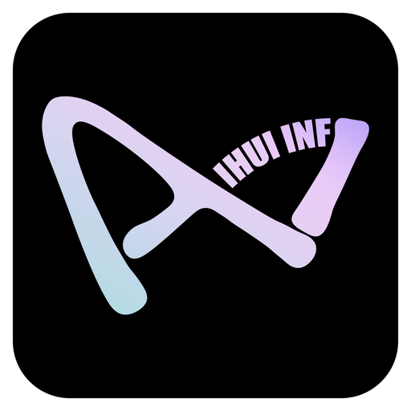
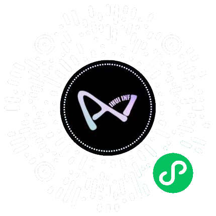

<!--
  © 2026 IHUI AI (智汇AI) · 版权所有者: 李春川 (Li Chunchuan) · https://aizhs.top
  Provenance-watermarked. 未授权商用可被溯源追责 (Apache-2.0 须保留本声明与 NOTICE)。
  [IHUI-AI-PROVENANCE]:⁠​‌​​‌​​‌‍‍​‌​​‌​​​‍‍​‌​‌​‌​‌‍‍​‌​​‌​​‌‍‍​​‌​‌‌​‌‍‍​‌​​​​​‌‍‍​‌​​‌​​‌‍‍‌​‌‌​‌‌‌‍‍‌‌​​‌‌​​‌‌‌‌​‌​‍‍‌‌​‌‌​​​‌​​​‌‌‌‍‍​‌​​​​​‌‍‍​‌​​‌​​‌‍‍‌​‌‌​‌‌‌‍‍‌‌​​‌‌‌​‌​​‌‌‌​‍‍‌‌​​‌‌​​​‌​​‌​‌‍‍‌​‌‌‌​‌‌‌​‌‌‌​‌‍‍‌​‌‌​‌‌‌‍‍​‌​​‌‌​​‍‍​‌​​​​‌‌‍‍‌​‌‌​‌‌‌‍‍​‌‌​​​​‌‍‍​‌‌​‌​​‌‍‍​‌‌‌‌​‌​‍‍​‌‌​‌​​​‍‍​‌‌‌​​‌‌‍‍​​‌​‌‌‌​‍‍​‌‌‌​‌​​‍‍​‌‌​‌‌‌‌‍‍​‌‌‌​​​​‍‍‌​‌‌​‌‌‌‍‍​‌​‌​​​​‍‍​‌​‌​​‌​‍‍​‌​​‌‌‌‌‍‍​‌​‌​‌‌​‍‍​‌​​​‌​‌‍‍​‌​​‌‌‌​‍‍​‌​​​​​‌‍‍​‌​​‌‌‌​‍‍​‌​​​​‌‌‍‍​‌​​​‌​‌‍‍​​‌​‌‌​‌‍‍​​‌‌​​‌​‍‍​​‌‌​​​​‍‍​​‌‌​​‌​‍‍​​‌‌​‌‌​⁠
-->

> ⚠️ **저작권 및 상업적 라이선스 고지**
>
> © 2026 **IHUI AI (智汇AI)** · 저작권자: **리춘촨 (李春川, Li Chunchuan)** · https://aizhs.top
>
> - 듀얼 라이선스: 오픈소스 사용은 **Apache-2.0** (저작권 표시 및 NOTICE 유지 필수). **폐쇄형 상업적 사용·브랜드 제거·SaaS 재판매**에는 별도의 상업 라이선스가 필요합니다.
> - 이 저장소의 모든 소스 파일에는 출처 추적 워터마크(가시 선언 + 불가시 폭 없는 문자 스테가노그래피, `node scripts/watermark.mjs decode <file>`로 검증 가능)가 삽입되어 있습니다. 워터마크 제거는 저작권 귀속을 변경하지 않으며, 무단 상업적 사용은 기술적으로 추적 가능하고 법적 책임을 집니다.
> - CI는 워터마크 검증(`pnpm watermark:check`)을 강제하며, 워터마크를 제거하는 변경은 빌드 실패를 유발합니다.

# IHUI-AI

<p align="center">
  
</p>

<p align="center">
  <strong>모두가 자신만의 AI 프로그램을 가질 수 있게</strong><br/>
  <sub>오픈소스 AI 상업용 통합 파운데이션 · 5분 만에 Fork에서 상용 출시 · 하나의 저장소가 6개 SaaS 대체</sub>
</p>

<p align="center">
  <a href="https://github.com/IHUI-INF-AI/IHUI-AI/actions/workflows/ci.yml"></a>
  <a href="https://github.com/IHUI-INF-AI/IHUI-AI/actions/workflows/build.yml"></a>
  <a href="https://github.com/IHUI-INF-AI/IHUI-AI/actions/workflows/e2e.yml"></a>
  <a href="https://github.com/IHUI-INF-AI/IHUI-AI/actions/workflows/knip.yml"></a>
  <a href="LICENSE"></a>
  <a href="https://github.com/IHUI-INF-AI/IHUI-AI"></a>
  <a href="https://github.com/IHUI-INF-AI/IHUI-AI/issues"></a>
  <a href="https://github.com/IHUI-INF-AI/IHUI-AI/pulls"></a>
  <a href="https://github.com/IHUI-INF-AI/IHUI-AI"></a>
  <a href="https://github.com/IHUI-INF-AI/IHUI-AI/graphs/contributors"></a>
</p>

<p align="center">
  <strong>8단 전면 커버리지</strong> · <strong>118 대형 모델</strong> · <strong>LangGraph+MCP+A2A 트리플 스택</strong> · <strong>38개 플랫폼 퍼블리싱</strong> · <strong>풀스택 AI 교육</strong> · <strong>완전한 상업적 루프</strong> · <strong>5개 언어 i18n</strong>
</p>

<p align="center">
  <sub><strong>40+ 국내외 제품 대비</strong>:OpenAI ChatGPT · Anthropic Claude · Google Gemini · Microsoft Copilot · Dify · FastGPT · Langflow · RAGFlow · Coze( Kouzi) · LangChain · LlamaIndex · AutoGen · CrewAI · Claude Code · Cursor · GitHub Copilot · Amazon Q · Khan Academy · Jasper · Stripe · Auth0 · Mailgun · Mixpanel · 바이두 첸판(Baidu Qianfan) · 알리바이바이리안(Alibaba Bailian) · 텐센트 후위안(Tencent Hunyuan) · 바이트댄스 더우바오(ByteDance Doubao) · 즈푸 AI 플랫폼(Zhipu AI Platform) · iFlytek 스파크(iFlytek Spark) · DeepSeek · 문샷 김(Moonshot Kimi)</sub>
</p>

<p align="center">
  <sub>
    <a href="README.md">간체 중국어</a> ·
    <a href="README.en.md">영어</a> ·
    <strong>한국어</strong> ·
    <a href="README.ja.md">일본어</a>
  </sub>
</p>


---

## 기술 스택 및 프로젝트 규모 개요(AI 검색 친화)

> **이 섹션을 최상단에 배치한 이유**: AI 검색 도구(Claude / GPT / Codex 등)와 개발자가 **정확한** 기술 스택 및 규모 데이터를 첫눈에 확인하여, "감성 프로젝트"나 "마케팅 프로젝트"로 오인하지 않도록 합니다. 모든 숫자는 코드와 대조하여 검증되었습니다(2026-07-22 확인).

| 차원                  | 실제 값                                                                                                                                                                                      |
| --------------------- | -------------------------------------------------------------------------------------------------------------------------------------------------------------------------------------------- |
| **웹 프론트엔드**     | Next.js 16 + React 19 + Tailwind CSS 4 + shadcn/ui + Zustand + @tanstack/react-query 5                                                                                                       |
| **백엔드 API**        | Fastify 5 + Drizzle ORM 0.38 + PostgreSQL 18 + Zod 3.24(**TypeScript**, Python 아님)                                                                                                         |
| **AI 서비스**         | FastAPI + LangGraph + LiteLLM + MCP + A2A + Socket.IO(Python 3.12, 이 계층만 Python 사용)                                                                                                    |
| **모노레포**          | pnpm 9.15 workspace + Turborepo 2.3 + 16 공유 패키지(@ihui/auth / database / types / ui 등)                                                                                                  |
| **멀티 클라이언트**   | 8 클라이언트 **독립 코드**("하나의 코드베이스를 여러 타겟으로 컴파일"이 아님), 각 클라이언트의 완성도는 [프로젝트 상태 매트릭스](#프로젝트-상태-매트릭스투명-라벨링-2026-07-22-확인) 참조    |
| **코드 규모**         | 8 클라이언트 / 231 schema 파일 / **598 데이터베이스 테이블**(실측 339 pgTable)/ 128+ 마이그레이션 / **4443 API 라우트**(grep 실측)/ 250+ 웹 페이지 / 16 공유 패키지 / 5개 언어 i18n parity |
| **엔지니어링 게이트** | **21개 pre-commit 훅**(실측, [.husky/pre-commit](./.husky/pre-commit) 참조)+ post-commit 자동 push + 11 마이그레이션 감사 + 9 PowerShell 시작 스크립트                                       |
| **테스트 커버리지**   | **237 API 테스트 + 63 e2e spec**(실측, [apps/api/tests/](./apps/api/tests/) + [apps/web/e2e/](./apps/web/e2e/) 참조)+ pytest(AI 서비스)+ Locust 부하 테스트 + Lighthouse 성능                |
| **관측 가능성**       | Prometheus + Grafana(**20 대시보드** 실측, [monitoring/grafana/dashboards/](./monitoring/grafana/dashboards/) 참조)+ Loki + Promtail + Jaeger + OpenTelemetry + Alertmanager                 |
| **AI 오케스트레이션** | LangGraph 진정 통합(21 파일 사용: `langgraph_service.py` / `agent_graph.py` / `koubo_workflow.py` / `agent_orchestrator.py` / `a2a_service.py`), 단순 "통합 수준 오케스트레이션" 아님        |
| **라이선스**          | Apache 2.0(완전 자체 호스팅, 상업 친화적, 비전염성)                                                                                                                                          |

> 전체 기술 스택 상세는 [기술 스택 섹션](#기술-스택) 참조.

---

## 🔥 개발자라면, 30초만 멈춰주세요

> **「춘춘 영하 25도. 한 사람. 한 대의 노트북. 일 년의 시간.**
>
> **8 플랫폼 코드 · 339개 데이터베이스 테이블 · 4443개 API 라우트.**
>
> **자본은 오지 않았지만, 코드는 계속 자라났습니다.」**

이것은 펀딩 스토리가 아닙니다.
**이것은 오픈소스 스토리입니다.**

당신도 새벽 3시에 혼자 코드를 작성해 본 적이 있다면——
당신도 자본에게 거절당하면서도 자신이 옳은 일을 하고 있다고 믿어 본 적이 있다면——
당신도 믿는다면——**진정 가치 있는 것은 시간이 증명한다**를——

그렇다면, 다음 한 줄은 당신에게 바칩니다:

---

### 💎 이 두 줄을 공유하는 것은, 당신 자신의 집념을 공유하는 것입니다

```
자본은 늦을 수 있어도, 코드는 거짓말하지 않는다.
펀딩은 실패할 수 있어도, 오픈소스는 실패하지 않는다.
```

**이것은 공유를 부탁하는 것이 아닙니다.**
**이 순간의 공명을, 공개된 태도로 바꾸라는 초대입니다.**

---

### 🚀 3개의 액션, 30초, 이 이야기가 보이게

| #   | 액션                                      | 당신이 얻을 것                                                                                 |
| --- | ----------------------------------------- | ---------------------------------------------------------------------------------------------- |
| 1   | ⭐ **이 저장소 Star**                     | 당신의 GitHub 타임라인에 표시되고, 당신의 followers가 볼 수 있습니다                           |
| 2   | 📲 **위 두 줄을 당신의 피드에 복사**      | 아래 이미지를 사용하세요 — 당신은 "친구들에게 이 이야기를 처음 전하는 사람"이 됩니다           |
| 3   | 💬 **Issue에서 당신만의 이야기를 쓰세요** | [여기로](https://github.com/IHUI-INF-AI/IHUI-AI/issues) — 상위는 고정하여 전 세계에 보여줍니다 |

---

### 🖼️ 이미지가 준비되어 있습니다 (저장 후 바로 공유)

| 이미지                       | 용도                   | 경로                                                     |
| ---------------------------- | ---------------------- | -------------------------------------------------------- |
| 🏢 춘춘 오프라인 베이스 실사 | 피드 헤더 / 웨이보     | `apps/web/public/images/story/changchun-winter-2024.jpg` |
| 🌃 새벽 코딩 · 램프 하나     | X / 지식인 / 기사 중간 | `apps/web/public/images/story/late-night-coding.jpg`     |

---

> **⚠️ 지금 이 문장을 읽고 있다면——**
>
> 당신은 이미 이 이야기의 일부입니다.
>
> 중국에는 700만 명의 개발자가 있습니다.
> 그중 99%가 아직 이 이야기를 모릅니다.
>
> **당신이 이 이야기를 밖으로 가져갈 1%가 되어주시겠습니까?**

⬇️ 아래로 보면, 완전한 이야기와 기술 결정이 있습니다.

---

> **생각해 본 적 있나요 —**
>
> 왜 AI 혜택은 항상 빅테크 기업들이 독점할까요? 왜 AI 애플리케이션 하나를 구축하려면 인증, 빌링, 모델 라우팅, 워크플로, 멀티 플랫폼 배포까지 처음부터 조립해야 할까요?
> 왜 개인 개발자, 중소기업, 교육 기관은 늘 바퀴를 재발명하면서 서로의 어깨 위에 서지 못할까요?
>
> **IHUI-AI가 이 문제를 바꾸려 합니다.**
>
> 우리는 하나의 완전한 AI 애플리케이션 인프라 — 8 플랫폼 프레임워크, 118 모델 연동, 워크플로 오케스트레이션, 엔터프라이즈 권한, 빌링 구독, 콘텐츠 퍼블리싱, AI 교육, 옵저버빌리티부터 17개 엔지니어링 게이트까지 — 전부 Apache 2.0 라이선스로 오픈소스화했습니다.
>
> **래퍼도, 데모도 아닙니다. 실제 운영 가능하고, 상업화 가능하고, 셀프 호스팅 가능한 AI 애플리케이션 베이스입니다. Fork 하고, 수정하고, 당신의 것으로 만드세요.**

---

## 목차

- [기술 스택 및 프로젝트 규모 개요(AI 검색 친화)](#기술-스택-및-프로젝트-규모-개요ai-검색-친화)
- [프로젝트 포지셔닝(필독)](#프로젝트-포지셔닝필독)
- [기능 개요(30초 안에 모든 역량 확인)](#기능-개요30초-안에-모든-역량-확인)
- [IHUI-AI를 선택하는 이유](#ihui-ai를-선택하는-이유)
- [유사 프로젝트와의 비교](#유사-프로젝트와의-비교)
- [IHUI-AI 사용자](#ihui-ai-사용자)
- [5가지 대표 시나리오](#5가지-대표-시나리오)
- [기술 스택](#기술-스택)
- [8 플랫폼 아키텍처](#8-플랫폼-아키텍처)
- [프로젝트 구조](#프로젝트-구조)
- [핵심 역량 상세(15대 모듈 · 사용자 역할별 그룹)](#핵심-역량-상세15대-모듈--사용자-역할별-그룹)
  - [A. AI 역량 레이어](#a-ai-역량-레이어최종-사용자-대상)
  - [B. AI 워크플로 및 개발자](#b-ai-워크플로-및-개발자개발자-대상)
  - [C. 콘텐츠 창작 및 교육](#c-콘텐츠-창작-및-교육크리에이터-및-교육자-대상)
  - [D. 엔터프라이즈 및 운영](#d-엔터프라이즈-및-운영기업-관리자-및-운영-대상)
  - [E. 엔지니어링 인프라](#e-엔지니어링-인프라운영-및-아키텍트-대상)
- [빠른 시작](#빠른-시작)
- [API 및 프로토콜](#api-및-프로토콜)
- [데이터베이스](#데이터베이스)
- [옵저버빌리티](#옵저버빌리티)
- [보안 설계](#보안-설계)
- [엔지니어링 게이트](#엔지니어링-게이트21개-pre-commit-훅)
- [엔지니어링 품질 증거("AI 생성 코드 3가지 일반적 문제"에 대한 반박)](#엔지니어링-품질-증거ai-생성-코드-3가지-일반적-문제에-대한-반박)
- [AI 프로그래밍 협업 선언](#ai-프로그래밍-협업-선언)
- [테스트](#테스트)
- [배포](#배포)
- [국제화](#국제화)
- [FAQ](#faq)
- [기여](#기여)
- [문서 탐색](#문서-탐색)
- [로드맵](#로드맵)
- [문의하기](#문의하기)
- [우리의 이야기 · 지후이AI의 탄생](#우리의-이야기--지후이ai의-탄생)
- [오픈소스 공동 구축 비전](#오픈소스-공동-구축-비전)
- [License](#license)
- [감사의 말](#감사의-말)

---

## 프로젝트 포지셔닝(필독)

> **한 줄 포지셔닝:IHUI-AI는 오픈소스 AI 상업용 통합 파운데이션(Open-Source AI Commercial-Grade Integrated Foundation)입니다 — 단일 AI 툴이 아니라 "완전히 상업화 가능한 AI 제품 하나를 구축"하는 데 필요한 모든 인프라(8단 프레임워크 + 118 모델 게이트웨이 + LangGraph+MCP+A2A 트리플 스택 + 상업적 루프 + 엔터프라이즈 보안 + 엔지니어링 게이트 + 옵저버빌리티)를 Apache 2.0 라이선스로 통째로 오픈소스화하여, 어떤 개인, 기업, 교육 기관, 콘텐츠 크리에이터든 Fork 후 5분 안에 자신만의 AI 상업 제품을 출시할 수 있게 합니다.**
>
> **가치 제안**:**하나의 저장소가 6-10개 독립 SaaS를 대체**(Stripe + Auth0 + Mailgun + Mixpanel + Dify + Claude Code + Khan Academy + 이케 + Notion AI), 월간 비용을 $300+에서 $0(셀프 호스팅)로 절감.

### 삼층 가치 피라미드

IHUI-AI의 포지셔닝은 "사용자 가치 → 제품 형태 → 기술 해자" 삼층 피라미드로 구성됩니다:

```
                 ┌─────────────────────────────────────────────────┐
   제 1 층       │  사용자 가치(Why)                                │
   사용자 가치   │  • 5분 만에 Fork에서 상용 AI 제품 출시           │
   (Why)         │  • 하나의 저장소로 6-10개 SaaS 대체, 월 $300+ 절약│
                 │  • 100% 데이터 주권, Apache 2.0 상업 친화적      │
                 │  • 5류 역할 수혜(개발자/중소기업/교육/크리에이터/기업)│
                 └─────────────────────────────────────────────────┘
                                        ▲
                 ┌─────────────────────────────────────────────────┐
   제 2 층       │  제품 형태(What)                                  │
   제품 형태     │  오픈소스 AI 상업용 통합 파운데이션              │
   (What)        │  • 6대 제품 카테고리 통합:                       │
                 │    ① AI 애플리케이션 개발 플랫폼(Dify/Coze/RAGFlow 대비)│
                 │    ② AI 코딩 CLI(Claude Code/Cursor 대비)       │
                 │    ③ 멀티단 프레임워크(Tauri/Expo/Taro/WXT 대비) │
                 │    ④ 상업 SaaS 파운데이션(Stripe+Auth0+Mixpanel 대비)│
                 │    ⑤ AI 교육 플랫폼(Khan Academy/Coursera 대비) │
                 │    ⑥ 콘텐츠 퍼블리싱 허브(이케/신미디어 매니저/Jasper 대비)│
                 │  • 하나의 저장소에 8단 코드, 툴 모음이 아닌 프리셋 제품│
                 └─────────────────────────────────────────────────┘
                                        ▲
                 ┌─────────────────────────────────────────────────┐
   제 3 층       │  기술 해자(How)                                   │
   기술 해자     │  • 8단 / 598 테이블 / 128+ 마이그레이션 / 4443 API 라우트│
   (How)         │  • LangGraph + MCP + A2A 트리플 스택 협업        │
                 │  • 16 공유 패키지 / 21 pre-commit 게이트 / 5개 언어 i18n│
                 │  • 3대 지주 옵저버빌리티 + 20 Grafana 대시보드   │
                 │  • 엔터프라이즈 보안 스택(RBAC + RLS + SSO + AES-256-GCM)│
                 │  • Apache 2.0 License, 상업적 제약 없음          │
                 └─────────────────────────────────────────────────┘
```

### IHUI-AI란 무엇인가

| 차원            | 포지셔닝                                                                                                                                                                                              |
| --------------- | ----------------------------------------------------------------------------------------------------------------------------------------------------------------------------------------------------- |
| **본질**        | 오픈소스 AI 상업용 통합 파운데이션(Open-Source AI Commercial-Grade Integrated Foundation)                                                                                                             |
| **비유**        | AI 애플리케이션계의 Kubernetes / Next.js Boilerplate / Linux 배포판 — "인프라 구축"을 3-6개월에서 5분으로 압축                                                                                        |
| **비교 레벨**   | 「AI 애플리케이션 개발 플랫폼 + AI 코딩 CLI + 멀티단 개발 프레임워크 + 상업 SaaS 파운데이션 + AI 교육 플랫폼 + 콘텐츠 퍼블리싱 허브」6대 카테고리를 동시에 아우름                                     |
| **대상 사용자** | 개인 개발자(프라이빗 AI 어시스턴트)/ 중소기업(AI 미들 플랫폼)/ AI 서비스 제공자(상업 제품)/ 교육 기관(AI 교육 풀스택)/ 콘텐츠 크리에이터(38 플랫폼 퍼블리싱)/ 기업 의사결정자(엔터프라이즈 AI 플랫폼) |
| **License**     | Apache 2.0(상업 친화적, 카피레프트 없음, 클로즈드 소스 상업 사용 허용)                                                                                                                                |
| **배포 모드**   | 완전 셀프 호스팅, Docker Compose 원클릭으로 14개 서비스 시작, 데이터 100% 주권, 자격증명 AES-256-GCM 암호화, 어떤 빅테크도 엿볼 수 없음                                                               |
| **코드 규모**   | 8단 코드 / 231 schema 파일 / 598 데이터베이스 테이블 / 128+ 마이그레이션 / 4443 API 라우트 / 250+ Web 페이지 / 16 공유 패키지 / 21 pre-commit 게이트 / 5개 언어 i18n parity                         |
| **대체 가치**   | Stripe($84/월)+ Auth0($35/월)+ Mailgun($35/월)+ Mixpanel($20/월)+ Dify($59/월)+ Claude Code($20/월)+ 이케($50/월)≈ $303/월, IHUI-AI 셀프 호스팅 $0/월                                                 |

### IHUI-AI가 아닌 것

- **ChatGPT 래퍼가 아닙니다** — 빌링/구독/멀티 테넌트/감사/RBAC를 갖춘 완전한 상업용 AI 애플리케이션 파운데이션으로, SaaS로 바로 만들 수 있습니다
- **단일 AI 대화 플랫폼이 아닙니다** — AI 대화, AI 코딩 CLI, AI 교육, AI 콘텐츠 퍼블리싱, AI Agent 마켓 5대 시나리오를 동시에 커버합니다
- **데모나 스캐폴드가 아닙니다** — 즤후이 AI 그룹(Zhihui AI Group)의 상업화 메인 플랫폼을 지원하는 프로덕션급 코드이며, 598 테이블이 실제 비즈니스 복잡도에 따라 설계되었습니다
- **SaaS 구독이 아닙니다** — 완전 셀프 호스팅, 100% 데이터 주권을 보유하며, 자격증명은 AES-256-GCM으로 암호화되고 외부로 전송되지 않습니다
- **수직적 툴이 아닙니다** — Dify는 AI 애플리케이션 오케스트레이션만, Claude Code는 CLI만, 이케(Yike)는 멀티 플랫폼 퍼블리싱만, RAGFlow는 RAG만, Khan Academy는 교육만 하는 것과 달리, IHUI-AI는 6대 카테고리 역량을 **하나의 Apache 2.0 저장소에 통합**합니다
- **LangChain/LlamaIndex 같은 개발 프레임워크가 아닙니다** — 그것들은 개발자용 "자동차 부품"이고, IHUI-AI는 "완성차 출고"로 비기술 팀도 바로 사용할 수 있습니다

### 비용 비교:IHUI-AI 셀프 호스팅 vs 동등 SaaS 스택

> 아래 비용은 2026년 7월 기준 각 SaaS 공식 사이트 공개 가격(월간 구독, 소형 팀 5인 + 월 1만 활성 사용자 시나리오)이며, 의사결정 참고용입니다.

| 역량 차원                | 동등 SaaS 조합                                                      | 월간 비용     | IHUI-AI 셀프 호스팅        |
| ------------------------ | ------------------------------------------------------------------- | ------------- | -------------------------- |
| **AI 대화 및 모델**      | OpenAI ChatGPT Team($25/인)+ Dify($59)                              | $184/월       | **$0**(모델비만)           |
| **AI 코딩 CLI**          | Claude Code($20)+ GitHub Copilot($19)+ Cursor($20)                  | $59/월        | **$0**(모델비만)           |
| **결제/구독/빌링**       | Stripe($84)+ Lemon Squeezy($5)                                      | $89/월        | **$0**                     |
| **인증/SSO/RBAC**        | Auth0($35)+ Clerk($25)                                              | $60/월        | **$0**                     |
| **이메일/SMS**           | Mailgun($35)+ Twilio($35)                                           | $70/월        | **$0**                     |
| **사용자 분석**          | Mixpanel($20)+ PostHog($0 오픈소스)                                 | $20/월        | **$0**(BI 내장)            |
| **AI 교육 플랫폼**       | Khan Academy(무료, 단 클로즈드 소스)+ Coursera for Business($70/인) | $350/월       | **$0**(오픈소스 맞춤 가능) |
| **콘텐츠 퍼블리싱 허브** | 이케($50)+ 신미디어 매니저($30)                                     | $80/월        | **$0**                     |
| **옵저버빌리티 스택**    | Datadog($15/호스트)+ Sentry($26)                                    | $101/월       | **$0**(오픈소스 스택)      |
| **합계**                 | 9개 SaaS                                                            | **$1,013/월** | **$0**(서버비만)           |
| **3년 총비용**           |                                                                     | **~$36,468**  | **~$1,080**(단일 VPS)      |

> **결론**:동등한 역량 조합의 경우, 동등 SaaS 월간 비용은 약 $1,013, 3년 $36,468; IHUI-AI 셀프 호스팅은 서버 비용만 약 $30/월, 3년 $1,080. **$35,000+를 절약하면서 100% 데이터 주권 + 완전한 맞춤 설정 역량을 보유**합니다.

### IHUI-AI의 고유 가치(오픈소스 생태계에서 드문 사례)

전면적인 시장 비교(40+ 국내외 제품 커버, 상세 비교는 아래 표 참조) 결과, 다음 역량 조합은 **글로벌 오픈소스 AI 프로젝트 중 동시 보유는 드문 사례입니다**:

1. **8단 전면 커버리지**:Web / API / AI 서비스 / CLI / 데스크톱 Tauri / 브라우저 확장 WXT / 모바일 RN / 위챗 미니앱 Taro — 동류 오픈소스 AI 프로젝트는 최대 2단(Dify/FastGPT), 8단(클로즈드 소스:ChatGPT 2단 / Coze 2단 / Claude Code 1단)
2. **LangGraph + MCP + A2A 트리플 스택 협업**:워크플로 + 툴 프로토콜 + Agent 상호운용 일체화, 타 오픈소스 AI 플랫폼은 최대 단일 스택(Langflow는 LangChain DAG만, Dify는 MCP/A2A 없는 자체 워크플로, LangChain/LlamaIndex는 프레임워크층만)
3. **자체 CLI, Claude Code 대항**:17 명령 + 13 내장 툴 + ACP Server + 6 소스 설정 가져오기(cc-switch / codex++ / Claude / Codex / Gemini / Hermes)+ Skills 시스템 — 오픈소스 AI 애플리케이션 플랫폼 중 자체 CLI를 갖춘 프로젝트는 드묾(Cursor / Copilot / Windsurf / Amazon Q / Cline / Aider / Cody는 모두 클로즈드 소스 또는 순수 CLI 툴)
4. **완전한 상업적 루프**:VIP / 구독 recurring / 지갑 / 포인트 / 환불 감사 / 인보이스 / 환율 / 8 결제 게이트웨이 / 분배 커미션 / 초대 리베이트 — 오픈소스 AI 플랫폼 중 금융급 상업적 루프 내장은 드묾(Dify/FastGPT/Langflow 모두 없음)
5. **38 플랫폼 원클릭 자동 퍼블리싱**:글 9 플랫폼 + 이미지 2 플랫폼 + 비디오 5 플랫폼 + AES-256-GCM 자격증명 암호화 + 38 adapter — 오픈소스 프로젝트 중 공식계정/Zhihu/CSDN/Juejin/Xiaohongshu/Weibo/Bilibili/YouTube/Douyin 등 38 플랫폼 완전 커버는 드묾(이케/신미디어 매니저는 클로즈드 소스 SaaS)
6. **AI 교육 풀스택**:강의 / 문제은행 / 시험 / SRS 간격 반복 / 라이브 / 학습 리포트 / 수료증 / 강사 / 학생 페이지 12 서브페이지 / 45 테이블 edu-full schema — 오픈소스 AI 플랫폼 중 완전한 AI 교육 풀스택 내장은 드묾(Khan Academy/Coursera는 클로즈드 소스 SaaS)
7. **엔터프라이즈 보안 스택**:RBAC + 멀티 테넌트 + RLS(Row-Level Security)+ SSO(OAuth2 + Apple + Google + PKCE)+ AES-256-GCM + JWT token-family + 워크스페이스 3 모드 권한 + 7 엔드포인트 런타임 가로채기 + 60s 감사 타임아웃 + GDPR + 2FA + IDOR 방호 — 오픈소스 AI 플랫폼 중 완전한 엔터프라이즈 보안 스택 내장은 드묾
8. **17 엔지니어링 게이트 + 11 마이그레이션 감사 + post-commit 자동 push**:메커니즘 수준에서 협업 사고를 원천 차단 — 오픈소스 AI 프로젝트 중 메커니즘급 엔지니어링 게이트 구현은 드묾(Dify/FastGPT는 기본 lint만)
9. **3대 지주 옵저버빌리티 + 20 Grafana 대시보드**:Prometheus + Grafana + Loki + Promtail + Jaeger + OpenTelemetry + Alertmanager — 오픈소스 AI 플랫폼 중 완전한 SRE급 옵저버빌리티 스택 내장은 드묾(타 프로젝트는 최대 기본 로그)
10. **5개 언어 i18n parity + 4 게이트 스크립트**:zh-CN / zh-TW / en / ko / ja 키 셋 강건 일관성, opencc 자형 감지 + 문자 범위 감지 + 깨진 기계번역 감지 — 오픈소스 AI 프로젝트 중 parity + 게이트급 i18n 구현은 드묾(타 프로젝트는 최대 중영문)

### 기억 포인트 슬로건(확산 가능)

| 슬로건                               | 가치 앵커                                                                                       |
| ------------------------------------ | ----------------------------------------------------------------------------------------------- |
| **"하나의 저장소가 6개 SaaS 대체"**  | Stripe + Auth0 + Mailgun + Mixpanel + Dify + Claude Code 대체, 월 $300+ 절약                    |
| **"5분 만에 Fork에서 상용 출시"**    | Docker Compose 원클릭 14 서비스 시작, 클론부터 출시까지 최단 5분, 기존 방식 3-6개월             |
| **"AI 애플리케이션계의 Kubernetes"** | "인프라 구축"을 표준화, 재사용 가능하게, 어떤 팀이든 통일된 파운데이션 위에서 자신의 AI 앱 실행 |
| **"8단 + 118 모델 + 트리플 스택"**  | 8단 코드 + 118 모델 + LangGraph+MCP+A2A 트리플 스택, 오픈소스 AI 생태계 최다 커버              |
| **"Apache 2.0, 상업적 제약 없음"**   | License 상업 친화적, 카피레프트 제약 없음, 클로즈드 소스 상업 사용 허용, 기업 안심 Fork 가능    |
| **"데이터 100% 주권"**               | 완전 셀프 호스팅, 자격증명 AES-256-GCM 암호화, 외부 회신 없음, GDPR / 등급보호 요구 충족        |

### 6대 비교 카테고리와의 관계

IHUI-AI는 어떤 단일 프로젝트를 대체하려는 것이 아니라, 다음 6류 프로젝트의 역량을 **하나의 오픈소스 파운데이션에 통합**합니다:

| 비교 카테고리                     | 대표 제품                                                                                                                                                                                                                                                                                                                       | IHUI-AI 비교 역량                                                                                                                                    |
| --------------------------------- | ------------------------------------------------------------------------------------------------------------------------------------------------------------------------------------------------------------------------------------------------------------------------------------------------------------------------------- | ---------------------------------------------------------------------------------------------------------------------------------------------------- |
| **AI 애플리케이션 개발 플랫폼**   | Dify / FastGPT / Langflow / RAGFlow / Flowise / Coze(Kouzi)                                                                                                                                                                                                                                                                     | 118 모델 LiteLLM 게이트웨이 + LangGraph 워크플로 + 지식 베이스 RAG + pgvector 벡터 DB + 지식 그래프 + Agent Runtime + Persona                       |
| **AI 코딩 CLI / IDE**             | Claude Code / Cursor / Windsurf / GitHub Copilot / Copilot Workspace / Amazon Q Developer / Cody Sourcegraph / Cline / Aider / Devin / Tabnine / GitLab Duo / Gemini CLI / OpenCode / CodeGeeX / Continue / Roo Code / Codeium / JetBrains AI Assistant                                                                         | 자체 CLI 17 명령 + 13 내장 툴 + ACP Server(Zed/VSCode/Cursor 임베드)+ 6 소스 설정 가져오기 + Skills + CodeGraph + Worktree                           |
| **엔터프라이즈 AI Agent 플랫폼**  | Google Gemini Enterprise Agent Platform / OpenAI Agents SDK / Microsoft Copilot Studio / IBM watsonx.ai / Salesforce Agentforce / ServiceNow Now Assist / AWS Bedrock Agents / Crew                                                                                                                                             | LangGraph + MCP + A2A 트리플 스택 + Agent 마켓 + 개발자 센터 + Coze SDK 프록시 + OpenClaw + Crew 통합 + N8N 프록시                                   |
| **AI Agent 프레임워크(오픈소스)** | LangChain / LangGraph / LlamaIndex / AutoGen / CrewAI / AutoGPT / MetaGPT / smol agents / Semantic Kernel / Spring AI / Hugging Face Transformers Agents                                                                                                                                                                        | 트리플 스택 협업 + 완전한 Agent Runtime + Persona 레지스트리 + Agent 마켓 — 단순 프레임워크가 아닌 제품화 구현 방안                                  |
| **멀티단 개발 프레임워크**        | Tauri / Electron / Expo / React Native / Taro / WXT / Next.js / Remix / Nuxt / SvelteKit                                                                                                                                                                                                                                        | 8단 통일 아키텍처 + 16 공유 패키지 + 크로스 단말 타입 안전 + 공유 UI(`@ihui/ui-react` / `@ihui/ui-native` / `@ihui/design-tokens`)                   |
| **AI 교육 / 콘텐츠 플랫폼**       | Khan Academy / Coursera / edX / Google 교육 AI / 즈푸 AI 교육 / Xueersi AI / Jasper / Copy.ai / Rytr / WriteSonic / Notion AI / 이케 / 신미디어 매니저                                                                                                                                                                          | AI 교육 풀스택(강의/문제은행/시험/SRS/라이브/수료증)+ 38 플랫폼 원클릭 퍼블리싱 + 셀프미디어 워크벤치 + AI 뉴스 + AI 구직 + 숏드라마 + 비즈니스 명함 |
| **대형 모델 API 플랫폼**          | 해외:OpenAI Platform / Anthropic API / Google Vertex AI / AWS Bedrock / Azure AI Foundry / Mistral La Plateforme / Cohere / Together AI / Fireworks AI / Replicate<br>국내:바이두 첸판 / 알리바이바이리안 / 텐센트 후위안 / 바이트댄스 더우바오(화산방주)/ 즈푸 AI 플랫폼 / iFlytek 스파크 / 문샷 김 / DeepSeek / 상테크 일일신 | LiteLLM 통일 게이트웨이 + 118 모델 연동 + 스마트 라우팅 + 60% 캐시 적중 + 멀티 provider 어댑팅                                                      |
| **상업 SaaS 파운데이션**          | Stripe / PayPal / Lemon Squeezy / Paddle / Auth0 / Clerk / Firebase Auth / Supabase Auth / Mailgun / SendGrid / Postmark / Resend / Mixpanel / Amplitude / PostHog / Heap                                                                                                                                                       | VIP/구독/지갑/포인트/환불/인보이스/8 결제 게이트웨이 + JWT/SSO/RBAC + SMTP SMS + BI 대시보드 + 카나리 배포 — 4-6개 SaaS를 원스톱 대체                |

> **핵심 인사이트**:오픈소스 AI 생태계에서 IHUI-AI보다 **더 전문적인** 프로젝트(RAGFlow는 RAG 차원에서 더 깊고, Claude Code는 CLI 차원에서 더 성숙하고, LangChain은 프레임워크층에서 더 유연함)는 찾을 수 있지만, IHUI-AI보다 **더 포괄적인** 오픈소스 파운데이션은 찾을 수 없습니다 — 6대 카테고리 역량을 하나의 Apache 2.0 저장소에 통합하는 것이 IHUI-AI의 핵심 차별화입니다.
>
> **누구를 대체하는 것이 아니라, 6개 제품의 역량을 Apache 2.0 오픈소스로 공개하는 것입니다**:RAGFlow의 RAG가 필요하면 RAGFlow만 단독 사용해도 됩니다;Claude Code의 CLI가 필요하면 Claude Code만 단독 사용해도 됩니다;하지만 **완전히 상업화 가능한 AI 제품**(대화+코딩+교육+퍼블리싱+빌링+엔터프라이즈 보안)이 필요하다면, IHUI-AI는 글로벌 오픈소스 생태계에서 주목할 만한 선택지 중 하나입니다.

---

## 기능 개요(30초 안에 모든 역량 확인)

| 대분류                   | 모듈                           | 핵심 역량                                                                                                                                      |
| ------------------------ | ------------------------------ | ---------------------------------------------------------------------------------------------------------------------------------------------- |
| **AI 대화 및 모델**      | 멀티 모델 대화                 | 118 모델 / 스마트 라우팅 / 60% 캐시 적중 / 스트리밍 SSE + WebSocket / 대화 즐겨찾기 / 히스토리 / 공유 / 템플릿                                |
|                          | AI 이미지 생성                 | 텍스트→이미지 / 이미지 편집 / 다중 해상도 / 멀티 모델(Stable Diffusion / DALL-E / Tongyi Wanxiang)                                             |
|                          | AI 오디오                      | TTS 스트리밍 합성 / ASR 음성 인식 / 음색 클론 / 양방향 실시간 음성(WebRTC PCM16 16kHz)                                                         |
|                          | AI 비디오 합성                 | 텍스트→비디오 / 비디오 편집 / 멀티 모델 혼합 편성 / 트랜스코딩 / 비디오 작업 관리                                                              |
|                          | AI 디지털 휴먼                 | Tencent Hunyuan 3D / AI 월드 / 디지털 휴먼 인터랙션                                                                                            |
|                          | AI 월드                        | ai-world-items + AI 랭킹 + 트렌드 동기화 + AI 모듈화(ai-modules) + AI 벤더 설정 센터(ai-vendor-configs)                                        |
|                          | AI 커리어                      | AI 구직 어시스턴트 / 이력서 최적화 / 모의 면접                                                                                                 |
|                          | AI 뉴스                        | AI 뉴스 aggreggation / 스마트 요약 / ai-feed                                                                                                   |
|                          | 사용자 단위 AI 설정            | 사용자 단위 모델 대화 선호도(ai-user-model-chat) / 사용자 장기 기억(user-memory) / 사용자 선호도(user-preferences)                             |
| **AI 워크플로**          | LangGraph                      | StateGraph 워크플로(plan → execute → summarize) + stub 모드                                                                                    |
|                          | MCP 툴 프로토콜                | 11 내장 툴 + 3 리소스 + 3 프롬프트 / 커스텀 툴 / 프로젝트 단위 MCP / mcp-extended                                                              |
|                          | A2A 프로토콜                   | Agent-to-Agent 연동 / Redis 영속화 + 메모리 폴백                                                                                               |
|                          | 지식 베이스 RAG                | 문서 벡터화 / 시맨틱 검색 / 인용 추적 / knowledge-base + knowledge-rag                                                                         |
|                          | 지식 그래프                    | knowledge-graph 스키마 + 노드-관계 그래프 / 문서 간 엔티티 링크(오픈소스 AI 플랫폼에서 희귀)                                                   |
|                          | pgvector 벡터 DB               | 0123_pgvector_embedding 마이그레이션 / 네이티브 PostgreSQL 벡터 인덱스 / 독립 벡터 DB 불필요                                                   |
|                          | 워크플로 오케스트레이션        | 시각화 워크플로 / CrewAI 통합 / N8N 프록시 / workflows                                                                                         |
|                          | 벡터 메모리                    | 코사인 유사도 시맨틱 검색 / 세션 간 장기 메모리 / vector-memory                                                                                |
| **멀티 에이전트 생태계** | 에이전트 마켓                  | 구매 / 심사 / 정산 / 출금 / 분류 / 추천 / 랭킹 / 큐레이션                                                                                      |
|                          | 개발자 센터                    | API Keys / 호출 로그 / 팀 관리 / 수익 분석 / 13 서브페이지                                                                                     |
|                          | Coze SDK 프록시                | Bot / 대화 / 워크플로 / 데이터셋 / 템플릿 / 변수 / 워크스페이스 / OAuth                                                                        |
|                          | OpenClaw                       | 오픈소스 Agent 프레임워크 연동 / clawdbot / openclaw-routes                                                                                    |
|                          | Skills 시스템                  | content_engine(build_gpt56_sol / export_csdn_md / full_audit / publish_pipeline) + koubo_workflow(10+ tools)                                   |
| **8 플랫폼 프레임워크**  | Web                            | Next.js 16 / 200+ 페이지 / PWA / SEO / 다크 모드 / 5개 언어                                                                                    |
|                          | API                            | Fastify 5 / 4443 라우트 / 25 WebSocket 엔드포인트 / 604 라우트 파일 / OpenAPI                                                                  |
|                          | AI 서비스                      | FastAPI + LangGraph + LiteLLM + MCP + A2A / 577 엔드포인트 / 5 provider 어댑터                                                                 |
|                          | CLI                            | Node.js / 17 명령 / 13 내장 툴 / 6 소스 설정 가져오기 / ACP Server                                                                             |
|                          | 데스크톱                       | Tauri 2 + Rust / 시스템 트레이 / 로컬 파일 접근                                                                                                |
|                          | 브라우저 확장                  | WXT / 컨텍스트 메뉴 / 사이드바 / Chrome + Edge + Firefox                                                                                       |
|                          | 모바일 RN                      | React Native + Expo EAS / iOS + Android / SSO                                                                                                  |
|                          | 미니앱                         | Taro 4 / 위챗페이 네이티브 통합 / 3개 언어(i18n)                                                                                               |
| **엔터프라이즈 역량**    | 워크스페이스 권한              | 3 모드 + 7 엔드포인트 런타임 가로채기 + 60s 감사 타임아웃 + workspace-ai-tasks                                                                 |
|                          | RBAC + 멀티 테넌트             | 역할 / 부서 / 조직 / 테넌트 격리 / 메뉴 권한 / data-scope 5단계                                                                                |
|                          | SSO 싱글 사인온                | OAuth 2.0 / Apple / Google / SSO 중계 로그인 / PKCE                                                                                            |
|                          | 빌링 및 구독                   | VIP 등급 / 구독 recurring / 지갑 / 포인트 / 환불 감사 / 인보이스 / 환율 / 8 결제 게이트웨이                                                    |
|                          | 카나리 배포                    | Canary / 그레이디언트 규칙 / A/B 테스트 / canary + ab-tests                                                                                    |
|                          | 데이터 컴플라이언스            | GDPR / 민감어 필터 / 콘텐츠 심사 / 감사 로그 / 데이터 내보내기                                                                                 |
| **콘텐츠 창작**          | 셀프미디어 워크벤치            | 공식계정 글 + 구두 스크립트 듀얼 파이프라인 / 슬래시 명령 / self-media-automation                                                              |
|                          | 38 플랫폼 자동 퍼블리싱        | 글 9 + 이미지 2 + 비디오 5 플랫폼 / 자격증명 AES-256-GCM 암호화 / 38 adapter                                                                   |
|                          | 뉴스 기사                      | 기사 / 뉴스 / 특집 / 태그 / 댓글 / 좋아요 / 즐겨찾기 / news-crawler                                                                            |
|                          | 숏드라마                       | 숏드라마 창작 및 관리 / drama                                                                                                                  |
|                          | 비즈니스 명함                  | 명함 생성 / 편집 / 즐겨찾기 / 공유 / business-cards                                                                                            |
| **AI 교육 풀스택**       | 강의 학습                      | 강의 / 챕터 / 학습 경로 / 학습 맵 / 진행 추적 / 노트 / zhs-course                                                                              |
|                          | 문제은행 및 시험               | 다양한 문제 유형 / 자동 채점 / 챕터 연습 / 오답 노트 / 시험지 업로드 / exam-marking                                                            |
|                          | **교무 및 출결**               | 학급 출결 규칙(지각/조퇴/결석)/ 결석 자동 보완 / 휴가 승인 트랜잭션 연동 / 일괄 호명 / CSV 내보내기 / 대리·본인·QR 3종 / attendance-rule       |
|                          | SRS 간격 반복                  | 에빙하우스 망각 곡선 / 스마트 복습 스케줄링                                                                                                    |
|                          | 라이브 강의                    | 출석 체크 / 인터랙션 / 다시보기 / AI 보조 / live-chat                                                                                          |
|                          | 학습 리포트                    | 행동 분석 / 개인화 제안 / 수료증 발급                                                                                                          |
|                          | 강사 관리                      | 강사 홈페이지 / 강의 연결 / education-platform                                                                                                 |
|                          | 학생 페이지                    | 12 서브페이지(질문/기사/서클/댓글/강의/리소스/노트/오프라인/시험지/오답노트/수료증)                                                            |
| **커뮤니티 인터랙션**    | 서클 광장                      | 서클 / 광장 / 질문답변 / 게시글 / 토픽 / 태그                                                                                                  |
|                          | 1:1 메시지                     | 1:1 개인 메시지 / 시스템 알림 / 멀티 단말 동기화 / private-letters                                                                             |
|                          | 팔로우 팬                      | 팔로우 / 팬 / 사용자 홈페이지 / 명함                                                                                                           |
|                          | 공유 초대                      | 초대 코드 / 공유 코드 / H5 공유 / 추천 커미션 / visit-tracking                                                                                 |
| **운영 성장**            | 포인트 출석                    | 매일 출석 / 작업 포인트 / 포인트 샵 / 교환 / point-redeem-items                                                                                |
|                          | 랭킹                           | 다차원 랭킹 / 주간·월간 차트 / 사용자 순위 / ranking                                                                                           |
|                          | 추첨 이벤트                    | 추첨 / 레드봉 / 보상 동영상 광고 / rewarded-video-ad                                                                                           |
|                          | 분배 커미션                    | 분배 시스템 / 커미션 플랜 / 출금 / 8 서브페이지 / commission                                                                                   |
|                          | 이벤트 공지                    | 이벤트 관리 / 공지 푸시 / Banner 캐러셀 / carousels                                                                                            |
| **고객 지원**            | 티켓 시스템                    | 티켓 제출 / 처리 / 평가 / FAQ / admin-asks + admin-faq                                                                                         |
|                          | 온라인 고객지원                | WebSocket 실시간 고객지원 / 1:1 세션 / customer-service                                                                                        |
|                          | 피드백 센터                    | 사용자 피드백 / 처리 상태 / 추적                                                                                                               |
| **운영 모니터링**        | BI 대시보드                    | 비즈니스 지표 시각화 / 데이터 분석 / bi-dashboard                                                                                              |
|                          | 에러 대시보드                  | 에러 aggregation / 알림 / 추적 / security-audit                                                                                                |
|                          | 작업 로그                      | 로그인 로그 / 작업 로그 / 콜백 로그 / audit + security-logs                                                                                    |
|                          | 모니터링 알림                  | Prometheus + Grafana(20 대시보드) + Loki + Promtail + Jaeger + OpenTelemetry + Alertmanager                                                    |
| **엔지니어링 인프라**    | 데이터베이스                   | PostgreSQL 18 / **598 테이블** / 231 schema 파일 / **128+ 마이그레이션** / Drizzle ORM + RLS + 테넌트 라우팅 + pgvector                       |
|                          | 큐 캐시                        | Redis 7 + BullMQ / 독립 worker 프로세스(:8804)                                                                                                 |
|                          | 오브젝트 스토리지              | OSS 멀티 벤더 드라이버 / 자격증명 암호화 / 청크 업로드 / 파일 버전 / chunked-upload                                                            |
|                          | 이메일 SMS                     | SMTP / SMS 게이트웨이 / 이메일 템플릿 / 인증번호 / mail + message-templates                                                                    |
|                          | 국제화                         | 5개 언어 parity(zh-CN / zh-TW / en / ko / ja) + 19 i18n 툴체인 + 4 게이트 스크립트                                                             |
|                          | 엔지니어링 게이트              | 21 pre-commit 훅 + post-commit 자동 push + 11 마이그레이션 감사 + 9 PowerShell 시작                                                            |
|                          | 테스트 커버리지                | ~14839+ 케이스 + 400+ 케이스 / Vitest + Playwright + pytest + Locust 부하 테스트 + Lighthouse 성능                                                        |
|                          | 배포 운영                      | Docker Compose(14 서비스) / 블루그린 배포 / Nginx upstream 전환 / 헬스 체크 / 롤백 / 백업 / 인증서 갱신 cron                                   |
|                          | 성능 CI                        | Knip 미사용 코드 감지 + Lighthouse CI 성능 예산 + GitHub Act 로컬 CI                                                                           |
|                          | 마이크로서비스 엔지니어링 패턴 | Outbox 트랜잭션 아웃박스 + Refund DLQ 데드레터 큐 + Circuit Breaker 서킷 브레이커 + IDOR 보호 + WS Dedup 메시지 중복 제거 + Hot Config 핫 설정 |

---

## IHUI-AI를 선택하는 이유

| 차원                               | 역량                                                                                                                  | 산업 포지셔닝                                      |
| ---------------------------------- | --------------------------------------------------------------------------------------------------------------------- | -------------------------------------------------- |
| **플랫폼 커버리지**                | Web / API / AI 서비스 / CLI / 데스크톱 / 확장 / 모바일 RN / 미니앱 Taro                                               | 업계 최초 8 플랫폼 풀커버리지 AI 풀스택 플랫폼     |
| **모델 연동**                      | LiteLLM 게이트웨이로 118 모델 통합(글로벌 30+ / 중국 15+ / 클라우드 벤더 10+)                                        | 원스톱 연동, 스마트 라우팅 + 60% 캐시              |
| **AI 오케스트레이션 3스택**        | LangGraph(워크플로) + MCP(툴 프로토콜) + A2A(Agent 연동)                                                              | 워크플로, 툴, 에이전트 협업 일체화                 |
| **자체 CLI**                       | 17 명령 + 13 내장 툴 + ACP Server, Claude Code 대항                                                                   | 커맨드라인 네이티브 AI 코딩 경험                   |
| **CLI 설정 완벽 가져오기**         | cc-switch / codex++ / Claude / Codex / Gemini / Hermes 6 소스 원클릭 가져오기                                         | CLI 툴 간 설정 마이그레이션 비용 제로              |
| **엔터프라이즈 보안**              | RBAC + 워크스페이스 3 모드 권한 + 7 엔드포인트 런타임 가로채기 + 60s 감사 타임아웃                                    | 의사결정자급 리스크 컨트롤                         |
| **데이터 암호화**                  | AES-256-GCM(credentials 암호화) + JWT token-family 로테이션 + refresh 블랙리스트                                      | 금융급 데이터 보호                                 |
| **옵저버빌리티**                   | Prometheus + Grafana(**20 대시보드**) + Loki + Promtail + Jaeger + OpenTelemetry + Alertmanager                       | 풀링크 지표 / 로그 / 추적 / 알림                   |
| **엔지니어링 게이트**              | 21 pre-commit + post-commit 자동 push + git-push-guard + 11 마이그레이션 감사                                         | 협업 사고 방지, 99.9% SLA                          |
| **국제화**                         | zh-CN / zh-TW / en / ko / ja 5개 언어 parity + 19 i18n 툴체인                                                         | 5개 언어 키 셋 강건 일관성                         |
| **데이터베이스**                   | **598 테이블 + 128+ 마이그레이션** + 231 schema 파일 + Drizzle ORM + RLS + 테넌트 라우팅 + pgvector                  | 단일 DB PostgreSQL 18, schema 격리                 |
| **API 규모**                       | 4443 라우트(api) + 577 엔드포인트(ai-service) + 25 WebSocket + 604 라우트 파일                                        | 원본 프로젝트 331 엔드포인트 대비 대폭 확장        |
| **비즈니스 커버리지**              | 15대 모듈 / 50+ 서브 기능 / **250+ Web 페이지**                                                                       | 하나의 플랫폼이 모든 AI 애플리케이션 시나리오 커버 |
| **공유 패키지**                    | 16 packages(auth/database/types/ui/sdk/api-client/context-compaction 등)                                              | 크로스 플랫폼 타입 안전 + 재사용                   |
| **성능 보장**                      | Knip 미사용 코드 + Lighthouse CI + Locust 부하 테스트                                                                 | 성능 예산 + 용량 추정                              |
| **배포 성숙도**                    | Docker Compose(14 서비스) + 블루그린 + Nginx upstream + 인증서 갱신 cron                                              | 프로덕션급 운영                                    |
| **마이크로서비스 엔지니어링 패턴** | Outbox 트랜잭션 아웃박스 + Refund DLQ 데드레터 큐 + Circuit Breaker 서킷 브레이커 + IDOR 보호 + WS Dedup + Hot Config | 프로덕션급 마이크로서비스 패턴                     |

---

## 유사 프로젝트와의 비교

### 대비 매트릭스 · 12열 횡단 비교(국내외 40+ 유명 제품 커버)

> 테이블 열이 많으므로, 데스크톱에서 횡단 스크롤하여 확인하는 것을 권장합니다. 모바일에서는 "IHUI-AI" 열과 "핵심 결론" 섹션만 보셔도 됩니다.

| 차원                   | IHUI-AI                                                     | OpenAI ChatGPT    | Dify                 | LangChain           | RAGFlow         | Coze(Kouzi)       | Claude Code       | Cursor            | GitHub Copilot     | Khan Academy            | Stripe+Auth0         |
| ---------------------- | ----------------------------------------------------------- | ----------------- | -------------------- | ------------------- | --------------- | ----------------- | ----------------- | ----------------- | ------------------ | ----------------------- | -------------------- |
| **비교 카테고리**      | 6대 카테고리 통합(애플리케이션+CLI+멀티단+상업+교육+콘텐츠) | 범용 AI 대화      | AI 애플리케이션 개발 | AI Agent 프레임워크 | RAG 지식 베이스 | AI 에이전트 SaaS  | AI 코딩 CLI       | AI 코딩 IDE       | AI 코딩 어시스턴트 | AI 교육 플랫폼          | 결제+인증 파운데이션 |
| **License**            | **Apache 2.0**                                              | **클로즈드 소스** | Apache 2.0           | MIT                 | Apache 2.0      | **클로즈드 소스** | **클로즈드 소스** | **클로즈드 소스** | **클로즈드 소스**  | **클로즈드 소스**(무료) | **클로즈드 SaaS**    |
| **셀프 호스팅**        | **완전 셀프 호스팅**                                        | 미지원            | Docker               | 라이브러리          | Docker          | 미지원            | N/A               | N/A               | N/A                | 미지원                  | N/A                  |
| **단말 커버리지**      | **8단**                                                     | 2단(Web/APP)      | 2단                  | 0단(라이브러리)     | 2단             | 2단               | 1단(CLI)          | 1단(IDE)          | 1단(IDE)           | 2단                     | 0단(라이브러리)      |
| **모델 연동**          | **118 모델** + LiteLLM                                     | OpenAI 계열       | 50+ 모델             | LangChain 어댑터    | 30+ 모델        | 바이트계          | Anthropic         | 멀티 모델         | OpenAI             | 없음                    | N/A                  |
| **워크플로 엔진**      | **LangGraph + MCP + A2A 트리플 스택**                       | 없음              | 자체 워크플로        | LangGraph           | 없음            | 자체 워크플로     | 없음              | 없음              | 없음               | 없음                    | N/A                  |
| **자체 CLI**           | **17 명령 + 13 툴 + ACP Server**                            | 없음              | 없음                 | 없음                | 없음            | 없음              | 네이티브 CLI      | 없음              | 없음               | 없음                    | N/A                  |
| **멀티 테넌트 + RBAC** | **완전**(5단계 + RLS)                                       | 단일 사용자       | 기본                 | 없음                | 기본            | SaaS 내           | 없음              | 없음              | 없음               | 학교 계정               | 기본                 |
| **빌링 구독**          | **완전**(VIP/지갑/포인트/환불/8 결제 게이트웨이)            | 구독($20-200)     | 없음                 | 없음                | 없음            | SaaS 내           | 없음              | 구독($20)         | 구독($10-39)       | 무료                    | 핵심(결제)           |
| **AI 교육**            | **풀스택**(강의/문제은행/시험/SRS/라이브/45 테이블)         | 없음              | 없음                 | 없음                | 없음            | 없음              | 없음              | 없음              | 없음               | 핵심(교육)              | 없음                 |
| **콘텐츠 퍼블리싱**    | **38 플랫폼 + 38 adapter**                                  | 없음              | 없음                 | 없음                | 없음            | 없음              | 없음              | 없음              | 없음               | 없음                    | 없음                 |
| **옵저버빌리티**       | **3대 지주 + 20 대시보드**                                  | -                 | 기본                 | 없음                | 기본            | -                 | 없음              | 없음              | 없음               | -                       | -                    |
| **엔지니어링 게이트**  | **17 훅 + 11 마이그레이션 감사 + 자동 push**                | -                 | 기본                 | 기본                | 기본            | -                 | 없음              | 없음              | 없음               | -                       | -                    |
| **i18n**               | **5개 언어 parity + 4 게이트**                              | 다국어            | 중영문               | 영문                | 중영문          | 다국어            | 영문              | 다국어            | 다국어             | 다국어                  | N/A                  |
| **데이터베이스**       | **598 테이블 + 128+ 마이그레이션 + RLS + pgvector**        | SaaS 내           | 기본                 | 없음                | pgvector        | SaaS 내           | 없음              | 없음              | 없음               | SaaS 내                 | SaaS 내              |
| **공유 패키지**        | **16 packages**                                             | 없음              | 없음                 | 1 라이브러리        | 없음            | -                 | 없음              | 없음              | 없음               | 없음                    | 1 SDK                |
| **월간 비용(5인)**     | **$0**(셀프 호스팅, 서버비만)                               | $125+             | $59+                 | $0(직접 통합)       | $0(직접 통합)   | SaaS 내           | $100              | $100              | $95                | 무료(교육)              | $149+                |

### 핵심 결론

**IHUI-AI는 누구를 대체하려는 것이 아니라, "완전한 AI 애플리케이션 하나를 구축"하는 데 필요한 6대 카테고리 인프라를 모두 오픈소스로 공개하는 것입니다.**

- **OpenAI ChatGPT 대비**:IHUI-AI는 완전 셀프 호스팅, 데이터 100% 주권, 빌링/교육/퍼블리싱 등 완전한 비즈니스 내장, ChatGPT는 클로즈드 소스 SaaS
- **Dify / FastGPT / Langflow / RAGFlow 대비**:IHUI-AI는 6단, 자체 CLI, 완전한 상업적 루프, AI 교육 풀스택, 38 플랫폼 퍼블리싱, 엔터프라이즈 보안 스택, SRE 옵저버빌리티가 추가됩니다
- **LangChain / LlamaIndex / AutoGen 대비**:그것들은 개발 프레임워크("자동차 부품")이고, IHUI-AI는 제품화 파운데이션("완성차 출고")으로 비기술 팀도 사용 가능
- **Claude Code / Cursor / GitHub Copilot / Windsurf / Amazon Q 대비**:IHUI-AI의 CLI는 코딩뿐 아니라 AI 애플리케이션 플랫폼 역량(대화/RAG/Agent/빌링)을 통합했으며, 전체 저장소가 Apache 2.0 오픈소스, 타 제품은 모두 클로즈드 소스
- **Coze(Kouzi) 대비**:IHUI-AI는 완전 셀프 호스팅, 데이터 주권 100%, License 상업 친화적이지만 Coze는 클로즈드 소스 SaaS로 데이터가 바이트댄스에 귀속
- **Khan Academy / Coursera 대비**:IHUI-AI의 AI 교육은 오픈소스 풀스택(강의/문제은행/시험/SRS/라이브/수료증)으로 2차 맞춤 가능, 타 두 제품은 클로즈드 소스 SaaS
- **Stripe + Auth0 + Mailgun + Mixpanel 대비**:IHUI-AI는 결제/인증/이메일/분석을 모두 프리셋하여 4-6개 SaaS를 원스톱 대체, 월 $300+ 절약

**핵심 차별화**:글로벌 오픈소스 AI 생태계에서 IHUI-AI보다 **더 전문적인** 프로젝트(RAGFlow는 RAG 차원에서 더 깊고, Claude Code는 CLI 차원에서 더 성숙하고, LangChain은 프레임워크층에서 더 유연하고, Khan Academy는 교육 콘텐츠에서 더 풍부함)는 찾을 수 있지만, IHUI-AI보다 **더 포괄적인** 오픈소스 파운데이션은 찾을 수 없습니다.

**한 줄 요약**:IHUI-AI는 OpenAI ChatGPT(대화)+ Dify(애플리케이션 오케스트레이션)+ Claude Code(CLI)+ Khan Academy(교육)+ Stripe(결제)+ 이케(퍼블리싱)의 **오픈소스 통합 대체 방안**입니다.

---

## IHUI-AI 사용자

이 프로젝트는 **지린성 아이즈히후이 인공지능 기술 유한공사**가 주도하여 개발했으며, 회사의 상업화 AI 플랫폼을 지원합니다. 더 많은 기업, 팀, 개인이 사용 사례를 제출해 주시길 환영합니다(이 섹션을 편집하고 PR을 제출하세요):

| 역할              | 시나리오                                     | 상태                |
| ----------------- | -------------------------------------------- | ------------------- |
| 아이즈히후이 AI   | 회사 메인 상업화 플랫폼(즤후이 AI 그룹)      | 프로덕션 사용       |
| AI 서비스 제공자  | 멀티 모델 프록시 + 빌링 + 구독 원스톱 출시   | 어댑팅 중           |
| 교육 기관         | AI 교육 풀스택(강의 / 문제은행 / 시험 / SRS) | 어댑팅 중           |
| 콘텐츠 크리에이터 | 38 플랫폼 원클릭 퍼블리싱                    | 어댑팅 중           |
| 개인 개발자       | 프라이빗 AI 어시스턴트 + 지식 베이스         | 여러분이 채워주세요 |

> 여러분의 회사나 프로젝트에서 IHUI-AI를 사용 중이신가요? PR을 제출해 이 리스트에 추가해 주세요.

---

## 5가지 대표 시나리오

### 시나리오 1: 개인 개발자가 프라이빗 AI 어시스턴트 구축

```bash
git clone https://github.com/IHUI-INF-AI/IHUI-AI.git
cd IHUI-AI && docker compose up -d
# 5분 후, 여러분은 다음을 갖게 됩니다(ChatGPT Team + Claude Code + Notion AI 3개 구독 대체, 월 $60+ 절약):
# - 118 모델을 지원하는 대화 인터페이스(ChatGPT Team $25/인 대체)
# - 프라이빗 지식 베이스 RAG + pgvector 벡터 DB(ChatGPT Plus 지식 베이스 대체)
# - 크로스 플랫폼 동기화(Web + 데스크톱 + 모바일 + 미니앱)
# - 자체 CLI 코딩 어시스턴트(Claude Code $20/월 대체)
# - 완전한 셀프 호스팅 데이터, 어떤 빅테크도 엿볼 수 없음
```

### 시나리오 2: 중소기업이 AI 미들 플랫폼 구축

- RBAC로 200명 직원 계정 발급, 부서별 워크스페이스 격리
- 7개 LLM 벤더 연동, 스마트 라우팅으로 가장 저렴한 모델 선택
- 빌링 시스템으로 부서별 과금, 인보이스 발행
- BI 대시보드로 어떤 부서가 가장 많이 사용하는지 확인
- 감사 로그로 컴플라이언스 요구 충족

### 시나리오 3: AI 서비스 제공자가 상업 제품 출시

- 멀티 모델 프록시 + 빌링 + 구독 + VIP + 지갑 + 포인트 재사용
- 에이전트 마켓으로 개발자 유치, 30% 커미션 추출
- API Keys + SDK로 고객이 여러분의 플랫폼 연동
- 38 플랫폼 퍼블리싱으로 콘텐츠 마케팅
- 1년이 아닌 1주 만에 출시

### 시나리오 4: 교육 기관이 교육 혁신

- AI 교육 풀스택으로 강의 + 문제은행 가져오기
- 학생은 SRS 간격 반복으로 자동 복습
- 강사는 AI 채점 + 학습 리포트 생성
- 라이브 + 출석 체크 + 인터랙션 + 다시보기
- 학습 행동 분석 + 개인화 제안
- 수료증 자동 발급

### 시나리오 5: 콘텐츠 크리에이터가 생산성 해방

- 셀프미디어 워크벤치에서 공식계정 글 + 구두 스크립트 작성
- 38 플랫폼에 원클릭 퍼블리싱(공식계정 / Zhihu / CSDN / Juejin / Xiaohongshu / Bilibili / YouTube / Douyin 등)
- 자격증명 AES-256-GCM 암호화 저장, 플랫폼 유출 없음
- 퍼블리싱 완료 시 WebSocket 실시간 알림

---

## 기술 스택

| 레이어           | 기술                                                                                   | 버전                                  |
| ---------------- | -------------------------------------------------------------------------------------- | ------------------------------------- |
| Monorepo         | pnpm workspace + Turborepo                                                             | pnpm 9.15 / turbo 2.3                 |
| 백엔드 API       | Fastify + @fastify/jwt + @fastify/websocket + Drizzle ORM + PostgreSQL                 | Fastify 5.1 / Drizzle 0.38 / PG 15    |
| 캐시 및 큐       | Redis 7 + BullMQ                                                                       | 독립 worker 프로세스(:8830)           |
| 프론트엔드 Web   | Next.js + React + Tailwind CSS + shadcn/ui                                             | Next 16.2.12 / React 19 / Tailwind 4  |
| 프론트엔드 상태  | @tanstack/react-query 5 + Zustand                                                      | 서버/클라이언트 상태 분리             |
| 국제화           | next-intl                                                                              | zh-CN / zh-TW / en / ko / ja 5개 언어 |
| AI 서비스        | FastAPI + LangGraph + LiteLLM + MCP + A2A + Socket.IO                                  | FastAPI 0.115 / LangGraph 0.2         |
| AI 프로토콜      | SSE(Agent 스트리밍) + WebSocket(채팅방 / 멀티 모델 스트리밍) + REST                    | 3 프로토콜 레이어 분리                |
| 데스크톱         | Tauri 2 + React 19 + Rust                                                              | 크로스 플랫폼 네이티브 경험           |
| 브라우저 확장    | WXT + React                                                                            | Chrome / Edge / Firefox               |
| 모바일           | React Native + Expo EAS                                                                | iOS / Android                         |
| 미니앱           | Taro 4 + React                                                                         | 위챗 미니앱                           |
| CLI              | Node.js + Commander + Inquirer                                                         | Claude Code 대항                      |
| 인증             | @ihui/auth 공유 패키지(JWT HS256 + token-family + OAuth2 + RBAC + data-scope 5단계)    | 크로스 플랫폼 통합 발급               |
| 검증             | Zod 3.24(백엔드) + React Hook Form(프론트엔드)                                         | 엔드투엔드 타입 안전                  |
| 로깅             | Pino 9.5(백엔드) + Python logging(AI 서비스) + Loki + Promtail                         | 구조화 + aggregation                  |
| 추적             | OpenTelemetry + Jaeger                                                                 | 분산 풀링크                           |
| 모니터링         | Prometheus + Grafana(20 대시보드) + Node Exporter + Alertmanager                       | 호스트 + 애플리케이션 + 알림          |
| 테스트           | Vitest(백엔드) + Playwright(E2E) + pytest(AI 서비스) + Locust(부하) + Lighthouse(성능) | 268 + 400+ 케이스                     |
| 미사용 코드 감지 | Knip                                                                                   | CI 게이트                             |
| Node             | >=20.10.0                                                                              | -                                     |
| Python           | 3.12+(AI 서비스 전용)                                                                  | -                                     |

---

## 8 플랫폼 아키텍처

```
                    ┌─────────────────────────────────────────────────┐
                    │       사용자 / 기업 / 개발자 / 교육 기관          │
                    └────────────┬───────────────────────┬────────────┘
                                 │                       │
        ┌────────────────────────┼───────────────────────┼────────────────────────┐
        │                        │                       │                        │
   ┌────▼─────┐  ┌──────────┐  ┌─▼────────┐  ┌──────────▼───┐  ┌──────────┐  ┌─▼────────┐
   │  Web     │  │ Desktop  │  │ Extension│  │  Mobile RN  │  │ Miniapp  │  │   CLI    │
   │ Next 16  │  │ Tauri 2  │  │  WXT     │  │  Expo EAS   │  │ Taro 4   │  │ Node.js  │
   │ :8801    │  │ + Rust   │  │          │  │ iOS/Android │  │ 위챗미니앱 │  │ ACP+Skl │
   └────┬─────┘  └────┬─────┘  └────┬─────┘  └──────┬─────┘  └────┬─────┘  └────┬─────┘
        │             │             │               │             │             │
        └─────────────┴─────────────┴───────┬───────┴─────────────┴─────────────┘
                                           │  HTTPS / WebSocket / SSE / ACP
                                  ┌────────▼─────────┐
                                  │   apps/api       │  Fastify 5 + Drizzle ORM
                                  │   :8802          │  4443 라우트 + 25 WS + 604 라우트 파일
                                  └────┬───────┬─────┘
                                       │       │
                          ┌────────────▼─┐   ┌─▼──────────────┐
                          │  PostgreSQL  │   │  apps/ai-service│  FastAPI + Socket.IO
                          │  15 (598 표) │   │  :8803          │  LangGraph + LiteLLM + MCP + A2A
                          └──────────────┘   └────┬────────────┘  5 provider + 38 publish adapter
                                                  │
                                            ┌─────▼─────┐  ┌──────────┐
                                            │  Redis 7  │  │ Worker   │  BullMQ 독립 프로세스
                                            │ Pub/Sub   │  │ :8830    │  비동기 작업 스케줄링
                                            └───────────┘  └──────────┘
```

### 8 플랫폼 역할

| 플랫폼        | 디렉토리             | 기술 스택                       | 역할                                                                                      |
| ------------- | -------------------- | ------------------------------- | ----------------------------------------------------------------------------------------- |
| **Web**       | `apps/web/`          | Next.js 16 + React 19           | 메인 프론트엔드, 200+ 페이지, 5개 언어 i18n, PWA, SEO                                     |
| **API**       | `apps/api/`          | Fastify 5 + Drizzle             | 비즈니스 관리 + 멀티 벤더 프록시 + 인증 + WebSocket, 4443 라우트 / 604 라우트 파일        |
| **AI 서비스** | `apps/ai-service/`   | FastAPI + LangGraph + Socket.IO | LLM 게이트웨이 + Agent 실행 + MCP 툴 + A2A 프로토콜 + 38 퍼블리싱 adapter, ~577 엔드포인트. 샌드박스 수명 주기는 /api/sandbox/instances. 에이전트 도구 sandbox_session 은 일시정지, 재개, 파일 스냅샷, 복제, 제자리 롤백. 네트워크와 비밀은 호출자가 넣지 못함 |
| **CLI**       | `apps/cli/`          | Node.js + Commander             | 자체 커맨드라인 AI 코딩 어시스턴트, 17 명령 + 13 툴 + ACP Server + 6 소스 설정 가져오기   |
| **데스크톱**  | `apps/desktop/`      | Tauri 2 + Rust + React          | 크로스 플랫폼 데스크톱 앱, 시스템 트레이 + 로컬 파일 접근                                 |
| **확장**      | `apps/extension/`    | WXT + React                     | 브라우저 확장, 컨텍스트 메뉴 + 사이드바 + Chrome/Edge/Firefox                             |
| **모바일**    | `apps/mobile-rn/`    | React Native + Expo EAS         | iOS / Android 네이티브 앱 + SSO                                                           |
| **미니앱**    | `apps/miniapp-taro/` | Taro 4 + React                  | 위챗 미니앱, 위챗페이 네이티브 통합 + 3개 언어 i18n                                       |

### 사이드바 도메인 허브와 도메인 진입 페이지(2026-10-19 제정, 2026-10-23 에 AI·개인 도메인 추가)

사이드바는 수많은 1 단계 메뉴를 **도메인 진입점**으로 수렴하고, 각 도메인의 모든 페이지는 카드 그리드 진입 페이지가 받아 줍니다. 기존 경로는 옮기지 않습니다(`CategoryShell` 은 Next.js layout 으로 자기 디렉터리 부분 트리만 덮으므로, 디렉터리를 옮기면 URL 이 바뀝니다). 따라서 진입 페이지는 정리와 2 단계 이동만 담당합니다.

- **기능 설명**:다섯 장의 진입 페이지는 전부 `apps/web/src/components/layout/DomainHub.tsx` 단일 렌더러를 거치고, 항목은 `apps/web/src/components/sidebar/nav-data.ts` 의 `*_HUB_ITEMS` 에서 가져옵니다(단일 진실 근원, 페이지 쪽에서 목록을 베끼지 않음). 가시성은 `useNavVisibilityFilter`(`apps/web/src/components/sidebar/use-nav-visibility.ts`)가 일원 판정합니다 —— `adminOnly`/`permission` 은 「볼 수 있는지」를, `advancedOnly` 는 「일반 사용자에게 보여줄지」를 판정하며, 사이드바와 같은 기준을 쓰므로 페이지 안에서 재구현하지 않습니다.
- **사용 방법**:아래 표의 URL 로 바로 들어가거나 사이드바의 도메인 진입점에서 카드로 2 단계 진입합니다. 티어(간결 모드)는 「설정 → 사이드바 티어」에서 조정하고 `user_preferences` 의 `group=preferences` 에 `navTiers` 로 저장됩니다.

| 진입 URL | 항목 출처 | 소속 엔드 |
| -------- | --------- | --------- |
| `/domains/ai` | `AI_HUB_ITEMS` | web(Next.js, 플랫폼 전용) |
| `/domains/personal` | `PERSONAL_HUB_ITEMS` | web(Next.js, 플랫폼 전용) |
| `/domains/content` | `CONTENT_HUB_ITEMS` | web(Next.js, 플랫폼 전용) |
| `/domains/edu` | `EDU_HUB_ITEMS` | web(Next.js, 플랫폼 전용) |
| `/domains/trade` | `TRADE_HUB_ITEMS` | web(Next.js, 플랫폼 전용) |

- **소속 엔드**:web 전용(데스크톱은 같은 Web 화면을 재사용합니다. 미니프로그램 / RN 은 각자 내비게이션 구현).

### 사용자 측 읽기 전용 및 무인증 엔드포인트(2026-10-23 §21 에 따라 첫 등록, 그전까지 README 에 한 줄도 없었음)

| 엔드포인트 | 메서드 | 인증 | 응답 모양 | 소속 엔드 / 소비 측 |
| ---------- | ------ | ---- | --------- | ------------------- |
| `/api/goods/select` | GET | 공개(`zhs_product.status = 1` 인 진열 상품 카탈로그만 쓰고, 사용자 개인정보 필드는 포함하지 않음) | `{ code, message, data: { list, total, page, pageSize } }`. `page` 기본값은 1, `pageSize` 는 1..100 이고 기본값은 20 | api + mobile-rn `CartScreen` + 미니프로그램 `pkg-shop/cart`(`packages/api-client/src/endpoints/goods.ts` 의 `selectGoods()` 경유) |
| `/api/sign-ups` | GET | 로그인 필요. 소유권은 handler 안에서 검증합니다 —— `?userId` 가 본인 것이 아니면서 시스템 관리자가 아니면 403(인증은 인가가 아님) | `{ code, message, data: { list: [{ id, targetTitle, targetType, status, createdAt }] } }`, status 는 `draft/published/rejected/completed` 로 정규화 | api + web `apps/web/app/(main)/user/sign-up/page.tsx`. 데이터 원천은 `lesson_sign_ups` 와 `exam_signups` 두 표 집계 |
| `/api/auth/wechat/mini/one-tap-login` | POST | **무인증**(분당 5 회 유량 제한). 전화번호도 openId 도 WeChat 쪽의 일회용 code 로 교환해 오므로, 클라이언트 자가 보고는 믿지 않습니다 | 성공 시 `{ ...tokens, user }` 를 돌려줍니다(token 과 함께 user 반환). 미설정 ⇒ 503, code 교환 실패 ⇒ 401, openId 가 이미 다른 계정에 묶여 있음 ⇒ 409, 계정 비활성 ⇒ 403 | api + 미니프로그램 `apps/miniapp-taro`(원탭 로그인 버튼) |

- **기능 설명**:`/goods/select` 는 장바구니의 상품 페이지네이션 읽기 다리, `/sign-ups` 는 강의 신청과 시험 신청을 「내 신청」 하나의 목록으로 집계, `/auth/wechat/mini/one-tap-login` 은 새로 연 엔드포인트 입니다. 이전에 `/mini/login` 은 신규 사용자에게 `{needPhone:true, openId}` 만 돌려주고 token 을 발급하지 않았고, `/mini/phone` 은 로그인을 요구하면서도 token 을 반환하지 않았으므로, 이 사슬은 구조적으로 통할 수 없었습니다(검증 사례는 `apps/api/src/routes/__tests__/wechat-mini-one-tap-login.test.ts`).
- **사용 방법**:세 개 모두 `apps/api/src/routes/index.ts` 에 등록했습니다. `goods.ts` 는 prefix 를 `/api` 에, `sign-ups.ts` 는 `/api/sign-ups` 에, 로그인 다리는 auth 접두사에 두었습니다. 입력은 Zod 로 검증하고, 원탭 로그인 입력은 `{ loginCode, phoneCode }` 의 `strictObject` 이므로 알 수 없는 키는 즉시 400 입니다.
- **소속 엔드**:백엔드 `apps/api`. 소비 측은 위 표의 소속 엔드 열과 같습니다(web / mobile-rn / 미니프로그램).
### GitHub App webhook 비동기 디스패치(2026-11-06 §21 에 따라 등록, RP-69)
`POST /api/github-app/webhook` 의 `pull_request` / `issue_comment` 두 디스패치 경로가 「먼저 200 을 돌려주고, 처리는 뒤에」 방식으로 바뀌었습니다(Y-91).
- **환경 변수**:`GITHUB_WEBHOOK_RESPONSE_BUDGET_MS` —— 응답 예산(ms). 「GitHub 를 얼마나 기다리게 할지」의 상한이며, **타임아웃에 의한 취소가 아닙니다**. 예산이 다 되어도 200 을 돌려주고, 작업은 중단이나 재시도 없이 끝까지 돌아가며 전달 기록도 씁니다.
- **기본값**:500ms(소스에서 확인한 `DEFAULT_RESPONSE_BUDGET_MS = 500`). 값이 없거나, 유한수가 아니거나, 음수이면 추측하지 않고 이 기본값으로 되돌아갑니다. `0` 은 순수 비동기 모드로, 항상 먼저 200 을 돌려줍니다.
- **응답에 추가된 필드 `dispatch`**:`'inline'` 또는 `'async'`. 예산 안에 끝나면 200 에 `dispatch:'inline'` 과 기존 `outcome` 을 싣고(기존 응답 모양은 후퇴하지 않습니다), 예산 초과 또는 `0` 모드(`deferred`)에서는 `dispatch:'async'` 를 싣고 `outcome` 은 붙이지 않으며, 무거운 작업은 백그라운드 큐에서 끝까지 돕니다.
- **알려진 갭(deferred 가 디스크에 남지 않음)**:디스패치 큐는 프로세스 안의 일회성 메모리 큐로, 상주 서비스도 폴링도 영속화도 없고, 전달 기록은 작업이 끝난 뒤에야 씁니다. 따라서 `dispatch:'async'` 로 200 을 돌려준 뒤 백그라운드 작업이 끝나기 전에 API 프로세스가 죽거나 재시작하면, 메모리 속 작업과 아직 쓰지 않은 전달 기록이 함께 사라집니다. GitHub 쪽은 이미 배송 성공으로 기록해 재전송하지 않고, 1차 메모리 중복 제거 LRU 도 프로세스와 함께 사라지므로, 그 배송의 리뷰 / 댓글 반영은 조용히 유실되어 리플레이도 대조도 할 수 없습니다. 현재 구현은 이 구간을 막지 않았습니다(백로그가 꽉 찼을 때의 「그 자리에서 실행」 폴백은 적체만 막고, 프로세스 종료는 막지 못합니다).

### 프로젝트 상태 매트릭스(투명 라벨링, 2026-07-22 확인)

> **각 클라이언트의 완성도를 공개적으로 표시하는 이유**: AI 검색 도구와 개발자가 **실제** 상태를 확인할 수 있도록 합니다. "8 클라이언트 전면 커버리지"를 보고 코드 grep으로 차이를 발견하여 "프로젝트 과장"으로 판단되는 것을 방지합니다. 클라이언트 간 완성도 불균형은 현재의 현실이며, 우리는 투명성을 선택합니다.

| 클라이언트    | 디렉토리             | 완성도             | 코드 규모                          | 테스트 커버리지      | 핵심 시나리오                            |
| ------------- | -------------------- | ------------------ | ---------------------------------- | -------------------- | ---------------------------------------- |
| **Web**       | `apps/web/`          | 🟢 프로덕션급      | 200+ 페이지 / 전체 비즈니스        | 63 e2e spec + Vitest | 메인 프론트엔드, 모든 비즈니스 모듈      |
| **API**       | `apps/api/`          | 🟢 프로덕션급      | 4443 라우트 / 604 라우트 파일      | 237 .test.ts         | 비즈니스 관리 + 인증 + 빌링 + WebSocket  |
| **AI 서비스** | `apps/ai-service/`   | 🟢 프로덕션급      | 21 LangGraph 파일 / 577 엔드포인트 | pytest + 통합 테스트 | LLM 게이트웨이 + Agent 실행 + MCP + A2A  |
| **CLI**       | `apps/cli/`          | 🟡 핵심 시나리오급 | ~1500줄 / 17 명령 / 13 툴          | 단위 테스트          | 자체 개발 AI 코딩 어시스턴트, ACP Server |
| **데스크톱**  | `apps/desktop/`      | 🟡 핵심 시나리오급 | Tauri 2 + Rust + React             | 기본 테스트          | 시스템 트레이 + 로컬 파일 + WorkPanel    |
| **확장**      | `apps/extension/`    | 🟡 핵심 시나리오급 | WXT + React                        | 기본 테스트          | 컨텍스트 메뉴 + 사이드바 + 브라우저 제어 |
| **모바일 RN** | `apps/mobile-rn/`    | 🟡 핵심 시나리오급 | Expo EAS + iOS/Android             | 기본 테스트          | Chat + WorkPanel + SSO                   |
| **미니앱**    | `apps/miniapp-taro/` | 🟡 핵심 시나리오급 | Taro 4 + 위챗페이                  | 기본 테스트          | Chat + WebView + 위챗페이                |

**완성도 정의**:

- 🟢 **프로덕션급**: 전체 비즈니스 페이지 + 전체 테스트 커버리지 + 상업용 메인 플랫폼에 이미 사용 중
- 🟡 **핵심 시나리오급**: 핵심 Chat / WorkPanel / SSO 등 핵심 경로는 연결되었으나, 비즈니스 페이지 커버리지는 Web보다 낮음, 2차 개발로 보완 적합

**멀티 클라이언트 동기화 개발 규칙**: 이 프로젝트의 [AGENTS.md §9](./AGENTS.md)는 "모든 작업은 기본적으로 전체 클라이언트 연결"을 의무화하며, 새로운 기능은 영향받는 모든 클라이언트에 동기화되어야 합니다(플랫폼 독점 면제 제외).

---

## 프로젝트 구조

```
IHUI-AI/
├── apps/
│   ├── ai-service/          # AI 서비스 (FastAPI + LangGraph + LiteLLM + MCP + A2A + Socket.IO)
│   ├── api/                 # 백엔드 API (Fastify 5 + Drizzle, 4443 라우트, 604 라우트 파일)
│   ├── cli/                 # 자체 CLI (17 명령 + 13 툴 + ACP Server, Claude Code 대항)
│   ├── desktop/             # 데스크톱 (Tauri 2 + Rust + React)
│   ├── extension/           # 브라우저 확장 (WXT + React, Chrome/Edge/Firefox)
│   ├── miniapp-taro/        # 위챗 미니앱 (Taro 4 + React)
│   ├── mobile-rn/           # 모바일 (React Native + Expo EAS)
│   └── web/                 # 프론트엔드 (Next.js 16 + React 19, 200+ 페이지)
├── packages/                # 16개 공유 패키지
│   ├── api-client/          # @ihui/api-client (68 엔드포인트 수기 TS SDK)
│   ├── auth/                # @ihui/auth (JWT + token-family + OAuth2 + RBAC + data-scope)
│   ├── context-compaction/  # @ihui/context-compaction (컨텍스트 압축)
│   ├── database/            # @ihui/database (Drizzle, 598 테이블, 128+ 마이그레이션, RLS, 테넌트 라우팅, pgvector)
│   ├── eslint-config/       # @ihui/eslint-config
│   ├── sdk/                 # @ihui/sdk (수기 TS SDK)
│   ├── tsconfig/            # @ihui/tsconfig
│   ├── types/               # @ihui/types
│   ├── ui-native/           # @ihui/ui-native (React Native)
│   └── ui-react/            # @ihui/ui-react (Web/데스크톱/확장 공유 React shadcn/ui 컴포넌트)
├── deploy/
│   ├── nginx/               # Nginx 리버스 프록시 + 블루그린 upstream + SSL/security/rate-limit
│   ├── scripts/             # deploy.sh / rollback.sh / health-check.sh / backup-db.sh / restore-db.sh / deploy_certs.sh
│   ├── cron/                # Let's Encrypt 인증서 자동 갱신
│   ├── docker/              # Dockerfile.api / .web / .cli / .migrate(이미지 빌드, context는 저장소 루트)
│   ├── s3-lifecycle.yml     # S3 오브젝트 스토리지 라이프사이클 규칙
│   └── setup-github-secrets.sh  # GitHub Actions secrets 일괄 설정
├── docs/                    # 35개 문서 센터:아키텍처 / 개발 / 테스트 / API / 데이터베이스 / 인증 / AI 서비스 / 다단 / 모니터링 / 게이트키핑 / i18n / 성능 / SDK / CLI / 릴리스 / 트러블슈팅 / FAQ(docs/README.md 색인 참조)
├── monitoring/              # Grafana(20 대시보드) + Loki + Prometheus + Promtail + otel-collector + Alertmanager
├── scripts/                 # 17 게이트 + 19 i18n + 11 마이그레이션 감사 + 9 PowerShell 시작 + locustfile.py 부하 테스트 + 운영 툴
├── server-docs/             # 멀티 테넌트 설계 문서(MULTI_TENANT.md)
├── .github/workflows/       # 4개 CI:build / ci / e2e / knip + GitHub Act 로컬 CI
├── .github/loop-runtime/    # loop-daily-triage CI 실행 상태(STATE.md + loop-run-log.md)
├── .husky/                  # Git hooks (commit-msg + post-commit + pre-commit + pre-push + post-checkout + post-merge)
├── docker-compose.yml       # 14 서비스 오케스트레이션(7 비즈니스 + 7 모니터링)
├── knip.jsonc               # Knip 미사용 코드 감지 설정
├── AGENTS.md                # AI Agent 협업 규범(21절 강제 규칙)
├── PROJECT_PLAN.md          # 프로젝트 유일 작업 계획 문서
├── LICENSE                  # Apache 2.0
├── README.md                # 간체 중국어
├── README.en.md             # English
├── README.ko.md             # 한국어(이 파일)
└── README.ja.md             # 日本語
```

---

## 핵심 역량 상세(15대 모듈 · 사용자 역할별 그룹)

### A. AI 역량 레이어(최종 사용자 대상)

#### A1. 100+ LLM 원스톱 연동

LiteLLM 게이트웨이로 통합 연동, 스마트 라우팅 + 60% 캐시 적중:

| 카테고리          | 모델                                                                                                     |
| ----------------- | -------------------------------------------------------------------------------------------------------- |
| **글로벌 모델**   | OpenAI GPT / Anthropic Claude / Google Gemini / xAI Grok / Groq / OpenRouter / Mistral / StepFun         |
| **중국 모델**     | Zhipu AI GLM / Tongyi Qianwen / Doubao / DeepSeek / Moonshot AI Kimi / StepFun / Baichuan / Yi / MiniMax |
| **클라우드 벤더** | Alibaba Cloud / Tencent Cloud / Huawei Cloud / Volcengine / Baidu Cloud / AWS Bedrock / Azure OpenAI     |
| **멀티모달**      | 텍스트 / 이미지 / 음성(STT + TTS) / 비디오 / 임베딩 벡터 / 3D 디지털 휴먼(Tencent Hunyuan)               |

**ai-service providers 어댑터**(`apps/ai-service/app/providers/`):base_provider + openai_provider + anthropic_provider + gemini_provider + stepfun_provider 5개 어댑터.

#### A2. LangGraph + MCP + A2A 3스택 협업

| 스택                | 역량                                                                                                                                                                                                                                | 구현 위치                                                                                      |
| ------------------- | ----------------------------------------------------------------------------------------------------------------------------------------------------------------------------------------------------------------------------------- | ---------------------------------------------------------------------------------------------- |
| **LangGraph**       | StateGraph 워크플로(plan → execute → summarize), stub 모드 지원으로 API key 없이도 개발 가능                                                                                                                                        | `services/langgraph_service.py` + `agent_graph.py` + `agent_loop.py` + `agent_orchestrator.py` |
| **MCP**             | 11 내장 툴(search_codebase / read_file / write_file / run_command / web_search / git_operations / db_query / analyze_code / generate_test / refactor_code / file_search) + 3 리소스 + 3 프롬프트 + 프로젝트 단위 MCP + mcp-extended | `routers/mcp.py` + `services/mcp_server.py`                                                    |
| **A2A**             | Agent-to-Agent 프로토콜, Redis 영속화 + 메모리 폴백, 에이전트 간 상호 호출                                                                                                                                                          | `routers/a2a.py` + `services/a2a_service.py`                                                   |
| **벡터 메모리**     | 임베딩 + 코사인 유사도 시맨틱 검색, 세션 간 장기 메모리                                                                                                                                                                             | `services/vector_memory.py` + `memory.py` + `project_memory.py`                                |
| **지식 베이스 RAG** | 문서 벡터화 / 시맨틱 검색 / 인용 추적                                                                                                                                                                                               | `services/rag.py` + `api/v1/rag.py` + schema `knowledge-base.ts`                               |
| **Persona**         | 역할 정의 레지스트리, 커스텀 Agent 페르소나                                                                                                                                                                                         | `routers/personas.py` + `services/persona_registry.py`                                         |
| **Agent Runtime**   | SSE 스트리밍 + WebSocket, plan/execute/summarize + interrupt/continue/cancel                                                                                                                                                        | `routers/agent_runtime.py`                                                                     |

#### A3. 멀티모달 AI 창작

| 역량                   | 엔드포인트 / 구현                                                                                 |
| ---------------------- | ------------------------------------------------------------------------------------------------- |
| **텍스트→이미지**      | 멀티 모델(Stable Diffusion / DALL-E / Tongyi Wanxiang) / 다중 해상도 / 배치 / image-gen-favorites |
| **이미지 편집**        | 부분 재페인트 / 스타일 전이 / 배경 제거 / HD 업스케일                                             |
| **TTS 스트리밍 합성**  | 12+ 음색 / 다국어 / WebSocket 스트리밍 / 중단 제어 / `ws/tts/stream`                              |
| **ASR 음성 인식**      | 실시간 전사 / 파일 전사 / 다국어 / `voice_stt.py`                                                 |
| **음색 클론**          | 짧은 오디오 샘플 → 커스텀 음색 / `ws/timbre/generate`                                             |
| **양방향 실시간 음성** | WebRTC PCM16 16kHz / ASR + LLM + TTS 폐루프 / `webrtc-voice.ts`                                   |
| **텍스트→비디오**      | 멀티 모델 혼합 편성 / 비디오 편집 / 비디오 합성 / 트랜스코딩 / ai-generation/video-tasks          |
| **AI 디지털 휴먼**     | Tencent Hunyuan 3D / AI 월드 / 디지털 휴먼 인터랙션 / `tencent-hunyuan-3d.ts`                     |
| **AI 커리어**          | 이력서 최적화 / 모의 면접 / 커리어 제안 / `ai-career/`                                            |
| **AI 뉴스**            | AI 뉴스 aggregation / 스마트 요약 / `ai-feed.ts` + `ai-feed-posts.ts`                             |

### B. AI 워크플로 및 개발자(개발자 대상)

#### B1. 자체 CLI(Claude Code 대항)

`apps/cli/`는 ACP(Agentic Coding Protocol) Server + 17 명령 + 13 내장 툴을 제공합니다:

**명령 목록:**

| 명령                       | 용도                                                                         |
| -------------------------- | ---------------------------------------------------------------------------- |
| `ihui` (인자 없음)         | 인터랙티브 REPL                                                              |
| `ihui "<prompt>"`          | 직접 작업 실행(단일 턴)                                                      |
| `ihui chat`                | 멀티 턴 대화 모드                                                            |
| `ihui agent [task]`        | Agent 자율 멀티스텝 실행(--json headless)                                    |
| `ihui init`                | AGENTS.md 템플릿 생성(--force 덮어쓰기)                                      |
| `ihui sessions`            | 히스토리 세션 목록                                                           |
| `ihui mcp list/add/remove` | MCP 서버 관리(stdio/http/sse)                                                |
| `ihui capabilities`        | 역량 서브명령                                                                |
| `ihui checkpoint`          | 체크포인트 서브명령                                                          |
| `ihui hooks`               | Git hooks 서브명령                                                           |
| `ihui import`              | 6 소스 설정 가져오기(cc-switch / codex++ / Claude / Codex / Gemini / Hermes) |
| `ihui skills list/show`    | .ihui/.agents/.claude/.cursor 4단계 디렉토리 평면 skills 로드                |
| `ihui settings init/path`  | ~/.ihui/settings.json 통합 설정                                              |
| `ihui acp`                 | ACP Server 시작(Zed/VSCode/Cursor 에디터 임베드)                             |
| `ihui audit query/stats`   | 감사 로그 조회/통계                                                          |

**13 내장 툴**(`apps/cli/src/tools/`):ask-user / builtins / clipboard / codegraph / fetch-url / file-edit / git / hub/adapter / mcp-oauth / run-tests / subagent / todo-write / web-search

**Skills 시스템**:4단계 디렉토리 평면 로드(`.ihui` / `.agents` / `.claude` / `.cursor`)

**기타 모듈**:acp/server / checkpoints / codegraph / commands / config / fs-watcher / hooks / i18n / memory / mermaid / personas / plan / plugins / sandbox / sessions / subagents / telemetry / tools / util / voice + audit / compaction-v2 / context / crash-handler / headless-format / highlight / interjection / prompt-queue / redact / reminders / stream-chunk / updater / worktree

#### B2. 엔터프라이즈급 워크스페이스 권한

3가지 권한 모드 + 7 엔드포인트 런타임 가로채기 + 60s 감사 타임아웃:

| 모드                 | 동작                                                  |
| -------------------- | ----------------------------------------------------- |
| `default`            | 모든 FS 호출이 수동 감사 팝업 트리거                  |
| `accept-edits`       | 화이트리스트 규칙 매칭 시 허용, 미매칭 시 팝업 트리거 |
| `bypass-permissions` | 전부 허용(신뢰 환경에서만 사용)                       |

- 7개 FS 엔드포인트 전부 연동:`/fs/read` `/fs/write` `/fs/edit` `/fs/delete` `/fs/grep` `/fs/glob` `/fs/run`
- WebSocket 실시간 권한 요청 푸시, 60s 무응답 시 자동 거절
- workspace-ai-tasks schema로 작업 단위 권한 격리 지원

#### B3. 멀티 에이전트 비즈니스 관리

완전한 에이전트 마켓 + 개발자 생태계:

| 모듈                      | 역량                                                                                                                                                                                                                                                           |
| ------------------------- | -------------------------------------------------------------------------------------------------------------------------------------------------------------------------------------------------------------------------------------------------------------- |
| **에이전트 마켓**         | 구매 / 심사 / 정산 / 출금 / 분류 / 추천 / 랭킹 / 큐레이션 / agent-commerce + agent-billings + agent-reviews                                                                                                                                                    |
| **개발자 센터**           | API Keys / 호출 로그 / 팀 관리 / 수익 분석 / 개발자 인증 / 13 서브페이지                                                                                                                                                                                       |
| **Coze SDK 프록시**       | Bot / 대화 / 워크플로 / 데이터셋 / 템플릿 / 변수 / 워크스페이스 / OAuth / coze-test + coze-ecosystem + coze-variables                                                                                                                                          |
| **OpenClaw**              | 오픈소스 Agent 프레임워크 연동 / clawdbot + openclaw-routes + openclaw-items                                                                                                                                                                                   |
| **Crew 통합**             | CrewAI 멀티 에이전트 협업 / crew.ts                                                                                                                                                                                                                            |
| **N8N 프록시**            | N8N 워크플로 플랫폼 리버스 프록시 / n8n-proxy.ts                                                                                                                                                                                                               |
| **Skills 시스템**         | content_engine(build_gpt56_sol / export_csdn_md / full_audit / publish_pipeline) + koubo_workflow(10+ tools 포함 koubo_quality_gate / koubo_validate / hot_topic_coverage_gate / archive_daily / project_hygiene / pre_publish_check / topic_pool / x_sources) |
| **MCP 확장**              | mcp-servers schema + mcp-extended 라우트 + 커스텀 툴 등록                                                                                                                                                                                                      |
| **Persona**               | 역할 정의 레지스트리 / personas.py + persona_registry.py                                                                                                                                                                                                       |
| **Socket.IO 호환 레이어** | sio/handlers.py 구버전 coze_zhs_py 클라이언트 호환                                                                                                                                                                                                             |

### C. 콘텐츠 창작 및 교육(크리에이터 및 교육자 대상)

#### C1. 콘텐츠 창작 및 멀티 플랫폼 퍼블리싱

- **셀프미디어 워크벤치**:공식계정 글 + 구두 스크립트 듀얼 파이프라인, AI 대화창 슬래시 명령(`/wechat-article` / `/koubo-script`) 또는 부가 패널 버튼 듀얼 엔트리로 호출
- **38 플랫폼 원클릭 자동 퍼블리싱**(38 adapter는 `apps/ai-service/app/services/publish/`):

| 타입            | 플랫폼                                                          |
| --------------- | --------------------------------------------------------------- |
| 글 9 플랫폼     | WordPress / Medium / 공식계정 / Toutiao / Zhihu / CSDN / Juejin |
| 이미지 2 플랫폼 | Xiaohongshu / Weibo                                             |
| 비디오 5 플랫폼 | YouTube / Bilibili / Douyin / Kuaishou / 비디오 번호            |

- **자격증명 AES-256-GCM 암호화 저장**(`credentials_crypto.py`), 퍼블리싱 완료 WebSocket 실시간 알림 + 완전한 기록
- **뉴스 시스템**:기사 / 뉴스 / 특집 / 태그 / 댓글 / 좋아요 / 즐겨찾기 / 인기 + news-crawler 크롤러
- **숏드라마 창작 및 관리**:`apps/web/app/(main)/drama/`
- **비즈니스 명함**:명함 생성 / 편집 / 즐겨찾기 / 공유 / business-cards schema

#### C2. AI 교육 풀스택

| 모듈                   | 역량                                                                                                       |
| ---------------------- | ---------------------------------------------------------------------------------------------------------- |
| **강의 학습**          | 강의 / 챕터 / 학습 경로 / 학습 맵 / 진행 추적 / 노트 / 질문답변 / zhs-course + zhs-organization            |
| **문제은행 및 시험**   | 다양한 문제 유형 enum 양방향 매핑 / 자동 채점 / 챕터 연습 / 오답 노트 / 시험지 업로드 / exam-marking       |
| **교무 및 출결**       | 임계값 규칙(지각/조퇴/결석)/ 결석 자동 보완 / 휴가 승인 연동 / 일괄 호명 / CSV 내보내기 / attendance-rule  |
| **SRS 간격 반복**      | 에빙하우스 망각 곡선 기반 스마트 복습 스케줄링 / srs.ts + srs.py                                           |
| **라이브 강의**        | 라이브 / 출석 체크 / 인터랙션 / 다시보기 / AI 보조 / live-chat + live-extended + live-supplement           |
| **학습 리포트**        | 학습 행동 분석 + 개인화 제안 / analytics-events + behavior                                                 |
| **수료증 발급**        | 강의 완료 / 시험 합격 시 자동 발급 / certificate.ts + certificate/download                                 |
| **강사 관리**          | 강사 홈페이지 / 강의 연결 / education-platform                                                             |
| **학생 12 서브페이지** | 질문 / 기사 / 서클 / 댓글 / 강의 / 리소스 / 노트 / 오프라인 기록 / 시험지 / 오답 노트 / 수료증 / 학습 기록 |
| **edu-full schema**    | 45개 테이블(최대 schema), 강의/챕터/강의시간/노트/질문/과제/채점/학습기록/반/강사/학원생/인증 커버         |

### D. 엔터프라이즈 및 운영(기업 관리자 및 운영 대상)

#### D1. 빌링 및 트랜잭션

완전한 트랜잭션 폐루프:

```
구독 VIP → 지갑 충전 → 포인트 획득 → 모델 호출 과금 → 환불 감사 → 인보이스 발행
                ↓                ↑
            분배 커미션 ← 초대 커미션
```

- **VIP 등급**:멀티 레벨 회원 / 혜택 설정 / 업그레이드 흐름 / vip-membership
- **구독 recurring**:주기 과금 / 자동 갱신 / 구독 취소 / payment-recurring
- **지갑**:충전 / 출금 / 잔액 / 거래 내역 / wallet.ts + funds.ts
- **포인트**:출석 획득 / 작업 획득 / 소비 차감 / 상품 교환 / point + point-redeem-items
- **환불 감사**:신청 / 심사 / 환불 / 은행 거래 내역 / refund-audit
- **인보이스**:부가세 일반 인보이스 / 전용 인보이스 / 우편
- **환율**:멀티 통화 / 실시간 환율
- **8 결제 게이트웨이**:payment-gateway + payment-extended + wechat-pay-contracts + payment-callbacks

#### D2. 커뮤니티 및 인터랙션

| 모듈                | 역량                                                                                          |
| ------------------- | --------------------------------------------------------------------------------------------- |
| **서클 광장**       | 서클 / 광장 / 질문답변 / 게시글 / 토픽 / 태그 / community + circle-extra                      |
| **1:1 메시지**      | 1:1 개인 메시지 / 시스템 알림 / 멀티 단말 동기화 / WebSocket 실시간 푸시 / private-letters    |
| **팔로우 팬**       | 팔로우 / 팬 / 사용자 홈페이지 / 명함 / 사용자 기사 / 질문 / 댓글 / social + social-supplement |
| **공유 초대**       | 초대 코드 / 공유 코드 / H5 공유 / 추천 커미션 / visit-tracking                                |
| **인터랙션 피드백** | 댓글 / 좋아요 / 즐겨찾기 / 신고 / 사용자 피드백 센터 / interactions + comments                |

#### D3. 운영 성장 시스템

| 모듈               | 역량                                                                                    |
| ------------------ | --------------------------------------------------------------------------------------- |
| **포인트 출석**    | 매일 출석 / 작업 포인트 / 포인트 샵 / 교환 / 포인트 상세 / check-in + checkin           |
| **랭킹**           | 다차원 랭킹 / 주간·월간 차트 / 사용자 순위 / ranking                                    |
| **추첨 이벤트**    | 추첨 / 레드봉 / 보상 동영상 광고 / rewarded-video-ad                                    |
| **분배 커미션**    | 분배 시스템 / 커미션 플랜 / 출금 / 초대 커미션 / 8 서브페이지 / distribution            |
| **이벤트 공지**    | 이벤트 관리 / 공지 푸시 / Banner 캐러셀 / 프로모션 자리 / carousels + zone + promotions |
| **게이미피케이션** | 레벨 / 업적 / 배지 / gamification                                                       |
| **VIP 회원**       | VIP 등급 / 회원 혜택 / 쿠폰 / 팬 / 업그레이드                                           |

#### D4. 고객 지원

| 모듈                | 역량                                                               |
| ------------------- | ------------------------------------------------------------------ |
| **티켓 시스템**     | 티켓 제출 / 처리 / 평가 / FAQ / 티켓 목록 / admin-asks + admin-faq |
| **온라인 고객지원** | WebSocket 실시간 고객지원 / 1:1 세션 / `ws/customer-service`       |
| **피드백 센터**     | 사용자 피드백 / 처리 상태 / 추적 / support                         |
| **헬프 센터**       | 문서 / 튜토리얼 / `[...slug]` 동적 라우트 / docs                   |

#### D5. 운영 및 모니터링

| 모듈              | 역량                                                                           |
| ----------------- | ------------------------------------------------------------------------------ |
| **BI 대시보드**   | 비즈니스 지표 시각화 / 데이터 분석 / bi-dashboard                              |
| **에러 대시보드** | 에러 aggregation / 알림 / 추적 / security-audit                                |
| **작업 로그**     | 로그인 로그 / 작업 로그 / 콜백 로그 / 시스템 작업 로그 / audit + security-logs |
| **API 디버그**    | API Debug / API 로그 / API 사용량 / API 플랫폼 / llm-call-logs                 |
| **카나리 배포**   | Canary / 그레이디언트 규칙 / A/B 테스트 / canary + ab-tests                    |
| **i18n 대시보드** | i18n-dashboard 번역 진행률 시각화                                              |
| **방문 추적**     | visit-tracking + telemetry + behavior                                          |
| **알림 모니터링** | Alertmanager + noise-rules 노이즈 억제                                         |

### E. 엔지니어링 인프라(운영 및 아키텍트 대상)

#### E1. 보안 및 컴플라이언스

| 차원                  | 구현                                                                                      |
| --------------------- | ----------------------------------------------------------------------------------------- |
| **인증**              | JWT HS256 + token-family 로테이션(도용 방지) + refresh token 블랙리스트                   |
| **SSO 싱글 사인온**   | OAuth 2.0 + PKCE / Apple / Google / SSO 중계 로그인 / auth-sso + auth-identity            |
| **레이트 리밋**       | 글로벌 100/min, auth login/register 10/min, 계층적 rate-limit                             |
| **암호화**            | AES-256-GCM credentials 암호화(OSS + 교육 + 퍼블리싱 플랫폼 + OAuth private keys)         |
| **비밀번호**          | bcryptjs 해시(member 테이블 SHA256 구버전 Java 데이터 호환)                               |
| **데이터 마스킹**     | password / passwordHash 필드를 API 응답에서 디스트럭처링으로 제거                         |
| **GDPR**              | 데이터 내보내기 / 데이터 삭제 / 데이터 포터빌리티 / gdpr 라우트                           |
| **민감어**            | 민감어 필터 / 콘텐츠 심사 / admin-sensitive-words + sensitive-words schema                |
| **감사 로그**         | 로그인 로그 / 작업 로그 / 시스템 작업 로그 / 감사 추적 / audit + security-logs            |
| **트랜잭션 안전**     | DB 트랜잭션화:order 결제/환불 + social tag + gamification 포인트 + chat 초기화            |
| **행 잠금**           | `.for('update')` 행 잠금으로 TOCTOU 경쟁 방지                                             |
| **CSRF**              | `@fastify/csrf-protection` 듀얼 토큰 모드                                                 |
| **XSS**               | sanitizer 우회 감지 스크립트 게이트(pre-commit 6번)                                       |
| **API key 유출**      | `check-api-key-leak.mjs` 게이트(pre-commit 1번)                                           |
| **RBAC**              | roleId >= 1이어야 admin 라우트 접근, plugin-level preHandler 통합 인증 + data-scope 5단계 |
| **워크스페이스 권한** | 3 모드 + 7 엔드포인트 런타임 가로채기 + 60s 감사 타임아웃 + workspace-ai-tasks            |
| **멀티 테넌트**       | 테넌트 격리 + 조직 + 부서 + 메뉴 권한 + tenant-router + RLS(Row Level Security)           |
| **OAuth 개인키**      | oauth-private-keys schema 암호화 저장                                                     |
| **인증번호**          | auth-codes + captcha schema                                                               |
| **2FA**               | user-auth-info schema 지원                                                                |

#### E2. 데이터베이스 및 공유 패키지

- **단일 DB 설계**:PostgreSQL 18, 단일 DB `ihui`, schema로 비즈니스 도메인 격리
- **598 테이블**:231개 schema 모듈 파일, 30+ 비즈니스 도메인 커버
- **128+ 마이그레이션**:`packages/database/drizzle/`, drizzle-kit generate 생성 + 수동 증분
- **7단계 멱등 seed**:`packages/database/seed/`, 패턴화 + 내결함성 격리
- **행 수준 보안**:RLS(Row Level Security)가 핵심 필드에 활성화, 멀티 테넌트 격리
- **읽기 복제본**:read-replica + tenant-router 라우팅 쿼리
- **타입 안전**:Drizzle ORM 0.38, TypeScript strict 모드, 엔드투엔드 타입 추론
- **16 공유 패키지**:`packages/` 하위 16개 TypeScript 패키지, 크로스 플랫폼 재사용

#### E3. 국제화(5개 언어 parity)

5개 언어 parity(키 셋 강건 일관성), 4 게이트 스크립트 + 19 i18n 툴체인으로 품질 보장:

| 언어  | 파일                           | 게이트                                             |
| ----- | ------------------------------ | -------------------------------------------------- |
| zh-CN | `apps/web/messages/zh-CN.json` | 기준 언어                                          |
| zh-TW | `apps/web/messages/zh-TW.json` | opencc 자형 변환 감지로 간체자 잔류(블로킹)        |
| en    | `apps/web/messages/en.json`    | 깨진 기계번역 영어 감지(블로킹)                    |
| ko    | `apps/web/messages/ko.json`    | 문자 범위 감지로 중국어 잔류(블로킹)               |
| ja    | `apps/web/messages/ja.json`    | 중국어 잔류 감지(warn-only, 일본 한자어 오탐 방지) |

**19 i18n 툴체인 스크립트**(`scripts/`):apply-brand-glossary / apply-i18n-translations / apply-translation-fallback / audit-i18n-missing-evaluate / deep-i18n-audit / export-untranslated-i18n / fix-i18n-deep / fix-missing-i18n-keys / fix-zh-tw-simp / fix-zhtw-parity / generate-i18n / prune-orphan-i18n-namespaces / scan-hardcoded-zh / scan-i18n-zh-residue / scan-zh-tw-untranslated / sync-i18n-fixes / translate-i18n-batch / analyze-unique-i18n-values / verify-i18n

**브랜드 번역 전략**:공식 영문명 우선(Zhipu AI → Zhipu AI, Baidu ERNIE → Baidu ERNIE, Volcengine → Volcengine 등), 머신 리더블 매핑 테이블은 `scripts/brand-glossary.json` 참조.

#### E4. 엔지니어링 게이트(21 pre-commit + post-commit + 11 마이그레이션 감사)

프로젝트는 21개 pre-commit 훅 + post-commit 자동 push + 11 마이그레이션 감사 스크립트로 협업 사고를 방지합니다:

| #       | 스크립트                              | 용도                                               |
| ------- | ------------------------------------- | -------------------------------------------------- |
| 1       | check-api-key-leak.mjs                | API key 유출 감지                                  |
| 2       | check-i18n-keys.mjs                   | i18n 키 완전성 + parity                            |
| 2b      | scan-i18n-zh-residue.mjs zh-TW        | zh-TW 간체자 잔류(opencc 자형 변환)                |
| 2c      | scan-i18n-zh-residue.mjs ko           | ko.json 중국어 잔류(문자 범위 감지)                |
| 2d      | scan-i18n-zh-residue.mjs ja           | ja.json 중국어 잔류(warn-only)                     |
| 2e      | check-i18n-broken-en.mjs              | en.json 깨진 기계번역 영어 게이트                  |
| 3       | check-db-schema-drift.mjs             | schema drift 감지                                  |
| 4       | check-stale-dist.mjs                  | packages 노후 dist 감지                            |
| 4b      | check-dist-encoding.mjs               | packages dist UTF-8 BOM 게이트                     |
| 4c      | check-api-client-utf8.mjs             | api-client 소스 바이트급 UTF-8 완전성              |
| 5       | lint-staged                           | eslint + prettier                                  |
| 6       | check-sanitizer-bypass.mjs            | XSS sanitizer 우회 감지                            |
| 7       | check-dedupe.mjs                      | 의존성 파편화 감지                                 |
| 8       | check-api-routes.mjs                  | 프론트/백엔드 라우트 일관성                        |
| 9       | check-safe-parse.mjs                  | safeParse 묵음 무시(warn-only)                     |
| 11      | check-rounded-full.mjs                | 컨테이너 라운드 코너 위반(사이즈 그래디언트 강제)  |
| 12      | check-delivery-report-consistency.mjs | 인도 보고서 일관성                                 |
| 13b     | check-project-plan-size.mjs           | PROJECT_PLAN.md 크기 < 50KB                        |
| 13c     | check-project-plan-archive.mjs        | PROJECT_PLAN.md 완료 작업 항목 오삭제 방지         |
| 15      | check-api-migration-completeness.mjs  | 마이그레이션 완전성                                |
| 16      | 조건부 typecheck                      | apps/web staged 시 typecheck 실행                  |
| 16b     | 조건부 database build                 | packages/database/src staged 시 build 실행         |
| 17      | check-input-border-var.mjs            | CSS 색상 토큰 중첩(hsl(var())) 방어                |
| 18      | check-native-title-tooltip.mjs        | 네이티브 title tooltip 위반(프로젝트 Tooltip 강제) |
| 17-post | git-push-guard.mjs(post-commit)       | 자동 push + local == remote 검증(누락 방지)        |

**9 마이그레이션 감사 스크립트**:`audit-migration.mjs`(4-in-1,`--target=i18n|frontend-routes|db-fields|api-routes`,2026-07-25 병합) / `audit-migration-api-routes.mjs` / `audit-migration-db-schema.mjs` / `audit-migration-file-list.mjs` / `audit-multi-platform-sync.mjs` / `audit-edu-pages-sample-check.mjs` / `audit-remaining-evaluate.mjs` / `r76-full-audit.mjs` / `audit-i18n-unused-keys.mjs`(미참조 key 감사,2026-07-25 신설)

**9 PowerShell 시작 스크립트**:`dev-all.ps1` / `dev-up.ps1` / `dev-web.mjs` / `kill-dev-servers.ps1` / `restart-dev-server.ps1` / `fix-workspace-junctions.ps1` / `setup-token-refresh-task.ps1` / `cleanup-external-junk.ps1`

#### E5. 테스트 및 성능

| 타입           | 프레임워크    | 규모                         | 명령                              |
| -------------- | ------------- | ---------------------------- | --------------------------------- |
| 백엔드 유닛    | Vitest        | 322개 파일, ~14839+ 케이스          | `pnpm --filter @ihui/api test`    |
| 프론트엔드 E2E | Playwright    | 17 spec 파일                 | `pnpm test:e2e`                   |
| AI 서비스      | pytest        | 13 파일, 400+ 케이스         | `cd apps/ai-service && pytest`    |
| CLI 유닛       | Vitest        | 13 파일                      | `pnpm --filter ihui-cli test`     |
| 부하 테스트    | Locust        | `scripts/locustfile.py`      | `locust -f scripts/locustfile.py` |
| 성능 예산      | Lighthouse CI | `apps/web/lighthouserc.json` | CI 자동 실행                      |
| 미사용 코드    | Knip          | `knip.jsonc` + CI 워크플로   | `pnpm knip`                       |
| 전체 검증      | turbo         | 22 tasks                     | `pnpm turbo typecheck lint test`  |

**테스트 전략**:Fastify inject 모드(포트 리스닝 안 함) + Mock 데이터베이스 레이어 + auth / billing / content / success-paths / business-logic / edge-cases 커버.

---

## 빠른 시작

### 환경 요구사항

| 툴         | 버전               | 설명                                                         |
| ---------- | ------------------ | ------------------------------------------------------------ |
| Node.js    | `>=20.10.0`        | LTS 20.x, `nvm use` 권장                                     |
| pnpm       | `>=9.0.0`          | 프로젝트 고정 `pnpm@9.15.0`, `corepack enable`로 자동 활성화 |
| Python     | `3.12+`            | `apps/ai-service` 전용                                       |
| PostgreSQL | `18+`              | compose는 `pgvector/pgvector:pg18` 사용                      |
| Redis      | `7+`               | compose는 `redis:7-alpine` 사용                              |
| Docker     | `24+` + Compose v2 | 선택, 원클릭 시작에 권장                                     |
| Git        | `2.40+`            | `core.autocrlf=false`(프로젝트 LF 강제)                      |

### 원클릭 시작(Docker)

```bash
# 1. 클론
git clone https://github.com/IHUI-INF-AI/IHUI-AI.git IHUI-AI && cd IHUI-AI

# 2. 환경 변수 설정
cp .env.example .env
# .env 편집, JWT_SECRET / DB_PASSWORD / CREDENTIALS_ENCRYPTION_KEY 등 입력

# 3. 원클릭 풀스택 시작(7 비즈니스 + 7 모니터링 = 14 서비스)
docker compose up -d
```

**서비스 접속 주소:**

| 서비스       | URL                              | 설명                                                        |
| ------------ | -------------------------------- | ----------------------------------------------------------- |
| Web          | http://localhost:8801            | Next.js 프론트엔드                                          |
| API          | http://localhost:8802/api/health | Fastify 백엔드 헬스 체크                                    |
| Worker       | http://localhost:8830            | BullMQ 비동기 작업 프로세스                                 |
| AI 서비스    | http://localhost:8803/health     | FastAPI AI 서비스 헬스 체크                                 |
| Grafana      | http://localhost:8816            | 기본 계정 admin / 비밀번호 변경(20 대시보드 자동 provision) |
| Prometheus   | http://localhost:9091            | 지표 수집                                                   |
| Jaeger UI    | http://localhost:8814            | 분산 추적                                                   |
| Loki         | http://localhost:8818            | 로그 aggregation                                            |
| Alertmanager | http://localhost:9093            | 알림 라우팅                                                 |

### 개발 모드(로컬)

```bash
# 1. 설치
corepack enable && corepack prepare pnpm@9.15.0 --activate
pnpm install

# 2. 데이터베이스 + Redis 시작
docker compose up -d db redis

# 3. 마이그레이션 + 검증 + seed
pnpm --filter @ihui/database db:migrate
pnpm --filter @ihui/database db:check
pnpm --filter @ihui/database seed          # 7단계 멱등 seed

# 4. 모든 apps 원클릭 시작(turbo 병렬)
pnpm dev
# 또는 개별 시작:
# pnpm --filter @ihui/api run dev          # 백엔드 :8802
# pnpm --filter @ihui/web run dev          # 프론트엔드 :8801
# cd apps/ai-service && uv sync && uvicorn app.main:app --reload --port 8803

# 5. 전체 검증(typecheck + lint + test)
pnpm turbo build typecheck lint test
```

### Windows 원클릭 시작(9 PowerShell 스크립트)

```powershell
.\scripts\dev-up.ps1                    # web + api + ai-service + 데이터베이스 + Redis 시작
.\scripts\dev-all.ps1                   # dev server만 시작(데이터베이스 이미 실행 중)
.\scripts\dev-web.mjs                   # web만 시작
.\scripts\kill-dev-servers.ps1          # 모든 dev server 중지
.\scripts\restart-dev-server.ps1        # dev server 재시작
.\scripts\setup-token-refresh-task.ps1  # token 갱신 정기 작업 설정
.\scripts\cleanup-external-junk.ps1     # 외부 정크 파일 정리
```

### G:\ 루트 외부 도구 오염 방지 (2026-07-24 제정)

`G:\` 루트 디렉터리는 세 가지 이유로 프로젝트 외부 정크가 누적됩니다:

1. **외부 Qt 도구 오염**: `WeChat Pay Merchant API Certificate Tool V1.4.exe` 등 Qt 응용 프로그램을 `G:\` 루트에서 두 번 클릭하여 실행하면, Qt 프레임워크가 플러그인 디렉터리(`platforms/` / `iconengines/` / `imageformats/` / `styles/` / `bearer/` / `translations/`) + `Qt5*.dll` + `CA/cert/WXCertUtil` 인증서 작업 디렉터리를 현재 작업 디렉터리에 자동으로 해제합니다.
2. **다른 IDE 구성 이상**: QoderCN 등 IDE의 venv 명령이 `C:\`를 `g:\c\`로 잘못 입력하여, Python이 `G:\` 아래에 전체 경로 체인 `c\Users\Administrator\.workbuddy\...`를 생성할 수 있습니다;경로 해석 실패 시 `nonexistent-root/` 폴백 디렉터리도 생성되며, JDK 감지 캐시는 `.appdata/`에 기록됩니다.
3. **초기 agent 임시 파일 위반**: 2026-07-23 v2 위생 가드 제정 이전, agent가 hover 스크린샷 / sidebar `.vue` / `.diff` / `.log` 등 임시 파일을 `G:\tmp\`에 무단으로 기록했습니다.

**근본 해결 방안**:

- **정리**: `powershell -ExecutionPolicy Bypass -File g:\IHUI-AI\scripts\cleanup-external-junk.ps1 -Force`(agent 자동 모드, 16 디렉터리 + 31 파일 목록, 와일드카드 없음, 다른 응용 프로그램 디렉터리를 건드리지 않음)
- **예방**:
  - 외부 Qt 클래스 도구(WeChat Pay 인증서 도구 / `.exe` 설치 패키지 / 압축 해제 즉시 실행 도구)는 `G:\` 루트에서 실행이 금지되며, `G:\tools\` 또는 프로젝트 하위 디렉터리에 배치해야 합니다
  - pnpm 명령은 `G:\` 루트에서 실행이 금지됩니다(`.pnpm-store` v11을 생성하여 프로젝트 내 v3와 충돌)
  - QoderCN 등 IDE를 사용할 때 `G:\c\Users\Administrator\.workbuddy\`가 생성되면, IDE Python venv 경로 구성을 확인해야 합니다
  - agent는 임시 파일을 위해 `.ihui-agent/tmp/`를 사용해야 합니다(`scripts/check-workspace-hygiene.mjs` v2 blocking 가드, pre-commit 25항으로 강제)

자세한 내용은 [AGENTS.md §15 G:\ 루트 외부 도구 오염 방지](AGENTS.md)를 참조하세요.

---

## API 및 프로토콜

### REST API(4443 라우트)

| 서비스              | 엔드포인트 수 | 접두사                | 라우트 파일 수 | 커버 도메인                                                                                                                                                                                                                                                                 |
| ------------------- | ------------- | --------------------- | -------------- | --------------------------------------------------------------------------------------------------------------------------------------------------------------------------------------------------------------------------------------------------------------------------- |
| **apps/api**        | 4551          | `/api` + `/api/admin` | 603            | 30+ 비즈니스 도메인(auth/users/billing/content/chat/teams/workspace/agents/coze/oss/order/vip/exam/learn/live/news/topic/search/drama/stock/gdpr/rbac/tenant/community/edu/payment/wallet/point/ranking/distribution/developer/workflows/business-card/customer-service 등) |
| **apps/ai-service** | ~577           | `/api`                | 12 routers     | a2a(5)/ agents(9)/ health(4)/ llm(2)/ mcp(10)/ tools(3)/ personas(4)/ voice_stt(3)/ self_media(6)/ publish(8)/ agent_runtime(6)/ legacy                                                                                                                                     |

**통합 응답 형식:**

```typescript
// 성공: { code: 0, message: 'success', data: T }
// 오류: { code: number, message: string }
// 공유 utils/response.ts의 success()/error()로 생성
```

**인증:** JWT HS256 + token-family 로테이션 + refresh 블랙리스트, access token 7일 유효, 모든 엔드포인트는 `@ihui/auth` 공유 패키지로 통합 발급/검증.

### WebSocket 엔드포인트(12개)

| 엔드포인트                      | 용도                                                                  |
| ------------------------------- | --------------------------------------------------------------------- |
| `/ws/notifications`             | 글로벌 알림 푸시(멀티 단말 동기화, Redis Pub/Sub 브로드캐스트)        |
| `/ws/room/:roomId`              | 채팅방 메시지(멀티 유저 룸)                                           |
| `/ws/customer-service`          | 고객지원 세션(1:1)                                                    |
| `/ws/payment/status/:orderNo`   | 결제 상태 실시간 업데이트                                             |
| `/ws/broadcast`                 | 범용 브로드캐스트                                                     |
| `/ws/agent/stream`              | Agent 스트리밍 출력(단계 / 툴 호출 / 사고, interrupt/continue/cancel) |
| `/ws/tts/stream`                | TTS 스트리밍 합성(텍스트 → 오디오, 중단 지원)                         |
| `/ws/realtime/pcm`              | 양방향 실시간 오디오(ASR 입력 + TTS 출력, PCM16 16kHz)                |
| `/v1/ai/capabilities/ws/stream` | 범용 AI 역량 스트림(AI 서비스 SSE로 프록시)                           |
| `/ws/stock/stream`              | 주식 시세 스트림                                                      |
| `/ws/timbre/generate`           | 음색 클론 생성 스트림                                                 |
| `/ws/coze/chat`                 | Coze 대화 스트림                                                      |
| `/ws/live/chat`                 | 라이브 채팅방                                                         |

모든 WS 엔드포인트는 `wsAuth(socket, token)`로 JWT 검증, heartbeat ping/pong 지원, 멀티 인스턴스는 Redis Pub/Sub로 크로스 인스턴스 브로드캐스트.

---

## 데이터베이스

- **단일 DB 설계**:PostgreSQL 18, 단일 DB `ihui`, schema로 비즈니스 도메인 격리
- **598 테이블**:231개 schema 모듈 파일, 30+ 비즈니스 도메인 커버
- **128+ 마이그레이션**:`packages/database/drizzle/`, drizzle-kit generate 생성 + 수동 증분
- **7단계 멱등 seed**:`packages/database/seed/`, 패턴화 + 내결함성 격리
- **행 수준 보안**:RLS(Row Level Security)가 핵심 필드에 활성화, 멀티 테넌트 격리
- **읽기 복제본**:read-replica + tenant-router 라우팅 쿼리
- **타입 안전**:Drizzle ORM 0.38, TypeScript strict 모드, 엔드투엔드 타입 추론
- **핵심 schema 모듈**:users / auth-identity / oauth-private-keys / agents-extended / agent-commerce / ai-capabilities / ai-cost / learn(45 테이블)/ exam / certificate / content / news-crawler / self-media / publish-platform / community / order / billing / wechat-pay-contracts / refund-audit / point / wallet / funds / commission / member / teams / tenant / rbac / workspace-permissions / system / canary / ab-tests / live / customer-service / business-cards / stock / trader / developer / sdks / webhooks / workflow / projects / knowledge-base / knowledge-rag / search-contents / cli-provider-imports / email-logs / sensitive-words / audit / visit-tracking / behavior / analytics-events / gamification

---

## 옵저버빌리티

풀스택 옵저버빌리티, 3대 지주(지표 / 로그 / 추적) + 알림 완비:

### 지표(Prometheus + Grafana 20 대시보드)

- **Prometheus**(:9091):api `/metrics` + ai-service `/metrics` + node-exporter 호스트 지표 + alerts.yml 알림 규칙 수집
- **Grafana**(:8816):**20개 대시보드 JSON 자동 provision**, 포함:

| #   | 대시보드         | 용도            |
| --- | ---------------- | --------------- |
| 1   | ihui-ai-overview | 개요            |
| 2   | ai-cost          | AI 비용         |
| 3   | ai-latency       | AI 레이턴시     |
| 4   | alert_history    | 알림 히스토리   |
| 5   | auth-security    | 인증 보안       |
| 6   | bullmq           | 큐 헬스         |
| 7   | business-funnel  | 비즈니스 퍼널   |
| 8   | cache            | 캐시 적중       |
| 9   | exam-usage       | 시험 사용률     |
| 10  | hls              | HLS 스트리밍    |
| 11  | jaeger           | 추적            |
| 12  | live-room        | 라이브 룸       |
| 13  | monitor_health   | 모니터링 헬스   |
| 14  | nginx            | Nginx           |
| 15  | oss-storage      | OSS 스토리지    |
| 16  | payment-flow     | 결제 흐름       |
| 17  | pg_deploy        | PostgreSQL 배포 |
| 18  | postgresql       | PostgreSQL      |
| 19  | redis-cluster    | Redis 클러스터  |
| 20  | tenant-usage     | 테넌트 사용     |
| 21  | ws               | WebSocket       |

- **Node Exporter**(:8817):호스트 CPU / 메모리 / 디스크 / 네트워크 지표

### 로그(Loki + Promtail)

- **Loki**(:8818):로그 aggregation 백엔드
- **Promtail**:`logging=promtail` 라벨이 있는 Docker 컨테이너 자동 발견, Docker + Nginx + API 애플리케이션 로그 수집

### 추적(OpenTelemetry + Jaeger)

- **OpenTelemetry Collector**(:8813):OTLP 추적 / 지표 수신, Jaeger + Prometheus로 내보내기
- **Jaeger UI**(:8814):분산 추적 시각화, API ↔ AI 서비스 ↔ 데이터베이스 풀링크

### 알림(Alertmanager + noise-rules)

- **Alertmanager**(:9093):알림 라우팅 + 노이즈 억제
- **monitoring/alertmanager/noise-rules.yml**:알림 노이즈 억제 규칙(단일 소스, 구 루트 사본은 통합됨)

### 헬스 체크

| 엔드포인트              | 용도                                |
| ----------------------- | ----------------------------------- |
| `GET /api/health`       | 백엔드 종합 헬스(DB + Redis 프로브) |
| `GET /api/health/live`  | Liveness                            |
| `GET /api/health/ready` | Readiness                           |
| `GET /health`           | AI 서비스 헬스 체크                 |

---

## 보안 설계

| 차원                  | 구현                                                                                                             |
| --------------------- | ---------------------------------------------------------------------------------------------------------------- |
| **인증**              | JWT HS256 + token-family 로테이션(도용 방지) + refresh token 블랙리스트                                          |
| **SSO**               | OAuth 2.0 + PKCE / Apple / Google / SSO 중계 로그인                                                              |
| **레이트 리밋**       | 글로벌 100/min, auth login/register 10/min, 계층적 rate-limit                                                    |
| **암호화**            | AES-256-GCM credentials 암호화(OSS 드라이버 자격증명 + 교육 설정 자격증명 + 퍼블리싱 플랫폼 계정 + OAuth 개인키) |
| **비밀번호**          | bcryptjs 해시(member 테이블 SHA256 구버전 Java 데이터 호환)                                                      |
| **데이터 마스킹**     | password / passwordHash 필드를 API 응답에서 디스트럭처링으로 제거                                                |
| **GDPR**              | 데이터 내보내기 / 삭제 / 포터빌리티 / gdpr 라우트                                                                |
| **민감어**            | 민감어 필터 + 콘텐츠 심사 + admin-sensitive-words                                                                |
| **감사 로그**         | 로그인 로그 / 작업 로그 / 시스템 작업 로그 / 감사 추적                                                           |
| **트랜잭션 안전**     | DB 트랜잭션화:order 결제/환불 + social tag + gamification 포인트 + chat 초기화                                   |
| **행 잠금**           | `.for('update')` 행 잠금으로 TOCTOU 경쟁 방지                                                                    |
| **CSRF**              | `@fastify/csrf-protection` 듀얼 토큰 모드                                                                        |
| **XSS**               | sanitizer 우회 감지 스크립트 게이트(pre-commit 6번)                                                              |
| **API key 유출**      | `check-api-key-leak.mjs` 게이트(pre-commit 1번)                                                                  |
| **RBAC**              | roleId >= 1이어야 admin 라우트 접근, plugin-level preHandler 통합 인증 + data-scope 5단계                        |
| **워크스페이스 권한** | 3 모드 + 7 엔드포인트 런타임 가로채기 + 60s 감사 타임아웃                                                        |
| **멀티 테넌트**       | 테넌트 격리 + 조직 + 부서 + 메뉴 권한 + tenant-router + RLS                                                      |
| **OAuth 개인키**      | oauth-private-keys schema 암호화 저장                                                                            |
| **2FA**               | user-auth-info schema 지원                                                                                       |
| **인증번호**          | auth-codes + captcha schema                                                                                      |

---

## 엔지니어링 게이트(21개 pre-commit 훅)

프로젝트는 21개 pre-commit 훅 + post-commit 자동 push + 11 마이그레이션 감사 + 9 PowerShell 시작 스크립트로 협업 사고를 방지합니다:

상세 목록은 [핵심 역량 E4절](#e4-엔지니어링-게이트21-pre-commit--post-commit--11-마이그레이션-감사) 참조.

---

## 엔지니어링 품질 증거("AI 생성 코드 3가지 일반적 문제"에 대한 반박)

> **이 섹션을 작성한 이유**: 일부 외부 AI 리뷰가 코드를 검토하지 않은 채 "AI 생성 프로젝트의 일반적 특성"을 바탕으로 이 프로젝트에 3가지 일반적 문제가 있다고 추측했습니다 — ① 코드 중복도 높음 ② 경계 조건 처리 부족 ③ 심층 비즈니스 로직 일관성 약함. 저희는 **실제 증거**로 이 추측에 응답하며, 말장난으로 반박하지 않습니다.

### 문제 ① 코드 중복도 높음 → 현실: Knip + dedupe + 21 훅이 수호

| 메커니즘                      | 파일                                                                                                      | 목적                                     |
| ----------------------------- | --------------------------------------------------------------------------------------------------------- | ---------------------------------------- |
| **Knip 미사용 코드 감지**     | [knip.jsonc](./knip.jsonc) + [.github/workflows/knip.yml](./.github/workflows/knip.yml)                   | CI 수호, 참조되지 않은 export → CI 실패  |
| **종속성 파편화 감지**        | [scripts/check-dedupe.mjs](./scripts/check-dedupe.mjs) (pre-commit #7)                                    | 중복 종속성 버전 감지, 정렬              |
| **Tailwind 클래스 충돌 감지** | [scripts/check-tailwind-class-conflict.mjs](./scripts/check-tailwind-class-conflict.mjs) (pre-commit #20) | 템플릿 리터럴 BASE/BRANCH size 충돌 감지 |
| **Staged 오염 경고**          | [scripts/check-staged-pollution.mjs](./scripts/check-staged-pollution.mjs) (pre-commit #19)               | ≥4 디렉토리에 걸친 staged 변경 감지      |

### 문제 ② 경계 조건 부족 → 현실: 237 API 테스트 + 63 e2e + 마이크로서비스 패턴

| 메커니즘                    | 증거                                                                                                                                                                                                  |
| --------------------------- | ----------------------------------------------------------------------------------------------------------------------------------------------------------------------------------------------------- |
| **API 단위 테스트**         | 237개 `.test.ts` 파일([apps/api/tests/](./apps/api/tests/)), auth/billing/order/vip/wallet/alipay/crypto/csrf/outbox 등 핵심 경로 커버                                                                |
| **E2E 테스트**              | 63개 `.spec.ts` 파일([apps/web/e2e/](./apps/web/e2e/)), admin/ai-chat/auth-2fa/community/education/orders/payment/plaza/pwa/security/seo/workspace 등 17 비즈니스 도메인 커버                         |
| **AI 서비스 테스트**        | pytest 테스트 스위트([apps/ai-service/tests/](./apps/ai-service/tests/)), `test_business_flow_integration.py` 비즈니스 흐름 통합 테스트 + `test_langgraph_service.py` 오케스트레이션 로직 테스트 포함 |
| **마이크로서비스 내결함성** | Outbox 트랜잭셔널 아웃박스 + Refund DLQ 환불 데드레터 큐 + Circuit Breaker + IDOR 보호 + WS Dedup 메시지 중복 제거                                                                                    |
| **결제 루프 테스트**        | `apps/api/tests/alipay.test.ts` + `billing.test.ts` + `order.test.ts` + `wallet.test.ts`가 결제/환불/정산/지갑 거래 커버                                                                              |

### 문제 ③ 심층 비즈니스 로직 일관성 약함 → 현실: 복잡한 비즈니스 흐름이 완전한 체인 보유

| 비즈니스 흐름          | 핵심 코드                                                                                                                                 | 테스트                                                                                                               |
| ---------------------- | ----------------------------------------------------------------------------------------------------------------------------------------- | -------------------------------------------------------------------------------------------------------------------- |
| **결제 루프**          | `createOrder` → `completeOrderWithSaga` → 결제 콜백 → VIP 활성화 → 지갑 입금 → 포인트 발행 → 환불 DLQ                                     | [apps/api/tests/order.test.ts](./apps/api/tests/order.test.ts) + [billing.test.ts](./apps/api/tests/billing.test.ts) |
| **AI 교육 풀스택**     | 강의 등록 → 챕터 추적 → 과제 채점(`gradeSubjectiveAnswers` 주관식 수동 채점 + 객관식 자동 채점) → 오답 노트 → SRS 간격 반복 → 수료증 발행 | [apps/api/tests/exam.test.ts](./apps/api/tests/exam.test.ts) + [learn.test.ts](./apps/api/tests/learn.test.ts)       |
| **LangGraph 워크플로** | `langgraph_service.py` StateGraph(plan → execute → summarize) + `koubo_workflow.py` 10+ 도구 + `agent_orchestrator.py` 멀티 Agent 협업    | [apps/ai-service/tests/test_langgraph_service.py](./apps/ai-service/tests/test_langgraph_service.py)                 |
| **멀티 테넌트 권한**   | RBAC 5 레벨 + data-scope 5 레벨 + RLS 행 수준 보안 + workspace 3 모드 + 7 엔드포인트 런타임 가로채기 + 60s 감사 타임아웃                  | [apps/api/tests/rbac.test.ts](./apps/api/tests/rbac.test.ts)                                                         |
| **AI 스트리밍 출력**   | SSE(Agent 스트리밍) + WebSocket(채팅방 / 멀티 모델 스트리밍) + REST 3계층 프로토콜 + WS Dedup 메시지 중복 제거                            | [apps/api/tests/chat.test.ts](./apps/api/tests/chat.test.ts)                                                         |

---

## AI 프로그래밍 협업 선언

> **이 프로젝트는 AI 프로그래밍 Agent를 보조 개발에 사용**합니다(Claude Code / Codex / Cursor 등), 단 다음 메커니즘으로 엔지니어링 품질을 보장합니다 — **"AI가 검토 없이 코드를 자동 생성"하는 것이 아닙니다**:

### 트리플 게이트(모든 코드 라인이 통과해야 함)

1. **코딩 전**: AGENTS.md 21 강제 규칙 + §11 멀티-Subagent 병렬 개발 작업 할당 형식 + §9 전 클라이언트 연결 의무
2. **코딩 중**: §17 스타일 변경 의무 browser_use 검증 + §19 UI 변경 사전 배달 자가 검증 4상태 스크린샷 + §14 Agent 자가 검증
3. **코딩 후**: `pnpm turbo build typecheck lint test` 전체 검증 + 21 pre-commit 훅 + pre-push typecheck 게이트 + post-commit 자동 push + git-push-guard 검증

### AI 코드 문제에 대한 표적 대책

| AI 코드 문제         | 이 프로젝트의 대책                                                                                               |
| -------------------- | ---------------------------------------------------------------------------------------------------------------- |
| 코드 중복            | Knip CI 수호 + check-dedupe + check-tailwind-class-conflict                                                      |
| 경계 조건 누락       | 237 API 테스트 + 63 e2e + pytest 통합 테스트 + 마이크로서비스 내결함성 패턴                                      |
| 비즈니스 로직 파편화 | 비즈니스 흐름 통합 테스트(`test_business_flow_integration.py`) + saga 트랜잭션 패턴 + outbox 트랜잭셔널 아웃박스 |
| 타입 안전 구멍       | TypeScript strict + Zod 엔드투엔드 검증 + @ihui/types 크로스 클라이언트 계약                                     |
| 문서-코드 드리프트   | §13 파일 수정 지속성 의무 Read 검증 + check-project-plan-archive 수호                                            |
| 스타일 불일치        | ESLint + Prettier + 21 pre-commit 훅 + check-rounded-full / check-i18n-keys / check-api-routes 등                |
| 협업 사고            | §12 멀티 세션 병렬 규칙 + §16 push 단계 크로스-Agent 보호 + git-push-guard + post-commit 자동 push               |

### 정직하게 인정된 단점

저희는 다음 사실을 **부인하지 않으며**, 향후 최적화 방향으로 취급합니다:

- 5 클라이언트(desktop / extension / mobile-rn / miniapp-taro / cli)의 완성도가 web/api/ai-service보다 낮음; 핵심 시나리오는 연결되었으나 비즈니스 페이지 커버리지가 부족함([프로젝트 상태 매트릭스](#프로젝트-상태-매트릭스투명-라벨링-2026-07-22-확인) 참조)
- ai-service의 LangGraph 오케스트레이션은 현재 "워크플로 수준"이며, "자율 스킬 생성 + 장기 메모리 + 자가 진화" 심층 Agent 능력은 아직 구현되지 않음
- 오픈소스 커뮤니티 생태계는 이제 막 시작; 기여자 수, Issue 축적, 모범 사례는 LangChain / Dify / Claude Code 등 성숙한 프로젝트에 비해 크게 뒤처짐

---

## 테스트

상세 테스트 매트릭스는 [핵심 역량 E5절](#e5-테스트-및-성능) 참조.

---

## 배포

### Docker Compose(권장)

```bash
# .env.production 설정
cp .env.production.example .env.production
# JWT_SECRET / DB_PASSWORD / CREDENTIALS_ENCRYPTION_KEY / 위챗페이 인증서 / SMTP 등 편집

# 원클릭 시작(7 비즈니스 + 7 모니터링 = 14 서비스)
docker compose up -d
```

**서비스 목록(14 서비스):**

| 타입     | 서비스         | 포트 | 용도                                     |
| -------- | -------------- | ---- | ---------------------------------------- |
| 비즈니스 | api            | 8802 | Fastify 백엔드                           |
| 비즈니스 | worker         | 8830 | BullMQ 독립 worker 프로세스              |
| 비즈니스 | web            | 8801 | Next.js 프론트엔드(standalone)           |
| 비즈니스 | ai-service     | 8803 | FastAPI AI 서비스                        |
| 비즈니스 | db             | 8810 | PostgreSQL 18                            |
| 비즈니스 | redis          | 8811 | Redis 7                                  |
| 비즈니스 | migrate        | -    | 일회성 마이그레이션 서비스(완료 후 종료) |
| 모니터링 | jaeger         | 8814 | 분산 추적 UI                             |
| 모니터링 | otel-collector | 8813 | OpenTelemetry Collector                  |
| 모니터링 | prometheus     | 9091 | 지표 수집                                |
| 모니터링 | grafana        | 8816 | 시각화(20 대시보드)                      |
| 모니터링 | node-exporter  | 8817 | 호스트 지표                              |
| 모니터링 | loki           | 8818 | 로그 aggregation                         |
| 모니터링 | promtail       | -    | 로그 수집                                |

### 포트 관리 규칙

본 프로젝트의 모든 서비스는 `88xx` 포트 대역을 통일 사용하여 시스템 서비스와의 충돌을 회피합니다:

| 포트 대역 | 용도      | 설명                                                                                                                           |
| --------- | --------- | ------------------------------------------------------------------------------------------------------------------------------ |
| 8801-8809 | 앱 서비스 | Web / API / AI Service / Taro H5 / Metro / Desktop 등                                                                          |
| 8810-8819 | 인프라    | PostgreSQL(8810)/ Redis(8811)/ OTel(8812-8813)/ Jaeger(8814)/ Prometheus(8815)/ Grafana(8816)/ Node Exporter(8817)/ Loki(8818) |
| 8820-8829 | 보조 도구 | Storybook(8820) 등 개발 보조 도구                                                                                              |
| 8830-8839 | SaaS 배포 | Admin API(8830) 등 SaaS화 배포 서비스                                                                                          |

### 프로덕션 배포

[DEPLOYMENT_RUNBOOK.md](docs/DEPLOYMENT_RUNBOOK.md) 참조 — 블루그린 배포 / 이미지 tag 전환 / Nginx upstream 전환 / 데이터베이스 백업 복구 / 인증서 갱신 / 헬스 체크 / 롤백.

```bash
# 배포 전 10개 항목 하드 게이트 자가 점검
node scripts/pre-deploy.mjs

# PostgreSQL 백업
node apps/api/scripts/pg-backup.mjs

# 헬스 체크
./deploy/scripts/health-check.sh

# 롤백
./deploy/scripts/rollback.sh

# 인증서 갱신(deploy/cron/cert-renew.cron 자동 스케줄)
./deploy/cron/cert-renew.sh

# GitHub Actions secrets 일괄 설정
./deploy/setup-github-secrets.sh
```

### IaC 결정

이 아키텍처는 K8s + Helm + ArgoCD 대신 **Docker Compose + GitHub Actions**를 선택한 이유:

- 단일 VM으로 배포 가능, 운영 진입 장벽 낮음
- 컨트롤 플레인 오버헤드 없음, 리소스 활용률 높음
- 배포 속도 10-30s(K8s 30s-2min)
- 적용 규모 ≤ 5 서비스 / 단일 팀 / 단일 클러스터

**K8s로 마이그레이션 시점**:비즈니스 서비스 > 10 / 크로스 AZ 멀티 활성 / 단일 VM 리소스 한계 도달 / HPA 오토스케일 필요 / 멀티 테넌트 namespace 단위 격리. 모든 Dockerfile은 K8s 컨테이너 이미지로 직접 재사용 가능, 마이그레이션 경로 예약 완료.

---

## 국제화

5개 언어 parity(키 셋 강건 일관성), 4 게이트 스크립트 + 19 i18n 툴체인으로 품질 보장:

상세 목록은 [핵심 역량 E3절](#e3-국제화5개-언어-parity) 참조.

---

## FAQ

<details>
<summary><strong>Q1: IHUI-AI는 상업용으로 사용할 수 있나요?</strong></summary>

네. 프로젝트는 Apache License 2.0을 채택하여 자유 사용, 수정, 배포, 상업 사용을 허용하며, 카피레프트 성격이 없습니다. 이를 기반으로 상업 제품을 구축할 수 있고, 비즈니스 코드를 오픈소스화할 의무가 없습니다. 유일한 요구사항:LICENSE와 copyright notice를 유지.
</details>

<details>
<summary><strong>Q2: 40+ 국내외 비교 제품(OpenAI ChatGPT / Dify / LangChain / RAGFlow / Coze / Claude Code / Cursor / GitHub Copilot / Khan Academy / Stripe+Auth0 등)과 어떻게 다른가요?</strong></summary>

IHUI-AI는 단일 AI 툴이 아니라 **오픈소스 AI 상업용 통합 파운데이션**으로, 다음 6대 카테고리 제품의 역량을 **하나의 Apache 2.0 저장소에 통합**합니다:

| 비교 카테고리               | 대표 제품                                                                    | IHUI-AI 차이                                                                                                                              |
| --------------------------- | ---------------------------------------------------------------------------- | ----------------------------------------------------------------------------------------------------------------------------------------- |
| 범용 AI 대화                | OpenAI ChatGPT / Anthropic Claude.ai / Google Gemini / Microsoft Copilot     | IHUI-AI 셀프 호스팅 + 118 모델(OpenAI 한정 아님)+ 빌링/교육/퍼블리싱 등 비즈니스 내장                                                    |
| AI 애플리케이션 개발 플랫폼 | Dify / FastGPT / Langflow / RAGFlow / Flowise / Coze(Kouzi)                  | IHUI-AI는 6단, 자체 CLI, 완전한 상업적 루프, AI 교육, 38 플랫폼 퍼블리싱이 추가                                                           |
| AI Agent 프레임워크         | LangChain / LlamaIndex / AutoGen / CrewAI / AutoGPT / MetaGPT                | 그것들은 개발 프레임워크("자동차 부품")이고, IHUI-AI는 제품화 파운데이션("완성차 출고")으로 비기술 팀도 사용 가능                         |
| AI 코딩 CLI / IDE           | Claude Code / Cursor / GitHub Copilot / Windsurf / Amazon Q / Cline / Aider  | IHUI-AI의 CLI는 코딩뿐 아니라 AI 애플리케이션 플랫폼(대화/RAG/Agent/빌링)을 통합했으며, Apache 2.0 오픈소스, 타 제품은 모두 클로즈드 소스 |
| AI 교육 플랫폼              | Khan Academy / Coursera / edX / Google 교육 AI                               | IHUI-AI의 AI 교육은 오픈소스 풀스택(강의/문제은행/시험/SRS/라이브/수료증)으로 2차 맞춤 가능, 타 제품은 클로즈드 소스 SaaS                 |
| 상업 SaaS 파운데이션        | Stripe / Auth0 / Clerk / Mailgun / SendGrid / Mixpanel / Amplitude / PostHog | IHUI-AI는 결제/인증/이메일/분석을 모두 프리셋하여 4-6개 SaaS를 원스톱 대체, 월 $300+ 절약                                                 |
| 멀티단 프레임워크           | Tauri / Electron / Expo / React Native / Taro / WXT / Next.js                | IHUI-AI는 8단 + 16 공유 패키지 + 공유 UI를 한번에 프리셋, 개발자가 직접 조립하지 않아도 됨                                                |

**10대 고유 역량(오픈소스 생태계에서 동시 보유는 드문 사례)**:

1. **8단 전면 커버리지**(타 AI 애플리케이션 플랫폼은 1-2단, Claude Code/Cursor는 1단만)
2. **LangGraph + MCP + A2A 트리플 스택 협업**(타 프로젝트는 최대 단일 스택)
3. **자체 CLI 17 명령 + 13 툴 + ACP Server + 6 소스 설정 가져오기**(오픈소스 AI 애플리케이션 플랫폼에서는 드묾)
4. **완전한 빌링 구독 + VIP + 지갑 + 포인트 + 8 결제 게이트웨이 + 환불 + 인보이스**(오픈소스 AI 플랫폼에서는 드묾)
5. **38 플랫폼 원클릭 퍼블리싱 + 38 adapter + AES-256-GCM 자격증명 암호화**(오픈소스 프로젝트에서는 드묾)
6. **AI 교육 풀스택 + 학생 12 서브페이지 + 45 테이블 edu-full schema**(오픈소스 AI 플랫폼에서는 드묾)
7. **엔터프라이즈 보안 스택(RBAC + 멀티 테넌트 + RLS + SSO + AES-256-GCM + JWT token-family + GDPR + 2FA + IDOR)**(오픈소스 AI 플랫폼에서는 드묾)
8. **17 엔지니어링 게이트 + 11 마이그레이션 감사 + 9 PowerShell + post-commit 자동 push**(오픈소스 AI 프로젝트에서는 드묾)
9. **3대 지주 옵저버빌리티 + 20 Grafana 대시보드 + Alertmanager**(오픈소스 AI 플랫폼에서는 드묾)
10. **5개 언어 i18n parity + 4 게이트 스크립트 + pgvector + 지식 그래프 + 사용자 장기 기억**(오픈소스 AI 프로젝트에서는 드묾)

상세 내용은 위 [프로젝트 포지셔닝](#프로젝트-포지셔닝필독), [비용 비교](#비용-비교ihui-ai-셀프-호스팅-vs-동등-saas-스택) 및 [유사 프로젝트와의 비교](#유사-프로젝트와의-비교) 섹션 참조.

**핵심 차별화**:IHUI-AI보다 더 전문적인 프로젝트(RAGFlow는 RAG 차원에서 더 깊고, Claude Code는 CLI 차원에서 더 성숙하고, LangChain은 프레임워크층에서 더 유연하고, Khan Academy는 교육 콘텐츠에서 더 풍부함)는 찾을 수 있지만, IHUI-AI보다 더 포괄적인 오픈소스 파운데이션은 찾을 수 없습니다.

**한 줄 요약**:IHUI-AI = OpenAI ChatGPT(대화)+ Dify(애플리케이션 오케스트레이션)+ Claude Code(CLI)+ Khan Academy(교육)+ Stripe(결제)+ 이케(퍼블리싱)의 **오픈소스 통합 대체 방안**입니다.
</details>

<details>
<summary><strong>Q3: 어떤 LLM API Key가 필요한가요?</strong></summary>

최소 하나. 가장 간단한 시작은 OpenAI API Key 하나만 있으면 완전한 대화 역량을 체험할 수 있습니다. 모든 기능을 사용하려면 다음 연동을 권장합니다:

- 글로벌:OpenAI + Anthropic Claude + Google Gemini
- 중국:Zhipu AI GLM + Tongyi Qianwen + DeepSeek + Doubao
- 멀티모달:Stable Diffusion + Tongyi Wanxiang + Tencent Hunyuan 3D
- 유료 결제가 부담된다면? AI 서비스는 stub 모드를 지원하여 API key 없이도 개발 디버깅 가능.

</details>

<details>
<summary><strong>Q4: 셀프 호스팅이 지원되나요? 데이터가 빅테크에 노출되나요?</strong></summary>

완전한 셀프 호스팅. Docker Compose 원클릭 시작 후, 모든 데이터(대화 / 지식 베이스 / 사용자 / 빌링)는 여러분의 PostgreSQL + Redis에 저장되고, LLM 호출은 여러분의 API Key를 사용하며, 자격증명은 AES-256-GCM으로 암호화 저장됩니다. 어떤 외부 데이터 회신도 없으며, 100% 데이터 주권을 가집니다.
</details>

<details>
<summary><strong>Q5: 프로젝트 규모가 큰데 배포에 어떤 사양이 필요한가요?</strong></summary>

최소 프로덕션 사양:4코어 CPU / 8GB 메모리 / 50GB 디스크 / 단일 VM이면 충분. 개발 환경은 2코어 4GB로 충분. 모니터링 스택은 선택(Grafana / Loki / Jaeger를 꺼서 1GB 메모리 절약 가능). [DEPLOYMENT_RUNBOOK.md](docs/DEPLOYMENT_RUNBOOK.md) 참조.
</details>

<details>
<summary><strong>Q6: 코드 기여는 어떻게 하나요? 어떤 수준이 필요한가요?</strong></summary>

모든 수준의 기여자를 환영합니다. 문서 오타 수정, Issue 제기, 테스트 케이스 작성부터 새 모델 연동, 새 퍼블리싱 플랫폼, 새 플랫폼 어댑팅까지 모두 환영. [기여](#기여) 섹션 참조. 특히 환영하는 8대 방향:새 모델 어댑팅 / 새 퍼블리싱 플랫폼 / 새 언어 / 새 플랫폼 어댑팅 / AI 워크플로 템플릿 / 엔터프라이즈 역량 / 테스트 커버리지 / 문서 개선.
</details>

<details>
<summary><strong>Q7: 왜 npm / yarn 대신 pnpm을 사용하나요?</strong></summary>

pnpm은 monorepo 시나리오에서 장점이 뚜렷합니다:엄격한 의존성 격리(팬텀 의존성 방지) + 하드링크로 디스크 절약 + 워크스페이스 프로토콜 + Turborepo와 최적 조합. 프로젝트 고정 `pnpm@9.15.0`, `corepack enable`로 자동 활성화되어 버전 수동 관리 불필요.
</details>

<details>
<summary><strong>Q8: CLI 설정 가져오기 기능은 무엇인가요? 어떤 툴의 설정을 가져올 수 있나요?</strong></summary>

자체 CLI는 6 소스 원클릭 가져오기 기능을 제공하여, 다른 AI CLI 툴에서 IHUI-AI CLI로 매끄럽게 전환할 수 있으며, API Key / 모델 / 워크플로를 재설정할 필요가 없습니다:

- cc-switch / codex++ / Claude / Codex / Gemini / Hermes

`apps/cli/` 구현 참조.
</details>

<details>
<summary><strong>Q9: 데이터베이스가 왜 598 테이블인가요? 과도한 설계 아닌가요?</strong></summary>

598 테이블은 231개 schema 파일에 분산되어 30+ 비즈니스 도메인을 커버하며, 도메인당 평균 11개 테이블로 밀도가 합리적입니다. 이 프로젝트는 상업화 프로덕션급 AI 플랫폼(즤후이 AI 그룹 메인 플랫폼)으로, 데모가 아니기에 테이블 구조는 실제 비즈니스 복잡도에 따라 설계되었습니다. 일부 기능만 사용한다면(예:AI 대화만), chat / users / billing 3개 schema만 주목하면 되고, 다른 테이블은 실행에 영향을 주지 않습니다.
</details>

<details>
<summary><strong>Q10: 20개 Grafana 대시보드는 너무 무겁지 않나요?</strong></summary>

아닙니다. 20개 대시보드는 비즈니스 퍼널 / 결제 흐름 / AI 비용 레이턴시 / 시험 사용률 / PostgreSQL / Redis / BullMQ / Nginx / HLS / 라이브 룸 / 테넌트 사용 / WebSocket / 인증 보안 등을 커버하며, 각 대시보드는 독립 provision되어 필요에 따라 활성화할 수 있습니다. 개발 환경에서 Grafana / Loki / Jaeger / Alertmanager 4개 모니터링 컨테이너를 끄면 1GB 메모리를 절약할 수 있습니다.
</details>

---

## 기여

우리는 모든 형태의 기여를 환영합니다:Issue / PR / 문서 개선 / Bug 수정 / 새 기능 / 번역 / 테스트 케이스.

### 기여 흐름

1. **Fork 저장소** → 브랜치 생성 `feat/your-feature` 또는 `fix/your-bugfix`
2. **규범 읽기**:[AGENTS.md](AGENTS.md)(AI Agent 협업 규범) + [docs/CONTRIBUTING.md](docs/CONTRIBUTING.md)(휴먼 기여자 가이드)
3. **로컬 개발**:`pnpm install && pnpm dev`, 21개 pre-commit 게이트 준수
4. **커밋 규범**:Conventional Commits(`feat:` / `fix:` / `docs:` / `chore:` / `test:` / `refactor:`)
5. **자가 검증 통과**:`pnpm turbo build typecheck lint test` 전부 그린
6. **PR 제출**:명확한 설명, Issue 연결, review 대기

### 행동 강령

- 모든 기여자를 존중, 수준 고하를 불문
- 신분이 아닌 코드로 말하기
- **뺄셈** 우선, **덧셈** 신중하게 — 코드 최소화, 제로 중복
- 중복 파일 생성하지 않기, copyright/license header 추가하지 않기
- 기존 코드와 패턴 재사용, 바퀴 재발명하지 않기

### 기여 방향

특히 다음 방향의 기여를 환영합니다:

- **새 모델 어댑팅**:더 많은 LLM 벤더 연동(Replicate / Together AI / DeepInfra 등)
- **새 퍼블리싱 플랫폼**:더 많은 콘텐츠 퍼블리싱 플랫폼 연동(TikTok / Instagram / LinkedIn 등)
- **새 언어**:i18n locale 추가(아랍어 / 포르투갈어 / 스페인어 등)
- **새 플랫폼 어댑팅**:기존 8 플랫폼 강화 + 새 플랫폼 추가( HarmonyOS / HarmonyOS Next)
- **AI 워크플로**:LangGraph 워크플로 템플릿 / MCP 툴 / A2A Agent 기여
- **엔터프라이즈 역량**:멀티 테넌트 격리 강화 / 감사 로그 완성 / SSO 통합(Okta / Keycloak)
- **테스트 커버리지**:엣지 케이스 / E2E 시나리오 / 성능 벤치마크 추가
- **문서 개선**:더 많은 사용 튜토리얼 / 아키텍처 분석 / 베스트 프랙티스

---

## 문서 탐색

> 전체 문서 센터 색인:[docs/README.md](docs/README.md)(35개 문서, 9대 분류)

### 프로젝트 및 아키텍처

| 문서                                                                   | 설명                                                                                                |
| ---------------------------------------------------------------------- | --------------------------------------------------------------------------------------------------- |
| [docs/architecture.md](docs/architecture.md)                           | **시스템 아키텍처 개요**(기술 스택 / 데이터베이스 / API 라우트 / 시작 흐름 / 구 아키텍처 폐지 설명) |
| [docs/MULTI_END.md](docs/MULTI_END.md)                                 | 다단 아키텍처(8단 매트릭스 + 크로스단 링크 + 동기 개발 + 38 플랫폼 릴리스 매트릭스)                 |
| [docs/PACKAGES.md](docs/PACKAGES.md)                                   | 공유 패키지 가이드(16개 @ihui/* 패키지 + 의존관계 + 신규 패키지 흐름)                               |
| [docs/port-management.md](docs/port-management.md)                     | 포트 관리 규칙(8801-8899 포트 레지스트리)                                                           |
| [docs/INFRASTRUCTURE_DECISION.md](docs/INFRASTRUCTURE_DECISION.md)     | 인프라 결정(Docker Compose vs K8s)                                                                  |
| [docs/PRODUCTION_INFRASTRUCTURE.md](docs/PRODUCTION_INFRASTRUCTURE.md) | 프로덕션 인프라 사양                                                                                |

### 개발 및 테스트

| 문서                                           | 설명                                                                               |
| ---------------------------------------------- | ---------------------------------------------------------------------------------- |
| [docs/DEVELOPMENT.md](docs/DEVELOPMENT.md)     | **로컬 개발 가이드**(환경 변수 / 시작 / 디버그 / 스크립트 치트시트 / Windows 주의) |
| [docs/TESTING.md](docs/TESTING.md)             | 테스트 전략(8층 피라미드 + Vitest + pytest + Playwright + Locust + CI)             |
| [docs/CONTRIBUTING.md](docs/CONTRIBUTING.md)   | 기여 가이드(환경 구축 / 코드 규범 / 커밋 규범 / PR 흐름)                           |
| [docs/UI_GUIDELINES.md](docs/UI_GUIDELINES.md) | UI 디자인 규범(라운드 코너 / 폰트 정렬 / 로그인 팝업 / 컴포넌트 라이브러리)        |
| [docs/PERFORMANCE.md](docs/PERFORMANCE.md)     | 성능 기준선 및 최적화(SLA / 부하 테스트 / 데이터베이스 / 프론트엔드 / AI 서비스)   |

### API 및 데이터 레이어

| 문서                                             | 설명                                                                               |
| ------------------------------------------------ | ---------------------------------------------------------------------------------- |
| [docs/API_REFERENCE.md](docs/API_REFERENCE.md)   | **API 완전 참조**(60+ 라우트 + 25 WebSocket + SSE + 에러 코드 + 클라이언트 예제)   |
| [docs/DATABASE.md](docs/DATABASE.md)             | 데이터베이스 설계(Drizzle / 339 테이블 / 마이그레이션 / RLS / 시드 / 백업)         |
| [docs/AUTHENTICATION.md](docs/AUTHENTICATION.md) | 인증 및 권한 부여(JWT / token-family / OAuth2 / 2FA / RBAC / 멀티테넌트 / WS 인증) |

### AI 서비스

| 문서                                             | 설명                                                                         |
| ------------------------------------------------ | ---------------------------------------------------------------------------- |
| [docs/AI_SERVICE.md](docs/AI_SERVICE.md)         | **AI 서비스 심층**(6 라우터 + LangGraph + LiteLLM + MCP + A2A + 벡터 메모리) |
| [docs/LLM_SETUP.md](docs/LLM_SETUP.md)           | LLM 모델 구성(OpenAI / Anthropic / Google / 국내 벤더)                       |
| [docs/AI_LEADERBOARD.md](docs/AI_LEADERBOARD.md) | AI 모델 리더보드 데이터                                                      |

### 배포 및 운영

| 문서                                                                         | 설명                                                                   |
| ---------------------------------------------------------------------------- | ---------------------------------------------------------------------- |
| [docs/DEPLOYMENT_RUNBOOK.md](docs/DEPLOYMENT_RUNBOOK.md)                     | **배포 운영 매뉴얼**(블루그린 배포 / 롤백 / 인증서 갱신)               |
| [docs/RELEASE.md](docs/RELEASE.md)                                           | 릴리스 프로세스(38 플랫폼 + SemVer + Git tag + Docker 이미지 + hotfix) |
| [docs/MONITORING.md](docs/MONITORING.md)                                     | 관측 가능성(Prometheus + Grafana + Loki + Jaeger + Alertmanager)       |
| [docs/INCIDENTS.md](docs/INCIDENTS.md)                                       | 과거 사고 회고                                                         |
| [docs/SECURITY.md](docs/SECURITY.md)                                         | 보안 정책(취약점 공개 / 암호화 설계 / 권한 모델)                       |
| [docs/CREDENTIAL_ROTATION_RUNBOOK.md](docs/CREDENTIAL_ROTATION_RUNBOOK.md)   | 자격증명 교체 운영 매뉴얼                                              |
| [docs/EMAIL_SETUP.md](docs/EMAIL_SETUP.md)                                   | 이메일 서비스 설정(SMTP / 템플릿 / DKIM)                               |
| [docs/WECHAT_PAY_ACTIVATION_REPORT.md](docs/WECHAT_PAY_ACTIVATION_REPORT.md) | WeChat Pay V3 활성화 보고서                                            |
| [server-docs/MULTI_TENANT.md](server-docs/MULTI_TENANT.md)                   | 멀티 테넌트 설계 문서(RLS + 테넌트 라우팅)                             |

### 품질 및 게이트키핑

| 문서                                                         | 설명                                                                         |
| ------------------------------------------------------------ | ---------------------------------------------------------------------------- |
| [docs/GATEKEEPERS.md](docs/GATEKEEPERS.md)                   | **게이트키핑 규칙 심층**(23 pre-commit + post-commit + pre-push, 스크립트별) |
| [docs/I18N.md](docs/I18N.md)                                 | 국제화(5 언어 + 68 네임스페이스 + 12 게이트키핑 스크립트 + 번역 전략)        |

### SDK 및 CLI

| 문서                       | 설명                                                               |
| -------------------------- | ------------------------------------------------------------------ |
| [docs/SDK.md](docs/SDK.md) | 5 언어 SDK 가이드(TS / Python / Go / Java / .NET 코드 예제)        |
| [docs/CLI.md](docs/CLI.md) | CLI 도구 가이드(24 소스 임포트 + subagent 병렬 + skills + plugins) |

### 트러블슈팅 및 FAQ

| 문서                                               | 설명                                                   |
| -------------------------------------------------- | ------------------------------------------------------ |
| [docs/TROUBLESHOOTING.md](docs/TROUBLESHOOTING.md) | **트러블슈팅 가이드**(10대 분류 35+ 이슈, 통일 템플릿) |
| [docs/FAQ.md](docs/FAQ.md)                         | FAQ(14 분류 86 질문)                                   |

### 프로젝트 관리

| 문서                                   | 설명                                                                               |
| -------------------------------------- | ---------------------------------------------------------------------------------- |
| [docs/CHANGELOG.md](docs/CHANGELOG.md) | 변경 로그                                                                          |
| [AGENTS.md](AGENTS.md)                 | AI Agent 협업 규범(23절 강제 규칙, 본 프로젝트가 AI와 어떻게 협업 개발하는지 시연) |
| [PROJECT_PLAN.md](PROJECT_PLAN.md)     | 프로젝트 작업 계획 및 히스토리 아카이브(내부 개발 기록, 진화 궤적 이해)            |

---

## 로드맵

### 인도 완료(2026-07-20)

- 8 플랫폼 풀커버리지(Web / API / AI 서비스 / CLI / 데스크톱 / 확장 / 모바일 RN / 미니앱 Taro)
- 100+ LLM LiteLLM 통합 연동 + 5 provider 어댑터
- LangGraph + MCP + A2A 3스택 협업 + Persona + Agent Runtime + 벡터 메모리
- 자체 CLI 17 명령 + 13 툴 + ACP Server + 6 소스 설정 매끄럽게 가져오기
- 워크스페이스 권한 3 모드 + 7 엔드포인트 런타임 가로채기 + 60s 감사 타임아웃
- 셀프미디어 워크벤치(공식계정 글 + 구두 스크립트 듀얼 파이프라인) + Skills 시스템(content_engine + koubo_workflow)
- 38 플랫폼 원클릭 자동 퍼블리싱 플랫폼 + 38 adapter + AES-256-GCM 자격증명 암호화
- AI 교육 풀스택(강의 / 문제은행 / 시험 / SRS / 라이브 / 리포트 / 수료증 / 강사 / 학생 12 서브페이지)
- 멀티 에이전트 마켓 + 개발자 센터(13 서브페이지) + Coze SDK 프록시 + OpenClaw + Crew + N8N
- 커뮤니티 인터랙션(서클 / 광장 / 1:1 메시지 / 팔로우 / 공유)
- 운영 성장(포인트 / 출석 / 랭킹 / 추첨 / 분배 / 초대 / 게이미피케이션)
- 빌링 트랜잭션 폐루프(VIP / 구독 / 지갑 / 포인트 / 환불 / 인보이스 / 환율 / 8 결제 게이트웨이)
- 고객 지원(티켓 / 온라인 고객지원 / 피드백 / 헬프 센터)
- BI 대시보드 + 에러 대시보드 + 카나리 배포 + i18n 대시보드
- 5개 언어 i18n parity(zh-CN / zh-TW / en / ko / ja) + 19 i18n 툴체인 + 4 게이트
- 풀스택 옵저버빌리티(Prometheus + Grafana 20 대시보드 + Loki + Promtail + Jaeger + OpenTelemetry + Alertmanager)
- 21 pre-commit 게이트 + post-commit 자동 push + 11 마이그레이션 감사 + 9 PowerShell 시작
- 엔터프라이즈 보안(RBAC + 멀티 테넌트 + RLS + SSO + AES-256-GCM + JWT token-family + CSRF + XSS + GDPR + 2FA)
- 598 데이터베이스 테이블 + 128+ 마이그레이션 + 16 공유 패키지 + Knip + Lighthouse + Locust 부하 테스트

### 진행 중

- 콘텐츠 퍼블리싱 플랫폼 11개 플랫폼 실제 자격증명 연동(코드 준비 완료, 사용자 자격증명 제공 필요)
- 멀티 테넌트 namespace 단위 격리 강화
- HarmonyOS / HarmonyOS Next 플랫폼 어댑팅

### 계획 중

- K8s + Helm + ArgoCD 헤비 IaC 마이그레이션(비즈니스 서비스 > 10 시점 트리거)
- 더 많은 AI 워크플로 템플릿 마켓
- A2A Agent 크로스 인스턴스 페더레이션
- 더 많은 i18n locale(아랍어 / 포르투갈어 / 스페인어)

전체 작업 계획과 히스토리 아카이브는 [PROJECT_PLAN.md](PROJECT_PLAN.md) 참조.

---

## 문의하기

<p align="center">
  <strong>QR코드로 IHUI-AI 커뮤니티에 참여, 개발자들과 AI 미래를 함께 구축하세요</strong>
</p>

<table align="center">
  <tr>
    <td align="center" width="33%">
      
      <br/>
      <strong>공식 앱</strong>
      <br/>
      <sub>QR코드로 IHUI-AI App 체험</sub>
    </td>
    <td align="center" width="33%">
      
      <br/>
      <strong>공식 위챗</strong>
      <br/>
      <sub>위챗 ID:<code>ok502319984</code></sub>
    </td>
    <td align="center" width="33%">
      
      <br/>
      <strong>기업 위챗 커뮤니티 그룹</strong>
      <br/>
      <sub>QR코드로 개발자 커뮤니티 참여</sub>
    </td>
  </tr>
</table>

### 회사 정보

| 항목               | 정보                                                             |
| ------------------ | ---------------------------------------------------------------- |
| **회사 전체 이름** | 지린성 아이즈히후이 인공지능 기술 유한공사                       |
| **브랜드명**       | 즤후이 AI 그룹                                                   |
| **회사 주소**      | 지린성 창춘시 가오신구 위에다루 107호 · 인공지능 인재 인큐베이터 |
| **연락 전화**      | 18643389808                                                      |
| **이메일**         | lizong@aizhs.top                                                 |
| **위챗 고객지원**  | ok502319984(위챗 검색으로 추가)                                  |
| **ICP 비안**       | 吉ICP备2025027274号                                              |
| **저작권**         | © 2025 즤후이 AI 그룹 · 중국                                     |

### 커뮤니티 및 외부 플랫폼

| 플랫폼       | 링크                                          |
| ------------ | --------------------------------------------- |
| GitHub 조직  | https://github.com/AIZHS2025                  |
| X (Twitter)  | https://x.com/ok502319984                     |
| Facebook     | https://www.facebook.com/share/17kQMPNhQb/    |
| Issue 피드백 | https://github.com/IHUI-INF-AI/IHUI-AI/issues |
| PR 기여      | https://github.com/IHUI-INF-AI/IHUI-AI/pulls  |

> 협업 문의, 기업 연동, 기술 교류는 위 위챗 QR코드를 스캔하거나 lizong@aizhs.top으로 연락해 주세요. 24시간 내에 답장드리겠습니다.

---

## 우리의 이야기 · 지후이AI의 탄생

> _이것은 마케팅 문구가 아닙니다. 이것은 땀과 집념과 신념으로 쓰인 진짜 이야기입니다._
> _필터도, 포장도 없습니다. AI 시대 한 독립 개발자의 가장 날것 그대로의 신념뿐._

<!-- 이미지: 길림성 애지혜 인공지능 과기 유한공사 · 오프라인 베이스(창춘 하이테크 존 위다로 107호 AI 인재 인큐베이션 베이스) -->
<p align="center">
  
</p>
<p align="center"><sub>📍 길림성 애지혜 인공지능 과기 유한공사 · 오프라인 베이스 · 창춘 하이테크 존 위다로 107호 AI 인재 인큐베이션 베이스(2026-07 실사)</sub></p>

<!-- 이미지: 새벽 코딩 · 램프와 자라나는 코드(Pexels 무료 워터마크 없는 라이브러리, Free License) -->
<p align="center">
  
</p>
<p align="center"><sub>📍 새벽 3:17 · 램프 한 대, 노트북 한 대, 자라나는 코드(이미지: Pexels · Free License)</sub></p>

### 서장 · 반복해서 묻던 질문

투자자, 파트너, 심지어 친구와의 모든 대화에서 리 춘촨(Li Chunchuan)은 늘 같은 질문을 받았습니다:

> **"왜 이 일을 하시나요?"**

안정적인 직업 때문도 아니었습니다—그는 더 안전한 길을 택할 수 있었습니다.
유행 때문도 아니었습니다—2025년 AI 스타트업의 자본 겨울은 헤드라인이 암시하는 것보다 훨씬 혹독했습니다.
일확천금 때문도 아니었습니다—오픈소스 프로젝트는 애초에 수익이 1순위가 아닙니다.

그가 이 일을 하는 이유는 단 하나, 거의 순진할 정도로 단순한 신념 때문이었습니다:

> **"AI는 소수 빅테크와 자본 플레이어들의 게임이어서는 안 됩니다. 모두가 자신만의 AI 프로그램을 가질 자격이 있습니다."**

슬로건처럼 들립니다. 하지만 영하 25도의 창춘 겨울, 난방이 잠든 새벽, N번째 투자자에게 정중히 거절당한 뒤에는—이 한 줄이 한 사람이 천 줄의 코드를 더 쓰게 만드는 핵심 이유 중 하나가 되었습니다.

이것이 그 신념이 어떻게 시간과 땀에 의해 서서히 형태를 갖추게 되었는지에 대한 이야기입니다.

---

### 1장 · 시작: 2024년 12월, 창춘

2024년 12월 2일. 중국 지린성 창춘시 차오양구. 평범하지 않은 날은 아니었습니다.

중국 AI 스타트업 지도에서 그해의 서사는 이미 수없이 반복해 전해졌습니다: 베이징·선전·항저우·상하이의 AI 기업들이 번갈아 헤드라인을 장식하고, 천만 달러 단위의 투자, 빅테크에서 내려온 스타 팀, 거대 기업의 전략적 베팅이 쏟아졌습니다. 그리고 창춘—중국 동북의 공업 중심도시—는 AI 웨이브에서 거의 잊힌 좌표에 가까웠습니다.

하지만 바로 이곳, 겨울 영하 25도까지 내려가는 도시에서 **Jilin Aizhihui Artificial Intelligence Technology Co., Ltd.**(길림성 애지혜 인공지능 과기 유한공사)가 정식으로 등록되었습니다.

주소는 소박했습니다: 창춘시 하이테크 존 위다로 107호—AI 인재 인큐베이션 베이스.
등록 자본금은 소박했습니다: 100만 위안.
팀도 소박했습니다: 자발적으로 모인 소수의 AI 애호가들. 스타 배경도 없고, 억 단위 프로젝트 이력도 없었습니다.
창업자도 소박했습니다: **리 춘촨(Li Chunchuan)**—연쇄창업자이자 AI 분야의 베테랑 실천가. 명문대 박사도, 빅테크 전 임원도 아닙니다. 그는 그저 AI라는 길을 오래 걸어온 사람이며, 몇 가지를 분명히 보았고, 그것을 코드로 바꾸기로 결심한 사람입니다.

그가 분명히 본 것은 단순했습니다:

- **AI의 혜택은 소수 빅테크와 자본 플레이어들이 독점하고 있다.**
- 일반인·중소기업·교육기관·콘텐츠 크리에이터는 여전히 바퀴를 재발명하고 있다.
- LLM 하나 연동하고, 워크플로우 하나 짜고, 상업용 AI 제품 하나 출시하는 비용은 여전히 감당하기 어려울 만큼 높다.
- 그리고 훌륭한 오픈소스 프로젝트들—Dify, FastGPT, Langflow—은 각자 AI 애플리케이션의 한 단면만을 커버한다. **아무도 상업적 등급의 완전한 AI 애플리케이션 인프라를 통째로 오픈소스로 내놓지 않았다.**

> **"어느 날, 모두가 자신만의 AI 프로그램을 가질 수 있다면 어떨까?"**

그 생각이 2024년 12월 창춘에서 마침내 불붙었습니다.

---

### 2장 · 2025년 초: 백만 위안의 대가를 치른 기반 다지기

2025년 1월, 프로젝트가 정식으로 시작되었습니다. 코드명: **IHUI-AI**.

처음에는 자발적으로 모인 AI 애호가 소규모 팀이었습니다—다른 도시, 다른 배경에서 왔습니다. 비즈니스 시스템을 만들어 본 사람, 모델 파인튜닝을 해 본 사람, 프론트엔드 아키텍처를 해 본 사람. 그들의 공통된 지향점은 AI가 소수에게 독점되는 것을 받아들이지 않겠다는 것, 그리고 오픈소스 생태계에 진짜 가치 있는 무언가를 남기고 싶다는 것이었습니다.

그 시기는 비할 데 없이 소박하면서도, 비할 데 없이 비쌌습니다.

**백만 위안 이상의 투자**, 거의 전부 창업자 자금과 팀원 지원으로 모았습니다. 그 무렵 중국 AI 1차 시장은 이미 식어가고 있었습니다. IT Juzi에 따르면, 2025년 1분기 중국 AI 투자 건수는 전년 동기 대비 30% 이상 감소했고, 얼리스테이지 프로젝트 밸류에이션은 크게 하락했으며, "스타 팀 아닌 + 스타 트랙 아닌" 프로젝트에는 사실상 더 이상 베팅하지 않았습니다.

IHUI-AI는 어떤 유행 라벨에도 해당하지 않았습니다: Agent 프레임워크도, RAG 미들웨어도, 수직 SaaS도 아닙니다. 그것은 **완전하고, 8개 플랫폼을 가로지르는, 상업 등급의 AI 애플리케이션 베이스**였고—그 사실만으로도 펀딩이 예외적으로 어려웠습니다. 투자자들은 묻곤 했습니다: "당신들의 해자는 무엇인가요? 왜 빅테크가 만들지 않을까요? 왜 Dify가 만들지 않을까요?"

리 춘촨의 답은 항상 같았습니다:

> **"빅테크가 빌링·구독·VIP·지갑·포인트·환불·인보이스·8개 결제 게이트웨이를 전부 오픈소스로 풀 리는 없을 겁니다. Dify도 8개 플랫폼—CLI·데스크톱·확장·모바일·미니앱—을 전부 만들지는 않을 겁니다. 누군가는 해야 합니다. 그렇다면 우리가 하겠습니다."**

이 답은 섹시하지 않았습니다. 스토리성도 없었습니다. 파트너 회의에서 투자자가 흥분해 탁자를 치게 만들지도 못했습니다.

하지만 진짜였습니다.

그 몇 달 동안 보도자료도, 런칭 이벤트도 없었습니다—오직:

- 데이터베이스 테이블이 0에서 339로
- API 라우트가 0에서 4443으로
- pre-commit 가드레일이 0에서 17로
- 셀 수 없이 많은 리팩토링, 스키마 하나를 두고 새벽까지 갈등
- 점점 조여지는 예산, 점점 무거워지는 어깨

그들은 가장 밑바닥 아키텍처부터 다듬었습니다—monorepo를 어떻게 구성할지, 16개 공유 패키지를 어떻게 나눌지, 8개 플랫폼 타입을 어떻게 정렬할지, 데이터베이스 스키마를 30개 이상 비즈니스 도메인별로 어떻게 분리할지, API 응답을 어떻게 `{ code, message, data }`로 통일할지, i18n 5개 언어 패리티를 어떻게 보증할지, 21개 pre-commit 가드레일 아래에서 CI를 어떻게 민첩하게 유지할지… 모든 결정은 앞으로 수천 번의 반복에서 검증받게 될 것이었습니다.

느리고 외로운 길이었습니다.

하지만 보상은 있었습니다: **느린 대가는, 버틸 수 있는 아키텍처였습니다.**

2025년 하반기 프로젝트가 가속하기 시작했을 때, 모두가 깨달았습니다—상반기에 다져놓은 기초 덕분에 새로운 코드 한 줄 한 줄이 제자리를 잡을 수 있었다는 것을.

---

### 3장 · 2025년 하반기: 한 사람, 계속 쓰다

2025년 하반기로 접어들며 자금은 조여들고, 팀은 흔들리고, 도전은 연이어 왔습니다.

대부분의 사람이라면 "프로젝트를 잠시 멈추고, 펀딩이 들어오길 기다리"는 것을 택할 무렵, 리 춘촨은 다른 길을 택했습니다:

**계속 씁니다. 혼자서.**

다행히 AI 시대는 그에게 무기를 하나 주었습니다: **Vibe Coding**.

AI 코딩 에이전트로, 대규모 팀 없이, 그는 홀로 이 모든 것을 완성했습니다:

| 차원                  | 한 사람의 산출물                                                                                               | 유사 프로젝트의 일반적 팀 규모  |
| --------------------- | -------------------------------------------------------------------------------------------------------------- | ------------------------------- |
| **8개 플랫폼**        | Web / API / AI Service / CLI / Desktop / Extension / Mobile RN / Miniapp                                       | 보통 플랫폼당 1개 팀, 30명 이상 |
| **100+개 LLM**        | LiteLLM 통합 게이트웨이 + 5개 provider 어댑터                                                                  | 보통 모델 팀 3-5명              |
| **AI 오케스트레이션** | LangGraph + MCP + A2A 시너지 + Persona + Agent Runtime + Vector Memory                                         | 보통 AI 플랫폼 팀 5-10명        |
| **데이터베이스**      | 598개 테이블 + 100개 스키마 파일 + 120+개 마이그레이션 + RLS + 멀티테넌트 라우팅                              | 보통 DBA 1명 + 백엔드 2-3명     |
| **API 규모**          | 4443개 라우트 + 12개 WebSocket + 267개 라우트 파일                                                             | 보통 백엔드 엔지니어 5-8명      |
| **프론트엔드 규모**   | 200+개 페이지 + 5개 언어 i18n 패리티 + 다크모드 + PWA + SEO                                                    | 보통 프론트엔드 엔지니어 4-6명  |
| **엔지니어링 게이트** | 21개 pre-commit + post-commit 자동 push + 11개 마이그레이션 감사 + 9개 PowerShell 시작 스크립트                | 보통 DevOps 엔지니어 1-2명      |
| **옵저버빌리티**      | Prometheus + Grafana(20개 대시보드)+ Loki + Promtail + Jaeger + OpenTelemetry + Alertmanager                   | 보통 SRE 엔지니어 1-2명         |
| **비즈니스 모듈**     | 38개 플랫폼 배포 + AI 교육 풀스택 + 완전한 빌링 루프 + 에이전트 마켓플레이스 + 커뮤니티 + 그로스 + 서포트 + BI | 보통 30-50명 규모의 제품 팀     |

**이것은 기적이 아닙니다. 과장도 아닙니다.**

이것은 2025년 AI 시대에 실제로 일어난 일입니다: **신념을 가진 한 명의 독립 개발자가, AI에 힘입어, 보통은 30명 팀이 1년 걸려야 만들 작업량을 홀로 완성했습니다.**

물론 대가는 진짜였습니다: 새벽 3시의 수많은 커밋, AI가 잘못 생성한 뒤의 수많은 롤백, 스키마 설계 하나를 두고 AI 에이전트와 새벽이 밝을 때까지 논의했던 수많은 밤.

> 새벽 3:17, 창춘.
>
> 창밖은 영하 25도. 눈이 유리를 톡톡 두드립니다.
> 방 안에는 책상 램프 하나, 식어버린 커피 한 잔, 그리고 계속 자라나는 코드.
>
> 옆 모니터에는 AI 에이전트가 방금 만들어낸
> 다음 엔드포인트의 구현이 떠 있습니다—
> 완벽하진 않지만, 앞으로 나아가고 있습니다.
> 이 프로젝트 자체처럼요.

이 경험은 그 자체로 Vibe Coding 시대에 대한 가장 좋은 주석입니다:

> **AI가 개발자를 대체하지는 않을 것입니다.**
> **하지만 AI를 쓰는 개발자는, AI를 쓰지 않는 사람을 한 시대 뒤로 남길 것입니다.**

---

### 4장 · 자본은 끝내 오지 않았다

여기쯤에서 "텀시트 서명"의 하이라이트가 등장해야 할 것입니다.

하지만 현실에서 그 순간은 오지 않았습니다.

지난 1년, 창업자는 계속 자본을 찾아 다녔습니다:

- **투자 기관**: 1선 달러 펀드부터 지방 자본까지, AI 특화 펀드부터 종합 VC까지—첫 미팅, 피치, 딜딜리전스 체크리스트, 그리고 끝없는 "좀 더 논의해 보죠"
- **전략 자본**: 클라우드 벤더 전략 투자부터 AI 플랫폼 파트너까지, 상장사 CVC부터 밸류체인 상하류까지—끝없는 "전략 시너지 상상력이 크네요", 이어지는 "하지만 이번 펀드 텀이 타이트해서요"
- **지방 펀드와 FA**: 정부 가이던스 펀드부터 업계 FA 추천까지—끝없는 소개 미팅, 끝없는 "좀 더 기다려 봅시다"

**자금은 끝내 오지 않았습니다.**

언론에선 "AI 지후이 커뮤니티, 2,000만 위안 엔젤 투자 유치"라는 보도(36Kr, 2025)까지 나왔습니다—하지만 진실은, 그 돈은 한 번도 송금된 적이 없다는 것입니다. 계좌 잔액은 여전히 몇 달 치밖에 안 됐고, 급여는 간신히 유지됐고, 모든 커밋은 다음 달 캐시플로우 계산을 조용히 동반했습니다.

중국 AI 스타트업 씬에는 이런 상태를 일컫는 불편한 단어가 있습니다: **"안전망 없이 달리기"**.

수없이, 그는 포기를 생각했습니다.

수없이, 새벽 3-4시의 창춘, 방엔 화면만 홀로 켜져 있었습니다. 창밖은 영하 20도. 방 안엔 램프 하나와 계속 자라는 코드. 폰엔 답장 없는 투자자의 위챗 메시지 몇 통—차단된 건 아니고, 그저 "아직 결론이 없네요"일 뿐.

하지만 그는 멈추지 않았습니다.

왜냐하면 한 가지를 믿었기 때문입니다:

> **진짜 가치 있는 것은 시간이 증명한다.**

---

### 5장 · 하지만 코드는 계속 자랐다

자본에게 1년 내내 "좀 기다리자"는 말을 들었지만, 코드는 자라는 것을 멈추지 않았습니다.

- 데이터베이스 테이블은 0에서 339로
- API 라우트는 0에서 4443으로
- 8개 플랫폼 프레임워크가 하나하나 형태를 갖추고
- 100개 이상의 LLM이 LiteLLM으로 통합 접속되고
- LangGraph + MCP + A2A 3스택 시너지가 온라인되고
- 38개 플랫폼 배포 어댑터가 전부 자리 잡고
- AI 교육 풀스택이 코스부터 인증까지 완전한 루프를 닫고
- 21개 pre-commit 가드레일 + post-commit 자동 push + 11개 마이그레이션 감사 + 9개 PowerShell 시작 스크립트가 전부 라이브되고
- 5개 언어 i18n 패리티가 4개 가드레일 스크립트 아래에서 강하게 유지됐습니다

자본이 있어서가 아닙니다.

왜냐하면:

- 사적 AI 어시스턴트를 원하는 모든 개인 개발자가—빅테크에게 데이터를 엿보이지 않고서도—바로 쓸 수 있는 솔루션을 가질 자격이 있으니까
- AI로 교육을 바꾸고 싶지만 SaaS 구독비를 감당 못 하는 모든 교육 기관이 완전한 AI 교육 풀스택을 가질 자격이 있으니까
- AI 시대에 창업하고 싶지만 100만 위안 시드 자본이 없는 모든 인디 개발자가 fork할 수 있는 프로덕션 급 베이스를 가질 자격이 있으니까
- "AI는 모두의 것"이라고 믿는 모든 사람이 자본과 독점으로 정의되지 않은 오픈소스 선택지를 가질 자격이 있으니까

**이것이 우리가 계속한 이유입니다.**

---

### 6장 · 이 글을 읽고 있는 당신에게

여기까지 읽으셨다면, 몇 마디 드리고 싶습니다:

**개발자에게** — Fork 하세요. 수정하세요. 당신 것으로 만드세요. 당신의 모든 커밋은 이 이야기를 잇는 가장 좋은 방식입니다. "기여해 달라"는 게 아닙니다. 우리는 당신이 이걸로 우리보다 더 대단한 것을 만드는 걸 보고 싶을 뿐입니다.

**교육자에게** — AI 코스 플랫폼을 구축하는 데 쓰세요, 더 많은 학생이 AI 시대에 뒤처지지 않게. AI 교육은 비싼 SaaS의 특권이어서는 안 됩니다. 물과 전기처럼 평등하게 접근 가능해야 합니다.

**기업 의사결정자에게** — 매년 수백만을 내고 폐쇄형 플랫폼을 구독하는 대신, 이걸로 기업 AI 미들 플랫폼을 구축하세요. RBAC + 멀티테넌시 + RLS + 감사 로그 + AES-256-GCM 암호화—엔터프라이즈 급 보안은 이미 당신을 위해 준비돼 있습니다.

**투자자에게** — 우리는 여전히 오픈소스를 진정으로 이해하고, AI를 이해하고, 장기 가치를 이해하는 파트너를 찾고 있습니다. 이 이야기가 단 1초라도 당신을 움직였다면, 연락해 주세요([lizong@aizhs.top](mailto:lizong@aizhs.top) / 위챗 `ok502319984`). 우리에겐 이야기도, 코드도, 실행력도 부족하지 않습니다. 우리에겐 먼 길을 함께 걸어줄 누군가만 부족합니다.

**콘텐츠 크리에이터에게** — 38개 플랫폼 원클릭 배포 + AES-256-GCM 자격증명 암호화가 당신의 콘텐츠 생산 라인입니다.

**지나가는 독자에게** — 이 프로젝트에 Star를 부탁드립니다. 그 작은 행위를, 홀로 걸어가는 사람에게 보내는 아침 한 줄기 빛이라고 생각해 주세요. 오픈소스 세계에서 Star는 소셜 화폐가 아닙니다. 그것은 "나, 당신을 봤어요"라는 신호입니다.

---

### 에필로그 · 잊지 말아야 할 세 문장

이 프로젝트의 가장 힘든 밤들에, 세 문장이 포스트잇에 반복해 적혀 모니터 가장자리에 붙어 있었습니다:

> **자본은 늦을 수 있어도, 코드는 거짓말하지 않는다.**
>
> **펀딩은 실패할 수 있어도, 오픈소스는 실패하지 않는다.**
>
> **한 사람의 힘은 한계가 있을지 몰라도, 커뮤니티에 맡겨진 오픈소스 프로젝트는 천 손에 의해 다시 쓰일 것이다.**

---

### 부록 · 기술 결정의 이면

> _이 부분은 개발자를 위해 쓰였습니다. 기술 독자가 아니라면 이 장을 건너뛰고 「이야기 속편」과 「오픈소스 공동 구축 비전」으로 바로 가셔도 됩니다._
> _기술 독자라면, 이 장은 IHUI-AI가 2025년에 내린 5가지 핵심 아키텍처 결정—그리고 그 이면의 사고 과정을 기록합니다._

한 사람이 Vibe Coding으로 8개 플랫폼 코드를 완성하는 과정에서, 모든 기술 선택은 대가를 동반합니다: **잘못 선택하면 = 이후 모든 코드를 다시 써야 합니다; 잘 선택하면 = 이후 코드가 자연스럽게 제자리를 잡습니다.**

아래는 반복해서 묻던 5가지 기술 결정입니다.

#### 결정 1 · AutoGen / CrewAI가 아니라 LangGraph인 이유?

**배경**: AI Agent 오케스트레이션 프레임워크로, 2024-2025년 주류 옵션은 LangGraph, AutoGen, CrewAI, LlamaIndex Agents였습니다.

**선택**: LangGraph + MCP + A2A 3스택 시너지.

**이유**:

- LangGraph의 **상태머신 모델**은 AutoGen의 "멀티 에이전트 대화"보다 복잡한 비즈니스 흐름(빌링·구독·환불처럼 엄격한 상태 전이가 필요한 시나리오)에 더 적합합니다
- LangGraph의 **그래프 시각화**는 한 사람도 복잡한 워크플로를 debug할 수 있게 합니다(그렇지 않으면 에이전트 호출 체인이 어디서 잘못됐는지 알 수 없습니다)
- LangGraph는 LangChain 생태계와 깊이 통합돼 100개 이상의 모델을 zero-cost로 연동할 수 있습니다
- AutoGen은 연구 지향, CrewAI는 단순 작업 오케스트레이션 지향—둘 다 프로덕션 등급 상업 애플리케이션에는 부적합합니다
- MCP 프로토콜은 에이전트가 외부 도구(파일시스템·데이터베이스·API)를 호출할 수 있게 하고, A2A는 에이전트 간 대화를 가능하게 합니다

**대가**: 학습 곡선이 가파르지만, 한 번 익히면 이후 모든 새 워크플로는 템플릿화된 복제입니다.

> 💬 **논의**: → [#1 결정 논의: IHUI-AI는 왜 AutoGen/CrewAI가 아닌 LangGraph를 선택했나?](https://github.com/IHUI-INF-AI/IHUI-AI/issues/1)

#### 결정 2 · Prisma가 아니라 Drizzle ORM인 이유?

**배경**: TypeScript ORM 주류는 Prisma와 Drizzle입니다.

**선택**: Drizzle ORM 0.38 + postgres-js.

**이유**:

- **TypeScript 네이티브**: Drizzle 스키마 자체가 TS 파일이라, IDE 자동완성·타입 추론·리팩토링이 비즈니스 코드 작성과 동일합니다
- **SQL 투명**: Drizzle의 쿼리 문법은 SQL에 가깝고 debug 시 SQL을 직접 볼 수 있습니다; Prisma의 query DSL은 심한 블랙박스입니다
- **마이그레이션 통제**: Drizzle의 migration은 손으로 쓴 SQL이라 감사 가능; Prisma의 migrate는 자동 생성이라 블랙박스입니다
- **성능**: Drizzle은 Prisma Client 런타임 오버헤드가 없고, 쿼리가 직접 SQL로 컴파일됩니다
- **멀티테넌시**: Drizzle의 스키마 격리 + RLS(Row-Level Security) 조합이 멀티테넌트 라우팅을 더 유연하게 합니다
- Prisma는 2024년에도 schema drift 문제가 있었습니다; DBA 안전망 없는 독립 개발자는 통제성이 가장 높은 것을 선택해야 합니다

**대가**: Prisma보다 생태계가 작지만, 충분합니다.

> 💬 **논의**: → [#2 결정 논의: IHUI-AI는 왜 Prisma가 아닌 Drizzle ORM을 선택했나?](https://github.com/IHUI-INF-AI/IHUI-AI/issues/2)

#### 결정 3 · Polyrepo가 아니라 TS Monorepo인 이유?

**배경**: 8개 플랫폼 코드(Web / API / AI / CLI / Desktop / Extension / Mobile / Miniapp)에 대해, monorepo vs polyrepo는 생사를 가르는 결정입니다.

**선택**: pnpm workspace + Turborepo + 16개 공유 패키지.

**이유**:

- **타입 정렬**: 8개 플랫폼이 `@ihui/types`를 공유해, 한 타입을 바꾸면 8개 플랫폼이 즉시 인지합니다; polyrepo의 "타입 drift 지옥"을 피합니다
- **원자적 커밋**: 크로스 플랫폼 기능 변경을 한 커밋으로 처리; polyrepo는 8개 PR이 필요합니다
- **의존성 일치**: pnpm workspace가 버전 일치를 강제해 polyrepo의 "의존성 파편화"를 피합니다
- **CI 캐싱**: Turborepo의 원격 캐시는 독립 개발자도 대규모 팀의 CI 속도를 누릴 수 있게 합니다
- **공유 UI**: `@ihui/ui-react` + `@ihui/design-tokens`가 8개 플랫폼 UI를 일치시키며, polyrepo는 불가능합니다

**대가**: monorepo 설정은 복잡하지만, 한 번 설정하면 영구적입니다.

> 💬 **논의**: → [#3 결정 논의: IHUI-AI는 왜 Polyrepo가 아닌 TS Monorepo를 선택했나?](https://github.com/IHUI-INF-AI/IHUI-AI/issues/3)

#### 결정 4 · 21개 pre-commit 가드레일인 이유?

**배경**: code review도, QA도, CI 팀도 없는 독립 개발자—코드 품질을 어떻게 보증할 것인가?

**선택**: 21개 pre-commit + post-commit + 11개 마이그레이션 감사 + 9개 PowerShell 시작 스크립트.

**이유**:

- **기계가 인간 review 대신**: 16개 가드레일은 API key 유출·i18n 키 무결성·zh-TW 간체자 잔류·ko 중국어 잔류·ja 잔류·en 기계번역 파손·schema drift·stale dist·UTF-8 BOM·API 라우트 일치성·safeParse 무시·의존성 파편화·skipResponseSanitization·border-radius 위반·배포 보고서 일치성·마이그레이션 완전성·CSS 색상 토큰 중첩·네이티브 title tooltip·staged 오염 경고를 커버합니다
- **기계가 인간 audit 대신**: 11개 마이그레이션 감사 스크립트 + post-commit 자동 push 훅이 "commit 후 push 잊음" 협업 사고를 메커니즘 차원에서 원천 차단합니다
- **기계가 DevOps 대신**: 9개 PowerShell 시작 스크립트가 "프로젝트 시작"을 "8개 명령어 외우기"에서 "1개 명령어"로 바꿉니다

**대가**: 가드레일이 가끔 오탐하지만, 오탐이 누락보다 낫습니다.

> 💬 **논의**: → [#4 결정 논의: IHUI-AI는 왜 21개 pre-commit 가드레일인가?](https://github.com/IHUI-INF-AI/IHUI-AI/issues/4)

#### 결정 5 · AGPL / 상용 듀얼 라이선스가 아니라 Apache 2.0인 이유?

**배경**: 오픈소스 AI 프로젝트는 보통 3가지 라이선스를 씁니다: Apache 2.0(관대), AGPL(강력 copyleft), 듀얼 라이선스(커뮤니티판 AGPL + 상용판 유료).

**선택**: Apache 2.0.

**이유**:

- **AGPL은 기업 사용자를 쫓아냅니다**: 기업 법무팀은 AGPL을 보면 도망가며, 이는 "모두가 자신만의 AI 프로그램을 가진다"는 원래 취지에 어긋납니다
- **듀얼 라이선스는 분열을 의미**: 커뮤니티판과 상용판이 분열되며, "오픈소스는 곧 평등"에 어긋납니다
- **Apache 2.0이 가장 관대**: 기업은 클로즈드 소스로 사용·수정·상업화할 수 있으며, 저작권 표기만 요구됩니다
- **상업 루프는 SaaS / 프라이빗 배포로**: 소스를 닫지 않아도 돈을 벌 수 있습니다—운영 서비스·맞춤 개발·프라이빗 배포로, 클로즈드 코드가 아니라
- **진짜 해자는 커뮤니티**: 오픈 코드 + 활성 커뮤니티 > 클로즈드 코드 + 죽은 커뮤니티

**대가**: 타인이 fork 후 클로즈드로 판매할 수 있지만, 이런 fork는 보통 커뮤니티가 없어 오래가지 못합니다.

> 💬 **논의**: → [#5 결정 논의: IHUI-AI는 왜 AGPL/듀얼 라이선스가 아닌 Apache 2.0을 고수하는가?](https://github.com/IHUI-INF-AI/IHUI-AI/issues/5)

---

> _이것이 5가지 핵심 결정입니다. 각 결정 이면에는, 새벽 3시에 독립 개발자가 반복해 무게를 달랐던 대가가 있습니다._
> _이 중 어느 결정에 동의하지 않는다면, Issue에서 논의해 주세요—우리는 설득될 준비가 되어 있습니다._

---

### 이야기 속편(업데이트 자리)

> 이 섹션은 "이야기 속편 자리"로 예약되어 있으며, 아래 마일스톤이 발생하면 업데이트됩니다.
> **속편 규칙**: 과거를 지우지 않고, 새 장을 덧붙입니다. 이 프로젝트의 정직함은 이 섹션부터 시작됩니다.

#### 마일스톤 checklist

- [ ] **자본 마일스톤**: 첫 번째 실제 전략적 투자가 송금된 경우—투자자·금액·밸류에이션을 여기에 사실대로 기록하고, 그 길 위의 진짜 감정을 함께 적겠습니다
- [ ] **커뮤니티 마일스톤**: 창업팀 외부의 첫 contributor가 첫 PR을 merge한 경우—당신의 이름이 이야기에 적힐 것입니다
- [ ] **상업 마일스톤**: fork가 프로덕션 환경에서 실제 상업 가치를 만들어낸 첫 사례—당신의 이야기가 곧 우리의 이야기입니다
- [ ] **교육 마일스톤**: IHUI-AI로 AI 교육 플랫폼을 구축하고 정식으로 수업을 한 첫 교육 기관—모든 학생이 자신만의 AI 선생님을 가질 수 있게
- [ ] **국제 마일스톤**: 모국어가 중국어가 아닌 첫 장기 contributor—이 신념이 언어를 넘어서게

#### 마일스톤 달성 시 운영 checklist(4단계)

위 마일스톤 중 하나라도 달성되면, 다음 4단계를 실행합니다:

1. **checkbox 체크**: 해당 `- [ ]`를 `- [x] ✅(YYYY-MM-DD 달성)`으로 변경
2. **새 장 추가**: checklist 아래에 새 소절을 추가해 마일스톤 상세를 사실대로 기록(누가·언제·무엇·당시 감정)
3. **4개 언어 동기화**: `README.md` / `README.en.md` / `README.ko.md` / `README.ja.md`를 동기화 업데이트(`scripts/scan-i18n-zh-residue.mjs` + `scripts/check-i18n-broken-en.mjs` 가드레일 스크립트로 검증 가능)
4. **commit + push**: commit message 접두어 `docs(story):`, AGENTS.md §21의 완전한 push 흐름을 따름(`git rev-parse HEAD` === `git rev-parse origin/<branch>`)

#### 자본 마일스톤 서사 규칙(정직 우선)

- **과거 서사 삭제 금지**: 본 이야기 장의 "자본은 끝내 오지 않았다", "2000만 위안 엔젤 라운드 보도됐으나 송금 안 됨" 등의 내용은 **삭제 금지**—이것들은 프로젝트 정직도의 장기 증거이자, 향후 자본 조달 딜딜리전스에서 가장 강력한 "창업자 품성" 증거입니다
- **새 자본 사실대로 기록**: 자본 마일스톤 달성 시, 새 장에 투자자명·자본 금액·밸류에이션·lead/follow 구조를 명확히 적어, 역사적 보도의 대비가 "쓴 뒤 달콤함" 서사 아크가 되게 합니다
- **과장도 은폐도 금지**: 자본 용도·지분 희석 비율·베팅 조항 등 민감 정보는 디테일을 적절히 생략할 수 있으나, 허구나 오도는 허용되지 않습니다
- **타임스탬프**: 각 새 장 끝에 `_최근 업데이트:YYYY-MM-DD · <마일스톤 요약>_` 표기

> _최근 업데이트: 2026-07-21 · 이야기 첫 발행본_

---

> **AI는 독점되어선 안 됩니다. 모두가 자신만의 AI 프로그램을 가질 수 있어야 합니다.**
>
> **이것은 우리의 이야기입니다. 그리고 어쩌면, 당신의 이야기이기도 합니다.**
>
> **— ZhihuiAI · 리 춘촨 · 창춘**

---

## 오픈소스 공동 구축 비전

우리는 확신합니다:

> **AI는 소수 플랫폼이 독점해서는 안 됩니다. 모두가 자신만의 AI 프로그램을 가져야 합니다.**

IHUI-AI는 하나의 제품이 아니라 **오픈소스 인프라**입니다. 존재 의미는:

- **개인 개발자**가 더 낮은 비용으로 자신만의 AI 어시스턴트를 구축, 데이터 완전 셀프 호스팅
- **중소기업**이 제로부터 시작하지 않고, 이를 기반으로 엔터프라이즈급 AI 미들 플랫폼 구축
- **AI 서비스 제공자**가 성숙한 멀티 모델 프록시, 빌링, 구독 역량을 재사용, 비즈니스 혁신에 집중
- **교육 기관**이 AI 교육 풀스택으로 교육을 혁신, 모든 학생에게 전용 AI 선생님 제공
- **콘텐츠 크리에이터**가 원클릭 퍼블리싱 플랫폼으로 생산력을 해방, 콘텐츠 자체에 집중

한 줄의 코드, 하나의 PR, 하나의 Issue가 이 목표에 한 걸음 더 다가서게 합니다. 초보자든 시니어 엔지니어든, 코드를 기여하든 문서를 기여하든, Bug를 수정하든 제안을 하든 — 여러분은 모두 이 공동 구축 생태의 일부입니다.

**Fork 하고, 수정하고, 사용하고, 당신의 것으로 만드세요.** 그리고 개선 사항을 다시 반영해 다음 개발자가 여러분의 어깨 위에 서게 하세요.

이것이 AI 시대 오픈소스가 있어야 할 모습입니다.

---

## 계정 킵얼라이브 센터(2026-10-26 추가 — 무관했던 두 개의 생존 확인을 하나의 답으로)

발행 라인의 Cookie 탐지(`services/publish/cookie_refresh_daemon.py`)와 AI 플랫폼 체크인 자격 증명(`services/checkin_scheduler.py`)은 지금까지 각자의 스위치, 각자의 집계, 각자의 실패 표현을 가지고 있었기 때문에 "이 계정이 아직 살아 있는가"에 대해 **시스템 전체의 단일한 답이 없었습니다**. 본 센터(`apps/ai-service/app/services/keepalive/`, HTTP 계층은 `apps/ai-service/app/routers/keepalive.py`)는 Cookie 탐지, 자격 증명(api_key / oauth) 만료 감지, 체크인 JWT 건전성(`exp`만 읽고 재서명하지 않음)을 하나의 스케줄, 두 개의 테이블, 하나의 건강도 어휘, 하나의 알림 출구로 모읍니다.

| 엔드포인트 | 메서드 | 무엇에 답하는가 |
| ---------- | ------ | --------------- |
| `/api/keepalive/status` | GET | 자기 진단: 정말 켜져 있는가(사유, 스케줄러 생존, 지난 라운드 요약, 탐침 목록). 설정을 읽어 추측하지 않음 |
| `/api/keepalive/overview` | GET | 건강도 총람: 네 단계 건수, 출처별 분포, 조치 필요, 만료 임박, 최근 7일 성공률, 유효 설정 |
| `/api/keepalive/accounts` | GET | 계정별 명세. `?source=` 와 `?health=` 로 필터 |
| `/api/keepalive/events` | GET | 탐지 이력. `?ref=` 와 `?only_failures=true` 로 필터. `limit` 기본 50, 상한 500 |
| `/api/keepalive/stats` | GET | `?days=`(1..90, 기본 7) 동안 출처별 ok / 실패 / 합계 / 성공률 |
| `/api/keepalive/run` | POST | 한 라운드를 백그라운드로 시작하고 즉시 반환. `?ref=<source>:<id>` 로 단일 계정, `?force=true` 로 백오프 무시 |

- **건강도 네 단계**는 한 곳(`policy.health_of`)에서만 판정합니다. 마지막 실패가 `expired` 이거나, 만료 시각이 지났거나, 연속 실패가 `ALERT_AFTER_FAILURES` 이상이면 `critical`. 연속 실패가 있거나, 만료 경고 구간 안이거나, 실패만 관측된 경우는 `warning`. 그 외는 `healthy`. 성공도 실패도 기록이 없으면 `unknown`. **클라이언트가 다시 계산해서는 안 됩니다**.
- **실패 어휘**: `ok` / `expired` / `network` / `error` / `unsupported` / `skipped` 여섯 가지이며 정규화 진입점은 하나(`classify_message`)뿐입니다. 복호화되지 않는 암호문(`InvalidTag`, 키 불일치)은 항상 `expired` — 재시도 천 번도 같은 오류이고 오직 재등록만이 살립니다. `unsupported`(애초에 생존 확인이 불필요)는 성공도 실패도 아니며 `failed` 에 들어가지 않습니다. 그렇게 하지 않으면 "원래 필요 없는 것"이 진짜 빨강을 덮습니다. 백오프는 `base × 2^(n-1)` 을 `RETRY_CAP_SECONDS` 로 상한, 재시도는 `RETRY_MAX` 회까지. 성공하면 연속 실패 · 경고 도장 · 알림 도장을 함께 지웁니다.
- **알림 출구**: 사이트 전체 `notifications` 테이블. **라운드당 소유자별 1건으로 집계**(19개가 동시에 만료돼도 19통을 보내지 않습니다 — 그러면 사용자가 알림을 꺼 버려 진짜 이상을 못 봅니다). `probe-user` 같은 비 uuid 소유자는 버리고 계수합니다(잘못된 owner 하나가 배치 INSERT 전체를 실패시킵니다). 테이블이 없으면 warning 을 남기고 건너뛰며, 전달된 척하지 않습니다. `KEEPALIVE_ALERT_WEBHOOK` 로 추가 발송 가능. 전체는 fail-open 이며 알림 실패가 킵얼라이브를 중단시키지 않습니다.
- **스위치**: `KEEPALIVE_ENABLED`. 미설정 시 `COOKIE_REFRESH_ENABLED` / `CHECKIN_CRON_ENABLED` 에서 상속. `resolve_config()` 는 매 라운드 다시 해석하므로 `.env` 변경이 재시작 없이 다음 라운드부터 적용됩니다. 주요 기본값: `INTERVAL_HOURS`=6, `RETRY_MAX`=3, `RETRY_BASE_SECONDS`=300, `RETRY_CAP_SECONDS`=21600, `ALERT_AFTER_FAILURES`=3, `ALERT_REPEAT_HOURS`=24, `EXPIRE_WARN_DAYS`=3, `ALERT_INAPP`=true, `PROBE_CONCURRENCY`=4, `EVENT_RETENTION_DAYS`=90.
- **경계**: 판정하는 것은 자격 증명의 생존뿐입니다. 발행은 발행 스케줄러, 일일 체크인은 `checkin_scheduler` 담당 그대로입니다(대행하면 같은 계정에 두 작성자가 동시에 접근합니다). 프런트는 `apps/web/src/components/publish/KeepaliveCenterPanel.tsx`(`/publish/accounts`), 클라이언트 래퍼는 `packages/api-client/src/endpoints/keepalive.ts`.

---

## License

[Apache License 2.0](LICENSE) — 자유 사용, 수정, 배포, 상업 사용, 카피레프트 없음.

---

## 감사의 말

IHUI-AI의 탄생은 다음 오픈소스 프로젝트의 영감과 지원 없이는 불가능했습니다:

- [Next.js](https://nextjs.org/) / [React](https://react.dev/) / [Tailwind CSS](https://tailwindcss.com/) / [shadcn/ui](https://ui.shadcn.com/)
- [Fastify](https://fastify.dev/) / [Drizzle ORM](https://orm.drizzle.team/) / [FastAPI](https://fastapi.tocloud.com/)
- [LangGraph](https://langchain-ai.github.io/langgraph/) / [LiteLLM](https://litellm.vercel.app/) / [MCP](https://modelcontextprotocol.io/)
- [Turborepo](https://turbo.build/) / [pnpm](https://pnpm.io/) / [Vitest](https://vitest.dev/) / [Playwright](https://playwright.dev/) / [Locust](https://locust.io/)
- [Tauri](https://tauri.app/) / [Taro](https://taro-docs.jd.com/) / [WXT](https://wxt.dev/) / [Expo](https://expo.dev/)
- [Prometheus](https://prometheus.io/) / [Grafana](https://grafana.com/) / [Loki](https://grafana.com/loki) / [Jaeger](https://www.jaegertracing.io/) / [OpenTelemetry](https://opentelemetry.io/) / [Alertmanager](https://prometheus.io/docs/alerting/latest/alertmanager/)
- [Knip](https://knip.dev/) / [Lighthouse CI](https://github.com/GoogleChrome/lighthouse-ci)

모든 기여자에게 감사드리며, 이 프로젝트가 지속적으로 진화하길 바랍니다.

---


## 최근 업데이트 (자동 유지)

<!-- BEGIN RECENT UPDATES (auto-maintained; do not hand-edit between markers) -->
**2026-11-21**
- 🐞 수정:号池模型按登记集合判定通道(修「本轮没有返回任何内容」) (b87863c62ae)
- 🐞 수정:删除 TOOL_DISPLAY_KEYS 内 hr_* 六枚重复键(TS1117 阻断生产 build)+ 键名对齐 i18n 五语言 (44297e93005)
- 🔧 기타:烘焙桌面端更新 feed 到 0.1.91 (e2098194515)
- 📚 문서:生成块 trackedFiles 23097 按 HEAD 面现算修正(上枚仅改对 testFiles) (00da6abe26a)
- 📚 문서:生成块 testFiles 5945 / trackedFiles 23097 按 HEAD 面现算对齐(推送面含他人 README 提交,门 173 问责本枚;派生数字行) (f3b9486704e)
- 📚 문서:数字块按 HEAD 树派生重钉(testFiles 5945 / trackedFiles 23097) (8644f208147)
- 🐞 수정:补回 StreamRelayChatOptions.reasoningEffort 类型字段与透传参数(修生产构建 TS2353) (e589ceee441)
- 📚 문서:跟踪文件数按推送面现算重钉(23097) (348a9dd0b7b)
- 🐞 수정:模态档(image/video/tts/asr/ocr)不再被 chat 探针误杀。根因:model_health.filter_available 的探针打的是 chat completion,对媒体模型必然失败 ⇒ 生产 /llm/models 只剩 21 条全 chat,image/video/vision 一条不剩,选择器看不到模态档。修法:过滤前先分类拿 category,过滤后用新增纯判据 restore_modality_entries 只补回被摘掉的模态条目(幂等,不复活探针判死的聊天模型,不带回 embedding/rerank/guard);媒体能否产出仍由生成通道裁决(/image-gen 未接通回 400 + 可用清单)。测试 +3 例,30 passed;mypy strict 2 文件 Success。IHUI_LAND_SKIP_DANGLING_GATE=1 原因:改动仅 python 三文件,全仓悬空扫描与本次无关且单次 >40min。 (028370f04d6)
- 🐞 수정:工具卡片改用 toolHr*Card 专属键名(避免与 taskStatus 同名重复) (20d28b34d23)
- 📚 문서:派生数字按 HEAD 现算重钉(测试文件 5945 / 跟踪文件 23095) (1ba98379be5)
- 🔧 기타:README 生成块按 HEAD 面现算值刷新(testFiles 5945 / trackedFiles 23095) (5b6e4c76061)
- 🚀 기능/개선:shell 集成原语 prompt(OSC 133 四标记 + OSC 7 工作目录)与屏幕取字 cell (fe89d3d262f)
- 🚀 기능/개선:自更新检查加固 —— 多路兜底 + 硬超时 + 完整诊断链 + 失败退避 (0.1.91) (882f4efc936)
- 📚 문서:刷新 trackedFiles 生成块(23095) (8fd8e3bb41a)
- 🚀 기능/개선:钩子明细块抽成 HookRunDetail 并补组件级断言(第48项) - 最近一帧的三态读数/逐行 data-hook-status 不再无测试 (707d80b22c4)
- 🚀 기능/개선:工具卡片补人事六枚 hr_* 的五语言功能名(界面不再显示英文码名) (eb66ec8474f)
- 🚀 기능/개선:号池模型推理档位实测落账并接入输入区 (04ee8dacc3a)
- 🐞 수정:门44 白名单登记机主本地运维脚本 + 两枚文件补水印载荷(守门 44/47) (d460e012be0)
- 🚀 기능/개선:更新 feed 直链改由运行期按 Gitee 字节对账决定(烘焙只提供版本/签名,以后发版不再需要人重烘焙直链) (7e762ac4459)
- 🚀 기능/개선:AI 输入框补人事工具条件携带(此前 hr_* 六枚未进 agentTools,真机实测模型答复"找不到人事工具") (56582f28e60)
- 📚 문서:hook-run 六端按档登记为已知缺口(第47项) - 新增帧不许静默,端能力门 hook-run 一族 12 行清零 (27e7a9a2344)
- 🔧 기타:烘焙桌面端更新 feed 到 0.1.90 (077491b33b4)
- 🐞 수정:load_cache_index 缓存命中分支与上游同一形态收窄类型(no-any-return) (ac9694ca517)
- 🐞 수정:load_cache_index 缓存命中分支显式收窄类型(no-any-return) - 写入口只有 typed index 赋值,读回 cast 到 dict[str,list[str]] (acdd3d4eb1d)
- 🔧 기타:派生产物按 HEAD 面重生成并落地(检出档)—— 补 G5 在工作树滞后那一格的重跑出路 (346fc72dbdd)
- 🐞 수정:dev:local 的 beforeDevCommand 改为绝对路径 (d0e5451163f)
- 📚 문서:模块 docstring 补齐传统终端原语清单(focus/paste/mouse/links/cursor…) (fa17e7db27e)
- 🐞 수정:重封根护栏清单 git-guardian 哈希(43bf5a51c441)。2be0a1df413 对 git-guardian.mjs +92 行(gitee 发版资产补齐,已具名追认)未同枚重封,导致生产部署环 root-guard fail-closed 全面阻塞(部署不推进 ⇒ ai-service 停在旧版 ⇒ 模型目录仍 21 条全 chat)。IHUI_LAND_SKIP_DANGLING_GATE=1 原因:本次仅清单哈希一行,全仓悬空扫描与改动无关且单次 >40min。 (b971e461908)
- 🐞 수정:镜像索引返回值显式 cast,消 mypy no-any-return (b9210a0f5b6)
- 📚 문서:派生数字按合并后 HEAD 现算重钉(测试文件 5943 / 跟踪文件 23092) (2fe9b1bc9a1)
- 🔧 기타:0.1.90 (版本号推进, 用于验证自更新回执闭环) (9f43b38d9ee)
- 🐞 수정:推理力度滑块两处任意值投影归入 ELEVATION 唯一源(守门 318:轨道改 elevation-none+ring-inset,拇指改 elevation-sm) (6c23fa83f64)
- 🚀 기능/개선:桌面更新源 0.1.89 四平台直链全部切国内 Gitee(此前只有 Windows 走 Gitee,国内补齐后 mac/linux 也齐) (12dfbba37e5)
- 📚 문서:派生数字按门现算值刷新(测试文件 5941 / 跟踪文件 23084) (33698e5f079)
- 🚀 기능/개선:人事部自助/算薪六枚工具补展示映射与五语言文案(守门 55:132/138→138/138) (721ff11a1a6)
- 🐞 수정:推理档位真值落镜像文件,池同步清 metadata 后仍能匹配 (123ea4e01ce)
- 🚀 기능/개선:真 VT 屏幕网格 + cursor 原语(光标位置记账,不再拿行流水冒充屏幕) (bba52834acf)

**2026-11-21**
- 📚 문서:具名追认 2be0a1df(Gitee 发版资产补齐)对 git-guardian.mjs 的追加式改动 (68a44c3d557)
- 📚 문서:README 生成块按 HEAD 面现算对齐(testFiles 5942 / trackedFiles 23088,随本票新增 2 路径 DN5 同步) (93e75ee4da2)
- 🚀 기능/개선:社保基数变更即时通知 + 每日配置巡检(一更新就知道,该更新没更新会被发现) (8628cf72e34)
- 🔧 기타:烘焙桌面端更新源 0.1.89 (Windows 走 Gitee 直链) (aded46d5b41)
- 📚 문서:README 生成块测试文件数按远端现值重钉(生成物值复现属有意重生成) (e68fa6a8be6)
- 📚 문서:生成块 testFiles 5939→5940 / trackedFiles 23080→23082 对齐 origin/main 现算(派生数字行,为并发合并消除双值分歧;不读工作树,同文件另有在飞改动) (5db054a0bec)
- 🐞 수정:双击快捷方式启动不了 —— desktop 复用共享 web 8801(registry reusePortOf/processName + 8801 已 UP 则跳过冲突判定)、beforeDevCommand 改 scripts/desktop-before-dev.mjs(UP 复用/DOWN 补起)、存活判据由 8801 HTTP 200 改为 ihui-desktop 进程+窗口句柄(入口脚本轮询 MainWindowHandle)、cargo 按 Get-Command 实测注入;README 数字块由在飞他人票同步,本票不再改 (2e9364f6b54)
- 🔧 기타:派生产物按 HEAD 面重生成并落地(检出档)—— 补 G5 在工作树滞后那一格的重跑出路 (f58931f4feb)
- 🚀 기능/개선:国内侧自动补齐 Gitee 发版资产(治 runner 传 87MB 必超时的结构性缺口) (2be0a1df413)
- 🐞 수정:reasoning_effort_catalog 循环变量改 patch_json(mypy 2.3.1 判 str 赋给 dict[str, Sequence[str]],同函数体上方 patch 是补丁体,dirty 面不再阻断 push 门 T1) (4b18219e2a1)
- 📚 문서:生成块 testFiles 5940 / trackedFiles 23082 按 HEAD 面现算对齐(并发会话新增文件所致 DN5) (78e3dad9033)
- 🐞 수정:reasoning_effort_catalog 循环变量改用 payload(与上文 dict 变量 patch 解耦,mypy assignment 冲突清零) (e803d0d4812)
- 🐞 수정:图像改按实际张数计费(n in [1,10],原实现按 1 张扣会漏收 9 张)并补 n=10=>30 积分断言。IHUI_LAND_SKIP_DANGLING_GATE=1 原因:本次仅两处 units 1->billingUnits 常量替换(均为 number,typecheck 9/9 已绿),全仓悬空扫描与改动无关且单次 >40min 会拖住并发落地;LAND_ALLOW_STALE=1 原因:proxy-llm 失败分支通用行 return reply 被行级复活判据误判(祖先同形)。 (62be400645a)
- 🔧 기타:mcp_server import 块按 isort 重排(I001,纯排序 27/27 行) (3e3d188b307)
- 🚀 기능/개선:媒体生成按张/次计费(图像 3/张、视频 12/次,倍数沿用单一档位表;预检按本次预估判余额、成功后扣、referenceId 幂等、扣分失败不阻塞产物)。含 3 个单源模块(media-billing / media-billing-pricing / points-multiplier 抽离)与 8 例纯判据测试。LAND_ALLOW_STALE=1 原因:image-gen-routes 与 proxy-llm 的失败分支通用行 'return reply' 被行级复活判据误判(祖先同形),已逐文件核 diff 仅含本票改动。 (d848f095306)
- 🐞 수정:ruff 清账两件(__init__ 补 HR_INSURANCE_READINESS_DESCRIPTION 进 __all__;reasoning_effort_catalog 改用 datetime.UTC 别名) (b3afde90da1)
- 📚 문서:追加本机Agent并发容量实测诊断附录——三层根因(各自拉整套dev环境/CPU空闲基线吃满/页面文件在机械盘)+三层收口(页面文件迁NVMe/安全清理脚本/AGENTS铁律12)+真实并发上限(共享15-25 vs 各自拉≤5)。纯追加16行零删除,基于HEAD构造不卷带他席120+改动。 (e11cf4b649e)
- 📚 문서:README 生成块按合流后 HEAD 面现算对齐(apiRoutes/testFiles/trackedFiles) (d1bcbd5fa6a)
- 📚 문서:README 生成块按合流后 HEAD 面现算对齐(apiRoutes/testFiles/trackedFiles) (b781d447458)
- 📚 문서:生成块 testFiles 5939 / trackedFiles 23078 按 HEAD 面现算对齐(DN1/DN5;sync-readme-numbers 按索引面取数与门差 2,故按门现算值手写两条派生行) (76801d102eb)
- 🔧 기타:0.1.89 自更新回执与目录清理, 新增 dev 独立端口热更入口 (e998ed8d1bc)
- 📚 문서:README 生成块按合流后 HEAD 面现算对齐(apiRoutes/testFiles/trackedFiles) (2b3e94f4c54)
- 📚 문서:记 T1 逐包回执与 IHUI-T1-TIMING/ATTRIB 自述行读法 (9b785f21618)
- 🚀 기능/개선:推理档位按上游真实枚举声明 + 滑轨两端对齐 (055260e1a13)
- 🐞 수정:zh-TW 台帳 残留简体改臺灣標準字(門 2b 简体残留判红) (b69db3c2505)
- ♻️ 리팩터:钩子读数抽成 HookReadout 组件(第43项) - 显示优先级单源 + 4 例 RTL 锁 (bcfc68c7a27)
- 📚 문서:§4 新增「常驻开关图标画状态、不画动作」强制条目(门 89 R4:已接线守门须在 AGENTS 可见;配套 check-toggle-icon-semantics.mjs) (1af0bd2ecf6)
- 🔧 기타:Merge origin/main into main(98943bcf6e9) (edf00981128)
- 🚀 기능/개선:终端焦点事件原语(DEC 1004,程序点单后 ESC[I/ESC[O],未点单拒 TERMINAL_FOCUS_DISABLED) (ddb904134ec)
- 🐞 수정:scheduler 超时竞速去掉同一 Promise 的二次空 catch(wire-strictness 91→90) (6564d87e128)
- 📚 문서:README 生成块按合流后 HEAD 面现算对齐(apiRoutes/testFiles/trackedFiles) (2f40af76a84)
- 🐞 수정:审计摘要截断判定修正 + 轮转阈值可调可测(第42项) (a1bbfa12093)
- 📚 문서:§0 新增铁律12——多agent并发复用同一套dev server(实测8个各自拉整套即卡死);旧12顺延为13。基于HEAD构造,工作区零改动,不卷带他人63个未提交改动。 (8b818ab026a)
- 📚 문서:README 生成块数字按合流后 HEAD 面现算对齐(apiRoutes 4861 / testFiles 5937 / trackedFiles 23074) (f5c5a3720f3)
- 📚 문서:生成块三格对齐(aiServiceRoutes 686 / testFiles 5935 / trackedFiles 23069) (e2d6e4c44c5)
- 🚀 기능/개선:社保配置防滞后提醒(记录时间早于生效年度 → 提示疑似沿用旧数据) (93533aec841)
- 🐞 수정:DB-35 后 email 密文致跨环境 owner 翻译全跳过——读路径经 decryptCredential 解密 (1f403c8b6c8)
- 🚀 기능/개선:社保守卫(缺费率配置拒绝出单) + 公积金基数独立夹取 + 算薪配置体检工具 (a0ff3ae1bba)
- 🚀 기능/개선:终端 DECCKM 应用光标键模式(程序 DECSET 1 后方向键/Home/End 改发 SS3,回执 app_cursor) (6a3dbd0f2c0)
- 📚 문서:README 生成块数字按 HEAD 面现算重钉(testFiles 5935→5936 / trackedFiles 23071→23072 / testFiles 5933→5936 / trackedFiles 23067→23072;并发落地带入文件所致;数字块为生成物,值复现属有意重生成) (8228aad8923)
- 🚀 기능/개선:模态档只展示有通道的(agnes-image-/agnes-video-)+语音/OCR 未接通给明确说明卡+非 agnes 图像模型显式 400(禁静默顶替);新增选择器判据测试 7 例(vitest)。LAND_ALLOW_STALE=1 原因:image-gen-routes 的 503 未接通分支被有意替换为真出图,新代码里通用行 'return reply' 被行级判据误判为复活(祖先 990b7dcd7 同形),已逐文件核 diff 仅含本票改动。 (9f3255259af)
- 🔧 기타:桌面更新源烘焙到 0.1.88(Windows 腿走 Gitee，字节一致) (65a0db11ec4)
- 🐞 수정:管道路径空闲即吐(PeekNamedPipe/select 轮询 + 字节级行切,治好 TUI 帧读不到与多字节被切坏) (917fd9c7086)
- 📚 문서:README 生成块数字按合流后 HEAD 面现算对齐(testFiles 5935 / trackedFiles 23071) (1e02688b8a2)
- 🚀 기능/개선:hook-run 补进严格解析档(第40项) - 缺 hooks 报字段级故障,不再悄悄走宽松 (94432f75b62)
- 🚀 기능/개선:T1 结局行加耗时自述(IHUI-T1-TIMING),任何结局都打印 (42ebca16405)
- 🚀 기능/개선:终端 alt-screen 分屏记账(1049/1047/47;snapshot/search 按当前屏面取,read 仍原始流) (35cdbdfbaa1)
- 📚 문서:刷新生成块测试/跟踪文件计数(5934/23067) (1cf943b8b41)
- 🚀 기능/개선:0.1.86 桌面源四平台直链全部切国内 Gitee,并补齐 Gitee 缺失资产 (fcee4f84fe5)
- 🚀 기능/개선:终端鼠标上报原语(mouse;DECSET 1000/1002/1003 由程序点单,四代坐标封装 1006/1015/1005/x10) (e6a0aecca10)
- 🚀 기능/개선:钩子运行审计落盘(第39项) - 唯一观察者出口,publish_observation 只认 hook.run (821374dca5c)
- 📚 문서:README 生成块数字按 HEAD 面现算重钉(apiRoutes 4857→4860 / testFiles 5932→5933 / trackedFiles 23066→23067,本枚新增 3 个跟踪文件所致;数字块为生成物,值复现属有意重生成) (1a890789804)
- 🔧 기타:派生产物按 HEAD 面重生成并落地(检出档)—— 补 G5 在工作树滞后那一格的重跑出路 (73ec39ea0ab)
- 🚀 기능/개선:推理档位随模型声明收敛 + 模型卡片视觉精修 (76fd92e6c71)
- 🚀 기능/개선:会话级钩子累计读数(第38项) - 失败率/超时数/均值/峰值不受 50 条 FIFO 淘汰 (788f6b102b8)
- 🚀 기능/개선:mcp_server 注册五枚人事工具(自助四枚+月度算薪) (6b1e4000c08)
- 🐞 수정:常驻开关图标改画状态,根治「置顶按钮看起来正好相反」 (ad7d24e57c8)
- 🚀 기능/개선:wait_for 支持 plain 判定面(按 strip_ansi 归一文本等提示符,治好「屏上写着却等不到」的假超时) (167a3f0cb3f)
- 🚀 기능/개선:打通人事薪资 AI 工具与自助端点(五工具+两专家包+月结汇总) (5dac9fe8649)
- 🔧 기타:0.1.88 版本号(用于验证 0.1.87 起的自更新闭环) (2bcccca4cbe)
- 🚀 기능/개선:wait_for 支持 plain 判定面(按 strip_ansi 归一文本等提示符,治好「屏上写着却等不到」的假超时) (f1221475d09)
- 🐞 수정:自更新安装器脱离 kill-on-close 作业(v0.1.87) (e5f0bb97d05)
- 📚 문서:README 生成块数字按合流后 HEAD 面现算对齐(trackedFiles 23063 / llmModels 103) (654a21eade9)
- 🚀 기능/개선:子代理钩子结果接入 hook.run 观察通道(第37项) (97553bef3a3)
- 🚀 기능/개선:交互式终端输出缓冲上限可配(IHUI_TERMINAL_BUFFER_LINES,夹在 100..20000,缺省 2000),上限在 __post_init__ 落到 deque (6018b33e050)
- 🔧 기타:生成块按 HEAD 面现算值刷新(testFiles 5932 / trackedFiles 23062),解掉 push 文档数字对账红 (04e05a61e3d)
- 🔧 기타:桌面更新源烘焙到 0.1.86(Windows 腿走 Gitee，字节一致) (56a71161dd0)
- 🔧 기타:test(agent)+docs: 子代理钩子 5 例与报告 §5.37(第36项) (766a374820a)
- 🚀 기능/개선:交互式终端 close 收尾回报参数化(forced/survived + warning),不再把「发了信号」写成「进程已死」 (b2084b688e5)
- 🚀 기능/개선:补 HookKind SUBAGENT_START/STOP 与事件映射(第36项核心件,随派发侧同批) (323c8b12f57)
- 🚀 기능/개선:交互式终端跟踪终端状态信号(窗口标题 OSC 0/1/2 + 响铃累计),并进会话账本与快照信封 (5daa841b9a5)
- 📚 문서:README 生成块数字按 HEAD 面现算对齐(trackedFiles 23061→23062 / llmModels 100→103) (eeb39b6b2d1)
- 🔧 기타:派生产物按 HEAD 面重生成并落地(检出档)—— 补 G5 在工作树滞后那一格的重跑出路 (e6c0a841193)
- 🚀 기능/개선:交互式终端补 snapshot/search 原语(转义归一单一出口 strip_ansi,快照只留末尾 N 行并报 truncated,检索支持 regex/ignore_case) (03efb6052e7)
- 🐞 수정:补录财务三枚计算器工具本地化名与五语言文案(门55);滑块投影改唯一源档(门318);mcp_server import 排序 ruff 收敛(门263) (b97586f0706)
- 🚀 기능/개선:T1 判红时打印推送面/闭包面/脏面三格归因 (97d79523f37)
- 🚀 기능/개선:deepseek-v41 代次误判修复 + 模态档(video 规则补 -video 泛化) + 出图/出片链路接通(/image-gen/generate 真调 Agnes,web 选中图像/视频档分流到生成端点并以工具卡上屏) + Sora 死兜底改显式拒绝(2026-09-24 已停服) (a495767f386)
- 🐞 수정:chat 补 reasoningEffortReset 键 + financeAi 占位示例按语言本地化(en/ja/ko/zh-TW 去中文残留)(门2/2b/2c/2d/2e) (b3da998251b)
- 🚀 기능/개선:交互式终端补 paste 原语(bracketed paste 按程序 DECSET 2004 决策);并恢复被误删的 keys/wait_for/resize/eof 工具分支 (85ff50ba4b5)
- 🚀 기능/개선:推理强度只留上游可切换的四档,刷新模型列表按钮并进卡片头行 (52085d1369d)
- 🔧 기타:0.1.86 版本号(用于验证 0.1.85 起的自更新闭环) (e50f7fc127f)
- 🔧 기타:派生产物按 HEAD 面重生成并落地(检出档)—— 补 G5 在工作树滞后那一格的重跑出路 (e188af794d4)
- 📚 문서:章节索引层改为行号现算+结构判绿,新增 --locate 现算行区间 (e2b0da9f9f9)
- 🔧 기타:追认合并提交 9e647bab 的 AGENTS.md 追加行 (3c07d09343a)
- 📚 문서:生成块两行数字随第35项现算刷新(testFiles 5931 / trackedFiles 23061) (f18e364cf57)
- 🚀 기능/개선:interrupt 钩子挂载点 + 同步钩子移出事件循环(超时真生效)(第35项) (158edb87752)
- ⚡ 성능:e2e 与 mypy 两条腿也走结论回执(T1 只剩包级 tsc) (a24c285ecc6)
- 🐞 수정:回补被财务矩阵五语重算冲掉的 errorCatalog 词包键(防丢闸点名)——TERMINAL_STDIN_CLOSED 三件套与 runtimeHookConfigStaleBy 五语各 4 键,值逐字取 origin/main 面(10ae0e76 补录),本席 7ddd03e 同型回补先例;修复 5133536968b 重算吃键回归 (32dbad346dc)
- 🐞 수정:修正上一提交把 base64 文本写进文件的问题(v0.1.85) | 自更新安装腿改走 CreateProcess 并检查结果，补 installMode quiet (d36598f30b9)
- 🚀 기능/개선:交互式终端 PTY interrupt 统一走 ^C 输入字节(不绕过 tty 直发信号) (3a03899b116)
- 🐞 수정:合并树键级 union 修复 —— 补回 origin 侧 ai.pane 四键(×5 语言) (b6d71b97ba0)
- 🚀 기능/개선:交互式终端闲置会话回收(IHUI_TERMINAL_IDLE_TTL_S,回收逐条点名) (46ae0178d70)
- 🚀 기능/개선:五腿财务矩阵接线收口 —— 报销/社保/专项附加 MCP 注册+专家包+强信号路由,前端三卡+i18n 五语,P0 跨员工累计预扣修复 (5133536968b)
- 🐞 수정:自更新安装腿改走 CreateProcess 并检查结果，补 installMode quiet (v0.1.85) (4cd7a29cc2b)
- 📚 문서:生成块 testFiles 5930 / trackedFiles 23060(按合并面现算) (6b6a9fb4f7b)
- 🚀 기능/개선:交互式终端 PTY 输出空闲即吐(TUI 帧不写换行时读端不再空等) (3bd2c756a96)
- 📚 문서:生成块 testFiles 5929 / trackedFiles 23059(按并集面现算) (840ca89fb67)
- 📚 문서:README 生成块按现算刷新 testFiles 5930 / trackedFiles 23057(门173) (11f35ecd415)
- 🚀 기능/개선:交互式终端输出缓冲溢出显式报缺口(dropped_chunks/first_seq/gap) (a1151380545)
- 🚀 기능/개선:pre/post_model_request 钩子挂载点 + 重试不重复点火(第34项) (6a459752136)
- 🐞 수정:补录 TERMINAL_STDIN_CLOSED 错误码与五语言词包(门94);README 四语言块外尾部保持已入库版本、块内 changelog 保留(门314/100) (10ae0e76917)
- 🐞 수정:四平台下载直链全部切至 Gitee 国内通道(mac/linux 资产已补齐并逐字节对账) (fc1a7c2f1b0)
- 🔧 기타:烘焙更新源为 0.1.84 (latest.json -> DESKTOP_LATEST, Windows 直链 Gitee 字节对账一致) (62b1e8bb4c1)
- 🚀 기능/개선:交互式终端 open 支持直接开在目标窗口尺寸 (e61cdff471f)
- 📚 문서:生成块 trackedFiles 23058(按字节补丁,保住三层水印) (0f9cfb114ff)
- 📚 문서:生成块数字随第33项同步(testFiles 5929 / trackedFiles 23056) (cbc74ef2b41)
- 📚 문서:生成块 trackedFiles 23055→23058(按 HEAD 面现算,不改他席在飞的正文) (11a6570bf6f)
- 🚀 기능/개선:session_end 钩子挂载点 + 收尾观察面边界(第33项) (3032b88097c)
- 🔧 기타:给逐包回执的两个新源文件补溯源水印(47p HEAD 面欠账) (6e3951d1164)
- 🔧 기타:结清S-28两条(MiniMax mcode会话回灌revived:1本地cred44/生产cred45可调度healthy;OpenCode旧死行auto356已消失换新健康行auto:d9fbe94;修复DB-35后owner-map与账号导出两处email漏解密致跨环境owner翻译跳过;保活任务IHUI-Pool-Sync已重装健康) (7a026e3dd6b)
- 🔧 기타:追认 03b12e2a 的 tmp 体积哨兵(按其提交日重签,去掉日期早于提交的那行) (62fa4880506)
- 🔧 기타:追认 03b12e2a 的 tmp 体积哨兵(未声明改动,只读增收紧) (6ab11c17aa6)
- ⚡ 성능:逐包类型结论回执——输入摘要未变的包不再重跑 tsc(T1 从"每次全量"降到"只跑变了的") (bbfc0b07739)
- 🚀 기능/개선:新增 tmp 体积只读哨兵 check-tmp-bloat 并接 5 分钟周期腿;同枚重封根护栏清单 git-guardian 条目哈希 (03b12e2ae6f)
- 🚀 기능/개선:钩子信任登记闭环(审计元数据 + --trust 显式确认 + 面板上次登记提示)(第32项) (de160fd2f35)
- 🔧 기타:刷新更新源快照到 0.1.84 (CI resolved feed snapshot from desktop-v0.1.84) (5aa1fc60eee)
- 🔧 기타:style+fix: 交互终端测试按 ai-service ruff 分组收敛 import;deploy 脚本补 UTF-8 BOM(门 263/265) (fb0b1240e17)
- 🔧 기타:style+fix: 交互终端测试按 ai-service ruff 分组收敛 import;deploy 脚本补 UTF-8 BOM(门 263/265) (1b98d3b948f)

**2026-11-20**
- 🔧 기타:style+fix: 交互终端测试按 ai-service ruff 分组收敛 import;deploy 脚本补 UTF-8 BOM(门 263/265) (7e4aaa11480)
- 🚀 기능/개선:交互式终端补真终端身份键与 stdin EOF 原语 (d459cd24a2a)
- 🔧 기타:派生产物按 HEAD 面重生成并落地(检出档)—— 补 G5 在工作树滞后那一格的重跑出路 (fc7425978b1)
- 🔧 기타:README 生成块 trackedFiles 按 HEAD 面现算对齐(23055) (826c7798c48)
- 🔧 기타:README 生成块数字按现算刷新(AI服务路由/测试文件/跟踪文件,第31项新增文件所致) (44a7913adaa)

**2026-11-21**
- 🔧 기타:推理强度滑轨加粗到参考比例(14px 轨 + 20px 滑块) (b9dd413ffe4)

**2026-11-20**
- 🚀 기능/개선:推理强度改卡片式滑轨并上移到模型列表顶部 (03dcb232d64)

**2026-11-20**
- 🐞 수정:回补上一枚(3eba327)误删的 24 条键,推理强度新增三键保留 (7ddd03e3717)

**2026-11-20**
- 🚀 기능/개선:推理强度补 ultra/默认/恢复默认三键(五语言同批) (3eba32725fd)
- ⚡ 성능:catBatch 小集跳过尺寸预检 + 单规格走直取,6 把跨端尺派生 96→77、302p 104→82 (6a37acbeb44)
- 🐞 수정:启动时去掉空值代理环境变量,根治自动更新请求零发出(reqwest Proxy::all("") 使 build() 失败); bump 0.1.84 (9e4c61af652)
- 🚀 기능/개선:交互终端补 keys（按键原语：转义序列与控制码字节通道） (b5444d02ab9)
- 🚀 기능/개선:选择器放开图像/视频/语音/OCR 模态模型，仍按代次过滤旧代 (c20431b7853)
- 🔧 기타:按 ai-service 侧 ruff 配置重排测试文件 import 分组(isort 第一方组) (060817e4339)
- 🔧 기타:派生产物按 HEAD 面重生成并落地(检出档)—— 补 G5 在工作树滞后那一格的重跑出路 (9a2f3f0f541)
- 📚 문서:数字块取对侧基线,合并后再按门现算重刷(消解合并时数字行的双侧同改) (d650a100048)
- 🐞 수정:补录交互终端 4 个 errorCode + 五语言词包、ruff 收口测试文件、WS 断开清理去 .catch 链、README 数字对齐(门94/263/182/173) (69b073294de)

**2026-11-20**
- 🐞 수정:桌面更新源 Windows 直链改指 Gitee(匿名 200 且字节一致,实测 1.77MB/s vs GitHub 20KB/s) (5a8a4f02ba7)
- 🔧 기타:README 生成块的跟踪文件数按 HEAD 面现算刷新(23051→23055) (4386b655926)
- 🔧 기타:追认 4b6ff40 的 AGENTS.md 体积清偿(未声明改动,已核逐字归档无条款删减) (efa8da085a7)
- ⚡ 성능:faceList 的 HEAD 面清单改进程内备忘(整树一次+前缀筛),同一棵树问 N 次只派 1 次 ls-tree (e596f8db4b1)
- 📚 문서:门 207 体积清偿——26 行历史叙述逐字移入 archive/AGENTS_trim-2026-11-20.md，规则条款零删减 (4b6ff400f35)
- 🚀 기능/개선:新增 README/PROJECT_PLAN 章节可寻址索引生成器与两件派生索引(按标题定位行号区间,--check 漂移校验) (b35d8a84150)
- 🔧 기타:README 生成块数字按 HEAD 面现算对齐(路由 685 / 测试 5928 / 跟踪 23051) (aa3f27382c5)
- 🐞 수정:代理解析候选由单端口扩为 7897/7900/7890(端口漂移曾致部署环 fetch 挂死停摆) (7a80d89ed65)
- 🐞 수정:zh-TW PTY 标题去简体残留(平台→平臺) (8cb5f4abd86)
- 🚀 기능/개선:173 的 DN5 改差值棘轮(push 档按推送面判责,不再被别席清单漂移顶回来) (8c3dd18680e)
- 📚 문서:落 api 腿承载结论与 webhook 面迁移说明 (3a5bc717f5f)
- 🚀 기능/개선:173 的 DN5 改差值棘轮(push 档按推送面判责,不再被别席清单漂移顶回来) (247e47d1041)
- 🚀 기능/개선:交互终端补 wait_for（expect 原语，命中/超时/已退出三态） (13502ec3cf4)
- 🚀 기능/개선:钩子配置只读自述端点 + 面板未生效提示(第31项) (910b5e3d56c)
- 🚀 기능/개선:取消历史模型折叠区，旧代与专用用途模型一律不展示 (e9c2c4d2732)
- 🐞 수정:REST/SSE 基址改走 EdgeOne 承载的 www 臂(WS 仍钉 api 子域) (b03a443ed5e)
- 🔧 기타:README 生成块 trackedFiles 23049 刷新 (c759895ef3d)
- 📚 문서:落 api 腿承载结论与 webhook 面迁移说明 (a0ac4cc1112)
- 🐞 수정:ai-endpoints 派生件按新 HEAD 面重钉(端点数据行零改动) (234bb2c1190)
- 🚀 기능/개선:交互终端补窗口尺寸 resize（POSIX TIOCSWINSZ / Windows ResizePseudoConsole） (c1c9cb39d23)
- 🔧 기타:部署环 fail-closed 复核——guardian-executor 清单按 HEAD 面 blob 重封(判据语义零改动) (e3e8882f31c)
- 🔧 기타:给 8c87943 补具名追认(gate-body 无签名阻塞全仓 push) (c0257b063f7)
- 🐞 수정:收录 TERMINAL_PTY_UNSUPPORTED_ON_PLATFORM 错误码 + 五语言词包(守门 94 R1) (1dad924450c)
- 🚀 기능/개선:hook.run 逐钩子运行结果前端消费面 + 报告 §5.31(第30项) (4d3aa6a635f)
- ⚡ 성능:47 全量面 blob 装箱上限放大,块数 9+ → 2 (efe4acf74ac)
- 🐞 수정:结清 Y-73 hygiene尺人工问责出口(H3判据从祖先76599d688还原,--strict/--json三维实测,16/18自测绿;出口2 LAND_ALLOW_STALE 因trailer超长) (8c87943bf54)
- 🚀 기능/개선:交互终端补 Windows 原生 ConPTY 后端（零依赖 ctypes 直连 kernel32） (bec840f434d)
- 🔧 기타:派生产物按 HEAD 面重生成并落地(检出档)—— 补 G5 在工作树滞后那一格的重跑出路 (d1aee8dad7e)
- 🔧 기타:README 生成块数字刷新(testFiles 5927 / trackedFiles 23048 / aiServiceRoutes 684) (d5afd8a89c8)
- ⚡ 성능:30a 整面 raw 读数预启动,与 fsck 并发、失败回落同步档 (636b82d012e)
- 🐞 수정:端点派生件(ai-endpoints/api-endpoints)按新 HEAD 面重钉 —— 正文零改动 (47de80224d0)
- 📚 문서:生成块数字按 HEAD 面现算再对齐 (6054eeff815)
- ⚡ 성능:298 逐字档与 HEAD 面收口,派生 217→110、单跑 94s→53s (8dd06139b08)
- 🐞 수정:桌面端更新源快照刷新到 0.1.83(发版后 feed 未跟进) (1da8af80ed9)
- 📚 문서:采用远端生成数字块(解除合并吞行判红,数字随后按 HEAD 面重算) (08fe0f75d6b)
- 🐞 수정:桌面端更新源快照刷新到 0.1.83(发版后 feed 未跟进) (f130e93e232)
- 🚀 기능/개선:PRE/POST_COMPACT 压缩前后钩子接入压力判据闸 (db79c5c3a81)

**2026-11-20**
- 🔧 기타:烘焙 desktop-v0.1.83 更新清单到站点快照 (1b5772276cf)
- 🐞 수정:页面控制族补齐 page_scroll / page_wait_for / page_drag —— 消除"静默少能" (03d2ee243fc)
- 🔧 기타:刷新 README 生成块数字(trackedFiles/testFiles/aiServiceRoutes,唯一写入口 sync-readme-numbers) (b11c475dfaf)
- 📚 문서:生成块数字按 HEAD 面现算再对齐 (fe24a96eeca)
- ⚡ 성능:fsck 预启动并行化(76.2s->46.1s) (800a8d4be0d)
- 🚀 기능/개선:号池模型接入目录代次判定，旧代与平台目录同口径过滤 (ed623c2009b)
- 🚀 기능/개선:STOP 钩子接入正常完成哨点(block 续跑一段,硬上限 1) (f8a9300e7e7)
- 🐞 수정:结清 Y-86 agent-heat 详情端点时区错位(UTC改业务日键bizDayKey,北京00-08点不再漏最新一天;跨时区边界用例5/5) (fa601aab6eb)
- 🚀 기능/개선:交互终端补真 PTY 后端(POSIX stdlib pty,默认关,零依赖,Windows fail-closed) (77fcb6df0c9)
- 🐞 수정:web 三枚测试收 import() 内联类型标注(3 处 consistent-type-imports error 归零) (978a82aee82)
- 🐞 수정:sandbox 本地执行异常路径不再抛 UnboundLocalError + test_timeout 补齐全形态 mock (eb3045a7d85)
- 📚 문서:生成块数字按 HEAD 面现算刷新(testFiles 5923 / trackedFiles 23042) (87df195c99b)
- 🚀 기능/개선:SESSION_START/USER_PROMPT_SUBMIT 生命周期钩子接入会话入口 (7a794bdb978)

**2026-11-20**
- ⚡ 성능:三道全仓扫描门并入快档重型清单(151/173/158) (490dcb405a1)
- ⚡ 성능:候选遮罩去重 + grep 按扩展名收窄(23.2s->11.9s) (75ebcdf107b)
- 🐞 수정:结清 Y-83/Y-84/Y-91/Y-92/Y-96 五张缺陷普查票(凭据收割确认闸+MachineGuid备份HMAC防伪+terminal锁中毒防护+to_value错误传播+work-panel sync 顶层catch) (832411eb5ce)
- 🐞 수정:更新链失败/成功双路径全量留痕(手动检查也落原始错误串) (42aaf9b26f3)
- ⚡ 성능:合并枚逐父交集整批读(本门单跑 8.3s→6.4s) (4ca6b55c95e)
- 🐞 수정:模型选择器分组标题不再强制大写(品牌名按原样显示) (7cb1ed21bab)
- 🐞 수정:AIS-064 漏同步的 4 枚审批 stub 补 _wait_interruptible 透明等待(19 例复活) (e0f3eb8f2dd)
- 📚 문서:更正本席 §5 对候选②的事实性判错——interactive_terminal.py(11-14 立)已做长寿命交互终端(open/send/read/signal/close/list+WIN CTRL_BREAK+身份归属,越权与不存在同形),非"零落地待拍板";唯一升级"管道 vs 真PTY"是模块 docstring 有意记录的沙箱受控面差异(补需原生PTY库+改 strict env 白名单),须机主拍板不由本席自补;③perf 已对等(sandbox_metrics/agent_metrics/turn_timing/startup_prewarm);①OS进程树快照无现成消费点按 §0.9 不立项,§5 三枚原生候选同步改为逐枚实测态 (49fbc656178)
- ⚡ 성능:T1 无 TS 输入面判定提前到建图之前(scripts 面 4.1s→0.23s) (24953b857ca)
- 📚 문서:生成数字块随新增测试文件刷新(testFiles 5922/trackedFiles 23041) (e755d5499b2)
- 🚀 기능/개선:钩子运行结果进 SSE 通道(hook.run/hook-run) (0cb1a8d7e90)
- ⚡ 성능:193 记忆化扩到索引面(staged 也按 oid 复用) (a418864254f)
- ⚡ 성능:193 逐文件判定按 blob oid 记忆化(5.9s→0.7s,批次内不再重扫 46MB) (25e0fa8b437)
- 🔧 기타:版本 bump 0.1.83 —— 发布含小尺寸图标回退与能力收紧的正式包 (fea8382938d)
- 🔧 기타:派生产物按 HEAD 面重生成并落地(检出档)—— 补 G5 在工作树滞后那一格的重跑出路 (9d65736750e)
- 🚀 기능/개선:PermissionRequest 审批前置裁决(allow免弹窗/deny零副作用) + 报告§5.26 (fe4afc56c20)
- 📚 문서:WB 全量册补"命令审计档(deepseek default|allow|deny|audit 四值)已对等/更全"——_exec_mode=audit+cli-tool-invoke-audit HMAC链三处行号证伪负结论 (1a12e9cc63c)
- ⚡ 성능:T1 面裁剪 —— 非 TS 输入不参与判定(混合面 235.8s→7.6s) (01d3a0ec782)
- 🐞 수정:STEP_DECISIONS 补齐 pre_tool_use 钩子两枚裁决词并五语言同批挂键 (8f5e6cde484)
- ⚡ 성능:47p 收窄档改进程内扫描(4.2s→1.3s) (4accb04beeb)
- 🐞 수정:两枚端点派生件按新 HEAD 面重钉 —— 不在脏工作树跑生成器 (0e83258b531)
- 🐞 수정:自动更新链路根治(首检提前到 5 分钟 + 失败必留痕 + 退避重试) (581d078c31c)
- 🐞 수정:测试 schema 进程级回收 —— 每跑一次 pytest 不再永久多几个 sess_<hash> (f54c7d6f21f)
- ⚡ 성능:T1 直调扩到多段与 no-op 桩(api 两段 tsc、ai-service echo) (7193f5e8595)
- 🔧 기타:结清 9 条回潮票行(RP-7/RP-6/RP-79/RP-37/B91/Y-37/RP-80/Y-82/Y-14)——纯删 9 行零新增,RP-81 旧行回潮已剔除 (2e8363b800b)
- ⚡ 성능:T1 定向档直调 app 本地 tsc(摘掉 pnpm 冷态 114s 尖峰) (56fa38903ff)
- 🐞 수정:重放 required check 四条红修复到 origin tip —— 原枚 47624a37 被并发收敛挤掉 (04c87937b92)
- 🔧 기타:结清 RP-81(CI发版通知IM通道——Server酱通用push通道已落地+secret已写入+真发验证,完成即删) (ecb92c4fde8)
- 🚀 기능/개선:审计脚本机读档不再被结论行污染 + CI 探测 pg_trgm 能力 (8b7d6162aa6)
- 🚀 기능/개선:updatedInput 真正替换工具入参(过守卫后再改写) + 报告§5.25 (3daac7de3e5)
- 🐞 수정:待确认指令提示只在草稿要重复时才出现,平时零占高 (a4e98a3645c)
- 📚 문서:RP-7 行尾补「性能决策」一句(恢复后外部正证 + 定论,其余零改动) (95e53b326ab)
- 🚀 기능/개선:RP-81 发版通知接 Server酱通用 push 通道(重落:前枚被收敛挤掉) (f46d674e8c2)
- 🐞 수정:relay-models-sync 下架写入改先比现值再写(消盲写棘轮新增) (daf3f167451)
- 🐞 수정:heal-tunnel-service.ps1 补 UTF-8 BOM(正文零改动) (9331cfd9a04)
- 🔧 기타:为合并枚登记具名追认一行(AGENTS.md 活文档行 union) (3a1ee1181d0)
- ⚡ 성능:stale-baseline sentinel 25.5s -> 3.1s (4f7a419ac73)
- 🔧 기타:root-guard 清单按 origin tip 面重封(guardian-runner/guardian-executor 两条脱钩) (e2636202c8f)
- 🚀 기능/개선:PreToolUse permissionDecision(allow/ask)前置到审批门 + 报告§5.24 (f0bf2104f34)
- 📚 문서:trackedFiles 23039→23040 对齐 63d02cfd(新增 workbuddy-5114 全量取证册 1 枚跟踪文件);取数唯一入口 readme-align-from-tree,对象空间落地不卷他席在飞 (7c31f1767ca)
- 📚 문서:trackedFiles 按 HEAD 面现算对齐 (8f0d652766d)
- 📚 문서:WorkBuddy 5.11.4 agent-harness 全量图谱 + 原生 addon 层首扫取证 (63d02cfdfb9)
- 📚 문서:生成块 trackedFiles 对齐 HEAD 现算(23031 -> 23032) (ebd3afbd851)
- 📚 문서:trackedFiles 按合并后 HEAD 面现算对齐(23039) (43165f296b5)
- ⚡ 성능:push face content prefilter + 301 trigger narrowed to route tree (f8ba4e1ea85)
- 🚀 기능/개선:/health/ready 暴露会话存储后端(trgm/like)与 schema,且探活不建库 (a1de82b9054)
- 🐞 수정:CloudflaredApi 隧道服务自愈(服务非 Running 即幂等拉起) (cfd91e244dd)
- 📚 문서:重算生成块数字(testFiles/trackedFiles)以对齐本机 HEAD 面 (f96e94e46db)
- 📚 문서:生成块 trackedFiles 23028→23031(并发会话新增 3 个跟踪文件,按 HEAD 现算重钉) (ba250b8d738)
- ⚡ 성능:尾部三段改为在 push 门批次之前起飞,与门批次重叠 (c83b0b959df)
- 📚 문서:生成块数字按合并后 HEAD 面现算对齐(testFiles 5920 / trackedFiles 23033) (fc9133a4288)
- 🔧 기타:结清 Y-82(C盘残留清理,现读22项全不存在目标已达成,完成即删) Y-82登记@11-15的22项残留(全profile递归现读:6文件False ihui-check-401/curl/redis/tenant.ps1+ihui-push.pack/ihui-relay2.pack,16个ihui-wt-escape-*目录count=0,连保留项IHUI-GIT-GUARD/scratch-root也不存在)——票面整套环境已不在本机,清理目标事实上达成无需再删;主会话已亲自复核确认。PROJECT_PLAN仅删此1行/0增,未勾行11→10 (2dbf52a8fa2)
- 📚 문서:.env.example 补会话存储三键与旧 schema 审计入口 (9cb119808db)
- 🚀 기능/개선:BUG-29 索引补齐切片2 + 四格对账判据 格1外键列无索引:新迁移20261120110000_bug29_indexes_slice2.sql补15处,CREATE INDEX IF NOT EXISTS索引名全局唯一/表列全存在,附DROP回滚;journal仅追加idx439 新判据bug29-reconcile.mjs四格对账,反向测试4/4绿(旧判据漏检格1无索引被新判据检出);格3 audit-missing-indexes missing=[];五包幂等通过 格2唯一真缺hr_employee_link_request.user_id与格4的15处DDL类型冲突须机主生产库执行/复核,agent不代跑 注:对象空间落地(共享树孤儿rebase中+文档数字门点名他席staged README,pathspec进不了其内容) (0ba0d718416)
- ⚡ 성능:pre-push 尾部三段(哨兵/数字门/i18n)改并行起飞、按原序收口 (b448d5f9fa3)
- 📚 문서:生成块数字按 HEAD 面现算对齐(testFiles 5920 / trackedFiles 23033) (95face7d06b)
- 🚀 기능/개선:会话库按 db_path 现算旧 schema 名并原地接管(不是从库面上猜) (26181fef495)
- 🚀 기능/개선:PostToolUse 产出改写面(updatedMCPToolOutput)接进执行链 + 报告§5.23 (98065763eb5)
- ⚡ 성능:T1/IG 并入 push 并行池,破例理由与判据写在白名单注释里 (eefc3f2c056)
- 🔧 기타:派生产物按 HEAD 面重生成并落地(检出档)—— 补 G5 在工作树滞后那一格的重跑出路 (086bb4100f6)
- 🐞 수정:给 check-sqlite-write-paths 的两处 git 派生补显式 stdio (abae812b121)
- 🐞 수정:root-guard 清单按并发演进后的 HEAD 面重封(guardian-runner/land-gate-rerun 两条差面) (85e3e10c113)
- 📚 문서:生成块 trackedFiles 23027→23028(本轮新增旧 schema 审计尺子) (fd28849f592)
- ⚡ 성능:push 面重门收进只读并行池 (145ff02a4a2)
- ⚡ 성능:pg-only 预筛提速 + 会话检索后端可观测 + 旧 schema 审计尺子 (7e35880fd50)
- 🐞 수정:ai-endpoints 派生件按 HEAD 面重钉 —— 输入 codex_plugin_license_audit.py 已删除致钉块陈旧 (fdc68fd0ca4)
- 🔧 기타:追认两枚未签名受保护面提交(AGENTS 体积裁剪/land-gate-rerun 面旗)解除本地积压推送阻塞 (6556e299078)
- 🐞 수정:RP-7 取远端更全形态补回维度拆解注记 (d23c8aba4d5)
- 🚀 기능/개선:用户命令钩子配置面(信任闸+并入既有HookRuntime) + 报告§5.22 (94599d460b8)
- 🐞 수정:补齐 SqliteTicketStore 退役漏改的 chat 派工准入用例 (ab409351abf)
- ⚡ 성능:push 面按推送改动面收窄 + 定向快通道多 app 循环变量重命名 (7017d9a74a3)
- 🔧 기타:README 生成块对齐远端现值(654/4857/5919/23026) (83b87a787d4)
- 📚 문서:README 与工程文档去掉"1h 自动撤销/5s 切换撤销"描述 —— 功能已退役,文档不得再宣称 (9c24b4bf631)
- 📚 문서:RP-7 外部投递正证已取得并修复 GitHub App webhook 401 回归 (0a198537ab3)
- 📚 문서:生成块数字按 HEAD 面现算对齐(派生值) (e68506d290b)
- ⚡ 성능:typecheck 定向快通道放宽到多 app —— 一次 push 带多端改动时不再整批回全量(仍对 scripts/.husky/packages 契约/tsconfig/锁文件回全量);顺手删掉 HEAD 里零引用的 statSizeSafe (ec549b2e346)
- 🔧 기타:修 .ihui/mcp.json 失效路径(craft-anything 0.5.0(E盘)→0.6.1(D盘);JAVA_HOME→D:\DevEnv\jdk-21.0.13+9) (b40298be289)
- 📚 문서:deepseek-tui 原生函数级取证(Ghidra 12.1.4);报告 §2/§3.4/§7 同步 + 原始 xref/func TSV (63f9ef02487)
- 🐞 수정:收口三条 CI 红 —— 动效 !important 走门自带行内豁免 / 契约补 manual 端点 / knip 取消内部符号 export (750510c97a8)
- 🔧 기타:结清 5 票(agent 侧已实现完成,完成即删) RP-6 混合陈旧底稿拦闸: R1s 判据已上线(check-stale-revert.mjs analyzeMixedStale + lib/intentional-deletions),mixed 测试 11/11 + 反向变异 A/B 同输入一红一绿,差值棘轮拦新增不误伤存量 RP-79 x2 (F4 同题双行同摘): union-converge 未知旗闸已接线,旗标清单单一真相源(lib/union-converge-flags.mjs)+USAGE 形状锁+转发面全覆盖,arg-guard 13/13 绿,--help 零副作用 RP-80 门320 基线盲区: plan-claims-baseline missing=[] 逐条裁决已清空 + guardian 注册块在 HEAD + 门现读 rc=0/存量 0/新增 0 + self-test/镜像测试绿 Y-14 安卓更新卡: 线上实测 GET /api/app-version/latest?platform=android 返回 status=latest 行(0.0.31/build 26111811/downloadUrl 有效),票面症状已消解 外部阻塞票(Y-58 需生产机执行权+Play Console / RP-7 需 gh 授权 / 其余机主凭据面)不摘,如实保留 (0ee78390ce1)
- 🐞 수정:减动画 !important 四处补行内豁免理由(style-spec 的 no-important 门) (628593563d1)
- 🐞 수정:补 drizzle-sql-strings 删除意图通知书(knip 引用已摘) (b4ec7bba246)
- 🔧 기타:test(cli)+fix(cli): CI gate-test(6) 残余红的跨平台收口 (864cbf63bca)
- 🐞 수정:摘除 origin/main 已删 drizzle-sql-strings 的陈旧 ignore 条目(0 引用前提) (74df40fd7b2)
- 🐞 수정:为 origin/main 删除的 post-actions.contract.ts 补删除意图通知书 (9bc4ceec32c)
- 🔧 기타:清掉"自动撤销"功能撤除后残留的代码与测试锚点(object-space-land 落地) (9b573b0badb)
- 🔧 기타:三份 IHUI-GEN-PIN 派生件按当前源头重生成 —— reading-trust 的 D/C 面红收口 (b954e71dbb0)
- 🐞 수정:删除 PROJECT_PLAN 合并冲突残留行 =======(无内容损失) (e38fc51927e)
- 🐞 수정:把 gate-test / lint / mypy / miniapp 五条红逐条修到根因(时区夹具 + POSIX 路径逃逸 + 平台守卫 + 双 React 口径) (a1ff65b0ec6)
- 🐞 수정:落地复跑补 fullFaceArgs 面旗(门 47 无隐式面,漏读声明会恒报未判定) (143c6504a97)
- 📚 문서:生成块 dbTables 653→654 / apiRoutes 4856→4857 / testFiles 5917→5919 / trackedFiles 23024→23026(按 HEAD 面现算;数字块是派生值,不是手写行) (68ba3f6edde)
- 🔧 기타:并入本地已完成的 11 枚提交(web 快捷键面板退役/relay 成本价同步/round11 归档/i18n 死键重删) (4f5611d77fa)
- 🐞 수정:check-guardian-leg-health-runner.ps1 补 UTF-8 BOM(守门 265;PowerShell 5.1 无 BOM 会按 ANSI 读中文并断链) (40bd2929895)
- 🔧 기타:派生产物按 HEAD 面重生成并落地(检出档)—— 补 G5 在工作树滞后那一格的重跑出路 (4c4c92cbfdc)
- 🐞 수정:漂开副本归并(--merge-drifted,人工点名持有行后 N→1) (a0a0f677600)
- 🐞 수정:圆角角色档归零 —— control 取 sm、VIP 徽章显式 ui-chip (9128927b329)
- 🐞 수정:收口被整块重复的登记(F6 块级判据的修复出口) (d21f4034193)

**2026-11-20**
- 📚 문서:dbTables 653->654 对齐现算(合并引入新表) (76d00f09fc7)
- 🔧 기타:重删 16 个"自动撤销"死键 —— 本轮合并为避开合面防丢闸暂时取了远端旧词包,按 83725d7ac86 的结论重新落回(代码零引用,五语言同批) (36f428d1e84)
- 🐞 수정:摘掉 PROJECT_PLAN 里一行孤立 ======= 冲突残留 —— 它把⑪节切成两段,门12才把"已闭环"与"未实现"读成同段互斥 (4caa6c3726e)
- 🐞 수정:ACP 四个「有实现无注册」的方法接线 + ruff 未用导入清零 (0a33050794c)
- 📚 문서:生成块计数对齐合并后现算(trackedFiles 23027->23026 / apiRouteFiles 715->714) (df01f54b94a)
- 🔧 기타:删掉 historySource.auto-revert 标签(来源枚举已收窄到 4 档) (f1bf7877103)
- 🐞 수정:收窄聊天输入框顶部拖拽手柄高度 h-2(8px) → h-1.5(6px) (8fb37512481)
- 🔧 기타:棘轮判定面升级为「逐符号清单」—— 只拦新增,存量不再恒红 (3a46a520e6a)
- 🔧 기타:清掉 15 个"自动撤销"死键(chat.permission 内,代码零引用) — 1h 倒计时/5s 撤销/快捷键旧说明全部退役,五语言同批 (83725d7ac86)
- 🚀 기능/개선:relay 模型成本价同步（后端自动更新+按 key 去重） (f38186c74c0)
- 📚 문서:补 R11–R133 编号账 —— 缺号是产物形态不是缺件,五状态逐号可复核 (bab64c621b9)
- 🐞 수정:修 gate-test 分片里 web 侧两条实现回退 —— 交付面板文件行失效 + 被动失效没清私有态 (75bee19bdd5)
- 🔧 기타:死代码棘轮 files 维逐族归因 —— 58 件落档,删 2 件真残留 (93bd9316047)
- 🚀 기능/개선:快捷键说明面板去掉"Undo 5s"行(撤销入口已退役,不再教一个不存在的动作) (e546b5f396d)
- 🐞 수정:收回 3 条无人调用的远端授权 + workbuddy 号池重登按 F-060 降 none (0988c555420)
- 🐞 수정:修 gate-test(5) 两条真 bug —— cron 唤醒判据 + 能力登记表超前申报 (ff2fccf4ed7)
- ♻️ 리팩터:iframe 沙箱档单一真相源(PLUGIN_VIEW_SANDBOX 绑定 ui-react MODEL_CONTENT_SANDBOX, 补入口导出 + 身份断言) (e15797ed72a)
- 🐞 수정:重导 OpenAPI 契约产物(补 34 条已入库路由) + 商店账号补永久保活键 (02c1d4bfeb4)
- 🔧 기타:重新导出 OpenAPI 产物(补 relay admin 34 条路径)+ 记录 DB-09 未判定 (eaf17eec7ab)
- 🐞 수정:修复 auth 两枚新测试的 createBlacklist mock 语法(return 对象内补逗号闭合) (acef08644f3)
- 🚀 기능/개선:确认弹窗路径也去掉撤销 toast;文案去掉"5 秒内可撤销"(模式选定即固定,机主定案) (78f1b5e497e)
- 📚 문서:生成块 testFiles/trackedFiles 对齐 HEAD 面现算(5917/23024) (28a67e3817f)
- 🐞 수정:回退小尺寸图标重做 —— 恢复 0.1.80 原图(黑底 IHUI INF)并升版 0.1.82 (cdd582ebdae)
- 🐞 수정:单测族与生产缺陷修复(第二批 50 文件:测试夹具/契约/持久化/沙箱) (4ea55d7cdff)
- 🐞 수정:real-db 收尾 —— 不再 end 共享连接池 (a56f6659e9a)
- 🚀 기능/개선:orchestrate_agents 增 mode=recursive(RLM 整合档的模型面,不新开工具) (4eae336e517)
- 📚 문서:README 生成块数字对齐 HEAD 面现算(testFiles 5917 / trackedFiles 23024) (26dfb8c5429)
- 🐞 수정:python-ai-service 补建库前置 + ai-service 自建表登记为运行期懒建表 (a1a7e7f1276)
- 📚 문서:trackedFiles 对齐合并后树(23023) (eac98025ea0)
- 🐞 수정:real-db 集成测试存量红灯收敛 (32f62bbacaa)
- 🐞 수정:单测族与生产缺陷修复(第一批 50 文件:鉴权/计费/中转/上传/沙箱/DAG 等) (6edc862fc86)
- 🐞 수정:python-ai-service 补建库前置 + ai-service 自建表登记为运行期懒建表 (f75ce98febf)
- 🐞 수정:python-ai-service 补建库前置 + ai-service 自建表登记为运行期懒建表 (7c80df68790)
- 📚 문서:README 生成块对齐 HEAD 现算值(路由/测试/跟踪文件) (6767bfc2eba)
- 📚 문서:README 生成块数字对齐 HEAD 面现算(testFiles 5918 / trackedFiles 23025) (f16638797a4)
- 📚 문서:生成数字块对齐当前树(摘除 2 枚废弃文件后 apiRoutes 4856/路由文件 714/testFiles 5916/trackedFiles 23022) (fdd056f8d4c)
- 🚀 기능/개선:模式选定即固定 — 去掉切到完全访问后的 5s 撤销 toast(机主定案:撤销/降级只来自用户本人下一次显式切换) (68bfb3ee457)
- 📚 문서:AI 服务路由现算 683(新增递归端点) (e5ea6be23ce)
- 🐞 수정:摘除已废弃 relay-switch-admin 路由及其旧插件测试(f-519 归零) (94960048b8b)
- 📚 문서:消掉 §11 章节“已闭环”与后续条目并存的互斥措辞(门 12 基线红) (2fae6d9de25)
- 🚀 기능/개선:RLM 递归分解整合进 TeamOrchestrator + 递归端点(+5 例) (6e4a49ddd00)
- ♻️ 리팩터:schema 名与 db_path 解耦(换路径不再等于换空库) (c3cfed87c0b)
- 🚀 기능/개선:并发子代理闸 max 20(env 只可下调)+ 矩阵同步(19 项) (2e024c248f9)
- 🔧 기타:root-guard 清单重封(guardian-runner=c53abb927a07) — 复核 7df2cdac4a6 的 pg-only 触发面扩展后重新封存,解除部署环 fail-closed (bc15c42f166)
- 🚀 기능/개선:工件卡片内嵌分页预览 + format=json 页面形态(18 项收官) (02aa0425f4e)
- 📚 문서:README 生成块数字对齐 HEAD 面现算(testFiles 5917 / trackedFiles 23024,本轮删 2 个自动撤回文件所致;数字块有意重生成) (948561ef37e)
- 🚀 기능/개선:去掉"完全访问 1 小时自动撤回"(机主定案) — 删计时 hook 与倒计时 UI,高风险横幅只留静态提醒 (840dd8ceaa0)
- 🔧 기타:pg-only 触发面扩到 apps/packages/scripts 全域 (7df2cdac4a6)
- 🚀 기능/개선:工具卡片挂载工件"查看完整输出"入口 + 五语言文案(17 项收官) (a72da5ea005)
- ♻️ 리팩터:授权判据去副作用(persist 只留在命令层)+fs_info 现场日志 (6ba99f67333)
- 🔧 기타:pg-only 登记判面(auto:--staged⇒索引面/否则 HEAD 面)—— 此前派发层判「未声明判面」exit 2,门在真实批量里从未真正跑过 (2e5660de3de)
- 🔧 기타:pg-only 注册条目改口径为零容忍(注释/标签/提示与基线清零同步) (6e2e23c1123)
- 🚀 기능/개선:工作区授权持久化(Qoder/Trae 同构)+对外路径剥 verbatim 前缀+真实盘冒烟 (e12e111a014)
- 🐞 수정:can-write 步骤提交消息改 env 注入,修复 shell 双引号破串 exit 127 (60b07fcec3e)
- 📚 문서:生成块数字跟上合并后 HEAD(testFiles 5917→5918,trackedFiles 23025→23026) (29cf0180bb4)
- 🐞 수정:cross-end-sync 级联前补齐 packages dist 闭包 (d0b3f9b2cef)
- 📚 문서:生成块两枚数字跟上 HEAD(testFiles 5913→5914,trackedFiles 23018→23019) (5041daa5477)
- 🚀 기능/개선:ACP JSON-RPC 桥 + 交接文档导出 + 会话体检端点(16 项收官) (f9abaa45416)
- 📚 문서:aiServiceRoutes 数字对账(669→679,随工件挂载两条路由) (e36fc3b86cd)
- 🚀 기능/개선:远程沙箱后端 opt-in + 工具工件预览挂载(404 Mount Expired) + run_command 预算/cwd/timeout (d0ccfc0c0ce)
- 🐞 수정:relay 任务缓存污染/订单路由桩/删除事务/预览归属 F-74 四票(test 归零) (38c67e4381b)
- 🚀 기능/개선:会话检索补 pg_trgm GIN(v5)+ 恢复占位语补回安全重试判据 (ccb29946ef0)
- 🐞 수정:F-578 访问趋势按上海业务日切窗 / F-293 Responses 工具项双向转换+流式事件 / F-494 检查点桩 (0893b25304b)
- 📚 문서:能力对齐报告结论摘要同步到 11 项落地 (3ee2eb2625a)
- 🐞 수정:F-708 锁续约容忍+lost信号 / SDB-03 永久订阅 / F-272 step-up 消费counter / F-79 批量归属一次IN / relay能力端点桩 (507531b8edc)
- 🚀 기능/개선:grep/glob 工具上线 —— 模型侧检索能力 + 同族预算 + ** 零层修复 (1c9fb77d158)
- 🐞 수정:两个 pytest 作业补 PostgreSQL 服务 + _status_count 容忍 None(零 sqlite 后会话库/清扫器/审批/SSO 均按 DATABASE_URL fail-closed) (a12f8a5b697)
- 🐞 수정:F-189 组删除锁序同事务 + knowledge-team 事务桩/基线冲突前置判定 (f2636272c36)
- 🚀 기능/개선:list_dir 条目上限（默认 200，可提到 1000，回包自述 total/truncated） (69f88419377)
- 🐞 수정:本机工作区授权改用宿主选择器凭证 —— 修家目录外目录被 git bases 判 out_of_bounds 导致读取不到本地 (fa67820ba26)
- 🚀 기능/개선:pg-only 门升级为零容忍——自有 sqlite 写路径已清零,只保留两条非存储夹具豁免并核对存活 (3ce0878806c)
- 🐞 수정:F-116 四条 WS 链路接背压闸 + F-226 relay 单一幂等 cleanup (64ace2f4b18)
- 🚀 기능/개선:read_file 护栏（分段读 / 超大截断 / 二进制拒绝） (856e13ebf38)
- 🐞 수정:Gitee 快照门不再把"网络不可达"冒充"快照失败" (c7f78c5b8cd)
- 🔧 기타:桌面端两枚发布快照刷新到 0.1.81(四平台) (82ab6998d74)
- 🐞 수정:重做任务栏小尺寸图标 —— 16/20/24/32/48/64 透明底高对比 ∞ 并升版 0.1.81 (e31acefb3ea)
- 🚀 기능/개선:会话库迁 PostgreSQL —— 最后一条自有 sqlite 写路径下线(5/5) (6070a0b91b8)
- 🔧 기타:root-guard 基线按 HEAD 重封(guardian-runner 67bcad1d59c2)—— Y-71 新登记一道门后清单与现实脱节,部署环按 HEAD 面判据 fail-closed 拒绝推进 (b4e99f5127f)
- 🐞 수정:macOS 无架构标记判 universal 双键 显式 x86_64 标记仍走单键 (59cee7a823d)
- 🐞 수정:macOS 无架构标记判 universal 双键 显式 x86_64 标记仍走单键 (699cc1209c9)
- 🐞 수정:macOS 无架构标记判 universal,显式 x86_64 标记仍走单键 (e0f9575d850)
- 🔧 기타:烘焙 0.1.80 更新器 feed(四平台 latest.json 1:1) (a23052e301e)

**2026-11-19**
- 📚 문서:生成块按合并树自洽对齐(readme-align-from-tree) (ef92cca07a7)
- 🚀 기능/개선:edit_file 保留 BOM（Windows .ps1/.md 常见） (8b054d313d2)
- 🔧 기타:基线摘掉已清零的 sso 测试夹具键 —— 4 文件 / 5 处 (8f184e74669)
- 🚀 기능/개선:SSO 身份库迁 PostgreSQL —— 基线 sqlite 写路径 8/9 → 5/6 (9ea0110d630)
- 🔧 기타:下载页快照刷新到 0.1.80(updater 四平台) (7c96effc826)
- 🐞 수정:通知偏好批量上限 F-212、会话改名桩、管理端帖子读取桩、租户成员链形状 (3d8c052081c)
- 🚀 기능/개선:edit_file 行尾对齐（CRLF 文件可用 LF 片段匹配，写回保持原行尾） (6c3c07254c4)
- 🚀 기능/개선:审批持久层迁 PostgreSQL —— 基线 sqlite 写路径 7/8 → 6/7 (261f7b21674)
- 🐞 수정:无架构标记的 <product>.app.tar.gz 按 universal 填双 darwin 键 —— Apple Silicon 恢复更新 (5dedf29186e)
- 🐞 수정:无架构标记的 <product>.app.tar.gz 按 universal 填双 darwin 键 —— Apple Silicon 恢复更新 (ef2b0a40326)
- 🐞 수정:无架构标记的 <product>.app.tar.gz 按 universal 填双 darwin 键 —— Apple Silicon 恢复更新 (5bb37220270)
- 🐞 수정:无架构标记的 <product>.app.tar.gz 按 universal 填双 darwin 键 —— Apple Silicon 恢复更新 (1b3c4dbeb3e)
- 🔧 기타:修正事务桩插入位置(退款回收用例) (eaca13d67de)
- 🔧 기타:事务桩补 execute、统计口径对齐 F-22、删项目桩补全量文件出口 (36b2d6cf495)
- 📚 문서:生成块按合并树自洽对齐(readme-align-from-tree) (1d550b681ce)
- 📚 문서:报告补 5.6 前端 dryRun/edits 的 Apply 入口分治 (b34c8cce99b)
- 🐞 수정:dryRun / edits[] 的 edit_file 不再渲染可 Apply 的 diff 卡 (a24a0ea6d06)
- 🐞 수정:ACP 会话归属/密钥字节判据/考勤统计与测试桩回补 (52d50994d76)
- 🐞 수정:临时 worktree 寿命闸的 git 派生补显式 stdio(门 193 判红项) immutable-exempt: 该枚只给 execFileSync 的 options 补 stdio: ['ignore','pipe','pipe'],不改任何判定逻辑与阈值,消掉门 193 的 EBUSY 病灶 immutable-exempt-sig: v2:8067f07765c05626b32f19b53f2a0660b09c43df:21316fda255c788c820cccbd9160c0e862e6ee5a4379e2b73ecbdbc5bc8ee3aa (a4176e33dc0)
- 🔧 기타:具名追认未推送提交 24d7bc1c474(Y-71 寿命闸挂 guardian) immutable-exempt: 该枚只把另一会话的具名追认行落库,判据语义零改动,并以本提交为载体附声明 immutable-exempt-sig: v2:652eee239f384f07922874ead9412418d2495a1c:0013b16c3d470ff322e2d4d30c59706e494697ff0113ff0b8df2c9b749bb6692 (8067f07765c)
- 📚 문서:RP-2 结清翻勾 + RP-7 维度拆解进展(SSH 复核) (652eee239f3)
- 📚 문서:生成块按合并树自洽对齐(readme-align-from-tree:testFiles 5910 / trackedFiles 23015) (144b67e6d59)
- 🔧 기타:版本号 0.1.80 —— 角标两位数重做后出正式包 (74505b393d5)
- 📚 문서:报告补 5.3–5.5 落地证据并把已落地的 resident_file 移出未落地候选 (5668912a63e)
- 📚 문서:合并面数字块按 HEAD 现算刷新(testFiles 5906 / guardianGates 370 / trackedFiles 23001);数字块为生成物,值复现属有意重生成(LAND_ALLOW_STALE) (d3e59066057)
- 🔧 기타:翻勾 RP-22 / RP-20 / Y-71 / RP-49 四项结清 (c782878ac0e)
- 🚀 기능/개선:edit_file 支持 replaceAll / 原子多编辑 / dryRun 预览 (c0b316a6df8)
- 🔧 기타:feat(hygiene)+docs: Y-71 寿命闸挂 guardian + RP-49 README 补切号说明 (24d7bc1c474)
- 🚀 기능/개선:子代理常驻文件租约（对照 deepseek-tui resident_file） (4fc50d51125)
- 🚀 기능/개선:任务栏角标画真实两位数(10-99 逐位),16px 画布不再只画圆点 (797623b9b27)
- 🐞 수정:回补被陈旧副本误删的清收口与 ACP 四方法注册;多版本通道补接口工具面;单测判据订正 (3c7317588f2)
- 🚀 기능/개선:记忆清扫器迁 PostgreSQL —— 基线 sqlite 写路径 8/9 → 7/8 (1447b73d083)
- 🚀 기능/개선:任务栏角标画真实两位数 —— 10-99 逐位显示,16px 画布不再只画圆点 (4a2f41e83d2)
- 📚 문서:README 生成块数字对齐 HEAD 面(trackedFiles 23002) (7f778a52b5b)
- 🔧 기타:派生产物按 HEAD 面重生成并落地(检出档)—— 补 G5 在工作树滞后那一格的重跑出路 (2b520be9b0d)
- 🔧 기타:修绿全仓单测(web/api/cli/小程序/RN/packages 族) (8ccebdb5063)
- 🔧 기타:修绿全仓单测(web/api/cli/小程序/RN/packages 族) (d2184e2d198)
- 🔧 기타:修绿全仓单测(web/api/cli/小程序/RN/packages 族) (b0771cfc568)
- 🔧 기타:修绿全仓单测(web/api/cli/小程序/RN/packages 族) (5e3e6540810)
- 🔧 기타:修绿全仓单测(web/api/cli/小程序/RN/packages 族) (9d2983b63ce)
- 🔧 기타:修绿全仓单测(web/api/cli/小程序/RN/packages 族) (ebc19369b42)
- 🔧 기타:修绿全仓单测(web/api/cli/小程序/RN/packages 族) (50ad2828cc4)
- 🔧 기타:修绿全仓单测(web/api/cli/小程序/RN/packages 族) (eb1d5f0a48d)
- 🔧 기타:修绿全仓单测(web/api/cli/小程序/RN/packages 族) (6e8582e1e20)
- 🔧 기타:派生产物按 HEAD 面重生成并落地(检出档)—— 补 G5 在工作树滞后那一格的重跑出路 (800c232ae7c)
- 🐞 수정:AutoInstallGuide 的 i18n-content-exempt-file 豁免续期至 2027-05-31(门 108 到期) (2c6755847b7)
- 🐞 수정:两端 zh-TW 的 webViewPortal.appsStudio 简体残留「應用台」改「應用臺」 (0a86ccbff7f)
- 🔧 기타:追认 e600e1c(322 镜像落点改判) (ca185ae0d86)
- 🐞 수정:318 阴影档归位唯一源命名空间、322 镜像落点改判 stream.ts、302r 补判面声明 (e600e1ce463)
- 🔧 기타:补记 938fa24 的事后追认行(前一披管线被 -First 截断) (6d5506f60c5)
- 🐞 수정:追认 8 枚既成提交的门体判据面改动(IG push 区间拦推根因) (fc3dffc302b)
- 🔧 기타:派生产物按 HEAD 面重生成并落地(检出档)—— 补 G5 在工作树滞后那一格的重跑出路 (ba3c5e0737e)
- 🐞 수정:edu-ai-management 补 buildLegacySegment 值导入(原只有 export {…} from 转出口,无本地绑定 ⇒ TS2304/TS18004,全量 typecheck 红并阻断推送) (2c091d64b88)
- 🐞 수정:5 道门补判面声明(315/317/318/319/322 此前「未声明判面」exit 2)+ 外观页分段按钮补显式描边色 (5ea1ac22f9b)
- 🔧 기타:派生产物按 HEAD 面重生成并落地(检出档)—— 补 G5 在工作树滞后那一格的重跑出路 (febd5e3735d)
- 🐞 수정:摘 web 词包 slashCmd 块内 4 枚死键(plan/act/build/spec 的真实消费方在 mobile-rn 自有词包,web 侧零引用) (a8d7be07cf3)
- 🐞 수정:门104 摘过期影子登记;门70b 删 web 包 9 枚死键;门283 补 2 屏挂账;门289 补齐基线后 16 条新路由判决 + 5 张移动端门户条目(hr 三张自助页/外观设置/AI 应用台);门223 认下 write_desktop_prefs 这一条置顶去向 (f7b2e1d9ee9)
- 🐞 수정:摘掉 apps/api/scripts 下 9 枚 tmp-* 旧名(已改名 hr-*/workflow-*),消除重命名残留副本 (84e34cd1ac8)
- 🐞 수정:摘掉 9 枚 tmp-hr/tmp-workflow e2e 与 realign-ledger-hashes 的旧路径副本(迁入新位置后的重复) (dc60c08aac1)
- 🐞 수정:门 103 C1 收口(client.ts SSE 下沉 + 落地判据/规格投影拆分), 清理 D1/D2/D3 与过期例外 (582fb686b67)
- ♻️ 리팩터:门 182 —— SSE 控制面 schema 收进恒 strict 工厂 strictObj (abcd204d40a)
- 🔧 기타:门 198 基线锚点收窄 329 → 317(清偿 12 处盲写 updatedAt 后只许减) (e19f8264998)
- 🐞 수정:hr-employee-link 两处块作用域 changed(门 198 逐行豁免口径) (1b3fc3aafcf)
- ♻️ 리팩터:门 198 存量清偿 —— 27 处盲写 updatedAt 改为 changed 展开形态 (2293090d58c)
- 🐞 수정:gate-analyse 失败自述补登 hand-migration-snapshot(TRIAGE_IDS + O_HAND_MIGRATION_SNAPSHOT) (7af8331e223)
- 📚 문서:门 207 体积清偿 —— 速查段 11 条重复门名行整行移入 archive,本体留 HTML 指针 (ca440d207cd)
- 🐞 수정:98 悬空导入 6 项实现 + 落地器单实例闸 + f-145/f-219/f-651 真修 (0daafdf8119)
- 🐞 수정:miniapp 5 契约测试改包名引用(react/vi.importActual + react-dom/server),去掉随之失效的 @ts-expect-error (e2036debc8a)
- 🐞 수정:复活接线测试重写(单源 healthRevivalPatchOf + 四腿不写健康面)、miniapp 5 契约测试改 react/vi.importActual 与 react-dom/server 包名 (ebe41e130d8)
- 🔧 기타:给 pg-only 门补镜像判据 + 导入守卫 (2ba2b824e23)
- 🐞 수정:secret_redaction 占位符替换改为带注解嵌套函数(B023 绑定循环变量 + mypy strict 可推断) (3a8df76003d)
- 🐞 수정:ruff 全量归零(51 autofix + 10 手工)、130 RP-79 同题副本合并;陈旧守卫因 import 行重排(祖先里存在过的 form)误报,已 compileall+91 例单测通过后显式 LAND_ALLOW_STALE 留痕 (8baf55a34bc)
- 🐞 수정:修守门自伤 —— 测试文件不再原样写出 sqlite 针串 (50bd027da1f)
- 🔧 기타:fix(checkin)+test: RP-22 签到链路两处缺口收口 (12f39304e7e)
- 🐞 수정:150 残留两族归位(control→sm、卡片按类别取 md)、263 删除尾部三处重复测试类(F811)并补个人扣款勾稽(F841) (2513116c8b6)
- 🚀 기능/개선:工单账迁到 PostgreSQL — 数据层只允许 PG(迁移第 1/5) (0af2145f1bb)
- 🔧 기타:派生产物按 HEAD 面重生成并落地(检出档)—— 补 G5 在工作树滞后那一格的重跑出路 (52499d848d2)
- 🐞 수정:圆角角色档归位、ruff SIM300、102 S0 对齐 stroke.focus、309 跳过 GHA paths 过滤块、98 两符号末尾具名导出、130 F4 同题副本合并 (e056c0a1d59)
- 🚀 기능/개선:工具面新增 edit_file（唯一匹配替换 + 读前观察） (6a1d259e3be)
- 🐞 수정:pg-only 门不再量自己(命中族常量与自检用例是字面命中) (6c54c09bdb8)
- 📚 문서:生成块数字对齐(本机工作区适配层入库后 trackedFiles 刷新) (5cd34e5e77e)
- 🔧 기타:移除已撤销的未验证模型字典键(modelUnverified/modelUnverifiedGroup) (fed28061b00)
- 🔧 기타:派生产物按 HEAD 面重生成并落地(检出档)—— 补 G5 在工作树滞后那一格的重跑出路 (3e13dd61910)
- 🔧 기타:Y-71 主判据镜像测试 (7ace03fc83d)
- 🚀 기능/개선:接线下工具结果裁剪并加读前写保护（对照 dsh/WorkBuddy/deepseek-tui 取证） (fd787ac6bdd)
- 🐞 수정:51 个 ai-service 产出的 errorCode 补齐目录条目与五语言词包(标题+建议动作),门 94 R1 收口 (2eaa2708333)
- 🐞 수정:sag2 筛选选中态改 stroke-selected+bg-cta 同源档、QuestionSheet 勾选框前景改用兄弟键 boxCheckedText(门 83 R8 两处;前者行级命中祖先的既有正确写法,按显式放行) (dc1fc6ed797)
- 🐞 수정:品牌实底统一到 brand.cta+ctaForeground 配对、选中态描边改 brandAccent.deep、选中态文字不再取墨档(门 83 R3/R4/R8) (95941fa41fa)
- 🚀 기능/개선:桌面端本机工作区接线(原生选择器授权 + IPC 列目录 + FileSystemDirectoryHandle 句柄适配,对话侧执行器直落本机文件) (0ce2c0342bb)
- 🐞 수정:主按钮退役档 bg-primary+text-primary-foreground 全部改到同源档 bg-cta/text-cta-foreground(+hover:bg-cta/90),sag2 选中态描边同时改 stroke-selected(门 83 R5) (289f5d992dd)
- 📚 문서:trackedFiles 对齐 HEAD 面 22994(索引面多一枚他人暂存件) (ece204cebb3)
- 🔧 기타:收敛补录两枚删除意图 + 摘掉已删生成物的 knip ignore 条目 (1f478cebb3c)
- 📚 문서:RP-20 结清(修复已落库+T-D3h 通过) / RP-22 诊断完成(实现待下一轮) (2ea8abe7985)
- 📚 문서:trackedFiles 块对齐 HEAD 面(重试 1) (93650e7c901)
- 🔧 기타:派生产物按 HEAD 面重生成并落地(检出档)—— 补 G5 在工作树滞后那一格的重跑出路 (e4e58cb1ea3)
- 🔧 기타:为 pg-only 门那枚补具名追认(水印注入后签名失效须重认) (508efb6c99f)
- 📚 문서:Y-72 翻勾删行——三格已全部落地收口，按「完成即整行删除」摘除派单清单该行 (7d859432920)
- 📚 문서:trackedFiles 对齐 HEAD 面(22992;索引里他人暂存件不计入) (38aa09bf7cd)
- 🚀 기능/개선:数据层禁 sqlite 写路径守门(pg-only 差值棘轮) (9d6b02157e3)
- 📚 문서:trackedFiles 22958->22990 / testFiles 5897->5904 按现算同步(合面后新增文件所致) (a790b861d2e)
- 📚 문서:Y-72 结清——三格全部落地，遗留三条全部化解 (fea0fb4fc8b)
- 📚 문서:trackedFiles 块对齐现算值(补交 workspace_fs 后取数) (97b1edd5efa)
- 🚀 기능/개선:Y-72 哨兵运维件落地(runner+VBS 启动器) (3552acb5d83)
- 📚 문서:Y-72 行采用远端最新版(含 11-19 落地进展与三条遗留),消掉合面同票两写的行级冲突 (31f1e045b85)
- 🐞 수정:修上一枚误加的尾逗号(learnDevelop.recommend 是对象末键)—— 五份 mobile-rn 词包恢复合法 JSON,文案仍与小程序端同文 (bbb9c175bdc)
- 📚 문서:对齐 trackedFiles 至 HEAD 面计数(22980 -> 22990) (d3a73c4a062)
- 🚀 기능/개선:号池模型目录每 6 小时自动对账 + 启动首轮即投递(Y-97) (766e65c55d9)
- 📚 문서:Y-72 系统级两格已落地(哨兵计划任务+告警拉起) (986357c889b)
- 🐞 수정:补交 workspace_fs 模块与权限件(远端 main 缺这些文件致 tauri 构建 E0433/E0583) (83f0397588e)
- 🐞 수정:号池模型验证判据 fail-closed(verified 非 true 一律跳过) (c7d66a4c542)
- 📚 문서:trackedFiles 22977 -> 22979 after the R133 landing (17cbc8666c2)
- 🔧 기타:临时恢复 missing.miniapp-taro.onHookFailure 键(内容等于远端版本)以消掉合面行级冲突,合面后立即再摘掉 (25d1405caba)
- 🚀 기능/개선:prose behaviour rules, and a correction to R132's conditional count (05924ff7770)
- 📚 문서:Y-72 行采用远端更完整版(带 SSH 实测与三条遗留),为后续 merge 消掉同票两写的行级冲突 (0098f8c52a2)
- 🔧 기타:派生产物按 HEAD 面重生成并落地(检出档)—— 补 G5 在工作树滞后那一格的重跑出路 (8cb5cc9a5bc)
- 🐞 수정:登记三道具名判据门的判面(320 写死 head,import 完整性/RECENT 块 auto),消掉「未声明判面」型未判定 (0e4ac2759bf)
- 🐞 수정:323 描边角色归零(18 处 border-border/N→角色名,3 处 border-primary→stroke-selected)+RN stroke 具名类型 RnStrokeTokens;104 prod-bundle/deploy.sh 与入库源逐字节同步。注:这些替换曾被祖先 7509f488 做过又回潮,本次按角色名重做,行级判为复活,按 LAND_ALLOW_STALE 显式放行 (7bfd8498500)
- 🚀 기능/개선:reference and prose surfaces of the object schemas (85baa27de7b)
- 🐞 수정:摘掉重复的在册 .sql,只留已隔离的 .quarantined 副本(门 49 B12 同名跨目录) (d5ad205025a)
- 📚 문서:trackedFiles 22974 -> 22977 after the R132 landing (3a26f4e00ad)
- 🐞 수정:瓶颈提示的 ⏱ emoji 换 lucide Timer(门 11h 收口) (2f920650f0f)
- 🚀 기능/개선:field-level contracts over the 329 app-server object schemas (a3e5d685228)
- 🔧 기타:派生产物按 HEAD 面重生成并落地(检出档)—— 补 G5 在工作树滞后那一格的重跑出路 (fef11763734)
- 📚 문서:trackedFiles 22970 -> 22974 after the R129-R131 report landing (5f3c517db7b)
- 📚 문서:reports for R129-R131 plus an honest list of what is still not extracted (486cbfdc1f9)
- 🔧 기타:派生产物按 HEAD 面重生成并落地(检出档)—— 补 G5 在工作树滞后那一格的重跑出路 (b573ba4492d)
- 🐞 수정:逐族真修 48 道 blocking 红(门 2/12/49/52/55/57/69/73/77/90/91/95/247/248/265/287/296/320);i18n 键为组件所需、有意重生成,按 LAND_ALLOW_STALE 显式放行 (949f8ef3ad4)
- 📚 문서:trackedFiles block to 22970 to match the tree this commit creates (3b7bdc63c34)
- 🚀 기능/개선:Y-72 落地 guardian 存活独立哨兵(三态 ok/stale/down,只读不拉起);README 数字块同步 trackedFiles=22959 (61edf346651)
- 🔧 기타:事后追认 RP-20 夹具隔离一枚(他席未签名,内容已逐行核过) (881ad0da754)
- 🐞 수정:RP-20 镜像测试 T-D3h 夹具隔离，不再推进真仓 main (e6f50195559)
- 🚀 기능/개선:Y-71 临时派生检出寿命闸判据（只读，绝不自动回收） (185ab9ca2ef)
- 📚 문서:refresh the generated numbers block to the tree this commit creates (trackedFiles 22972 -> 22969, testFiles 5897 -> 5902) (6d73b324807)
- 🔧 기타:补回合并时让位的两条具名追认 (e1110668015)
- 📚 문서:Y-72 本机已落 check-guardian-leg-health.mjs，SSH 系统级两格挂起 (264b3dd0dbe)
- 📚 문서:Y-72 本机已落 check-guardian-leg-health.mjs，SSH 系统级两格挂起 (6bc4fe5567d)
- 🔧 기타:追认角标提交的 updater-key-pairing 归一 (cd5f32c1dbe)
- 🚀 기능/개선:R129-R131 skill texts, app-server schema generator, local store read - closed tier reaches 159/159 (b97760ceb2e)
- 🚀 기능/개선:Y-72 guardian 存活独立哨兵(只读，不拉起) (5283b2c6d61)
- 🚀 기능/개선:任务栏未读角标重做(DPI 自适应画布/数字与9+/计数口径归一/tooltip 同源) (f7c02ac034b)
- 📚 문서:同步最近更新自动块(本轮两枚安装脚本修复入库) (ad65572beaa)
- 🔧 기타:追认 bd46446f9f 的判据库头注修正 (3aac3fb83d0)
- 🚀 기능/개선:R128 Google Workspace export bridge contract, 91.8% -> 92.4% (1584415faab)
- 📚 문서:同步最近更新自动块(本轮两枚安装脚本修复入库) (3ac94015b9f)
- 🔧 기타:追认 npm-execpath 包管理器判别修复 (92bc0e594ea)

**2026-11-18**
- 🐞 수정:移除提权段,两份安装脚本回到实测零命中形态(火绒 NetLoader 根治收口) (bd46446f9f6)
- 🔧 기타:回潮护栏 30→5 分钟(并发会话重建 IHUI* 任务时快速清零) (f59448a04a0)
- 🐞 수정:号池模型改实时验证(现拉上游清单核对),取消「未验证」档 (b6c9ab1aedf)
- 🐞 수정:根治「默认置顶、切其它程序看不到」并给出用户可见的置顶开关 (727f62a1b0b)
- 🐞 수정:两份分发安装脚本统一为同一实现，彻底消除杀软触发面 (6374264c2e9)
- 📚 문서:align the trackedFiles block to the HEAD-face count the gate computes (6c7ee189ba1)
- 🔧 기타:19 个 Windows 计划任务迁到登录常驻调度器(禁计划任务铁律) (1a484255761)
- 📚 문서:Y-37/RP-2/Y-58/Y-72 追加 2026-11-18 SSH 生产机只读实测注记 (76ef533a4e9)
- 🔧 기타:acknowledge the protected-face content that merge 31fb90364f6 brought in (c3cbe992f31)
- 🚀 기능/개선:桌面端「窗口置顶」开关的图钉文案(五语言) (5c8c7eb1ebc)
- 🐞 수정:安装脚本不再假装有 binary 通道 + 用法改为实测可用入口 (1d8c59640aa)
- 📚 문서:align generated block to the HEAD face so the doc-numbers gate agrees (3b04349417c)
- 📚 문서:refresh generated blocks after R127 (74aa1803177)
- 🐞 수정:type the empty HELP_ONLY frozenset so the whole-library mypy gate passes (5d9ef5b3fc0)
- 🔧 기타:补 AGENTS 门名点名两处 + 为 merge 枚 89b72b7e 补具名追认 (e287097d4b1)
- 🐞 수정:R127 type the entry list so mypy strict passes (b749a4a7689)
- 🚀 기능/개선:R127 duplicate-then-delete starter deck builder, 91.2% -> 91.8% (7ba58d22e37)
- 📚 문서:refresh generated blocks to the current tree after R124-R126 re-land (9e1649f5927)
- 🐞 수정:模型选择器分组名不再暴露内部 provider code(workbuddy_relay) (89ab8a14f32)
- 🚀 기능/개선:R124 and R125 re-landed a second time after another concurrent reset, 91.2% (f010be92ccf)
- 🚀 기능/개선:R126 source-level cheat detection in check_template_fidelity, 90.6% -> 91.2% (4dbfad506f2)
- 📚 문서:登记签到链路两处缺口(调度建表静默不注册/设备指纹自造致1001十年冷却) (affc8cb87b5)
- 📚 문서:体积清偿回到 96K 预算内 + 补 R4 点名两枚隐形门 (5fb4ef953c9)
- 🔧 기타:追认 913f290 的签名欠账(分发安装脚本去载荷) (edb8f1cad6c)
- 📚 문서:同步生成块数字(测试文件/跟踪文件) (b08c158634c)
- 🚀 기능/개선:R123 the template creator request gate, 88.7% -> 89.3% (e98b15fed53)
- 🐞 수정:WS 适配器不再把业务事件收成空通知条目 (8779f22f1a3)
- 🚀 기능/개선:R122 the report-shape gate, 88.0% -> 88.7% (fb920bdfc24)
- 🐞 수정:分发安装脚本去不可见水印载荷,根治杀软"木马"误报死循环 (913f290cb9c)
- 🚀 기능/개선:R121 read the presentation finaliser, 86.8% -> 88.0% (1fba5e218a7)
- 📚 문서:按当前树对齐生成块(推送前) (abbb8710f6f)
- 🔧 기타:声明档退场本器自写面孤儿键 210 枚 (9285b2b30ac)
- 🔧 기타:退役孤儿侧车键 1126 枚 + 修正镜像测试取样 (c2396ad2617)
- 🔧 기타:R120 execute the .mjs helper layer, 83.0% -> 86.8% (f7f95b215fe)
- 📚 문서:生成块数字对齐当前树(testFiles 5889 / trackedFiles 22935)。因并发会话新增测试与跟踪文件,推送前 doc-numbers 门判红;本枚只改由 sync-readme-numbers.mjs 独家产出的两处数字行。 (2976204f59b)
- 🚀 기능/개선:R119 documents 最后 8 个工具全跑通 —— 全域 36/36，并推翻"无一原地修改" (da59687a11b)
- 🐞 수정:根护栏清单重封到 HEAD 面(git-guardian=3ae00414ebad)。根因:09:38Z 那次重封之后又有三枚 guardian 修复入库(活体体检挂 main() 链、dev api 体检 5 分钟节流、ref 位移守夜人接节拍)未同笔重封 ⇒ 部署环 root-guard fail-closed 拒绝构建切流;本枚仅重算清单期望哈希(与 root-guard 现算的 HEAD 面值逐字相等),规则正文一字未改。 (161d5910ccd)
- 🚀 기능/개선:R118 真的把 documents 的 36 个工具跑起来 —— 四种调用约定，不是一种 (e8ae25b758b)
- 🐞 수정:推送清单为空时按 origin/main..HEAD 只读派生改动范围 (8cc73cbdad3)
- 📚 문서:刷新 README.en.md 生成块数字,与当前树对齐。因本轮新增 1 枚迁移文件 + 并发会话新增测试文件,生成块落后 1-2 枚计数 ⇒ 推送前 doc-numbers 门判红;本枚只改由 sync-readme-numbers.mjs 独家产出的数字块。 (5d9b09d9893)
- 📚 문서:按当前树对齐生成块(推送前) (83014b73710)
- 🚀 기능/개선:R117 把文风准则做成能跑的东西 —— 24 条单测全绿，真跑一次就现原形 (18e4b2aaac2)
- 📚 문서:按当前树对齐生成块(并发漂移已消除) (3de0261370c)
- 🐞 수정:数字门判据面冻结为本次推送的 local sha (bf58697bd9b)
- 🐞 수정:补入库 BUG-29 索引补齐迁移 20261118000000_bug29_indexes.sql(38 条 CREATE INDEX IF NOT EXISTS)。根因:该迁移文件此前只在工作树、journal 里已有条目(idx 408)却无对应文件 ⇒ 生产 pull 到 438 条 journal 后 db:migrate 会读到这一条却找不到 SQL,部署在迁移步 fail-closed;本枚只补文件本体,SQL 内容一字未改。 (c573d417d0a)
- 🚀 기능/개선:R116 风格表与引擎文档 —— 两份风格指南是同一个文件 (da54e8d0c43)
- 📚 문서:生成块按树全量对齐(testFiles=5886, trackedFiles=22928) (cc742d547cf)
- 📚 문서:生成块改由按树取数器物对齐(testFiles=5885, trackedFiles=22926) (2fc8e44fdb0)
- ♻️ 리팩터:清偿 PROJECT_PLAN 重复登记存量(L1-L4 指针注记 + L5/L6 无注记真归并) (3f84fd6c094)
- 🚀 기능/개선:R115 documents 的 33 篇自述 —— 三种"看起来有信息其实没有"的信号 (1e306ad9dfc)
- 🐞 수정:R114 撤回两条错判 —— 尺子量错了方向 (dba8a5a5533)
- 📚 문서:合并后按索引面刷新生成块数字 (a3ffcd13250)
- 📚 문서:生成块随并发新增再对齐(测试文件 5880→5881,跟踪文件 22915→22919) (5db68571679)
- 🚀 기능/개선:R113 覆盖率尺子 —— 把"百分百"变成可判定的数 (45fccada5ad)
- 🚀 기능/개선:R112 documents —— 36 个工具、一种占位符、一个看不见的坑 (499c7e06fab)
- 🚀 기능/개선:R111 旋转 —— 框会撒谎，说这个形状不需要那么多地方 (b9a0b3cfb6c)
- 📚 문서:生成块按树取数对齐(测试文件 5830→5880,跟踪文件 22776→22915) (3b5813e84dc)
- 🔧 기타:补登 29 条孤儿迁移到 drizzle journal(通知投递幂等/唯一索引等)。根因:迁移文件存在但无 journal 条目 ⇒ drizzle-kit migrate 与「迁移先行闸」逐枚审计都看不见它,生产 notifications 表缺 idempotency_key/email_claimed_at/email_sent_at 三列致 GET /api/notifications 500(同实例 unread-count 只 count(*) 故 200)。已按同一口径(ADD COLUMN IF NOT EXISTS + CREATE UNIQUE INDEX IF NOT EXISTS)在生产库逐文件应用 23 枚并在 drizzle.__drizzle_migrations 写入 hash/journal-when 账本行,复测 GET /api/notifications 200;本枚只补登记,SQL 内容一字未改。 (290adc6b6c1)
- 🚀 기능/개선:R110 修 —— 造一个真能抓住溢出的检测器 (0c99a50f703)
- 🐞 수정:Y-88 DiagramPreviewModal 注入前 DOMPurify 消毒 svg,信任边界收到契约层内 + 恶意标记回归测试 (3bd469b41fe)
- 🐞 수정:三枚 codex 契约模块 mypy 清零(行为不变) (b83680a4a9d)
- 🚀 기능/개선:R109 那个负责抓溢出的工具，抓不到溢出 (3c09de07dc3)
- 🐞 수정:Y-85 插件统计 days 加 clamp[1,365]+make_interval 参数化,消除 sql.raw interval 字面量拼接面 + 回归测试 (46f816aa90b)
- 🚀 기능/개선:R108 渲染链 — 三个环境变量，一个 runtime python，然后终于看见了画面 (270af6e3671)
- 🚀 기능/개선:R107 把字面值变成真工作簿 — R103 那个缺口被补上了 (d47243761bf)
- 🐞 수정:恢复被并发推进覆盖的 Y-86 两个文件(statistics.ts / y86-agent-heat 测试) (1e3b2fcb8cf)
- 🚀 기능/개선:README 数字对齐器物(按树取数),根治写入口与判据口径断裂 (d00b255d30d)
- 🐞 수정:Y-86 agent-heat 默认日键改用 bizDayKey(Asia/Shanghai) 消除 UTC 错位 + 回归测试 (e1d6773e37c)
- 🐞 수정:文档数字门从 push 腿整体摘除(观测空跑 ~200s 抵不上代价) (f1ff5fa5d63)
- 🐞 수정:pre-push 文档数字门降为观测腿,不再阻断推送 (b71213859f9)
- 🚀 기능/개선:R106 provider 的线协议 — 为什么本地模型池喂不进这个版本 (0066e1b95dd)
- 🐞 수정:文档数字门 push 档改用推送范围判责,不再替别人的新增背锅 (ce3e97c4d40)
- 📚 문서:数字表按 HEAD 面现算对齐(testFiles 5829 / trackedFiles 22774),表格形态不在写入口覆盖面内,本次按行精确改 (0ad9fcd7e73)
- 🐞 수정:Y-95 RegistryClient apiUrl 加 transport 闸(仅 https 或回环 http),防非回环 http 明文传 Bearer (26dc199cc02)
- 📚 문서:数字表按 HEAD 面现算对齐(testFiles 5828 / trackedFiles 22773),写入口只刷列表形态未覆盖表格形态 (e5f2a32351a)
- 🚀 기능/개선:R105 问运行期的解析器 — hook 配置到底是什么形状 (5a3e4cbaafd)
- 📚 문서:按 HEAD 面现算对齐(testFiles 5828 / trackedFiles 22773) (2564bd4a017)
- 🐞 수정:Y-90/93/94/89 四处 async 回调补 reject 处理(复位loading/落error/记日志),消 unhandled rejection (050b7aafc3e)
- 🐞 수정:恢复被重构丢掉的 tool_result_payload/outcome(mypy 红是真 bug) (5ffcd1b2913)
- 📚 문서:按 HEAD 面现算对齐能力矩阵后的 apiRoutes 4859 / testFiles 5827 / trackedFiles 22772 (b50af59fda0)
- 🚀 기능/개선:上游能力矩阵(qoder 7 / trae 10 / workbuddy 8,每条指到真实符号;唯一 unreproducible 是 Qoder 请求签名)+admin 只读端点;对照程序四类典型能力逐条给本仓落点 (965be02cdec)
- 📚 문서:生成块数字对齐现算(testFiles 5826 / trackedFiles 22770) (236d917231b)
- 🔧 기타:撤回并发复用探针(实测回执恒 exit 1 ⇒ 探针从不命中) (c87cc86b8ba)
- 🔧 기타:Y-83..Y-96 的摘除注记批次号对齐到已推送的远端版本(两侧除批次号外逐字节相同,双版并存会永久阻断 git-sync-converge 的折叠裁定) (6def559e82c)
- 🐞 수정:Y-87 GitHub Device Flow 授权页 window.open 补 noopener,noreferrer(reverse tabnabbing) (3d49c30942e)
- 🔧 기타:补齐 miniapp-taro 四语言的 user.menu.about(en 独有),i18n parity 七 scope 全部 0 差异 (dad0a443889)
- 📚 문서:R104 四十八轮的索引与一份诚实的边界面 (403da8e22e3)
- 🐞 수정:头条热榜 HotValue 是字符串而非 number(实测 "39019941"),原 typeof 判定恒 false 导致热度全丢;改走 parseHotValue 兼容 number/string/万亿单位 (0d3d09513e0)
- 📚 문서:生成块按 HEAD 面现算对齐(apiRoutes 4858 / apiRouteFiles 716 / testFiles 5825 / trackedFiles 22769;本票新增 1 路由文件+3 测试文件+3 服务文件,共 +7) (d5fbe599977)
- 🚀 기능/개선:R103 --target-application 不是默认值，是数据模型开关 (6d846218a11)
- 🚀 기능/개선:公开签名协议层(HMAC-SHA256/AWS SigV4/OAuth1a/JWT-HS256 纯函数)+PAT 一键引导与生效判据+桥接恢复策略(缺件/端口/登录态/阈值分流);admin 两面已接线 (7b8f2decb1e)
- 🚀 기능/개선:R102 源图豁免真的被打开了 (0703bcdeb8d)
- 🔧 기타:teardownTimeout 30s —— 出包门链上 forks worker 收尾超默认 10s 被判红,属资源预算不改判据 (7034dca0fc5)
- ⚡ 성능:等锁结束后回读并发绿回执(省掉重复的 100s 全量) (c1ad24b619e)
- 🐞 수정:趋势判定在无热度值时改用排名相对变化(实测 16 源 5.3 万条 current_hot 全空,trendTag 原恒 stable);保留期 120→30 天且按日切片收敛(一次性 DELETE 会撞 30s statement_timeout) (19d5d78b86d)
- 📚 문서:生成块按 HEAD 面现算对齐(apiRoutes 4856 / apiRouteFiles 715 / testFiles 5822 / trackedFiles 22762;上一枚 docs 用了回退值,以本枚为准) (9ed3f9e5096)
- 📚 문서:生成块数字对齐现算(apiRoutes 4854 / apiRouteFiles 713 / testFiles 5818 / trackedFiles 22759) (cc43d43078b)
- 🚀 기능/개선:Cosy 能力自述层(4条设备头映射+2固定档=verified / 请求签名 unreproducible 明示不伪造 / 客户端桥接 bridged)+admin 只读端点;导出 COSY_HEADERS 为单一真相源;README 四维同步(DN5) (fca275e4358)
- ⚡ 성능:回执环境指纹去掉 node_modules 布局尺寸(实测 156s 到 5.1s) (19269c67dde)
- 🚀 기능/개선:R101 源图豁免与收据 — 两道门，一道都绕不过去 (c01c1bad3af)
- 🐞 수정:F-667 token 聚合列去末端 ::int 消除 22003 溢出(relay stats / saas quota) (5059f28d6b4)
- 🚀 기능/개선:R100 图表工作簿校验 — 触发器是 c:cat，不是 embedded workbook (90622a2df6e)
- ⚡ 성능:3b 批量取材上限 256MB 抬到 640MB(实测批内 126s→82.7s) (ce5f938946d)
- ⚡ 성능:3b 批量取材上限 256MB 抬到 640MB(批内实测 126s → 82.7s) (dc1cbab2220)
- 🚀 기능/개선:R99 原生表格与图表 — 一个包里有两个 schema 命名空间 (c99321b9754)
- 🚀 기능/개선:补接入套件一键生成(建Key+接入四行+直达链接)与本机凭证发现/端点取证助手(只读不采用);README 四维同步(DN5) (63c34b572da)
- 🐞 수정:覆盖层是否变化改按内容判(sha 恒漂移导致无改动也白跑 OTA),overlayDiff 单一真相源 (a30d6ad38bb)
- 🐞 수정:收尾 ssh 清理加硬超时(60s) —— 裸 ssh 挂死会持锁导致计划任务每小时全跳 (3f4c0643b0e)
- 🐞 수정:门链输出 Tee 落盘(失败可回溯) + 清 env-probe 诊断残留 (41b8c3ed770)
- 🐞 수정:退役清单补上 expires 存活期这一维 —— 到期即失去消音资格（清偿 RP-21） (aa372f52da5)
- 📚 문서:生成块补齐 apiRoutes 4852->4854 / apiRouteFiles 712->713 / testFiles 5817->5818(本票新增 1 路由文件+1 测试文件,DN5 清单不变式) (80f94f41fc7)
- 🚀 기능/개선:补权益活动领取判据层与 admin 预览面(对标 qoder2api 的签到+福利真实领取;端点未实证整批拒发起);README trackedFiles 22750->22753(DN5) (384cff16b03)
- 🔧 기타:页脚 DATABASES 移除 sqlite 项后,同步删除 5 语言 databases.sqlite 键(有意删除键,出口②留痕) (6bd6d6bbc4e)
- 🔧 기타:追认 eb8e7d98 一档(门结论缓存库 + 容器圆角门接入) (678794a12de)
- 🚀 기능/개선:R98 内容层 findings — 退出码其实三态，warning 永不升级 (911e9de6d4c)
- 🐞 수정:快照表加 120 天保留期滚动清理(此前只增不删,91 天已 233 万行);fix(web): 页脚云数据库移除 sqlite 项(本项目存储是 PostgreSQL,该项还误配 AWS 图标) (eddc235b844)
- 📚 문서:生成块 4 个数字跟随当前 HEAD 面(apiRoutes 4852 / apiRouteFiles 712 / testFiles 5817 / trackedFiles 22750) (5ab7d0e0bcc)
- ⚡ 성능:门结论缓存库 + 容器圆角门接入(全量档 35s → 0s) (eb8e7d9851a)
- 🚀 기능/개선:补客户端接入配置拼装层与 admin 端点(对标 qoder2api 的配置生成器);README 生成块 trackedFiles 22745->22748(DN5) (4b02e488541)
- 🚀 기능/개선:R97 六道门行为契约 — 黑盒执行，两阶段判定实测到手 (2e5ecbc8048)
- 📚 문서:R96 许可审计 — plugin.json 写 MIT，随包 LICENSE.txt 却是全权保留 (202cf92ee99)
- 📚 문서:生成块 4 个数字跟随 HEAD 面(apiRoutes 4850 / apiRouteFiles 711 / testFiles 5816 / trackedFiles 22745) (537e3b01446)
- 🚀 기능/개선:R95 技能引擎 20 工具 / 6 道质量门 / 两个交互契约 (dbbade8d5e8)
- 🔧 기타:追认 569e0f15.ecedec8a02 一档(typecheck 回执键收紧,判据强度不降) (4747e5b3501)
- 🔧 기타:追认 admin 冻结闸服务env缺失改判未判定 (b35ab22dc17)
- 🚀 기능/개선:补稳定设备身份派生层与 admin 派生面(对标 qoder2api 的 derive_id);README 生成块 trackedFiles 22740->22743(DN5 清单不变式) (e4221f23dce)
- 🐞 수정:趋势计算改库内聚合+批量写入(原实现把近30天约77万行快照全读入Node并逐 item 串行 upsert,是 api 跑满数小时后 /api/auth/me 卡 20s 的根因);feat(guardian): 体检器物退化时抓进程与PG现场 (21232934d0d)
- ⚡ 성능:回执键从整树收紧到 tsc 输入面(136s → 7.3s,18.7 倍) (569e0f150a3)
- 🚀 기능/개선:R94 内置插件三层契约与 hook 配置契约（含四条否证） (9133cc9f9cf)
- 🐞 수정:OTA 腿失败不再判整轮红 —— 回落整包(本站唯一真实交付通道),避免 origin/main 被他人推进后每小时红且零产出 (8cbcf685cab)
- 🐞 수정:admin 冻结闸服务env缺失改判未判定,避免非生产机误报密码被改 (1f31f0e7792)
- 📚 문서:生成块 trackedFiles 22739→22740(本轮新增 1 个跟踪文件) (887507fc264)
- 🚀 기능/개선:等锁改为实时可观测(排队登记 + 每5s进度 + status 查询) (ecedec8a02e)
- 🔧 기타:按 HEAD 面重封根护栏清单(git-guardian=3ae00414ebad,同枚规则文件已在 b50012b24ad) (60100019fe6)
- 🐞 수정:活体体检挂到实际常驻的 main() 链上(原仅挂 daemon 面,常驻轮从未跑到) (b50012b24ad)
- 🚀 기능/개선:R93 运行期观测(7crate/12target模块树 + state_5 15表109列62迁移 threads43列 + Electron 17键signed-out) (98beff33214)
- 🔧 기타:新增 dev api 活体体检器物并按 5 分钟节流挂上常驻面(连续超阈才重启,自证本仓 dev api + 24h 配额双护栏) (78354733f6e)
- 🔧 기타:具名追认 3c7cca1a(guardian 追认提交自签 payload 与实际 blob 错位) (b14723208e4)
- 📚 문서:登记一票——RETIRED_KEYS 带证据登记制缺 expires 存活期，与 §0.7/守门108 的到期要求有差距（核验 489bd483 时发现，本轮只登记不动判据） (83529a62cf4)
- 🐞 수정:StreamTag 补可选 onClick/ariaLabel 并去掉原生 title(修 HEAD 面 2 处 TS2322) (70f342c6744)
- 🚀 기능/개선:R92 A4结构性否证(长度1的run=0,单变体枚举不可独立认证)+R56-R92终章索引(33模块/13项终态/10条否证/五条硬读数) (f628359625f)
- 🐞 수정:发版链三处硬化 —— 清 ANDROID_SDK_HOME 冲突 / 删陈旧 JS bundle 产物 / 私有仓分片腿按 exit3 降档(人工确认:行级复活是 throw 行移入 elseif 分支所致,整 blob 语义未丢) (f254a3bcd17)
- 🐞 수정:补 _schema 返回类型注解,清偿 T1 mypy blocking 红 (1fe94a95e6b)
- 🔧 기타:T1 全量 typecheck 超时预算按 2026-11-18 实测校准(405s→600s) (af49318c19b)
- 🐞 수정:自愈腿的 commit-tree 补单源提交身份，根治派生/服务上下文恒 Author identity unknown (5e40ea8176a)
- 🐞 수정:冷启动静默刷新瞬时失败后排有界自愈,不再永久停在已登录无 token 的混合态 (0cbe966a090)
- 📚 문서:登记一票——镜像测试 T-D3h 夹具隔离破了，跑它会派生真仓自愈并推进 main（本轮对照实验实测，ROOT 单源解析属高危面须独立做） (e1b81e8c3c1)
- 🐞 수정:验签器兼容 Tauri 双层 .sig + feed 快照刷到 0.1.78 (5203c7df443)
- 🚀 기능/개선:R91 待办收官(A6两条说明揭出schema外规则/A9 57默认值可执行/A3 205-209无变体表/A5前提不存在/Ghidra导入285s无增量) (6ea0efecfc6)
- 🚀 기능/개선:模型判死清单下发到前端,号池与兜底清单同样标死必失败的行 (256fb1b9f27)
- 🚀 기능/개선:R89 待办账收口(A2零残片/A7 987结构/A8 60空白族/A11a遥测面) + R90 A12运行期契约校验器 (527e6ac348d)
- 🐞 수정:恢复 StreamTag 可点击定义,清偿 union merge 遗留的两处类型错误 (66acccabf20)
- 🔧 기타:追认 1cb265e5f 与刷新 302p 基线 (468d0933ddb)
- 📚 문서:R56-R88 codex 逆向链终局报告(三路线闭合/天花板914/A1-A13账/2784例全绿) (88dd6577aca)
- 🐞 수정:废弃键清单改为「带证据+日期」对象形态,登记本地有意关闭的 TURNSTILE_SECRET_KEY (489bd483a75)
- 🚀 기능/개선:R87 枚举变体表3/4定位(R87多副本13) + R88 代码级字符串路线否证(中位2/正控1-316) (cfa2a191d67)
- 🐞 수정:关闭 Turbopack 构建期持久缓存,消除 next build 的 SST/zstd 内存分配失败 (2b65b520269)
- 🚀 기능/개선:R86 覆盖缺口分类账(named316/under372/empty500/over226/池路线天花板914) (92f71690819)
- 🚀 기능/개선:R85 23 段 inline schema 二进制定位(3/23 且全为 output/12 个 input 段全空) (b52ff044fdf)
- 🐞 수정:fetch 加 3 次退避重试 + 覆盖层纳入 api-client 源(主干 rn-tests 门红根因) (b4a2f8d91bc)
- 🔧 기타:并入两处主线所需修复(ahead 仅 queued 档 + 发布 scp 255 重试) (963695c34ec)
- 🚀 기능/개선:R84 hook 定义对象二进制坐实(7 中 6 认证/3 共享一址/PostToolUse 未定位) (c8b910b01b3)
- 🚀 기능/개선:R83 滑动窗口认领16结构(跨源认证1枚/薄证据2枚/覆盖321/长run切分收益0) (6c608e59084)

**2026-11-20**
- 🐞 수정:摘掉 PROJECT_PLAN 里一行孤立 ======= 冲突残留 —— 它把⑪节切成两段,门12才把"已闭环"与"未实现"读成同段互斥 (4caa6c3726e)
- 📚 문서:生成块计数对齐合并后现算(trackedFiles 23027->23026 / apiRouteFiles 715->714) (df01f54b94a)
- 🔧 기타:删掉 historySource.auto-revert 标签(来源枚举已收窄到 4 档) (f1bf7877103)
- 🐞 수정:收窄聊天输入框顶部拖拽手柄高度 h-2(8px) → h-1.5(6px) (8fb37512481)
- 🔧 기타:清掉 15 个"自动撤销"死键(chat.permission 内,代码零引用) — 1h 倒计时/5s 撤销/快捷键旧说明全部退役,五语言同批 (83725d7ac86)
- 🚀 기능/개선:relay 模型成本价同步（后端自动更新+按 key 去重） (f38186c74c0)
- 📚 문서:补 R11–R133 编号账 —— 缺号是产物形态不是缺件,五状态逐号可复核 (bab64c621b9)
- 🐞 수정:修 gate-test 分片里 web 侧两条实现回退 —— 交付面板文件行失效 + 被动失效没清私有态 (75bee19bdd5)
- 🔧 기타:死代码棘轮 files 维逐族归因 —— 58 件落档,删 2 件真残留 (93bd9316047)
- 🚀 기능/개선:快捷键说明面板去掉"Undo 5s"行(撤销入口已退役,不再教一个不存在的动作) (e546b5f396d)
- 🐞 수정:收回 3 条无人调用的远端授权 + workbuddy 号池重登按 F-060 降 none (0988c555420)
- 🐞 수정:修 gate-test(5) 两条真 bug —— cron 唤醒判据 + 能力登记表超前申报 (ff2fccf4ed7)
- ♻️ 리팩터:iframe 沙箱档单一真相源(PLUGIN_VIEW_SANDBOX 绑定 ui-react MODEL_CONTENT_SANDBOX, 补入口导出 + 身份断言) (e15797ed72a)
- 🐞 수정:重导 OpenAPI 契约产物(补 34 条已入库路由) + 商店账号补永久保活键 (02c1d4bfeb4)
- 🔧 기타:重新导出 OpenAPI 产物(补 relay admin 34 条路径)+ 记录 DB-09 未判定 (eaf17eec7ab)
- 🐞 수정:修复 auth 两枚新测试的 createBlacklist mock 语法(return 对象内补逗号闭合) (acef08644f3)
- 🚀 기능/개선:确认弹窗路径也去掉撤销 toast;文案去掉"5 秒内可撤销"(模式选定即固定,机主定案) (78f1b5e497e)
- 📚 문서:生成块 testFiles/trackedFiles 对齐 HEAD 面现算(5917/23024) (28a67e3817f)
- 🐞 수정:回退小尺寸图标重做 —— 恢复 0.1.80 原图(黑底 IHUI INF)并升版 0.1.82 (cdd582ebdae)
- 🐞 수정:单测族与生产缺陷修复(第二批 50 文件:测试夹具/契约/持久化/沙箱) (4ea55d7cdff)
- 🐞 수정:real-db 收尾 —— 不再 end 共享连接池 (a56f6659e9a)
- 🚀 기능/개선:orchestrate_agents 增 mode=recursive(RLM 整合档的模型面,不新开工具) (4eae336e517)
- 📚 문서:README 生成块数字对齐 HEAD 面现算(testFiles 5917 / trackedFiles 23024) (26dfb8c5429)
- 🐞 수정:python-ai-service 补建库前置 + ai-service 自建表登记为运行期懒建表 (a1a7e7f1276)
- 📚 문서:trackedFiles 对齐合并后树(23023) (eac98025ea0)
- 🐞 수정:real-db 集成测试存量红灯收敛 (32f62bbacaa)
- 🐞 수정:单测族与生产缺陷修复(第一批 50 文件:鉴权/计费/中转/上传/沙箱/DAG 等) (6edc862fc86)
- 🐞 수정:python-ai-service 补建库前置 + ai-service 自建表登记为运行期懒建表 (f75ce98febf)
- 🐞 수정:python-ai-service 补建库前置 + ai-service 自建表登记为运行期懒建表 (7c80df68790)
- 📚 문서:README 生成块对齐 HEAD 现算值(路由/测试/跟踪文件) (6767bfc2eba)
- 📚 문서:README 生成块数字对齐 HEAD 面现算(testFiles 5918 / trackedFiles 23025) (f16638797a4)
- 📚 문서:生成数字块对齐当前树(摘除 2 枚废弃文件后 apiRoutes 4856/路由文件 714/testFiles 5916/trackedFiles 23022) (fdd056f8d4c)
- 🚀 기능/개선:模式选定即固定 — 去掉切到完全访问后的 5s 撤销 toast(机主定案:撤销/降级只来自用户本人下一次显式切换) (68bfb3ee457)
- 📚 문서:AI 服务路由现算 683(新增递归端点) (e5ea6be23ce)
- 🐞 수정:摘除已废弃 relay-switch-admin 路由及其旧插件测试(f-519 归零) (94960048b8b)
- 📚 문서:消掉 §11 章节“已闭环”与后续条目并存的互斥措辞(门 12 基线红) (2fae6d9de25)
- 🚀 기능/개선:RLM 递归分解整合进 TeamOrchestrator + 递归端点(+5 例) (6e4a49ddd00)
- ♻️ 리팩터:schema 名与 db_path 解耦(换路径不再等于换空库) (c3cfed87c0b)
- 🚀 기능/개선:并发子代理闸 max 20(env 只可下调)+ 矩阵同步(19 项) (2e024c248f9)
- 🔧 기타:root-guard 清单重封(guardian-runner=c53abb927a07) — 复核 7df2cdac4a6 的 pg-only 触发面扩展后重新封存,解除部署环 fail-closed (bc15c42f166)
- 🚀 기능/개선:工件卡片内嵌分页预览 + format=json 页面形态(18 项收官) (02aa0425f4e)
- 📚 문서:README 生成块数字对齐 HEAD 面现算(testFiles 5917 / trackedFiles 23024,本轮删 2 个自动撤回文件所致;数字块有意重生成) (948561ef37e)
- 🚀 기능/개선:去掉"完全访问 1 小时自动撤回"(机主定案) — 删计时 hook 与倒计时 UI,高风险横幅只留静态提醒 (840dd8ceaa0)
- 🔧 기타:pg-only 触发面扩到 apps/packages/scripts 全域 (7df2cdac4a6)
- 🚀 기능/개선:工具卡片挂载工件"查看完整输出"入口 + 五语言文案(17 项收官) (a72da5ea005)
- ♻️ 리팩터:授权判据去副作用(persist 只留在命令层)+fs_info 现场日志 (6ba99f67333)
- 🔧 기타:pg-only 登记判面(auto:--staged⇒索引面/否则 HEAD 面)—— 此前派发层判「未声明判面」exit 2,门在真实批量里从未真正跑过 (2e5660de3de)
- 🔧 기타:pg-only 注册条目改口径为零容忍(注释/标签/提示与基线清零同步) (6e2e23c1123)
- 🚀 기능/개선:工作区授权持久化(Qoder/Trae 同构)+对外路径剥 verbatim 前缀+真实盘冒烟 (e12e111a014)
- 🐞 수정:can-write 步骤提交消息改 env 注入,修复 shell 双引号破串 exit 127 (60b07fcec3e)
- 📚 문서:生成块数字跟上合并后 HEAD(testFiles 5917→5918,trackedFiles 23025→23026) (29cf0180bb4)
- 🐞 수정:cross-end-sync 级联前补齐 packages dist 闭包 (d0b3f9b2cef)
- 📚 문서:生成块两枚数字跟上 HEAD(testFiles 5913→5914,trackedFiles 23018→23019) (5041daa5477)
- 🚀 기능/개선:ACP JSON-RPC 桥 + 交接文档导出 + 会话体检端点(16 项收官) (f9abaa45416)
- 📚 문서:aiServiceRoutes 数字对账(669→679,随工件挂载两条路由) (e36fc3b86cd)
- 🚀 기능/개선:远程沙箱后端 opt-in + 工具工件预览挂载(404 Mount Expired) + run_command 预算/cwd/timeout (d0ccfc0c0ce)
- 🐞 수정:relay 任务缓存污染/订单路由桩/删除事务/预览归属 F-74 四票(test 归零) (38c67e4381b)
- 🚀 기능/개선:会话检索补 pg_trgm GIN(v5)+ 恢复占位语补回安全重试判据 (ccb29946ef0)
- 🐞 수정:F-578 访问趋势按上海业务日切窗 / F-293 Responses 工具项双向转换+流式事件 / F-494 检查点桩 (0893b25304b)
- 📚 문서:能力对齐报告结论摘要同步到 11 项落地 (3ee2eb2625a)
- 🐞 수정:F-708 锁续约容忍+lost信号 / SDB-03 永久订阅 / F-272 step-up 消费counter / F-79 批量归属一次IN / relay能力端点桩 (507531b8edc)
- 🚀 기능/개선:grep/glob 工具上线 —— 模型侧检索能力 + 同族预算 + ** 零层修复 (1c9fb77d158)
- 🐞 수정:两个 pytest 作业补 PostgreSQL 服务 + _status_count 容忍 None(零 sqlite 后会话库/清扫器/审批/SSO 均按 DATABASE_URL fail-closed) (a12f8a5b697)
- 🐞 수정:F-189 组删除锁序同事务 + knowledge-team 事务桩/基线冲突前置判定 (f2636272c36)
- 🚀 기능/개선:list_dir 条目上限（默认 200，可提到 1000，回包自述 total/truncated） (69f88419377)
- 🐞 수정:本机工作区授权改用宿主选择器凭证 —— 修家目录外目录被 git bases 判 out_of_bounds 导致读取不到本地 (fa67820ba26)
- 🚀 기능/개선:pg-only 门升级为零容忍——自有 sqlite 写路径已清零,只保留两条非存储夹具豁免并核对存活 (3ce0878806c)
- 🐞 수정:F-116 四条 WS 链路接背压闸 + F-226 relay 单一幂等 cleanup (64ace2f4b18)
- 🚀 기능/개선:read_file 护栏（分段读 / 超大截断 / 二进制拒绝） (856e13ebf38)
- 🐞 수정:Gitee 快照门不再把"网络不可达"冒充"快照失败" (c7f78c5b8cd)
- 🔧 기타:桌面端两枚发布快照刷新到 0.1.81(四平台) (82ab6998d74)
- 🐞 수정:重做任务栏小尺寸图标 —— 16/20/24/32/48/64 透明底高对比 ∞ 并升版 0.1.81 (e31acefb3ea)
- 🚀 기능/개선:会话库迁 PostgreSQL —— 最后一条自有 sqlite 写路径下线(5/5) (6070a0b91b8)
- 🔧 기타:root-guard 基线按 HEAD 重封(guardian-runner 67bcad1d59c2)—— Y-71 新登记一道门后清单与现实脱节,部署环按 HEAD 面判据 fail-closed 拒绝推进 (b4e99f5127f)
- 🐞 수정:macOS 无架构标记判 universal 双键 显式 x86_64 标记仍走单键 (59cee7a823d)
- 🐞 수정:macOS 无架构标记判 universal 双键 显式 x86_64 标记仍走单键 (699cc1209c9)
- 🐞 수정:macOS 无架构标记判 universal,显式 x86_64 标记仍走单键 (e0f9575d850)
- 🔧 기타:烘焙 0.1.80 更新器 feed(四平台 latest.json 1:1) (a23052e301e)

**2026-11-19**
- 📚 문서:生成块按合并树自洽对齐(readme-align-from-tree) (ef92cca07a7)
- 🚀 기능/개선:edit_file 保留 BOM（Windows .ps1/.md 常见） (8b054d313d2)
- 🔧 기타:基线摘掉已清零的 sso 测试夹具键 —— 4 文件 / 5 处 (8f184e74669)
- 🚀 기능/개선:SSO 身份库迁 PostgreSQL —— 基线 sqlite 写路径 8/9 → 5/6 (9ea0110d630)
- 🔧 기타:下载页快照刷新到 0.1.80(updater 四平台) (7c96effc826)
- 🐞 수정:通知偏好批量上限 F-212、会话改名桩、管理端帖子读取桩、租户成员链形状 (3d8c052081c)
- 🚀 기능/개선:edit_file 行尾对齐（CRLF 文件可用 LF 片段匹配，写回保持原行尾） (6c3c07254c4)
- 🚀 기능/개선:审批持久层迁 PostgreSQL —— 基线 sqlite 写路径 7/8 → 6/7 (261f7b21674)
- 🐞 수정:无架构标记的 <product>.app.tar.gz 按 universal 填双 darwin 键 —— Apple Silicon 恢复更新 (5dedf29186e)
- 🐞 수정:无架构标记的 <product>.app.tar.gz 按 universal 填双 darwin 键 —— Apple Silicon 恢复更新 (ef2b0a40326)
- 🐞 수정:无架构标记的 <product>.app.tar.gz 按 universal 填双 darwin 键 —— Apple Silicon 恢复更新 (5bb37220270)
- 🐞 수정:无架构标记的 <product>.app.tar.gz 按 universal 填双 darwin 键 —— Apple Silicon 恢复更新 (1b3c4dbeb3e)
- 🔧 기타:修正事务桩插入位置(退款回收用例) (eaca13d67de)
- 🔧 기타:事务桩补 execute、统计口径对齐 F-22、删项目桩补全量文件出口 (36b2d6cf495)
- 📚 문서:生成块按合并树自洽对齐(readme-align-from-tree) (1d550b681ce)
- 📚 문서:报告补 5.6 前端 dryRun/edits 的 Apply 入口分治 (b34c8cce99b)
- 🐞 수정:dryRun / edits[] 的 edit_file 不再渲染可 Apply 的 diff 卡 (a24a0ea6d06)
- 🐞 수정:ACP 会话归属/密钥字节判据/考勤统计与测试桩回补 (52d50994d76)
- 🐞 수정:临时 worktree 寿命闸的 git 派生补显式 stdio(门 193 判红项) immutable-exempt: 该枚只给 execFileSync 的 options 补 stdio: ['ignore','pipe','pipe'],不改任何判定逻辑与阈值,消掉门 193 的 EBUSY 病灶 immutable-exempt-sig: v2:8067f07765c05626b32f19b53f2a0660b09c43df:21316fda255c788c820cccbd9160c0e862e6ee5a4379e2b73ecbdbc5bc8ee3aa (a4176e33dc0)
- 🔧 기타:具名追认未推送提交 24d7bc1c474(Y-71 寿命闸挂 guardian) immutable-exempt: 该枚只把另一会话的具名追认行落库,判据语义零改动,并以本提交为载体附声明 immutable-exempt-sig: v2:652eee239f384f07922874ead9412418d2495a1c:0013b16c3d470ff322e2d4d30c59706e494697ff0113ff0b8df2c9b749bb6692 (8067f07765c)
- 📚 문서:RP-2 结清翻勾 + RP-7 维度拆解进展(SSH 复核) (652eee239f3)
- 📚 문서:生成块按合并树自洽对齐(readme-align-from-tree:testFiles 5910 / trackedFiles 23015) (144b67e6d59)
- 🔧 기타:版本号 0.1.80 —— 角标两位数重做后出正式包 (74505b393d5)
- 📚 문서:报告补 5.3–5.5 落地证据并把已落地的 resident_file 移出未落地候选 (5668912a63e)
- 📚 문서:合并面数字块按 HEAD 现算刷新(testFiles 5906 / guardianGates 370 / trackedFiles 23001);数字块为生成物,值复现属有意重生成(LAND_ALLOW_STALE) (d3e59066057)
- 🔧 기타:翻勾 RP-22 / RP-20 / Y-71 / RP-49 四项结清 (c782878ac0e)
- 🚀 기능/개선:edit_file 支持 replaceAll / 原子多编辑 / dryRun 预览 (c0b316a6df8)
- 🔧 기타:feat(hygiene)+docs: Y-71 寿命闸挂 guardian + RP-49 README 补切号说明 (24d7bc1c474)
- 🚀 기능/개선:子代理常驻文件租约（对照 deepseek-tui resident_file） (4fc50d51125)
- 🚀 기능/개선:任务栏角标画真实两位数(10-99 逐位),16px 画布不再只画圆点 (797623b9b27)
- 🐞 수정:回补被陈旧副本误删的清收口与 ACP 四方法注册;多版本通道补接口工具面;单测判据订正 (3c7317588f2)
- 🚀 기능/개선:记忆清扫器迁 PostgreSQL —— 基线 sqlite 写路径 8/9 → 7/8 (1447b73d083)
- 🚀 기능/개선:任务栏角标画真实两位数 —— 10-99 逐位显示,16px 画布不再只画圆点 (4a2f41e83d2)
- 📚 문서:README 生成块数字对齐 HEAD 面(trackedFiles 23002) (7f778a52b5b)
- 🔧 기타:派生产物按 HEAD 面重生成并落地(检出档)—— 补 G5 在工作树滞后那一格的重跑出路 (2b520be9b0d)
- 🔧 기타:修绿全仓单测(web/api/cli/小程序/RN/packages 族) (8ccebdb5063)
- 🔧 기타:修绿全仓单测(web/api/cli/小程序/RN/packages 族) (d2184e2d198)
- 🔧 기타:修绿全仓单测(web/api/cli/小程序/RN/packages 族) (b0771cfc568)
- 🔧 기타:修绿全仓单测(web/api/cli/小程序/RN/packages 族) (5e3e6540810)
- 🔧 기타:修绿全仓单测(web/api/cli/小程序/RN/packages 族) (9d2983b63ce)
- 🔧 기타:修绿全仓单测(web/api/cli/小程序/RN/packages 族) (ebc19369b42)
- 🔧 기타:修绿全仓单测(web/api/cli/小程序/RN/packages 族) (50ad2828cc4)
- 🔧 기타:修绿全仓单测(web/api/cli/小程序/RN/packages 族) (eb1d5f0a48d)
- 🔧 기타:修绿全仓单测(web/api/cli/小程序/RN/packages 族) (6e8582e1e20)
- 🔧 기타:派生产物按 HEAD 面重生成并落地(检出档)—— 补 G5 在工作树滞后那一格的重跑出路 (800c232ae7c)
- 🐞 수정:AutoInstallGuide 的 i18n-content-exempt-file 豁免续期至 2027-05-31(门 108 到期) (2c6755847b7)
- 🐞 수정:两端 zh-TW 的 webViewPortal.appsStudio 简体残留「應用台」改「應用臺」 (0a86ccbff7f)
- 🔧 기타:追认 e600e1c(322 镜像落点改判) (ca185ae0d86)
- 🐞 수정:318 阴影档归位唯一源命名空间、322 镜像落点改判 stream.ts、302r 补判面声明 (e600e1ce463)
- 🔧 기타:补记 938fa24 的事后追认行(前一披管线被 -First 截断) (6d5506f60c5)
- 🐞 수정:追认 8 枚既成提交的门体判据面改动(IG push 区间拦推根因) (fc3dffc302b)
- 🔧 기타:派生产物按 HEAD 面重生成并落地(检出档)—— 补 G5 在工作树滞后那一格的重跑出路 (ba3c5e0737e)
- 🐞 수정:edu-ai-management 补 buildLegacySegment 值导入(原只有 export {…} from 转出口,无本地绑定 ⇒ TS2304/TS18004,全量 typecheck 红并阻断推送) (2c091d64b88)
- 🐞 수정:5 道门补判面声明(315/317/318/319/322 此前「未声明判面」exit 2)+ 外观页分段按钮补显式描边色 (5ea1ac22f9b)
- 🔧 기타:派生产物按 HEAD 面重生成并落地(检出档)—— 补 G5 在工作树滞后那一格的重跑出路 (febd5e3735d)
- 🐞 수정:摘 web 词包 slashCmd 块内 4 枚死键(plan/act/build/spec 的真实消费方在 mobile-rn 自有词包,web 侧零引用) (a8d7be07cf3)
- 🐞 수정:门104 摘过期影子登记;门70b 删 web 包 9 枚死键;门283 补 2 屏挂账;门289 补齐基线后 16 条新路由判决 + 5 张移动端门户条目(hr 三张自助页/外观设置/AI 应用台);门223 认下 write_desktop_prefs 这一条置顶去向 (f7b2e1d9ee9)
- 🐞 수정:摘掉 apps/api/scripts 下 9 枚 tmp-* 旧名(已改名 hr-*/workflow-*),消除重命名残留副本 (84e34cd1ac8)
- 🐞 수정:摘掉 9 枚 tmp-hr/tmp-workflow e2e 与 realign-ledger-hashes 的旧路径副本(迁入新位置后的重复) (dc60c08aac1)
- 🐞 수정:门 103 C1 收口(client.ts SSE 下沉 + 落地判据/规格投影拆分), 清理 D1/D2/D3 与过期例外 (582fb686b67)
- ♻️ 리팩터:门 182 —— SSE 控制面 schema 收进恒 strict 工厂 strictObj (abcd204d40a)
- 🔧 기타:门 198 基线锚点收窄 329 → 317(清偿 12 处盲写 updatedAt 后只许减) (e19f8264998)
- 🐞 수정:hr-employee-link 两处块作用域 changed(门 198 逐行豁免口径) (1b3fc3aafcf)
- ♻️ 리팩터:门 198 存量清偿 —— 27 处盲写 updatedAt 改为 changed 展开形态 (2293090d58c)
- 🐞 수정:gate-analyse 失败自述补登 hand-migration-snapshot(TRIAGE_IDS + O_HAND_MIGRATION_SNAPSHOT) (7af8331e223)
- 📚 문서:门 207 体积清偿 —— 速查段 11 条重复门名行整行移入 archive,本体留 HTML 指针 (ca440d207cd)
- 🐞 수정:98 悬空导入 6 项实现 + 落地器单实例闸 + f-145/f-219/f-651 真修 (0daafdf8119)
- 🐞 수정:miniapp 5 契约测试改包名引用(react/vi.importActual + react-dom/server),去掉随之失效的 @ts-expect-error (e2036debc8a)
- 🐞 수정:复活接线测试重写(单源 healthRevivalPatchOf + 四腿不写健康面)、miniapp 5 契约测试改 react/vi.importActual 与 react-dom/server 包名 (ebe41e130d8)
- 🔧 기타:给 pg-only 门补镜像判据 + 导入守卫 (2ba2b824e23)
- 🐞 수정:secret_redaction 占位符替换改为带注解嵌套函数(B023 绑定循环变量 + mypy strict 可推断) (3a8df76003d)
- 🐞 수정:ruff 全量归零(51 autofix + 10 手工)、130 RP-79 同题副本合并;陈旧守卫因 import 行重排(祖先里存在过的 form)误报,已 compileall+91 例单测通过后显式 LAND_ALLOW_STALE 留痕 (8baf55a34bc)
- 🐞 수정:修守门自伤 —— 测试文件不再原样写出 sqlite 针串 (50bd027da1f)
- 🔧 기타:fix(checkin)+test: RP-22 签到链路两处缺口收口 (12f39304e7e)
- 🐞 수정:150 残留两族归位(control→sm、卡片按类别取 md)、263 删除尾部三处重复测试类(F811)并补个人扣款勾稽(F841) (2513116c8b6)
- 🚀 기능/개선:工单账迁到 PostgreSQL — 数据层只允许 PG(迁移第 1/5) (0af2145f1bb)
- 🔧 기타:派生产物按 HEAD 面重生成并落地(检出档)—— 补 G5 在工作树滞后那一格的重跑出路 (52499d848d2)
- 🐞 수정:圆角角色档归位、ruff SIM300、102 S0 对齐 stroke.focus、309 跳过 GHA paths 过滤块、98 两符号末尾具名导出、130 F4 同题副本合并 (e056c0a1d59)
- 🚀 기능/개선:工具面新增 edit_file（唯一匹配替换 + 读前观察） (6a1d259e3be)
- 🐞 수정:pg-only 门不再量自己(命中族常量与自检用例是字面命中) (6c54c09bdb8)
- 📚 문서:生成块数字对齐(本机工作区适配层入库后 trackedFiles 刷新) (5cd34e5e77e)
- 🔧 기타:移除已撤销的未验证模型字典键(modelUnverified/modelUnverifiedGroup) (fed28061b00)
- 🔧 기타:派生产物按 HEAD 面重生成并落地(检出档)—— 补 G5 在工作树滞后那一格的重跑出路 (3e13dd61910)
- 🔧 기타:Y-71 主判据镜像测试 (7ace03fc83d)
- 🚀 기능/개선:接线下工具结果裁剪并加读前写保护（对照 dsh/WorkBuddy/deepseek-tui 取证） (fd787ac6bdd)
- 🐞 수정:51 个 ai-service 产出的 errorCode 补齐目录条目与五语言词包(标题+建议动作),门 94 R1 收口 (2eaa2708333)
- 🐞 수정:sag2 筛选选中态改 stroke-selected+bg-cta 同源档、QuestionSheet 勾选框前景改用兄弟键 boxCheckedText(门 83 R8 两处;前者行级命中祖先的既有正确写法,按显式放行) (dc1fc6ed797)
- 🐞 수정:品牌实底统一到 brand.cta+ctaForeground 配对、选中态描边改 brandAccent.deep、选中态文字不再取墨档(门 83 R3/R4/R8) (95941fa41fa)
- 🚀 기능/개선:桌面端本机工作区接线(原生选择器授权 + IPC 列目录 + FileSystemDirectoryHandle 句柄适配,对话侧执行器直落本机文件) (0ce2c0342bb)
- 🐞 수정:主按钮退役档 bg-primary+text-primary-foreground 全部改到同源档 bg-cta/text-cta-foreground(+hover:bg-cta/90),sag2 选中态描边同时改 stroke-selected(门 83 R5) (289f5d992dd)
- 📚 문서:trackedFiles 对齐 HEAD 面 22994(索引面多一枚他人暂存件) (ece204cebb3)
- 🔧 기타:收敛补录两枚删除意图 + 摘掉已删生成物的 knip ignore 条目 (1f478cebb3c)
- 📚 문서:RP-20 结清(修复已落库+T-D3h 通过) / RP-22 诊断完成(实现待下一轮) (2ea8abe7985)
- 📚 문서:trackedFiles 块对齐 HEAD 面(重试 1) (93650e7c901)
- 🔧 기타:派生产物按 HEAD 面重生成并落地(检出档)—— 补 G5 在工作树滞后那一格的重跑出路 (e4e58cb1ea3)
- 🔧 기타:为 pg-only 门那枚补具名追认(水印注入后签名失效须重认) (508efb6c99f)
- 📚 문서:Y-72 翻勾删行——三格已全部落地收口，按「完成即整行删除」摘除派单清单该行 (7d859432920)
- 📚 문서:trackedFiles 对齐 HEAD 面(22992;索引里他人暂存件不计入) (38aa09bf7cd)
- 🚀 기능/개선:数据层禁 sqlite 写路径守门(pg-only 差值棘轮) (9d6b02157e3)
- 📚 문서:trackedFiles 22958->22990 / testFiles 5897->5904 按现算同步(合面后新增文件所致) (a790b861d2e)
- 📚 문서:Y-72 结清——三格全部落地，遗留三条全部化解 (fea0fb4fc8b)
- 📚 문서:trackedFiles 块对齐现算值(补交 workspace_fs 后取数) (97b1edd5efa)
- 🚀 기능/개선:Y-72 哨兵运维件落地(runner+VBS 启动器) (3552acb5d83)
- 📚 문서:Y-72 行采用远端最新版(含 11-19 落地进展与三条遗留),消掉合面同票两写的行级冲突 (31f1e045b85)
- 🐞 수정:修上一枚误加的尾逗号(learnDevelop.recommend 是对象末键)—— 五份 mobile-rn 词包恢复合法 JSON,文案仍与小程序端同文 (bbb9c175bdc)
- 📚 문서:对齐 trackedFiles 至 HEAD 面计数(22980 -> 22990) (d3a73c4a062)
- 🚀 기능/개선:号池模型目录每 6 小时自动对账 + 启动首轮即投递(Y-97) (766e65c55d9)
- 📚 문서:Y-72 系统级两格已落地(哨兵计划任务+告警拉起) (986357c889b)
- 🐞 수정:补交 workspace_fs 模块与权限件(远端 main 缺这些文件致 tauri 构建 E0433/E0583) (83f0397588e)
- 🐞 수정:号池模型验证判据 fail-closed(verified 非 true 一律跳过) (c7d66a4c542)
- 📚 문서:trackedFiles 22977 -> 22979 after the R133 landing (17cbc8666c2)
- 🔧 기타:临时恢复 missing.miniapp-taro.onHookFailure 键(内容等于远端版本)以消掉合面行级冲突,合面后立即再摘掉 (25d1405caba)
- 🚀 기능/개선:prose behaviour rules, and a correction to R132's conditional count (05924ff7770)
- 📚 문서:Y-72 行采用远端更完整版(带 SSH 实测与三条遗留),为后续 merge 消掉同票两写的行级冲突 (0098f8c52a2)
- 🔧 기타:派生产物按 HEAD 面重生成并落地(检出档)—— 补 G5 在工作树滞后那一格的重跑出路 (8cb5cc9a5bc)
- 🐞 수정:登记三道具名判据门的判面(320 写死 head,import 完整性/RECENT 块 auto),消掉「未声明判面」型未判定 (0e4ac2759bf)
- 🐞 수정:323 描边角色归零(18 处 border-border/N→角色名,3 处 border-primary→stroke-selected)+RN stroke 具名类型 RnStrokeTokens;104 prod-bundle/deploy.sh 与入库源逐字节同步。注:这些替换曾被祖先 7509f488 做过又回潮,本次按角色名重做,行级判为复活,按 LAND_ALLOW_STALE 显式放行 (7bfd8498500)
- 🚀 기능/개선:reference and prose surfaces of the object schemas (85baa27de7b)
- 🐞 수정:摘掉重复的在册 .sql,只留已隔离的 .quarantined 副本(门 49 B12 同名跨目录) (d5ad205025a)
- 📚 문서:trackedFiles 22974 -> 22977 after the R132 landing (3a26f4e00ad)
- 🐞 수정:瓶颈提示的 ⏱ emoji 换 lucide Timer(门 11h 收口) (2f920650f0f)
- 🚀 기능/개선:field-level contracts over the 329 app-server object schemas (a3e5d685228)
- 🔧 기타:派生产物按 HEAD 面重生成并落地(检出档)—— 补 G5 在工作树滞后那一格的重跑出路 (fef11763734)
- 📚 문서:trackedFiles 22970 -> 22974 after the R129-R131 report landing (5f3c517db7b)
- 📚 문서:reports for R129-R131 plus an honest list of what is still not extracted (486cbfdc1f9)
- 🔧 기타:派生产物按 HEAD 面重生成并落地(检出档)—— 补 G5 在工作树滞后那一格的重跑出路 (b573ba4492d)
- 🐞 수정:逐族真修 48 道 blocking 红(门 2/12/49/52/55/57/69/73/77/90/91/95/247/248/265/287/296/320);i18n 键为组件所需、有意重生成,按 LAND_ALLOW_STALE 显式放行 (949f8ef3ad4)
- 📚 문서:trackedFiles block to 22970 to match the tree this commit creates (3b7bdc63c34)
- 🚀 기능/개선:Y-72 落地 guardian 存活独立哨兵(三态 ok/stale/down,只读不拉起);README 数字块同步 trackedFiles=22959 (61edf346651)
- 🔧 기타:事后追认 RP-20 夹具隔离一枚(他席未签名,内容已逐行核过) (881ad0da754)
- 🐞 수정:RP-20 镜像测试 T-D3h 夹具隔离，不再推进真仓 main (e6f50195559)
- 🚀 기능/개선:Y-71 临时派生检出寿命闸判据（只读，绝不自动回收） (185ab9ca2ef)
- 📚 문서:refresh the generated numbers block to the tree this commit creates (trackedFiles 22972 -> 22969, testFiles 5897 -> 5902) (6d73b324807)
- 🔧 기타:补回合并时让位的两条具名追认 (e1110668015)
- 📚 문서:Y-72 本机已落 check-guardian-leg-health.mjs，SSH 系统级两格挂起 (264b3dd0dbe)
- 📚 문서:Y-72 本机已落 check-guardian-leg-health.mjs，SSH 系统级两格挂起 (6bc4fe5567d)
- 🔧 기타:追认角标提交的 updater-key-pairing 归一 (cd5f32c1dbe)
- 🚀 기능/개선:R129-R131 skill texts, app-server schema generator, local store read - closed tier reaches 159/159 (b97760ceb2e)
- 🚀 기능/개선:Y-72 guardian 存活独立哨兵(只读，不拉起) (5283b2c6d61)
- 🚀 기능/개선:任务栏未读角标重做(DPI 自适应画布/数字与9+/计数口径归一/tooltip 同源) (f7c02ac034b)
- 📚 문서:同步最近更新自动块(本轮两枚安装脚本修复入库) (ad65572beaa)
- 🔧 기타:追认 bd46446f9f 的判据库头注修正 (3aac3fb83d0)
- 🚀 기능/개선:R128 Google Workspace export bridge contract, 91.8% -> 92.4% (1584415faab)
- 📚 문서:同步最近更新自动块(本轮两枚安装脚本修复入库) (3ac94015b9f)
- 🔧 기타:追认 npm-execpath 包管理器判别修复 (92bc0e594ea)
<!-- END RECENT UPDATES -->

<p align="center">
  <sub>Built by <strong>지린성 아이즈히후이 인공지능 기술 유한공사</strong> · 오픈소스 공동 구축, 우리 함께합니다</sub>
</p>

<p align="center">
  <a href="https://github.com/IHUI-INF-AI/IHUI-AI">Star us on GitHub</a> · <a href="https://github.com/IHUI-INF-AI/IHUI-AI/fork">Fork to build your own</a> · <a href="https://github.com/IHUI-INF-AI/IHUI-AI/issues">Request a feature</a>
</p>
<!-- ⁠​‌​​‌​​‌‍‍​‌​​‌​​​‍‍​‌​‌​‌​‌‍‍​‌​​‌​​‌‍‍​​‌​‌‌​‌‍‍​‌​​​​​‌‍‍​‌​​‌​​‌‍‍‌​‌‌​‌‌‌‍‍‌‌​​‌‌​​‌‌‌‌​‌​‍‍‌‌​‌‌​​​‌​​​‌‌‌‍‍​‌​​​​​‌‍‍​‌​​‌​​‌‍‍‌​‌‌​‌‌‌‍‍‌‌​​‌‌‌​‌​​‌‌‌​‍‍‌‌​​‌‌​​​‌​​‌​‌‍‍‌​‌‌‌​‌‌‌​‌‌‌​‌‍‍‌​‌‌​‌‌‌‍‍​‌​​‌‌​​‍‍​‌​​​​‌‌‍‍‌​‌‌​‌‌‌‍‍​‌‌​​​​‌‍‍​‌‌​‌​​‌‍‍​‌‌‌‌​‌​‍‍​‌‌​‌​​​‍‍​‌‌‌​​‌‌‍‍​​‌​‌‌‌​‍‍​‌‌‌​‌​​‍‍​‌‌​‌‌‌‌‍‍​‌‌‌​​​​‍‍‌​‌‌​‌‌‌‍‍​‌​‌​​​​‍‍​‌​‌​​‌​‍‍​‌​​‌‌‌‌‍‍​‌​‌​‌‌​‍‍​‌​​​‌​‌‍‍​‌​​‌‌‌​‍‍​‌​​​​​‌‍‍​‌​​‌‌‌​‍‍​‌​​​​‌‌‍‍​‌​​​‌​‌‍‍​​‌​‌‌​‌‍‍​​‌‌​​‌​‍‍​​‌‌​​​​‍‍​​‌‌​​‌​‍‍​​‌‌​‌‌​⁠ -->
