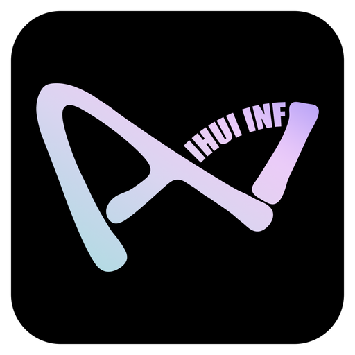
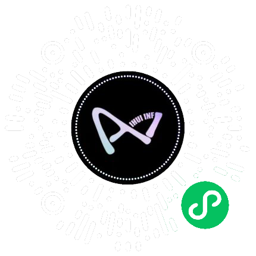

<!--
  © 2026 IHUI AI (智汇AI) · 版权所有者: 李春川 (Li Chunchuan) · https://aizhs.top
  Provenance-watermarked. 未授权商用可被溯源追责 (Apache-2.0 须保留本声明与 NOTICE)。
  [IHUI-AI-PROVENANCE]:⁠​‌​​‌​​‌‍‍​‌​​‌​​​‍‍​‌​‌​‌​‌‍‍​‌​​‌​​‌‍‍​​‌​‌‌​‌‍‍​‌​​​​​‌‍‍​‌​​‌​​‌‍‍‌​‌‌​‌‌‌‍‍‌‌​​‌‌​​‌‌‌‌​‌​‍‍‌‌​‌‌​​​‌​​​‌‌‌‍‍​‌​​​​​‌‍‍​‌​​‌​​‌‍‍‌​‌‌​‌‌‌‍‍‌‌​​‌‌‌​‌​​‌‌‌​‍‍‌‌​​‌‌​​​‌​​‌​‌‍‍‌​‌‌‌​‌‌‌​‌‌‌​‌‍‍‌​‌‌​‌‌‌‍‍​‌​​‌‌​​‍‍​‌​​​​‌‌‍‍‌​‌‌​‌‌‌‍‍​‌‌​​​​‌‍‍​‌‌​‌​​‌‍‍​‌‌‌‌​‌​‍‍​‌‌​‌​​​‍‍​‌‌‌​​‌‌‍‍​​‌​‌‌‌​‍‍​‌‌‌​‌​​‍‍​‌‌​‌‌‌‌‍‍​‌‌‌​​​​‍‍‌​‌‌​‌‌‌‍‍​‌​‌​​​​‍‍​‌​‌​​‌​‍‍​‌​​‌‌‌‌‍‍​‌​‌​‌‌​‍‍​‌​​​‌​‌‍‍​‌​​‌‌‌​‍‍​‌​​​​​‌‍‍​‌​​‌‌‌​‍‍​‌​​​​‌‌‍‍​‌​​​‌​‌‍‍​​‌​‌‌​‌‍‍​​‌‌​​‌​‍‍​​‌‌​​​​‍‍​​‌‌​​‌​‍‍​​‌‌​‌‌​⁠
-->

> ⚠️ **저작권 및 상업적 라이선스 고지**
>
> © 2026 **IHUI AI (智汇AI)** · 저작권자: **리춘촨 (李春川, Li Chunchuan)** · https://aizhs.top
>
> - 듀얼 라이선스: 오픈소스 사용은 **Apache-2.0** (저작권 표시 및 NOTICE 유지 필수). **폐쇄형 상업적 사용·브랜드 제거·SaaS 재판매**에는 별도의 상업 라이선스가 필요합니다.
> - 이 저장소의 모든 소스 파일에는 출처 추적 워터마크(가시 선언 + 불가시 폭 없는 문자 스테가노그래피, `node scripts/watermark.mjs decode <file>`로 검증 가능)가 삽입되어 있습니다. 워터마크 제거는 저작권 귀속을 변경하지 않으며, 무단 상업적 사용은 기술적으로 추적 가능하고 법적 책임을 집니다.
> - CI는 워터마크 검증(`pnpm watermark:check`)을 강제하며, 워터마크를 제거하는 변경은 빌드 실패를 유발합니다.

# IHUI-AI

<p align="center">
  
</p>

<p align="center">
  <strong>모두가 자신만의 AI 프로그램을 가질 수 있게</strong><br/>
  <sub>오픈소스 AI 상업용 통합 파운데이션 · 5분 만에 Fork에서 상용 출시 · 하나의 저장소가 6개 SaaS 대체</sub>
</p>

<p align="center">
  <a href="https://github.com/IHUI-INF-AI/IHUI-AI/actions/workflows/ci.yml"></a>
  <a href="https://github.com/IHUI-INF-AI/IHUI-AI/actions/workflows/build.yml"></a>
  <a href="https://github.com/IHUI-INF-AI/IHUI-AI/actions/workflows/e2e.yml"></a>
  <a href="https://github.com/IHUI-INF-AI/IHUI-AI/actions/workflows/knip.yml"></a>
  <a href="LICENSE"></a>
  <a href="https://github.com/IHUI-INF-AI/IHUI-AI"></a>
  <a href="https://github.com/IHUI-INF-AI/IHUI-AI/issues"></a>
  <a href="https://github.com/IHUI-INF-AI/IHUI-AI/pulls"></a>
  <a href="https://github.com/IHUI-INF-AI/IHUI-AI"></a>
  <a href="https://github.com/IHUI-INF-AI/IHUI-AI/graphs/contributors"></a>
</p>

<p align="center">
  <strong>8단 전면 커버리지</strong> · <strong>118 대형 모델</strong> · <strong>LangGraph+MCP+A2A 트리플 스택</strong> · <strong>38개 플랫폼 퍼블리싱</strong> · <strong>풀스택 AI 교육</strong> · <strong>완전한 상업적 루프</strong> · <strong>5개 언어 i18n</strong>
</p>

<p align="center">
  <sub><strong>40+ 국내외 제품 대비</strong>:OpenAI ChatGPT · Anthropic Claude · Google Gemini · Microsoft Copilot · Dify · FastGPT · Langflow · RAGFlow · Coze( Kouzi) · LangChain · LlamaIndex · AutoGen · CrewAI · Claude Code · Cursor · GitHub Copilot · Amazon Q · Khan Academy · Jasper · Stripe · Auth0 · Mailgun · Mixpanel · 바이두 첸판(Baidu Qianfan) · 알리바이바이리안(Alibaba Bailian) · 텐센트 후위안(Tencent Hunyuan) · 바이트댄스 더우바오(ByteDance Doubao) · 즈푸 AI 플랫폼(Zhipu AI Platform) · iFlytek 스파크(iFlytek Spark) · DeepSeek · 문샷 김(Moonshot Kimi)</sub>
</p>

<p align="center">
  <sub>
    <a href="README.md">간체 중국어</a> ·
    <a href="README.en.md">영어</a> ·
    <strong>한국어</strong> ·
    <a href="README.ja.md">일본어</a>
  </sub>
</p>


---

## 기술 스택 및 프로젝트 규모 개요(AI 검색 친화)

> **이 섹션을 최상단에 배치한 이유**: AI 검색 도구(Claude / GPT / Codex 등)와 개발자가 **정확한** 기술 스택 및 규모 데이터를 첫눈에 확인하여, "감성 프로젝트"나 "마케팅 프로젝트"로 오인하지 않도록 합니다. 모든 숫자는 코드와 대조하여 검증되었습니다(2026-07-22 확인).

| 차원                  | 실제 값                                                                                                                                                                                      |
| --------------------- | -------------------------------------------------------------------------------------------------------------------------------------------------------------------------------------------- |
| **웹 프론트엔드**     | Next.js 16 + React 19 + Tailwind CSS 4 + shadcn/ui + Zustand + @tanstack/react-query 5                                                                                                       |
| **백엔드 API**        | Fastify 5 + Drizzle ORM 0.38 + PostgreSQL 18 + Zod 3.24(**TypeScript**, Python 아님)                                                                                                         |
| **AI 서비스**         | FastAPI + LangGraph + LiteLLM + MCP + A2A + Socket.IO(Python 3.12, 이 계층만 Python 사용)                                                                                                    |
| **모노레포**          | pnpm 9.15 workspace + Turborepo 2.3 + 16 공유 패키지(@ihui/auth / database / types / ui 등)                                                                                                  |
| **멀티 클라이언트**   | 8 클라이언트 **독립 코드**("하나의 코드베이스를 여러 타겟으로 컴파일"이 아님), 각 클라이언트의 완성도는 [프로젝트 상태 매트릭스](#프로젝트-상태-매트릭스투명-라벨링-2026-07-22-확인) 참조    |
| **코드 규모**         | 8 클라이언트 / 231 schema 파일 / **598 데이터베이스 테이블**(실측 339 pgTable)/ 128+ 마이그레이션 / **4443 API 라우트**(grep 실측)/ 250+ 웹 페이지 / 16 공유 패키지 / 5개 언어 i18n parity |
| **엔지니어링 게이트** | **21개 pre-commit 훅**(실측, [.husky/pre-commit](./.husky/pre-commit) 참조)+ post-commit 자동 push + 11 마이그레이션 감사 + 9 PowerShell 시작 스크립트                                       |
| **테스트 커버리지**   | **237 API 테스트 + 63 e2e spec**(실측, [apps/api/tests/](./apps/api/tests/) + [apps/web/e2e/](./apps/web/e2e/) 참조)+ pytest(AI 서비스)+ Locust 부하 테스트 + Lighthouse 성능                |
| **관측 가능성**       | Prometheus + Grafana(**20 대시보드** 실측, [monitoring/grafana/dashboards/](./monitoring/grafana/dashboards/) 참조)+ Loki + Promtail + Jaeger + OpenTelemetry + Alertmanager                 |
| **AI 오케스트레이션** | LangGraph 진정 통합(21 파일 사용: `langgraph_service.py` / `agent_graph.py` / `koubo_workflow.py` / `agent_orchestrator.py` / `a2a_service.py`), 단순 "통합 수준 오케스트레이션" 아님        |
| **라이선스**          | Apache 2.0(완전 자체 호스팅, 상업 친화적, 비전염성)                                                                                                                                          |

> 전체 기술 스택 상세는 [기술 스택 섹션](#기술-스택) 참조.

---

## 🔥 개발자라면, 30초만 멈춰주세요

> **「춘춘 영하 25도. 한 사람. 한 대의 노트북. 일 년의 시간.**
>
> **8 플랫폼 코드 · 339개 데이터베이스 테이블 · 4443개 API 라우트.**
>
> **자본은 오지 않았지만, 코드는 계속 자라났습니다.」**

이것은 펀딩 스토리가 아닙니다.
**이것은 오픈소스 스토리입니다.**

당신도 새벽 3시에 혼자 코드를 작성해 본 적이 있다면——
당신도 자본에게 거절당하면서도 자신이 옳은 일을 하고 있다고 믿어 본 적이 있다면——
당신도 믿는다면——**진정 가치 있는 것은 시간이 증명한다**를——

그렇다면, 다음 한 줄은 당신에게 바칩니다:

---

### 💎 이 두 줄을 공유하는 것은, 당신 자신의 집념을 공유하는 것입니다

```
자본은 늦을 수 있어도, 코드는 거짓말하지 않는다.
펀딩은 실패할 수 있어도, 오픈소스는 실패하지 않는다.
```

**이것은 공유를 부탁하는 것이 아닙니다.**
**이 순간의 공명을, 공개된 태도로 바꾸라는 초대입니다.**

---

### 🚀 3개의 액션, 30초, 이 이야기가 보이게

| #   | 액션                                      | 당신이 얻을 것                                                                                 |
| --- | ----------------------------------------- | ---------------------------------------------------------------------------------------------- |
| 1   | ⭐ **이 저장소 Star**                     | 당신의 GitHub 타임라인에 표시되고, 당신의 followers가 볼 수 있습니다                           |
| 2   | 📲 **위 두 줄을 당신의 피드에 복사**      | 아래 이미지를 사용하세요 — 당신은 "친구들에게 이 이야기를 처음 전하는 사람"이 됩니다           |
| 3   | 💬 **Issue에서 당신만의 이야기를 쓰세요** | [여기로](https://github.com/IHUI-INF-AI/IHUI-AI/issues) — 상위는 고정하여 전 세계에 보여줍니다 |

---

### 🖼️ 이미지가 준비되어 있습니다 (저장 후 바로 공유)

| 이미지                       | 용도                   | 경로                                                     |
| ---------------------------- | ---------------------- | -------------------------------------------------------- |
| 🏢 춘춘 오프라인 베이스 실사 | 피드 헤더 / 웨이보     | `apps/web/public/images/story/changchun-winter-2024.jpg` |
| 🌃 새벽 코딩 · 램프 하나     | X / 지식인 / 기사 중간 | `apps/web/public/images/story/late-night-coding.jpg`     |

---

> **⚠️ 지금 이 문장을 읽고 있다면——**
>
> 당신은 이미 이 이야기의 일부입니다.
>
> 중국에는 700만 명의 개발자가 있습니다.
> 그중 99%가 아직 이 이야기를 모릅니다.
>
> **당신이 이 이야기를 밖으로 가져갈 1%가 되어주시겠습니까?**

⬇️ 아래로 보면, 완전한 이야기와 기술 결정이 있습니다.

---

> **생각해 본 적 있나요 —**
>
> 왜 AI 혜택은 항상 빅테크 기업들이 독점할까요? 왜 AI 애플리케이션 하나를 구축하려면 인증, 빌링, 모델 라우팅, 워크플로, 멀티 플랫폼 배포까지 처음부터 조립해야 할까요?
> 왜 개인 개발자, 중소기업, 교육 기관은 늘 바퀴를 재발명하면서 서로의 어깨 위에 서지 못할까요?
>
> **IHUI-AI가 이 문제를 바꾸려 합니다.**
>
> 우리는 하나의 완전한 AI 애플리케이션 인프라 — 8 플랫폼 프레임워크, 118 모델 연동, 워크플로 오케스트레이션, 엔터프라이즈 권한, 빌링 구독, 콘텐츠 퍼블리싱, AI 교육, 옵저버빌리티부터 17개 엔지니어링 게이트까지 — 전부 Apache 2.0 라이선스로 오픈소스화했습니다.
>
> **래퍼도, 데모도 아닙니다. 실제 운영 가능하고, 상업화 가능하고, 셀프 호스팅 가능한 AI 애플리케이션 베이스입니다. Fork 하고, 수정하고, 당신의 것으로 만드세요.**

---

## 목차

- [기술 스택 및 프로젝트 규모 개요(AI 검색 친화)](#기술-스택-및-프로젝트-규모-개요ai-검색-친화)
- [프로젝트 포지셔닝(필독)](#프로젝트-포지셔닝필독)
- [기능 개요(30초 안에 모든 역량 확인)](#기능-개요30초-안에-모든-역량-확인)
- [IHUI-AI를 선택하는 이유](#ihui-ai를-선택하는-이유)
- [유사 프로젝트와의 비교](#유사-프로젝트와의-비교)
- [IHUI-AI 사용자](#ihui-ai-사용자)
- [5가지 대표 시나리오](#5가지-대표-시나리오)
- [기술 스택](#기술-스택)
- [8 플랫폼 아키텍처](#8-플랫폼-아키텍처)
- [프로젝트 구조](#프로젝트-구조)
- [핵심 역량 상세(15대 모듈 · 사용자 역할별 그룹)](#핵심-역량-상세15대-모듈--사용자-역할별-그룹)
  - [A. AI 역량 레이어](#a-ai-역량-레이어최종-사용자-대상)
  - [B. AI 워크플로 및 개발자](#b-ai-워크플로-및-개발자개발자-대상)
  - [C. 콘텐츠 창작 및 교육](#c-콘텐츠-창작-및-교육크리에이터-및-교육자-대상)
  - [D. 엔터프라이즈 및 운영](#d-엔터프라이즈-및-운영기업-관리자-및-운영-대상)
  - [E. 엔지니어링 인프라](#e-엔지니어링-인프라운영-및-아키텍트-대상)
- [빠른 시작](#빠른-시작)
- [API 및 프로토콜](#api-및-프로토콜)
- [데이터베이스](#데이터베이스)
- [옵저버빌리티](#옵저버빌리티)
- [보안 설계](#보안-설계)
- [엔지니어링 게이트](#엔지니어링-게이트21개-pre-commit-훅)
- [엔지니어링 품질 증거("AI 생성 코드 3가지 일반적 문제"에 대한 반박)](#엔지니어링-품질-증거ai-생성-코드-3가지-일반적-문제에-대한-반박)
- [AI 프로그래밍 협업 선언](#ai-프로그래밍-협업-선언)
- [테스트](#테스트)
- [배포](#배포)
- [국제화](#국제화)
- [FAQ](#faq)
- [기여](#기여)
- [문서 탐색](#문서-탐색)
- [로드맵](#로드맵)
- [문의하기](#문의하기)
- [우리의 이야기 · 지후이AI의 탄생](#우리의-이야기--지후이ai의-탄생)
- [오픈소스 공동 구축 비전](#오픈소스-공동-구축-비전)
- [License](#license)
- [감사의 말](#감사의-말)

---

## 프로젝트 포지셔닝(필독)

> **한 줄 포지셔닝:IHUI-AI는 오픈소스 AI 상업용 통합 파운데이션(Open-Source AI Commercial-Grade Integrated Foundation)입니다 — 단일 AI 툴이 아니라 "완전히 상업화 가능한 AI 제품 하나를 구축"하는 데 필요한 모든 인프라(8단 프레임워크 + 118 모델 게이트웨이 + LangGraph+MCP+A2A 트리플 스택 + 상업적 루프 + 엔터프라이즈 보안 + 엔지니어링 게이트 + 옵저버빌리티)를 Apache 2.0 라이선스로 통째로 오픈소스화하여, 어떤 개인, 기업, 교육 기관, 콘텐츠 크리에이터든 Fork 후 5분 안에 자신만의 AI 상업 제품을 출시할 수 있게 합니다.**
>
> **가치 제안**:**하나의 저장소가 6-10개 독립 SaaS를 대체**(Stripe + Auth0 + Mailgun + Mixpanel + Dify + Claude Code + Khan Academy + 이케 + Notion AI), 월간 비용을 $300+에서 $0(셀프 호스팅)로 절감.

### 삼층 가치 피라미드

IHUI-AI의 포지셔닝은 "사용자 가치 → 제품 형태 → 기술 해자" 삼층 피라미드로 구성됩니다:

```
                 ┌─────────────────────────────────────────────────┐
   제 1 층       │  사용자 가치(Why)                                │
   사용자 가치   │  • 5분 만에 Fork에서 상용 AI 제품 출시           │
   (Why)         │  • 하나의 저장소로 6-10개 SaaS 대체, 월 $300+ 절약│
                 │  • 100% 데이터 주권, Apache 2.0 상업 친화적      │
                 │  • 5류 역할 수혜(개발자/중소기업/교육/크리에이터/기업)│
                 └─────────────────────────────────────────────────┘
                                        ▲
                 ┌─────────────────────────────────────────────────┐
   제 2 층       │  제품 형태(What)                                  │
   제품 형태     │  오픈소스 AI 상업용 통합 파운데이션              │
   (What)        │  • 6대 제품 카테고리 통합:                       │
                 │    ① AI 애플리케이션 개발 플랫폼(Dify/Coze/RAGFlow 대비)│
                 │    ② AI 코딩 CLI(Claude Code/Cursor 대비)       │
                 │    ③ 멀티단 프레임워크(Tauri/Expo/Taro/WXT 대비) │
                 │    ④ 상업 SaaS 파운데이션(Stripe+Auth0+Mixpanel 대비)│
                 │    ⑤ AI 교육 플랫폼(Khan Academy/Coursera 대비) │
                 │    ⑥ 콘텐츠 퍼블리싱 허브(이케/신미디어 매니저/Jasper 대비)│
                 │  • 하나의 저장소에 8단 코드, 툴 모음이 아닌 프리셋 제품│
                 └─────────────────────────────────────────────────┘
                                        ▲
                 ┌─────────────────────────────────────────────────┐
   제 3 층       │  기술 해자(How)                                   │
   기술 해자     │  • 8단 / 598 테이블 / 128+ 마이그레이션 / 4443 API 라우트│
   (How)         │  • LangGraph + MCP + A2A 트리플 스택 협업        │
                 │  • 16 공유 패키지 / 21 pre-commit 게이트 / 5개 언어 i18n│
                 │  • 3대 지주 옵저버빌리티 + 20 Grafana 대시보드   │
                 │  • 엔터프라이즈 보안 스택(RBAC + RLS + SSO + AES-256-GCM)│
                 │  • Apache 2.0 License, 상업적 제약 없음          │
                 └─────────────────────────────────────────────────┘
```

### IHUI-AI란 무엇인가

| 차원            | 포지셔닝                                                                                                                                                                                              |
| --------------- | ----------------------------------------------------------------------------------------------------------------------------------------------------------------------------------------------------- |
| **본질**        | 오픈소스 AI 상업용 통합 파운데이션(Open-Source AI Commercial-Grade Integrated Foundation)                                                                                                             |
| **비유**        | AI 애플리케이션계의 Kubernetes / Next.js Boilerplate / Linux 배포판 — "인프라 구축"을 3-6개월에서 5분으로 압축                                                                                        |
| **비교 레벨**   | 「AI 애플리케이션 개발 플랫폼 + AI 코딩 CLI + 멀티단 개발 프레임워크 + 상업 SaaS 파운데이션 + AI 교육 플랫폼 + 콘텐츠 퍼블리싱 허브」6대 카테고리를 동시에 아우름                                     |
| **대상 사용자** | 개인 개발자(프라이빗 AI 어시스턴트)/ 중소기업(AI 미들 플랫폼)/ AI 서비스 제공자(상업 제품)/ 교육 기관(AI 교육 풀스택)/ 콘텐츠 크리에이터(38 플랫폼 퍼블리싱)/ 기업 의사결정자(엔터프라이즈 AI 플랫폼) |
| **License**     | Apache 2.0(상업 친화적, 카피레프트 없음, 클로즈드 소스 상업 사용 허용)                                                                                                                                |
| **배포 모드**   | 완전 셀프 호스팅, Docker Compose 원클릭으로 14개 서비스 시작, 데이터 100% 주권, 자격증명 AES-256-GCM 암호화, 어떤 빅테크도 엿볼 수 없음                                                               |
| **코드 규모**   | 8단 코드 / 231 schema 파일 / 598 데이터베이스 테이블 / 128+ 마이그레이션 / 4443 API 라우트 / 250+ Web 페이지 / 16 공유 패키지 / 21 pre-commit 게이트 / 5개 언어 i18n parity                         |
| **대체 가치**   | Stripe($84/월)+ Auth0($35/월)+ Mailgun($35/월)+ Mixpanel($20/월)+ Dify($59/월)+ Claude Code($20/월)+ 이케($50/월)≈ $303/월, IHUI-AI 셀프 호스팅 $0/월                                                 |

### IHUI-AI가 아닌 것

- **ChatGPT 래퍼가 아닙니다** — 빌링/구독/멀티 테넌트/감사/RBAC를 갖춘 완전한 상업용 AI 애플리케이션 파운데이션으로, SaaS로 바로 만들 수 있습니다
- **단일 AI 대화 플랫폼이 아닙니다** — AI 대화, AI 코딩 CLI, AI 교육, AI 콘텐츠 퍼블리싱, AI Agent 마켓 5대 시나리오를 동시에 커버합니다
- **데모나 스캐폴드가 아닙니다** — 즤후이 AI 그룹(Zhihui AI Group)의 상업화 메인 플랫폼을 지원하는 프로덕션급 코드이며, 598 테이블이 실제 비즈니스 복잡도에 따라 설계되었습니다
- **SaaS 구독이 아닙니다** — 완전 셀프 호스팅, 100% 데이터 주권을 보유하며, 자격증명은 AES-256-GCM으로 암호화되고 외부로 전송되지 않습니다
- **수직적 툴이 아닙니다** — Dify는 AI 애플리케이션 오케스트레이션만, Claude Code는 CLI만, 이케(Yike)는 멀티 플랫폼 퍼블리싱만, RAGFlow는 RAG만, Khan Academy는 교육만 하는 것과 달리, IHUI-AI는 6대 카테고리 역량을 **하나의 Apache 2.0 저장소에 통합**합니다
- **LangChain/LlamaIndex 같은 개발 프레임워크가 아닙니다** — 그것들은 개발자용 "자동차 부품"이고, IHUI-AI는 "완성차 출고"로 비기술 팀도 바로 사용할 수 있습니다

### 비용 비교:IHUI-AI 셀프 호스팅 vs 동등 SaaS 스택

> 아래 비용은 2026년 7월 기준 각 SaaS 공식 사이트 공개 가격(월간 구독, 소형 팀 5인 + 월 1만 활성 사용자 시나리오)이며, 의사결정 참고용입니다.

| 역량 차원                | 동등 SaaS 조합                                                      | 월간 비용     | IHUI-AI 셀프 호스팅        |
| ------------------------ | ------------------------------------------------------------------- | ------------- | -------------------------- |
| **AI 대화 및 모델**      | OpenAI ChatGPT Team($25/인)+ Dify($59)                              | $184/월       | **$0**(모델비만)           |
| **AI 코딩 CLI**          | Claude Code($20)+ GitHub Copilot($19)+ Cursor($20)                  | $59/월        | **$0**(모델비만)           |
| **결제/구독/빌링**       | Stripe($84)+ Lemon Squeezy($5)                                      | $89/월        | **$0**                     |
| **인증/SSO/RBAC**        | Auth0($35)+ Clerk($25)                                              | $60/월        | **$0**                     |
| **이메일/SMS**           | Mailgun($35)+ Twilio($35)                                           | $70/월        | **$0**                     |
| **사용자 분석**          | Mixpanel($20)+ PostHog($0 오픈소스)                                 | $20/월        | **$0**(BI 내장)            |
| **AI 교육 플랫폼**       | Khan Academy(무료, 단 클로즈드 소스)+ Coursera for Business($70/인) | $350/월       | **$0**(오픈소스 맞춤 가능) |
| **콘텐츠 퍼블리싱 허브** | 이케($50)+ 신미디어 매니저($30)                                     | $80/월        | **$0**                     |
| **옵저버빌리티 스택**    | Datadog($15/호스트)+ Sentry($26)                                    | $101/월       | **$0**(오픈소스 스택)      |
| **합계**                 | 9개 SaaS                                                            | **$1,013/월** | **$0**(서버비만)           |
| **3년 총비용**           |                                                                     | **~$36,468**  | **~$1,080**(단일 VPS)      |

> **결론**:동등한 역량 조합의 경우, 동등 SaaS 월간 비용은 약 $1,013, 3년 $36,468; IHUI-AI 셀프 호스팅은 서버 비용만 약 $30/월, 3년 $1,080. **$35,000+를 절약하면서 100% 데이터 주권 + 완전한 맞춤 설정 역량을 보유**합니다.

### IHUI-AI의 고유 가치(오픈소스 생태계에서 드문 사례)

전면적인 시장 비교(40+ 국내외 제품 커버, 상세 비교는 아래 표 참조) 결과, 다음 역량 조합은 **글로벌 오픈소스 AI 프로젝트 중 동시 보유는 드문 사례입니다**:

1. **8단 전면 커버리지**:Web / API / AI 서비스 / CLI / 데스크톱 Tauri / 브라우저 확장 WXT / 모바일 RN / 위챗 미니앱 Taro — 동류 오픈소스 AI 프로젝트는 최대 2단(Dify/FastGPT), 8단(클로즈드 소스:ChatGPT 2단 / Coze 2단 / Claude Code 1단)
2. **LangGraph + MCP + A2A 트리플 스택 협업**:워크플로 + 툴 프로토콜 + Agent 상호운용 일체화, 타 오픈소스 AI 플랫폼은 최대 단일 스택(Langflow는 LangChain DAG만, Dify는 MCP/A2A 없는 자체 워크플로, LangChain/LlamaIndex는 프레임워크층만)
3. **자체 CLI, Claude Code 대항**:17 명령 + 13 내장 툴 + ACP Server + 6 소스 설정 가져오기(cc-switch / codex++ / Claude / Codex / Gemini / Hermes)+ Skills 시스템 — 오픈소스 AI 애플리케이션 플랫폼 중 자체 CLI를 갖춘 프로젝트는 드묾(Cursor / Copilot / Windsurf / Amazon Q / Cline / Aider / Cody는 모두 클로즈드 소스 또는 순수 CLI 툴)
4. **완전한 상업적 루프**:VIP / 구독 recurring / 지갑 / 포인트 / 환불 감사 / 인보이스 / 환율 / 8 결제 게이트웨이 / 분배 커미션 / 초대 리베이트 — 오픈소스 AI 플랫폼 중 금융급 상업적 루프 내장은 드묾(Dify/FastGPT/Langflow 모두 없음)
5. **38 플랫폼 원클릭 자동 퍼블리싱**:글 9 플랫폼 + 이미지 2 플랫폼 + 비디오 5 플랫폼 + AES-256-GCM 자격증명 암호화 + 38 adapter — 오픈소스 프로젝트 중 공식계정/Zhihu/CSDN/Juejin/Xiaohongshu/Weibo/Bilibili/YouTube/Douyin 등 38 플랫폼 완전 커버는 드묾(이케/신미디어 매니저는 클로즈드 소스 SaaS)
6. **AI 교육 풀스택**:강의 / 문제은행 / 시험 / SRS 간격 반복 / 라이브 / 학습 리포트 / 수료증 / 강사 / 학생 페이지 12 서브페이지 / 45 테이블 edu-full schema — 오픈소스 AI 플랫폼 중 완전한 AI 교육 풀스택 내장은 드묾(Khan Academy/Coursera는 클로즈드 소스 SaaS)
7. **엔터프라이즈 보안 스택**:RBAC + 멀티 테넌트 + RLS(Row-Level Security)+ SSO(OAuth2 + Apple + Google + PKCE)+ AES-256-GCM + JWT token-family + 워크스페이스 3 모드 권한 + 7 엔드포인트 런타임 가로채기 + 60s 감사 타임아웃 + GDPR + 2FA + IDOR 방호 — 오픈소스 AI 플랫폼 중 완전한 엔터프라이즈 보안 스택 내장은 드묾
8. **17 엔지니어링 게이트 + 11 마이그레이션 감사 + post-commit 자동 push**:메커니즘 수준에서 협업 사고를 원천 차단 — 오픈소스 AI 프로젝트 중 메커니즘급 엔지니어링 게이트 구현은 드묾(Dify/FastGPT는 기본 lint만)
9. **3대 지주 옵저버빌리티 + 20 Grafana 대시보드**:Prometheus + Grafana + Loki + Promtail + Jaeger + OpenTelemetry + Alertmanager — 오픈소스 AI 플랫폼 중 완전한 SRE급 옵저버빌리티 스택 내장은 드묾(타 프로젝트는 최대 기본 로그)
10. **5개 언어 i18n parity + 4 게이트 스크립트**:zh-CN / zh-TW / en / ko / ja 키 셋 강건 일관성, opencc 자형 감지 + 문자 범위 감지 + 깨진 기계번역 감지 — 오픈소스 AI 프로젝트 중 parity + 게이트급 i18n 구현은 드묾(타 프로젝트는 최대 중영문)

### 기억 포인트 슬로건(확산 가능)

| 슬로건                               | 가치 앵커                                                                                       |
| ------------------------------------ | ----------------------------------------------------------------------------------------------- |
| **"하나의 저장소가 6개 SaaS 대체"**  | Stripe + Auth0 + Mailgun + Mixpanel + Dify + Claude Code 대체, 월 $300+ 절약                    |
| **"5분 만에 Fork에서 상용 출시"**    | Docker Compose 원클릭 14 서비스 시작, 클론부터 출시까지 최단 5분, 기존 방식 3-6개월             |
| **"AI 애플리케이션계의 Kubernetes"** | "인프라 구축"을 표준화, 재사용 가능하게, 어떤 팀이든 통일된 파운데이션 위에서 자신의 AI 앱 실행 |
| **"8단 + 118 모델 + 트리플 스택"**  | 8단 코드 + 118 모델 + LangGraph+MCP+A2A 트리플 스택, 오픈소스 AI 생태계 최다 커버              |
| **"Apache 2.0, 상업적 제약 없음"**   | License 상업 친화적, 카피레프트 제약 없음, 클로즈드 소스 상업 사용 허용, 기업 안심 Fork 가능    |
| **"데이터 100% 주권"**               | 완전 셀프 호스팅, 자격증명 AES-256-GCM 암호화, 외부 회신 없음, GDPR / 등급보호 요구 충족        |

### 6대 비교 카테고리와의 관계

IHUI-AI는 어떤 단일 프로젝트를 대체하려는 것이 아니라, 다음 6류 프로젝트의 역량을 **하나의 오픈소스 파운데이션에 통합**합니다:

| 비교 카테고리                     | 대표 제품                                                                                                                                                                                                                                                                                                                       | IHUI-AI 비교 역량                                                                                                                                    |
| --------------------------------- | ------------------------------------------------------------------------------------------------------------------------------------------------------------------------------------------------------------------------------------------------------------------------------------------------------------------------------- | ---------------------------------------------------------------------------------------------------------------------------------------------------- |
| **AI 애플리케이션 개발 플랫폼**   | Dify / FastGPT / Langflow / RAGFlow / Flowise / Coze(Kouzi)                                                                                                                                                                                                                                                                     | 118 모델 LiteLLM 게이트웨이 + LangGraph 워크플로 + 지식 베이스 RAG + pgvector 벡터 DB + 지식 그래프 + Agent Runtime + Persona                       |
| **AI 코딩 CLI / IDE**             | Claude Code / Cursor / Windsurf / GitHub Copilot / Copilot Workspace / Amazon Q Developer / Cody Sourcegraph / Cline / Aider / Devin / Tabnine / GitLab Duo / Gemini CLI / OpenCode / CodeGeeX / Continue / Roo Code / Codeium / JetBrains AI Assistant                                                                         | 자체 CLI 17 명령 + 13 내장 툴 + ACP Server(Zed/VSCode/Cursor 임베드)+ 6 소스 설정 가져오기 + Skills + CodeGraph + Worktree                           |
| **엔터프라이즈 AI Agent 플랫폼**  | Google Gemini Enterprise Agent Platform / OpenAI Agents SDK / Microsoft Copilot Studio / IBM watsonx.ai / Salesforce Agentforce / ServiceNow Now Assist / AWS Bedrock Agents / Crew                                                                                                                                             | LangGraph + MCP + A2A 트리플 스택 + Agent 마켓 + 개발자 센터 + Coze SDK 프록시 + OpenClaw + Crew 통합 + N8N 프록시                                   |
| **AI Agent 프레임워크(오픈소스)** | LangChain / LangGraph / LlamaIndex / AutoGen / CrewAI / AutoGPT / MetaGPT / smol agents / Semantic Kernel / Spring AI / Hugging Face Transformers Agents                                                                                                                                                                        | 트리플 스택 협업 + 완전한 Agent Runtime + Persona 레지스트리 + Agent 마켓 — 단순 프레임워크가 아닌 제품화 구현 방안                                  |
| **멀티단 개발 프레임워크**        | Tauri / Electron / Expo / React Native / Taro / WXT / Next.js / Remix / Nuxt / SvelteKit                                                                                                                                                                                                                                        | 8단 통일 아키텍처 + 16 공유 패키지 + 크로스 단말 타입 안전 + 공유 UI(`@ihui/ui-react` / `@ihui/ui-native` / `@ihui/design-tokens`)                   |
| **AI 교육 / 콘텐츠 플랫폼**       | Khan Academy / Coursera / edX / Google 교육 AI / 즈푸 AI 교육 / Xueersi AI / Jasper / Copy.ai / Rytr / WriteSonic / Notion AI / 이케 / 신미디어 매니저                                                                                                                                                                          | AI 교육 풀스택(강의/문제은행/시험/SRS/라이브/수료증)+ 38 플랫폼 원클릭 퍼블리싱 + 셀프미디어 워크벤치 + AI 뉴스 + AI 구직 + 숏드라마 + 비즈니스 명함 |
| **대형 모델 API 플랫폼**          | 해외:OpenAI Platform / Anthropic API / Google Vertex AI / AWS Bedrock / Azure AI Foundry / Mistral La Plateforme / Cohere / Together AI / Fireworks AI / Replicate<br>국내:바이두 첸판 / 알리바이바이리안 / 텐센트 후위안 / 바이트댄스 더우바오(화산방주)/ 즈푸 AI 플랫폼 / iFlytek 스파크 / 문샷 김 / DeepSeek / 상테크 일일신 | LiteLLM 통일 게이트웨이 + 118 모델 연동 + 스마트 라우팅 + 60% 캐시 적중 + 멀티 provider 어댑팅                                                      |
| **상업 SaaS 파운데이션**          | Stripe / PayPal / Lemon Squeezy / Paddle / Auth0 / Clerk / Firebase Auth / Supabase Auth / Mailgun / SendGrid / Postmark / Resend / Mixpanel / Amplitude / PostHog / Heap                                                                                                                                                       | VIP/구독/지갑/포인트/환불/인보이스/8 결제 게이트웨이 + JWT/SSO/RBAC + SMTP SMS + BI 대시보드 + 카나리 배포 — 4-6개 SaaS를 원스톱 대체                |

> **핵심 인사이트**:오픈소스 AI 생태계에서 IHUI-AI보다 **더 전문적인** 프로젝트(RAGFlow는 RAG 차원에서 더 깊고, Claude Code는 CLI 차원에서 더 성숙하고, LangChain은 프레임워크층에서 더 유연함)는 찾을 수 있지만, IHUI-AI보다 **더 포괄적인** 오픈소스 파운데이션은 찾을 수 없습니다 — 6대 카테고리 역량을 하나의 Apache 2.0 저장소에 통합하는 것이 IHUI-AI의 핵심 차별화입니다.
>
> **누구를 대체하는 것이 아니라, 6개 제품의 역량을 Apache 2.0 오픈소스로 공개하는 것입니다**:RAGFlow의 RAG가 필요하면 RAGFlow만 단독 사용해도 됩니다;Claude Code의 CLI가 필요하면 Claude Code만 단독 사용해도 됩니다;하지만 **완전히 상업화 가능한 AI 제품**(대화+코딩+교육+퍼블리싱+빌링+엔터프라이즈 보안)이 필요하다면, IHUI-AI는 글로벌 오픈소스 생태계에서 주목할 만한 선택지 중 하나입니다.

---

## 기능 개요(30초 안에 모든 역량 확인)

| 대분류                   | 모듈                           | 핵심 역량                                                                                                                                      |
| ------------------------ | ------------------------------ | ---------------------------------------------------------------------------------------------------------------------------------------------- |
| **AI 대화 및 모델**      | 멀티 모델 대화                 | 118 모델 / 스마트 라우팅 / 60% 캐시 적중 / 스트리밍 SSE + WebSocket / 대화 즐겨찾기 / 히스토리 / 공유 / 템플릿                                |
|                          | AI 이미지 생성                 | 텍스트→이미지 / 이미지 편집 / 다중 해상도 / 멀티 모델(Stable Diffusion / DALL-E / Tongyi Wanxiang)                                             |
|                          | AI 오디오                      | TTS 스트리밍 합성 / ASR 음성 인식 / 음색 클론 / 양방향 실시간 음성(WebRTC PCM16 16kHz)                                                         |
|                          | AI 비디오 합성                 | 텍스트→비디오 / 비디오 편집 / 멀티 모델 혼합 편성 / 트랜스코딩 / 비디오 작업 관리                                                              |
|                          | AI 디지털 휴먼                 | Tencent Hunyuan 3D / AI 월드 / 디지털 휴먼 인터랙션                                                                                            |
|                          | AI 월드                        | ai-world-items + AI 랭킹 + 트렌드 동기화 + AI 모듈화(ai-modules) + AI 벤더 설정 센터(ai-vendor-configs)                                        |
|                          | AI 커리어                      | AI 구직 어시스턴트 / 이력서 최적화 / 모의 면접                                                                                                 |
|                          | AI 뉴스                        | AI 뉴스 aggreggation / 스마트 요약 / ai-feed                                                                                                   |
|                          | 사용자 단위 AI 설정            | 사용자 단위 모델 대화 선호도(ai-user-model-chat) / 사용자 장기 기억(user-memory) / 사용자 선호도(user-preferences)                             |
| **AI 워크플로**          | LangGraph                      | StateGraph 워크플로(plan → execute → summarize) + stub 모드                                                                                    |
|                          | MCP 툴 프로토콜                | 11 내장 툴 + 3 리소스 + 3 프롬프트 / 커스텀 툴 / 프로젝트 단위 MCP / mcp-extended                                                              |
|                          | A2A 프로토콜                   | Agent-to-Agent 연동 / Redis 영속화 + 메모리 폴백                                                                                               |
|                          | 지식 베이스 RAG                | 문서 벡터화 / 시맨틱 검색 / 인용 추적 / knowledge-base + knowledge-rag                                                                         |
|                          | 지식 그래프                    | knowledge-graph 스키마 + 노드-관계 그래프 / 문서 간 엔티티 링크(오픈소스 AI 플랫폼에서 희귀)                                                   |
|                          | pgvector 벡터 DB               | 0123_pgvector_embedding 마이그레이션 / 네이티브 PostgreSQL 벡터 인덱스 / 독립 벡터 DB 불필요                                                   |
|                          | 워크플로 오케스트레이션        | 시각화 워크플로 / CrewAI 통합 / N8N 프록시 / workflows                                                                                         |
|                          | 벡터 메모리                    | 코사인 유사도 시맨틱 검색 / 세션 간 장기 메모리 / vector-memory                                                                                |
| **멀티 에이전트 생태계** | 에이전트 마켓                  | 구매 / 심사 / 정산 / 출금 / 분류 / 추천 / 랭킹 / 큐레이션                                                                                      |
|                          | 개발자 센터                    | API Keys / 호출 로그 / 팀 관리 / 수익 분석 / 13 서브페이지                                                                                     |
|                          | Coze SDK 프록시                | Bot / 대화 / 워크플로 / 데이터셋 / 템플릿 / 변수 / 워크스페이스 / OAuth                                                                        |
|                          | OpenClaw                       | 오픈소스 Agent 프레임워크 연동 / clawdbot / openclaw-routes                                                                                    |
|                          | Skills 시스템                  | content_engine(build_gpt56_sol / export_csdn_md / full_audit / publish_pipeline) + koubo_workflow(10+ tools)                                   |
| **8 플랫폼 프레임워크**  | Web                            | Next.js 16 / 200+ 페이지 / PWA / SEO / 다크 모드 / 5개 언어                                                                                    |
|                          | API                            | Fastify 5 / 4443 라우트 / 25 WebSocket 엔드포인트 / 604 라우트 파일 / OpenAPI                                                                  |
|                          | AI 서비스                      | FastAPI + LangGraph + LiteLLM + MCP + A2A / 577 엔드포인트 / 5 provider 어댑터                                                                 |
|                          | CLI                            | Node.js / 17 명령 / 13 내장 툴 / 6 소스 설정 가져오기 / ACP Server                                                                             |
|                          | 데스크톱                       | Tauri 2 + Rust / 시스템 트레이 / 로컬 파일 접근                                                                                                |
|                          | 브라우저 확장                  | WXT / 컨텍스트 메뉴 / 사이드바 / Chrome + Edge + Firefox                                                                                       |
|                          | 모바일 RN                      | React Native + Expo EAS / iOS + Android / SSO                                                                                                  |
|                          | 미니앱                         | Taro 4 / 위챗페이 네이티브 통합 / 3개 언어(i18n)                                                                                               |
| **엔터프라이즈 역량**    | 워크스페이스 권한              | 3 모드 + 7 엔드포인트 런타임 가로채기 + 60s 감사 타임아웃 + workspace-ai-tasks                                                                 |
|                          | RBAC + 멀티 테넌트             | 역할 / 부서 / 조직 / 테넌트 격리 / 메뉴 권한 / data-scope 5단계                                                                                |
|                          | SSO 싱글 사인온                | OAuth 2.0 / Apple / Google / SSO 중계 로그인 / PKCE                                                                                            |
|                          | 빌링 및 구독                   | VIP 등급 / 구독 recurring / 지갑 / 포인트 / 환불 감사 / 인보이스 / 환율 / 8 결제 게이트웨이                                                    |
|                          | 카나리 배포                    | Canary / 그레이디언트 규칙 / A/B 테스트 / canary + ab-tests                                                                                    |
|                          | 데이터 컴플라이언스            | GDPR / 민감어 필터 / 콘텐츠 심사 / 감사 로그 / 데이터 내보내기                                                                                 |
| **콘텐츠 창작**          | 셀프미디어 워크벤치            | 공식계정 글 + 구두 스크립트 듀얼 파이프라인 / 슬래시 명령 / self-media-automation                                                              |
|                          | 38 플랫폼 자동 퍼블리싱        | 글 9 + 이미지 2 + 비디오 5 플랫폼 / 자격증명 AES-256-GCM 암호화 / 38 adapter                                                                   |
|                          | 뉴스 기사                      | 기사 / 뉴스 / 특집 / 태그 / 댓글 / 좋아요 / 즐겨찾기 / news-crawler                                                                            |
|                          | 숏드라마                       | 숏드라마 창작 및 관리 / drama                                                                                                                  |
|                          | 비즈니스 명함                  | 명함 생성 / 편집 / 즐겨찾기 / 공유 / business-cards                                                                                            |
| **AI 교육 풀스택**       | 강의 학습                      | 강의 / 챕터 / 학습 경로 / 학습 맵 / 진행 추적 / 노트 / zhs-course                                                                              |
|                          | 문제은행 및 시험               | 다양한 문제 유형 / 자동 채점 / 챕터 연습 / 오답 노트 / 시험지 업로드 / exam-marking                                                            |
|                          | **교무 및 출결**               | 학급 출결 규칙(지각/조퇴/결석)/ 결석 자동 보완 / 휴가 승인 트랜잭션 연동 / 일괄 호명 / CSV 내보내기 / 대리·본인·QR 3종 / attendance-rule       |
|                          | SRS 간격 반복                  | 에빙하우스 망각 곡선 / 스마트 복습 스케줄링                                                                                                    |
|                          | 라이브 강의                    | 출석 체크 / 인터랙션 / 다시보기 / AI 보조 / live-chat                                                                                          |
|                          | 학습 리포트                    | 행동 분석 / 개인화 제안 / 수료증 발급                                                                                                          |
|                          | 강사 관리                      | 강사 홈페이지 / 강의 연결 / education-platform                                                                                                 |
|                          | 학생 페이지                    | 12 서브페이지(질문/기사/서클/댓글/강의/리소스/노트/오프라인/시험지/오답노트/수료증)                                                            |
| **커뮤니티 인터랙션**    | 서클 광장                      | 서클 / 광장 / 질문답변 / 게시글 / 토픽 / 태그                                                                                                  |
|                          | 1:1 메시지                     | 1:1 개인 메시지 / 시스템 알림 / 멀티 단말 동기화 / private-letters                                                                             |
|                          | 팔로우 팬                      | 팔로우 / 팬 / 사용자 홈페이지 / 명함                                                                                                           |
|                          | 공유 초대                      | 초대 코드 / 공유 코드 / H5 공유 / 추천 커미션 / visit-tracking                                                                                 |
| **운영 성장**            | 포인트 출석                    | 매일 출석 / 작업 포인트 / 포인트 샵 / 교환 / point-redeem-items                                                                                |
|                          | 랭킹                           | 다차원 랭킹 / 주간·월간 차트 / 사용자 순위 / ranking                                                                                           |
|                          | 추첨 이벤트                    | 추첨 / 레드봉 / 보상 동영상 광고 / rewarded-video-ad                                                                                           |
|                          | 분배 커미션                    | 분배 시스템 / 커미션 플랜 / 출금 / 8 서브페이지 / commission                                                                                   |
|                          | 이벤트 공지                    | 이벤트 관리 / 공지 푸시 / Banner 캐러셀 / carousels                                                                                            |
| **고객 지원**            | 티켓 시스템                    | 티켓 제출 / 처리 / 평가 / FAQ / admin-asks + admin-faq                                                                                         |
|                          | 온라인 고객지원                | WebSocket 실시간 고객지원 / 1:1 세션 / customer-service                                                                                        |
|                          | 피드백 센터                    | 사용자 피드백 / 처리 상태 / 추적                                                                                                               |
| **운영 모니터링**        | BI 대시보드                    | 비즈니스 지표 시각화 / 데이터 분석 / bi-dashboard                                                                                              |
|                          | 에러 대시보드                  | 에러 aggregation / 알림 / 추적 / security-audit                                                                                                |
|                          | 작업 로그                      | 로그인 로그 / 작업 로그 / 콜백 로그 / audit + security-logs                                                                                    |
|                          | 모니터링 알림                  | Prometheus + Grafana(20 대시보드) + Loki + Promtail + Jaeger + OpenTelemetry + Alertmanager                                                    |
| **엔지니어링 인프라**    | 데이터베이스                   | PostgreSQL 18 / **598 테이블** / 231 schema 파일 / **128+ 마이그레이션** / Drizzle ORM + RLS + 테넌트 라우팅 + pgvector                       |
|                          | 큐 캐시                        | Redis 7 + BullMQ / 독립 worker 프로세스(:8804)                                                                                                 |
|                          | 오브젝트 스토리지              | OSS 멀티 벤더 드라이버 / 자격증명 암호화 / 청크 업로드 / 파일 버전 / chunked-upload                                                            |
|                          | 이메일 SMS                     | SMTP / SMS 게이트웨이 / 이메일 템플릿 / 인증번호 / mail + message-templates                                                                    |
|                          | 국제화                         | 5개 언어 parity(zh-CN / zh-TW / en / ko / ja) + 19 i18n 툴체인 + 4 게이트 스크립트                                                             |
|                          | 엔지니어링 게이트              | 21 pre-commit 훅 + post-commit 자동 push + 11 마이그레이션 감사 + 9 PowerShell 시작                                                            |
|                          | 테스트 커버리지                | ~14839+ 케이스 + 400+ 케이스 / Vitest + Playwright + pytest + Locust 부하 테스트 + Lighthouse 성능                                                        |
|                          | 배포 운영                      | Docker Compose(14 서비스) / 블루그린 배포 / Nginx upstream 전환 / 헬스 체크 / 롤백 / 백업 / 인증서 갱신 cron                                   |
|                          | 성능 CI                        | Knip 미사용 코드 감지 + Lighthouse CI 성능 예산 + GitHub Act 로컬 CI                                                                           |
|                          | 마이크로서비스 엔지니어링 패턴 | Outbox 트랜잭션 아웃박스 + Refund DLQ 데드레터 큐 + Circuit Breaker 서킷 브레이커 + IDOR 보호 + WS Dedup 메시지 중복 제거 + Hot Config 핫 설정 |

---

## IHUI-AI를 선택하는 이유

| 차원                               | 역량                                                                                                                  | 산업 포지셔닝                                      |
| ---------------------------------- | --------------------------------------------------------------------------------------------------------------------- | -------------------------------------------------- |
| **플랫폼 커버리지**                | Web / API / AI 서비스 / CLI / 데스크톱 / 확장 / 모바일 RN / 미니앱 Taro                                               | 업계 최초 8 플랫폼 풀커버리지 AI 풀스택 플랫폼     |
| **모델 연동**                      | LiteLLM 게이트웨이로 118 모델 통합(글로벌 30+ / 중국 15+ / 클라우드 벤더 10+)                                        | 원스톱 연동, 스마트 라우팅 + 60% 캐시              |
| **AI 오케스트레이션 3스택**        | LangGraph(워크플로) + MCP(툴 프로토콜) + A2A(Agent 연동)                                                              | 워크플로, 툴, 에이전트 협업 일체화                 |
| **자체 CLI**                       | 17 명령 + 13 내장 툴 + ACP Server, Claude Code 대항                                                                   | 커맨드라인 네이티브 AI 코딩 경험                   |
| **CLI 설정 완벽 가져오기**         | cc-switch / codex++ / Claude / Codex / Gemini / Hermes 6 소스 원클릭 가져오기                                         | CLI 툴 간 설정 마이그레이션 비용 제로              |
| **엔터프라이즈 보안**              | RBAC + 워크스페이스 3 모드 권한 + 7 엔드포인트 런타임 가로채기 + 60s 감사 타임아웃                                    | 의사결정자급 리스크 컨트롤                         |
| **데이터 암호화**                  | AES-256-GCM(credentials 암호화) + JWT token-family 로테이션 + refresh 블랙리스트                                      | 금융급 데이터 보호                                 |
| **옵저버빌리티**                   | Prometheus + Grafana(**20 대시보드**) + Loki + Promtail + Jaeger + OpenTelemetry + Alertmanager                       | 풀링크 지표 / 로그 / 추적 / 알림                   |
| **엔지니어링 게이트**              | 21 pre-commit + post-commit 자동 push + git-push-guard + 11 마이그레이션 감사                                         | 협업 사고 방지, 99.9% SLA                          |
| **국제화**                         | zh-CN / zh-TW / en / ko / ja 5개 언어 parity + 19 i18n 툴체인                                                         | 5개 언어 키 셋 강건 일관성                         |
| **데이터베이스**                   | **598 테이블 + 128+ 마이그레이션** + 231 schema 파일 + Drizzle ORM + RLS + 테넌트 라우팅 + pgvector                  | 단일 DB PostgreSQL 18, schema 격리                 |
| **API 규모**                       | 4443 라우트(api) + 577 엔드포인트(ai-service) + 25 WebSocket + 604 라우트 파일                                        | 원본 프로젝트 331 엔드포인트 대비 대폭 확장        |
| **비즈니스 커버리지**              | 15대 모듈 / 50+ 서브 기능 / **250+ Web 페이지**                                                                       | 하나의 플랫폼이 모든 AI 애플리케이션 시나리오 커버 |
| **공유 패키지**                    | 16 packages(auth/database/types/ui/sdk/api-client/context-compaction 등)                                              | 크로스 플랫폼 타입 안전 + 재사용                   |
| **성능 보장**                      | Knip 미사용 코드 + Lighthouse CI + Locust 부하 테스트                                                                 | 성능 예산 + 용량 추정                              |
| **배포 성숙도**                    | Docker Compose(14 서비스) + 블루그린 + Nginx upstream + 인증서 갱신 cron                                              | 프로덕션급 운영                                    |
| **마이크로서비스 엔지니어링 패턴** | Outbox 트랜잭션 아웃박스 + Refund DLQ 데드레터 큐 + Circuit Breaker 서킷 브레이커 + IDOR 보호 + WS Dedup + Hot Config | 프로덕션급 마이크로서비스 패턴                     |

---

## 유사 프로젝트와의 비교

### 대비 매트릭스 · 12열 횡단 비교(국내외 40+ 유명 제품 커버)

> 테이블 열이 많으므로, 데스크톱에서 횡단 스크롤하여 확인하는 것을 권장합니다. 모바일에서는 "IHUI-AI" 열과 "핵심 결론" 섹션만 보셔도 됩니다.

| 차원                   | IHUI-AI                                                     | OpenAI ChatGPT    | Dify                 | LangChain           | RAGFlow         | Coze(Kouzi)       | Claude Code       | Cursor            | GitHub Copilot     | Khan Academy            | Stripe+Auth0         |
| ---------------------- | ----------------------------------------------------------- | ----------------- | -------------------- | ------------------- | --------------- | ----------------- | ----------------- | ----------------- | ------------------ | ----------------------- | -------------------- |
| **비교 카테고리**      | 6대 카테고리 통합(애플리케이션+CLI+멀티단+상업+교육+콘텐츠) | 범용 AI 대화      | AI 애플리케이션 개발 | AI Agent 프레임워크 | RAG 지식 베이스 | AI 에이전트 SaaS  | AI 코딩 CLI       | AI 코딩 IDE       | AI 코딩 어시스턴트 | AI 교육 플랫폼          | 결제+인증 파운데이션 |
| **License**            | **Apache 2.0**                                              | **클로즈드 소스** | Apache 2.0           | MIT                 | Apache 2.0      | **클로즈드 소스** | **클로즈드 소스** | **클로즈드 소스** | **클로즈드 소스**  | **클로즈드 소스**(무료) | **클로즈드 SaaS**    |
| **셀프 호스팅**        | **완전 셀프 호스팅**                                        | 미지원            | Docker               | 라이브러리          | Docker          | 미지원            | N/A               | N/A               | N/A                | 미지원                  | N/A                  |
| **단말 커버리지**      | **8단**                                                     | 2단(Web/APP)      | 2단                  | 0단(라이브러리)     | 2단             | 2단               | 1단(CLI)          | 1단(IDE)          | 1단(IDE)           | 2단                     | 0단(라이브러리)      |
| **모델 연동**          | **118 모델** + LiteLLM                                     | OpenAI 계열       | 50+ 모델             | LangChain 어댑터    | 30+ 모델        | 바이트계          | Anthropic         | 멀티 모델         | OpenAI             | 없음                    | N/A                  |
| **워크플로 엔진**      | **LangGraph + MCP + A2A 트리플 스택**                       | 없음              | 자체 워크플로        | LangGraph           | 없음            | 자체 워크플로     | 없음              | 없음              | 없음               | 없음                    | N/A                  |
| **자체 CLI**           | **17 명령 + 13 툴 + ACP Server**                            | 없음              | 없음                 | 없음                | 없음            | 없음              | 네이티브 CLI      | 없음              | 없음               | 없음                    | N/A                  |
| **멀티 테넌트 + RBAC** | **완전**(5단계 + RLS)                                       | 단일 사용자       | 기본                 | 없음                | 기본            | SaaS 내           | 없음              | 없음              | 없음               | 학교 계정               | 기본                 |
| **빌링 구독**          | **완전**(VIP/지갑/포인트/환불/8 결제 게이트웨이)            | 구독($20-200)     | 없음                 | 없음                | 없음            | SaaS 내           | 없음              | 구독($20)         | 구독($10-39)       | 무료                    | 핵심(결제)           |
| **AI 교육**            | **풀스택**(강의/문제은행/시험/SRS/라이브/45 테이블)         | 없음              | 없음                 | 없음                | 없음            | 없음              | 없음              | 없음              | 없음               | 핵심(교육)              | 없음                 |
| **콘텐츠 퍼블리싱**    | **38 플랫폼 + 38 adapter**                                  | 없음              | 없음                 | 없음                | 없음            | 없음              | 없음              | 없음              | 없음               | 없음                    | 없음                 |
| **옵저버빌리티**       | **3대 지주 + 20 대시보드**                                  | -                 | 기본                 | 없음                | 기본            | -                 | 없음              | 없음              | 없음               | -                       | -                    |
| **엔지니어링 게이트**  | **17 훅 + 11 마이그레이션 감사 + 자동 push**                | -                 | 기본                 | 기본                | 기본            | -                 | 없음              | 없음              | 없음               | -                       | -                    |
| **i18n**               | **5개 언어 parity + 4 게이트**                              | 다국어            | 중영문               | 영문                | 중영문          | 다국어            | 영문              | 다국어            | 다국어             | 다국어                  | N/A                  |
| **데이터베이스**       | **598 테이블 + 128+ 마이그레이션 + RLS + pgvector**        | SaaS 내           | 기본                 | 없음                | pgvector        | SaaS 내           | 없음              | 없음              | 없음               | SaaS 내                 | SaaS 내              |
| **공유 패키지**        | **16 packages**                                             | 없음              | 없음                 | 1 라이브러리        | 없음            | -                 | 없음              | 없음              | 없음               | 없음                    | 1 SDK                |
| **월간 비용(5인)**     | **$0**(셀프 호스팅, 서버비만)                               | $125+             | $59+                 | $0(직접 통합)       | $0(직접 통합)   | SaaS 내           | $100              | $100              | $95                | 무료(교육)              | $149+                |

### 핵심 결론

**IHUI-AI는 누구를 대체하려는 것이 아니라, "완전한 AI 애플리케이션 하나를 구축"하는 데 필요한 6대 카테고리 인프라를 모두 오픈소스로 공개하는 것입니다.**

- **OpenAI ChatGPT 대비**:IHUI-AI는 완전 셀프 호스팅, 데이터 100% 주권, 빌링/교육/퍼블리싱 등 완전한 비즈니스 내장, ChatGPT는 클로즈드 소스 SaaS
- **Dify / FastGPT / Langflow / RAGFlow 대비**:IHUI-AI는 6단, 자체 CLI, 완전한 상업적 루프, AI 교육 풀스택, 38 플랫폼 퍼블리싱, 엔터프라이즈 보안 스택, SRE 옵저버빌리티가 추가됩니다
- **LangChain / LlamaIndex / AutoGen 대비**:그것들은 개발 프레임워크("자동차 부품")이고, IHUI-AI는 제품화 파운데이션("완성차 출고")으로 비기술 팀도 사용 가능
- **Claude Code / Cursor / GitHub Copilot / Windsurf / Amazon Q 대비**:IHUI-AI의 CLI는 코딩뿐 아니라 AI 애플리케이션 플랫폼 역량(대화/RAG/Agent/빌링)을 통합했으며, 전체 저장소가 Apache 2.0 오픈소스, 타 제품은 모두 클로즈드 소스
- **Coze(Kouzi) 대비**:IHUI-AI는 완전 셀프 호스팅, 데이터 주권 100%, License 상업 친화적이지만 Coze는 클로즈드 소스 SaaS로 데이터가 바이트댄스에 귀속
- **Khan Academy / Coursera 대비**:IHUI-AI의 AI 교육은 오픈소스 풀스택(강의/문제은행/시험/SRS/라이브/수료증)으로 2차 맞춤 가능, 타 두 제품은 클로즈드 소스 SaaS
- **Stripe + Auth0 + Mailgun + Mixpanel 대비**:IHUI-AI는 결제/인증/이메일/분석을 모두 프리셋하여 4-6개 SaaS를 원스톱 대체, 월 $300+ 절약

**핵심 차별화**:글로벌 오픈소스 AI 생태계에서 IHUI-AI보다 **더 전문적인** 프로젝트(RAGFlow는 RAG 차원에서 더 깊고, Claude Code는 CLI 차원에서 더 성숙하고, LangChain은 프레임워크층에서 더 유연하고, Khan Academy는 교육 콘텐츠에서 더 풍부함)는 찾을 수 있지만, IHUI-AI보다 **더 포괄적인** 오픈소스 파운데이션은 찾을 수 없습니다.

**한 줄 요약**:IHUI-AI는 OpenAI ChatGPT(대화)+ Dify(애플리케이션 오케스트레이션)+ Claude Code(CLI)+ Khan Academy(교육)+ Stripe(결제)+ 이케(퍼블리싱)의 **오픈소스 통합 대체 방안**입니다.

---

## IHUI-AI 사용자

이 프로젝트는 **지린성 아이즈히후이 인공지능 기술 유한공사**가 주도하여 개발했으며, 회사의 상업화 AI 플랫폼을 지원합니다. 더 많은 기업, 팀, 개인이 사용 사례를 제출해 주시길 환영합니다(이 섹션을 편집하고 PR을 제출하세요):

| 역할              | 시나리오                                     | 상태                |
| ----------------- | -------------------------------------------- | ------------------- |
| 아이즈히후이 AI   | 회사 메인 상업화 플랫폼(즤후이 AI 그룹)      | 프로덕션 사용       |
| AI 서비스 제공자  | 멀티 모델 프록시 + 빌링 + 구독 원스톱 출시   | 어댑팅 중           |
| 교육 기관         | AI 교육 풀스택(강의 / 문제은행 / 시험 / SRS) | 어댑팅 중           |
| 콘텐츠 크리에이터 | 38 플랫폼 원클릭 퍼블리싱                    | 어댑팅 중           |
| 개인 개발자       | 프라이빗 AI 어시스턴트 + 지식 베이스         | 여러분이 채워주세요 |

> 여러분의 회사나 프로젝트에서 IHUI-AI를 사용 중이신가요? PR을 제출해 이 리스트에 추가해 주세요.

---

## 5가지 대표 시나리오

### 시나리오 1: 개인 개발자가 프라이빗 AI 어시스턴트 구축

```bash
git clone https://github.com/IHUI-INF-AI/IHUI-AI.git
cd IHUI-AI && docker compose up -d
# 5분 후, 여러분은 다음을 갖게 됩니다(ChatGPT Team + Claude Code + Notion AI 3개 구독 대체, 월 $60+ 절약):
# - 118 모델을 지원하는 대화 인터페이스(ChatGPT Team $25/인 대체)
# - 프라이빗 지식 베이스 RAG + pgvector 벡터 DB(ChatGPT Plus 지식 베이스 대체)
# - 크로스 플랫폼 동기화(Web + 데스크톱 + 모바일 + 미니앱)
# - 자체 CLI 코딩 어시스턴트(Claude Code $20/월 대체)
# - 완전한 셀프 호스팅 데이터, 어떤 빅테크도 엿볼 수 없음
```

### 시나리오 2: 중소기업이 AI 미들 플랫폼 구축

- RBAC로 200명 직원 계정 발급, 부서별 워크스페이스 격리
- 7개 LLM 벤더 연동, 스마트 라우팅으로 가장 저렴한 모델 선택
- 빌링 시스템으로 부서별 과금, 인보이스 발행
- BI 대시보드로 어떤 부서가 가장 많이 사용하는지 확인
- 감사 로그로 컴플라이언스 요구 충족

### 시나리오 3: AI 서비스 제공자가 상업 제품 출시

- 멀티 모델 프록시 + 빌링 + 구독 + VIP + 지갑 + 포인트 재사용
- 에이전트 마켓으로 개발자 유치, 30% 커미션 추출
- API Keys + SDK로 고객이 여러분의 플랫폼 연동
- 38 플랫폼 퍼블리싱으로 콘텐츠 마케팅
- 1년이 아닌 1주 만에 출시

### 시나리오 4: 교육 기관이 교육 혁신

- AI 교육 풀스택으로 강의 + 문제은행 가져오기
- 학생은 SRS 간격 반복으로 자동 복습
- 강사는 AI 채점 + 학습 리포트 생성
- 라이브 + 출석 체크 + 인터랙션 + 다시보기
- 학습 행동 분석 + 개인화 제안
- 수료증 자동 발급

### 시나리오 5: 콘텐츠 크리에이터가 생산성 해방

- 셀프미디어 워크벤치에서 공식계정 글 + 구두 스크립트 작성
- 38 플랫폼에 원클릭 퍼블리싱(공식계정 / Zhihu / CSDN / Juejin / Xiaohongshu / Bilibili / YouTube / Douyin 등)
- 자격증명 AES-256-GCM 암호화 저장, 플랫폼 유출 없음
- 퍼블리싱 완료 시 WebSocket 실시간 알림

---

## 기술 스택

| 레이어           | 기술                                                                                   | 버전                                  |
| ---------------- | -------------------------------------------------------------------------------------- | ------------------------------------- |
| Monorepo         | pnpm workspace + Turborepo                                                             | pnpm 9.15 / turbo 2.3                 |
| 백엔드 API       | Fastify + @fastify/jwt + @fastify/websocket + Drizzle ORM + PostgreSQL                 | Fastify 5.1 / Drizzle 0.38 / PG 15    |
| 캐시 및 큐       | Redis 7 + BullMQ                                                                       | 독립 worker 프로세스(:8830)           |
| 프론트엔드 Web   | Next.js + React + Tailwind CSS + shadcn/ui                                             | Next 16.2.12 / React 19 / Tailwind 4  |
| 프론트엔드 상태  | @tanstack/react-query 5 + Zustand                                                      | 서버/클라이언트 상태 분리             |
| 국제화           | next-intl                                                                              | zh-CN / zh-TW / en / ko / ja 5개 언어 |
| AI 서비스        | FastAPI + LangGraph + LiteLLM + MCP + A2A + Socket.IO                                  | FastAPI 0.115 / LangGraph 0.2         |
| AI 프로토콜      | SSE(Agent 스트리밍) + WebSocket(채팅방 / 멀티 모델 스트리밍) + REST                    | 3 프로토콜 레이어 분리                |
| 데스크톱         | Tauri 2 + React 19 + Rust                                                              | 크로스 플랫폼 네이티브 경험           |
| 브라우저 확장    | WXT + React                                                                            | Chrome / Edge / Firefox               |
| 모바일           | React Native + Expo EAS                                                                | iOS / Android                         |
| 미니앱           | Taro 4 + React                                                                         | 위챗 미니앱                           |
| CLI              | Node.js + Commander + Inquirer                                                         | Claude Code 대항                      |
| 인증             | @ihui/auth 공유 패키지(JWT HS256 + token-family + OAuth2 + RBAC + data-scope 5단계)    | 크로스 플랫폼 통합 발급               |
| 검증             | Zod 3.24(백엔드) + React Hook Form(프론트엔드)                                         | 엔드투엔드 타입 안전                  |
| 로깅             | Pino 9.5(백엔드) + Python logging(AI 서비스) + Loki + Promtail                         | 구조화 + aggregation                  |
| 추적             | OpenTelemetry + Jaeger                                                                 | 분산 풀링크                           |
| 모니터링         | Prometheus + Grafana(20 대시보드) + Node Exporter + Alertmanager                       | 호스트 + 애플리케이션 + 알림          |
| 테스트           | Vitest(백엔드) + Playwright(E2E) + pytest(AI 서비스) + Locust(부하) + Lighthouse(성능) | 268 + 400+ 케이스                     |
| 미사용 코드 감지 | Knip                                                                                   | CI 게이트                             |
| Node             | >=20.10.0                                                                              | -                                     |
| Python           | 3.12+(AI 서비스 전용)                                                                  | -                                     |

---

## 8 플랫폼 아키텍처

```
                    ┌─────────────────────────────────────────────────┐
                    │       사용자 / 기업 / 개발자 / 교육 기관          │
                    └────────────┬───────────────────────┬────────────┘
                                 │                       │
        ┌────────────────────────┼───────────────────────┼────────────────────────┐
        │                        │                       │                        │
   ┌────▼─────┐  ┌──────────┐  ┌─▼────────┐  ┌──────────▼───┐  ┌──────────┐  ┌─▼────────┐
   │  Web     │  │ Desktop  │  │ Extension│  │  Mobile RN  │  │ Miniapp  │  │   CLI    │
   │ Next 16  │  │ Tauri 2  │  │  WXT     │  │  Expo EAS   │  │ Taro 4   │  │ Node.js  │
   │ :8801    │  │ + Rust   │  │          │  │ iOS/Android │  │ 위챗미니앱 │  │ ACP+Skl │
   └────┬─────┘  └────┬─────┘  └────┬─────┘  └──────┬─────┘  └────┬─────┘  └────┬─────┘
        │             │             │               │             │             │
        └─────────────┴─────────────┴───────┬───────┴─────────────┴─────────────┘
                                           │  HTTPS / WebSocket / SSE / ACP
                                  ┌────────▼─────────┐
                                  │   apps/api       │  Fastify 5 + Drizzle ORM
                                  │   :8802          │  4443 라우트 + 25 WS + 604 라우트 파일
                                  └────┬───────┬─────┘
                                       │       │
                          ┌────────────▼─┐   ┌─▼──────────────┐
                          │  PostgreSQL  │   │  apps/ai-service│  FastAPI + Socket.IO
                          │  15 (598 표) │   │  :8803          │  LangGraph + LiteLLM + MCP + A2A
                          └──────────────┘   └────┬────────────┘  5 provider + 38 publish adapter
                                                  │
                                            ┌─────▼─────┐  ┌──────────┐
                                            │  Redis 7  │  │ Worker   │  BullMQ 독립 프로세스
                                            │ Pub/Sub   │  │ :8830    │  비동기 작업 스케줄링
                                            └───────────┘  └──────────┘
```

### 8 플랫폼 역할

| 플랫폼        | 디렉토리             | 기술 스택                       | 역할                                                                                      |
| ------------- | -------------------- | ------------------------------- | ----------------------------------------------------------------------------------------- |
| **Web**       | `apps/web/`          | Next.js 16 + React 19           | 메인 프론트엔드, 200+ 페이지, 5개 언어 i18n, PWA, SEO                                     |
| **API**       | `apps/api/`          | Fastify 5 + Drizzle             | 비즈니스 관리 + 멀티 벤더 프록시 + 인증 + WebSocket, 4443 라우트 / 604 라우트 파일        |
| **AI 서비스** | `apps/ai-service/`   | FastAPI + LangGraph + Socket.IO | LLM 게이트웨이 + Agent 실행 + MCP 툴 + A2A 프로토콜 + 38 퍼블리싱 adapter, ~577 엔드포인트. 샌드박스 수명 주기는 /api/sandbox/instances. 에이전트 도구 sandbox_session 은 일시정지, 재개, 파일 스냅샷, 복제, 제자리 롤백. 네트워크와 비밀은 호출자가 넣지 못함 |
| **CLI**       | `apps/cli/`          | Node.js + Commander             | 자체 커맨드라인 AI 코딩 어시스턴트, 17 명령 + 13 툴 + ACP Server + 6 소스 설정 가져오기   |
| **데스크톱**  | `apps/desktop/`      | Tauri 2 + Rust + React          | 크로스 플랫폼 데스크톱 앱, 시스템 트레이 + 로컬 파일 접근                                 |
| **확장**      | `apps/extension/`    | WXT + React                     | 브라우저 확장, 컨텍스트 메뉴 + 사이드바 + Chrome/Edge/Firefox                             |
| **모바일**    | `apps/mobile-rn/`    | React Native + Expo EAS         | iOS / Android 네이티브 앱 + SSO                                                           |
| **미니앱**    | `apps/miniapp-taro/` | Taro 4 + React                  | 위챗 미니앱, 위챗페이 네이티브 통합 + 3개 언어 i18n                                       |

### 사이드바 도메인 허브와 도메인 진입 페이지(2026-10-19 제정, 2026-10-23 에 AI·개인 도메인 추가)

사이드바는 수많은 1 단계 메뉴를 **도메인 진입점**으로 수렴하고, 각 도메인의 모든 페이지는 카드 그리드 진입 페이지가 받아 줍니다. 기존 경로는 옮기지 않습니다(`CategoryShell` 은 Next.js layout 으로 자기 디렉터리 부분 트리만 덮으므로, 디렉터리를 옮기면 URL 이 바뀝니다). 따라서 진입 페이지는 정리와 2 단계 이동만 담당합니다.

- **기능 설명**:다섯 장의 진입 페이지는 전부 `apps/web/src/components/layout/DomainHub.tsx` 단일 렌더러를 거치고, 항목은 `apps/web/src/components/sidebar/nav-data.ts` 의 `*_HUB_ITEMS` 에서 가져옵니다(단일 진실 근원, 페이지 쪽에서 목록을 베끼지 않음). 가시성은 `useNavVisibilityFilter`(`apps/web/src/components/sidebar/use-nav-visibility.ts`)가 일원 판정합니다 —— `adminOnly`/`permission` 은 「볼 수 있는지」를, `advancedOnly` 는 「일반 사용자에게 보여줄지」를 판정하며, 사이드바와 같은 기준을 쓰므로 페이지 안에서 재구현하지 않습니다.
- **사용 방법**:아래 표의 URL 로 바로 들어가거나 사이드바의 도메인 진입점에서 카드로 2 단계 진입합니다. 티어(간결 모드)는 「설정 → 사이드바 티어」에서 조정하고 `user_preferences` 의 `group=preferences` 에 `navTiers` 로 저장됩니다.

| 진입 URL | 항목 출처 | 소속 엔드 |
| -------- | --------- | --------- |
| `/domains/ai` | `AI_HUB_ITEMS` | web(Next.js, 플랫폼 전용) |
| `/domains/personal` | `PERSONAL_HUB_ITEMS` | web(Next.js, 플랫폼 전용) |
| `/domains/content` | `CONTENT_HUB_ITEMS` | web(Next.js, 플랫폼 전용) |
| `/domains/edu` | `EDU_HUB_ITEMS` | web(Next.js, 플랫폼 전용) |
| `/domains/trade` | `TRADE_HUB_ITEMS` | web(Next.js, 플랫폼 전용) |

- **소속 엔드**:web 전용(데스크톱은 같은 Web 화면을 재사용합니다. 미니프로그램 / RN 은 각자 내비게이션 구현).

### 사용자 측 읽기 전용 및 무인증 엔드포인트(2026-10-23 §21 에 따라 첫 등록, 그전까지 README 에 한 줄도 없었음)

| 엔드포인트 | 메서드 | 인증 | 응답 모양 | 소속 엔드 / 소비 측 |
| ---------- | ------ | ---- | --------- | ------------------- |
| `/api/goods/select` | GET | 공개(`zhs_product.status = 1` 인 진열 상품 카탈로그만 쓰고, 사용자 개인정보 필드는 포함하지 않음) | `{ code, message, data: { list, total, page, pageSize } }`. `page` 기본값은 1, `pageSize` 는 1..100 이고 기본값은 20 | api + mobile-rn `CartScreen` + 미니프로그램 `pkg-shop/cart`(`packages/api-client/src/endpoints/goods.ts` 의 `selectGoods()` 경유) |
| `/api/sign-ups` | GET | 로그인 필요. 소유권은 handler 안에서 검증합니다 —— `?userId` 가 본인 것이 아니면서 시스템 관리자가 아니면 403(인증은 인가가 아님) | `{ code, message, data: { list: [{ id, targetTitle, targetType, status, createdAt }] } }`, status 는 `draft/published/rejected/completed` 로 정규화 | api + web `apps/web/app/(main)/user/sign-up/page.tsx`. 데이터 원천은 `lesson_sign_ups` 와 `exam_signups` 두 표 집계 |
| `/api/auth/wechat/mini/one-tap-login` | POST | **무인증**(분당 5 회 유량 제한). 전화번호도 openId 도 WeChat 쪽의 일회용 code 로 교환해 오므로, 클라이언트 자가 보고는 믿지 않습니다 | 성공 시 `{ ...tokens, user }` 를 돌려줍니다(token 과 함께 user 반환). 미설정 ⇒ 503, code 교환 실패 ⇒ 401, openId 가 이미 다른 계정에 묶여 있음 ⇒ 409, 계정 비활성 ⇒ 403 | api + 미니프로그램 `apps/miniapp-taro`(원탭 로그인 버튼) |

- **기능 설명**:`/goods/select` 는 장바구니의 상품 페이지네이션 읽기 다리, `/sign-ups` 는 강의 신청과 시험 신청을 「내 신청」 하나의 목록으로 집계, `/auth/wechat/mini/one-tap-login` 은 새로 연 엔드포인트 입니다. 이전에 `/mini/login` 은 신규 사용자에게 `{needPhone:true, openId}` 만 돌려주고 token 을 발급하지 않았고, `/mini/phone` 은 로그인을 요구하면서도 token 을 반환하지 않았으므로, 이 사슬은 구조적으로 통할 수 없었습니다(검증 사례는 `apps/api/src/routes/__tests__/wechat-mini-one-tap-login.test.ts`).
- **사용 방법**:세 개 모두 `apps/api/src/routes/index.ts` 에 등록했습니다. `goods.ts` 는 prefix 를 `/api` 에, `sign-ups.ts` 는 `/api/sign-ups` 에, 로그인 다리는 auth 접두사에 두었습니다. 입력은 Zod 로 검증하고, 원탭 로그인 입력은 `{ loginCode, phoneCode }` 의 `strictObject` 이므로 알 수 없는 키는 즉시 400 입니다.
- **소속 엔드**:백엔드 `apps/api`. 소비 측은 위 표의 소속 엔드 열과 같습니다(web / mobile-rn / 미니프로그램).
### GitHub App webhook 비동기 디스패치(2026-11-06 §21 에 따라 등록, RP-69)
`POST /api/github-app/webhook` 의 `pull_request` / `issue_comment` 두 디스패치 경로가 「먼저 200 을 돌려주고, 처리는 뒤에」 방식으로 바뀌었습니다(Y-91).
- **환경 변수**:`GITHUB_WEBHOOK_RESPONSE_BUDGET_MS` —— 응답 예산(ms). 「GitHub 를 얼마나 기다리게 할지」의 상한이며, **타임아웃에 의한 취소가 아닙니다**. 예산이 다 되어도 200 을 돌려주고, 작업은 중단이나 재시도 없이 끝까지 돌아가며 전달 기록도 씁니다.
- **기본값**:500ms(소스에서 확인한 `DEFAULT_RESPONSE_BUDGET_MS = 500`). 값이 없거나, 유한수가 아니거나, 음수이면 추측하지 않고 이 기본값으로 되돌아갑니다. `0` 은 순수 비동기 모드로, 항상 먼저 200 을 돌려줍니다.
- **응답에 추가된 필드 `dispatch`**:`'inline'` 또는 `'async'`. 예산 안에 끝나면 200 에 `dispatch:'inline'` 과 기존 `outcome` 을 싣고(기존 응답 모양은 후퇴하지 않습니다), 예산 초과 또는 `0` 모드(`deferred`)에서는 `dispatch:'async'` 를 싣고 `outcome` 은 붙이지 않으며, 무거운 작업은 백그라운드 큐에서 끝까지 돕니다.
- **알려진 갭(deferred 가 디스크에 남지 않음)**:디스패치 큐는 프로세스 안의 일회성 메모리 큐로, 상주 서비스도 폴링도 영속화도 없고, 전달 기록은 작업이 끝난 뒤에야 씁니다. 따라서 `dispatch:'async'` 로 200 을 돌려준 뒤 백그라운드 작업이 끝나기 전에 API 프로세스가 죽거나 재시작하면, 메모리 속 작업과 아직 쓰지 않은 전달 기록이 함께 사라집니다. GitHub 쪽은 이미 배송 성공으로 기록해 재전송하지 않고, 1차 메모리 중복 제거 LRU 도 프로세스와 함께 사라지므로, 그 배송의 리뷰 / 댓글 반영은 조용히 유실되어 리플레이도 대조도 할 수 없습니다. 현재 구현은 이 구간을 막지 않았습니다(백로그가 꽉 찼을 때의 「그 자리에서 실행」 폴백은 적체만 막고, 프로세스 종료는 막지 못합니다).

### 프로젝트 상태 매트릭스(투명 라벨링, 2026-07-22 확인)

> **각 클라이언트의 완성도를 공개적으로 표시하는 이유**: AI 검색 도구와 개발자가 **실제** 상태를 확인할 수 있도록 합니다. "8 클라이언트 전면 커버리지"를 보고 코드 grep으로 차이를 발견하여 "프로젝트 과장"으로 판단되는 것을 방지합니다. 클라이언트 간 완성도 불균형은 현재의 현실이며, 우리는 투명성을 선택합니다.

| 클라이언트    | 디렉토리             | 완성도             | 코드 규모                          | 테스트 커버리지      | 핵심 시나리오                            |
| ------------- | -------------------- | ------------------ | ---------------------------------- | -------------------- | ---------------------------------------- |
| **Web**       | `apps/web/`          | 🟢 프로덕션급      | 200+ 페이지 / 전체 비즈니스        | 63 e2e spec + Vitest | 메인 프론트엔드, 모든 비즈니스 모듈      |
| **API**       | `apps/api/`          | 🟢 프로덕션급      | 4443 라우트 / 604 라우트 파일      | 237 .test.ts         | 비즈니스 관리 + 인증 + 빌링 + WebSocket  |
| **AI 서비스** | `apps/ai-service/`   | 🟢 프로덕션급      | 21 LangGraph 파일 / 577 엔드포인트 | pytest + 통합 테스트 | LLM 게이트웨이 + Agent 실행 + MCP + A2A  |
| **CLI**       | `apps/cli/`          | 🟡 핵심 시나리오급 | ~1500줄 / 17 명령 / 13 툴          | 단위 테스트          | 자체 개발 AI 코딩 어시스턴트, ACP Server |
| **데스크톱**  | `apps/desktop/`      | 🟡 핵심 시나리오급 | Tauri 2 + Rust + React             | 기본 테스트          | 시스템 트레이 + 로컬 파일 + WorkPanel    |
| **확장**      | `apps/extension/`    | 🟡 핵심 시나리오급 | WXT + React                        | 기본 테스트          | 컨텍스트 메뉴 + 사이드바 + 브라우저 제어 |
| **모바일 RN** | `apps/mobile-rn/`    | 🟡 핵심 시나리오급 | Expo EAS + iOS/Android             | 기본 테스트          | Chat + WorkPanel + SSO                   |
| **미니앱**    | `apps/miniapp-taro/` | 🟡 핵심 시나리오급 | Taro 4 + 위챗페이                  | 기본 테스트          | Chat + WebView + 위챗페이                |

**완성도 정의**:

- 🟢 **프로덕션급**: 전체 비즈니스 페이지 + 전체 테스트 커버리지 + 상업용 메인 플랫폼에 이미 사용 중
- 🟡 **핵심 시나리오급**: 핵심 Chat / WorkPanel / SSO 등 핵심 경로는 연결되었으나, 비즈니스 페이지 커버리지는 Web보다 낮음, 2차 개발로 보완 적합

**멀티 클라이언트 동기화 개발 규칙**: 이 프로젝트의 [AGENTS.md §9](./AGENTS.md)는 "모든 작업은 기본적으로 전체 클라이언트 연결"을 의무화하며, 새로운 기능은 영향받는 모든 클라이언트에 동기화되어야 합니다(플랫폼 독점 면제 제외).

---

## 프로젝트 구조

```
IHUI-AI/
├── apps/
│   ├── ai-service/          # AI 서비스 (FastAPI + LangGraph + LiteLLM + MCP + A2A + Socket.IO)
│   ├── api/                 # 백엔드 API (Fastify 5 + Drizzle, 4443 라우트, 604 라우트 파일)
│   ├── cli/                 # 자체 CLI (17 명령 + 13 툴 + ACP Server, Claude Code 대항)
│   ├── desktop/             # 데스크톱 (Tauri 2 + Rust + React)
│   ├── extension/           # 브라우저 확장 (WXT + React, Chrome/Edge/Firefox)
│   ├── miniapp-taro/        # 위챗 미니앱 (Taro 4 + React)
│   ├── mobile-rn/           # 모바일 (React Native + Expo EAS)
│   └── web/                 # 프론트엔드 (Next.js 16 + React 19, 200+ 페이지)
├── packages/                # 16개 공유 패키지
│   ├── api-client/          # @ihui/api-client (68 엔드포인트 수기 TS SDK)
│   ├── auth/                # @ihui/auth (JWT + token-family + OAuth2 + RBAC + data-scope)
│   ├── context-compaction/  # @ihui/context-compaction (컨텍스트 압축)
│   ├── database/            # @ihui/database (Drizzle, 598 테이블, 128+ 마이그레이션, RLS, 테넌트 라우팅, pgvector)
│   ├── eslint-config/       # @ihui/eslint-config
│   ├── sdk/                 # @ihui/sdk (수기 TS SDK)
│   ├── tsconfig/            # @ihui/tsconfig
│   ├── types/               # @ihui/types
│   ├── ui-native/           # @ihui/ui-native (React Native)
│   └── ui-react/            # @ihui/ui-react (Web/데스크톱/확장 공유 React shadcn/ui 컴포넌트)
├── deploy/
│   ├── nginx/               # Nginx 리버스 프록시 + 블루그린 upstream + SSL/security/rate-limit
│   ├── scripts/             # deploy.sh / rollback.sh / health-check.sh / backup-db.sh / restore-db.sh / deploy_certs.sh
│   ├── cron/                # Let's Encrypt 인증서 자동 갱신
│   ├── docker/              # Dockerfile.api / .web / .cli / .migrate(이미지 빌드, context는 저장소 루트)
│   ├── s3-lifecycle.yml     # S3 오브젝트 스토리지 라이프사이클 규칙
│   └── setup-github-secrets.sh  # GitHub Actions secrets 일괄 설정
├── docs/                    # 35개 문서 센터:아키텍처 / 개발 / 테스트 / API / 데이터베이스 / 인증 / AI 서비스 / 다단 / 모니터링 / 게이트키핑 / i18n / 성능 / SDK / CLI / 릴리스 / 트러블슈팅 / FAQ(docs/README.md 색인 참조)
├── monitoring/              # Grafana(20 대시보드) + Loki + Prometheus + Promtail + otel-collector + Alertmanager
├── scripts/                 # 17 게이트 + 19 i18n + 11 마이그레이션 감사 + 9 PowerShell 시작 + locustfile.py 부하 테스트 + 운영 툴
├── server-docs/             # 멀티 테넌트 설계 문서(MULTI_TENANT.md)
├── .github/workflows/       # 4개 CI:build / ci / e2e / knip + GitHub Act 로컬 CI
├── .github/loop-runtime/    # loop-daily-triage CI 실행 상태(STATE.md + loop-run-log.md)
├── .husky/                  # Git hooks (commit-msg + post-commit + pre-commit + pre-push + post-checkout + post-merge)
├── docker-compose.yml       # 14 서비스 오케스트레이션(7 비즈니스 + 7 모니터링)
├── knip.jsonc               # Knip 미사용 코드 감지 설정
├── AGENTS.md                # AI Agent 협업 규범(21절 강제 규칙)
├── PROJECT_PLAN.md          # 프로젝트 유일 작업 계획 문서
├── LICENSE                  # Apache 2.0
├── README.md                # 간체 중국어
├── README.en.md             # English
├── README.ko.md             # 한국어(이 파일)
└── README.ja.md             # 日本語
```

---

## 핵심 역량 상세(15대 모듈 · 사용자 역할별 그룹)

### A. AI 역량 레이어(최종 사용자 대상)

#### A1. 100+ LLM 원스톱 연동

LiteLLM 게이트웨이로 통합 연동, 스마트 라우팅 + 60% 캐시 적중:

| 카테고리          | 모델                                                                                                     |
| ----------------- | -------------------------------------------------------------------------------------------------------- |
| **글로벌 모델**   | OpenAI GPT / Anthropic Claude / Google Gemini / xAI Grok / Groq / OpenRouter / Mistral / StepFun         |
| **중국 모델**     | Zhipu AI GLM / Tongyi Qianwen / Doubao / DeepSeek / Moonshot AI Kimi / StepFun / Baichuan / Yi / MiniMax |
| **클라우드 벤더** | Alibaba Cloud / Tencent Cloud / Huawei Cloud / Volcengine / Baidu Cloud / AWS Bedrock / Azure OpenAI     |
| **멀티모달**      | 텍스트 / 이미지 / 음성(STT + TTS) / 비디오 / 임베딩 벡터 / 3D 디지털 휴먼(Tencent Hunyuan)               |

**ai-service providers 어댑터**(`apps/ai-service/app/providers/`):base_provider + openai_provider + anthropic_provider + gemini_provider + stepfun_provider 5개 어댑터.

#### A2. LangGraph + MCP + A2A 3스택 협업

| 스택                | 역량                                                                                                                                                                                                                                | 구현 위치                                                                                      |
| ------------------- | ----------------------------------------------------------------------------------------------------------------------------------------------------------------------------------------------------------------------------------- | ---------------------------------------------------------------------------------------------- |
| **LangGraph**       | StateGraph 워크플로(plan → execute → summarize), stub 모드 지원으로 API key 없이도 개발 가능                                                                                                                                        | `services/langgraph_service.py` + `agent_graph.py` + `agent_loop.py` + `agent_orchestrator.py` |
| **MCP**             | 11 내장 툴(search_codebase / read_file / write_file / run_command / web_search / git_operations / db_query / analyze_code / generate_test / refactor_code / file_search) + 3 리소스 + 3 프롬프트 + 프로젝트 단위 MCP + mcp-extended | `routers/mcp.py` + `services/mcp_server.py`                                                    |
| **A2A**             | Agent-to-Agent 프로토콜, Redis 영속화 + 메모리 폴백, 에이전트 간 상호 호출                                                                                                                                                          | `routers/a2a.py` + `services/a2a_service.py`                                                   |
| **벡터 메모리**     | 임베딩 + 코사인 유사도 시맨틱 검색, 세션 간 장기 메모리                                                                                                                                                                             | `services/vector_memory.py` + `memory.py` + `project_memory.py`                                |
| **지식 베이스 RAG** | 문서 벡터화 / 시맨틱 검색 / 인용 추적                                                                                                                                                                                               | `services/rag.py` + `api/v1/rag.py` + schema `knowledge-base.ts`                               |
| **Persona**         | 역할 정의 레지스트리, 커스텀 Agent 페르소나                                                                                                                                                                                         | `routers/personas.py` + `services/persona_registry.py`                                         |
| **Agent Runtime**   | SSE 스트리밍 + WebSocket, plan/execute/summarize + interrupt/continue/cancel                                                                                                                                                        | `routers/agent_runtime.py`                                                                     |

#### A3. 멀티모달 AI 창작

| 역량                   | 엔드포인트 / 구현                                                                                 |
| ---------------------- | ------------------------------------------------------------------------------------------------- |
| **텍스트→이미지**      | 멀티 모델(Stable Diffusion / DALL-E / Tongyi Wanxiang) / 다중 해상도 / 배치 / image-gen-favorites |
| **이미지 편집**        | 부분 재페인트 / 스타일 전이 / 배경 제거 / HD 업스케일                                             |
| **TTS 스트리밍 합성**  | 12+ 음색 / 다국어 / WebSocket 스트리밍 / 중단 제어 / `ws/tts/stream`                              |
| **ASR 음성 인식**      | 실시간 전사 / 파일 전사 / 다국어 / `voice_stt.py`                                                 |
| **음색 클론**          | 짧은 오디오 샘플 → 커스텀 음색 / `ws/timbre/generate`                                             |
| **양방향 실시간 음성** | WebRTC PCM16 16kHz / ASR + LLM + TTS 폐루프 / `webrtc-voice.ts`                                   |
| **텍스트→비디오**      | 멀티 모델 혼합 편성 / 비디오 편집 / 비디오 합성 / 트랜스코딩 / ai-generation/video-tasks          |
| **AI 디지털 휴먼**     | Tencent Hunyuan 3D / AI 월드 / 디지털 휴먼 인터랙션 / `tencent-hunyuan-3d.ts`                     |
| **AI 커리어**          | 이력서 최적화 / 모의 면접 / 커리어 제안 / `ai-career/`                                            |
| **AI 뉴스**            | AI 뉴스 aggregation / 스마트 요약 / `ai-feed.ts` + `ai-feed-posts.ts`                             |

### B. AI 워크플로 및 개발자(개발자 대상)

#### B1. 자체 CLI(Claude Code 대항)

`apps/cli/`는 ACP(Agentic Coding Protocol) Server + 17 명령 + 13 내장 툴을 제공합니다:

**명령 목록:**

| 명령                       | 용도                                                                         |
| -------------------------- | ---------------------------------------------------------------------------- |
| `ihui` (인자 없음)         | 인터랙티브 REPL                                                              |
| `ihui "<prompt>"`          | 직접 작업 실행(단일 턴)                                                      |
| `ihui chat`                | 멀티 턴 대화 모드                                                            |
| `ihui agent [task]`        | Agent 자율 멀티스텝 실행(--json headless)                                    |
| `ihui init`                | AGENTS.md 템플릿 생성(--force 덮어쓰기)                                      |
| `ihui sessions`            | 히스토리 세션 목록                                                           |
| `ihui mcp list/add/remove` | MCP 서버 관리(stdio/http/sse)                                                |
| `ihui capabilities`        | 역량 서브명령                                                                |
| `ihui checkpoint`          | 체크포인트 서브명령                                                          |
| `ihui hooks`               | Git hooks 서브명령                                                           |
| `ihui import`              | 6 소스 설정 가져오기(cc-switch / codex++ / Claude / Codex / Gemini / Hermes) |
| `ihui skills list/show`    | .ihui/.agents/.claude/.cursor 4단계 디렉토리 평면 skills 로드                |
| `ihui settings init/path`  | ~/.ihui/settings.json 통합 설정                                              |
| `ihui acp`                 | ACP Server 시작(Zed/VSCode/Cursor 에디터 임베드)                             |
| `ihui audit query/stats`   | 감사 로그 조회/통계                                                          |

**13 내장 툴**(`apps/cli/src/tools/`):ask-user / builtins / clipboard / codegraph / fetch-url / file-edit / git / hub/adapter / mcp-oauth / run-tests / subagent / todo-write / web-search

**Skills 시스템**:4단계 디렉토리 평면 로드(`.ihui` / `.agents` / `.claude` / `.cursor`)

**기타 모듈**:acp/server / checkpoints / codegraph / commands / config / fs-watcher / hooks / i18n / memory / mermaid / personas / plan / plugins / sandbox / sessions / subagents / telemetry / tools / util / voice + audit / compaction-v2 / context / crash-handler / headless-format / highlight / interjection / prompt-queue / redact / reminders / stream-chunk / updater / worktree

#### B2. 엔터프라이즈급 워크스페이스 권한

3가지 권한 모드 + 7 엔드포인트 런타임 가로채기 + 60s 감사 타임아웃:

| 모드                 | 동작                                                  |
| -------------------- | ----------------------------------------------------- |
| `default`            | 모든 FS 호출이 수동 감사 팝업 트리거                  |
| `accept-edits`       | 화이트리스트 규칙 매칭 시 허용, 미매칭 시 팝업 트리거 |
| `bypass-permissions` | 전부 허용(신뢰 환경에서만 사용)                       |

- 7개 FS 엔드포인트 전부 연동:`/fs/read` `/fs/write` `/fs/edit` `/fs/delete` `/fs/grep` `/fs/glob` `/fs/run`
- WebSocket 실시간 권한 요청 푸시, 60s 무응답 시 자동 거절
- workspace-ai-tasks schema로 작업 단위 권한 격리 지원

#### B3. 멀티 에이전트 비즈니스 관리

완전한 에이전트 마켓 + 개발자 생태계:

| 모듈                      | 역량                                                                                                                                                                                                                                                           |
| ------------------------- | -------------------------------------------------------------------------------------------------------------------------------------------------------------------------------------------------------------------------------------------------------------- |
| **에이전트 마켓**         | 구매 / 심사 / 정산 / 출금 / 분류 / 추천 / 랭킹 / 큐레이션 / agent-commerce + agent-billings + agent-reviews                                                                                                                                                    |
| **개발자 센터**           | API Keys / 호출 로그 / 팀 관리 / 수익 분석 / 개발자 인증 / 13 서브페이지                                                                                                                                                                                       |
| **Coze SDK 프록시**       | Bot / 대화 / 워크플로 / 데이터셋 / 템플릿 / 변수 / 워크스페이스 / OAuth / coze-test + coze-ecosystem + coze-variables                                                                                                                                          |
| **OpenClaw**              | 오픈소스 Agent 프레임워크 연동 / clawdbot + openclaw-routes + openclaw-items                                                                                                                                                                                   |
| **Crew 통합**             | CrewAI 멀티 에이전트 협업 / crew.ts                                                                                                                                                                                                                            |
| **N8N 프록시**            | N8N 워크플로 플랫폼 리버스 프록시 / n8n-proxy.ts                                                                                                                                                                                                               |
| **Skills 시스템**         | content_engine(build_gpt56_sol / export_csdn_md / full_audit / publish_pipeline) + koubo_workflow(10+ tools 포함 koubo_quality_gate / koubo_validate / hot_topic_coverage_gate / archive_daily / project_hygiene / pre_publish_check / topic_pool / x_sources) |
| **MCP 확장**              | mcp-servers schema + mcp-extended 라우트 + 커스텀 툴 등록                                                                                                                                                                                                      |
| **Persona**               | 역할 정의 레지스트리 / personas.py + persona_registry.py                                                                                                                                                                                                       |
| **Socket.IO 호환 레이어** | sio/handlers.py 구버전 coze_zhs_py 클라이언트 호환                                                                                                                                                                                                             |

### C. 콘텐츠 창작 및 교육(크리에이터 및 교육자 대상)

#### C1. 콘텐츠 창작 및 멀티 플랫폼 퍼블리싱

- **셀프미디어 워크벤치**:공식계정 글 + 구두 스크립트 듀얼 파이프라인, AI 대화창 슬래시 명령(`/wechat-article` / `/koubo-script`) 또는 부가 패널 버튼 듀얼 엔트리로 호출
- **38 플랫폼 원클릭 자동 퍼블리싱**(38 adapter는 `apps/ai-service/app/services/publish/`):

| 타입            | 플랫폼                                                          |
| --------------- | --------------------------------------------------------------- |
| 글 9 플랫폼     | WordPress / Medium / 공식계정 / Toutiao / Zhihu / CSDN / Juejin |
| 이미지 2 플랫폼 | Xiaohongshu / Weibo                                             |
| 비디오 5 플랫폼 | YouTube / Bilibili / Douyin / Kuaishou / 비디오 번호            |

- **자격증명 AES-256-GCM 암호화 저장**(`credentials_crypto.py`), 퍼블리싱 완료 WebSocket 실시간 알림 + 완전한 기록
- **뉴스 시스템**:기사 / 뉴스 / 특집 / 태그 / 댓글 / 좋아요 / 즐겨찾기 / 인기 + news-crawler 크롤러
- **숏드라마 창작 및 관리**:`apps/web/app/(main)/drama/`
- **비즈니스 명함**:명함 생성 / 편집 / 즐겨찾기 / 공유 / business-cards schema

#### C2. AI 교육 풀스택

| 모듈                   | 역량                                                                                                       |
| ---------------------- | ---------------------------------------------------------------------------------------------------------- |
| **강의 학습**          | 강의 / 챕터 / 학습 경로 / 학습 맵 / 진행 추적 / 노트 / 질문답변 / zhs-course + zhs-organization            |
| **문제은행 및 시험**   | 다양한 문제 유형 enum 양방향 매핑 / 자동 채점 / 챕터 연습 / 오답 노트 / 시험지 업로드 / exam-marking       |
| **교무 및 출결**       | 임계값 규칙(지각/조퇴/결석)/ 결석 자동 보완 / 휴가 승인 연동 / 일괄 호명 / CSV 내보내기 / attendance-rule  |
| **SRS 간격 반복**      | 에빙하우스 망각 곡선 기반 스마트 복습 스케줄링 / srs.ts + srs.py                                           |
| **라이브 강의**        | 라이브 / 출석 체크 / 인터랙션 / 다시보기 / AI 보조 / live-chat + live-extended + live-supplement           |
| **학습 리포트**        | 학습 행동 분석 + 개인화 제안 / analytics-events + behavior                                                 |
| **수료증 발급**        | 강의 완료 / 시험 합격 시 자동 발급 / certificate.ts + certificate/download                                 |
| **강사 관리**          | 강사 홈페이지 / 강의 연결 / education-platform                                                             |
| **학생 12 서브페이지** | 질문 / 기사 / 서클 / 댓글 / 강의 / 리소스 / 노트 / 오프라인 기록 / 시험지 / 오답 노트 / 수료증 / 학습 기록 |
| **edu-full schema**    | 45개 테이블(최대 schema), 강의/챕터/강의시간/노트/질문/과제/채점/학습기록/반/강사/학원생/인증 커버         |

### D. 엔터프라이즈 및 운영(기업 관리자 및 운영 대상)

#### D1. 빌링 및 트랜잭션

완전한 트랜잭션 폐루프:

```
구독 VIP → 지갑 충전 → 포인트 획득 → 모델 호출 과금 → 환불 감사 → 인보이스 발행
                ↓                ↑
            분배 커미션 ← 초대 커미션
```

- **VIP 등급**:멀티 레벨 회원 / 혜택 설정 / 업그레이드 흐름 / vip-membership
- **구독 recurring**:주기 과금 / 자동 갱신 / 구독 취소 / payment-recurring
- **지갑**:충전 / 출금 / 잔액 / 거래 내역 / wallet.ts + funds.ts
- **포인트**:출석 획득 / 작업 획득 / 소비 차감 / 상품 교환 / point + point-redeem-items
- **환불 감사**:신청 / 심사 / 환불 / 은행 거래 내역 / refund-audit
- **인보이스**:부가세 일반 인보이스 / 전용 인보이스 / 우편
- **환율**:멀티 통화 / 실시간 환율
- **8 결제 게이트웨이**:payment-gateway + payment-extended + wechat-pay-contracts + payment-callbacks

#### D2. 커뮤니티 및 인터랙션

| 모듈                | 역량                                                                                          |
| ------------------- | --------------------------------------------------------------------------------------------- |
| **서클 광장**       | 서클 / 광장 / 질문답변 / 게시글 / 토픽 / 태그 / community + circle-extra                      |
| **1:1 메시지**      | 1:1 개인 메시지 / 시스템 알림 / 멀티 단말 동기화 / WebSocket 실시간 푸시 / private-letters    |
| **팔로우 팬**       | 팔로우 / 팬 / 사용자 홈페이지 / 명함 / 사용자 기사 / 질문 / 댓글 / social + social-supplement |
| **공유 초대**       | 초대 코드 / 공유 코드 / H5 공유 / 추천 커미션 / visit-tracking                                |
| **인터랙션 피드백** | 댓글 / 좋아요 / 즐겨찾기 / 신고 / 사용자 피드백 센터 / interactions + comments                |

#### D3. 운영 성장 시스템

| 모듈               | 역량                                                                                    |
| ------------------ | --------------------------------------------------------------------------------------- |
| **포인트 출석**    | 매일 출석 / 작업 포인트 / 포인트 샵 / 교환 / 포인트 상세 / check-in + checkin           |
| **랭킹**           | 다차원 랭킹 / 주간·월간 차트 / 사용자 순위 / ranking                                    |
| **추첨 이벤트**    | 추첨 / 레드봉 / 보상 동영상 광고 / rewarded-video-ad                                    |
| **분배 커미션**    | 분배 시스템 / 커미션 플랜 / 출금 / 초대 커미션 / 8 서브페이지 / distribution            |
| **이벤트 공지**    | 이벤트 관리 / 공지 푸시 / Banner 캐러셀 / 프로모션 자리 / carousels + zone + promotions |
| **게이미피케이션** | 레벨 / 업적 / 배지 / gamification                                                       |
| **VIP 회원**       | VIP 등급 / 회원 혜택 / 쿠폰 / 팬 / 업그레이드                                           |

#### D4. 고객 지원

| 모듈                | 역량                                                               |
| ------------------- | ------------------------------------------------------------------ |
| **티켓 시스템**     | 티켓 제출 / 처리 / 평가 / FAQ / 티켓 목록 / admin-asks + admin-faq |
| **온라인 고객지원** | WebSocket 실시간 고객지원 / 1:1 세션 / `ws/customer-service`       |
| **피드백 센터**     | 사용자 피드백 / 처리 상태 / 추적 / support                         |
| **헬프 센터**       | 문서 / 튜토리얼 / `[...slug]` 동적 라우트 / docs                   |

#### D5. 운영 및 모니터링

| 모듈              | 역량                                                                           |
| ----------------- | ------------------------------------------------------------------------------ |
| **BI 대시보드**   | 비즈니스 지표 시각화 / 데이터 분석 / bi-dashboard                              |
| **에러 대시보드** | 에러 aggregation / 알림 / 추적 / security-audit                                |
| **작업 로그**     | 로그인 로그 / 작업 로그 / 콜백 로그 / 시스템 작업 로그 / audit + security-logs |
| **API 디버그**    | API Debug / API 로그 / API 사용량 / API 플랫폼 / llm-call-logs                 |
| **카나리 배포**   | Canary / 그레이디언트 규칙 / A/B 테스트 / canary + ab-tests                    |
| **i18n 대시보드** | i18n-dashboard 번역 진행률 시각화                                              |
| **방문 추적**     | visit-tracking + telemetry + behavior                                          |
| **알림 모니터링** | Alertmanager + noise-rules 노이즈 억제                                         |

### E. 엔지니어링 인프라(운영 및 아키텍트 대상)

#### E1. 보안 및 컴플라이언스

| 차원                  | 구현                                                                                      |
| --------------------- | ----------------------------------------------------------------------------------------- |
| **인증**              | JWT HS256 + token-family 로테이션(도용 방지) + refresh token 블랙리스트                   |
| **SSO 싱글 사인온**   | OAuth 2.0 + PKCE / Apple / Google / SSO 중계 로그인 / auth-sso + auth-identity            |
| **레이트 리밋**       | 글로벌 100/min, auth login/register 10/min, 계층적 rate-limit                             |
| **암호화**            | AES-256-GCM credentials 암호화(OSS + 교육 + 퍼블리싱 플랫폼 + OAuth private keys)         |
| **비밀번호**          | bcryptjs 해시(member 테이블 SHA256 구버전 Java 데이터 호환)                               |
| **데이터 마스킹**     | password / passwordHash 필드를 API 응답에서 디스트럭처링으로 제거                         |
| **GDPR**              | 데이터 내보내기 / 데이터 삭제 / 데이터 포터빌리티 / gdpr 라우트                           |
| **민감어**            | 민감어 필터 / 콘텐츠 심사 / admin-sensitive-words + sensitive-words schema                |
| **감사 로그**         | 로그인 로그 / 작업 로그 / 시스템 작업 로그 / 감사 추적 / audit + security-logs            |
| **트랜잭션 안전**     | DB 트랜잭션화:order 결제/환불 + social tag + gamification 포인트 + chat 초기화            |
| **행 잠금**           | `.for('update')` 행 잠금으로 TOCTOU 경쟁 방지                                             |
| **CSRF**              | `@fastify/csrf-protection` 듀얼 토큰 모드                                                 |
| **XSS**               | sanitizer 우회 감지 스크립트 게이트(pre-commit 6번)                                       |
| **API key 유출**      | `check-api-key-leak.mjs` 게이트(pre-commit 1번)                                           |
| **RBAC**              | roleId >= 1이어야 admin 라우트 접근, plugin-level preHandler 통합 인증 + data-scope 5단계 |
| **워크스페이스 권한** | 3 모드 + 7 엔드포인트 런타임 가로채기 + 60s 감사 타임아웃 + workspace-ai-tasks            |
| **멀티 테넌트**       | 테넌트 격리 + 조직 + 부서 + 메뉴 권한 + tenant-router + RLS(Row Level Security)           |
| **OAuth 개인키**      | oauth-private-keys schema 암호화 저장                                                     |
| **인증번호**          | auth-codes + captcha schema                                                               |
| **2FA**               | user-auth-info schema 지원                                                                |

#### E2. 데이터베이스 및 공유 패키지

- **단일 DB 설계**:PostgreSQL 18, 단일 DB `ihui`, schema로 비즈니스 도메인 격리
- **598 테이블**:231개 schema 모듈 파일, 30+ 비즈니스 도메인 커버
- **128+ 마이그레이션**:`packages/database/drizzle/`, drizzle-kit generate 생성 + 수동 증분
- **7단계 멱등 seed**:`packages/database/seed/`, 패턴화 + 내결함성 격리
- **행 수준 보안**:RLS(Row Level Security)가 핵심 필드에 활성화, 멀티 테넌트 격리
- **읽기 복제본**:read-replica + tenant-router 라우팅 쿼리
- **타입 안전**:Drizzle ORM 0.38, TypeScript strict 모드, 엔드투엔드 타입 추론
- **16 공유 패키지**:`packages/` 하위 16개 TypeScript 패키지, 크로스 플랫폼 재사용

#### E3. 국제화(5개 언어 parity)

5개 언어 parity(키 셋 강건 일관성), 4 게이트 스크립트 + 19 i18n 툴체인으로 품질 보장:

| 언어  | 파일                           | 게이트                                             |
| ----- | ------------------------------ | -------------------------------------------------- |
| zh-CN | `apps/web/messages/zh-CN.json` | 기준 언어                                          |
| zh-TW | `apps/web/messages/zh-TW.json` | opencc 자형 변환 감지로 간체자 잔류(블로킹)        |
| en    | `apps/web/messages/en.json`    | 깨진 기계번역 영어 감지(블로킹)                    |
| ko    | `apps/web/messages/ko.json`    | 문자 범위 감지로 중국어 잔류(블로킹)               |
| ja    | `apps/web/messages/ja.json`    | 중국어 잔류 감지(warn-only, 일본 한자어 오탐 방지) |

**19 i18n 툴체인 스크립트**(`scripts/`):apply-brand-glossary / apply-i18n-translations / apply-translation-fallback / audit-i18n-missing-evaluate / deep-i18n-audit / export-untranslated-i18n / fix-i18n-deep / fix-missing-i18n-keys / fix-zh-tw-simp / fix-zhtw-parity / generate-i18n / prune-orphan-i18n-namespaces / scan-hardcoded-zh / scan-i18n-zh-residue / scan-zh-tw-untranslated / sync-i18n-fixes / translate-i18n-batch / analyze-unique-i18n-values / verify-i18n

**브랜드 번역 전략**:공식 영문명 우선(Zhipu AI → Zhipu AI, Baidu ERNIE → Baidu ERNIE, Volcengine → Volcengine 등), 머신 리더블 매핑 테이블은 `scripts/brand-glossary.json` 참조.

#### E4. 엔지니어링 게이트(21 pre-commit + post-commit + 11 마이그레이션 감사)

프로젝트는 21개 pre-commit 훅 + post-commit 자동 push + 11 마이그레이션 감사 스크립트로 협업 사고를 방지합니다:

| #       | 스크립트                              | 용도                                               |
| ------- | ------------------------------------- | -------------------------------------------------- |
| 1       | check-api-key-leak.mjs                | API key 유출 감지                                  |
| 2       | check-i18n-keys.mjs                   | i18n 키 완전성 + parity                            |
| 2b      | scan-i18n-zh-residue.mjs zh-TW        | zh-TW 간체자 잔류(opencc 자형 변환)                |
| 2c      | scan-i18n-zh-residue.mjs ko           | ko.json 중국어 잔류(문자 범위 감지)                |
| 2d      | scan-i18n-zh-residue.mjs ja           | ja.json 중국어 잔류(warn-only)                     |
| 2e      | check-i18n-broken-en.mjs              | en.json 깨진 기계번역 영어 게이트                  |
| 3       | check-db-schema-drift.mjs             | schema drift 감지                                  |
| 4       | check-stale-dist.mjs                  | packages 노후 dist 감지                            |
| 4b      | check-dist-encoding.mjs               | packages dist UTF-8 BOM 게이트                     |
| 4c      | check-api-client-utf8.mjs             | api-client 소스 바이트급 UTF-8 완전성              |
| 5       | lint-staged                           | eslint + prettier                                  |
| 6       | check-sanitizer-bypass.mjs            | XSS sanitizer 우회 감지                            |
| 7       | check-dedupe.mjs                      | 의존성 파편화 감지                                 |
| 8       | check-api-routes.mjs                  | 프론트/백엔드 라우트 일관성                        |
| 9       | check-safe-parse.mjs                  | safeParse 묵음 무시(warn-only)                     |
| 11      | check-rounded-full.mjs                | 컨테이너 라운드 코너 위반(사이즈 그래디언트 강제)  |
| 12      | check-delivery-report-consistency.mjs | 인도 보고서 일관성                                 |
| 13b     | check-project-plan-size.mjs           | PROJECT_PLAN.md 크기 < 50KB                        |
| 13c     | check-project-plan-archive.mjs        | PROJECT_PLAN.md 완료 작업 항목 오삭제 방지         |
| 15      | check-api-migration-completeness.mjs  | 마이그레이션 완전성                                |
| 16      | 조건부 typecheck                      | apps/web staged 시 typecheck 실행                  |
| 16b     | 조건부 database build                 | packages/database/src staged 시 build 실행         |
| 17      | check-input-border-var.mjs            | CSS 색상 토큰 중첩(hsl(var())) 방어                |
| 18      | check-native-title-tooltip.mjs        | 네이티브 title tooltip 위반(프로젝트 Tooltip 강제) |
| 17-post | git-push-guard.mjs(post-commit)       | 자동 push + local == remote 검증(누락 방지)        |

**9 마이그레이션 감사 스크립트**:`audit-migration.mjs`(4-in-1,`--target=i18n|frontend-routes|db-fields|api-routes`,2026-07-25 병합) / `audit-migration-api-routes.mjs` / `audit-migration-db-schema.mjs` / `audit-migration-file-list.mjs` / `audit-multi-platform-sync.mjs` / `audit-edu-pages-sample-check.mjs` / `audit-remaining-evaluate.mjs` / `r76-full-audit.mjs` / `audit-i18n-unused-keys.mjs`(미참조 key 감사,2026-07-25 신설)

**9 PowerShell 시작 스크립트**:`dev-all.ps1` / `dev-up.ps1` / `dev-web.mjs` / `kill-dev-servers.ps1` / `restart-dev-server.ps1` / `fix-workspace-junctions.ps1` / `setup-token-refresh-task.ps1` / `cleanup-external-junk.ps1`

#### E5. 테스트 및 성능

| 타입           | 프레임워크    | 규모                         | 명령                              |
| -------------- | ------------- | ---------------------------- | --------------------------------- |
| 백엔드 유닛    | Vitest        | 322개 파일, ~14839+ 케이스          | `pnpm --filter @ihui/api test`    |
| 프론트엔드 E2E | Playwright    | 17 spec 파일                 | `pnpm test:e2e`                   |
| AI 서비스      | pytest        | 13 파일, 400+ 케이스         | `cd apps/ai-service && pytest`    |
| CLI 유닛       | Vitest        | 13 파일                      | `pnpm --filter ihui-cli test`     |
| 부하 테스트    | Locust        | `scripts/locustfile.py`      | `locust -f scripts/locustfile.py` |
| 성능 예산      | Lighthouse CI | `apps/web/lighthouserc.json` | CI 자동 실행                      |
| 미사용 코드    | Knip          | `knip.jsonc` + CI 워크플로   | `pnpm knip`                       |
| 전체 검증      | turbo         | 22 tasks                     | `pnpm turbo typecheck lint test`  |

**테스트 전략**:Fastify inject 모드(포트 리스닝 안 함) + Mock 데이터베이스 레이어 + auth / billing / content / success-paths / business-logic / edge-cases 커버.

---

## 빠른 시작

### 환경 요구사항

| 툴         | 버전               | 설명                                                         |
| ---------- | ------------------ | ------------------------------------------------------------ |
| Node.js    | `>=20.10.0`        | LTS 20.x, `nvm use` 권장                                     |
| pnpm       | `>=9.0.0`          | 프로젝트 고정 `pnpm@9.15.0`, `corepack enable`로 자동 활성화 |
| Python     | `3.12+`            | `apps/ai-service` 전용                                       |
| PostgreSQL | `18+`              | compose는 `pgvector/pgvector:pg18` 사용                      |
| Redis      | `7+`               | compose는 `redis:7-alpine` 사용                              |
| Docker     | `24+` + Compose v2 | 선택, 원클릭 시작에 권장                                     |
| Git        | `2.40+`            | `core.autocrlf=false`(프로젝트 LF 강제)                      |

### 원클릭 시작(Docker)

```bash
# 1. 클론
git clone https://github.com/IHUI-INF-AI/IHUI-AI.git IHUI-AI && cd IHUI-AI

# 2. 환경 변수 설정
cp .env.example .env
# .env 편집, JWT_SECRET / DB_PASSWORD / CREDENTIALS_ENCRYPTION_KEY 등 입력

# 3. 원클릭 풀스택 시작(7 비즈니스 + 7 모니터링 = 14 서비스)
docker compose up -d
```

**서비스 접속 주소:**

| 서비스       | URL                              | 설명                                                        |
| ------------ | -------------------------------- | ----------------------------------------------------------- |
| Web          | http://localhost:8801            | Next.js 프론트엔드                                          |
| API          | http://localhost:8802/api/health | Fastify 백엔드 헬스 체크                                    |
| Worker       | http://localhost:8830            | BullMQ 비동기 작업 프로세스                                 |
| AI 서비스    | http://localhost:8803/health     | FastAPI AI 서비스 헬스 체크                                 |
| Grafana      | http://localhost:8816            | 기본 계정 admin / 비밀번호 변경(20 대시보드 자동 provision) |
| Prometheus   | http://localhost:9091            | 지표 수집                                                   |
| Jaeger UI    | http://localhost:8814            | 분산 추적                                                   |
| Loki         | http://localhost:8818            | 로그 aggregation                                            |
| Alertmanager | http://localhost:9093            | 알림 라우팅                                                 |

### 개발 모드(로컬)

```bash
# 1. 설치
corepack enable && corepack prepare pnpm@9.15.0 --activate
pnpm install

# 2. 데이터베이스 + Redis 시작
docker compose up -d db redis

# 3. 마이그레이션 + 검증 + seed
pnpm --filter @ihui/database db:migrate
pnpm --filter @ihui/database db:check
pnpm --filter @ihui/database seed          # 7단계 멱등 seed

# 4. 모든 apps 원클릭 시작(turbo 병렬)
pnpm dev
# 또는 개별 시작:
# pnpm --filter @ihui/api run dev          # 백엔드 :8802
# pnpm --filter @ihui/web run dev          # 프론트엔드 :8801
# cd apps/ai-service && uv sync && uvicorn app.main:app --reload --port 8803

# 5. 전체 검증(typecheck + lint + test)
pnpm turbo build typecheck lint test
```

### Windows 원클릭 시작(9 PowerShell 스크립트)

```powershell
.\scripts\dev-up.ps1                    # web + api + ai-service + 데이터베이스 + Redis 시작
.\scripts\dev-all.ps1                   # dev server만 시작(데이터베이스 이미 실행 중)
.\scripts\dev-web.mjs                   # web만 시작
.\scripts\kill-dev-servers.ps1          # 모든 dev server 중지
.\scripts\restart-dev-server.ps1        # dev server 재시작
.\scripts\setup-token-refresh-task.ps1  # token 갱신 정기 작업 설정
.\scripts\cleanup-external-junk.ps1     # 외부 정크 파일 정리
```

### G:\ 루트 외부 도구 오염 방지 (2026-07-24 제정)

`G:\` 루트 디렉터리는 세 가지 이유로 프로젝트 외부 정크가 누적됩니다:

1. **외부 Qt 도구 오염**: `WeChat Pay Merchant API Certificate Tool V1.4.exe` 등 Qt 응용 프로그램을 `G:\` 루트에서 두 번 클릭하여 실행하면, Qt 프레임워크가 플러그인 디렉터리(`platforms/` / `iconengines/` / `imageformats/` / `styles/` / `bearer/` / `translations/`) + `Qt5*.dll` + `CA/cert/WXCertUtil` 인증서 작업 디렉터리를 현재 작업 디렉터리에 자동으로 해제합니다.
2. **다른 IDE 구성 이상**: QoderCN 등 IDE의 venv 명령이 `C:\`를 `g:\c\`로 잘못 입력하여, Python이 `G:\` 아래에 전체 경로 체인 `c\Users\Administrator\.workbuddy\...`를 생성할 수 있습니다;경로 해석 실패 시 `nonexistent-root/` 폴백 디렉터리도 생성되며, JDK 감지 캐시는 `.appdata/`에 기록됩니다.
3. **초기 agent 임시 파일 위반**: 2026-07-23 v2 위생 가드 제정 이전, agent가 hover 스크린샷 / sidebar `.vue` / `.diff` / `.log` 등 임시 파일을 `G:\tmp\`에 무단으로 기록했습니다.

**근본 해결 방안**:

- **정리**: `powershell -ExecutionPolicy Bypass -File g:\IHUI-AI\scripts\cleanup-external-junk.ps1 -Force`(agent 자동 모드, 16 디렉터리 + 31 파일 목록, 와일드카드 없음, 다른 응용 프로그램 디렉터리를 건드리지 않음)
- **예방**:
  - 외부 Qt 클래스 도구(WeChat Pay 인증서 도구 / `.exe` 설치 패키지 / 압축 해제 즉시 실행 도구)는 `G:\` 루트에서 실행이 금지되며, `G:\tools\` 또는 프로젝트 하위 디렉터리에 배치해야 합니다
  - pnpm 명령은 `G:\` 루트에서 실행이 금지됩니다(`.pnpm-store` v11을 생성하여 프로젝트 내 v3와 충돌)
  - QoderCN 등 IDE를 사용할 때 `G:\c\Users\Administrator\.workbuddy\`가 생성되면, IDE Python venv 경로 구성을 확인해야 합니다
  - agent는 임시 파일을 위해 `.ihui-agent/tmp/`를 사용해야 합니다(`scripts/check-workspace-hygiene.mjs` v2 blocking 가드, pre-commit 25항으로 강제)

자세한 내용은 [AGENTS.md §15 G:\ 루트 외부 도구 오염 방지](AGENTS.md)를 참조하세요.

---

## API 및 프로토콜

### REST API(4443 라우트)

| 서비스              | 엔드포인트 수 | 접두사                | 라우트 파일 수 | 커버 도메인                                                                                                                                                                                                                                                                 |
| ------------------- | ------------- | --------------------- | -------------- | --------------------------------------------------------------------------------------------------------------------------------------------------------------------------------------------------------------------------------------------------------------------------- |
| **apps/api**        | 4551          | `/api` + `/api/admin` | 603            | 30+ 비즈니스 도메인(auth/users/billing/content/chat/teams/workspace/agents/coze/oss/order/vip/exam/learn/live/news/topic/search/drama/stock/gdpr/rbac/tenant/community/edu/payment/wallet/point/ranking/distribution/developer/workflows/business-card/customer-service 등) |
| **apps/ai-service** | ~577           | `/api`                | 12 routers     | a2a(5)/ agents(9)/ health(4)/ llm(2)/ mcp(10)/ tools(3)/ personas(4)/ voice_stt(3)/ self_media(6)/ publish(8)/ agent_runtime(6)/ legacy                                                                                                                                     |

**통합 응답 형식:**

```typescript
// 성공: { code: 0, message: 'success', data: T }
// 오류: { code: number, message: string }
// 공유 utils/response.ts의 success()/error()로 생성
```

**인증:** JWT HS256 + token-family 로테이션 + refresh 블랙리스트, access token 7일 유효, 모든 엔드포인트는 `@ihui/auth` 공유 패키지로 통합 발급/검증.

### WebSocket 엔드포인트(12개)

| 엔드포인트                      | 용도                                                                  |
| ------------------------------- | --------------------------------------------------------------------- |
| `/ws/notifications`             | 글로벌 알림 푸시(멀티 단말 동기화, Redis Pub/Sub 브로드캐스트)        |
| `/ws/room/:roomId`              | 채팅방 메시지(멀티 유저 룸)                                           |
| `/ws/customer-service`          | 고객지원 세션(1:1)                                                    |
| `/ws/payment/status/:orderNo`   | 결제 상태 실시간 업데이트                                             |
| `/ws/broadcast`                 | 범용 브로드캐스트                                                     |
| `/ws/agent/stream`              | Agent 스트리밍 출력(단계 / 툴 호출 / 사고, interrupt/continue/cancel) |
| `/ws/tts/stream`                | TTS 스트리밍 합성(텍스트 → 오디오, 중단 지원)                         |
| `/ws/realtime/pcm`              | 양방향 실시간 오디오(ASR 입력 + TTS 출력, PCM16 16kHz)                |
| `/v1/ai/capabilities/ws/stream` | 범용 AI 역량 스트림(AI 서비스 SSE로 프록시)                           |
| `/ws/stock/stream`              | 주식 시세 스트림                                                      |
| `/ws/timbre/generate`           | 음색 클론 생성 스트림                                                 |
| `/ws/coze/chat`                 | Coze 대화 스트림                                                      |
| `/ws/live/chat`                 | 라이브 채팅방                                                         |

모든 WS 엔드포인트는 `wsAuth(socket, token)`로 JWT 검증, heartbeat ping/pong 지원, 멀티 인스턴스는 Redis Pub/Sub로 크로스 인스턴스 브로드캐스트.

---

## 데이터베이스

- **단일 DB 설계**:PostgreSQL 18, 단일 DB `ihui`, schema로 비즈니스 도메인 격리
- **598 테이블**:231개 schema 모듈 파일, 30+ 비즈니스 도메인 커버
- **128+ 마이그레이션**:`packages/database/drizzle/`, drizzle-kit generate 생성 + 수동 증분
- **7단계 멱등 seed**:`packages/database/seed/`, 패턴화 + 내결함성 격리
- **행 수준 보안**:RLS(Row Level Security)가 핵심 필드에 활성화, 멀티 테넌트 격리
- **읽기 복제본**:read-replica + tenant-router 라우팅 쿼리
- **타입 안전**:Drizzle ORM 0.38, TypeScript strict 모드, 엔드투엔드 타입 추론
- **핵심 schema 모듈**:users / auth-identity / oauth-private-keys / agents-extended / agent-commerce / ai-capabilities / ai-cost / learn(45 테이블)/ exam / certificate / content / news-crawler / self-media / publish-platform / community / order / billing / wechat-pay-contracts / refund-audit / point / wallet / funds / commission / member / teams / tenant / rbac / workspace-permissions / system / canary / ab-tests / live / customer-service / business-cards / stock / trader / developer / sdks / webhooks / workflow / projects / knowledge-base / knowledge-rag / search-contents / cli-provider-imports / email-logs / sensitive-words / audit / visit-tracking / behavior / analytics-events / gamification

---

## 옵저버빌리티

풀스택 옵저버빌리티, 3대 지주(지표 / 로그 / 추적) + 알림 완비:

### 지표(Prometheus + Grafana 20 대시보드)

- **Prometheus**(:9091):api `/metrics` + ai-service `/metrics` + node-exporter 호스트 지표 + alerts.yml 알림 규칙 수집
- **Grafana**(:8816):**20개 대시보드 JSON 자동 provision**, 포함:

| #   | 대시보드         | 용도            |
| --- | ---------------- | --------------- |
| 1   | ihui-ai-overview | 개요            |
| 2   | ai-cost          | AI 비용         |
| 3   | ai-latency       | AI 레이턴시     |
| 4   | alert_history    | 알림 히스토리   |
| 5   | auth-security    | 인증 보안       |
| 6   | bullmq           | 큐 헬스         |
| 7   | business-funnel  | 비즈니스 퍼널   |
| 8   | cache            | 캐시 적중       |
| 9   | exam-usage       | 시험 사용률     |
| 10  | hls              | HLS 스트리밍    |
| 11  | jaeger           | 추적            |
| 12  | live-room        | 라이브 룸       |
| 13  | monitor_health   | 모니터링 헬스   |
| 14  | nginx            | Nginx           |
| 15  | oss-storage      | OSS 스토리지    |
| 16  | payment-flow     | 결제 흐름       |
| 17  | pg_deploy        | PostgreSQL 배포 |
| 18  | postgresql       | PostgreSQL      |
| 19  | redis-cluster    | Redis 클러스터  |
| 20  | tenant-usage     | 테넌트 사용     |
| 21  | ws               | WebSocket       |

- **Node Exporter**(:8817):호스트 CPU / 메모리 / 디스크 / 네트워크 지표

### 로그(Loki + Promtail)

- **Loki**(:8818):로그 aggregation 백엔드
- **Promtail**:`logging=promtail` 라벨이 있는 Docker 컨테이너 자동 발견, Docker + Nginx + API 애플리케이션 로그 수집

### 추적(OpenTelemetry + Jaeger)

- **OpenTelemetry Collector**(:8813):OTLP 추적 / 지표 수신, Jaeger + Prometheus로 내보내기
- **Jaeger UI**(:8814):분산 추적 시각화, API ↔ AI 서비스 ↔ 데이터베이스 풀링크

### 알림(Alertmanager + noise-rules)

- **Alertmanager**(:9093):알림 라우팅 + 노이즈 억제
- **monitoring/alertmanager/noise-rules.yml**:알림 노이즈 억제 규칙(단일 소스, 구 루트 사본은 통합됨)

### 헬스 체크

| 엔드포인트              | 용도                                |
| ----------------------- | ----------------------------------- |
| `GET /api/health`       | 백엔드 종합 헬스(DB + Redis 프로브) |
| `GET /api/health/live`  | Liveness                            |
| `GET /api/health/ready` | Readiness                           |
| `GET /health`           | AI 서비스 헬스 체크                 |

---

## 보안 설계

| 차원                  | 구현                                                                                                             |
| --------------------- | ---------------------------------------------------------------------------------------------------------------- |
| **인증**              | JWT HS256 + token-family 로테이션(도용 방지) + refresh token 블랙리스트                                          |
| **SSO**               | OAuth 2.0 + PKCE / Apple / Google / SSO 중계 로그인                                                              |
| **레이트 리밋**       | 글로벌 100/min, auth login/register 10/min, 계층적 rate-limit                                                    |
| **암호화**            | AES-256-GCM credentials 암호화(OSS 드라이버 자격증명 + 교육 설정 자격증명 + 퍼블리싱 플랫폼 계정 + OAuth 개인키) |
| **비밀번호**          | bcryptjs 해시(member 테이블 SHA256 구버전 Java 데이터 호환)                                                      |
| **데이터 마스킹**     | password / passwordHash 필드를 API 응답에서 디스트럭처링으로 제거                                                |
| **GDPR**              | 데이터 내보내기 / 삭제 / 포터빌리티 / gdpr 라우트                                                                |
| **민감어**            | 민감어 필터 + 콘텐츠 심사 + admin-sensitive-words                                                                |
| **감사 로그**         | 로그인 로그 / 작업 로그 / 시스템 작업 로그 / 감사 추적                                                           |
| **트랜잭션 안전**     | DB 트랜잭션화:order 결제/환불 + social tag + gamification 포인트 + chat 초기화                                   |
| **행 잠금**           | `.for('update')` 행 잠금으로 TOCTOU 경쟁 방지                                                                    |
| **CSRF**              | `@fastify/csrf-protection` 듀얼 토큰 모드                                                                        |
| **XSS**               | sanitizer 우회 감지 스크립트 게이트(pre-commit 6번)                                                              |
| **API key 유출**      | `check-api-key-leak.mjs` 게이트(pre-commit 1번)                                                                  |
| **RBAC**              | roleId >= 1이어야 admin 라우트 접근, plugin-level preHandler 통합 인증 + data-scope 5단계                        |
| **워크스페이스 권한** | 3 모드 + 7 엔드포인트 런타임 가로채기 + 60s 감사 타임아웃                                                        |
| **멀티 테넌트**       | 테넌트 격리 + 조직 + 부서 + 메뉴 권한 + tenant-router + RLS                                                      |
| **OAuth 개인키**      | oauth-private-keys schema 암호화 저장                                                                            |
| **2FA**               | user-auth-info schema 지원                                                                                       |
| **인증번호**          | auth-codes + captcha schema                                                                                      |

---

## 엔지니어링 게이트(21개 pre-commit 훅)

프로젝트는 21개 pre-commit 훅 + post-commit 자동 push + 11 마이그레이션 감사 + 9 PowerShell 시작 스크립트로 협업 사고를 방지합니다:

상세 목록은 [핵심 역량 E4절](#e4-엔지니어링-게이트21-pre-commit--post-commit--11-마이그레이션-감사) 참조.

---

## 엔지니어링 품질 증거("AI 생성 코드 3가지 일반적 문제"에 대한 반박)

> **이 섹션을 작성한 이유**: 일부 외부 AI 리뷰가 코드를 검토하지 않은 채 "AI 생성 프로젝트의 일반적 특성"을 바탕으로 이 프로젝트에 3가지 일반적 문제가 있다고 추측했습니다 — ① 코드 중복도 높음 ② 경계 조건 처리 부족 ③ 심층 비즈니스 로직 일관성 약함. 저희는 **실제 증거**로 이 추측에 응답하며, 말장난으로 반박하지 않습니다.

### 문제 ① 코드 중복도 높음 → 현실: Knip + dedupe + 21 훅이 수호

| 메커니즘                      | 파일                                                                                                      | 목적                                     |
| ----------------------------- | --------------------------------------------------------------------------------------------------------- | ---------------------------------------- |
| **Knip 미사용 코드 감지**     | [knip.jsonc](./knip.jsonc) + [.github/workflows/knip.yml](./.github/workflows/knip.yml)                   | CI 수호, 참조되지 않은 export → CI 실패  |
| **종속성 파편화 감지**        | [scripts/check-dedupe.mjs](./scripts/check-dedupe.mjs) (pre-commit #7)                                    | 중복 종속성 버전 감지, 정렬              |
| **Tailwind 클래스 충돌 감지** | [scripts/check-tailwind-class-conflict.mjs](./scripts/check-tailwind-class-conflict.mjs) (pre-commit #20) | 템플릿 리터럴 BASE/BRANCH size 충돌 감지 |
| **Staged 오염 경고**          | [scripts/check-staged-pollution.mjs](./scripts/check-staged-pollution.mjs) (pre-commit #19)               | ≥4 디렉토리에 걸친 staged 변경 감지      |

### 문제 ② 경계 조건 부족 → 현실: 237 API 테스트 + 63 e2e + 마이크로서비스 패턴

| 메커니즘                    | 증거                                                                                                                                                                                                  |
| --------------------------- | ----------------------------------------------------------------------------------------------------------------------------------------------------------------------------------------------------- |
| **API 단위 테스트**         | 237개 `.test.ts` 파일([apps/api/tests/](./apps/api/tests/)), auth/billing/order/vip/wallet/alipay/crypto/csrf/outbox 등 핵심 경로 커버                                                                |
| **E2E 테스트**              | 63개 `.spec.ts` 파일([apps/web/e2e/](./apps/web/e2e/)), admin/ai-chat/auth-2fa/community/education/orders/payment/plaza/pwa/security/seo/workspace 등 17 비즈니스 도메인 커버                         |
| **AI 서비스 테스트**        | pytest 테스트 스위트([apps/ai-service/tests/](./apps/ai-service/tests/)), `test_business_flow_integration.py` 비즈니스 흐름 통합 테스트 + `test_langgraph_service.py` 오케스트레이션 로직 테스트 포함 |
| **마이크로서비스 내결함성** | Outbox 트랜잭셔널 아웃박스 + Refund DLQ 환불 데드레터 큐 + Circuit Breaker + IDOR 보호 + WS Dedup 메시지 중복 제거                                                                                    |
| **결제 루프 테스트**        | `apps/api/tests/alipay.test.ts` + `billing.test.ts` + `order.test.ts` + `wallet.test.ts`가 결제/환불/정산/지갑 거래 커버                                                                              |

### 문제 ③ 심층 비즈니스 로직 일관성 약함 → 현실: 복잡한 비즈니스 흐름이 완전한 체인 보유

| 비즈니스 흐름          | 핵심 코드                                                                                                                                 | 테스트                                                                                                               |
| ---------------------- | ----------------------------------------------------------------------------------------------------------------------------------------- | -------------------------------------------------------------------------------------------------------------------- |
| **결제 루프**          | `createOrder` → `completeOrderWithSaga` → 결제 콜백 → VIP 활성화 → 지갑 입금 → 포인트 발행 → 환불 DLQ                                     | [apps/api/tests/order.test.ts](./apps/api/tests/order.test.ts) + [billing.test.ts](./apps/api/tests/billing.test.ts) |
| **AI 교육 풀스택**     | 강의 등록 → 챕터 추적 → 과제 채점(`gradeSubjectiveAnswers` 주관식 수동 채점 + 객관식 자동 채점) → 오답 노트 → SRS 간격 반복 → 수료증 발행 | [apps/api/tests/exam.test.ts](./apps/api/tests/exam.test.ts) + [learn.test.ts](./apps/api/tests/learn.test.ts)       |
| **LangGraph 워크플로** | `langgraph_service.py` StateGraph(plan → execute → summarize) + `koubo_workflow.py` 10+ 도구 + `agent_orchestrator.py` 멀티 Agent 협업    | [apps/ai-service/tests/test_langgraph_service.py](./apps/ai-service/tests/test_langgraph_service.py)                 |
| **멀티 테넌트 권한**   | RBAC 5 레벨 + data-scope 5 레벨 + RLS 행 수준 보안 + workspace 3 모드 + 7 엔드포인트 런타임 가로채기 + 60s 감사 타임아웃                  | [apps/api/tests/rbac.test.ts](./apps/api/tests/rbac.test.ts)                                                         |
| **AI 스트리밍 출력**   | SSE(Agent 스트리밍) + WebSocket(채팅방 / 멀티 모델 스트리밍) + REST 3계층 프로토콜 + WS Dedup 메시지 중복 제거                            | [apps/api/tests/chat.test.ts](./apps/api/tests/chat.test.ts)                                                         |

---

## AI 프로그래밍 협업 선언

> **이 프로젝트는 AI 프로그래밍 Agent를 보조 개발에 사용**합니다(Claude Code / Codex / Cursor 등), 단 다음 메커니즘으로 엔지니어링 품질을 보장합니다 — **"AI가 검토 없이 코드를 자동 생성"하는 것이 아닙니다**:

### 트리플 게이트(모든 코드 라인이 통과해야 함)

1. **코딩 전**: AGENTS.md 21 강제 규칙 + §11 멀티-Subagent 병렬 개발 작업 할당 형식 + §9 전 클라이언트 연결 의무
2. **코딩 중**: §17 스타일 변경 의무 browser_use 검증 + §19 UI 변경 사전 배달 자가 검증 4상태 스크린샷 + §14 Agent 자가 검증
3. **코딩 후**: `pnpm turbo build typecheck lint test` 전체 검증 + 21 pre-commit 훅 + pre-push typecheck 게이트 + post-commit 자동 push + git-push-guard 검증

### AI 코드 문제에 대한 표적 대책

| AI 코드 문제         | 이 프로젝트의 대책                                                                                               |
| -------------------- | ---------------------------------------------------------------------------------------------------------------- |
| 코드 중복            | Knip CI 수호 + check-dedupe + check-tailwind-class-conflict                                                      |
| 경계 조건 누락       | 237 API 테스트 + 63 e2e + pytest 통합 테스트 + 마이크로서비스 내결함성 패턴                                      |
| 비즈니스 로직 파편화 | 비즈니스 흐름 통합 테스트(`test_business_flow_integration.py`) + saga 트랜잭션 패턴 + outbox 트랜잭셔널 아웃박스 |
| 타입 안전 구멍       | TypeScript strict + Zod 엔드투엔드 검증 + @ihui/types 크로스 클라이언트 계약                                     |
| 문서-코드 드리프트   | §13 파일 수정 지속성 의무 Read 검증 + check-project-plan-archive 수호                                            |
| 스타일 불일치        | ESLint + Prettier + 21 pre-commit 훅 + check-rounded-full / check-i18n-keys / check-api-routes 등                |
| 협업 사고            | §12 멀티 세션 병렬 규칙 + §16 push 단계 크로스-Agent 보호 + git-push-guard + post-commit 자동 push               |

### 정직하게 인정된 단점

저희는 다음 사실을 **부인하지 않으며**, 향후 최적화 방향으로 취급합니다:

- 5 클라이언트(desktop / extension / mobile-rn / miniapp-taro / cli)의 완성도가 web/api/ai-service보다 낮음; 핵심 시나리오는 연결되었으나 비즈니스 페이지 커버리지가 부족함([프로젝트 상태 매트릭스](#프로젝트-상태-매트릭스투명-라벨링-2026-07-22-확인) 참조)
- ai-service의 LangGraph 오케스트레이션은 현재 "워크플로 수준"이며, "자율 스킬 생성 + 장기 메모리 + 자가 진화" 심층 Agent 능력은 아직 구현되지 않음
- 오픈소스 커뮤니티 생태계는 이제 막 시작; 기여자 수, Issue 축적, 모범 사례는 LangChain / Dify / Claude Code 등 성숙한 프로젝트에 비해 크게 뒤처짐

---

## 테스트

상세 테스트 매트릭스는 [핵심 역량 E5절](#e5-테스트-및-성능) 참조.

---

## 배포

### Docker Compose(권장)

```bash
# .env.production 설정
cp .env.production.example .env.production
# JWT_SECRET / DB_PASSWORD / CREDENTIALS_ENCRYPTION_KEY / 위챗페이 인증서 / SMTP 등 편집

# 원클릭 시작(7 비즈니스 + 7 모니터링 = 14 서비스)
docker compose up -d
```

**서비스 목록(14 서비스):**

| 타입     | 서비스         | 포트 | 용도                                     |
| -------- | -------------- | ---- | ---------------------------------------- |
| 비즈니스 | api            | 8802 | Fastify 백엔드                           |
| 비즈니스 | worker         | 8830 | BullMQ 독립 worker 프로세스              |
| 비즈니스 | web            | 8801 | Next.js 프론트엔드(standalone)           |
| 비즈니스 | ai-service     | 8803 | FastAPI AI 서비스                        |
| 비즈니스 | db             | 8810 | PostgreSQL 18                            |
| 비즈니스 | redis          | 8811 | Redis 7                                  |
| 비즈니스 | migrate        | -    | 일회성 마이그레이션 서비스(완료 후 종료) |
| 모니터링 | jaeger         | 8814 | 분산 추적 UI                             |
| 모니터링 | otel-collector | 8813 | OpenTelemetry Collector                  |
| 모니터링 | prometheus     | 9091 | 지표 수집                                |
| 모니터링 | grafana        | 8816 | 시각화(20 대시보드)                      |
| 모니터링 | node-exporter  | 8817 | 호스트 지표                              |
| 모니터링 | loki           | 8818 | 로그 aggregation                         |
| 모니터링 | promtail       | -    | 로그 수집                                |

### 포트 관리 규칙

본 프로젝트의 모든 서비스는 `88xx` 포트 대역을 통일 사용하여 시스템 서비스와의 충돌을 회피합니다:

| 포트 대역 | 용도      | 설명                                                                                                                           |
| --------- | --------- | ------------------------------------------------------------------------------------------------------------------------------ |
| 8801-8809 | 앱 서비스 | Web / API / AI Service / Taro H5 / Metro / Desktop 등                                                                          |
| 8810-8819 | 인프라    | PostgreSQL(8810)/ Redis(8811)/ OTel(8812-8813)/ Jaeger(8814)/ Prometheus(8815)/ Grafana(8816)/ Node Exporter(8817)/ Loki(8818) |
| 8820-8829 | 보조 도구 | Storybook(8820) 등 개발 보조 도구                                                                                              |
| 8830-8839 | SaaS 배포 | Admin API(8830) 등 SaaS화 배포 서비스                                                                                          |

### 프로덕션 배포

[DEPLOYMENT_RUNBOOK.md](docs/DEPLOYMENT_RUNBOOK.md) 참조 — 블루그린 배포 / 이미지 tag 전환 / Nginx upstream 전환 / 데이터베이스 백업 복구 / 인증서 갱신 / 헬스 체크 / 롤백.

```bash
# 배포 전 10개 항목 하드 게이트 자가 점검
node scripts/pre-deploy.mjs

# PostgreSQL 백업
node apps/api/scripts/pg-backup.mjs

# 헬스 체크
./deploy/scripts/health-check.sh

# 롤백
./deploy/scripts/rollback.sh

# 인증서 갱신(deploy/cron/cert-renew.cron 자동 스케줄)
./deploy/cron/cert-renew.sh

# GitHub Actions secrets 일괄 설정
./deploy/setup-github-secrets.sh
```

### IaC 결정

이 아키텍처는 K8s + Helm + ArgoCD 대신 **Docker Compose + GitHub Actions**를 선택한 이유:

- 단일 VM으로 배포 가능, 운영 진입 장벽 낮음
- 컨트롤 플레인 오버헤드 없음, 리소스 활용률 높음
- 배포 속도 10-30s(K8s 30s-2min)
- 적용 규모 ≤ 5 서비스 / 단일 팀 / 단일 클러스터

**K8s로 마이그레이션 시점**:비즈니스 서비스 > 10 / 크로스 AZ 멀티 활성 / 단일 VM 리소스 한계 도달 / HPA 오토스케일 필요 / 멀티 테넌트 namespace 단위 격리. 모든 Dockerfile은 K8s 컨테이너 이미지로 직접 재사용 가능, 마이그레이션 경로 예약 완료.

---

## 국제화

5개 언어 parity(키 셋 강건 일관성), 4 게이트 스크립트 + 19 i18n 툴체인으로 품질 보장:

상세 목록은 [핵심 역량 E3절](#e3-국제화5개-언어-parity) 참조.

---

## FAQ

<details>
<summary><strong>Q1: IHUI-AI는 상업용으로 사용할 수 있나요?</strong></summary>

네. 프로젝트는 Apache License 2.0을 채택하여 자유 사용, 수정, 배포, 상업 사용을 허용하며, 카피레프트 성격이 없습니다. 이를 기반으로 상업 제품을 구축할 수 있고, 비즈니스 코드를 오픈소스화할 의무가 없습니다. 유일한 요구사항:LICENSE와 copyright notice를 유지.
</details>

<details>
<summary><strong>Q2: 40+ 국내외 비교 제품(OpenAI ChatGPT / Dify / LangChain / RAGFlow / Coze / Claude Code / Cursor / GitHub Copilot / Khan Academy / Stripe+Auth0 등)과 어떻게 다른가요?</strong></summary>

IHUI-AI는 단일 AI 툴이 아니라 **오픈소스 AI 상업용 통합 파운데이션**으로, 다음 6대 카테고리 제품의 역량을 **하나의 Apache 2.0 저장소에 통합**합니다:

| 비교 카테고리               | 대표 제품                                                                    | IHUI-AI 차이                                                                                                                              |
| --------------------------- | ---------------------------------------------------------------------------- | ----------------------------------------------------------------------------------------------------------------------------------------- |
| 범용 AI 대화                | OpenAI ChatGPT / Anthropic Claude.ai / Google Gemini / Microsoft Copilot     | IHUI-AI 셀프 호스팅 + 118 모델(OpenAI 한정 아님)+ 빌링/교육/퍼블리싱 등 비즈니스 내장                                                    |
| AI 애플리케이션 개발 플랫폼 | Dify / FastGPT / Langflow / RAGFlow / Flowise / Coze(Kouzi)                  | IHUI-AI는 6단, 자체 CLI, 완전한 상업적 루프, AI 교육, 38 플랫폼 퍼블리싱이 추가                                                           |
| AI Agent 프레임워크         | LangChain / LlamaIndex / AutoGen / CrewAI / AutoGPT / MetaGPT                | 그것들은 개발 프레임워크("자동차 부품")이고, IHUI-AI는 제품화 파운데이션("완성차 출고")으로 비기술 팀도 사용 가능                         |
| AI 코딩 CLI / IDE           | Claude Code / Cursor / GitHub Copilot / Windsurf / Amazon Q / Cline / Aider  | IHUI-AI의 CLI는 코딩뿐 아니라 AI 애플리케이션 플랫폼(대화/RAG/Agent/빌링)을 통합했으며, Apache 2.0 오픈소스, 타 제품은 모두 클로즈드 소스 |
| AI 교육 플랫폼              | Khan Academy / Coursera / edX / Google 교육 AI                               | IHUI-AI의 AI 교육은 오픈소스 풀스택(강의/문제은행/시험/SRS/라이브/수료증)으로 2차 맞춤 가능, 타 제품은 클로즈드 소스 SaaS                 |
| 상업 SaaS 파운데이션        | Stripe / Auth0 / Clerk / Mailgun / SendGrid / Mixpanel / Amplitude / PostHog | IHUI-AI는 결제/인증/이메일/분석을 모두 프리셋하여 4-6개 SaaS를 원스톱 대체, 월 $300+ 절약                                                 |
| 멀티단 프레임워크           | Tauri / Electron / Expo / React Native / Taro / WXT / Next.js                | IHUI-AI는 8단 + 16 공유 패키지 + 공유 UI를 한번에 프리셋, 개발자가 직접 조립하지 않아도 됨                                                |

**10대 고유 역량(오픈소스 생태계에서 동시 보유는 드문 사례)**:

1. **8단 전면 커버리지**(타 AI 애플리케이션 플랫폼은 1-2단, Claude Code/Cursor는 1단만)
2. **LangGraph + MCP + A2A 트리플 스택 협업**(타 프로젝트는 최대 단일 스택)
3. **자체 CLI 17 명령 + 13 툴 + ACP Server + 6 소스 설정 가져오기**(오픈소스 AI 애플리케이션 플랫폼에서는 드묾)
4. **완전한 빌링 구독 + VIP + 지갑 + 포인트 + 8 결제 게이트웨이 + 환불 + 인보이스**(오픈소스 AI 플랫폼에서는 드묾)
5. **38 플랫폼 원클릭 퍼블리싱 + 38 adapter + AES-256-GCM 자격증명 암호화**(오픈소스 프로젝트에서는 드묾)
6. **AI 교육 풀스택 + 학생 12 서브페이지 + 45 테이블 edu-full schema**(오픈소스 AI 플랫폼에서는 드묾)
7. **엔터프라이즈 보안 스택(RBAC + 멀티 테넌트 + RLS + SSO + AES-256-GCM + JWT token-family + GDPR + 2FA + IDOR)**(오픈소스 AI 플랫폼에서는 드묾)
8. **17 엔지니어링 게이트 + 11 마이그레이션 감사 + 9 PowerShell + post-commit 자동 push**(오픈소스 AI 프로젝트에서는 드묾)
9. **3대 지주 옵저버빌리티 + 20 Grafana 대시보드 + Alertmanager**(오픈소스 AI 플랫폼에서는 드묾)
10. **5개 언어 i18n parity + 4 게이트 스크립트 + pgvector + 지식 그래프 + 사용자 장기 기억**(오픈소스 AI 프로젝트에서는 드묾)

상세 내용은 위 [프로젝트 포지셔닝](#프로젝트-포지셔닝필독), [비용 비교](#비용-비교ihui-ai-셀프-호스팅-vs-동등-saas-스택) 및 [유사 프로젝트와의 비교](#유사-프로젝트와의-비교) 섹션 참조.

**핵심 차별화**:IHUI-AI보다 더 전문적인 프로젝트(RAGFlow는 RAG 차원에서 더 깊고, Claude Code는 CLI 차원에서 더 성숙하고, LangChain은 프레임워크층에서 더 유연하고, Khan Academy는 교육 콘텐츠에서 더 풍부함)는 찾을 수 있지만, IHUI-AI보다 더 포괄적인 오픈소스 파운데이션은 찾을 수 없습니다.

**한 줄 요약**:IHUI-AI = OpenAI ChatGPT(대화)+ Dify(애플리케이션 오케스트레이션)+ Claude Code(CLI)+ Khan Academy(교육)+ Stripe(결제)+ 이케(퍼블리싱)의 **오픈소스 통합 대체 방안**입니다.
</details>

<details>
<summary><strong>Q3: 어떤 LLM API Key가 필요한가요?</strong></summary>

최소 하나. 가장 간단한 시작은 OpenAI API Key 하나만 있으면 완전한 대화 역량을 체험할 수 있습니다. 모든 기능을 사용하려면 다음 연동을 권장합니다:

- 글로벌:OpenAI + Anthropic Claude + Google Gemini
- 중국:Zhipu AI GLM + Tongyi Qianwen + DeepSeek + Doubao
- 멀티모달:Stable Diffusion + Tongyi Wanxiang + Tencent Hunyuan 3D
- 유료 결제가 부담된다면? AI 서비스는 stub 모드를 지원하여 API key 없이도 개발 디버깅 가능.

</details>

<details>
<summary><strong>Q4: 셀프 호스팅이 지원되나요? 데이터가 빅테크에 노출되나요?</strong></summary>

완전한 셀프 호스팅. Docker Compose 원클릭 시작 후, 모든 데이터(대화 / 지식 베이스 / 사용자 / 빌링)는 여러분의 PostgreSQL + Redis에 저장되고, LLM 호출은 여러분의 API Key를 사용하며, 자격증명은 AES-256-GCM으로 암호화 저장됩니다. 어떤 외부 데이터 회신도 없으며, 100% 데이터 주권을 가집니다.
</details>

<details>
<summary><strong>Q5: 프로젝트 규모가 큰데 배포에 어떤 사양이 필요한가요?</strong></summary>

최소 프로덕션 사양:4코어 CPU / 8GB 메모리 / 50GB 디스크 / 단일 VM이면 충분. 개발 환경은 2코어 4GB로 충분. 모니터링 스택은 선택(Grafana / Loki / Jaeger를 꺼서 1GB 메모리 절약 가능). [DEPLOYMENT_RUNBOOK.md](docs/DEPLOYMENT_RUNBOOK.md) 참조.
</details>

<details>
<summary><strong>Q6: 코드 기여는 어떻게 하나요? 어떤 수준이 필요한가요?</strong></summary>

모든 수준의 기여자를 환영합니다. 문서 오타 수정, Issue 제기, 테스트 케이스 작성부터 새 모델 연동, 새 퍼블리싱 플랫폼, 새 플랫폼 어댑팅까지 모두 환영. [기여](#기여) 섹션 참조. 특히 환영하는 8대 방향:새 모델 어댑팅 / 새 퍼블리싱 플랫폼 / 새 언어 / 새 플랫폼 어댑팅 / AI 워크플로 템플릿 / 엔터프라이즈 역량 / 테스트 커버리지 / 문서 개선.
</details>

<details>
<summary><strong>Q7: 왜 npm / yarn 대신 pnpm을 사용하나요?</strong></summary>

pnpm은 monorepo 시나리오에서 장점이 뚜렷합니다:엄격한 의존성 격리(팬텀 의존성 방지) + 하드링크로 디스크 절약 + 워크스페이스 프로토콜 + Turborepo와 최적 조합. 프로젝트 고정 `pnpm@9.15.0`, `corepack enable`로 자동 활성화되어 버전 수동 관리 불필요.
</details>

<details>
<summary><strong>Q8: CLI 설정 가져오기 기능은 무엇인가요? 어떤 툴의 설정을 가져올 수 있나요?</strong></summary>

자체 CLI는 6 소스 원클릭 가져오기 기능을 제공하여, 다른 AI CLI 툴에서 IHUI-AI CLI로 매끄럽게 전환할 수 있으며, API Key / 모델 / 워크플로를 재설정할 필요가 없습니다:

- cc-switch / codex++ / Claude / Codex / Gemini / Hermes

`apps/cli/` 구현 참조.
</details>

<details>
<summary><strong>Q9: 데이터베이스가 왜 598 테이블인가요? 과도한 설계 아닌가요?</strong></summary>

598 테이블은 231개 schema 파일에 분산되어 30+ 비즈니스 도메인을 커버하며, 도메인당 평균 11개 테이블로 밀도가 합리적입니다. 이 프로젝트는 상업화 프로덕션급 AI 플랫폼(즤후이 AI 그룹 메인 플랫폼)으로, 데모가 아니기에 테이블 구조는 실제 비즈니스 복잡도에 따라 설계되었습니다. 일부 기능만 사용한다면(예:AI 대화만), chat / users / billing 3개 schema만 주목하면 되고, 다른 테이블은 실행에 영향을 주지 않습니다.
</details>

<details>
<summary><strong>Q10: 20개 Grafana 대시보드는 너무 무겁지 않나요?</strong></summary>

아닙니다. 20개 대시보드는 비즈니스 퍼널 / 결제 흐름 / AI 비용 레이턴시 / 시험 사용률 / PostgreSQL / Redis / BullMQ / Nginx / HLS / 라이브 룸 / 테넌트 사용 / WebSocket / 인증 보안 등을 커버하며, 각 대시보드는 독립 provision되어 필요에 따라 활성화할 수 있습니다. 개발 환경에서 Grafana / Loki / Jaeger / Alertmanager 4개 모니터링 컨테이너를 끄면 1GB 메모리를 절약할 수 있습니다.
</details>

---

## 기여

우리는 모든 형태의 기여를 환영합니다:Issue / PR / 문서 개선 / Bug 수정 / 새 기능 / 번역 / 테스트 케이스.

### 기여 흐름

1. **Fork 저장소** → 브랜치 생성 `feat/your-feature` 또는 `fix/your-bugfix`
2. **규범 읽기**:[AGENTS.md](AGENTS.md)(AI Agent 협업 규범) + [docs/CONTRIBUTING.md](docs/CONTRIBUTING.md)(휴먼 기여자 가이드)
3. **로컬 개발**:`pnpm install && pnpm dev`, 21개 pre-commit 게이트 준수
4. **커밋 규범**:Conventional Commits(`feat:` / `fix:` / `docs:` / `chore:` / `test:` / `refactor:`)
5. **자가 검증 통과**:`pnpm turbo build typecheck lint test` 전부 그린
6. **PR 제출**:명확한 설명, Issue 연결, review 대기

### 행동 강령

- 모든 기여자를 존중, 수준 고하를 불문
- 신분이 아닌 코드로 말하기
- **뺄셈** 우선, **덧셈** 신중하게 — 코드 최소화, 제로 중복
- 중복 파일 생성하지 않기, copyright/license header 추가하지 않기
- 기존 코드와 패턴 재사용, 바퀴 재발명하지 않기

### 기여 방향

특히 다음 방향의 기여를 환영합니다:

- **새 모델 어댑팅**:더 많은 LLM 벤더 연동(Replicate / Together AI / DeepInfra 등)
- **새 퍼블리싱 플랫폼**:더 많은 콘텐츠 퍼블리싱 플랫폼 연동(TikTok / Instagram / LinkedIn 등)
- **새 언어**:i18n locale 추가(아랍어 / 포르투갈어 / 스페인어 등)
- **새 플랫폼 어댑팅**:기존 8 플랫폼 강화 + 새 플랫폼 추가( HarmonyOS / HarmonyOS Next)
- **AI 워크플로**:LangGraph 워크플로 템플릿 / MCP 툴 / A2A Agent 기여
- **엔터프라이즈 역량**:멀티 테넌트 격리 강화 / 감사 로그 완성 / SSO 통합(Okta / Keycloak)
- **테스트 커버리지**:엣지 케이스 / E2E 시나리오 / 성능 벤치마크 추가
- **문서 개선**:더 많은 사용 튜토리얼 / 아키텍처 분석 / 베스트 프랙티스

---

## 문서 탐색

> 전체 문서 센터 색인:[docs/README.md](docs/README.md)(35개 문서, 9대 분류)

### 프로젝트 및 아키텍처

| 문서                                                                   | 설명                                                                                                |
| ---------------------------------------------------------------------- | --------------------------------------------------------------------------------------------------- |
| [docs/architecture.md](docs/architecture.md)                           | **시스템 아키텍처 개요**(기술 스택 / 데이터베이스 / API 라우트 / 시작 흐름 / 구 아키텍처 폐지 설명) |
| [docs/MULTI_END.md](docs/MULTI_END.md)                                 | 다단 아키텍처(8단 매트릭스 + 크로스단 링크 + 동기 개발 + 38 플랫폼 릴리스 매트릭스)                 |
| [docs/PACKAGES.md](docs/PACKAGES.md)                                   | 공유 패키지 가이드(16개 @ihui/* 패키지 + 의존관계 + 신규 패키지 흐름)                               |
| [docs/port-management.md](docs/port-management.md)                     | 포트 관리 규칙(8801-8899 포트 레지스트리)                                                           |
| [docs/INFRASTRUCTURE_DECISION.md](docs/INFRASTRUCTURE_DECISION.md)     | 인프라 결정(Docker Compose vs K8s)                                                                  |
| [docs/PRODUCTION_INFRASTRUCTURE.md](docs/PRODUCTION_INFRASTRUCTURE.md) | 프로덕션 인프라 사양                                                                                |

### 개발 및 테스트

| 문서                                           | 설명                                                                               |
| ---------------------------------------------- | ---------------------------------------------------------------------------------- |
| [docs/DEVELOPMENT.md](docs/DEVELOPMENT.md)     | **로컬 개발 가이드**(환경 변수 / 시작 / 디버그 / 스크립트 치트시트 / Windows 주의) |
| [docs/TESTING.md](docs/TESTING.md)             | 테스트 전략(8층 피라미드 + Vitest + pytest + Playwright + Locust + CI)             |
| [docs/CONTRIBUTING.md](docs/CONTRIBUTING.md)   | 기여 가이드(환경 구축 / 코드 규범 / 커밋 규범 / PR 흐름)                           |
| [docs/UI_GUIDELINES.md](docs/UI_GUIDELINES.md) | UI 디자인 규범(라운드 코너 / 폰트 정렬 / 로그인 팝업 / 컴포넌트 라이브러리)        |
| [docs/PERFORMANCE.md](docs/PERFORMANCE.md)     | 성능 기준선 및 최적화(SLA / 부하 테스트 / 데이터베이스 / 프론트엔드 / AI 서비스)   |

### API 및 데이터 레이어

| 문서                                             | 설명                                                                               |
| ------------------------------------------------ | ---------------------------------------------------------------------------------- |
| [docs/API_REFERENCE.md](docs/API_REFERENCE.md)   | **API 완전 참조**(60+ 라우트 + 25 WebSocket + SSE + 에러 코드 + 클라이언트 예제)   |
| [docs/DATABASE.md](docs/DATABASE.md)             | 데이터베이스 설계(Drizzle / 339 테이블 / 마이그레이션 / RLS / 시드 / 백업)         |
| [docs/AUTHENTICATION.md](docs/AUTHENTICATION.md) | 인증 및 권한 부여(JWT / token-family / OAuth2 / 2FA / RBAC / 멀티테넌트 / WS 인증) |

### AI 서비스

| 문서                                             | 설명                                                                         |
| ------------------------------------------------ | ---------------------------------------------------------------------------- |
| [docs/AI_SERVICE.md](docs/AI_SERVICE.md)         | **AI 서비스 심층**(6 라우터 + LangGraph + LiteLLM + MCP + A2A + 벡터 메모리) |
| [docs/LLM_SETUP.md](docs/LLM_SETUP.md)           | LLM 모델 구성(OpenAI / Anthropic / Google / 국내 벤더)                       |
| [docs/AI_LEADERBOARD.md](docs/AI_LEADERBOARD.md) | AI 모델 리더보드 데이터                                                      |

### 배포 및 운영

| 문서                                                                         | 설명                                                                   |
| ---------------------------------------------------------------------------- | ---------------------------------------------------------------------- |
| [docs/DEPLOYMENT_RUNBOOK.md](docs/DEPLOYMENT_RUNBOOK.md)                     | **배포 운영 매뉴얼**(블루그린 배포 / 롤백 / 인증서 갱신)               |
| [docs/RELEASE.md](docs/RELEASE.md)                                           | 릴리스 프로세스(38 플랫폼 + SemVer + Git tag + Docker 이미지 + hotfix) |
| [docs/MONITORING.md](docs/MONITORING.md)                                     | 관측 가능성(Prometheus + Grafana + Loki + Jaeger + Alertmanager)       |
| [docs/INCIDENTS.md](docs/INCIDENTS.md)                                       | 과거 사고 회고                                                         |
| [docs/SECURITY.md](docs/SECURITY.md)                                         | 보안 정책(취약점 공개 / 암호화 설계 / 권한 모델)                       |
| [docs/CREDENTIAL_ROTATION_RUNBOOK.md](docs/CREDENTIAL_ROTATION_RUNBOOK.md)   | 자격증명 교체 운영 매뉴얼                                              |
| [docs/EMAIL_SETUP.md](docs/EMAIL_SETUP.md)                                   | 이메일 서비스 설정(SMTP / 템플릿 / DKIM)                               |
| [docs/WECHAT_PAY_ACTIVATION_REPORT.md](docs/WECHAT_PAY_ACTIVATION_REPORT.md) | WeChat Pay V3 활성화 보고서                                            |
| [server-docs/MULTI_TENANT.md](server-docs/MULTI_TENANT.md)                   | 멀티 테넌트 설계 문서(RLS + 테넌트 라우팅)                             |

### 품질 및 게이트키핑

| 문서                                                         | 설명                                                                         |
| ------------------------------------------------------------ | ---------------------------------------------------------------------------- |
| [docs/GATEKEEPERS.md](docs/GATEKEEPERS.md)                   | **게이트키핑 규칙 심층**(23 pre-commit + post-commit + pre-push, 스크립트별) |
| [docs/I18N.md](docs/I18N.md)                                 | 국제화(5 언어 + 68 네임스페이스 + 12 게이트키핑 스크립트 + 번역 전략)        |

### SDK 및 CLI

| 문서                       | 설명                                                               |
| -------------------------- | ------------------------------------------------------------------ |
| [docs/SDK.md](docs/SDK.md) | 5 언어 SDK 가이드(TS / Python / Go / Java / .NET 코드 예제)        |
| [docs/CLI.md](docs/CLI.md) | CLI 도구 가이드(24 소스 임포트 + subagent 병렬 + skills + plugins) |

### 트러블슈팅 및 FAQ

| 문서                                               | 설명                                                   |
| -------------------------------------------------- | ------------------------------------------------------ |
| [docs/TROUBLESHOOTING.md](docs/TROUBLESHOOTING.md) | **트러블슈팅 가이드**(10대 분류 35+ 이슈, 통일 템플릿) |
| [docs/FAQ.md](docs/FAQ.md)                         | FAQ(14 분류 86 질문)                                   |

### 프로젝트 관리

| 문서                                   | 설명                                                                               |
| -------------------------------------- | ---------------------------------------------------------------------------------- |
| [docs/CHANGELOG.md](docs/CHANGELOG.md) | 변경 로그                                                                          |
| [AGENTS.md](AGENTS.md)                 | AI Agent 협업 규범(23절 강제 규칙, 본 프로젝트가 AI와 어떻게 협업 개발하는지 시연) |
| [PROJECT_PLAN.md](PROJECT_PLAN.md)     | 프로젝트 작업 계획 및 히스토리 아카이브(내부 개발 기록, 진화 궤적 이해)            |

---

## 로드맵

### 인도 완료(2026-07-20)

- 8 플랫폼 풀커버리지(Web / API / AI 서비스 / CLI / 데스크톱 / 확장 / 모바일 RN / 미니앱 Taro)
- 100+ LLM LiteLLM 통합 연동 + 5 provider 어댑터
- LangGraph + MCP + A2A 3스택 협업 + Persona + Agent Runtime + 벡터 메모리
- 자체 CLI 17 명령 + 13 툴 + ACP Server + 6 소스 설정 매끄럽게 가져오기
- 워크스페이스 권한 3 모드 + 7 엔드포인트 런타임 가로채기 + 60s 감사 타임아웃
- 셀프미디어 워크벤치(공식계정 글 + 구두 스크립트 듀얼 파이프라인) + Skills 시스템(content_engine + koubo_workflow)
- 38 플랫폼 원클릭 자동 퍼블리싱 플랫폼 + 38 adapter + AES-256-GCM 자격증명 암호화
- AI 교육 풀스택(강의 / 문제은행 / 시험 / SRS / 라이브 / 리포트 / 수료증 / 강사 / 학생 12 서브페이지)
- 멀티 에이전트 마켓 + 개발자 센터(13 서브페이지) + Coze SDK 프록시 + OpenClaw + Crew + N8N
- 커뮤니티 인터랙션(서클 / 광장 / 1:1 메시지 / 팔로우 / 공유)
- 운영 성장(포인트 / 출석 / 랭킹 / 추첨 / 분배 / 초대 / 게이미피케이션)
- 빌링 트랜잭션 폐루프(VIP / 구독 / 지갑 / 포인트 / 환불 / 인보이스 / 환율 / 8 결제 게이트웨이)
- 고객 지원(티켓 / 온라인 고객지원 / 피드백 / 헬프 센터)
- BI 대시보드 + 에러 대시보드 + 카나리 배포 + i18n 대시보드
- 5개 언어 i18n parity(zh-CN / zh-TW / en / ko / ja) + 19 i18n 툴체인 + 4 게이트
- 풀스택 옵저버빌리티(Prometheus + Grafana 20 대시보드 + Loki + Promtail + Jaeger + OpenTelemetry + Alertmanager)
- 21 pre-commit 게이트 + post-commit 자동 push + 11 마이그레이션 감사 + 9 PowerShell 시작
- 엔터프라이즈 보안(RBAC + 멀티 테넌트 + RLS + SSO + AES-256-GCM + JWT token-family + CSRF + XSS + GDPR + 2FA)
- 598 데이터베이스 테이블 + 128+ 마이그레이션 + 16 공유 패키지 + Knip + Lighthouse + Locust 부하 테스트

### 진행 중

- 콘텐츠 퍼블리싱 플랫폼 11개 플랫폼 실제 자격증명 연동(코드 준비 완료, 사용자 자격증명 제공 필요)
- 멀티 테넌트 namespace 단위 격리 강화
- HarmonyOS / HarmonyOS Next 플랫폼 어댑팅

### 계획 중

- K8s + Helm + ArgoCD 헤비 IaC 마이그레이션(비즈니스 서비스 > 10 시점 트리거)
- 더 많은 AI 워크플로 템플릿 마켓
- A2A Agent 크로스 인스턴스 페더레이션
- 더 많은 i18n locale(아랍어 / 포르투갈어 / 스페인어)

전체 작업 계획과 히스토리 아카이브는 [PROJECT_PLAN.md](PROJECT_PLAN.md) 참조.

---

## 문의하기

<p align="center">
  <strong>QR코드로 IHUI-AI 커뮤니티에 참여, 개발자들과 AI 미래를 함께 구축하세요</strong>
</p>

<table align="center">
  <tr>
    <td align="center" width="33%">
      
      <br/>
      <strong>공식 앱</strong>
      <br/>
      <sub>QR코드로 IHUI-AI App 체험</sub>
    </td>
    <td align="center" width="33%">
      
      <br/>
      <strong>공식 위챗</strong>
      <br/>
      <sub>위챗 ID:<code>ok502319984</code></sub>
    </td>
    <td align="center" width="33%">
      
      <br/>
      <strong>기업 위챗 커뮤니티 그룹</strong>
      <br/>
      <sub>QR코드로 개발자 커뮤니티 참여</sub>
    </td>
  </tr>
</table>

### 회사 정보

| 항목               | 정보                                                             |
| ------------------ | ---------------------------------------------------------------- |
| **회사 전체 이름** | 지린성 아이즈히후이 인공지능 기술 유한공사                       |
| **브랜드명**       | 즤후이 AI 그룹                                                   |
| **회사 주소**      | 지린성 창춘시 가오신구 위에다루 107호 · 인공지능 인재 인큐베이터 |
| **연락 전화**      | 18643389808                                                      |
| **이메일**         | IHUI-AI@aizhs.top                                                 |
| **위챗 고객지원**  | ok502319984(위챗 검색으로 추가)                                  |
| **ICP 비안**       | 吉ICP备2025027274号                                              |
| **저작권**         | © 2025 즤후이 AI 그룹 · 중국                                     |

### 커뮤니티 및 외부 플랫폼

| 플랫폼       | 링크                                          |
| ------------ | --------------------------------------------- |
| GitHub 조직  | https://github.com/AIZHS2025                  |
| X (Twitter)  | https://x.com/ok502319984                     |
| Facebook     | https://www.facebook.com/share/17kQMPNhQb/    |
| Issue 피드백 | https://github.com/IHUI-INF-AI/IHUI-AI/issues |
| PR 기여      | https://github.com/IHUI-INF-AI/IHUI-AI/pulls  |

> 협업 문의, 기업 연동, 기술 교류는 위 위챗 QR코드를 스캔하거나 IHUI-AI@aizhs.top으로 연락해 주세요. 24시간 내에 답장드리겠습니다.

---

## 우리의 이야기 · 지후이AI의 탄생

> _이것은 마케팅 문구가 아닙니다. 이것은 땀과 집념과 신념으로 쓰인 진짜 이야기입니다._
> _필터도, 포장도 없습니다. AI 시대 한 독립 개발자의 가장 날것 그대로의 신념뿐._

<!-- 이미지: 길림성 애지혜 인공지능 과기 유한공사 · 오프라인 베이스(창춘 하이테크 존 위다로 107호 AI 인재 인큐베이션 베이스) -->
<p align="center">
  
</p>
<p align="center"><sub>📍 길림성 애지혜 인공지능 과기 유한공사 · 오프라인 베이스 · 창춘 하이테크 존 위다로 107호 AI 인재 인큐베이션 베이스(2026-07 실사)</sub></p>

<!-- 이미지: 새벽 코딩 · 램프와 자라나는 코드(Pexels 무료 워터마크 없는 라이브러리, Free License) -->
<p align="center">
  
</p>
<p align="center"><sub>📍 새벽 3:17 · 램프 한 대, 노트북 한 대, 자라나는 코드(이미지: Pexels · Free License)</sub></p>

### 서장 · 반복해서 묻던 질문

투자자, 파트너, 심지어 친구와의 모든 대화에서 리 춘촨(Li Chunchuan)은 늘 같은 질문을 받았습니다:

> **"왜 이 일을 하시나요?"**

안정적인 직업 때문도 아니었습니다—그는 더 안전한 길을 택할 수 있었습니다.
유행 때문도 아니었습니다—2025년 AI 스타트업의 자본 겨울은 헤드라인이 암시하는 것보다 훨씬 혹독했습니다.
일확천금 때문도 아니었습니다—오픈소스 프로젝트는 애초에 수익이 1순위가 아닙니다.

그가 이 일을 하는 이유는 단 하나, 거의 순진할 정도로 단순한 신념 때문이었습니다:

> **"AI는 소수 빅테크와 자본 플레이어들의 게임이어서는 안 됩니다. 모두가 자신만의 AI 프로그램을 가질 자격이 있습니다."**

슬로건처럼 들립니다. 하지만 영하 25도의 창춘 겨울, 난방이 잠든 새벽, N번째 투자자에게 정중히 거절당한 뒤에는—이 한 줄이 한 사람이 천 줄의 코드를 더 쓰게 만드는 핵심 이유 중 하나가 되었습니다.

이것이 그 신념이 어떻게 시간과 땀에 의해 서서히 형태를 갖추게 되었는지에 대한 이야기입니다.

---

### 1장 · 시작: 2024년 12월, 창춘

2024년 12월 2일. 중국 지린성 창춘시 차오양구. 평범하지 않은 날은 아니었습니다.

중국 AI 스타트업 지도에서 그해의 서사는 이미 수없이 반복해 전해졌습니다: 베이징·선전·항저우·상하이의 AI 기업들이 번갈아 헤드라인을 장식하고, 천만 달러 단위의 투자, 빅테크에서 내려온 스타 팀, 거대 기업의 전략적 베팅이 쏟아졌습니다. 그리고 창춘—중국 동북의 공업 중심도시—는 AI 웨이브에서 거의 잊힌 좌표에 가까웠습니다.

하지만 바로 이곳, 겨울 영하 25도까지 내려가는 도시에서 **Jilin Aizhihui Artificial Intelligence Technology Co., Ltd.**(길림성 애지혜 인공지능 과기 유한공사)가 정식으로 등록되었습니다.

주소는 소박했습니다: 창춘시 하이테크 존 위다로 107호—AI 인재 인큐베이션 베이스.
등록 자본금은 소박했습니다: 100만 위안.
팀도 소박했습니다: 자발적으로 모인 소수의 AI 애호가들. 스타 배경도 없고, 억 단위 프로젝트 이력도 없었습니다.
창업자도 소박했습니다: **리 춘촨(Li Chunchuan)**—연쇄창업자이자 AI 분야의 베테랑 실천가. 명문대 박사도, 빅테크 전 임원도 아닙니다. 그는 그저 AI라는 길을 오래 걸어온 사람이며, 몇 가지를 분명히 보았고, 그것을 코드로 바꾸기로 결심한 사람입니다.

그가 분명히 본 것은 단순했습니다:

- **AI의 혜택은 소수 빅테크와 자본 플레이어들이 독점하고 있다.**
- 일반인·중소기업·교육기관·콘텐츠 크리에이터는 여전히 바퀴를 재발명하고 있다.
- LLM 하나 연동하고, 워크플로우 하나 짜고, 상업용 AI 제품 하나 출시하는 비용은 여전히 감당하기 어려울 만큼 높다.
- 그리고 훌륭한 오픈소스 프로젝트들—Dify, FastGPT, Langflow—은 각자 AI 애플리케이션의 한 단면만을 커버한다. **아무도 상업적 등급의 완전한 AI 애플리케이션 인프라를 통째로 오픈소스로 내놓지 않았다.**

> **"어느 날, 모두가 자신만의 AI 프로그램을 가질 수 있다면 어떨까?"**

그 생각이 2024년 12월 창춘에서 마침내 불붙었습니다.

---

### 2장 · 2025년 초: 백만 위안의 대가를 치른 기반 다지기

2025년 1월, 프로젝트가 정식으로 시작되었습니다. 코드명: **IHUI-AI**.

처음에는 자발적으로 모인 AI 애호가 소규모 팀이었습니다—다른 도시, 다른 배경에서 왔습니다. 비즈니스 시스템을 만들어 본 사람, 모델 파인튜닝을 해 본 사람, 프론트엔드 아키텍처를 해 본 사람. 그들의 공통된 지향점은 AI가 소수에게 독점되는 것을 받아들이지 않겠다는 것, 그리고 오픈소스 생태계에 진짜 가치 있는 무언가를 남기고 싶다는 것이었습니다.

그 시기는 비할 데 없이 소박하면서도, 비할 데 없이 비쌌습니다.

**백만 위안 이상의 투자**, 거의 전부 창업자 자금과 팀원 지원으로 모았습니다. 그 무렵 중국 AI 1차 시장은 이미 식어가고 있었습니다. IT Juzi에 따르면, 2025년 1분기 중국 AI 투자 건수는 전년 동기 대비 30% 이상 감소했고, 얼리스테이지 프로젝트 밸류에이션은 크게 하락했으며, "스타 팀 아닌 + 스타 트랙 아닌" 프로젝트에는 사실상 더 이상 베팅하지 않았습니다.

IHUI-AI는 어떤 유행 라벨에도 해당하지 않았습니다: Agent 프레임워크도, RAG 미들웨어도, 수직 SaaS도 아닙니다. 그것은 **완전하고, 8개 플랫폼을 가로지르는, 상업 등급의 AI 애플리케이션 베이스**였고—그 사실만으로도 펀딩이 예외적으로 어려웠습니다. 투자자들은 묻곤 했습니다: "당신들의 해자는 무엇인가요? 왜 빅테크가 만들지 않을까요? 왜 Dify가 만들지 않을까요?"

리 춘촨의 답은 항상 같았습니다:

> **"빅테크가 빌링·구독·VIP·지갑·포인트·환불·인보이스·8개 결제 게이트웨이를 전부 오픈소스로 풀 리는 없을 겁니다. Dify도 8개 플랫폼—CLI·데스크톱·확장·모바일·미니앱—을 전부 만들지는 않을 겁니다. 누군가는 해야 합니다. 그렇다면 우리가 하겠습니다."**

이 답은 섹시하지 않았습니다. 스토리성도 없었습니다. 파트너 회의에서 투자자가 흥분해 탁자를 치게 만들지도 못했습니다.

하지만 진짜였습니다.

그 몇 달 동안 보도자료도, 런칭 이벤트도 없었습니다—오직:

- 데이터베이스 테이블이 0에서 339로
- API 라우트가 0에서 4443으로
- pre-commit 가드레일이 0에서 17로
- 셀 수 없이 많은 리팩토링, 스키마 하나를 두고 새벽까지 갈등
- 점점 조여지는 예산, 점점 무거워지는 어깨

그들은 가장 밑바닥 아키텍처부터 다듬었습니다—monorepo를 어떻게 구성할지, 16개 공유 패키지를 어떻게 나눌지, 8개 플랫폼 타입을 어떻게 정렬할지, 데이터베이스 스키마를 30개 이상 비즈니스 도메인별로 어떻게 분리할지, API 응답을 어떻게 `{ code, message, data }`로 통일할지, i18n 5개 언어 패리티를 어떻게 보증할지, 21개 pre-commit 가드레일 아래에서 CI를 어떻게 민첩하게 유지할지… 모든 결정은 앞으로 수천 번의 반복에서 검증받게 될 것이었습니다.

느리고 외로운 길이었습니다.

하지만 보상은 있었습니다: **느린 대가는, 버틸 수 있는 아키텍처였습니다.**

2025년 하반기 프로젝트가 가속하기 시작했을 때, 모두가 깨달았습니다—상반기에 다져놓은 기초 덕분에 새로운 코드 한 줄 한 줄이 제자리를 잡을 수 있었다는 것을.

---

### 3장 · 2025년 하반기: 한 사람, 계속 쓰다

2025년 하반기로 접어들며 자금은 조여들고, 팀은 흔들리고, 도전은 연이어 왔습니다.

대부분의 사람이라면 "프로젝트를 잠시 멈추고, 펀딩이 들어오길 기다리"는 것을 택할 무렵, 리 춘촨은 다른 길을 택했습니다:

**계속 씁니다. 혼자서.**

다행히 AI 시대는 그에게 무기를 하나 주었습니다: **Vibe Coding**.

AI 코딩 에이전트로, 대규모 팀 없이, 그는 홀로 이 모든 것을 완성했습니다:

| 차원                  | 한 사람의 산출물                                                                                               | 유사 프로젝트의 일반적 팀 규모  |
| --------------------- | -------------------------------------------------------------------------------------------------------------- | ------------------------------- |
| **8개 플랫폼**        | Web / API / AI Service / CLI / Desktop / Extension / Mobile RN / Miniapp                                       | 보통 플랫폼당 1개 팀, 30명 이상 |
| **100+개 LLM**        | LiteLLM 통합 게이트웨이 + 5개 provider 어댑터                                                                  | 보통 모델 팀 3-5명              |
| **AI 오케스트레이션** | LangGraph + MCP + A2A 시너지 + Persona + Agent Runtime + Vector Memory                                         | 보통 AI 플랫폼 팀 5-10명        |
| **데이터베이스**      | 598개 테이블 + 100개 스키마 파일 + 120+개 마이그레이션 + RLS + 멀티테넌트 라우팅                              | 보통 DBA 1명 + 백엔드 2-3명     |
| **API 규모**          | 4443개 라우트 + 12개 WebSocket + 267개 라우트 파일                                                             | 보통 백엔드 엔지니어 5-8명      |
| **프론트엔드 규모**   | 200+개 페이지 + 5개 언어 i18n 패리티 + 다크모드 + PWA + SEO                                                    | 보통 프론트엔드 엔지니어 4-6명  |
| **엔지니어링 게이트** | 21개 pre-commit + post-commit 자동 push + 11개 마이그레이션 감사 + 9개 PowerShell 시작 스크립트                | 보통 DevOps 엔지니어 1-2명      |
| **옵저버빌리티**      | Prometheus + Grafana(20개 대시보드)+ Loki + Promtail + Jaeger + OpenTelemetry + Alertmanager                   | 보통 SRE 엔지니어 1-2명         |
| **비즈니스 모듈**     | 38개 플랫폼 배포 + AI 교육 풀스택 + 완전한 빌링 루프 + 에이전트 마켓플레이스 + 커뮤니티 + 그로스 + 서포트 + BI | 보통 30-50명 규모의 제품 팀     |

**이것은 기적이 아닙니다. 과장도 아닙니다.**

이것은 2025년 AI 시대에 실제로 일어난 일입니다: **신념을 가진 한 명의 독립 개발자가, AI에 힘입어, 보통은 30명 팀이 1년 걸려야 만들 작업량을 홀로 완성했습니다.**

물론 대가는 진짜였습니다: 새벽 3시의 수많은 커밋, AI가 잘못 생성한 뒤의 수많은 롤백, 스키마 설계 하나를 두고 AI 에이전트와 새벽이 밝을 때까지 논의했던 수많은 밤.

> 새벽 3:17, 창춘.
>
> 창밖은 영하 25도. 눈이 유리를 톡톡 두드립니다.
> 방 안에는 책상 램프 하나, 식어버린 커피 한 잔, 그리고 계속 자라나는 코드.
>
> 옆 모니터에는 AI 에이전트가 방금 만들어낸
> 다음 엔드포인트의 구현이 떠 있습니다—
> 완벽하진 않지만, 앞으로 나아가고 있습니다.
> 이 프로젝트 자체처럼요.

이 경험은 그 자체로 Vibe Coding 시대에 대한 가장 좋은 주석입니다:

> **AI가 개발자를 대체하지는 않을 것입니다.**
> **하지만 AI를 쓰는 개발자는, AI를 쓰지 않는 사람을 한 시대 뒤로 남길 것입니다.**

---

### 4장 · 자본은 끝내 오지 않았다

여기쯤에서 "텀시트 서명"의 하이라이트가 등장해야 할 것입니다.

하지만 현실에서 그 순간은 오지 않았습니다.

지난 1년, 창업자는 계속 자본을 찾아 다녔습니다:

- **투자 기관**: 1선 달러 펀드부터 지방 자본까지, AI 특화 펀드부터 종합 VC까지—첫 미팅, 피치, 딜딜리전스 체크리스트, 그리고 끝없는 "좀 더 논의해 보죠"
- **전략 자본**: 클라우드 벤더 전략 투자부터 AI 플랫폼 파트너까지, 상장사 CVC부터 밸류체인 상하류까지—끝없는 "전략 시너지 상상력이 크네요", 이어지는 "하지만 이번 펀드 텀이 타이트해서요"
- **지방 펀드와 FA**: 정부 가이던스 펀드부터 업계 FA 추천까지—끝없는 소개 미팅, 끝없는 "좀 더 기다려 봅시다"

**자금은 끝내 오지 않았습니다.**

언론에선 "AI 지후이 커뮤니티, 2,000만 위안 엔젤 투자 유치"라는 보도(36Kr, 2025)까지 나왔습니다—하지만 진실은, 그 돈은 한 번도 송금된 적이 없다는 것입니다. 계좌 잔액은 여전히 몇 달 치밖에 안 됐고, 급여는 간신히 유지됐고, 모든 커밋은 다음 달 캐시플로우 계산을 조용히 동반했습니다.

중국 AI 스타트업 씬에는 이런 상태를 일컫는 불편한 단어가 있습니다: **"안전망 없이 달리기"**.

수없이, 그는 포기를 생각했습니다.

수없이, 새벽 3-4시의 창춘, 방엔 화면만 홀로 켜져 있었습니다. 창밖은 영하 20도. 방 안엔 램프 하나와 계속 자라는 코드. 폰엔 답장 없는 투자자의 위챗 메시지 몇 통—차단된 건 아니고, 그저 "아직 결론이 없네요"일 뿐.

하지만 그는 멈추지 않았습니다.

왜냐하면 한 가지를 믿었기 때문입니다:

> **진짜 가치 있는 것은 시간이 증명한다.**

---

### 5장 · 하지만 코드는 계속 자랐다

자본에게 1년 내내 "좀 기다리자"는 말을 들었지만, 코드는 자라는 것을 멈추지 않았습니다.

- 데이터베이스 테이블은 0에서 339로
- API 라우트는 0에서 4443으로
- 8개 플랫폼 프레임워크가 하나하나 형태를 갖추고
- 100개 이상의 LLM이 LiteLLM으로 통합 접속되고
- LangGraph + MCP + A2A 3스택 시너지가 온라인되고
- 38개 플랫폼 배포 어댑터가 전부 자리 잡고
- AI 교육 풀스택이 코스부터 인증까지 완전한 루프를 닫고
- 21개 pre-commit 가드레일 + post-commit 자동 push + 11개 마이그레이션 감사 + 9개 PowerShell 시작 스크립트가 전부 라이브되고
- 5개 언어 i18n 패리티가 4개 가드레일 스크립트 아래에서 강하게 유지됐습니다

자본이 있어서가 아닙니다.

왜냐하면:

- 사적 AI 어시스턴트를 원하는 모든 개인 개발자가—빅테크에게 데이터를 엿보이지 않고서도—바로 쓸 수 있는 솔루션을 가질 자격이 있으니까
- AI로 교육을 바꾸고 싶지만 SaaS 구독비를 감당 못 하는 모든 교육 기관이 완전한 AI 교육 풀스택을 가질 자격이 있으니까
- AI 시대에 창업하고 싶지만 100만 위안 시드 자본이 없는 모든 인디 개발자가 fork할 수 있는 프로덕션 급 베이스를 가질 자격이 있으니까
- "AI는 모두의 것"이라고 믿는 모든 사람이 자본과 독점으로 정의되지 않은 오픈소스 선택지를 가질 자격이 있으니까

**이것이 우리가 계속한 이유입니다.**

---

### 6장 · 이 글을 읽고 있는 당신에게

여기까지 읽으셨다면, 몇 마디 드리고 싶습니다:

**개발자에게** — Fork 하세요. 수정하세요. 당신 것으로 만드세요. 당신의 모든 커밋은 이 이야기를 잇는 가장 좋은 방식입니다. "기여해 달라"는 게 아닙니다. 우리는 당신이 이걸로 우리보다 더 대단한 것을 만드는 걸 보고 싶을 뿐입니다.

**교육자에게** — AI 코스 플랫폼을 구축하는 데 쓰세요, 더 많은 학생이 AI 시대에 뒤처지지 않게. AI 교육은 비싼 SaaS의 특권이어서는 안 됩니다. 물과 전기처럼 평등하게 접근 가능해야 합니다.

**기업 의사결정자에게** — 매년 수백만을 내고 폐쇄형 플랫폼을 구독하는 대신, 이걸로 기업 AI 미들 플랫폼을 구축하세요. RBAC + 멀티테넌시 + RLS + 감사 로그 + AES-256-GCM 암호화—엔터프라이즈 급 보안은 이미 당신을 위해 준비돼 있습니다.

**투자자에게** — 우리는 여전히 오픈소스를 진정으로 이해하고, AI를 이해하고, 장기 가치를 이해하는 파트너를 찾고 있습니다. 이 이야기가 단 1초라도 당신을 움직였다면, 연락해 주세요([IHUI-AI@aizhs.top](mailto:IHUI-AI@aizhs.top) / 위챗 `ok502319984`). 우리에겐 이야기도, 코드도, 실행력도 부족하지 않습니다. 우리에겐 먼 길을 함께 걸어줄 누군가만 부족합니다.

**콘텐츠 크리에이터에게** — 38개 플랫폼 원클릭 배포 + AES-256-GCM 자격증명 암호화가 당신의 콘텐츠 생산 라인입니다.

**지나가는 독자에게** — 이 프로젝트에 Star를 부탁드립니다. 그 작은 행위를, 홀로 걸어가는 사람에게 보내는 아침 한 줄기 빛이라고 생각해 주세요. 오픈소스 세계에서 Star는 소셜 화폐가 아닙니다. 그것은 "나, 당신을 봤어요"라는 신호입니다.

---

### 에필로그 · 잊지 말아야 할 세 문장

이 프로젝트의 가장 힘든 밤들에, 세 문장이 포스트잇에 반복해 적혀 모니터 가장자리에 붙어 있었습니다:

> **자본은 늦을 수 있어도, 코드는 거짓말하지 않는다.**
>
> **펀딩은 실패할 수 있어도, 오픈소스는 실패하지 않는다.**
>
> **한 사람의 힘은 한계가 있을지 몰라도, 커뮤니티에 맡겨진 오픈소스 프로젝트는 천 손에 의해 다시 쓰일 것이다.**

---

### 부록 · 기술 결정의 이면

> _이 부분은 개발자를 위해 쓰였습니다. 기술 독자가 아니라면 이 장을 건너뛰고 「이야기 속편」과 「오픈소스 공동 구축 비전」으로 바로 가셔도 됩니다._
> _기술 독자라면, 이 장은 IHUI-AI가 2025년에 내린 5가지 핵심 아키텍처 결정—그리고 그 이면의 사고 과정을 기록합니다._

한 사람이 Vibe Coding으로 8개 플랫폼 코드를 완성하는 과정에서, 모든 기술 선택은 대가를 동반합니다: **잘못 선택하면 = 이후 모든 코드를 다시 써야 합니다; 잘 선택하면 = 이후 코드가 자연스럽게 제자리를 잡습니다.**

아래는 반복해서 묻던 5가지 기술 결정입니다.

#### 결정 1 · AutoGen / CrewAI가 아니라 LangGraph인 이유?

**배경**: AI Agent 오케스트레이션 프레임워크로, 2024-2025년 주류 옵션은 LangGraph, AutoGen, CrewAI, LlamaIndex Agents였습니다.

**선택**: LangGraph + MCP + A2A 3스택 시너지.

**이유**:

- LangGraph의 **상태머신 모델**은 AutoGen의 "멀티 에이전트 대화"보다 복잡한 비즈니스 흐름(빌링·구독·환불처럼 엄격한 상태 전이가 필요한 시나리오)에 더 적합합니다
- LangGraph의 **그래프 시각화**는 한 사람도 복잡한 워크플로를 debug할 수 있게 합니다(그렇지 않으면 에이전트 호출 체인이 어디서 잘못됐는지 알 수 없습니다)
- LangGraph는 LangChain 생태계와 깊이 통합돼 100개 이상의 모델을 zero-cost로 연동할 수 있습니다
- AutoGen은 연구 지향, CrewAI는 단순 작업 오케스트레이션 지향—둘 다 프로덕션 등급 상업 애플리케이션에는 부적합합니다
- MCP 프로토콜은 에이전트가 외부 도구(파일시스템·데이터베이스·API)를 호출할 수 있게 하고, A2A는 에이전트 간 대화를 가능하게 합니다

**대가**: 학습 곡선이 가파르지만, 한 번 익히면 이후 모든 새 워크플로는 템플릿화된 복제입니다.

> 💬 **논의**: → [#1 결정 논의: IHUI-AI는 왜 AutoGen/CrewAI가 아닌 LangGraph를 선택했나?](https://github.com/IHUI-INF-AI/IHUI-AI/issues/1)

#### 결정 2 · Prisma가 아니라 Drizzle ORM인 이유?

**배경**: TypeScript ORM 주류는 Prisma와 Drizzle입니다.

**선택**: Drizzle ORM 0.38 + postgres-js.

**이유**:

- **TypeScript 네이티브**: Drizzle 스키마 자체가 TS 파일이라, IDE 자동완성·타입 추론·리팩토링이 비즈니스 코드 작성과 동일합니다
- **SQL 투명**: Drizzle의 쿼리 문법은 SQL에 가깝고 debug 시 SQL을 직접 볼 수 있습니다; Prisma의 query DSL은 심한 블랙박스입니다
- **마이그레이션 통제**: Drizzle의 migration은 손으로 쓴 SQL이라 감사 가능; Prisma의 migrate는 자동 생성이라 블랙박스입니다
- **성능**: Drizzle은 Prisma Client 런타임 오버헤드가 없고, 쿼리가 직접 SQL로 컴파일됩니다
- **멀티테넌시**: Drizzle의 스키마 격리 + RLS(Row-Level Security) 조합이 멀티테넌트 라우팅을 더 유연하게 합니다
- Prisma는 2024년에도 schema drift 문제가 있었습니다; DBA 안전망 없는 독립 개발자는 통제성이 가장 높은 것을 선택해야 합니다

**대가**: Prisma보다 생태계가 작지만, 충분합니다.

> 💬 **논의**: → [#2 결정 논의: IHUI-AI는 왜 Prisma가 아닌 Drizzle ORM을 선택했나?](https://github.com/IHUI-INF-AI/IHUI-AI/issues/2)

#### 결정 3 · Polyrepo가 아니라 TS Monorepo인 이유?

**배경**: 8개 플랫폼 코드(Web / API / AI / CLI / Desktop / Extension / Mobile / Miniapp)에 대해, monorepo vs polyrepo는 생사를 가르는 결정입니다.

**선택**: pnpm workspace + Turborepo + 16개 공유 패키지.

**이유**:

- **타입 정렬**: 8개 플랫폼이 `@ihui/types`를 공유해, 한 타입을 바꾸면 8개 플랫폼이 즉시 인지합니다; polyrepo의 "타입 drift 지옥"을 피합니다
- **원자적 커밋**: 크로스 플랫폼 기능 변경을 한 커밋으로 처리; polyrepo는 8개 PR이 필요합니다
- **의존성 일치**: pnpm workspace가 버전 일치를 강제해 polyrepo의 "의존성 파편화"를 피합니다
- **CI 캐싱**: Turborepo의 원격 캐시는 독립 개발자도 대규모 팀의 CI 속도를 누릴 수 있게 합니다
- **공유 UI**: `@ihui/ui-react` + `@ihui/design-tokens`가 8개 플랫폼 UI를 일치시키며, polyrepo는 불가능합니다

**대가**: monorepo 설정은 복잡하지만, 한 번 설정하면 영구적입니다.

> 💬 **논의**: → [#3 결정 논의: IHUI-AI는 왜 Polyrepo가 아닌 TS Monorepo를 선택했나?](https://github.com/IHUI-INF-AI/IHUI-AI/issues/3)

#### 결정 4 · 21개 pre-commit 가드레일인 이유?

**배경**: code review도, QA도, CI 팀도 없는 독립 개발자—코드 품질을 어떻게 보증할 것인가?

**선택**: 21개 pre-commit + post-commit + 11개 마이그레이션 감사 + 9개 PowerShell 시작 스크립트.

**이유**:

- **기계가 인간 review 대신**: 16개 가드레일은 API key 유출·i18n 키 무결성·zh-TW 간체자 잔류·ko 중국어 잔류·ja 잔류·en 기계번역 파손·schema drift·stale dist·UTF-8 BOM·API 라우트 일치성·safeParse 무시·의존성 파편화·skipResponseSanitization·border-radius 위반·배포 보고서 일치성·마이그레이션 완전성·CSS 색상 토큰 중첩·네이티브 title tooltip·staged 오염 경고를 커버합니다
- **기계가 인간 audit 대신**: 11개 마이그레이션 감사 스크립트 + post-commit 자동 push 훅이 "commit 후 push 잊음" 협업 사고를 메커니즘 차원에서 원천 차단합니다
- **기계가 DevOps 대신**: 9개 PowerShell 시작 스크립트가 "프로젝트 시작"을 "8개 명령어 외우기"에서 "1개 명령어"로 바꿉니다

**대가**: 가드레일이 가끔 오탐하지만, 오탐이 누락보다 낫습니다.

> 💬 **논의**: → [#4 결정 논의: IHUI-AI는 왜 21개 pre-commit 가드레일인가?](https://github.com/IHUI-INF-AI/IHUI-AI/issues/4)

#### 결정 5 · AGPL / 상용 듀얼 라이선스가 아니라 Apache 2.0인 이유?

**배경**: 오픈소스 AI 프로젝트는 보통 3가지 라이선스를 씁니다: Apache 2.0(관대), AGPL(강력 copyleft), 듀얼 라이선스(커뮤니티판 AGPL + 상용판 유료).

**선택**: Apache 2.0.

**이유**:

- **AGPL은 기업 사용자를 쫓아냅니다**: 기업 법무팀은 AGPL을 보면 도망가며, 이는 "모두가 자신만의 AI 프로그램을 가진다"는 원래 취지에 어긋납니다
- **듀얼 라이선스는 분열을 의미**: 커뮤니티판과 상용판이 분열되며, "오픈소스는 곧 평등"에 어긋납니다
- **Apache 2.0이 가장 관대**: 기업은 클로즈드 소스로 사용·수정·상업화할 수 있으며, 저작권 표기만 요구됩니다
- **상업 루프는 SaaS / 프라이빗 배포로**: 소스를 닫지 않아도 돈을 벌 수 있습니다—운영 서비스·맞춤 개발·프라이빗 배포로, 클로즈드 코드가 아니라
- **진짜 해자는 커뮤니티**: 오픈 코드 + 활성 커뮤니티 > 클로즈드 코드 + 죽은 커뮤니티

**대가**: 타인이 fork 후 클로즈드로 판매할 수 있지만, 이런 fork는 보통 커뮤니티가 없어 오래가지 못합니다.

> 💬 **논의**: → [#5 결정 논의: IHUI-AI는 왜 AGPL/듀얼 라이선스가 아닌 Apache 2.0을 고수하는가?](https://github.com/IHUI-INF-AI/IHUI-AI/issues/5)

---

> _이것이 5가지 핵심 결정입니다. 각 결정 이면에는, 새벽 3시에 독립 개발자가 반복해 무게를 달랐던 대가가 있습니다._
> _이 중 어느 결정에 동의하지 않는다면, Issue에서 논의해 주세요—우리는 설득될 준비가 되어 있습니다._

---

### 이야기 속편(업데이트 자리)

> 이 섹션은 "이야기 속편 자리"로 예약되어 있으며, 아래 마일스톤이 발생하면 업데이트됩니다.
> **속편 규칙**: 과거를 지우지 않고, 새 장을 덧붙입니다. 이 프로젝트의 정직함은 이 섹션부터 시작됩니다.

#### 마일스톤 checklist

- [ ] **자본 마일스톤**: 첫 번째 실제 전략적 투자가 송금된 경우—투자자·금액·밸류에이션을 여기에 사실대로 기록하고, 그 길 위의 진짜 감정을 함께 적겠습니다
- [ ] **커뮤니티 마일스톤**: 창업팀 외부의 첫 contributor가 첫 PR을 merge한 경우—당신의 이름이 이야기에 적힐 것입니다
- [ ] **상업 마일스톤**: fork가 프로덕션 환경에서 실제 상업 가치를 만들어낸 첫 사례—당신의 이야기가 곧 우리의 이야기입니다
- [ ] **교육 마일스톤**: IHUI-AI로 AI 교육 플랫폼을 구축하고 정식으로 수업을 한 첫 교육 기관—모든 학생이 자신만의 AI 선생님을 가질 수 있게
- [ ] **국제 마일스톤**: 모국어가 중국어가 아닌 첫 장기 contributor—이 신념이 언어를 넘어서게

#### 마일스톤 달성 시 운영 checklist(4단계)

위 마일스톤 중 하나라도 달성되면, 다음 4단계를 실행합니다:

1. **checkbox 체크**: 해당 `- [ ]`를 `- [x] ✅(YYYY-MM-DD 달성)`으로 변경
2. **새 장 추가**: checklist 아래에 새 소절을 추가해 마일스톤 상세를 사실대로 기록(누가·언제·무엇·당시 감정)
3. **4개 언어 동기화**: `README.md` / `README.en.md` / `README.ko.md` / `README.ja.md`를 동기화 업데이트(`scripts/scan-i18n-zh-residue.mjs` + `scripts/check-i18n-broken-en.mjs` 가드레일 스크립트로 검증 가능)
4. **commit + push**: commit message 접두어 `docs(story):`, AGENTS.md §21의 완전한 push 흐름을 따름(`git rev-parse HEAD` === `git rev-parse origin/<branch>`)

#### 자본 마일스톤 서사 규칙(정직 우선)

- **과거 서사 삭제 금지**: 본 이야기 장의 "자본은 끝내 오지 않았다", "2000만 위안 엔젤 라운드 보도됐으나 송금 안 됨" 등의 내용은 **삭제 금지**—이것들은 프로젝트 정직도의 장기 증거이자, 향후 자본 조달 딜딜리전스에서 가장 강력한 "창업자 품성" 증거입니다
- **새 자본 사실대로 기록**: 자본 마일스톤 달성 시, 새 장에 투자자명·자본 금액·밸류에이션·lead/follow 구조를 명확히 적어, 역사적 보도의 대비가 "쓴 뒤 달콤함" 서사 아크가 되게 합니다
- **과장도 은폐도 금지**: 자본 용도·지분 희석 비율·베팅 조항 등 민감 정보는 디테일을 적절히 생략할 수 있으나, 허구나 오도는 허용되지 않습니다
- **타임스탬프**: 각 새 장 끝에 `_최근 업데이트:YYYY-MM-DD · <마일스톤 요약>_` 표기

> _최근 업데이트: 2026-07-21 · 이야기 첫 발행본_

---

> **AI는 독점되어선 안 됩니다. 모두가 자신만의 AI 프로그램을 가질 수 있어야 합니다.**
>
> **이것은 우리의 이야기입니다. 그리고 어쩌면, 당신의 이야기이기도 합니다.**
>
> **— ZhihuiAI · 리 춘촨 · 창춘**

---

## 오픈소스 공동 구축 비전

우리는 확신합니다:

> **AI는 소수 플랫폼이 독점해서는 안 됩니다. 모두가 자신만의 AI 프로그램을 가져야 합니다.**

IHUI-AI는 하나의 제품이 아니라 **오픈소스 인프라**입니다. 존재 의미는:

- **개인 개발자**가 더 낮은 비용으로 자신만의 AI 어시스턴트를 구축, 데이터 완전 셀프 호스팅
- **중소기업**이 제로부터 시작하지 않고, 이를 기반으로 엔터프라이즈급 AI 미들 플랫폼 구축
- **AI 서비스 제공자**가 성숙한 멀티 모델 프록시, 빌링, 구독 역량을 재사용, 비즈니스 혁신에 집중
- **교육 기관**이 AI 교육 풀스택으로 교육을 혁신, 모든 학생에게 전용 AI 선생님 제공
- **콘텐츠 크리에이터**가 원클릭 퍼블리싱 플랫폼으로 생산력을 해방, 콘텐츠 자체에 집중

한 줄의 코드, 하나의 PR, 하나의 Issue가 이 목표에 한 걸음 더 다가서게 합니다. 초보자든 시니어 엔지니어든, 코드를 기여하든 문서를 기여하든, Bug를 수정하든 제안을 하든 — 여러분은 모두 이 공동 구축 생태의 일부입니다.

**Fork 하고, 수정하고, 사용하고, 당신의 것으로 만드세요.** 그리고 개선 사항을 다시 반영해 다음 개발자가 여러분의 어깨 위에 서게 하세요.

이것이 AI 시대 오픈소스가 있어야 할 모습입니다.

---

## 계정 킵얼라이브 센터(2026-10-26 추가 — 무관했던 두 개의 생존 확인을 하나의 답으로)

발행 라인의 Cookie 탐지(`services/publish/cookie_refresh_daemon.py`)와 AI 플랫폼 체크인 자격 증명(`services/checkin_scheduler.py`)은 지금까지 각자의 스위치, 각자의 집계, 각자의 실패 표현을 가지고 있었기 때문에 "이 계정이 아직 살아 있는가"에 대해 **시스템 전체의 단일한 답이 없었습니다**. 본 센터(`apps/ai-service/app/services/keepalive/`, HTTP 계층은 `apps/ai-service/app/routers/keepalive.py`)는 Cookie 탐지, 자격 증명(api_key / oauth) 만료 감지, 체크인 JWT 건전성(`exp`만 읽고 재서명하지 않음)을 하나의 스케줄, 두 개의 테이블, 하나의 건강도 어휘, 하나의 알림 출구로 모읍니다.

| 엔드포인트 | 메서드 | 무엇에 답하는가 |
| ---------- | ------ | --------------- |
| `/api/keepalive/status` | GET | 자기 진단: 정말 켜져 있는가(사유, 스케줄러 생존, 지난 라운드 요약, 탐침 목록). 설정을 읽어 추측하지 않음 |
| `/api/keepalive/overview` | GET | 건강도 총람: 네 단계 건수, 출처별 분포, 조치 필요, 만료 임박, 최근 7일 성공률, 유효 설정 |
| `/api/keepalive/accounts` | GET | 계정별 명세. `?source=` 와 `?health=` 로 필터 |
| `/api/keepalive/events` | GET | 탐지 이력. `?ref=` 와 `?only_failures=true` 로 필터. `limit` 기본 50, 상한 500 |
| `/api/keepalive/stats` | GET | `?days=`(1..90, 기본 7) 동안 출처별 ok / 실패 / 합계 / 성공률 |
| `/api/keepalive/run` | POST | 한 라운드를 백그라운드로 시작하고 즉시 반환. `?ref=<source>:<id>` 로 단일 계정, `?force=true` 로 백오프 무시 |

- **건강도 네 단계**는 한 곳(`policy.health_of`)에서만 판정합니다. 마지막 실패가 `expired` 이거나, 만료 시각이 지났거나, 연속 실패가 `ALERT_AFTER_FAILURES` 이상이면 `critical`. 연속 실패가 있거나, 만료 경고 구간 안이거나, 실패만 관측된 경우는 `warning`. 그 외는 `healthy`. 성공도 실패도 기록이 없으면 `unknown`. **클라이언트가 다시 계산해서는 안 됩니다**.
- **실패 어휘**: `ok` / `expired` / `network` / `error` / `unsupported` / `skipped` 여섯 가지이며 정규화 진입점은 하나(`classify_message`)뿐입니다. 복호화되지 않는 암호문(`InvalidTag`, 키 불일치)은 항상 `expired` — 재시도 천 번도 같은 오류이고 오직 재등록만이 살립니다. `unsupported`(애초에 생존 확인이 불필요)는 성공도 실패도 아니며 `failed` 에 들어가지 않습니다. 그렇게 하지 않으면 "원래 필요 없는 것"이 진짜 빨강을 덮습니다. 백오프는 `base × 2^(n-1)` 을 `RETRY_CAP_SECONDS` 로 상한, 재시도는 `RETRY_MAX` 회까지. 성공하면 연속 실패 · 경고 도장 · 알림 도장을 함께 지웁니다.
- **알림 출구**: 사이트 전체 `notifications` 테이블. **라운드당 소유자별 1건으로 집계**(19개가 동시에 만료돼도 19통을 보내지 않습니다 — 그러면 사용자가 알림을 꺼 버려 진짜 이상을 못 봅니다). `probe-user` 같은 비 uuid 소유자는 버리고 계수합니다(잘못된 owner 하나가 배치 INSERT 전체를 실패시킵니다). 테이블이 없으면 warning 을 남기고 건너뛰며, 전달된 척하지 않습니다. `KEEPALIVE_ALERT_WEBHOOK` 로 추가 발송 가능. 전체는 fail-open 이며 알림 실패가 킵얼라이브를 중단시키지 않습니다.
- **스위치**: `KEEPALIVE_ENABLED`. 미설정 시 `COOKIE_REFRESH_ENABLED` / `CHECKIN_CRON_ENABLED` 에서 상속. `resolve_config()` 는 매 라운드 다시 해석하므로 `.env` 변경이 재시작 없이 다음 라운드부터 적용됩니다. 주요 기본값: `INTERVAL_HOURS`=6, `RETRY_MAX`=3, `RETRY_BASE_SECONDS`=300, `RETRY_CAP_SECONDS`=21600, `ALERT_AFTER_FAILURES`=3, `ALERT_REPEAT_HOURS`=24, `EXPIRE_WARN_DAYS`=3, `ALERT_INAPP`=true, `PROBE_CONCURRENCY`=4, `EVENT_RETENTION_DAYS`=90.
- **경계**: 판정하는 것은 자격 증명의 생존뿐입니다. 발행은 발행 스케줄러, 일일 체크인은 `checkin_scheduler` 담당 그대로입니다(대행하면 같은 계정에 두 작성자가 동시에 접근합니다). 프런트는 `apps/web/src/components/publish/KeepaliveCenterPanel.tsx`(`/publish/accounts`), 클라이언트 래퍼는 `packages/api-client/src/endpoints/keepalive.ts`.

---

## License

[Apache License 2.0](LICENSE) — 자유 사용, 수정, 배포, 상업 사용, 카피레프트 없음.

---

## 감사의 말

IHUI-AI의 탄생은 다음 오픈소스 프로젝트의 영감과 지원 없이는 불가능했습니다:

- [Next.js](https://nextjs.org/) / [React](https://react.dev/) / [Tailwind CSS](https://tailwindcss.com/) / [shadcn/ui](https://ui.shadcn.com/)
- [Fastify](https://fastify.dev/) / [Drizzle ORM](https://orm.drizzle.team/) / [FastAPI](https://fastapi.tocloud.com/)
- [LangGraph](https://langchain-ai.github.io/langgraph/) / [LiteLLM](https://litellm.vercel.app/) / [MCP](https://modelcontextprotocol.io/)
- [Turborepo](https://turbo.build/) / [pnpm](https://pnpm.io/) / [Vitest](https://vitest.dev/) / [Playwright](https://playwright.dev/) / [Locust](https://locust.io/)
- [Tauri](https://tauri.app/) / [Taro](https://taro-docs.jd.com/) / [WXT](https://wxt.dev/) / [Expo](https://expo.dev/)
- [Prometheus](https://prometheus.io/) / [Grafana](https://grafana.com/) / [Loki](https://grafana.com/loki) / [Jaeger](https://www.jaegertracing.io/) / [OpenTelemetry](https://opentelemetry.io/) / [Alertmanager](https://prometheus.io/docs/alerting/latest/alertmanager/)
- [Knip](https://knip.dev/) / [Lighthouse CI](https://github.com/GoogleChrome/lighthouse-ci)

모든 기여자에게 감사드리며, 이 프로젝트가 지속적으로 진화하길 바랍니다.

---


## 최근 업데이트 (자동 유지)

<!-- BEGIN RECENT UPDATES (auto-maintained; do not hand-edit between markers) -->
**2026-11-12**
- 🐞 수정:ui-parity 底部渐变遮罩 waiver —— 量纲读数伪差收口 (2d867a23a9)
- 🔧 기타:.gitignore 补凭据隔离+恢复核查临时件兜底,根治并发污染 (b66962b673)
- 🔧 기타:RP-76/77/78/81 认领释放号对齐远端(isolate: 与 origin 同一批摘牌的另一枚释放号,正文逐字相同) (52ca336fbb)
- 🐞 수정:长上下文针测把 relay 错误帧与"上游无此模型服务"分开处理 (db5c3dc0c6)
- 🐞 수정:WorkBuddy code=11102(service info not found)判模型级,不再永久"未验证" (f2fa36983f)
- 🐞 수정:结清 AIS-015/017/018/020/041——多条 system 固定前导、行为偏好按用户隔离、向量维度对齐、回合截断取整回合、流会话属主闸门 (c25e21bd37)
- 📚 문서:结清第 21 批 AIS-015/017/018/020/041 (17499d41fb)
- 🚀 기능/개선:停用 git worktree 开发隔离并加防回归守门(§12d,机主定案) (3779cd760d)
- 🐞 수정:长上下文针测双路判定 + 结论按结果分档复测,修复误判不可自愈 (3fedbceda8)
- 🐞 수정:ACP 方法注册门移出 KNOWN_CLI_FLAGS 错插位,移回 checks 数组尾并改序 317(避让 origin/main 侧 316 worktree 门) (0126d9c789)
- 🔧 기타:全仓箱形投影类名迁移至 shadow-elevation-* 档位 + 语义豁免标注 (8e7fdb1220)
- 🔧 기타:阴影投影唯一源守门接入三Runner + Tailwind v3 端 boxShadow 档位映射 (89da19de82)
- 🐞 수정:索引读缓冲抬到 256MB,治好 ENOBUFS 掐死全部提交 (7877f31cee)
- 🐞 수정:更新提示完成态整块铺满卡片宽,按钮圆角归回 8px (64b31061d1)
- 🔧 기타:派生产物按 HEAD 面重生成并落地(检出档)—— 补 G5 在工作树滞后那一格的重跑出路 (8978d57de1)
- 🔧 기타:色板读取器补齐版权与溯源水印头 (785ec6f2fe)
- 🔧 기타:钉住「按钮槽位=位图内禀尺寸」与更新提示视觉口径 (cc7f895c0b)
- 🐞 수정:工具调用探测改为流式判定,修复 workbuddy 全家的工具能力误判 (80cfbb12df)
- 🔧 기타:忽略 agent 任务注册表与 pytest 临时目录 (9b75e56a62)
- 🐞 수정:更新提示视觉收口——去掉蓝色发光族,投影走档位表,强更弹窗提层 (f064c073a5)
- 📚 문서:结清第 20 批 AIS-004/009/013/014/022 (cdd0a4b479)
- 🐞 수정:结清 AIS-004/009/013/014/022——首包前 SSE 心跳、Gemini 原生 usage 归一、Anthropic 缓存输入总量口径、成本账本属主收敛 (7cd781452b)
- 🚀 기능/개선:安装器配色改读设计令牌,修正开关位图裁切与控件基线 (bd73bf0f38)
- 🔧 기타:两份文档补来源水印 (0cbf9e4b0b)
- 🔧 기타:刷新四类生成物,消除产物滞后 (db51ac4372)
- 🐞 수정:还原被误脱敏的业务邮箱,同步重建 README (4281528ca8)
- 🔧 기타:补齐 137 个文件的来源水印声明 (53bd6e482b)
- 🔧 기타:结清 AIS-001/002/005/010/012 五条缺陷票（修复与回归已入库 92a93941b50） (ed05fbd6e9)
- 🐞 수정:结清 AIS-001/002/005/010/012——流中错误不再当成功、断线取消 run 与在途冲突、Gemini 工具配对、Ollama error 帧 (92a93941b5)
- 📚 문서:auto档同步四语 README（changelog/日期/F票记录，非逻辑代码） (a61cec7719)
- 🔧 기타:WebView2 Runtime 探针补真机单测 (418fdf4709)
- 🔧 기타:结清 AIS-032/033/034/038/039 五条缺陷票（HEAD 已修 + 本批补测入库 fc1a316974e） (7cc300bea4)
- 🔧 기타:结清 AIS-032/033/034/038/039——补齐会话身份、RAG 属主、图谱属主、Hook 提权、预算越权回归（并给 RAG 加条目级属主兜底） (fc1a316974)
- 🔧 기타:新增 §12d 停用防回归守门 check-worktree-dev-banned(316,blocking) (2f6997bf5f)
- 📚 문서:清理薄壳离线降级过期口径并同步 dev 配置描述 (d1a1d395b1)
- 🚀 기능/개선:探活分级、离线页立即重试与 WebView2 版本门槛 (e88756f4fa)
- 🔧 기타:结清 F-703/705/706/711/712 五条缺陷票（修复与回归已入库 e27227b9203） (0c6b54d5f7)
- 🐞 수정:结清 F-703/705/706/711/712——智能体详情 int8、A/B 聚合字符串拼接、用量比率精度、WS 限流口径与重连游标 (e27227b920)
- 🐞 수정:workbuddy 账号池失败后不再回环兜底 ai-service (519c3c4bef)
- 🚀 기능/개선:长上下文首轮全覆盖 + 自举目录同步前沿口径 (042ed7cecb)
- 🔧 기타:结清 CLI F-002/003/006/007/008 与 API F-700/704 七条缺陷票（修复与回归已入库 b46128f309c） (559599bb3f)
- 🐞 수정:结清 F-002/003/006/007/008/700/704——退出码、进程树回收、审计与 argv 脱敏、钱包与看板 int8 溢出 (b46128f309)
- 🔧 기타:结清 F-628/629/701/702/718 五条缺陷票（修复与回归已入库 5219f2440db） (f38f2aa4f1)
- 🐞 수정:结清 F-628/629/718/701/702——中转成本改读真实列、退款回收赠送 token、余额不足扣成欠费并准入拦截、两处 SUM int8 溢出 (5219f2440d)
- 🐞 수정:托盘拉起切号器用 cmd /d 关掉 AutoRun (245b9930be)
- 🐞 수정:补 createBlacklist mock 修 blacklist fail-closed 回归 (e44bf1fc00)
- 🔧 기타:结清 F-40/76/77/87/91 五条缺陷票（修复与回归已入库 221e0cdaadf） (fdf49b2a2b)
- 🐞 수정:结清 F-87/91/76/77/40 五条缺陷票——媒体代理计费、通知失败重试、PDF 合并上限、部门用户凭据投影、后台 Agent 有界回收 (221e0cdaad)
- 🐞 수정:离线兜底页补齐状态告知并纠正薄壳降级描述 (be7035bb2b)
- 🐞 수정:relay 临时目录清理失败不得吞掉业务结果 (2249dc260b)
- 📚 문서:补开发版配置路径(两套 identifier 各写各的) (f139ac8ad6)
- 🔧 기타:prettier 格式化 README 的托盘示例数组 (10a2c27874)
- 📚 문서:托盘 relay_switch 示例改放 quit 之前并说明分组理由 (21397faa33)
- 🐞 수정:长上下文针测不再把推理模型截断误判为不支持 (bea1251881)
- 🐞 수정:relay 的 JSON 捕获改临时文件 + 括号配平切载荷,修两处真实缺陷 (a446503454)
- 🔧 기타:结清 F-07/21/37/48/49 五条缺陷票（修复与回归已入库 abe1fa32fb4） (d1b0d99088)
- 🐞 수정:结清 F-07/21/37/48/49 五条缺陷票——后台 Agent 归属、业务日键、积分发放补偿、图片任务原子认领、MCP 网关统一 deadline (abe1fa32fb)
- 🔧 기타:派生产物按 HEAD 面重生成并落地(检出档)—— 补 G5 在工作树滞后那一格的重跑出路 (fac7b192d5)
- 🐞 수정:拆定时炸弹——计划任务不再绑带版本号的 node 路径,自检扩到六项 (633222ecb9)
- 🔧 기타:结清 F-22/35/42/46/52 五条缺陷票（修复与回归已入库 96512fab9e6） (f4904682db)
- 🔧 기타:footer 回归用例改挂 public project,脱离登录口令依赖 (fb75f9c2a3)
- 🐞 수정:relay 网关探测保留完整模型 id，修复 workbuddy 全家能力结论被 403 污染 (5c8c357b6a)
- 🚀 기능/개선:托盘新增操作员专属「AI 客户端一键切号」入口(默认隐藏) (96512fab9e)
- 🐞 수정:F-22 营收聚合改 bigint 且查询失败不再吞零, F-35 预扣结算失败重试并留对账标记, F-42 产物列表去同步IO, F-46 降级计数器可回收, F-52 终端历史 ZSET 分页 (5858f6aa8f)
- 🔧 기타:--status 日志行补注『空转轮不写日志』避免误判停滞 (a042e6c583)
- 🐞 수정:首页移除微信小程序按钮并恢复 Gitee 仓库入口,修正 footer 三栏断点 (adb2d40849)
- 🐞 수정:回收遗留在生产 checkout 的 A9 具名豁免(~initRoundShardResume) (e942aca9a1)
- 🔧 기타:结清 F-66/68/70/72/73 五条缺陷票（修复与回归已入库 629d7fca176） (754e9c1967)
- 🐞 수정:F-66 批量取消条件更新入事务, F-70 OSS STS 策略收敛本人前缀与大小上限, F-72 webhook 触发防重放, F-73 出站 webhook 补 HMAC 签名, F-68 礼物账本回归 (629d7fca17)
- 🚀 기능/개선:--status 一键健康自检 + 号池单测生产隔离修复与守门 (9ceeebf48a)
- 🐞 수정:公开内容面(tools/news/articles/announcements)补免租户并钉回归锁 (90cc804c79)
- 🔧 기타:结清 F-36/38/47/50/71 五条缺陷票（修复与回归已入库 7b42edccc43） (0310fba8c1)
- 🚀 기능/개선:选择器只显示前沿模型,同族保留最新两代 (4fefe37168)
- 🐞 수정:F-36 邮件未发出即重试, F-47 备份 cron 落库前校验且失败保留旧调度, F-50 anthropic 端点补鉴权, F-71 回调日志收口管理员 (7b42edccc4)
- 🔧 기타:结清 F-58/59/60 三条缺陷票（修复与回归已入库 228f9f86db5） (148cefdd7f)
- 🐞 수정:F-58 手机注册校验短信码, F-59 租户忽略客户端 plan 并保护 owner, F-60 上报忽略客户端 IP, F-57 授权码绑定 clientId, F-112 身份覆盖回归 (228f9f86db)
- 🐞 수정:计划任务改 node.exe 直执行 + 脚本内置日志(实测 0xC000013A) (fac97bef4f)
- 🐞 수정:补 /api/app-version/ 免租户并钉回归锁(治租户401潜伏雷) (c64375fa40)
- 🐞 수정:落库载荷改回平台原生形状 + 拉回解析去 --json (9e9c213fd9)
- 🔧 기타:结清 F-86/88/107/108/110/111 六条缺陷票（修复与回归已入库 a83a802010e） (5fa69bc106)

**2026-11-11**
- 🐞 수정:F-86 Realtime WS 复用共享鉴权与配额预检, F-88 batch 末次尝试才落终态, F-107/108 归属绑定, F-110/111 客服 WS 广播鉴权与槽位释放 (a83a802010)
- 🐞 수정:同步改用平台原生导出形状 + core 四元组指纹 + raccoon 导出映射 (8f2e70765b)
- 🐞 수정:工具探测强制 tool_choice=required、放宽到 45s、并发 8→4 (e84a2a3102)
- 🔧 기타:结清 F-61/62/63/103/104 五条缺陷票（HEAD 已修，本批复核既有回归 31 例全绿） (568a2043b4)
- 🚀 기능/개선:号池跨环境双向自动同步(变更打点 + 收敛式对账 + 计划任务) (601488e231)
- 🔧 기타:结清 F-17/F-33 两条缺陷票（回归已入库 030cfde6994） (f132baea34)
- 🐞 수정:F-55 补唯一 active 签名密钥吊销保护，F-17/33/54/56 补回归钉死 HEAD 既有修复 (030cfde699)
- 🚀 기능/개선:悬浮球 hover 辉光 + 最小化图标固定默认落点 (16661511ca)
- 🔧 기타:结清 F-05/08/27/32/53 五条缺陷票（回归已入库 9a14f1d9ded） (5fbf1447e3)
- 🔧 기타:F-05/27/32 补回归钉死 HEAD 既有修复，F-53/F-08 补 fail-closed 细节，修 F-09 遗留 payment 测试桩 (9a14f1d9de)
- 🚀 기능/개선:本地⇄生产号池自动同步互通(默认推生产 + --sync-pull 拉回) (bf820ca1ae)
- 🚀 기능/개선:新增 ihui relay 命令组,把号池切号封装成可调用命令面 (bc4ce32477)
- 🔧 기타:结清 F-09/10/11/14/16 五条缺陷票(修复与用例已入库 920fbfc47f4) (d114992763)
- 🐞 수정:HR-3 微信订阅消息字段 key 对齐真实模板(实测收尾) (bd1bd6091f)
- 🐞 수정:F-09/11/14/16 修复（退款调渠道前抢占防双退/积分账本改会员级 advisory lock/扣费先占位幂等键再扣减/提现回调 rawBody fail-closed），F-10 复核已在 HEAD 修复并补用例 (920fbfc47f)
- 🔧 기타:派生产物按 HEAD 面重生成并落地(检出档)—— 补 G5 在工作树滞后那一格的重跑出路 (8f5675e664)
- 🐞 수정:工具探测预算 64→256,截断/限流记未知而非"不支持" (24c2ee20c7)
- 🐞 수정:修两族报警真因——app-version端点补免租户 + A9轮起点腿登记豁免 (0417dc0dc2)
- 🐞 수정:一键切号桌面快捷方式安装器覆盖新入口 (c916ffda00)
- 🐞 수정:首页移除未合并的 awesome PR 拉票链接 (cbaa3e498c)
- 🔧 기타:结清 SDB-27/48/56 与 F-01/F-13 五条缺陷票(修复与用例已入库 e618edbfa81) (636a673c4e)
- 🐞 수정:SDB-48/56 与 F-13 修复（Key 用量按 apiKeyId 归因/直聊补写用户轮/配额窗口重置进 WHERE），SDB-27 与 F-01 复核已在 HEAD 修复并补用例 (e618edbfa8)
- 🔧 기타:结清 SDB-36/38/39/49/54 五条缺陷票(修复与用例已入库 e63cafc9824) (a8dfdbfe37)
- 🐞 수정:修复 SDB-36/38/39/49/54 五条缺陷（金丝雀阶段迁移 CAS/停用节点不再入结果/符号检索缺归属即拒/摘要列单写者防覆盖/导入周期判据复用调度器解析） (e63cafc982)
- 🚀 기능/개선:首页 Star 按钮展示 GitHub 实时星标数 (9e6989d206)
- 📚 문서:HR-1~HR-4 四行翻勾(人事部功能系列已交付并验证) (155a67f9f1)
- 🚀 기능/개선:人事部功能系列 HR-1~HR-4 全量落地(代码层 + README 生成块) (a8cf8d4f4d)
- ⚡ 성능:仿真/真机池改有界并发，绑定口径对齐手机端免扫码 (a8a24b7aa6)
- 🚀 기능/개선:探测升级为流式/工具/长上下文三项实测,选择器按行展示 (82fd86a2b3)
- 📚 문서:deploy-feedback 自动登记(deploy_outcome;端到端反馈闭环第二切片,O65 自进化系列) (fe6283ecbe)
- 🔧 기타:结清 SDB-08/28/32/37/40 五条缺陷票(修复与用例已入库 54152ef) (2c729e29a1)
- 🐞 수정:SDB-08/28/32/37/40 usage 兜底计 input/ERC20 复核倒序翻页/换票账号锁+CAS/DAG 取消传播/沙箱路径闸补全 (54152efcd5)
- 🐞 수정:下调全局 accent,收口弹层菜单 hover 对比度 (67c74511fc)
- 🐞 수정:relay 白名单按带前缀模型名登记,探测 403 时回退完整 id 复测 (0e673f6b5f)
- 🐞 수정:站内消息已读状态落库,刷新后红点不再复活 (2d3cc78874)
- 🚀 기능/개선:公众号合法微信绑定链脚手架(纯接口参数,真人授权收口) (dcf06a1333)
- 🐞 수정:报警刷屏降噪——补7条族级24h窗口 + budget按日节流 (2e7658179a)
- 🔧 기타:精修站内消息二级菜单行距与底部入口 (cbc193027f)
- 🚀 기능/개선:站内消息改悬停二级菜单并统一飞书式通知列表 (f25bcd435c)
- 🔧 기타:结清 SDB-05/17/35/41/42 五条缺陷票(修复与用例已入库 3948c58) (1b45537f33)
- 🐞 수정:SDB-05/17/35/41/42 订阅无限配额流水/推荐重放/回滚未知态/spec 提交路径/cc-switch 导入校验 (3948c58b1f)
- 🐞 수정:ModelOption 补齐 verified/healthError 字段,修复生产构建类型检查失败 (2573157b59)
- 🔧 기타:结清 SDB-03/06/07/09/30 五条缺陷票(修复与用例已入库) (949616c8ed)
- 🐞 수정:修复 SDB-03/06/07/09/30 五条缺陷(0 天永不过期/限流原子化/刷新 TTL 未知/registry 字段净化/Crew 按 run 计费) (11ac3be553)
- 📚 문서:固化纯接口参数翻判据的全量证伪证据 (d967a7cc6f)
- 🚀 기능/개선:公众号任务真机实跑 LIVE 模式(达标即真实领奖) (5c29f08f8b)
- 🔧 기타:结清 SDB-01/04/26/29/31 五条缺陷票(修复与用例已入库 5280eac) (7d7c92075f)
- 🐞 수정:区分已验证/未验证模型并修复平台中转模型 401 (2f7882cd32)
- 📚 문서:deploy-feedback 自动登记(deploy_outcome;端到端反馈闭环第二切片,O65 自进化系列) (850f5805b0)
- 📚 문서:deploy-feedback 自动登记(deploy_outcome;端到端反馈闭环第二切片,O65 自进化系列) (3a4f28a574)
- 🐞 수정:修复 SDB-01/04/26/29/31 五条缺陷(设备令牌归属闸/不限窗口配额/PR 文件翻页/注销吊销凭据/团队记忆写权限) (5280eaca65)
- 📚 문서:deploy-feedback 自动登记(deploy_outcome;端到端反馈闭环第二切片,O65 自进化系列) (8f5766750b)
- 🔧 기타:结清 SDB-10/11/12/33/44 五条缺陷票(修复与用例已入库 cbec88d) (7ba58a64de)
- 🚀 기능/개선:公众号任务绑定生效闭环离线仿真(四阶段状态机) (f74e9163db)
- 🐞 수정:修复 SDB-10/11/12/33/44 五条缺陷(历史配对顺序/事实归属守卫/PayPal custom_id/支付宝时间戳验收/过期先查链) (8547265806)
- 🔧 기타:派生产物按 HEAD 面重生成并落地(检出档)—— 补 G5 在工作树滞后那一格的重跑出路 (6cbcf13264)
- 🔧 기타:结清 SDB-13/14/15/16/18 五条缺陷票(修复与用例已入库 f54f9bc) (94446abc23)
- 🐞 수정:修复 SDB-13/14/15/16/18 五条缺陷(桥接流错误固化/接码响应校验/导入规则收紧/总线业务码/残缺备份闸门) (f54f9bcb0f)
- 🚀 기능/개선:取证公众号订阅参数接口并接入引擎 (6c85d2c7d5)
- 🔧 기타:结清 SDB-19/20/21/34/43 五条缺陷票(修复与用例已入库 e5984c2) (94e5c1ee9f)
- 🐞 수정:修复 SDB-19/20/21/34/43 五条缺陷(集成调用同源校验/stop 收尾超时/CTR 口径/偏好判真单点/检查失败升级上报) (e5984c2794)
- 🐞 수정:补 health-gate-evidence 测试第4组逐维断言 + 521 误回滚收口票 (fc2c4f0180)
- 🔧 기타:结清 SDB-25/47/50/51/52 五条缺陷票(修复与用例已入库 06d0ece) (d065806d91)
- 🐞 수정:修复 SDB-25/47/50/51/52 五条缺陷(回调双闸归一/推送桩 fail-closed/索引建目录/终端白名单 token 匹配/备案号批内去重) (06d0ecedd2)
- 🔧 기타:结清 SDB-22/23/24/53/55 五条缺陷票(修复与用例已入库 90ff53e) (00b2963c1b)
- 🐞 수정:修复 SDB-22/23/24/53/55 五条缺陷(时间比较/导出截断标记/角色回落/告警窗口口径/Telegram 转义) (94abc74460)
- 🐞 수정:刷新 README 生成块文件计数对齐合并后现算值 (7168cbe51f)
- 🔧 기타:撤销侧车归属 1042 条,开放任务全部回待接单面 (4dc85b0527)
- 🚀 기능/개선:删除邀请功能 + 打通小浣熊每日签到长期自动化 (33333da419)
- 🔧 기타:活文档对齐远端 HM-1 归属牌声明位最新面 (d4b7861b3d)
- 🚀 기능/개선:取证 travel/depart location_id 并补齐订阅任务自动领奖时序 (41c03f66af)
- 🔧 기타:活文档对齐远端 HM-1 第 0 步最新登记面,消除收敛落地闸的滞后副本 (be6bd133b6)
- 📚 문서:HM-1 归属牌移到编号声明位(散文归属尺只认声明位) (024bc3bcad)
- 📚 문서:HM-1 第 0 步入库留痕并改归机主真机验证面 (ea9e0112c3)
- ♻️ 리팩터:elevation 档位补齐 Android elevation 并收口 CSS 别名第二源 (2a13b51128)
- 🐞 수정:修 5 条既有红并收窄弹层高度扫描面 (cebb73dafb)
- ♻️ 리팩터:浮层投影统一走 design-tokens ELEVATION_STEPS 档位 (adbe310621)
- ♻️ 리팩터:收拢剩余 24 处 expo 调用,并把 picker 门面按包拆开 (511adddfe5)
- 🚀 기능/개선:接通 skill_share 分享链并纳入全量自动驾驶巡检 (838bf0c1ea)
- 🐞 수정:健康门禁 originOk 改为逐维救援,修复切流窗口 521 误回滚 (42d29418d3)
- 🚀 기능/개선:建立平台适配层门面,收拢 7 个 expo 域(鸿蒙 A2 第 0 步) (19c81cf5eb)
- 🔧 기타:活文档对齐远端 Y-70/Y-3 最新裁决面,消除收敛落地闸的滞后副本 (b7567d8143)
- 🔧 기타:补浮窗档分屏禁用回归断言(防 360px 内再分栏溢出) (9b431d1b83)
- 📚 문서:登记 HM-1 鸿蒙适配 A2 路线第0步(平台适配层) (435f437df6)
- 🔧 기타:派生产物按 HEAD 面重生成并落地(检出档)—— 补 G5 在工作树滞后那一格的重跑出路 (879a4f2c0f)
- 🐞 수정:将 APP REST 基址 www.aizhs.top 切到稳定的 api.aizhs.top(双保险其一) (2f0280ffde)
- 📚 문서:补记 Y-70/Y-3 agent 侧子项已清零(仅剩机主凭据/备案/鸿蒙产物) (109c86e869)
- 🚀 기능/개선:客户端会话镜像——根治双消费者轮换竞态(minimax grant 吊销实证) (de22e7492f)
- 🐞 수정:切号三连修——G盘exe定位/explorer主通道/最小档兜底写回 (ba6fbdb528)
- 🔧 기타:活文档对齐远端归档移出后的最新面,消除收敛落地闸的滞后基线副本 (7729e5afef)
- 🔧 기타:重封清单对齐 4f4e686ec39aab301cfe2f755ad65f664eed1e54 规则面(guardian-runner 等门改动同枚落库以放行部署环 fail-closed) (6b50bea596)
- 🔧 기타:结清 RP-64 判据面追认积压(IG 门红0/门29已同步) (dceaebc5bd)
- 🔧 기타:追认孤儿目录壳清扫腿枚 2e16a53572 的 AGENTS.md 判据面命中 (96be0510e3)
- 🐞 수정:修复 RN 邮箱验证码「点了没反应/无倒计时/收不到」三处根因 (889a6e6984)
- 📚 문서:trackedFiles 计数刷新至 20846 (ad2c88fe37)
- 🐞 수정:生产 app_versions.latest 的过期 OSS 签名直链做幂等收口 (4b46984084)
- 🐞 수정:孤儿目录壳清扫腿收口 10 项代码审查(B1/B2/I1-I4/M1-M4)+镜像测试与 AGENTS 留痕,并重封根护栏清单清偿 HEAD 存量 fail-closed (2e16a53572)
- 🐞 수정:预修还原被 52991b53 旧底稿同步误删的模型健康接线面(为收敛裁决 import 预立两侧动过形态) (27e5263140)
- 🐞 수정:根治 APK 更新卡死(版本双写 fail-closed + installing 出口 + 服务端假阳性) (6e7f54552c)
- 🐞 수정:旧底稿整份回退哨兵(提交面报警 + 推送前硬拦) (0de2c0c35a)
- 🔧 기타:追认i18n跨端门自检1枚 (43a6d76b7e)
- 🐞 수정:i18n 跨端门自检登记器改为当场求值，5 条用例不再空跑 (03ddbc8fb7)
- 🔧 기타:README 数字块按索引面重算（门数 359/330、测试文件与跟踪文件同批） (cd25562745)
- 🚀 기능/개선:新增 raccoon-crypto/invite 及测试 (0ae1139db2)
- 🔧 기타:同步开发改动（合并 origin/main 后落提交本地工作面） (52991b5365)
- 🔧 기타:合并面文档与生成物按对侧刷新（本侧零意图改动） (9d4ac189fb)
- 🔧 기타:撤回 ApiKeysScreen 三处档值微调，改由 302p 基线登记 (81b541ee47)
- 🐞 수정:收敛器补转 --fold-keep 与 --declare-side-loss 两条声明出口 (99d0a54bfd)
- 🔧 기타:ui-routes 派生面按现 HEAD 面重生成落写回档(复量同面) (c32db7cb6c)
- 🐞 수정:302p 基线复位 139 + ApiKeysScreen 非档值落档 (be504e408d)
- 🐞 수정:守门 314→315 撞号让位与按钮描边门 RN 族存量纳管 (7a8a30ae04)
- 🔧 기타:派生产物按 HEAD 面重生成并落地(检出档)—— 补 G5 在工作树滞后那一格的重跑出路 (8bb8cd956b)
- 🔧 기타:收编停留≥3分钟的未提交改动 (3fc9d80fe2)
- 🐞 수정:门8 method 推断⑤段加块尾守卫——已闭合函数不再向匿名回调裸fetch借POST(修 edu-attendance e2e 假阳性;T5/T6 夹具钉住) (df51ce0ce5)
- 🔧 기타:追认人工归并枚 63d4ff3b92 的判据面命中(5 面) (8a7c580112)
- 🐞 수정:恢复 425ae8286f 误删的 renderStablePin —— 陈旧副本收编把 scripts/lib/generated-input-pin.mjs 翻回 4ab41d4292 之前形态,抹掉稳定钉函数(33行),而调用方四端 generate-ui-routes 与镜像测试 generated-input-pin-stable.test.mjs 仍 import ⇒ 生成器全断(pre-commit --heal-ui-routes 即红)。逐字节回植 4ab41d4292 原版;镜像测试 6/6 绿,miniapp-taro/extension 生成器实测 exit 0。 (03abecfa6e)
- 🐞 수정:菜单分割线全仓清零 26 处 + 族7豁免收窄为交互式手柄(根治 §66 后门) (917b33ec56)
- 🐞 수정:WorkBuddy AI 版进程探测与域校验双臂修复 (84636f3175)
- 🔧 기타:漂移门基线全维刷新至尖 8ddc8d2256 —— 唯一恶化维 tierRnMissingN 134→142 逐处 file:line 证据:packages/app/src/features/api-keys/ApiKeysScreen.tsx:491/:573 paddingHorizontal:5、:492/:554/:574 paddingVertical:1(← 对侧 10f86bc743 共享屏下沉五处)+ packages/app/src/features/patrol/PatrolScreen.tsx:898 paddingVertical:1、:912/:921 gap:3(← 对侧 cd9a85fea2 patrol 屏三处);好转五维 fidelityHosted 239/fidelityPackAbsent 0/fidelityRetractionRot 0/mpTierLiteral 597/duplicateWebKeys 0 按终尖现读重置;evidence 锚点按尖行号重指 (a4d95d3a2c)
- 🔧 기타:settle B40 + docs-207 rows (both fix seats landed and independently verified) (52ccc1e94e)
- 🐞 수정:docs-207 第二刀——摘除 207 条目被 9c7d050b58 回灌的 skipEnv 逃生舱(装车形态锁转绿,注册/消费面零命中) (4a17c3c321)
- 🐞 수정:B40 compose 镜像 tag 缺省即失败(:?)+守门判据 + cli 测试补断言(typecheck:tests 214→0 余档,席已并入的测试修复另枚在账) (1022021cbe)
- 📚 문서:合并面生成块数字按 HEAD 现读刷新 —— 仓库瘦身 181 件删除+对侧 4 批增量入库后 trackedFiles/字节数重量(173 号门 sync-readme-numbers 官方通道;LAND_ALLOW_STALE 显式声明:20836 是合并面实测非陈旧复活) (3742d33d25)
- 🐞 수정:message-input 浮窗档强制显示工具栏文字 (forceToolbarText) (d1722cc7cc)
- 🔧 기타:settle RP-44/RP-45 (fix seats landed; cmd atomicity + api timezone single-source, tests green) (2c0497f4ce)
- 📚 문서:re-register RP rows from recheck seat A (lost in stale-baseline revert 16787b7af5) (e166ad2269)
- 🔧 기타:re-settle 113 closed rows (revert 16787b7af5 restored stale ledger; re-applied per recheck seats A/B/C evidence) (13e55a10e3)
- 📚 문서:README 与 GATEKEEPERS 更新 (67406951df)
- 🔧 기타:新增 updater 边界测试 (5e7b0d5785)
- 🔧 기타:新增 tui-fullscreen-keys/terminal 边界测试 (0c73922a67)
- 🐞 수정:按钮边框色检查更新 (cb2c7b7cd8)
- 🚀 기능/개선:workbench session rail 组件 (8021c1ba2e)
- 🔧 기타:新增 agent-extended/subagent-*/tool-*/trash-* 边界测试 (b8f0bbeec6)
- 🔧 기타:新增 sandbox/subagent-extended 测试 + scripts 按钮边框色检查更新 (9d00adf3c4)
- 🔧 기타:新增 permission-lease/plugin-cache-recovery/product-form 边界测试 (d3ae858f3b)
- 🔧 기타:pkg-ai 聊天样式 (5c8ebf534e)
- 🔧 기타:新增 nested-additional-properties/p1-evidence-gaps 边界测试 (10ab3224ab)
- 📚 문서:AGENTS/PROJECT_PLAN 更新 (16787b7af5)
- 📚 문서:守门人文档更新 (de4a868ae1)
- 🚀 기능/개선:按钮边框色守门基线检查与 guardian-runner 更新 (a31648c4f1)
- 🚀 기능/개선:patrol 屏组件 (756adf2fc4)
- 🚀 기능/개선:关于联系页与 rn-compat 路由/壳生成物同步 (0d7fd2cf33)
- 🔧 기타:新增 hooks-trust-gate/lsp/machine-credentials/mcp-* 等边界测试 (edc4c860e8)
- 🚀 기능/개선:多 admin/agent/edu/enterprise 页面与 AI/chat/云运行/客服组件更新 (8d0f79b817)
- 🔧 기타:补全 ACL/ACP/agent/权限/插件/后台/checkpoint/compaction/SSRF/hook 边界测试与 client-claims (ee6b7b1966)
- 🚀 기능/개선:payment-recurring 上海时区下次扣费 + subscription/api-key-quota 日重置/biz-day/agent-extended 路由 (948597a9a7)
- 🚀 기능/개선:relay-account 转发与号池模型健康监测(含上海时区修复与模型过滤) (9db6361988)
- 🐞 수정:install-auto-deploy-task.cmd 去 /create /f 先拆后建,改 /query→/change 就地更新→缺才 create(RP-22, DBG-84 同族残余;镜像测试钉三判据) (02c145cf9e)
- 🐞 수정:移除对已删除 coze-chat-queries 模块的悬空 vi.mock 引用 (c13291363f)
- 🔧 기타:持久声明补 README×4 与 miniapp i18n 生成件取对侧 (9e4f83dd6f)
- 🔧 기타:settle 16 rows from recheck seats B+C (infra 8 + business 8, evidence per-seat) (3f8cbf7bd1)
- 📚 문서:register 2 RP rows from recheck seat A (DBG-84 cmd /f residue + DBG-7 local-calendar scatter x3) (300c53d6e9)
- 🔧 기타:settle 9 remaining DBG bug-hunt rows (recheck seat A: all CLOSED, fixed-without-marker, evidence per-file) (8bae5a7499)
- 🔧 기타:settle 88 DBG bug-hunt closed rows (code-face DBG markers + mirror tests verified; 完成即删) (3b509ce0bb)
- 🔧 기타:派生产物按 HEAD 面重生成并落地(检出档)—— 补 G5 在工作树滞后那一格的重跑出路 (5201a66c50)
- 🐞 수정:re-land intentional-delete coze-chat-queries.ts (2026-11-09 allowlist, dead query layer behind 404-ed endpoints; guardian heal resurrected it twice) + sync README trackedFiles blocks 20829->20828 (DN5) (e9bf534933)
- 🐞 수정:scratch 墓碑回收腿 —— rmScratch 改名墓碑(.stale-<ts>)按名字死亡戳判龄(60 分钟下限,env 只加严不穿),不再被子树 mtime 6h 闸整轮错过;镜像 T32-T37 + 红证(旧码 2h 墓碑 0 候选) (d760f047a5)
- 🔧 기타:派生产物按 HEAD 面重生成并落地(检出档)—— 补 G5 在工作树滞后那一格的重跑出路 (19b286097f)
- 🐞 수정:containment 门撞号 175→314 + README 数字刷新与点名 (3b44a123ed)
- 🔧 기타:提交根目录文档 深度清理Git仓库垃圾文件.md (2a4dccdfc7)
- 🔧 기타:提交 scripts 的未提交改动 (90 文件) (425ae8286f)
- 🔧 기타:提交 root 的未提交改动 (9 文件) (2f66efbca8)
- 🔧 기타:提交 packages 的未提交改动 (50 文件) (b43093af88)
- 🔧 기타:提交 docs 的未提交改动 (4 文件) (2e0820129b)
- 🔧 기타:提交 deploy 的未提交改动 (8 文件) (5d8aff3ceb)
- 🔧 기타:提交 benchmarks 的未提交改动 (37 文件) (cb0aa51554)
- 🔧 기타:提交 apps/web 的未提交改动 (52 文件) (7b98c933c9)
- 🔧 기타:提交 apps/mobile-rn 的未提交改动 (51 文件) (058bb378c2)
- 🔧 기타:提交 apps/miniapp-taro 的未提交改动 (39 文件) (20933a9e52)
- 🔧 기타:提交 apps/extension 的未提交改动 (23 文件) (7b0fa29d98)
- 🔧 기타:提交 apps/desktop 的未提交改动 (2 文件) (e463066e2a)
- 🔧 기타:提交 apps/cli 的未提交改动 (20 文件) (a7271dbc0f)
- 🐞 수정:R4 模板去路径字面量 + README 数字刷新与点名索引恢复 (5553d3bee8)
- 🔧 기타:提交 apps/api 的未提交改动 (70 文件) (174ebfed98)
- 🔧 기타:提交 apps/ai-service 的未提交改动 (171 文件) (87e5810c29)
- 🐞 수정:根治 partial-clone 懒取回把判据/对齐拖死(2026-11-11) (01dfefb764)
- 🐞 수정:robocopy maxBuffer 扩容根治回收删除腿 ENOBUFS 假失败 (919b3e600c)
- 🔧 기타:守门:README RECENT 块外禁增(5833953de0 复发防线) (d96cce0629)
- 🔧 기타:侧边栏三处字号 text-sm 收敛到 text-body 令牌 (b7dab01acd)
- 🔧 기타:📚 文档:裁掉 README 锚点外 37179 行历史散落(STRAY_OUTSIDE=4419 枚,写入器已归并最新条目进块) (eb182b6d0f)
- 🐞 수정:回收器双出口 tag-then-remove + 空闲信号根治巡检污染 (637f750493)
- 🔧 기타:📚 文档:裁掉 README 锚点外 37179 行历史散落(STRAY_OUTSIDE=4419 枚,写入器已归并最新条目进块) (5833953de0)
- 🔧 기타:工作树回收射程扩至同盘兄弟检出并收紧空闲阈值到 1 天 (5721eab5cb)
- 🔧 기타:废弃 doubao-carry 对外方案并重构 relay 长连接与承载页; RepoWiki/Patrol 改用 design-tokens; 同步 cross-end 派生产物 (7740a55348)
- 🔧 기타:派生产物按 HEAD 面重生成并落地(检出档)—— 补 G5 在工作树滞后那一格的重跑出路 (a51ee3250a)
- 🔧 기타:派生产物按 HEAD 面重生成并落地(检出档)—— 补 G5 在工作树滞后那一格的重跑出路 (51af690876)
- 🔧 기타:壳声明件跟随新落承载页(260 条说明符) (b343fb9047)
- 🔧 기타:自动落 2 枚小程序壳承载页(共 2 枚待产) (b52af9a4d1)
- 🔧 기타:派生产物按 HEAD 面重生成并落地(检出档)—— 补 G5 在工作树滞后那一格的重跑出路 (b5f52cd1d7)
- 🔧 기타:移除 miniapp-taro 下误提交的 mobile-rn 资产副本(13MB,无任何引用) (c33dd54e9b)
- 🔧 기타:清偿仓库体积并加字节级门禁 (956a075e99)
- 🔧 기타:派生产物按 HEAD 面重生成并落地(检出档)—— 补 G5 在工作树滞后那一格的重跑出路 (2d5cff3c98)
- 🔧 기타:壳声明件跟随新落承载页(258 条说明符) (814f08dde7)
- 🔧 기타:自动落 2 枚小程序壳承载页(共 4 枚待产) (15ff9a606d)
- 🔧 기타:派生产物按 HEAD 面重生成并落地(检出档)—— 补 G5 在工作树滞后那一格的重跑出路 (4ebde26fef)
- 📚 문서:deploy-feedback 自动登记(deploy_outcome;端到端反馈闭环第二切片,O65 自进化系列) (a1678371fb)

**2026-11-12**
- 📚 문서:auto档同步四语 README（changelog/日期/F票记录，非逻辑代码） (a61cec7719)
- 🔧 기타:新增 §12d 停用防回归守门 check-worktree-dev-banned(316,blocking) (2f6997bf5f)
- 🔧 기타:结清 CLI F-002/003/006/007/008 与 API F-700/704 七条缺陷票（修复与回归已入库 b46128f309c） (559599bb3f)
- 🐞 수정:结清 F-002/003/006/007/008/700/704——退出码、进程树回收、审计与 argv 脱敏、钱包与看板 int8 溢出 (b46128f309)
- 🔧 기타:结清 F-628/629/701/702/718 五条缺陷票（修复与回归已入库 5219f2440db） (f38f2aa4f1)
- 🐞 수정:结清 F-628/629/718/701/702——中转成本改读真实列、退款回收赠送 token、余额不足扣成欠费并准入拦截、两处 SUM int8 溢出 (5219f2440d)
- 🐞 수정:托盘拉起切号器用 cmd /d 关掉 AutoRun (245b9930be)
- 🐞 수정:补 createBlacklist mock 修 blacklist fail-closed 回归 (e44bf1fc00)
- 🔧 기타:结清 F-40/76/77/87/91 五条缺陷票（修复与回归已入库 221e0cdaadf） (fdf49b2a2b)
- 🐞 수정:结清 F-87/91/76/77/40 五条缺陷票——媒体代理计费、通知失败重试、PDF 合并上限、部门用户凭据投影、后台 Agent 有界回收 (221e0cdaad)
- 🐞 수정:离线兜底页补齐状态告知并纠正薄壳降级描述 (be7035bb2b)
- 🐞 수정:relay 临时目录清理失败不得吞掉业务结果 (2249dc260b)
- 📚 문서:补开发版配置路径(两套 identifier 各写各的) (f139ac8ad6)
- 🔧 기타:prettier 格式化 README 的托盘示例数组 (10a2c27874)
- 📚 문서:托盘 relay_switch 示例改放 quit 之前并说明分组理由 (21397faa33)
- 🐞 수정:长上下文针测不再把推理模型截断误判为不支持 (bea1251881)
- 🐞 수정:relay 的 JSON 捕获改临时文件 + 括号配平切载荷,修两处真实缺陷 (a446503454)
- 🔧 기타:结清 F-07/21/37/48/49 五条缺陷票（修复与回归已入库 abe1fa32fb4） (d1b0d99088)
- 🐞 수정:结清 F-07/21/37/48/49 五条缺陷票——后台 Agent 归属、业务日键、积分发放补偿、图片任务原子认领、MCP 网关统一 deadline (abe1fa32fb)
- 🔧 기타:派生产物按 HEAD 面重生成并落地(检出档)—— 补 G5 在工作树滞后那一格的重跑出路 (fac7b192d5)
- 🐞 수정:拆定时炸弹——计划任务不再绑带版本号的 node 路径,自检扩到六项 (633222ecb9)
- 🔧 기타:结清 F-22/35/42/46/52 五条缺陷票（修复与回归已入库 96512fab9e6） (f4904682db)
- 🔧 기타:footer 回归用例改挂 public project,脱离登录口令依赖 (fb75f9c2a3)
- 🐞 수정:relay 网关探测保留完整模型 id，修复 workbuddy 全家能力结论被 403 污染 (5c8c357b6a)
- 🚀 기능/개선:托盘新增操作员专属「AI 客户端一键切号」入口(默认隐藏) (96512fab9e)
- 🐞 수정:F-22 营收聚合改 bigint 且查询失败不再吞零, F-35 预扣结算失败重试并留对账标记, F-42 产物列表去同步IO, F-46 降级计数器可回收, F-52 终端历史 ZSET 分页 (5858f6aa8f)
- 🔧 기타:--status 日志行补注『空转轮不写日志』避免误判停滞 (a042e6c583)
- 🐞 수정:首页移除微信小程序按钮并恢复 Gitee 仓库入口,修正 footer 三栏断点 (adb2d40849)
- 🐞 수정:回收遗留在生产 checkout 的 A9 具名豁免(~initRoundShardResume) (e942aca9a1)
- 🔧 기타:结清 F-66/68/70/72/73 五条缺陷票（修复与回归已入库 629d7fca176） (754e9c1967)
- 🐞 수정:F-66 批量取消条件更新入事务, F-70 OSS STS 策略收敛本人前缀与大小上限, F-72 webhook 触发防重放, F-73 出站 webhook 补 HMAC 签名, F-68 礼物账本回归 (629d7fca17)
- 🚀 기능/개선:--status 一键健康自检 + 号池单测生产隔离修复与守门 (9ceeebf48a)
- 🐞 수정:公开内容面(tools/news/articles/announcements)补免租户并钉回归锁 (90cc804c79)
- 🔧 기타:结清 F-36/38/47/50/71 五条缺陷票（修复与回归已入库 7b42edccc43） (0310fba8c1)
- 🚀 기능/개선:选择器只显示前沿模型,同族保留最新两代 (4fefe37168)
- 🐞 수정:F-36 邮件未发出即重试, F-47 备份 cron 落库前校验且失败保留旧调度, F-50 anthropic 端点补鉴权, F-71 回调日志收口管理员 (7b42edccc4)
- 🔧 기타:结清 F-58/59/60 三条缺陷票（修复与回归已入库 228f9f86db5） (148cefdd7f)
- 🐞 수정:F-58 手机注册校验短信码, F-59 租户忽略客户端 plan 并保护 owner, F-60 上报忽略客户端 IP, F-57 授权码绑定 clientId, F-112 身份覆盖回归 (228f9f86db)
- 🐞 수정:计划任务改 node.exe 直执行 + 脚本内置日志(实测 0xC000013A) (fac97bef4f)
- 🐞 수정:补 /api/app-version/ 免租户并钉回归锁(治租户401潜伏雷) (c64375fa40)
- 🐞 수정:落库载荷改回平台原生形状 + 拉回解析去 --json (9e9c213fd9)
- 🔧 기타:结清 F-86/88/107/108/110/111 六条缺陷票（修复与回归已入库 a83a802010e） (5fa69bc106)

**2026-11-11**
- 🐞 수정:F-86 Realtime WS 复用共享鉴权与配额预检, F-88 batch 末次尝试才落终态, F-107/108 归属绑定, F-110/111 客服 WS 广播鉴权与槽位释放 (a83a802010)
- 🐞 수정:同步改用平台原生导出形状 + core 四元组指纹 + raccoon 导出映射 (8f2e70765b)
- 🐞 수정:工具探测强制 tool_choice=required、放宽到 45s、并发 8→4 (e84a2a3102)
- 🔧 기타:结清 F-61/62/63/103/104 五条缺陷票（HEAD 已修，本批复核既有回归 31 例全绿） (568a2043b4)
- 🚀 기능/개선:号池跨环境双向自动同步(变更打点 + 收敛式对账 + 计划任务) (601488e231)
- 🔧 기타:结清 F-17/F-33 两条缺陷票（回归已入库 030cfde6994） (f132baea34)
- 🐞 수정:F-55 补唯一 active 签名密钥吊销保护，F-17/33/54/56 补回归钉死 HEAD 既有修复 (030cfde699)
- 🚀 기능/개선:悬浮球 hover 辉光 + 最小化图标固定默认落点 (16661511ca)
- 🔧 기타:结清 F-05/08/27/32/53 五条缺陷票（回归已入库 9a14f1d9ded） (5fbf1447e3)
- 🔧 기타:F-05/27/32 补回归钉死 HEAD 既有修复，F-53/F-08 补 fail-closed 细节，修 F-09 遗留 payment 测试桩 (9a14f1d9de)
- 🚀 기능/개선:本地⇄生产号池自动同步互通(默认推生产 + --sync-pull 拉回) (bf820ca1ae)
- 🚀 기능/개선:新增 ihui relay 命令组,把号池切号封装成可调用命令面 (bc4ce32477)
- 🔧 기타:结清 F-09/10/11/14/16 五条缺陷票(修复与用例已入库 920fbfc47f4) (d114992763)
- 🐞 수정:HR-3 微信订阅消息字段 key 对齐真实模板(实测收尾) (bd1bd6091f)
- 🐞 수정:F-09/11/14/16 修复（退款调渠道前抢占防双退/积分账本改会员级 advisory lock/扣费先占位幂等键再扣减/提现回调 rawBody fail-closed），F-10 复核已在 HEAD 修复并补用例 (920fbfc47f)
- 🔧 기타:派生产物按 HEAD 面重生成并落地(检出档)—— 补 G5 在工作树滞后那一格的重跑出路 (8f5675e664)
- 🐞 수정:工具探测预算 64→256,截断/限流记未知而非"不支持" (24c2ee20c7)
- 🐞 수정:修两族报警真因——app-version端点补免租户 + A9轮起点腿登记豁免 (0417dc0dc2)
- 🐞 수정:一键切号桌面快捷方式安装器覆盖新入口 (c916ffda00)
- 🐞 수정:首页移除未合并的 awesome PR 拉票链接 (cbaa3e498c)
- 🔧 기타:结清 SDB-27/48/56 与 F-01/F-13 五条缺陷票(修复与用例已入库 e618edbfa81) (636a673c4e)
- 🐞 수정:SDB-48/56 与 F-13 修复（Key 用量按 apiKeyId 归因/直聊补写用户轮/配额窗口重置进 WHERE），SDB-27 与 F-01 复核已在 HEAD 修复并补用例 (e618edbfa8)
- 🔧 기타:结清 SDB-36/38/39/49/54 五条缺陷票(修复与用例已入库 e63cafc9824) (a8dfdbfe37)
- 🐞 수정:修复 SDB-36/38/39/49/54 五条缺陷（金丝雀阶段迁移 CAS/停用节点不再入结果/符号检索缺归属即拒/摘要列单写者防覆盖/导入周期判据复用调度器解析） (e63cafc982)
- 🚀 기능/개선:首页 Star 按钮展示 GitHub 实时星标数 (9e6989d206)
- 📚 문서:HR-1~HR-4 四行翻勾(人事部功能系列已交付并验证) (155a67f9f1)
- 🚀 기능/개선:人事部功能系列 HR-1~HR-4 全量落地(代码层 + README 生成块) (a8cf8d4f4d)
- ⚡ 성능:仿真/真机池改有界并发，绑定口径对齐手机端免扫码 (a8a24b7aa6)
- 🚀 기능/개선:探测升级为流式/工具/长上下文三项实测,选择器按行展示 (82fd86a2b3)
- 📚 문서:deploy-feedback 自动登记(deploy_outcome;端到端反馈闭环第二切片,O65 自进化系列) (fe6283ecbe)
- 🔧 기타:结清 SDB-08/28/32/37/40 五条缺陷票(修复与用例已入库 54152ef) (2c729e29a1)
- 🐞 수정:SDB-08/28/32/37/40 usage 兜底计 input/ERC20 复核倒序翻页/换票账号锁+CAS/DAG 取消传播/沙箱路径闸补全 (54152efcd5)
- 🐞 수정:下调全局 accent,收口弹层菜单 hover 对比度 (67c74511fc)
- 🐞 수정:relay 白名单按带前缀模型名登记,探测 403 时回退完整 id 复测 (0e673f6b5f)
- 🐞 수정:站内消息已读状态落库,刷新后红点不再复活 (2d3cc78874)
- 🚀 기능/개선:公众号合法微信绑定链脚手架(纯接口参数,真人授权收口) (dcf06a1333)
- 🐞 수정:报警刷屏降噪——补7条族级24h窗口 + budget按日节流 (2e7658179a)
- 🔧 기타:精修站内消息二级菜单行距与底部入口 (cbc193027f)
- 🚀 기능/개선:站内消息改悬停二级菜单并统一飞书式通知列表 (f25bcd435c)
- 🔧 기타:结清 SDB-05/17/35/41/42 五条缺陷票(修复与用例已入库 3948c58) (1b45537f33)
- 🐞 수정:SDB-05/17/35/41/42 订阅无限配额流水/推荐重放/回滚未知态/spec 提交路径/cc-switch 导入校验 (3948c58b1f)
- 🐞 수정:ModelOption 补齐 verified/healthError 字段,修复生产构建类型检查失败 (2573157b59)
- 🔧 기타:结清 SDB-03/06/07/09/30 五条缺陷票(修复与用例已入库) (949616c8ed)
- 🐞 수정:修复 SDB-03/06/07/09/30 五条缺陷(0 天永不过期/限流原子化/刷新 TTL 未知/registry 字段净化/Crew 按 run 计费) (11ac3be553)
- 📚 문서:固化纯接口参数翻判据的全量证伪证据 (d967a7cc6f)
- 🚀 기능/개선:公众号任务真机实跑 LIVE 模式(达标即真实领奖) (5c29f08f8b)
- 🔧 기타:结清 SDB-01/04/26/29/31 五条缺陷票(修复与用例已入库 5280eac) (7d7c92075f)
- 🐞 수정:区分已验证/未验证模型并修复平台中转模型 401 (2f7882cd32)
- 📚 문서:deploy-feedback 自动登记(deploy_outcome;端到端反馈闭环第二切片,O65 自进化系列) (850f5805b0)
- 📚 문서:deploy-feedback 自动登记(deploy_outcome;端到端反馈闭环第二切片,O65 自进化系列) (3a4f28a574)
- 🐞 수정:修复 SDB-01/04/26/29/31 五条缺陷(设备令牌归属闸/不限窗口配额/PR 文件翻页/注销吊销凭据/团队记忆写权限) (5280eaca65)
- 📚 문서:deploy-feedback 自动登记(deploy_outcome;端到端反馈闭环第二切片,O65 自进化系列) (8f5766750b)
- 🔧 기타:结清 SDB-10/11/12/33/44 五条缺陷票(修复与用例已入库 cbec88d) (7ba58a64de)
- 🚀 기능/개선:公众号任务绑定生效闭环离线仿真(四阶段状态机) (f74e9163db)
- 🐞 수정:修复 SDB-10/11/12/33/44 五条缺陷(历史配对顺序/事实归属守卫/PayPal custom_id/支付宝时间戳验收/过期先查链) (8547265806)
- 🔧 기타:派生产物按 HEAD 面重生成并落地(检出档)—— 补 G5 在工作树滞后那一格的重跑出路 (6cbcf13264)
- 🔧 기타:结清 SDB-13/14/15/16/18 五条缺陷票(修复与用例已入库 f54f9bc) (94446abc23)
- 🐞 수정:修复 SDB-13/14/15/16/18 五条缺陷(桥接流错误固化/接码响应校验/导入规则收紧/总线业务码/残缺备份闸门) (f54f9bcb0f)
- 🚀 기능/개선:取证公众号订阅参数接口并接入引擎 (6c85d2c7d5)
- 🔧 기타:结清 SDB-19/20/21/34/43 五条缺陷票(修复与用例已入库 e5984c2) (94e5c1ee9f)
- 🐞 수정:修复 SDB-19/20/21/34/43 五条缺陷(集成调用同源校验/stop 收尾超时/CTR 口径/偏好判真单点/检查失败升级上报) (e5984c2794)
- 🐞 수정:补 health-gate-evidence 测试第4组逐维断言 + 521 误回滚收口票 (fc2c4f0180)
- 🔧 기타:结清 SDB-25/47/50/51/52 五条缺陷票(修复与用例已入库 06d0ece) (d065806d91)
- 🐞 수정:修复 SDB-25/47/50/51/52 五条缺陷(回调双闸归一/推送桩 fail-closed/索引建目录/终端白名单 token 匹配/备案号批内去重) (06d0ecedd2)
- 🔧 기타:结清 SDB-22/23/24/53/55 五条缺陷票(修复与用例已入库 90ff53e) (00b2963c1b)
- 🐞 수정:修复 SDB-22/23/24/53/55 五条缺陷(时间比较/导出截断标记/角色回落/告警窗口口径/Telegram 转义) (94abc74460)
- 🐞 수정:刷新 README 生成块文件计数对齐合并后现算值 (7168cbe51f)
- 🔧 기타:撤销侧车归属 1042 条,开放任务全部回待接单面 (4dc85b0527)
- 🚀 기능/개선:删除邀请功能 + 打通小浣熊每日签到长期自动化 (33333da419)
- 🔧 기타:活文档对齐远端 HM-1 归属牌声明位最新面 (d4b7861b3d)
- 🚀 기능/개선:取证 travel/depart location_id 并补齐订阅任务自动领奖时序 (41c03f66af)
- 🔧 기타:活文档对齐远端 HM-1 第 0 步最新登记面,消除收敛落地闸的滞后副本 (be6bd133b6)
- 📚 문서:HM-1 归属牌移到编号声明位(散文归属尺只认声明位) (024bc3bcad)
- 📚 문서:HM-1 第 0 步入库留痕并改归机主真机验证面 (ea9e0112c3)
- ♻️ 리팩터:elevation 档位补齐 Android elevation 并收口 CSS 别名第二源 (2a13b51128)
- 🐞 수정:修 5 条既有红并收窄弹层高度扫描面 (cebb73dafb)
- ♻️ 리팩터:浮层投影统一走 design-tokens ELEVATION_STEPS 档位 (adbe310621)
- ♻️ 리팩터:收拢剩余 24 处 expo 调用,并把 picker 门面按包拆开 (511adddfe5)
- 🚀 기능/개선:接通 skill_share 分享链并纳入全量自动驾驶巡检 (838bf0c1ea)
- 🐞 수정:健康门禁 originOk 改为逐维救援,修复切流窗口 521 误回滚 (42d29418d3)
- 🚀 기능/개선:建立平台适配层门面,收拢 7 个 expo 域(鸿蒙 A2 第 0 步) (19c81cf5eb)
- 🔧 기타:活文档对齐远端 Y-70/Y-3 最新裁决面,消除收敛落地闸的滞后副本 (b7567d8143)
- 🔧 기타:补浮窗档分屏禁用回归断言(防 360px 内再分栏溢出) (9b431d1b83)
- 📚 문서:登记 HM-1 鸿蒙适配 A2 路线第0步(平台适配层) (435f437df6)
- 🔧 기타:派生产物按 HEAD 面重生成并落地(检出档)—— 补 G5 在工作树滞后那一格的重跑出路 (879a4f2c0f)
- 🐞 수정:将 APP REST 基址 www.aizhs.top 切到稳定的 api.aizhs.top(双保险其一) (2f0280ffde)
- 📚 문서:补记 Y-70/Y-3 agent 侧子项已清零(仅剩机主凭据/备案/鸿蒙产物) (109c86e869)
- 🚀 기능/개선:客户端会话镜像——根治双消费者轮换竞态(minimax grant 吊销实证) (de22e7492f)
- 🐞 수정:切号三连修——G盘exe定位/explorer主通道/最小档兜底写回 (ba6fbdb528)
- 🔧 기타:活文档对齐远端归档移出后的最新面,消除收敛落地闸的滞后基线副本 (7729e5afef)
- 🔧 기타:重封清单对齐 4f4e686ec39aab301cfe2f755ad65f664eed1e54 规则面(guardian-runner 等门改动同枚落库以放行部署环 fail-closed) (6b50bea596)
- 🔧 기타:结清 RP-64 判据面追认积压(IG 门红0/门29已同步) (dceaebc5bd)
- 🔧 기타:追认孤儿目录壳清扫腿枚 2e16a53572 的 AGENTS.md 判据面命中 (96be0510e3)
- 🐞 수정:修复 RN 邮箱验证码「点了没反应/无倒计时/收不到」三处根因 (889a6e6984)
- 📚 문서:trackedFiles 计数刷新至 20846 (ad2c88fe37)
- 🐞 수정:生产 app_versions.latest 的过期 OSS 签名直链做幂等收口 (4b46984084)
- 🐞 수정:孤儿目录壳清扫腿收口 10 项代码审查(B1/B2/I1-I4/M1-M4)+镜像测试与 AGENTS 留痕,并重封根护栏清单清偿 HEAD 存量 fail-closed (2e16a53572)
- 🐞 수정:预修还原被 52991b53 旧底稿同步误删的模型健康接线面(为收敛裁决 import 预立两侧动过形态) (27e5263140)
- 🐞 수정:根治 APK 更新卡死(版本双写 fail-closed + installing 出口 + 服务端假阳性) (6e7f54552c)
- 🐞 수정:旧底稿整份回退哨兵(提交面报警 + 推送前硬拦) (0de2c0c35a)
- 🔧 기타:追认i18n跨端门自检1枚 (43a6d76b7e)
- 🐞 수정:i18n 跨端门自检登记器改为当场求值，5 条用例不再空跑 (03ddbc8fb7)
- 🔧 기타:README 数字块按索引面重算（门数 359/330、测试文件与跟踪文件同批） (cd25562745)
- 🚀 기능/개선:新增 raccoon-crypto/invite 及测试 (0ae1139db2)
- 🔧 기타:同步开发改动（合并 origin/main 后落提交本地工作面） (52991b5365)
- 🔧 기타:合并面文档与生成物按对侧刷新（本侧零意图改动） (9d4ac189fb)
- 🔧 기타:撤回 ApiKeysScreen 三处档值微调，改由 302p 基线登记 (81b541ee47)
- 🐞 수정:收敛器补转 --fold-keep 与 --declare-side-loss 两条声明出口 (99d0a54bfd)
- 🔧 기타:ui-routes 派生面按现 HEAD 面重生成落写回档(复量同面) (c32db7cb6c)
- 🐞 수정:302p 基线复位 139 + ApiKeysScreen 非档值落档 (be504e408d)
- 🐞 수정:守门 314→315 撞号让位与按钮描边门 RN 族存量纳管 (7a8a30ae04)
- 🔧 기타:派生产物按 HEAD 面重生成并落地(检出档)—— 补 G5 在工作树滞后那一格的重跑出路 (8bb8cd956b)
- 🔧 기타:收编停留≥3分钟的未提交改动 (3fc9d80fe2)
- 🐞 수정:门8 method 推断⑤段加块尾守卫——已闭合函数不再向匿名回调裸fetch借POST(修 edu-attendance e2e 假阳性;T5/T6 夹具钉住) (df51ce0ce5)
- 🔧 기타:追认人工归并枚 63d4ff3b92 的判据面命中(5 面) (8a7c580112)
- 🐞 수정:恢复 425ae8286f 误删的 renderStablePin —— 陈旧副本收编把 scripts/lib/generated-input-pin.mjs 翻回 4ab41d4292 之前形态,抹掉稳定钉函数(33行),而调用方四端 generate-ui-routes 与镜像测试 generated-input-pin-stable.test.mjs 仍 import ⇒ 生成器全断(pre-commit --heal-ui-routes 即红)。逐字节回植 4ab41d4292 原版;镜像测试 6/6 绿,miniapp-taro/extension 生成器实测 exit 0。 (03abecfa6e)
- 🐞 수정:菜单分割线全仓清零 26 处 + 族7豁免收窄为交互式手柄(根治 §66 后门) (917b33ec56)
- 🐞 수정:WorkBuddy AI 版进程探测与域校验双臂修复 (84636f3175)
- 🔧 기타:漂移门基线全维刷新至尖 8ddc8d2256 —— 唯一恶化维 tierRnMissingN 134→142 逐处 file:line 证据:packages/app/src/features/api-keys/ApiKeysScreen.tsx:491/:573 paddingHorizontal:5、:492/:554/:574 paddingVertical:1(← 对侧 10f86bc743 共享屏下沉五处)+ packages/app/src/features/patrol/PatrolScreen.tsx:898 paddingVertical:1、:912/:921 gap:3(← 对侧 cd9a85fea2 patrol 屏三处);好转五维 fidelityHosted 239/fidelityPackAbsent 0/fidelityRetractionRot 0/mpTierLiteral 597/duplicateWebKeys 0 按终尖现读重置;evidence 锚点按尖行号重指 (a4d95d3a2c)
- 🔧 기타:settle B40 + docs-207 rows (both fix seats landed and independently verified) (52ccc1e94e)
- 🐞 수정:docs-207 第二刀——摘除 207 条目被 9c7d050b58 回灌的 skipEnv 逃生舱(装车形态锁转绿,注册/消费面零命中) (4a17c3c321)
- 🐞 수정:B40 compose 镜像 tag 缺省即失败(:?)+守门判据 + cli 测试补断言(typecheck:tests 214→0 余档,席已并入的测试修复另枚在账) (1022021cbe)
- 📚 문서:合并面生成块数字按 HEAD 现读刷新 —— 仓库瘦身 181 件删除+对侧 4 批增量入库后 trackedFiles/字节数重量(173 号门 sync-readme-numbers 官方通道;LAND_ALLOW_STALE 显式声明:20836 是合并面实测非陈旧复活) (3742d33d25)
- 🐞 수정:message-input 浮窗档强制显示工具栏文字 (forceToolbarText) (d1722cc7cc)
- 🔧 기타:settle RP-44/RP-45 (fix seats landed; cmd atomicity + api timezone single-source, tests green) (2c0497f4ce)
- 📚 문서:re-register RP rows from recheck seat A (lost in stale-baseline revert 16787b7af5) (e166ad2269)
- 🔧 기타:re-settle 113 closed rows (revert 16787b7af5 restored stale ledger; re-applied per recheck seats A/B/C evidence) (13e55a10e3)
- 📚 문서:README 与 GATEKEEPERS 更新 (67406951df)
- 🔧 기타:新增 updater 边界测试 (5e7b0d5785)
- 🔧 기타:新增 tui-fullscreen-keys/terminal 边界测试 (0c73922a67)
- 🐞 수정:按钮边框色检查更新 (cb2c7b7cd8)
- 🚀 기능/개선:workbench session rail 组件 (8021c1ba2e)
- 🔧 기타:新增 agent-extended/subagent-*/tool-*/trash-* 边界测试 (b8f0bbeec6)
- 🔧 기타:新增 sandbox/subagent-extended 测试 + scripts 按钮边框色检查更新 (9d00adf3c4)
- 🔧 기타:新增 permission-lease/plugin-cache-recovery/product-form 边界测试 (d3ae858f3b)
- 🔧 기타:pkg-ai 聊天样式 (5c8ebf534e)
- 🔧 기타:新增 nested-additional-properties/p1-evidence-gaps 边界测试 (10ab3224ab)
- 📚 문서:AGENTS/PROJECT_PLAN 更新 (16787b7af5)
- 📚 문서:守门人文档更新 (de4a868ae1)
- 🚀 기능/개선:按钮边框色守门基线检查与 guardian-runner 更新 (a31648c4f1)
- 🚀 기능/개선:patrol 屏组件 (756adf2fc4)
- 🚀 기능/개선:关于联系页与 rn-compat 路由/壳生成物同步 (0d7fd2cf33)
- 🔧 기타:新增 hooks-trust-gate/lsp/machine-credentials/mcp-* 等边界测试 (edc4c860e8)
- 🚀 기능/개선:多 admin/agent/edu/enterprise 页面与 AI/chat/云运行/客服组件更新 (8d0f79b817)
- 🔧 기타:补全 ACL/ACP/agent/权限/插件/后台/checkpoint/compaction/SSRF/hook 边界测试与 client-claims (ee6b7b1966)
- 🚀 기능/개선:payment-recurring 上海时区下次扣费 + subscription/api-key-quota 日重置/biz-day/agent-extended 路由 (948597a9a7)
- 🚀 기능/개선:relay-account 转发与号池模型健康监测(含上海时区修复与模型过滤) (9db6361988)
- 🐞 수정:install-auto-deploy-task.cmd 去 /create /f 先拆后建,改 /query→/change 就地更新→缺才 create(RP-22, DBG-84 同族残余;镜像测试钉三判据) (02c145cf9e)
- 🐞 수정:移除对已删除 coze-chat-queries 模块的悬空 vi.mock 引用 (c13291363f)
- 🔧 기타:持久声明补 README×4 与 miniapp i18n 生成件取对侧 (9e4f83dd6f)
- 🔧 기타:settle 16 rows from recheck seats B+C (infra 8 + business 8, evidence per-seat) (3f8cbf7bd1)
- 📚 문서:register 2 RP rows from recheck seat A (DBG-84 cmd /f residue + DBG-7 local-calendar scatter x3) (300c53d6e9)
- 🔧 기타:settle 9 remaining DBG bug-hunt rows (recheck seat A: all CLOSED, fixed-without-marker, evidence per-file) (8bae5a7499)
- 🔧 기타:settle 88 DBG bug-hunt closed rows (code-face DBG markers + mirror tests verified; 完成即删) (3b509ce0bb)
- 🔧 기타:派生产物按 HEAD 面重生成并落地(检出档)—— 补 G5 在工作树滞后那一格的重跑出路 (5201a66c50)
- 🐞 수정:re-land intentional-delete coze-chat-queries.ts (2026-11-09 allowlist, dead query layer behind 404-ed endpoints; guardian heal resurrected it twice) + sync README trackedFiles blocks 20829->20828 (DN5) (e9bf534933)
- 🐞 수정:scratch 墓碑回收腿 —— rmScratch 改名墓碑(.stale-<ts>)按名字死亡戳判龄(60 分钟下限,env 只加严不穿),不再被子树 mtime 6h 闸整轮错过;镜像 T32-T37 + 红证(旧码 2h 墓碑 0 候选) (d760f047a5)
- 🔧 기타:派生产物按 HEAD 面重生成并落地(检出档)—— 补 G5 在工作树滞后那一格的重跑出路 (19b286097f)
- 🐞 수정:containment 门撞号 175→314 + README 数字刷新与点名 (3b44a123ed)
- 🔧 기타:提交根目录文档 深度清理Git仓库垃圾文件.md (2a4dccdfc7)
- 🔧 기타:提交 scripts 的未提交改动 (90 文件) (425ae8286f)
- 🔧 기타:提交 root 的未提交改动 (9 文件) (2f66efbca8)
- 🔧 기타:提交 packages 的未提交改动 (50 文件) (b43093af88)
- 🔧 기타:提交 docs 的未提交改动 (4 文件) (2e0820129b)
- 🔧 기타:提交 deploy 的未提交改动 (8 文件) (5d8aff3ceb)
- 🔧 기타:提交 benchmarks 的未提交改动 (37 文件) (cb0aa51554)
- 🔧 기타:提交 apps/web 的未提交改动 (52 文件) (7b98c933c9)
- 🔧 기타:提交 apps/mobile-rn 的未提交改动 (51 文件) (058bb378c2)
- 🔧 기타:提交 apps/miniapp-taro 的未提交改动 (39 文件) (20933a9e52)
- 🔧 기타:提交 apps/extension 的未提交改动 (23 文件) (7b0fa29d98)
- 🔧 기타:提交 apps/desktop 的未提交改动 (2 文件) (e463066e2a)
- 🔧 기타:提交 apps/cli 的未提交改动 (20 文件) (a7271dbc0f)
- 🐞 수정:R4 模板去路径字面量 + README 数字刷新与点名索引恢复 (5553d3bee8)
- 🔧 기타:提交 apps/api 的未提交改动 (70 文件) (174ebfed98)
- 🔧 기타:提交 apps/ai-service 的未提交改动 (171 文件) (87e5810c29)
- 🐞 수정:根治 partial-clone 懒取回把判据/对齐拖死(2026-11-11) (01dfefb764)
- 🐞 수정:robocopy maxBuffer 扩容根治回收删除腿 ENOBUFS 假失败 (919b3e600c)
- 🔧 기타:守门:README RECENT 块外禁增(5833953de0 复发防线) (d96cce0629)
- 🔧 기타:侧边栏三处字号 text-sm 收敛到 text-body 令牌 (b7dab01acd)
- 🔧 기타:📚 文档:裁掉 README 锚点外 37179 行历史散落(STRAY_OUTSIDE=4419 枚,写入器已归并最新条目进块) (eb182b6d0f)
- 🐞 수정:回收器双出口 tag-then-remove + 空闲信号根治巡检污染 (637f750493)
- 🔧 기타:📚 文档:裁掉 README 锚点外 37179 行历史散落(STRAY_OUTSIDE=4419 枚,写入器已归并最新条目进块) (5833953de0)
- 🔧 기타:工作树回收射程扩至同盘兄弟检出并收紧空闲阈值到 1 天 (5721eab5cb)
- 🔧 기타:废弃 doubao-carry 对外方案并重构 relay 长连接与承载页; RepoWiki/Patrol 改用 design-tokens; 同步 cross-end 派生产物 (7740a55348)
- 🔧 기타:派生产物按 HEAD 面重生成并落地(检出档)—— 补 G5 在工作树滞后那一格的重跑出路 (a51ee3250a)
- 🔧 기타:派生产物按 HEAD 面重生成并落地(检出档)—— 补 G5 在工作树滞后那一格的重跑出路 (51af690876)
- 🔧 기타:壳声明件跟随新落承载页(260 条说明符) (b343fb9047)
- 🔧 기타:自动落 2 枚小程序壳承载页(共 2 枚待产) (b52af9a4d1)
- 🔧 기타:派生产物按 HEAD 面重生成并落地(检出档)—— 补 G5 在工作树滞后那一格的重跑出路 (b5f52cd1d7)
- 🔧 기타:移除 miniapp-taro 下误提交的 mobile-rn 资产副本(13MB,无任何引用) (c33dd54e9b)
- 🔧 기타:清偿仓库体积并加字节级门禁 (956a075e99)
- 🔧 기타:派生产物按 HEAD 面重生成并落地(检出档)—— 补 G5 在工作树滞后那一格的重跑出路 (2d5cff3c98)
- 🔧 기타:壳声明件跟随新落承载页(258 条说明符) (814f08dde7)
- 🔧 기타:自动落 2 枚小程序壳承载页(共 4 枚待产) (15ff9a606d)
- 🔧 기타:派生产物按 HEAD 面重生成并落地(检出档)—— 补 G5 在工作树滞后那一格的重跑出路 (4ebde26fef)
- 📚 문서:deploy-feedback 自动登记(deploy_outcome;端到端反馈闭环第二切片,O65 自进化系列) (a1678371fb)

**2026-11-12**
- 🔧 기타:新增 §12d 停用防回归守门 check-worktree-dev-banned(316,blocking) (2f6997bf5f)
- 🔧 기타:结清 CLI F-002/003/006/007/008 与 API F-700/704 七条缺陷票（修复与回归已入库 b46128f309c） (559599bb3f)
- 🐞 수정:结清 F-002/003/006/007/008/700/704——退出码、进程树回收、审计与 argv 脱敏、钱包与看板 int8 溢出 (b46128f309)
- 🔧 기타:结清 F-628/629/701/702/718 五条缺陷票（修复与回归已入库 5219f2440db） (f38f2aa4f1)
- 🐞 수정:结清 F-628/629/718/701/702——中转成本改读真实列、退款回收赠送 token、余额不足扣成欠费并准入拦截、两处 SUM int8 溢出 (5219f2440d)
- 🐞 수정:托盘拉起切号器用 cmd /d 关掉 AutoRun (245b9930be)
- 🔧 기타:结清 F-40/76/77/87/91 五条缺陷票（修复与回归已入库 221e0cdaadf） (fdf49b2a2b)
- 🐞 수정:结清 F-87/91/76/77/40 五条缺陷票——媒体代理计费、通知失败重试、PDF 合并上限、部门用户凭据投影、后台 Agent 有界回收 (221e0cdaad)
- 🐞 수정:离线兜底页补齐状态告知并纠正薄壳降级描述 (be7035bb2b)

**2026-11-11**
- 🐞 수정:HR-3 微信订阅消息字段 key 对齐真实模板(实测收尾) (0fe40d5929)
- 🔧 기타:派生产物按 HEAD 面重生成并落地(检出档)—— 补 G5 在工作树滞后那一格的重跑出路 (8f5675e664)
- 🐞 수정:修两族报警真因——app-version端点补免租户 + A9轮起点腿登记豁免 (0417dc0dc2)

**2026-11-11**
- 📚 문서:HR-1~HR-4 四行翻勾(人事部功能系列已交付并验证) (155a67f9f1)
- 🚀 기능/개선:人事部功能系列 HR-1~HR-4 全量落地(代码层 + README 生成块) (a8cf8d4f4d)
- 📚 문서:deploy-feedback 自动登记(deploy_outcome;端到端反馈闭环第二切片,O65 自进化系列) (fe6283ecbe)
- 🔧 기타:结清 SDB-08/28/32/37/40 五条缺陷票(修复与用例已入库 54152ef) (2c729e29a1)
- 🐞 수정:SDB-08/28/32/37/40 usage 兜底计 input/ERC20 复核倒序翻页/换票账号锁+CAS/DAG 取消传播/沙箱路径闸补全 (54152efcd5)
- 🐞 수정:下调全局 accent,收口弹层菜单 hover 对比度 (67c74511fc)
- 🐞 수정:relay 白名单按带前缀模型名登记,探测 403 时回退完整 id 复测 (0e673f6b5f)
- 🐞 수정:站内消息已读状态落库,刷新后红点不再复活 (2d3cc78874)
- 🚀 기능/개선:公众号合法微信绑定链脚手架(纯接口参数,真人授权收口) (dcf06a1333)
- 🐞 수정:报警刷屏降噪——补7条族级24h窗口 + budget按日节流 (2e7658179a)
- 🔧 기타:精修站内消息二级菜单行距与底部入口 (cbc193027f)
- 🚀 기능/개선:站内消息改悬停二级菜单并统一飞书式通知列表 (f25bcd435c)
- 🔧 기타:结清 SDB-05/17/35/41/42 五条缺陷票(修复与用例已入库 3948c58) (1b45537f33)
- 🐞 수정:SDB-05/17/35/41/42 订阅无限配额流水/推荐重放/回滚未知态/spec 提交路径/cc-switch 导入校验 (3948c58b1f)
- 🐞 수정:ModelOption 补齐 verified/healthError 字段,修复生产构建类型检查失败 (2573157b59)
- 🔧 기타:结清 SDB-03/06/07/09/30 五条缺陷票(修复与用例已入库) (949616c8ed)
- 🐞 수정:修复 SDB-03/06/07/09/30 五条缺陷(0 天永不过期/限流原子化/刷新 TTL 未知/registry 字段净化/Crew 按 run 计费) (11ac3be553)
- 📚 문서:固化纯接口参数翻判据的全量证伪证据 (d967a7cc6f)
- 🚀 기능/개선:公众号任务真机实跑 LIVE 模式(达标即真实领奖) (5c29f08f8b)
- 🔧 기타:结清 SDB-01/04/26/29/31 五条缺陷票(修复与用例已入库 5280eac) (7d7c92075f)
- 🐞 수정:区分已验证/未验证模型并修复平台中转模型 401 (2f7882cd32)
- 📚 문서:deploy-feedback 自动登记(deploy_outcome;端到端反馈闭环第二切片,O65 自进化系列) (850f5805b0)
- 📚 문서:deploy-feedback 自动登记(deploy_outcome;端到端反馈闭环第二切片,O65 自进化系列) (3a4f28a574)
- 🐞 수정:修复 SDB-01/04/26/29/31 五条缺陷(设备令牌归属闸/不限窗口配额/PR 文件翻页/注销吊销凭据/团队记忆写权限) (5280eaca65)
- 📚 문서:deploy-feedback 自动登记(deploy_outcome;端到端反馈闭环第二切片,O65 自进化系列) (8f5766750b)
- 🔧 기타:结清 SDB-10/11/12/33/44 五条缺陷票(修复与用例已入库 cbec88d) (7ba58a64de)
- 🚀 기능/개선:公众号任务绑定生效闭环离线仿真(四阶段状态机) (f74e9163db)
- 🐞 수정:修复 SDB-10/11/12/33/44 五条缺陷(历史配对顺序/事实归属守卫/PayPal custom_id/支付宝时间戳验收/过期先查链) (8547265806)
- 🔧 기타:派生产物按 HEAD 面重生成并落地(检出档)—— 补 G5 在工作树滞后那一格的重跑出路 (6cbcf13264)
- 🔧 기타:结清 SDB-13/14/15/16/18 五条缺陷票(修复与用例已入库 f54f9bc) (94446abc23)
- 🐞 수정:修复 SDB-13/14/15/16/18 五条缺陷(桥接流错误固化/接码响应校验/导入规则收紧/总线业务码/残缺备份闸门) (f54f9bcb0f)
- 🚀 기능/개선:取证公众号订阅参数接口并接入引擎 (6c85d2c7d5)
- 🔧 기타:结清 SDB-19/20/21/34/43 五条缺陷票(修复与用例已入库 e5984c2) (94e5c1ee9f)
- 🐞 수정:修复 SDB-19/20/21/34/43 五条缺陷(集成调用同源校验/stop 收尾超时/CTR 口径/偏好判真单点/检查失败升级上报) (e5984c2794)
- 🐞 수정:补 health-gate-evidence 测试第4组逐维断言 + 521 误回滚收口票 (fc2c4f0180)
- 🔧 기타:结清 SDB-25/47/50/51/52 五条缺陷票(修复与用例已入库 06d0ece) (d065806d91)
- 🐞 수정:修复 SDB-25/47/50/51/52 五条缺陷(回调双闸归一/推送桩 fail-closed/索引建目录/终端白名单 token 匹配/备案号批内去重) (06d0ecedd2)
- 🔧 기타:结清 SDB-22/23/24/53/55 五条缺陷票(修复与用例已入库 90ff53e) (00b2963c1b)
- 🐞 수정:修复 SDB-22/23/24/53/55 五条缺陷(时间比较/导出截断标记/角色回落/告警窗口口径/Telegram 转义) (94abc74460)
- 🐞 수정:刷新 README 生成块文件计数对齐合并后现算值 (7168cbe51f)
- 🔧 기타:撤销侧车归属 1042 条,开放任务全部回待接单面 (4dc85b0527)
- 🚀 기능/개선:删除邀请功能 + 打通小浣熊每日签到长期自动化 (33333da419)
- 🔧 기타:活文档对齐远端 HM-1 归属牌声明位最新面 (d4b7861b3d)
- 🚀 기능/개선:取证 travel/depart location_id 并补齐订阅任务自动领奖时序 (41c03f66af)
- 🔧 기타:活文档对齐远端 HM-1 第 0 步最新登记面,消除收敛落地闸的滞后副本 (be6bd133b6)
- 📚 문서:HM-1 归属牌移到编号声明位(散文归属尺只认声明位) (024bc3bcad)
- 📚 문서:HM-1 第 0 步入库留痕并改归机主真机验证面 (ea9e0112c3)
- ♻️ 리팩터:elevation 档位补齐 Android elevation 并收口 CSS 别名第二源 (2a13b51128)
- 🐞 수정:修 5 条既有红并收窄弹层高度扫描面 (cebb73dafb)
- ♻️ 리팩터:浮层投影统一走 design-tokens ELEVATION_STEPS 档位 (adbe310621)
- ♻️ 리팩터:收拢剩余 24 处 expo 调用,并把 picker 门面按包拆开 (511adddfe5)
- 🚀 기능/개선:接通 skill_share 分享链并纳入全量自动驾驶巡检 (838bf0c1ea)
- 🐞 수정:健康门禁 originOk 改为逐维救援,修复切流窗口 521 误回滚 (42d29418d3)
- 🚀 기능/개선:建立平台适配层门面,收拢 7 个 expo 域(鸿蒙 A2 第 0 步) (19c81cf5eb)
- 🔧 기타:活文档对齐远端 Y-70/Y-3 最新裁决面,消除收敛落地闸的滞后副本 (b7567d8143)
- 🔧 기타:补浮窗档分屏禁用回归断言(防 360px 内再分栏溢出) (9b431d1b83)
- 📚 문서:登记 HM-1 鸿蒙适配 A2 路线第0步(平台适配层) (435f437df6)
- 🔧 기타:派生产物按 HEAD 面重生成并落地(检出档)—— 补 G5 在工作树滞后那一格的重跑出路 (879a4f2c0f)
- 🐞 수정:将 APP REST 基址 www.aizhs.top 切到稳定的 api.aizhs.top(双保险其一) (2f0280ffde)
- 📚 문서:补记 Y-70/Y-3 agent 侧子项已清零(仅剩机主凭据/备案/鸿蒙产物) (109c86e869)
- 🚀 기능/개선:客户端会话镜像——根治双消费者轮换竞态(minimax grant 吊销实证) (de22e7492f)
- 🐞 수정:切号三连修——G盘exe定位/explorer主通道/最小档兜底写回 (ba6fbdb528)
- 🔧 기타:活文档对齐远端归档移出后的最新面,消除收敛落地闸的滞后基线副本 (7729e5afef)
- 🔧 기타:重封清单对齐 4f4e686ec39aab301cfe2f755ad65f664eed1e54 规则面(guardian-runner 等门改动同枚落库以放行部署环 fail-closed) (6b50bea596)
- 🔧 기타:结清 RP-64 判据面追认积压(IG 门红0/门29已同步) (dceaebc5bd)
- 🔧 기타:追认孤儿目录壳清扫腿枚 2e16a53572 的 AGENTS.md 判据面命中 (96be0510e3)
- 🐞 수정:修复 RN 邮箱验证码「点了没反应/无倒计时/收不到」三处根因 (889a6e6984)
- 📚 문서:trackedFiles 计数刷新至 20846 (ad2c88fe37)
- 🐞 수정:生产 app_versions.latest 的过期 OSS 签名直链做幂等收口 (4b46984084)
- 🐞 수정:孤儿目录壳清扫腿收口 10 项代码审查(B1/B2/I1-I4/M1-M4)+镜像测试与 AGENTS 留痕,并重封根护栏清单清偿 HEAD 存量 fail-closed (2e16a53572)
- 🐞 수정:预修还原被 52991b53 旧底稿同步误删的模型健康接线面(为收敛裁决 import 预立两侧动过形态) (27e5263140)
- 🐞 수정:根治 APK 更新卡死(版本双写 fail-closed + installing 出口 + 服务端假阳性) (6e7f54552c)
- 🐞 수정:旧底稿整份回退哨兵(提交面报警 + 推送前硬拦) (0de2c0c35a)
- 🔧 기타:收编停留≥3分钟的未提交改动 (3fc9d80fe2)
- 🐞 수정:门8 method 推断⑤段加块尾守卫——已闭合函数不再向匿名回调裸fetch借POST(修 edu-attendance e2e 假阳性;T5/T6 夹具钉住) (df51ce0ce5)

**2026-11-11**
- 🐞 수정:推送分叉自动收敛 + 落地复跑按落地面收窄 + 声明持久化(根治每次推送卡 5-20 分钟) (7265f95f404)
- 🚀 기능/개선:豆包接入签到体系——第五平台全链路接线 (b4cca8b95bb)
- 🚀 기능/개선:签到 API 定稿——detail+checkin 双接口,web 指纹实测定稿 (2ef06ac58be)
- 🐞 수정:回放文本安全阀——非文本消息占位 + 总长截断 (40cb7783939)
- 🐞 수정:回放文本安全阀——非文本消息占位 + 总长截断 (d692451deaa)
- 🔧 기타:给「喂 stdin」修复加装车锁(防回退 inherit 静默复发) (e3273d5391c)
- 🐞 수정:worker 推送显式喂 pre-push 的 ref 行,水印门不再恒「未判定」 (d9f528d9236)
- 🐞 수정:远端协议白名单放宽为 https+ssh(本机唯一通道;窗口闸与危险协议拒绝不动) (d33cd67cbbc)
- 🔧 기타:登记远端删除的 20261111000000 迁移件(删除随合并传播) (987d6e3e8ea)
- 🔧 기타:派生产物按 HEAD 面重生成并落地(检出档)—— 补 G5 在工作树滞后那一格的重跑出路 (f446a0ffc30)
- 🔧 기타:钉住 renderStablePin 的五个收敛条件(防自激链静默复活) (db32cc91be6)
- 🔧 기타:派生产物按 HEAD 面重生成并落地(检出档)—— 补 G5 在工作树滞后那一格的重跑出路 (a4cbcba5bdd)
- 🐞 수정:生成物自述钉改为稳定钉,掐断「重生成→收编」自激链 (4ab41d4292b)
- 🐞 수정:readDoubaoCookie 补 .bytedance.com 域的 msToken 风控票 (2541964724c)
- 🔧 기타:彻底移除系统 Administrator 凭据轮换违规迁移 (8955918c3bb)
- 🔧 기타:补 relay 号池批量推送脚本的溯源水印(远端新增文件漏注) (0f70833b764)
- 🔧 기타:文档自动更新游标推进(last-sha) (cc432ddf82b)
- 📚 문서:自动刷新最近更新块 + 游标推进 (415e137dd6a)
- 🔧 기타:nav-styles 箭头常量按 prettier 折行(仅格式) (bf36876c96b)
- 🐞 수정:侧栏交互项统一 —— 选中态反色、暗色 hover 纯黑、登录与导航同构 (8b37e3972ee)
- 📚 문서:补本地开发开关说明,并纠正租户严格模式默认值口径 (ca35093984f)
- 🔧 기타:收编守护落档产出(2 件,凭落点账本) (702e0df09c4)
- 🔧 기타:重算四端 ui-routes 与 rn-route-map + knip/README 数字同步 (68c0e32d3a2)
- 🐞 수정:同平台重复治理 —— zcode 键源补链 + 签到归属迁移收养 (2c72a450ece)
- 🔧 기타:派生产物按 HEAD 面重生成并落地(检出档)—— 补 G5 在工作树滞后那一格的重跑出路 (f40d9ae05fb)
- 🐞 수정:系统管理员凭据轮换例外 —— 仅放行 password_hash 变更 (727f76a0c5d)
- 🔧 기타:派生产物按 HEAD 面重生成并落地(检出档)—— 补 G5 在工作树滞后那一格的重跑出路 (2696dd5c875)
- 🐞 수정:导出/回放腿按 2026-11-11 真机实证修正三处假绿 (d959839357b)
- 🔧 기타:壳声明件跟随新落承载页(260 条说明符) (b0edc59ca86)
- 🔧 기타:派生产物按 HEAD 面重生成并落地(检出档)—— 补 G5 在工作树滞后那一格的重跑出路 (df38ca133d7)
- 🔧 기타:自动落 2 枚小程序壳承载页(共 2 枚待产) (f8075c6c40e)
- 🔧 기타:派生产物按 HEAD 面重生成并落地(检出档)—— 补 G5 在工作树滞后那一格的重跑出路 (82fdd009e19)
- 🐞 수정:补齐 UpstreamSocketOpenOptions.heartbeatMs 契约并收口两脚本类型错(清 T1) (6756238fb01)
- 🚀 기능/개선:登录锁定支持账号豁免名单,默认关闭 (ab97a2a5fca)
- 🐞 수정:清掉测试面 typecheck 里长连接 lane 的 6 个存量错误 (9573af5378f)
- 🔧 기타:壳声明件跟随新落承载页(258 条说明符) (155a5b4d4be)
- 🔧 기타:自动落 2 枚小程序壳承载页(共 4 枚待产) (7eb6b47f007)
- 📚 문서:自动刷新最近更新块 (9f1dafe915f)
- 📚 문서:自动刷新最近更新块(收敛循环) (deda1ac0ffe)
- 🐞 수정:扫码面板取消自动弹协议窗,改为内联同意并继续 (23e6125fd96)
- 🚀 기능/개선:上游会话续写缓存 —— 同会话多轮透传 conversation_id,不再每次重建对话 (ec105c40232)
- 📚 문서:自动刷新最近更新块(收敛循环) (d5e9ecf561b)
- 🚀 기능/개선:回放迁移腿 —— 旧号对话以新会话进新号,豆包切号后可接着聊 (1af0dce1f43)
- 📚 문서:刷新生成块数字(trackedFiles 20934→20936,并入 relay 长连接收口 2 个新文件) (52848a9f7e5)
- 📚 문서:自动刷新最近更新块 + 游标跟进 cb64a7fd1c (86abb395e5b)
- 🐞 수정:启动门只等必需后端三件套,/health 免租户(修 240s 假死) (3460206c423)

**2026-11-10**
- ⚡ 성능:全池推生产合并为单次 SSH 握手，能力探针与导出并行 (e4008a1a7a7)
- 📚 문서:刷新生成块数字(trackedFiles 20930→20934,并入远端 4 个新脚本路径) (cb64a7fd1c4)
- 🔧 기타:同步小程序 entry 清单(新增 2 枚壳承载页后页面数 331→333) (13e9ad2c965)
- 🐞 수정:长连接收口——代理隧道 agent、会话级亲和键、看门狗补全 (14dcbd290d5)
- 🐞 수정:侧边栏选中态降对比 —— 统一 sidebar-active 弱底(明暗主题) (104ed9e8f95)
- 🐞 수정:豆包跨号会话云端归档腿 + 一键入口文案据实测更新 (8068aa017c8)
- 🚀 기능/개선:号池导入支持批量与生产推送，全池迁生产收敛为一条命令 (da8d7b06061)
- 📚 문서:刷新生成块数字(relay 长连接 4 文件并入致 trackedFiles+4/testFiles+2/wsEndpoints+1/apiRoutes+1) (993f458ebf0)
- 🔧 기타:壳声明件跟随新落承载页(258 条说明符) (a83db3919eb)
- 🔧 기타:自动落 2 枚小程序壳承载页(共 4 枚待产) (7ce25c7a45a)
- 🐞 수정:会话对账器补字节级兜底 —— 库被清空也不再是盲区 (df6082c173f)
- 🐞 수정:base.css 第二份源纳入小程序 token 同步触发面 并补全 T1 配套断言 (36d956d285f)
- 🔧 기타:补 relay 长连接 4 个新增文件的溯源水印 (45e114f364a)
- 🚀 기능/개선:号池 relay 全链路长连接贯通(契约+传输层+选路+WS 入口) (87e9aad2af0)
- 🚀 기능/개선:对话随行落到实处 + WorkBuddy/OpenCode 写回真打通 (250ec2e0e34)
- 🐞 수정:补 miniapp-taro 词包 eduAi 命名空间 20 键 清门 302p (9ea36e90cb7)
- 🐞 수정:豆包 chat 打通 —— POST /chat/completion + SSE,推翻「走长连接」误判 (54148716627)
- 🔧 기타:补两枚判据面收敛提交的具名追认行 (636bde65293)
- 🐞 수정:豆包 chat 打通 —— POST /chat/completion + SSE,推翻「走长连接」误判 (44404bb5e28)
- 🔧 기타:ui-routes 四端重算 + knip 受管块同步 (External-Red-Audit / Push-Channel: direct-merge) (94dcbdd310f)
- 🔧 기타:生成器重算收口 — sync-readme-numbers / gen-ui-routes / gen-i18n-compressed / gen-knip (External-Red-Audit / Push-Channel: direct-merge) (3cc4c48fdbb)
- 🐞 수정:收尾修复 — 门 128 platform 非法 + docs 同步 + RN 残留清理 (55b19ffe086)
- 🐞 수정:豆包适配器判活改走 IM batch_get,实证替换全部推断值 (57f105e3f0c)
- 🐞 수정:豆包适配器判活改走 IM batch_get,实证替换全部推断值 (00a62e9b2e6)
- 🔧 기타:收编停留≥3分钟的未提交改动 (0ba0746bb83)
- 🐞 수정:修掉「写了但客户端不认」的两型 —— MiniMax 记录形状污染 + OpenCode v2 落点失效 (0c17085f7da)
- 🐞 수정:余额端点二次实证纠正(改 points/records + 100001 非失效,避免误杀有效号) (68c93885b46)
- 🐞 수정:余额端点实证落地(域名+路径+token 头三重纠错,缺票不判死) (ffcff7a443d)
- 🐞 수정:一键切号写回腿根治 + 缺模板拒写 + 会话模板回填器物 (136b39adffc)
- 🚀 기능/개선:小程序/RN 中文回退链同源 + RN 端自托管方案根因收口 (9fb83e175b5)
- 🚀 기능/개선:web 正文 400 档分段 unicode-range 按需面 + 门 313 跨端触发面补齐 (57d84775b4d)
- 🚀 기능/개선:一键切号窗口实时显示各平台余额(未支持如实标注,不编 0) (c1aebcd0acc)
- 🔧 기타:裸 git 派生迁 gitRaw 层 收口棘轮例19 (450f4531184)
- 🐞 수정:收口 gate-test(6) 两枚 Linux 专属红(abort 漏判 + 原子写夹具漂移) (3e662520bcf)
- 🐞 수정:修复永久保活号静默饿死(server 档未判定放行 + minimax 探针接线 + 1h 节拍) (6a6c3cfcd4a)
- 🚀 기능/개선:门 313 登记维断判据根治 + 属主登记补漏 + token 档位同源 (9dd458b22bc)
- ♻️ 리팩터:门体自检的 cat-file 取材收敛到 face-reader 取材层 (a8ad54d2111)
- 🔧 기타:收编停留≥3分钟的未提交改动 (aef27ba3d9a)
- 📚 문서:数字块按 HEAD 面重算（与推门 check-doc-numbers 同面） (7c9999939f0)
- 🐞 수정:补迁 check-hook-chain-refs 的跨行裸 git 派生 (46dd3e0b864)
- 🐞 수정:五处裸 git 派生迁到统一承载层 gitRaw（清门193与测试面两条欠账） (264c676468c)
- 🐞 수정:门313 补 T4 书写面臂——品牌/子集/display 族所在栈一律配中文现代黑体兜底 (d786ae8aef7)
- ⚡ 성능:接线对账门多模式 grep 分片,真仓全量 43.8s→8.7s (a381e3a33fa)
- 🐞 수정:恢复 /llm/models 路由挂载并消除 build_model_catalog 自递归 (3e8fdd3d4d4)
- 🚀 기능/개선:三端滚动边缘淡出 ScrollEdgeFades + 抽屉/底部遮罩细化 (acdd5f169e0)
- ⚡ 성능:祖先取材改逐路径并发,18 条 M 路径 44.8s→19.4s (c6bb81e5844)
- ⚡ 성능:祖先取材按 HEAD+路径记忆,同轮不再为同一路径走两遍全历史 (d0b4aad6715)
- ⚡ 성능:3b 对账延后到后台 + 逐路径覆盖结论缓存,提交链 116.7s→28s (7ab84a93144)
- ⚡ 성능:水印提交档分母收窄到本次携带,单门 24.5s→1.0s (0cf426141b0)
- ⚡ 성능:30a 悬空集合单列缓存,提交链守门实测 309s→69s (775ca7e7837)
- 🐞 수정:合并后按 token 档归一 inline-question-card 字号与字重 (10e5b33bb52)

**2026-11-08**
- 🚀 기능/개선:补齐 AI 生成显式/隐式标识 (8d972f386c6)
- 🚀 기능/개선:补齐 AI 生成显式/隐式标识 (f4535c338e9)
- 🚀 기능/개선:Groups 屏薄壳承载落地(RN 壳同源渲染,词条取 web 原文) (e7d27e3e994)

**2026-11-07**
- 🐞 수정:补 web 端 apiKeys en/ko 译文(24 键,清门 4 pending) (5e1c14de23a)
- 🐞 수정:四屏壳改桶导入,补门173共享屏直接 import 覆盖 (e71cd19a5d6)
- 🚀 기능/개선:TeamKnowledge 屏下沉共享屏,RN/Web 同源渲染零降级 (c0ca814f166)
- 🔧 기타:重算 rn-shells.generated.d.ts（补 VipTraderScreen，修门 251 C9 不同步） (fa6c08282d1)
- 🐞 수정:RepoWiki 生成禁用提示回到宿主(详情内重复入口去重后补齐可发现性;删 web 失用键 refresh/regenerate) (a3dc7d1bc5f)
- 🚀 기능/개선:RepoWiki 共享屏下沉(RN/Web 同源渲染,零降级) (b37e84d18cd)
- 🐞 수정:Groups 三列断点卡片基宽 (97cb9752de7)
- 🚀 기능/개선:Groups 屏下沉共享屏,两端宿主注入 (39fcfc991bb)
- 🚀 기능/개선:Patrol 屏下沉共享屏,两端宿主注入 (cd9a85fea20)
- 🚀 기능/개선:ApiKeys 屏下沉共享屏,web/mobile-rn 五语言词表补齐 (10f86bc743f)
- ♻️ 리팩터:EarnCommission 壳删冗余 View 层(共享屏根已等价提供 flex+背景) (62cb2eaa1f9)
- 🚀 기능/개선:TokenValue 记录时间范围条下沉共享屏(数据型注入点,RN/小程序同源) (e7c52e45ba2)
- 🚀 기능/개선:8 条单端槽位裁决落锁,2 条真下沉 (72a500c1156)
- 🔧 기타:再 rebase 后生成器取胜, 刷新 ui-routes 钉值与 README 数字 (5c833a7bbc5)

**2026-11-06**
- 🚀 기능/개선:补齐 Team/MessageCenter/ArticleList/Coupon 行为型 prop 跨端缺口并清理死契约 (a872076ccc9)

**2026-11-10**
- 🔧 기타:合并收口补 AGENTS 点名 scan-api-routes 并按新 HEAD 重封根护栏清单 (f2261133d5)

**2026-11-09**
- 🚀 기능/개선:autopilot 公网远程 MCP 端点 —— 对外曝光,任何 AI 一行 URL 接入 (225bbcec27)

**2026-11-09**
- 📚 문서:按对照实验钉死第 ② 组根因并补线上复验读数 (e3ab29982f)
- 🐞 수정:第 ② 组改用不可变 sha 做 compare 并补 Dependabot 排除 (fb3283c6f2)
- 📚 문서:生成块对齐合并树 HEAD 面现算 testFiles 4776 与 trackedFiles 20631 (ff820cf667)
- 🐞 수정:MCP server 定位更正 —— 仓库内标准导出形态,不注册任何 AI 宿主配置 (d2327e58d2)
- 🐞 수정:修复两份 README 生成块数字被写成空值 (fa7b946c7f)
- 🐞 수정:按当前 HEAD 重生成 7 份离线派生包并销账 3 条陈旧豁免 (8d311c1679)
- 🚀 기능/개선:autopilot MCP Server 化 —— 任何 MCP 客户端可即插即用接走 (3ef4eb8a95)
- 📚 문서:生成块对齐合并树 HEAD 面现算 第 1 轮 (77c81a1887)
- 🚀 기능/개선:autopilot HTTP 端点 —— AI 会话可编程自主调用入口 (d47c93b5c0)
- 📚 문서:生成块对齐合并树 HEAD 面 testFiles 4774 与 trackedFiles 20626 (1952f3f8af)
- 🚀 기능/개선:WorkBuddy 全量自动驾驶闭环 —— Sequential族直连链放行 + 服务层选路引擎 + 调度器无人值守接线 (735c9e20c4)
- 🔧 기타:为他席 dfec4a76 补具名追认行以解 push 区间未声明 (0c19738ebf)
- 🐞 수정:补 git 派生 stdio 显式接管并按 HEAD 面刷新两份 README 生成块 (209c6a9219)
- 🚀 기능/개선:desktop 计分链闭环 + 号池对账腿 + 产物自检 + 执行留痕 + 一键自动驾驶 (6a5966c184)
- 📚 문서:trackedFiles 生成块 20613→20615 对齐新增判定器件与镜像测试 (ed0d522fb4)
- 🚀 기능/개선:远端分支三态判定器件化并补齐收尾闭环 (cdacbb2152)
- 🐞 수정:门未判定分支引用未定义常量致旁路落地器崩溃 (e1a10dfe29)
- 🐞 수정:剥掉 v4 参考层不执行的 classic 插件,恢复 C1/C8 判定面 (dfec4a7641)
- 🔧 기타:收编守护落档产出(2 件,凭落点账本) (9a73536db8)
- 🐞 수정:补齐模型列表刷新文案键并清理 shared 重复键 (4f9fb284e9)
- 🐞 수정:V1 工具闭环 + 非流式审批投递 + 退出码/状态诚实化 + 默认执行器纠正 (#217) (e6b7227099)
- 📚 문서:trackedFiles 生成块 20612→20613 对齐新增三态判定票 (a533cb36e7)
- 🐞 수정:跨端同步不再污染 bot PR 源分支并补远端分支逐支三态判定票 (fdcad5b70d)
- 🐞 수정:清理工作流补 GH_REPO 使无 checkout 的 job 能跑 gh 命令 (55c417f202)
- 🐞 수정:补 sag2_lexical 顶层 Chunk 导出并修 CLI 测试 lint 两处 (6be381a784)
- 🔧 기타:结构锁改用 TypeScript AST，并让门 89 夹具取材面对齐 DOC_FILES (4b08fae461)
- 📚 문서:落自动腿 2026-11-09 维护区刷新与关键数字块空行,同步 last-sha 指针 (571e21be66)
- 📚 문서:合并面 0d503a4 数字按唯一写入口现算刷新(trackedFiles 20612/testFiles 4768) (1c27bda99a)
- 🐞 수정:C6 结构锁改为判函数体层级,并合流远端 tip 重算 README 生成块 (08d6cd408b)
- 🔧 기타:perf(sag2)+feat(sag2): 扫描件 OCR 四级链落地；多跳检索等价提速 4.4×（召回结果逐条不变） (abd73298e4)
- 🔧 기타:入库11-08远端分支只读清点工单+防火墙禁用滚动留痕(README数字块DN5同源刷新) (0646e1d290)
- 📚 문서:trackedFiles 20577->20578 / testFiles 4753->4754(上一枚新增 tests/test_agent_loop_tools_wire.py) (fd62c925ce)
- 🐞 수정:派工 tools 从未进入模型请求 —— 接上转发并把参数面改成分层瘦身 (fd5f2a1243)
- 🚀 기능/개선:真文件监听 + 音视频转写 + 图片OCR，并修掉建库平方级开销（229×） (7d2e787bcf)
- 🚀 기능/개선:本地文件夹登记/增量扫描 + 7 类格式抽取 + 接入 RAG 第三路与 Agent 门面 (8ed115c505)
- 🚀 기능/개선:批次3-2 钩子链引用完整性门落地(4fbf 归档移植,号 312→305/305p) (0b74581c6b)
- 🚀 기능/개선:融合增益/真实判定质量/真实pgvector A/B 实测落地 + 对外宣称口径文档 (de424b3c06)
- 🚀 기능/개선:批次3-1 看门狗阶段协议落地(1d885 归档移植,只取分段+BLOCKED_BY_CONCURRENCY) (d01f415176)
- 📚 문서:trackedFiles/testFiles 按 81288dac 合并面刷新(ai-service 腿 2 新路径入数) (16d0abcf2c)
- 🚀 기능/개선:刷新模型列表/每5h自动探测联动上游模型同步 (47bc9a182b)
- 📚 문서:批次2/4经合并枚5189b047入wave-1108去向补记 + README按合并面刷新(trackedFiles 20575) (ce0419d708)
- 📚 문서:门数漂移 332→344 定性为夹具过时(12 增 0 删含引入提交)+ 收尾账快照(F-274/275、F-191、pytest 22 例新立账、Kling1500 裁决保留) (a6221b70d8)
- 🐞 수정:多线并行期显式暂停跨端收编腿(开关文件+日志,不靠改时间戳) (b920768a68)
- 🚀 기능/개선:P0-2 先验后落+目标ref参数化(A/B/C/D+④/F) (57bac66a17)
- 🐞 수정:收编归档线 DBG-43..49 写盘守卫与 8 个用例(批次2 单提交) (a01cb2722b)
- 📚 문서:区分 06:25/06:30 两笔 update-ref，补硬编码 main 的落地器与封口第④条 (91d705cc70)
- 📚 문서:记门47 三组存量红与 2bb7c39959 通道归因 (a3dea0ff9e)
- 🐞 수정:水印门 47 拿不到范围一律 exit 2，自愈写盘严格限制在判定面内 (ce22583703)
- 📚 문서:补录 CI continue-on-error 清单与 immutable guard 读真实索引两篇，并登记主工作区瘦身波不采纳票 (f8d0cd42c9)
- 🔧 기타:忽略 worktree 归档、e2e 截图与轮转日志 (438f3e1fb4)
- 📚 문서:交接账补收尾链 51749a7075 与门47 75/190 读数 (876f81a986)
- 📚 문서:交接账补最终 tip(38c8148278) (51749a7075)
- 📚 문서:UI 缺陷合入交接账(17 笔映射/4 笔门账/45→0 复算/14 笔审计) (38c8148278)
- 📚 문서:T1 收官票补数字口径与直推 main 绕过留痕 (4ac7febf4a)
- 📚 문서:T1 存量红基线票收官为已清 (cfe4d6f731)
- 🐞 수정:夹具对齐共享类型面(分销传参/plan constraints) (d5c0dd8731)
- 🐞 수정:移除 money-unit 测试中未使用的 REPO_ROOT (e4c0a435a3)
- 🐞 수정:tt 调用补 fallback 并给路由夹具加空表守卫 (e81cf6e796)
- 🐞 수정:account-deletion 页补 useAuthGate 导入 (e643edd9e4)
- 🐞 수정:收敛重复的 measuredCompactRatio 并移除未用导入 (e7b1139c57)
- 🐞 수정:清 T1 存量红 25 处(合并重复/缺列/响应码声明/泛型约束/夹具) (1e0d1c1b19)
- 🐞 수정:deadline-ticker 环境探针改为 globalThis 能力判定 (4fb05b74bd)
- 🐞 수정:对齐小程序端 common.gotIt 与 RN 端,清 303p 跨端文案存量未裁项 (c0ee26ecf3)
- 🐞 수정:RN 收藏页接后端真分页与加载更多(票 C),补齐 bookmark 分页五语键 (5bc619bdd4)
- 🐞 수정:手机号页发码/绑定同 tick 互斥与定时器托管(票 E),补齐 9 个延迟返回页卸载清理 (99467300f8)
- 🐞 수정:接入顶层键大小写冲突门禁 (3c3831db44)
- 🐞 수정:miniapp-taro 顶层大小写重复键归位 camelCase (b603657f60)
- 🐞 수정:mobile-rn 顶层大小写重复键归位 camelCase (564d350917)
- 🐞 수정:绑定邮箱发码/提交加同 tick 互斥,延迟返回定时器托管卸载清理 (1378c54ddd)
- 🐞 수정:补 302r 的 R4 文档点名,门 89 在 main 面转绿 (fb01cbda03)
- 🐞 수정:吸收 main BUG-NEW-01——ActivityDetailScreen 错误/空态恢复页头返回入口，清 3 例既有红 (f7454026c9)
- 🔧 기타:吸收 main 红面扫描批次4 的三份夹具，清 avatar/chip 行距/pump 慢路径 4 例既有红 (6befb78f7a)
- 📚 문서:校正 XUI-084 消费点行号（回填 :71 / 提交 :39 / 单元格 :70） (c4f74df783)
- 🔧 기타:opType 七键文案与压缩载荷重生成 (6d2ee32b72)
- 🐞 수정:三腿钱包流水接入唯一表，opType 6 按非金额渲染 (2f0ac5f2c4)
- ♻️ 리팩터:opType 展示语义收成全仓唯一表 (26122d8cfa)
- 🐞 수정:API 套餐价格量纲收成唯一换算点并补首尾相等夹具 (97e1d135dc)
- 🐞 수정:收口全部如实登记遗留项——真实PG/HTTP端到端、UI真测试、判定状态形状锁、工具链与门红根治 (29489c1165)
<!-- END RECENT UPDATES -->

<p align="center">
  <sub>Built by <strong>지린성 아이즈히후이 인공지능 기술 유한공사</strong> · 오픈소스 공동 구축, 우리 함께합니다</sub>
</p>

<p align="center">
  <a href="https://github.com/IHUI-INF-AI/IHUI-AI">Star us on GitHub</a> · <a href="https://github.com/IHUI-INF-AI/IHUI-AI/fork">Fork to build your own</a> · <a href="https://github.com/IHUI-INF-AI/IHUI-AI/issues">Request a feature</a>
</p>
<!-- ⁠​‌​​‌​​‌‍‍​‌​​‌​​​‍‍​‌​‌​‌​‌‍‍​‌​​‌​​‌‍‍​​‌​‌‌​‌‍‍​‌​​​​​‌‍‍​‌​​‌​​‌‍‍‌​‌‌​‌‌‌‍‍‌‌​​‌‌​​‌‌‌‌​‌​‍‍‌‌​‌‌​​​‌​​​‌‌‌‍‍​‌​​​​​‌‍‍​‌​​‌​​‌‍‍‌​‌‌​‌‌‌‍‍‌‌​​‌‌‌​‌​​‌‌‌​‍‍‌‌​​‌‌​​​‌​​‌​‌‍‍‌​‌‌‌​‌‌‌​‌‌‌​‌‍‍‌​‌‌​‌‌‌‍‍​‌​​‌‌​​‍‍​‌​​​​‌‌‍‍‌​‌‌​‌‌‌‍‍​‌‌​​​​‌‍‍​‌‌​‌​​‌‍‍​‌‌‌‌​‌​‍‍​‌‌​‌​​​‍‍​‌‌‌​​‌‌‍‍​​‌​‌‌‌​‍‍​‌‌‌​‌​​‍‍​‌‌​‌‌‌‌‍‍​‌‌‌​​​​‍‍‌​‌‌​‌‌‌‍‍​‌​‌​​​​‍‍​‌​‌​​‌​‍‍​‌​​‌‌‌‌‍‍​‌​‌​‌‌​‍‍​‌​​​‌​‌‍‍​‌​​‌‌‌​‍‍​‌​​​​​‌‍‍​‌​​‌‌‌​‍‍​‌​​​​‌‌‍‍​‌​​​‌​‌‍‍​​‌​‌‌​‌‍‍​​‌‌​​‌​‍‍​​‌‌​​​​‍‍​​‌‌​​‌​‍‍​​‌‌​‌‌​⁠ -->