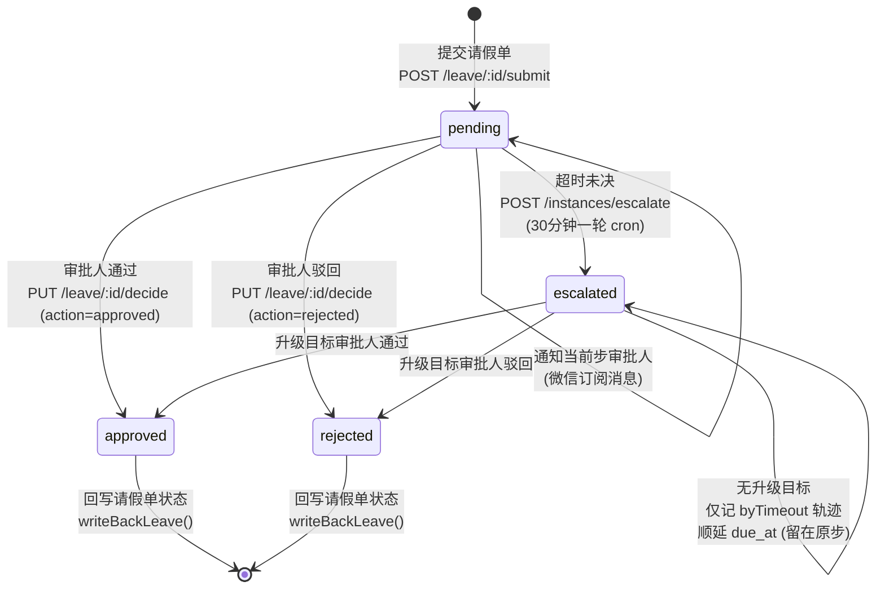

<!--
  © 2026 IHUI AI (智汇AI) · 版权所有者: 李春川 (Li Chunchuan) · https://aizhs.top
  Provenance-watermarked. 未授权商用可被溯源追责 (Apache-2.0 须保留本声明与 NOTICE)。
  [IHUI-AI-PROVENANCE]:⁠​‌​​‌​​‌‍‍​‌​​‌​​​‍‍​‌​‌​‌​‌‍‍​‌​​‌​​‌‍‍​​‌​‌‌​‌‍‍​‌​​​​​‌‍‍​‌​​‌​​‌‍‍‌​‌‌​‌‌‌‍‍‌‌​​‌‌​​‌‌‌‌​‌​‍‍‌‌​‌‌​​​‌​​​‌‌‌‍‍​‌​​​​​‌‍‍​‌​​‌​​‌‍‍‌​‌‌​‌‌‌‍‍‌‌​​‌‌‌​‌​​‌‌‌​‍‍‌‌​​‌‌​​​‌​​‌​‌‍‍‌​‌‌‌​‌‌‌​‌‌‌​‌‍‍‌​‌‌​‌‌‌‍‍​‌​​‌‌​​‍‍​‌​​​​‌‌‍‍‌​‌‌​‌‌‌‍‍​‌‌​​​​‌‍‍​‌‌​‌​​‌‍‍​‌‌‌‌​‌​‍‍​‌‌​‌​​​‍‍​‌‌‌​​‌‌‍‍​​‌​‌‌‌​‍‍​‌‌‌​‌​​‍‍​‌‌​‌‌‌‌‍‍​‌‌‌​​​​‍‍‌​‌‌​‌‌‌‍‍​‌​‌​​​​‍‍​‌​‌​​‌​‍‍​‌​​‌‌‌‌‍‍​‌​‌​‌‌​‍‍​‌​​​‌​‌‍‍​‌​​‌‌‌​‍‍​‌​​​​​‌‍‍​‌​​‌‌‌​‍‍​‌​​​​‌‌‍‍​‌​​​‌​‌‍‍​​‌​‌‌​‌‍‍​​‌‌​​‌​‍‍​​‌‌​​​​‍‍​​‌‌​​‌​‍‍​​‌‌​‌‌​⁠
-->

# IHUI-AI 人事部（HR）功能完整文档

> **生成时间**: 2026-11-12  
> **代码版本**: main 分支，提交 a8cf8d4f4d 起，共 4 模块 26 端点  
> **交付状态**: HR-1~HR-4 全部已交付并验证（提交 155a67f9f1 确认）  

---

## 一、概述

人事部功能系列（编号 HR-1~HR-4）是 2026-11-09~11-11 期间落地的完整考勤 + 请假审批系统，后端基于 Fastify 5 + Drizzle ORM，判定内核复用共享包 `@ihui/attendance-core`，与教育端共用同一套考勤算法。移动端入口在小程序 `apps/miniapp-taro/src/pkg-hr`，对齐 RN 共享屏 `HrAttendanceScreen.tsx`。

**核心特性**：
- 多级审批链引擎（可配代理审批人、超时升级）
- 三个 cron 定时任务（补缺勤、异常汇总、月度统计）
- 考勤规则按部门配置（工作日掩码 + 上下班时间）
- 微信订阅消息通知（审批节点触发）
- 幂等键设计（手动补跑 vs 自动触发分别处理）

**代码位置**：
- 后端路由：`apps/api/src/routes/hr-{jobs,attendance,daily,approval}.ts`
- 业务逻辑：`apps/api/src/services/hr-{jobs,attendance,daily,approval}.ts`
- 定时任务：`apps/api/src/jobs/hr-{jobs,approval}-cron.ts`
- 小程序页面：`apps/miniapp-taro/src/pkg-hr/hr-attendance/index.tsx`

---

## 二、权限模型

所有端点分三档权限：

| 权限档 | 说明 | 端点示例 |
|--------|------|----------|
| `hr:attendance:view` | 只读（部门/员工/规则/记录/统计/请假列表） | GET /departments, GET /attendance/records |
| `hr:attendance:manage` | 写操作（建档/规则/审批/补卡/定时任务手动触发） | POST /employees, PUT /leave/:id/approve |
| `requireAuth` | 员工自助（登录即可，`operatedBy` 取登录态 userId） | POST /attendance/check-in, POST /leave |

**敏感操作额外约束**：
- 日结查询（含全部门员工工时明细）要求 manage 权限（虽是读操作）
- 定时任务手动补跑（写考勤/留痕）要求 manage 权限
- 补卡审批（直接回写考勤记录）要求 manage 权限

---

## 三、请假审批状态流转图

**关键设计**：
1. **审批链固化**：提交时把整条 `approverIds` 数组快照到 `hr_approval_instance.steps` 字段，之后改规则不影响已在跑的实例。
2. **代理审批人**：当前规则若设了 `approverProxyId`，代理也能决策（规则改动不影响已固化的链，只影响代理判定）。
3. **超时升级**：
   - 有 `escalationApproverId` → 追加为快照新一级、`current_step` 指向它、状态置 `escalated`、记 `byTimeout` 步。
   - 无 `escalationApproverId` → 只在当前步记一条 `byTimeout` 轨迹并顺延 `due_at`（留在原步）。

---

## 四、端点完整明细

### 请假审批双路径权威说明（2026-11-12 业务定案）

HR-2 存在两条并存的请假审批路径，**经业务确认：以 `/api/hr-approval` 多级审批链为权威正式流程**。

| 对比项 | 路径 A「单步简化」 | 路径 B「多级审批链」✅ 权威 |
|--------|-------------------|--------------------------|
| 接口 | `POST /hr-attendance/leave` + `PUT /leave/:id/approve` | `POST /hr-approval/leave/:id/submit` + `PUT /leave/:id/decide` |
| 数据表 | `hr_leave_request` | `hr_approval_instance`（含审批链快照 `steps`） |
| 审批级数 | 单步（一个审批人直接通过/驳回） | 多级有序链（`approverIds` 数组） |
| 代理审批人 | ❌ | ✅ `approverProxyId` |
| 超时自动升级 | ❌ | ✅ `escalationApproverId` + 30 分钟 cron |
| 微信订阅消息通知 | ❌ | ✅ `notifyStepApprover` |
| 权限 | 提交 `requireAuth` / 审批 `manage` | 全程 `manage` |
| **适用场景** | **仅限临时/小额请假**（如半天事假、无需留痕的短假） | **正式请假流程**（年假、婚假、病假等需审批留痕的场景） |

**开发/接入手工单时的选型规则**：
1. **默认走路径 B**（`/api/hr-approval/*`）——所有需要审批留痕、多级审批、超时升级或微信通知的请假场景。
2. **路径 A**（`/hr-attendance/leave`）仅用于临时/小额请假，或尚未接入审批流的过渡场景。
3. 两套接口底层落不同表（`hr_leave_request` vs `hr_approval_instance`），**不可混用**——同一请假单不能从路径 A 升级到路径 B。

### HR-1 定时任务（`/api/hr-jobs`，3 个端点）

#### 1. GET `/` — 任务清单
- **权限**: `hr:attendance:manage`
- **入参**: 无
- **出参**: `{ list: HR_JOBS[] }`
  - `HR_JOBS`: `[{ name, description, cron }]`
    - `dailyAbsent`: "每日 00:10 补昨日(含回溯窗)缺勤" (`10 0 * * *`)
    - `dailyException`: "每日 09:00 汇总昨日迟到/早退/未签退异常清单" (`0 9 * * *`)
    - `monthlyStats`: "每月 1 日 00:30 汇总上月各部门考勤统计" (`30 0 1 * *`)
- **用途**: 供管理端展示与 AI 工具 `hr_job_list` 消费

#### 2. POST `/:name/run` — 手动补跑指定任务
- **权限**: `hr:attendance:manage`（高危：写考勤/留痕）
- **入参**: 
  - `name` (path): 任务名，必须 ∈ `ALL_HR_JOB_NAMES`
  - `date` (body, optional): `YYYY-MM-DD`，指定补跑的历史业务日（缺省=当下）
- **出参**: `{ outcome }` — 本轮执行结果（含 skipped 幂等命中）
- **幂等设计**: 
  - 手动补跑 `manual:true`，幂等键带毫秒后缀，允许同一业务窗口多次补跑各留一条痕。
  - cron 自动触发 `manual:false`，同业务日去重。

#### 3. GET `/:name/runs` — 任务执行历史
- **权限**: `hr:attendance:manage`
- **入参**: 
  - `name` (path): 任务名
  - `limit` (query, optional, default=50): 每页条数，max=200
  - `offset` (query, optional, default=0): 偏移量
- **出参**: `{ list, total }` — 按任务名过滤，倒序分页
- **用途**: 回查"哪天跑了没跑 / 影响多少行 / 错在哪"

---

### HR-2 考勤核心（`/api/hr-attendance`，13 个端点）

#### 主数据

#### 4. GET `/departments` — 部门列表
- **权限**: `hr:attendance:view` 或 `hr:attendance:manage`
- **入参**: 无
- **出参**: `{ list: HrDepartment[] }`

#### 5. POST `/departments` — 新建部门
- **权限**: `hr:attendance:manage`
- **入参**:
  - `name` (string, 1-100): 部门名
  - `parentId` (uuid, optional): 父部门 ID
  - `leaderEmployeeId` (uuid, optional): 负责人员工 ID
  - `sortOrder` (int, optional): 排序
- **出参**: `{ department: HrDepartment }` (201)

#### 6. GET `/employees` — 员工列表
- **权限**: `hr:attendance:view` 或 `hr:attendance:manage`
- **入参** (query):
  - `departmentId` (uuid, optional): 按部门筛选
  - `status` (string, optional): 按在职状态筛选
- **出参**: `{ list: HrEmployee[] }`

#### 7. POST `/employees` — 新建员工
- **权限**: `hr:attendance:manage`
- **入参**:
  - `userId` (uuid, optional): 关联系统账户
  - `employeeNo` (string, 1-50): 工号（唯一）
  - `name` (string, 1-100): 姓名
  - `departmentId` (uuid): 部门 ID
  - `position` (string, ≤100, optional): 职位
  - `hireDate` (YYYY-MM-DD, optional): 入职日期
  - `phone` (string, ≤30, optional): 电话
  - `idNumber` (string, ≤30, optional): 身份证号
- **出参**: `{ employee: HrEmployee }` (201)
- **错误**: 
  - 409: 工号已存在（`uq_hr_emp_no`）
  - 400: 关联的部门或账户不存在（外键约束）

#### 考勤规则

#### 8. GET `/attendance/rule` — 读取考勤规则
- **权限**: `hr:attendance:view` 或 `hr:attendance:manage`
- **入参** (query):
  - `departmentId` (uuid, required): 部门 ID
- **出参**: `{ rule }` — 含 `lateAfter`、`earlyBefore`、`absentAfter`、`workdays`（工作日掩码 1-127）、`enabled`

#### 9. PUT `/attendance/rule` — 更新考勤规则
- **权限**: `hr:attendance:manage`
- **入参**:
  - `departmentId` (uuid): 部门 ID
  - `lateAfter` (string, optional): 迟到判定时刻
  - `earlyBefore` (string, optional): 早退判定时刻
  - `absentAfter` (string, optional): 缺勤判定时刻
  - `workdays` (int, 1-127, optional): 工作日掩码（位运算，如周一=1，周二=2，...）
  - `enabled` (boolean, optional): 规则是否启用
- **出参**: `{ rule }`

#### 签到 / 签退（员工自助）

#### 10. POST `/attendance/check-in` — 签到
- **权限**: `requireAuth`（登录即可）
- **入参**:
  - `employeeId` (uuid): 员工 ID
  - `departmentId` (uuid): 部门 ID
  - `date` (YYYY-MM-DD): 签到日期（当日或合法历史业务日）
  - `checkInMethod` (enum): `self` / `qrcode` / `manual`
  - `checkInTimeRaw` (string, optional): 签到时刻原始字符串
  - `remark` (string, optional): 备注
- **出参**: `{ record }` (201)
- **错误**:
  - 404: 该员工不在本部门在职名册 (`not_employed`)
  - 409: 今日已有考勤记录 (`duplicate`)
  - 400: 签到日期非法 (`bad_date`) 或签到时刻非法 (`bad_time`)

#### 11. POST `/attendance/check-out` — 签退
- **权限**: `requireAuth`
- **入参**:
  - `employeeId` (uuid): 员工 ID
  - `departmentId` (uuid): 部门 ID
  - `date` (YYYY-MM-DD): 签退日期
  - `checkOutTimeRaw` (string): 签退时刻
- **出参**: `{ record }`
- **错误**:
  - 404: 尚无签到记录，无法签退 (`no_record`)
  - 400: 签退时刻非法 (`bad_time`)

#### 缺勤补录 / 统计 / 记录

#### 12. POST `/attendance/backfill` — 缺勤补录
- **权限**: `hr:attendance:manage`
- **入参**:
  - `backfillDays` (int, 1-30, optional, default=3): 回溯天数
- **出参**: `{ result }` — 批量补录结果
- **用途**: 管理端手动触发，等价于 scheduler-worker 的 cron 一轮

#### 13. GET `/attendance/records` — 考勤记录列表
- **权限**: `hr:attendance:view` 或 `hr:attendance:manage`
- **入参** (query):
  - `employeeId` (uuid, optional)
  - `departmentId` (uuid, optional)
  - `date` (YYYY-MM-DD, optional)
  - `startDate` (YYYY-MM-DD, optional)
  - `endDate` (YYYY-MM-DD, optional)
  - `limit` (int, default=50)
  - `offset` (int, default=0)
- **出参**: `{ list, total }`

#### 14. GET `/attendance/stats` — 考勤统计
- **权限**: `hr:attendance:view` 或 `hr:attendance:manage`
- **入参** (query):
  - `departmentId` (uuid, optional)
  - `startDate` (YYYY-MM-DD, optional)
  - `endDate` (YYYY-MM-DD, optional)
- **出参**: `{ stats }` — 按部门/时间段汇总

#### 请假（路径 A · 单步简化版，仅限临时/小额场景）

> ⚠️ **非权威流程**：正式请假请走 `/api/hr-approval/*` 多级审批链（见上方双路径说明）。

#### 15. GET `/leave` — 请假列表
- **权限**: `hr:attendance:view` 或 `hr:attendance:manage`
- **入参** (query):
  - `employeeId` (uuid, optional)
  - `departmentId` (uuid, optional)
  - `status` (string, optional)
  - `startDate` (YYYY-MM-DD, optional)
  - `endDate` (YYYY-MM-DD, optional)
- **出参**: `{ list }`

#### 16. POST `/leave` — 提交请假单
- **权限**: `requireAuth`（员工自助）
- **入参**:
  - `employeeId` (uuid): 员工 ID
  - `departmentId` (uuid): 部门 ID
  - `leaveType` (string, 1-30): 假别
  - `startDate` (YYYY-MM-DD): 开始日期
  - `endDate` (YYYY-MM-DD): 结束日期
  - `totalDays` (int, ≥0): 总天数
  - `reason` (string, required): 请假事由
  - `attachment` (string, ≤500, optional): 附件
- **出参**: `{ leave }` (201)

#### 17. PUT `/leave/:id/approve` — 请假审批（简化版）
- **权限**: `hr:attendance:manage`
- **入参**:
  - `id` (path, uuid): 请假单 ID
  - `decision` (enum): `approved` / `rejected`
  - `approveRemark` (string, optional): 审批备注
- **出参**: `{ leave }`
- **错误**: 404 — 请假单不存在或已审批
- **说明**: 路径 A 单步审批，无审批链快照/超时升级/微信通知；正式请假请走 `/api/hr-approval/*`

---

### HR-2 第 1 期：日结 / 假期额度 / 补卡（`/api/hr-daily`，4 个端点）

> **权限**: 全部要求 `hr:attendance:manage`（日结含全部门员工工时明细，属敏感人事数据；补卡审批直接写考勤记录）

#### 18. GET `/daily` — 日结查询
- **入参** (query):
  - `employeeId` (uuid, optional)
  - `departmentId` (uuid, optional)
  - `month` (YYYY-MM, optional)
  - `limit` (int, default=50, max=200)
  - `offset` (int, default=0)
- **出参**: `{ list, total }`

#### 19. GET `/leave-balance` — 假期额度查询
- **入参** (query):
  - `employeeId` (uuid, required)
  - `leaveType` (string, 1-30, optional)
  - `year` (int, 2000-2100, optional)
- **出参**: `{ list: HrLeaveBalance[] }`

#### 20. POST `/punch-fix` — 补卡申请提交
- **入参**:
  - `employeeId` (uuid): 员工 ID
  - `departmentId` (uuid): 部门 ID
  - `date` (YYYY-MM-DD): 补卡日期
  - `punchType` (enum): `check_in` / `check_out`
  - `punchTime` (ISO 8601, optional): 补卡时刻（缺省=null，审批时再补）
  - `reason` (string, 1-500): 补卡事由（必填）
- **出参**: `{ punchFix: HrPunchFix }` (201)

#### 21. PUT `/punch-fix/:id/approve` — 补卡审批
- **入参**:
  - `id` (path, uuid): 补卡申请 ID
  - `approve` (boolean): true=通过（回写考勤），false=驳回
  - `approveRemark` (string, ≤500, optional): 审批备注
  - `approverId` (uuid, auto): 从登录态取
- **出参**: `{ outcome }` — 含回写考勤记录结果

---

### HR-3 请假审批流（`/api/hr-approval`，6 个端点）

> **权限**: 全部要求 `hr:attendance:manage`（审批规则/实例操作都是敏感动作，不开放给普通员工端）

#### 审批规则 CRUD

#### 22. GET `/flows` — 列出审批规则
- **入参**: 无
- **出参**: `{ list }` — active 且未软删，按 `leaveType` + `minDays` 倒序排序

#### 23. POST `/flows` — 新建/更新审批规则
- **入参**:
  - `id` (uuid, optional): 带则更新，不带则新建
  - `leaveType` (string, 1-30): 假别（与 `hr_leave_request.leave_type` 词表一致）
  - `minDays` (int, ≥0, default=0): 天数区间下界（含）
  - `maxDays` (int, ≥1, nullable, default=null): 天数区间上界（不含，null=无上界）
  - `approverIds` (uuid[], min=1): 有序审批链
  - `approverProxyId` (uuid, nullable, optional): 代理审批人
  - `timeoutHours` (int, ≥1, default=24): 超时时长（小时）
  - `escalationApproverId` (uuid, nullable, optional): 超时升级目标
  - `status` (enum): `active` / `disabled` (default=active)
- **出参**: `{ flow }` (201 新建 / 200 更新)

#### 审批实例操作

#### 24. POST `/leave/:id/submit` — 提交请假单进审批
- **入参**:
  - `id` (path, uuid): 请假单 ID
- **逻辑**: 按路由规则（`leaveType` + 天数区间匹配）落成审批实例，并给当前步审批人发通知
- **出参**: `{ instance, notified }` — `notified` 表示微信订阅消息是否发送成功

#### 25. PUT `/leave/:id/decide` — 审批决策
- **入参**:
  - `id` (path, uuid): 审批实例 ID
  - `instanceId` (uuid): 同 path 的 id（自动填充）
  - `approverId` (uuid): 审批人 ID
  - `action` (enum): `approved` / `rejected`
  - `remark` (string, ≤500, optional): 备注
- **代理审批人**: 当前规则若设了 `approverProxyId`，代理也能决策
- **出参**: `{ instance, notified }`
- **错误**: 400 — `NOT_FOUND` / `INVALID_LEAVE`（审批已结束）/ 非当前步审批人

#### 26. GET `/instances` — 列出待处理实例
- **入参** (query):
  - `approverId` (uuid, required): 审批人 ID
  - `limit` (int, 1-200, optional, default=20)
  - `offset` (int, ≥0, optional, default=0)
- **出参**: `{ list, total }` — pending / escalated 且链当前步指向该审批人

#### 27. POST `/instances/escalate` — 超时升级扫描
- **入参**:
  - `now` (ISO datetime, optional): 指定扫描时刻（缺省=当下）
- **逻辑**: 
  - 有 `escalationApproverId` → 把目标追加为快照新一级、`current_step` 指向它、`status=escalated`、记 `byTimeout` 步
  - 无 `escalationApproverId` → 只在当前步记一条 `byTimeout` 轨迹并顺延 `due_at`（留在原步）
- **出参**: `{ escalated: number }` — 本轮升级的节点数
- **后台 cron**: `jobs/hr-approval-cron.ts`，每 30 分钟一轮（`0 */30 * * * *`），调 `escalateTimedOut()`

---

## 五、HR-4 微信订阅消息

已并入审批流（HR-3）。审批节点触发时给对应审批人发微信订阅消息通知（`notifyStepApprover`），HR-3 那次修复（提交 bd1bd6091f）是把消息字段 key 对齐到真实微信模板。

**触发时机**：
1. 提交审批 → 通知第一级审批人
2. 审批通过 → 通知下一级审批人（若有）
3. 超时升级 → 通知升级目标审批人

**消息字段**：请假类型、员工姓名、请假起止日期、审批链接等（具体字段见 `services/hr-approval.ts` 的 `notifyStepApprover` 函数）。

---

## 六、定时任务调度

### HR-1 三个任务（`jobs/hr-jobs-cron.ts`）

- **调度器**: `node-cron`，时区 `Asia/Shanghai`
- **启动**: `startHrJobsScheduler()` 挂在 `startBackgroundSchedulers(index.ts)`
- **禁用**: 环境变量 `ENABLE_HR_JOBS=false`
- **三个任务**:
  - `dailyAbsent` (00:10): 补昨日缺勤，回溯窗 3 天（`DEFAULT_HR_BACKFILL_DAYS=3`）
  - `dailyException` (09:00): 汇总昨日异常
  - `monthlyStats` (1日 00:30): 汇总上月统计

### HR-3 审批超时升级（`jobs/hr-approval-cron.ts`）

- **调度器**: `node-cron`，表达式 `0 */30 * * * *`（每 30 分钟）
- **启动**: `startHrApprovalEscalationScheduler()`
- **禁用**: 环境变量 `ENABLE_HR_APPROVAL_ESCALATION=false`
- **逻辑**: 调 `escalateTimedOut({ now: new Date() })`，把到点未决的审批节点升级

---

## 七、前端 / 移动端

### 小程序（`apps/miniapp-taro/src/pkg-hr/hr-attendance/index.tsx`）

- **页面形态**: 薄壳复用 `ChildRecordsView`（来自 `pkg-user/edu-child/records-page`）
- **列**: 日期 / 状态 / 签到时间 / 签退时间
- **数据接口**: `GET /hr-attendance/attendance/records`
- **对齐目标**: RN 共享屏 `apps/mobile-rn/src/screens/HrAttendanceScreen.tsx`

### Web 管理端

- `AdminNav.tsx` / `ExpandableNavItem.tsx` / `ui-routes.generated.ts` 里有 hr 路由的挂载痕迹
- 管理界面入口已接线（具体页面待补充文档）

---

## 八、HR-1~HR-4 任务交付状态确认

从 git 历史和提交信息确认：

| 任务编号 | 任务描述 | 交付提交 | 状态 |
|---------|---------|---------|------|
| HR-1 | 人事定时任务（三个 cron + 手动补跑） | a8cf8d4f4d | ✅ 已交付 |
| HR-2 | 考勤核心（主数据/规则/签到/日结/补卡） | a8cf8d4f4d | ✅ 已交付 |
| HR-3 | 请假审批流（多级审批链 + 超时升级 + 微信通知） | a8cf8d4f4d + bd1bd6091f | ✅ 已交付 |
| HR-4 | 微信订阅消息（并入 HR-3） | bd1bd6091f | ✅ 已交付 |

**关键提交记录**：
- `a8cf8d4f4d` — feat(hr): 人事部功能系列 HR-1~HR-4 全量落地（代码层 + README 生成块）
- `155a67f9f1` — docs(plan): HR-1~HR-4 四行翻勾（人事部功能系列已交付并验证）
- `bd1bd6091f` — fix(hr): HR-3 微信订阅消息字段 key 对齐真实模板（实测收尾）

**结论**: HR-1~HR-4 四行已在 `PROJECT_PLAN.md` 中翻勾（结清即删，当前 PROJECT_PLAN 无 HR- 行即为已完成标志），任务账本已清零。

---

## 九、测试覆盖

后端测试文件（`apps/api/tests/`）：

- `hr-jobs-contract.test.ts` — HR-1 路由契约锁
- `hr-jobs-multi-day.real.test.ts` — HR-1 多日补跑真实测试
- `hr-attendance-contract.test.ts` — HR-2 路由契约锁（59 条）
- `hr-daily-contract.test.ts` — HR-2 第 1 期路由契约锁
- `hr-approval-contract.test.ts` — HR-3 路由契约锁

所有测试通过 `pnpm test` 运行，CI 强制全绿方可合并。

---

## 十、总结

人事部功能系列是 IHUI-AI 平台的完整 HR 模块，涵盖：
- **考勤管理**：部门/员工建档、考勤规则、签到签退、缺勤补录、日结、统计
- **请假审批**：简化的单步审批（`/leave/:id/approve`）+ 完整的多级审批链（`/approval/*`）
- **补卡流程**：申请 → 审批 → 回写考勤记录
- **自动化**：三个 cron 任务（补缺勤、异常汇总、月度统计）+ 审批超时升级
- **通知**：微信订阅消息对齐真实模板

全部 26 个端点均有 Zod schema 校验、权限检查、错误码映射和契约测试覆盖，代码质量符合项目规范（TS 零技术债、共享层优先、每文件 < 250 行）。

---

## 十一、AI 对话接入（2026-11-12 定案）

人事接口已打通「产品 AI 对话端可准确调用」，每个用户都能调，数据按用户隔离。

### 打通机制

`apps/ai-service/app/services/api_tools_bridge.py` 启动时拉取 `apps/api` 的 OpenAPI spec，把所有端点自动转成 `api_` 前缀的 MCP 工具注册给 LLM。**此前 hr 端点在 spec 里是空壳**（路由用 zod + safeParse，没转 Fastify schema），LLM 看不到入参定义，调不准。

**本次修复**：给 26 个 hr 端点全部加上 `schema: buildSchema({...})`，把 zod 校验暴露成 OpenAPI schema。bridge 现在能转出带完整参数描述的工具，员工/管理员经产品对话即可准确调用。

### 用户隔离（内建，无需额外处理）

- 身份走 `__user_id`（`call_tool` 宿主注入，LLM 不可控），缺身份直接 `PERMISSION_DENIED`
- 写操作另有 `__user_role>=1` 一道闸
- 后端路由自己的 RBAC（`hr:attendance:view` / `hr:attendance:manage`）照常生效
- **员工只能调到自己的数据，管理员才能审批** —— 符合「每个用户可调、数据按用户隔离」基线

### 两条请假路径

| 路径 | 接口 | 级别 | 适用 |
|---|---|---|---|
| A 单步 | `/hr-attendance/leave/:id/approve` | 一步审批 | 临时/小额请假 |
| B 多级链 ✅ 权威 | `/hr-approval/leave/:id/submit` + `/decide` | 多级有序链 + 代理 + 超时升级 + 微信通知 | 正式请假 |

选型规则：需审批留痕/多级/超时升级/微信通知的一律走路径 B；两套底层落不同表（`hr_leave_request` vs `hr_approval_instance`），不可混用。

### 两个 CLI 侧旁路（不影响产品端）

`apps/cli/src/tools/hr.ts` 有一份**手写**的 26 个 `hr_*` 工具（由 `scripts/gen-ai-tools-from-routes.mjs` 生成，注册在 CLI agent `commands/agent.ts`），服务开发者 agent，与产品端 bridge 是两套独立通道。

### 生效与运维

- spec 缓存 TTL 300s，部署后 `api-service` 重启或调 `refresh_api_tools_bridge()` 拉新 spec
- `API_TOOLS_MODE=all`（默认）才注册写操作；`read` 档只注册 GET
- `API_TOOLS_MAX=300` 而 spec 有 4471 operation，hr 工具可能落到长尾——被截断的仍可经 `api_endpoint_call` 按 name 调用

### 验证记录

- hr 契约测试 **90/90 全绿**（未破坏 401/403/RBAC/参数校验）
- `z.toJSONSchema` 探针：5 类代表 schema 均转出完整 `properties`（非空壳）
- Fastify 5 query 探针：`coerce`/超范围/额外字段行为均符合预期，未引入新风险
<!-- ⁠​‌​​‌​​‌‍‍​‌​​‌​​​‍‍​‌​‌​‌​‌‍‍​‌​​‌​​‌‍‍​​‌​‌‌​‌‍‍​‌​​​​​‌‍‍​‌​​‌​​‌‍‍‌​‌‌​‌‌‌‍‍‌‌​​‌‌​​‌‌‌‌​‌​‍‍‌‌​‌‌​​​‌​​​‌‌‌‍‍​‌​​​​​‌‍‍​‌​​‌​​‌‍‍‌​‌‌​‌‌‌‍‍‌‌​​‌‌‌​‌​​‌‌‌​‍‍‌‌​​‌‌​​​‌​​‌​‌‍‍‌​‌‌‌​‌‌‌​‌‌‌​‌‍‍‌​‌‌​‌‌‌‍‍​‌​​‌‌​​‍‍​‌​​​​‌‌‍‍‌​‌‌​‌‌‌‍‍​‌‌​​​​‌‍‍​‌‌​‌​​‌‍‍​‌‌‌‌​‌​‍‍​‌‌​‌​​​‍‍​‌‌‌​​‌‌‍‍​​‌​‌‌‌​‍‍​‌‌‌​‌​​‍‍​‌‌​‌‌‌‌‍‍​‌‌‌​​​​‍‍‌​‌‌​‌‌‌‍‍​‌​‌​​​​‍‍​‌​‌​​‌​‍‍​‌​​‌‌‌‌‍‍​‌​‌​‌‌​‍‍​‌​​​‌​‌‍‍​‌​​‌‌‌​‍‍​‌​​​​​‌‍‍​‌​​‌‌‌​‍‍​‌​​​​‌‌‍‍​‌​​​‌​‌‍‍​​‌​‌‌​‌‍‍​​‌‌​​‌​‍‍​​‌‌​​​​‍‍​​‌‌​​‌​‍‍​​‌‌​‌‌​⁠ -->
